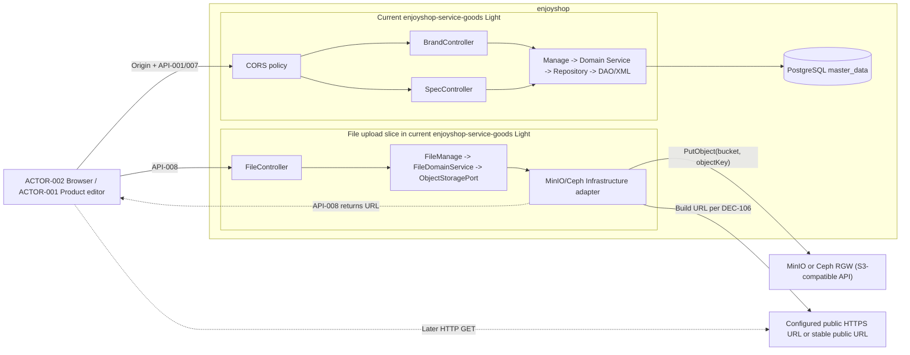
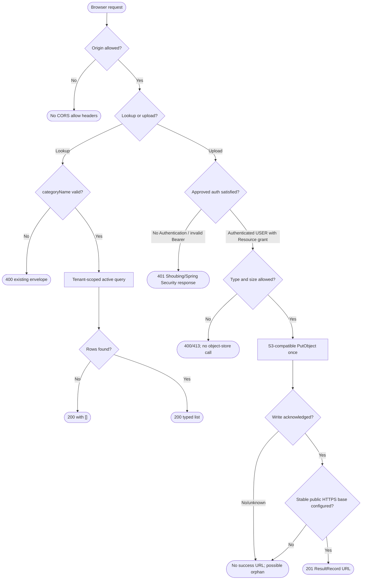
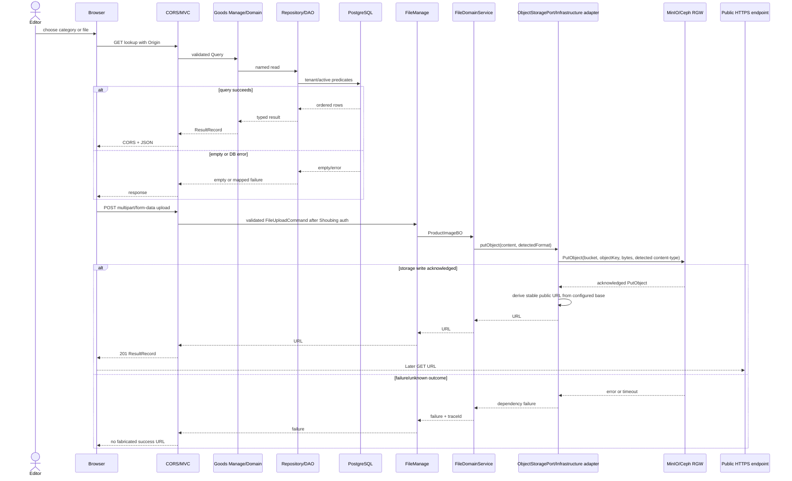
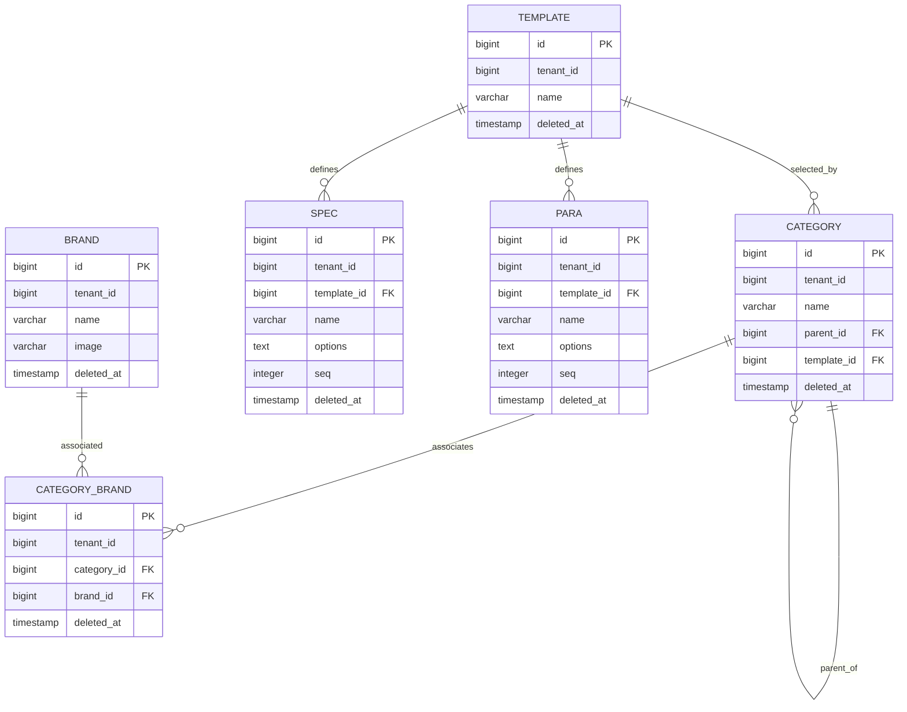

# 第2章：跨域、商品目录查询与 MinIO/Ceph 文件存储

| Field | Value |
| --- | --- |
| Document | docs/egon/spec/2026-09-28-21-50-distributed-file-catalog-lookups.md |
| Template Version | 7 |
| Status | Accepted |
| Type | Feature |
| Complexity | Complex |
| Complexity Drivers | 已接受的商品品牌 Spec 将分类与规格留给后续迭代；本需求同时触及关系数据、外部 REST API、CORS、安全、MinIO/Ceph 对象存储、第三方依赖与部署；当前 checkout 缺少分类数据表、其写入者和对象存储服务 |
| Created | 2026-09-28 21:50 CST |
| Updated | 2026-09-29 11:11 CST |
| Owner | mario |
| Repository | enjoyshop |
| Scope | enjoyshop-service-goods；按分类商品查询、规格查询、Spring MVC CORS 与 MinIO/Ceph S3 对象上传 |
| Change Surface | goods Light 增加品牌分类过滤与规格查询、CORS allowlist、JPEG/PNG 单文件上传；增加本地 catalog managed-DDL、AWS SDK v2 与 Tianquan-Shoubing 资源服务器集成；MinIO/Ceph 实例由外部运维提供 |
| Affected Chapters | §7, §8, §9, §10, §11, §14, §15, §16, §17, §18 |
| Source Requirement | 用户附件 Pasted text.txt 第2章；用户 2026-09-29 确认文件 API 置于 goods、其他选择按推荐方案，并指定 Tianquan-Shoubing OIDC Bearer 上传认证 |
| Baseline Revision | 60d2fe3 (main)；本 Spec 为本地未跟踪设计输入；生产代码未修改 |
| Amends | [enjoyshop 工程骨架与商品品牌 CRUD 设计](2026-09-23-17-16-enjoyshop-scaffold-brand-crud.md) §3.2 中“分类、规格与 SKU 属后续 Spec”的非目标；仅对本 Spec 明确新增的查询、模型、数据表、接口、测试与部署补充 §§7–11、14–18。原品牌 API、brand 表和其它已接受决策继续有效 |
| Supersedes | None |
| Depends On | [enjoyshop 工程骨架与商品品牌 CRUD 设计](2026-09-23-17-16-enjoyshop-scaffold-brand-crud.md) §§5.4、6.1、7.1、9.0–9.4、11.2.1、14、16 |
| Related Specs | None |
| Related Plans | [分布式商品目录与文件上传实施计划](../plan/2026-09-29-08-52-distributed-catalog-storage-implementation.md) |

## 1. Summary

本 Spec 将教学章节适配到 enjoyshop：浏览器 CORS、按分类读取品牌/规格，以及在现有 goods Light 应用中通过 Spring Boot 管理的 AWS SDK for Java 2.x S3Client 接入 MinIO 或 Ceph RGW 上传产品图片。用户已确认文件 API 归属 goods、其余主要选项按 Spec 推荐方向关闭；上传要求 Shoubing OIDC Bearer USER Token。仅支持 Java 21 + Spring Boot 3.5（当前 Boot 3.5.16、Egon parent 5.4.1）。分类/模板管理 CRUD 与对象存储服务部署由外部 owner 提供，当前仓库实现本地 catalog 读模型、managed DDL 与上传命令。

本 Spec 经用户 2026-09-29 确认 DEC-103–111 推荐选项后状态为 Accepted。分类写入由范围外的外部 catalog 管理 owner 负责；实际 CORS origins、Shoubing Resource/JWK/Redis 投影与 MinIO/Ceph endpoint/bucket/secrets 作为环境配置和发布前置，不引入 goods 以外业务服务。

## 2. Background and Current State

### 2.1 Business and user context

用户附件原始目标为 FastDFS 上传；用户 2026-09-29 改为 MinIO 或 Ceph RGW，并确认文件 API 放在 goods、上传由 Tianquan-Shoubing OIDC Bearer USER Token 认证。其余主要选择按当前 Spec 推荐方向关闭。应用侧采用 Spring Boot 配置和受管 AWS SDK v2 S3Client，经 Light Infrastructure adapter 调用外部对象存储。分类/模板管理仍不实现 CRUD，由范围外 catalog 管理 owner 写入本地读模型表。

enjoyshop 当前没有前端代码。enjoyshop-web 只有空聚合 POM。本文不把原文引用的静态原型、Eureka、Feign、Hystrix 或旧业务代码描述为当前仓库已有能力。

### 2.2 Repository evidence

| Evidence ID | Classification | Exact path/symbol/decision | Observed fact | Design significance | Verification limit/freshness |
| --- | --- | --- | --- | --- | --- |
| EVD-001 | User request | 用户附件第2章；用户 2026-09-29 修订 | 附件原始要求 FastDFS 上传和 10MB；用户决定改为 MinIO/Ceph 类对象存储，Java 21 + Spring Boot 3.5，并选择 goods + 推荐实施决策及 Shoubing Bearer | 用户决策替代 FastDFS；应用侧用 Spring 管理 AWS SDK v2 S3Client | 部署 origin/endpoint/secrets 是发布输入；实现选择已记录在 DEC-103–111 |
| EVD-002 | Accepted predecessor Spec | docs/egon/spec/2026-09-23-17-16-enjoyshop-scaffold-brand-crud.md §§3.2、5.4、6.1、7.1、9、11 | 已选 Egon-COLA Light；品牌 HTTP 在 goods adapter；brand 位于 master_data 的 SINGLE；分类/规格/SKU 是后续范围 | 本 Spec 必须显式修订原范围，保留已接受的品牌和架构决定 | Accepted Spec 是规范性设计；实现仍以当前代码为基线 |
| EVD-003 | Static repository | enjoyshop-service/enjoyshop-service-goods/pom.xml、README.zh-CN.md、src/main/java/top/egon/enjoyshop/goods | Java 21、Spring Boot 3.5.16、非 open Light 单模块；COLA 职责以包承载；使用 Web MVC、Validation、Jackson、MapStructPlus、MP-SDJ | 维持现有 Light 结构，不加传统 biz.* | 静态 POM/目录，不证明运行状态 |
| EVD-004 | Static repository | adapter/goods/BrandController.java、BrandManage、BrandDomainService、BrandRepository、BrandDAO | 品牌读写链是 Controller -> Manage -> Domain Service -> Repository -> DAO/XML；当前集合查询为 GET /api/v1/brands；统一 ResultRecord/PageResultRecord | 新读查询应复用当前调用边界和 envelope | 静态源码 |
| EVD-005 | Static repository | infrastructure/goods/dao/BrandDAO.java、resources/mybatis/mapper/goods/BrandDAO.xml | 当前自定义 SQL 使用具名 DAO 方法与 Mapper XML；active 查询过滤 deleted_at，租户谓词由 MP-SDJ 管道增强 | 采用具名参数、typed projection；不复制旧 @Select/List<Map> 样例 | 静态 XML 不证明 PostgreSQL 执行计划 |
| EVD-006 | Static repository | db/egon-mp/V20260923_001__initialize_goods_schema.sql、repository-manifest.json、egon-mybatis-plus-sharding.yml | 已有 brand 表位于 master_data，类型 SINGLE；最新 Manifest 版本为 20260923_001；脚本为 PostgreSQL managed DDL | 新本地关系表需要后续 managed-DDL 版本与一致 Manifest | 未查 live PostgreSQL/ddl_history |
| EVD-007 | Static repository | goods 模块 main/resources、infrastructure、adapter 和 POM 检索 | 当前没有 category、category_brand、template、spec 或 para 表、PO、DAO、XML、Controller 或 Service | 原文“基础工程已生成”不适用于当前 checkout；两个 SQL 查询目前没有可读数据源 | 不证明仓库外系统不存在 |
| EVD-008 | Static repository | start/config/NativeHttpSecurityConfiguration.java、adapter/filter/TenantContextFilter.java、application*.yml | 当前 SecurityChain 对所有请求 permitAll；X-Tenant-Id/X-Actor-Id 是请求头 MDC 上下文而非认证；四份 profile 有 Shoubing issuer/JWK/resource 配置占位但 enabled=false；goods POM 未声明 Shoubing resource-server starter | 仅 API-008 改为 Shoubing 验证 USER Token；保留其它路由策略，不能信任 actor/tenant 头做身份 | 静态配置，不证明 Shoubing Resource 已部署 |
| EVD-009 | Static repository | enjoyshop-web/pom.xml | 聚合 POM 声明当前无工程内容 | 不设计前端页面，只定义外部浏览器 API | 静态 POM |
| EVD-010 | Static repository | goods POM、Egon-COLA component POM/source search | goods/Egon components/archetypes 中未找到 S3/MinIO/Ceph client；Shoubing starter is available in egon-cola-xingyuan but absent from goods POM; RagDocumentStorage is local-only | Current code has no S3 client; the approved AWS SDK v2 dependency closes this capability gap | 静态检索；不证明外部部署没有存储服务 |
| EVD-011 | Static repository | deploy/compose/compose.docker.yaml、compose.docker.prod.yaml、deploy/container/README.md | Compose 使用 bridge network，多引擎部署；当前没有 MinIO/Ceph 服务；文档不使用 host network | 使用外部受支持服务，由部署提供 endpoint/bucket | 静态部署文件，不代表运行环境 |
| EVD-012 | Static repository | BrandControllerWebTest、BrandOpenApiContractTest、BrandQuerySqlShapeTest | 有 MockMvc、生成 OpenAPI、SQL 形态测试；当前 tests 使用 H2 且关闭 managed DDL | 可复用测试层次；不证明 PostgreSQL/MinIO/Ceph runtime | 本 Spec 未运行测试 |
| EVD-013 | External primary source | MinIO official [server README](https://github.com/minio/minio/blob/master/README.md) and [releases](https://github.com/minio/minio/releases) | minio/minio server repository was archived on 2026-04-25; official README says Community Edition is source-only and historical precompiled binaries are not maintained | Do not select archived MinIO Community binaries/images as the default; a commercial or maintained distribution requires an explicit decision | Official GitHub pages checked 2026-09-29 |
| EVD-014 | External primary source | [Ceph RGW S3 API](https://docs.ceph.com/en/latest/radosgw/s3/) and [Ceph Object Gateway](https://docs.ceph.com/en/latest/radosgw/) | RGW provides an S3-compatible REST API and documents object/multipart operations; current /latest docs identify themselves as development docs | Ceph RGW is a candidate; exact deployed release/subset must be tested | Official docs do not prove a cluster exists |
| EVD-015 | External primary source | AWS official Maven [SDK v2 project setup](https://docs.aws.amazon.com/sdk-for-java/latest/developer-guide/setup-project-maven.html), [custom endpoint configuration](https://docs.aws.amazon.com/sdk-for-java/latest/developer-guide/endpoint-config.html), [retry strategy](https://docs.aws.amazon.com/sdk-for-java/latest/developer-guide/retry-strategy.html), [timeouts](https://docs.aws.amazon.com/sdk-for-java/latest/developer-guide/timeouts.html), and [2.55.6 release](https://github.com/aws/aws-sdk-java-v2/releases/tag/2.55.6) | SDK v2 uses BOM-managed service modules; S3 custom endpoints require endpointOverride, signing still requires a region, path-style is configurable, and ClientOverrideConfiguration supports attempt/overall timeouts plus maxAttempts. The selected config is one attempt, 15s attempt and 20s overall | Use software.amazon.awssdk:s3 with the 2.55.6 BOM behind a Spring-managed adapter | Java 21 + Boot 3.5 is the only supported runtime; MinIO/Ceph endpoint compatibility remains unverified |
| EVD-016 | User decision | User message 2026-09-29 | Only Egon-COLA Java 21 + Spring Boot 3.5 is supported | No Boot 2/JDK 8 compatibility target; current project uses Java 21/Boot 3.5.16 | User instruction |
| EVD-017 | Static repository | Egon archetype/component POM/source search | No AWS SDK v2, MinIO or Ceph object storage dependency is managed/declared in examined Egon BOM/archetypes | Exact AWS SDK v2 dependency is approved and closes the S3 protocol client gap | Static search only; effective POM is a future build gate |
| EVD-018 | User decision | User message 2026-09-29 | File storage uses MinIO or Ceph RGW through a Spring-managed AWS SDK v2 S3Client | Use AWS SDK v2 S3Client 2.55.6 in a Light Infrastructure adapter; external service endpoint is an environment input | User decision 2026-09-29 |
| EVD-019 | Static Egon-COLA platform source | egon-cola-xingyuan/egon-cola-tianquan-shoubing/egon-cola-tianquan-shoubing-starter 5.4.1: IdpStarterProperties, IdpBearerAuthenticationFilter, IdpEndpointAuthenticationPolicy, IdpJwtVerifier | The USER verifier checks the signed USER identity token statelessly (`aud=platform`) and places `IdpAuthenticationToken` in Spring Security; it does not read Resource/Client Redis state or carry a Resource/client grant in the USER principal. SERVICE verification does check Resource/Client runtime state. Missing Authorization continues the filter chain; invalid Bearer returns Shoubing 401. The auto Servlet registration is outside Spring Security's context lifecycle, so this app must insert the filter into its upload SecurityFilterChain and keep `register-filter=false` | Reuse the starter for USER JWT verification on POST /api/v1/files. Require the active USER_DELEGATION grant and Jianshen app-entry authorization before token acquisition; goods cannot re-check that grant per request from the stateless USER token | Starter is absent from goods POM; provision issuer/JWK, ACTIVE Resource, required upstream authorization and shared Redis for starter runtime |

### 2.3 Problem statement and gap

教程的品牌/规格查询引用的分类关系表当前不存在；即使加入 DAO 方法，仓库里也没有 schema、管理写入者或数据。旧 Spec 还明确将分类与规格排除在当期范围外，因此新范围必须作为修订记录。

goods POM 中无 AWS SDK v2 或 Shoubing resource-server starter，当前 API route permitAll；Shoubing properties exist but are disabled until deployment configuration is supplied。文件 API 放在 goods；部署需提供 Shoubing Resource/JWK/Redis 投影、外部 MinIO/Ceph endpoint/bucket/凭据及浏览器 origins。产品图片使用稳定公开 HTTPS URL。

### 2.4 Evidence and current-chain map

| Entry/trigger | Current call chain | Data read/written | External dependency | Consumers | Evidence |
| --- | --- | --- | --- | --- | --- |
| 现有品牌集合查询 | GET /api/v1/brands -> BrandController -> BrandManage -> BrandDomainService -> BrandRepository -> BrandDAO.xml -> brand | 只读 brand | PostgreSQL/MP-SDJ | 仓库无前端 | EVD-004–006 |
| 按分类读品牌 | 当前不存在；候选 category -> category_brand -> brand | 需要分类及关联数据 | PostgreSQL | 商品编辑者 | EVD-001、EVD-007 |
| 按分类读规格 | 当前不存在；候选 category -> template -> spec | 需要模板与规格数据；options 需投影转换 | PostgreSQL | 商品编辑者 | EVD-001、EVD-007 |
| 浏览器跨源调用 | 原有业务 route permitAll，CORS policy 缺失 | 无 | Browser preflight | 外部浏览器 | EVD-008、EVD-009 |
| MinIO/Ceph object upload | 当前不存在；MultipartFile -> FileController -> FileManage -> FileDomainService -> ObjectStoragePort -> MinIO/Ceph Infrastructure adapter -> S3-compatible PutObject -> stable URL | 远端 bucket/objectKey；没有本地文件索引表 | 外部 MinIO/Ceph endpoint 与 product-media bucket | 商品编辑者/调用者 | EVD-001、EVD-010、EVD-011 |

## 3. Goals and Non-goals

### 3.1 Goals

- 为批准的浏览器 origins 处理预检和跨源 API response。
- 查询分类对应的品牌集合。
- 查询分类对应的模板规格，并将 options 分隔字符串投影为有序 JSON 数组。
- 使用 Shoubing 认证的 goods API 将不超过 10MB 的 JPEG/PNG 产品图片写入外部 MinIO/Ceph，并返回稳定公开 URL。
- 保持当前 Light、PostgreSQL、EgonModel、MP-SDJ、ResultRecord 和 managed-DDL 契约。

### 3.2 Non-goals

- 分类/模板/规格/参数的管理 CRUD。原文仅要求理解表结构，并认为管理端由基础工程提供。
- 前端页面、菜单、静态原型、React 或其他前端 POM。
- Eureka、Feign、Hystrix、Seata、新网关、新发现服务。
- 文件下载代理、HTTP 删除、缩略图、文件元数据表、CDN 运维；原文 SDK 有 delete 方法，但无完整 HTTP contract，学习目标明确为上传。
- 修改现有 Brand CRUD、brand 字段、既有 DDL/Manifest 前缀。
- 启动应用、数据库、Docker、MinIO/Ceph 对象存储或真实环境集成。

### 3.3 Change Surface and Design Depth

| Area/layer | Disposition | Exact repository evidence | Changed or preserved behavior/contract | Required Spec treatment | Chapter(s) |
| --- | --- | --- | --- | --- | --- |
| CORS / Spring MVC | Affected | NativeHttpSecurityConfiguration.java；无当前 CORS 配置 | 增加跨源 origins 与 preflight | CORS allowlist、Shoubing upload authorization 与配置/测试 | §7, §8, §9, §14, §15 |
| Brand category lookup | Affected | BrandController、BrandManage、BrandDomainService、BrandRepository、BrandDAO/XML | 增加分类查找或扩展已有 collection filter | 完整 HTTP/SQL/响应/错误/OpenAPI | §7, §8, §9, §10, §11, §14, §15, §16, §17, §18 |
| Category/template/spec/para/association schema | Affected | 当前无上述对象，Manifest 只有 brand | 本地读模型建表；写入由范围外 ACTOR-003 提供 | ER、表、约束、索引与外部 writer contract | §7, §8, §9, §10, §11, §14, §15, §16, §17, §18 |
| MinIO/Ceph object upload API | Affected | 当前无 Controller/client/config | 在 goods Light 内增加 multipart API、对象存储副作用与稳定公开 URL | 完整 REST/依赖/失败/配置/认证设计 | §7, §8, §9, §10, §14, §15, §16, §17, §18 |
| External object-store infrastructure | Affected | Compose 没有 MinIO/Ceph 服务，README 使用 bridge network | 连接由运维提供的 MinIO/Ceph 服务，不在 goods Compose 托管服务 | endpoint、bucket、credentials、region 与 public URL base 配置 | §7, §8, §14, §15, §16, §17, §18 |
| enjoyshop-web | Not applicable | 空 aggregator POM | 无 UI 代码变化 | N/A；浏览器是外部 actor | §12 |
| Brand CRUD/schema | Unchanged | BrandController/BrandPO/DDL V20260923_001 | 原五个 API 与 brand 表不变 | 仅作为 context/关联表邻接点 | §7, §9, §11, §16 |

## 4. Requirements and Acceptance Criteria

| ID | Atomic requirement | Priority | Observable acceptance criteria | Source |
| --- | --- | --- | --- | --- |
| REQ-101 | allowlisted browser origins 可调用本范围 API | Must | 批准来源的 OPTIONS 与实际请求获得匹配允许头；未批准来源不获得 ACAO；CORS 不视作身份认证 | 附件 §1 |
| REQ-102 | 定义规格/参数模板、三级分类和关系结构 | Must | Spec 给出表/关系/主外键/tenant/soft-delete；本地 managed DDL 或外部 schema owner 经 DEC 选定 | 附件 §3、§4 |
| REQ-103 | 在 GET /api/v1/brands 按 categoryName 过滤品牌 | Must | categoryName 可选，存在时精确匹配；同名类别结果 union 后按 brand id 去重；保留 API-001 既有过滤、分页、PageResultRecord 与缺省全量语义；无数据返回空 records | 附件 §4.1；用户 DEC-105 选择推荐项 B |
| REQ-104 | 按分类名称读取规格 | Must | 通过类别模板读 active specs；options 返回有序 array；空/null/分隔符规则明确 | 附件 §4.2 |
| REQ-105 | 使用 Shoubing USER Bearer 认证上传 JPEG/PNG 产品图片至 MinIO/Ceph 并返回稳定公开 URL | Must | goods 验证 Shoubing USER Bearer；USER_DELEGATION grant 与 Jianshen app-entry 授权是获得该 Token 的上游前置条件。goods Starter 5.4.1 不提供 per-request USER Resource grant 决策。Infrastructure adapter 使用 Spring 管理的 AWS SDK v2 2.55.6 S3Client 调用 PutObject；实际格式必须是 JPEG/PNG 且 <=10MB；对象写入成功才返回 URL；失败不得伪造成功 | 附件 §5.3–5.5；用户 2026-09-29 修订/认证选择；EVD-019 的实现边界 |
| REQ-106 | 10MB 文件与请求限制 | Must | 单文件最大 10MB；请求体上限高于文件限制以容纳 multipart 边界开销；超限有稳定结果 | 附件 §5.3 |
| REQ-107 | 所有 Spring profile 配置 key 结构一致 | Must | application.yml/dev/test/prod 保持相同 CORS、Shoubing 与 object-store key 结构；值可不同；origins、issuer/JWK/resource URI、endpoint、bucket 与 credentials 由环境/secret source 提供 | Rule 7、附件 §5.3 |
| REQ-108 | 沿用当前 Light/CQE/MP-SDJ 与运行时基线 | Must | Controller 不直接访问 DAO；查询只读；PostgreSQL 与 managed DDL；新项目必须由 Light archetype 生成；仅支持 Java 21 + Spring Boot 3.5 | Java Rules、Accepted predecessor、EVD-016 |

### 4.1 Scenario matrix

| Scenario | Actor/trigger | Preconditions | Main path | Alternative/failure path | Data/state change | Observable result | Requirements |
| --- | --- | --- | --- | --- | --- | --- | --- |
| 分类下品牌读取 | ACTOR-001 选择分类 | 数据存在、tenant context 正确 | CORS -> validate -> DAO read -> typed result | 无类目/无关联；重复名称 | 无写入 | 200 有序列表或空数组 | REQ-101/103 |
| 分类规格读取 | ACTOR-001 打开规格选择 | template/spec 关联完整 | DAO join -> options 转 array | 缺模板、空 options、重复 spec | 无写入 | 200 数组 | REQ-102/104 |
| CORS 预检 | ACTOR-002 发 OPTIONS | Origin/method/header 已配置 | policy 匹配 -> 返回允许头 | origin/method 不允许 | 无写入 | 允许或无 ACAO | REQ-101 |
| 上传成功 | ACTOR-001 提交单文件 | 文件安全策略/认证/SDK 地址已决定 | validate -> S3-compatible PutObject -> stable public URL | PutObject、bucket 配置或公开/预签名 URL 生成失败 | 远端对象新增 | 201 URL envelope | REQ-105/106 |
| 上传超限/类型错误 | ACTOR-001 提交无效文件 | API 可达 | boundary 拒绝，不调用 SDK | 超过 10MB 为 413；非 JPEG/PNG 为 400 | 无远端对象 | 稳定错误 | REQ-105/106 |
| 上传响应未知 | 客户端超时后重试 | MinIO/Ceph object may have been written | 不自动重试；报告 traceId | 人工重试可能生成重复对象 | 可能 orphan | 不伪造 URL | REQ-105 |

### 4.2 Use-case analysis

#### 4.2.1 Actor inventory

| Actor ID | Actor/role | Goal and responsibility | Entry/channel | Permission/tenant context | Evidence |
| --- | --- | --- | --- | --- | --- |
| ACTOR-001 | 商品编辑者 | 选择类目、品牌、规格并上传媒体 | 外部浏览器 | Shoubing Bearer USER token for upload; existing read policy retained | 附件 §3–5；现有 Brand API |
| ACTOR-002 | Browser | 跨源调用 API 和发起预检 | HTTP Origin | Origin 不是认证凭据 | 附件 §1 |
| ACTOR-003 | External catalog data owner | 写类别、模板、规格、参数与品牌关联 | 外部管理工程 | 本 Plan 不改 writer；部署提供数据 | DEC-103；EVD-007 |
| ACTOR-004 | External MinIO/Ceph operator | Provision endpoint, bucket and stable public HTTPS read policy | S3-compatible API | credentials are secret-managed; object GET policy is limited to product-media | deployment operator | DEC-109/111 |

#### 4.2.2 Use-case artifact

| ID | Use case/goal | Primary actor | Supporting actors/systems | Trigger | Preconditions | Main success outcome | Alternatives/failures | Postconditions | Requirements | Interfaces/pages | Tests |
| --- | --- | --- | --- | --- | --- | --- | --- | --- | --- | --- | --- |
| UC-101 | 加载类目品牌选项 | ACTOR-001 | Browser、PostgreSQL | 选定类目 | 外部 catalog owner 已写入本地 schema；tenant context 正确 | 展示匹配品牌 | 空、重复类目、CORS/DB error | 只读 | REQ-101/103 | API-001 | TEST-101–105 |
| UC-102 | 加载类目规格选项 | ACTOR-001 | Browser、PostgreSQL | 展开规格 | 类目/template/spec 数据存在 | 展示 name/options | 空模板、空 options、DB error | 只读 | REQ-102/104 | API-007 | TEST-106–110 |
| UC-103 | 上传并获取存储 URL | ACTOR-001 | Browser、MinIO/Ceph 对象存储 | 提交文件 | Shoubing USER grant、JPEG/PNG 与 external endpoint configured | 返回可访问 URL | 类型/尺寸/授权失败、storage timeout/未知结果 | 远端对象可能已存在 | REQ-101/105/106 | API-008 | TEST-111–118 |

## 5. Constraints, Assumptions, and Decisions

### 5.1 Confirmed constraints

- 保留当前 egon-cola-archetype-light；Controller -> Manage -> Domain Service -> Repository -> DAO/XML。
- 只用 Spring MVC、Jackson、Jakarta Validation、MapStructPlus 和 existing ResultRecord；不用教程的 Result/List<Map>。
- 持久化使用 PostgreSQL、MP-SDJ 与 managed-DDL；已应用 SQL/Manifest prefix 不可改。
- 文件单体积 10MB 来自用户原文；请求体要额外留 multipart overhead。
- CORS 和认证授权是两个不同机制。
- 文件存储限定为 MinIO 或 Ceph RGW；应用仅支持 Java 21 + Spring Boot 3.5，并由 Spring 管理客户端配置和 Bean 生命周期；不假设存在 Egon 自带的 MinIO/Ceph Starter。
- 不在本 Spec 写生产代码/POM/SQL/容器配置或运行环境。

### 5.2 Small-gap assumptions

| ID | Inference | Repository evidence | Why locally reversible | Impact if wrong |
| --- | --- | --- | --- | --- |
| ASM-101 | 若本地建表，新表使用 category/template/spec/para/category_brand，不加 tb_ 前缀 | 当前表 brand、courses、school_classes | 新表尚不存在 | 迁移前改名 |
| ASM-102 | categoryName exact match 返回所有同名 category 的 union，按品牌/spec id 去重 | 原文用 IN 子查询，不要求名称唯一 | 符合 SQL 示例 | 若需唯一类别，应改用 categoryId |
| ASM-103 | options 按逗号分隔并保序；空值返回空数组；逗号不能出现在单选项中 | 原文直接 split(",") | 保留存储格式 | 含逗号/空 token 的数据需另定规则 |
| ASM-104 | 查询不筛 is_show/is_menu | 原文 SQL 未包含这些条件 | 与来源查询一致 | 若只暴露可见类目需加规则 |

### 5.3 Resolved decisions

| ID | Decision | Decision owner | Evidence and rationale | Requirements |
| --- | --- | --- | --- | --- |
| DEC-101 | 保留当前 Egon-COLA Light | 用户既有 Accepted Spec | EVD-002/003 | REQ-108 |
| DEC-102 | CORS 不承担认证授权 | 技术边界 | EVD-008 | REQ-101/105 |
| DEC-103 | 在 goods master_data 增加 category/template/spec/para/category_brand 本地读模型、SINGLE/master_data 分片映射与分类查询所需 schema；管理 CRUD 由范围外 ACTOR-003 外部 catalog 管理 owner 写入，不纳入本次 Plan | User, 2026-09-29 | 用户选择推荐项 A；五张表均映射到 `master_data`；ACTOR-003 是范围外实际 writer；PostgreSQL id FKs enforce endpoint existence；writer 与 query joins enforce tenant equality；无数据时返回空集合 | REQ-102/103/104 |
| DEC-104 | FileController、FileManage、FileDomainService、ObjectStoragePort 与 Infrastructure adapter 均放入现有 enjoyshop-service-goods Light 应用 | User, 2026-09-29 | 用户明确选择 goods；没有新服务、POM 聚合或 archetype 生成 | REQ-105/108 |
| DEC-105 | 将可选 categoryName 查询参数并入现有 GET /api/v1/brands API-001；不新增品牌分类子路由 | User, 2026-09-29 | 用户选择推荐项 B；遵循 Accepted predecessor DEC-112 将同一品牌集合目标合并在一个资源查询接口的原则；categoryName 与既有过滤、分页参数可组合 | REQ-103 |
| DEC-106 | CORS 使用逐环境精确 allowlist；产品图片返回稳定公开 HTTPS URL；object GET 由外部 bucket policy 公开，上传本身另需认证 | User, 2026-09-29 | 商品图片 URL 写入产品数据需长期可用；不使用会过期的 presigned URL；CORS 不承担身份校验 | REQ-101/105/107 |
| DEC-107 | 仅 POST /api/v1/files 要求 Tianquan-Shoubing USER Bearer Token 与有效 Resource grant；现有其他业务路由策略保持不变 | User, 2026-09-29 | 用户选择 Shoubing USER Bearer；goods 验证 issuer/JWK 和 USER 身份；Resource grant/Jianshen app-entry 在上游授权和 Token 获取流程中满足。对上传请求缺少/无效 Bearer 必须由 Shoubing/Security 返回 401；现有其他路由无 Bearer 时继续公开 | REQ-105 |
| DEC-108 | 只允许实际 JPEG 与 PNG 图片，单文件最大 10MB；multipart 请求上限为 11MB 以容纳 framing；实际签名决定 content type 与对象扩展名，忽略 caller filename/content-type | User, 2026-09-29 | 用户选择推荐的产品图片 allowlist；JDK ImageIO/文件头检查可识别目标格式，不增加 MIME 工具依赖 | REQ-105/106 |
| DEC-109 | 使用外部运维的、处于支持状态的 MinIO 发行版或 Ceph RGW S3-compatible 服务；不由 enjoyshop 托管 server process | User, 2026-09-29 | 用户选择复用外部服务推荐项；MinIO Community 上游仓库归档，禁止依赖未维护的旧镜像/二进制 | REQ-105/107 |
| DEC-110 | 使用 AWS SDK for Java v2 S3Client 2.55.6；经 Spring 管理并由 Light Infrastructure Adapter 封装；依赖为 software.amazon.awssdk:bom 与 software.amazon.awssdk:s3 | User, 2026-09-29 | 用户选择推荐的 provider-neutral SDK；Egon BOM 不管理该 artifact，用户明确批准此 SDK 依赖方案 | REQ-105/107 |
| DEC-111 | goods 仅连接外部 MinIO/Ceph 服务；本地 Compose 不新增 object-store container | User, 2026-09-29 | 用户选择复用已运维外部服务；endpoint、bucket、region、credentials、public base 由环境配置注入 | REQ-105/107 |

**Implementation boundary correction (2026-10-05):** Starter 5.4.1's USER verifier is stateless and does not expose a Resource grant or OAuth client binding to the goods request handler. The goods upload route validates a Shoubing USER Bearer; USER_DELEGATION and Jianshen app-entry authorization are upstream token-acquisition gates. A grant-specific 403 is not an API-008 response. The Servlet Filter must be installed inside the upload `SecurityFilterChain` because a filter registered outside it has its authentication context replaced by Spring Security. Keep the Starter's `register-filter=false` and add the filter before `AnonymousAuthenticationFilter`. Per-request grant/revocation enforcement still requires a resource-bound USER token or an upstream authorization decision contract.

### 5.4 External deployment inputs (not design blockers)

| Input | Owner/source | Required runtime evidence |
| --- | --- | --- |
| Catalog writer and data | ACTOR-003 external catalog-management owner | Provision category/template/spec/para/category_brand rows that obey this schema before manual lookup acceptance; this plan does not add write CRUD |
| Browser origins | Deployment operator | Supply exact HTTPS origins in `app.web.cors.allowed-origins` for each environment |
| Shoubing Resource Server | Tianquan-Shoubing administrator | Configure existing `egon.cola.platform.tianquan.shoubing.{enabled,register-filter,issuer,jwk-set-uri,resource-server-id,resource-uri}` keys; create/activate the USER grant and shared Redis runtime projections |
| MinIO/Ceph object store | Storage operator | Supply `app.object-storage.{endpoint,region,bucket,path-style-access,public-url-base,access-key,secret-key,api-call-attempt-timeout,api-call-timeout}` with credentials from a secret source; provision supported endpoint, product-media bucket, stable public HTTPS base, and read policy |
| Multipart request budget | Deployment operator | Set `spring.servlet.multipart.max-file-size=10MB` and `max-request-size=11MB` in every profile so multipart framing fits while the file limit stays 10MB |
| Spring configuration inputs | Deployment operator/secret manager | Supply `app.web.cors.allowed-origins`, `app.object-storage.{endpoint,region,bucket,path-style-access,public-url-base,access-key,secret-key}` and the existing `egon.cola.platform.tianquan.shoubing.*` settings; profile structure and `SINGLE/master_data` table maps stay identical |
| Real integration | Release owner | Verify Shoubing Bearer authentication, PutObject, and browser GET of returned image URL after deployment |

## 6. Project Technology Context

| Concern | Current choice | Repository evidence | Constraint on design |
| --- | --- | --- | --- |
| Runtime | Only Java 21 + Spring Boot 3.5; current checkout uses Boot 3.5.16 | goods POM、Egon archetype parent 5.4.1、user decision EVD-016 | No Boot 2/JDK 8 support path; current goods Light is the only application |
| Web | Spring Boot 3.5.16 / Spring MVC | POM、BrandController | MVC multipart；OpenAPI 3 |
| Architecture | Egon-COLA Light | POM/tree/verifier | 不引入 biz.* |
| Persistence | MP-SDJ/PostgreSQL/STRATEGY；brand 为 SINGLE/master_data | POM/YAML/DDL | Managed DDL；无 Flyway |
| Response/docs | ResultRecord + springdoc code-first | common-core/tests | 无第二套 envelope/Springfox |
| Frontend | None | enjoyshop-web 空 aggregator | Browser 是 external actor |
| Deployment | Docker/Podman/nerdctl，bridge；object store is external | Compose/README | no local storage server; endpoint and credentials are environment inputs |

### 6.1 Java architecture profile and capability baseline

| Architecture profile | Archetype/template or base package | Exact evidence and verifier | Existing deviations | Design action |
| --- | --- | --- | --- | --- |
| Egon-COLA Light | egon-cola-source-light; top.egon.enjoyshop.goods | POM、包树、LightPersistenceArchitectureTest、ArchetypeContractConvergenceTest | goods 只有 brand 持久化；catalog/file 读写新加至此 Light | 保持现有单模块与 domain-first 分包 |

| Need | Spring/JDK candidate | Starter/module candidate | Proven gap | Decision |
| --- | --- | --- | --- | --- |
| CORS | Spring MVC CORS support | Web MVC | 当前无 policy | Spring MVC/Security CORS with exact per-profile allowlist |
| REST/validation | Jackson/Jakarta Validation | existing ResultRecord/starter-validation | 无普通 API gap | Reuse |
| Mapper | MyBatis XML | BrandDAO/Repository | 新关系数据 absent | Add named typed query under selected local schema |
| DDL | PostgreSQL | MP-SDJ/EgonColaPostgreDdlRunner | 新表 absent | Reuse; one next version |
| MinIO/Ceph client integration | AWS SDK v2 S3Client 2.55.6 | no S3 client in Egon BOM/POM; RAG storage is local-only | protocol client missing | add user-approved software.amazon.awssdk BOM and S3 artifact behind a Spring-managed Light Infrastructure adapter |
| Shoubing authentication | Tianquan-Shoubing starter 5.4.1 in egon-cola-xingyuan | starter absent from goods POM; four profiles already contain disabled Shoubing keys; RedissonClient exists | Bearer identity/filter component missing from this module | add Shoubing starter 5.4.1 and require authenticated() only for file POST | DEC-107 |
| Public file URL | Stable public HTTPS base for product-media | no current URL config | public base missing | DEC-106/109/111 |

### 6.2 User-mandated Java rule compliance

| Literal rule | Affected? | Repository evidence | Exact design decision | Files/types/interfaces | Validation/test evidence | Status/blocker |
| --- | --- | --- | --- | --- | --- | --- |
| Rule 1 | Yes | Current PO/DAO/VO/Query naming | Use semantic suffixes; no Map carriers or redundant URL result wrapper | SpecPO, SpecBO, SpecCategoryQueryDTO, SpecListQuery, SpecResult, SpecOptionVO, FileUploadDTO, FileUploadCommand, ProductImageBO, FileController | Naming inventory/static review | PASS |
| Rule 2 | Yes | Validation starter/current @Valid routes | Validate every layer handoff; use `GoodsCatalogQueryValidationGroup` for `BrandDomainQuery` and `SpecDomainQuery`, each reused between Domain Service and Repository; validate Shoubing principal at the file entry | category query/Command/ProductImage/API | positive/negative/group tests | PASS |
| Rule 3 | Yes | BrandPO/EgonModel/SuperBuilder, BrandVO record, MapStructPlus | Mutable PO/DTO/Command/BO/Result use classes with the Lombok baseline; immutable SpecOptionVO may be record; MapStructPlus plus BaseConverter/BaseForwardConverter | SpecPO/SpecBO/DTO/Command/ProductImageBO/VO and converters | constructor/mapping tests | PASS |
| Rule 4 | Yes | existing named Beans/@Slf4j/Qualifier/lombok.config | New business Beans use stable name, constructor injection, Qualifier and safe logging | Manage/Domain/adapter | wiring/log review | PASS design constraint |
| Rule 5 | Yes | goods POM has no S3 client | Reuse JDK ImageIO for JPEG/PNG; add user-approved AWS SDK v2 S3Client; no utility library | S3 adapter | dependency/import audit | PASS DEC-110 |
| Rule 6 | Yes | Jackson/current ResultRecord; Shoubing filter emits its documented 401 body | Jackson only; typed PageResultRecord/ResultRecord; OpenAPI documents separate Shoubing 401 body | Query/VO/Result | wire/OpenAPI tests | PASS |
| Rule 7 | Yes | four existing profiles | Same CORS/Shoubing/S3/multipart keys and five SINGLE/master_data table mappings in each profile | application*.yml | key-parity/bind tests | PASS; environment values external |
| Rule 9 | Yes; this cross-cutting feature is Complex | lookup/read and one synchronous upload | Use the Adapter pattern to isolate AWS S3 types/config behind ObjectStoragePort; no provider-specific Strategy is needed | ObjectStoragePort/S3CompatibleObjectStorageAdapter | focused port/adapter tests | PASS |
| Rule 10 | Yes | current domain uses java.time | No java.util date types | POs/API if timestamps added | serialization/mapping check | PASS |
| Rule 11 | Yes | selected Light/POM/verifier | Keep current Light; no new app | current goods app only | architecture verifier | PASS DEC-104 |

## 7. Architecture Design

### 7.0 Minimum-design baseline and element-necessity audit

| Proposed element | Change | Requirements | Existing/direct alternative | Concrete inadequacy | Cost | Verdict |
| --- | --- | --- | --- | --- | --- | --- |
| CORS allowlist | Add | REQ-101 | None currently | Browser cannot read cross-origin API response | config/tests | Add to goods MVC/security CORS configuration |
| Catalog tables | Add local read model | REQ-102–104 | current brand API/table | no relation data exists in repo | one managed DDL version; writer external | Add after migration contract test |
| Brand category filter | Modify API-001 | REQ-103 | current GET /api/v1/brands | categoryName absent | optional filter and joined count/page SQL | Add to API-001 |
| Spec by-category API | Add | REQ-104 | none | no Spec collection | one read path over the selected local catalog read model | Add API-007 |
| AWS SDK v2 client dependency | Add | REQ-105 | local RAG file store | cannot satisfy distributed storage | approved 2.55.6 S3 client | Add behind infrastructure adapter |
| Shoubing-authenticated upload | Add to goods | REQ-105 | existing SecurityFilterChain and Shoubing config keys | current chain is permitAll and Shoubing disabled | starter + method/path authentication | Add only on POST /api/v1/files |
| File delete/download API | Remove | none | SDK helper exists | no HTTP user goal/contract | adds security/destructive behavior | Remove from this Spec |
| Frontend page | Remove | none | no front-end code | no UI path in checkout | adds new frontend stack | Remove |

Direct path is one GET per lookup and one multipart POST. No preflight endpoint fetches tenant/storage parameters. The public product-media URL base is deployment configuration. The file API is in the existing goods Light app; the external object store is a deployment dependency, not an enjoyshop application.

| Path | Network calls | Client states | Server contracts/state | Failure and TOCTOU points | Additional user/business value |
| --- | --- | --- | --- | --- | --- |
| Existing brand list | One GET | Existing list states | Existing API-001 and brand table | Does not select by category | General brand catalog |
| Category brand/spec lookup | One GET per selected collection | Loading/empty/error | API-001 filters the brand collection; API-007 reads specs | Catalog can change between reads | Category-scoped selection |
| Product image upload | One browser multipart/form-data POST, then URL GET | Upload progress/success/error | API-008 writes one remote MinIO/Ceph object | Timeout may hide committed remote write | Shared stable product-image URL |

### 7.1 System Architecture Design



| Module/component | Capability/data owned | Inputs/outputs | Allowed dependencies | Forbidden responsibility | Requirements |
| --- | --- | --- | --- | --- | --- |
| Browser | User selections/JPEG or PNG bytes | Queries, authenticated multipart, stable URL | approved public API | client-supplied identity/tenant headers are not trusted | REQ-101–105 |
| Goods adapter/app/domain/infra | Existing brand and local catalog reads | REST -> typed Query -> Repository -> DAO/XML | current Light and MP-SDJ | Controller-to-DAO/vendor SDK call | REQ-103/104 |
| ACTOR-003 external catalog data owner | category/template/spec/para/links | writes rows in goods master_data | external catalog-management boundary | goods does not add catalog CRUD | REQ-102 |
| Goods file slice | upload coordination | validated command -> URL | FileManage -> FileDomainService -> ObjectStoragePort | claim atomic DB/storage transaction | REQ-105 |
| MinIO/Ceph adapter | S3-compatible object access | bucket/objectKey and bounded byte[] | Spring-managed client Bean | own product catalog policy | REQ-105 |
| External MinIO/Ceph object store | object bytes and stable public HTTPS read | bucket/objectKey | Spring-configured S3Client | category/business data ownership | REQ-105 |

### 7.2 High-Level Design

Brand/spec operations are read-only. Brand API-001 optionally exact-matches categoryName, unions same-name category IDs, deduplicates brands, then preserves existing page order. Spec lookup joins active tenant rows. Upload is synchronous with no SQL write. An acknowledged PutObject and stable public URL construction are required before success. A timeout may leave an object; the SDK is configured for one attempt and no cleanup is claimed.



| Concern/use case | Required behavior | Mechanism | Failure/degradation | Trade-off | Verification | Requirements |
| --- | --- | --- | --- | --- | --- | --- |
| CORS | allow configured origins | Spring MVC CORS | no ACAO for denied Origin | env configuration | preflight test | REQ-101 |
| Tenant isolation | no cross-tenant rows | current MP-SDJ tenant context | missing/untrusted context fails closed after security decision | SINGLE is one physical node | mapper/persistence tests | REQ-103/104 |
| MinIO/Ceph object store | stable URL only after acknowledged PutObject | one S3-compatible PutObject request | dependency error/no auto retry | external availability | mock + later real integration | REQ-105 |
| File visibility | product images are publicly readable | one stable HTTPS base and external bucket GET policy | public object GET is separate from authenticated upload | durable URL is suitable for product records | browser retrieval/security test | DEC-106 |
| Capacity | <=10MB file | multipart limits | reject before SDK | concurrency memory/network cost | limit boundary test | REQ-106 |

#### 7.2.2 High-level decision and quality matrix

| Concern/use case | Required behavior | Mechanism | Failure/degradation | Trade-off | Verification | Requirements |
| --- | --- | --- | --- | --- | --- | --- |
| CORS | approved browser origins only | Spring MVC policy | no allow headers for rejected origin | per-profile configuration | preflight test | REQ-101 |
| Catalog isolation | active tenant rows only | MP-SDJ tenant context | missing/untrusted context rejected after security decision | SINGLE table still needs tenant guard | SQL and persistence tests | REQ-103/104 |
| MinIO/Ceph 对象存储 | return stable URL only after PutObject success | one synchronous S3-compatible PutObject request | stable dependency failure; no automatic retry | external dependency and orphan risk | mock plus later runtime gate | REQ-105 |

### 7.3 Detailed Design

Brand category filter extends the existing API-001 query chain and uses named DAO/XML methods. Spec query adds a typed read chain and XML join. No List<Map> output. New SpecPO extends EgonModel; join-only catalog tables do not force one class each. All mapping uses MapStructPlus and Egon BaseConverter/BaseForwardConverter.

FileController binds MultipartFile in FileUploadDTO and converts it to FileUploadCommand; MultipartFile itself does not cross into Application or Domain. FileManage converts the command to ProductImageBO before invoking FileDomainService. ProductImageValidator derives JPEG/PNG format before ObjectStoragePort receives bytes and format. The Spring-managed adapter owns SDK types/config. S3 API endpoint and browser-facing public URL base are separate values. Never log bytes, tokens, original filename or bucket/objectKey.

| Step | Caller -> callee | Symbol | Input/output | State/data effect | Failure | Requirements |
| --- | --- | --- | --- | --- | --- | --- |
| 1 | Browser -> BrandController | API-001 | categoryName -> typed query | none | CORS/validation error | REQ-101/103 |
| 2 | BrandManageImpl -> BrandDomainService | listBrands | BrandPageQuery -> BrandDomainQuery with categoryName | none | current PageResultRecord | REQ-103 |
| 3 | Repository -> DAO/XML -> DB | named select | category/brand rows | read only | DB error | REQ-103 |
| 4 | Browser -> SpecController | API-007 | categoryName | none | CORS/validation error | REQ-101/104 |
| 5 | SpecDAO -> SpecPersistenceConverter -> SpecBO -> SpecResultConverter -> SpecOptionVO | listByCategoryName | options text -> ordered array | read only | malformed data detected | REQ-104 |
| 6 | Browser -> FileController -> FileManage -> FileDomainService | uploadFile | multipart/form-data -> FileUploadDTO -> FileUploadCommand -> ProductImageBO | no storage write | Shoubing, byte bound and media validation before storage call | REQ-105/106 |
| 7 | FileDomainService -> ObjectStoragePort -> Infrastructure adapter -> S3 client | putObject | bounded byte[] + server-detected ProductImageFormat -> URL | remote object created after acknowledgement | error/timeout may leave outcome unknown | REQ-105 |



#### 7.3.3 Transactions, consistency, concurrency, and idempotency

| Concern/state | Owner/boundary | Concurrency | Visibility | Failure | Requirements/tests |
| --- | --- | --- | --- | --- | --- |
| Catalog query | goods Query + PostgreSQL | next request may see update | statement result | empty/query error | REQ-103/104 |
| Catalog writes | ACTOR-003 external catalog owner | outside this change | external writer commit | goods observes rows on the next statement; no local CRUD or outbox | REQ-102 |
| File object | MinIO/Ceph object store | each new request creates a distinct objectKey | storage acknowledgement | timeout is not rollback | REQ-105 |

#### 7.3.4 Failure semantics, recovery, and reconciliation

| Failure point | Detection | Immediate flow | State | Retry | Caller result | Recovery owner | Verification |
| --- | --- | --- | --- | --- | --- | --- | --- |
| Invalid category | Jakarta validation | stop before DAO | unchanged | no | 400 | caller | MockMvc |
| Empty result | DAO result | return [] | unchanged | safe | 200 | none | repository test |
| MinIO/Ceph PutObject timeout | SDK timeout | dependency error | remote outcome unknown | no automatic retry | 503 + trace | storage operator checks object state before resubmission | mock; runtime manual gate |
| Public URL base missing after upload | startup property validation | app does not serve traffic | no request can write an object | no retry | startup failure | deployment operator supplies valid HTTPS base | property-binding test |
| Oversize/type rejection | validation | reject before SDK | no object | correct input | 413/400 | caller | MVC test |
| CORS denied | policy | no allow headers | preflight only | adjust allowlist | browser error | deployment owner | preflight test |

#### 7.3.5 Observability and operational boundaries

| Signal | Owner | Fields | Sensitive-data rule | Threshold | Operator action | Verification |
| --- | --- | --- | --- | --- | --- | --- |
| Upload result | File application | traceId, operation, outcome, duration, size bucket | Do not log bytes, tokens, original filename or full bucket/objectKey | No SLO supplied | Storage operator follows external object-store runbook | Static design; runtime later |
| Query failure | goods app | operationId, traceId, result code, latency | Do not log credentials or raw tenant headers | No SLO supplied | Existing log/metrics | Focused tests |

#### 7.3.6 Conclusion evidence chain

| Conclusion | Repository/user evidence | Constraint or requirement | Design decision | Consequence and trade-off | Verification and acceptance |
| --- | --- | --- | --- | --- | --- |
| Catalog tables are absent from current goods schema | EVD-002, EVD-006, EVD-007 | REQ-102–104 need local read-model tables and populated rows | Add the five selected tables with one managed DDL version; ACTOR-003 remains the external writer | goods owns read schema/queries; runtime lookup acceptance waits for valid rows | DEC-103, query tests and deployment manual gate |
| MinIO/Ceph client integration is absent | EVD-010, EVD-013 | REQ-105 needs distributed storage client | Add user-approved AWS SDK v2 S3Client 2.55.6 behind ObjectStoragePort | compile-time dependency is approved; endpoint compatibility remains a deployment manual gate | DEC-110, adapter tests and deployment manual gate |

## 8. Package Structure and Code File Tree

### 8.1 Current relevant tree

```text
enjoyshop-service/pom.xml
enjoyshop-service/enjoyshop-service-goods/pom.xml
enjoyshop-service/enjoyshop-service-goods/codegen/brand-codegen.json
enjoyshop-service/enjoyshop-service-goods/src/main/java/top/egon/enjoyshop/goods/adapter/goods/BrandController.java
enjoyshop-service/enjoyshop-service-goods/src/main/java/top/egon/enjoyshop/goods/application/goods/
enjoyshop-service/enjoyshop-service-goods/src/main/java/top/egon/enjoyshop/goods/domain/goods/
enjoyshop-service/enjoyshop-service-goods/src/main/java/top/egon/enjoyshop/goods/infrastructure/goods/{dao,po,repo,service/impl}/
enjoyshop-service/enjoyshop-service-goods/src/main/resources/db/egon-mp/{V20260923_001__initialize_goods_schema.sql,repository-manifest.json}
enjoyshop-service/enjoyshop-service-goods/src/main/resources/mybatis/mapper/goods/BrandDAO.xml
enjoyshop-service/enjoyshop-service-goods/src/main/resources/application.yml and dev/test/prod profiles
enjoyshop-web/pom.xml
```

### 8.2 Target tree

No files are created by the Spec. The user selected the existing goods Light application; there is no new business project or local object-store container.

```text
enjoyshop-service/enjoyshop-service-goods/
  MODIFY pom.xml
    - add software.amazon.awssdk BOM 2.55.6 and software.amazon.awssdk:s3
    - add egon-cola-tianquan-shoubing-starter 5.4.1
  MODIFY codegen/catalog-lookup-codegen.json (configVersion 1; generated Plan formatVersion 2)
    - logicalTables=["spec"]; artifacts=["po"]; existingTypeMappings.dao=SpecDAO
  ADD src/main/resources/db/egon-mp/V20260929_001__initialize_catalog_lookup_schema.sql
  MODIFY src/main/resources/db/egon-mp/repository-manifest.json (one checksum entry)
  MODIFY docs/egon/codegen/ddl-consumption-log.md (append one generated DDL consumption record)
  MODIFY adapter/goods/pojo/dto/BrandListQuery.java
  MODIFY adapter/goods/pojo/convertor/BrandAdapterConverter.java
  MODIFY application/goods/BrandPageQuery.java and BrandManageImpl.java
  MODIFY domain/goods/BrandDomainQuery.java
  MODIFY domain/goods/BrandDomainService.java
  MODIFY infrastructure/goods/dao/BrandDAO.java, BrandRepository.java, mapper/goods/BrandDAO.xml
  GENERATED infrastructure/goods/po/SpecPO.java
  ADD infrastructure/goods/dao/SpecDAO.java and resources/mybatis/mapper/goods/SpecDAO.xml (custom listByCategoryName(String categoryName) query)
  ADD adapter/goods/SpecController.java
  ADD adapter/goods/pojo/dto/SpecCategoryQueryDTO.java and pojo/vo/SpecOptionVO.java
  ADD adapter/goods/pojo/convertor/SpecAdapterConverter.java
  ADD application/goods/SpecListQuery.java, SpecResult.java, SpecManage.java and SpecManageImpl.java
  ADD application/goods/converter/SpecManageConverter.java and SpecResultConverter.java
  ADD domain/goods/SpecBO.java and SpecDomainQuery.java
  ADD common/validation/GoodsCatalogQueryValidationGroup.java, ValidCategoryName.java and ValidCategoryNameValidator.java
  MODIFY domain/goods/SpecDomainService.java
  ADD infrastructure/goods/repo/SpecRepository.java
  ADD infrastructure/goods/service/impl/SpecPersistenceConverter.java
  ADD infrastructure/goods/service/impl/SpecDomainServiceImpl.java
  ADD adapter/goods/FileController.java and pojo/dto/FileUploadDTO.java
  ADD adapter/goods/pojo/convertor/FileUploadAdapterConverter.java
  ADD application/goods/FileManage.java and FileManageImpl.java
  ADD application/goods/FileUploadCommand.java and converter/FileUploadDomainConverter.java
  ADD domain/goods/FileDomainService.java, ObjectStoragePort.java, ProductImageBO.java, ProductImageFormat.java and ProductImageValidator.java
  ADD infrastructure/goods/service/impl/FileDomainServiceImpl.java
  ADD infrastructure/goods/service/impl/S3CompatibleObjectStorageAdapter.java
  ADD start/config/ObjectStorageConfigurationProperties.java and ObjectStorageConfiguration.java
  MODIFY start/config/NativeHttpSecurityConfiguration.java
  MODIFY common/enums/GoodsErrorStatus.java and adapter/handler/BaseExceptionHandler.java (610106–610110, 413 and 503 mappings)
  MODIFY src/main/resources/application.yml and application-{dev,test,prod}.yml
  MODIFY README.zh-CN.md (required environment keys and rollout gates)
  MODIFY src/test/java/top/egon/enjoyshop/goods/adapter/goods/BrandControllerWebTest.java,
         BrandOpenApiContractTest.java,
         src/test/java/top/egon/enjoyshop/goods/infrastructure/goods/repo/BrandQuerySqlShapeTest.java
  ADD src/test/java/top/egon/enjoyshop/goods/infrastructure/goods/repo/BrandCategoryQueryRepositoryTest.java
  MODIFY src/test/java/top/egon/enjoyshop/goods/adapter/handler/BaseExceptionHandlerTest.java
  MODIFY src/test/java/top/egon/enjoyshop/goods/start/config/ProfileKeyParityTest.java and NativeRpcConfigurationTest.java
  ADD src/test/java/top/egon/enjoyshop/goods/start/config/NativeHttpSecurityConfigurationTest.java
  ADD src/test/java/top/egon/enjoyshop/goods/infrastructure/ddl/CatalogDdlContractTest.java
  ADD src/test/java/top/egon/enjoyshop/goods/adapter/goods/SpecControllerWebTest.java,
      src/test/java/top/egon/enjoyshop/goods/adapter/goods/pojo/convertor/SpecAdapterConverterTest.java,
      src/test/java/top/egon/enjoyshop/goods/adapter/goods/SpecOpenApiContractTest.java,
      src/test/java/top/egon/enjoyshop/goods/common/validation/GoodsCatalogQueryValidationTest.java,
      src/test/java/top/egon/enjoyshop/goods/common/validation/ValidCategoryNameValidatorTest.java,
      src/test/java/top/egon/enjoyshop/goods/common/validation/SpecCatalogQueryValidationTest.java,
      src/test/java/top/egon/enjoyshop/goods/application/goods/SpecManageImplTest.java,
      src/test/java/top/egon/enjoyshop/goods/infrastructure/goods/repo/SpecQueryRepositoryTest.java,
      src/test/java/top/egon/enjoyshop/goods/infrastructure/goods/repo/SpecQuerySqlShapeTest.java,
      src/test/java/top/egon/enjoyshop/goods/adapter/goods/FileControllerWebTest.java,
      src/test/java/top/egon/enjoyshop/goods/adapter/goods/FileOpenApiContractTest.java,
      src/test/java/top/egon/enjoyshop/goods/adapter/goods/pojo/convertor/FileUploadAdapterConverterTest.java,
      src/test/java/top/egon/enjoyshop/goods/application/goods/FileManageImplTest.java,
      src/test/java/top/egon/enjoyshop/goods/domain/goods/ProductImageValidatorTest.java,
      src/test/java/top/egon/enjoyshop/goods/infrastructure/goods/service/impl/FileDomainServiceImplTest.java,
      src/test/java/top/egon/enjoyshop/goods/infrastructure/goods/service/impl/S3CompatibleObjectStorageAdapterTest.java,
      src/test/java/top/egon/enjoyshop/goods/start/config/ObjectStorageConfigurationPropertiesTest.java
No database migration history is edited. DDL and manifest are delivered together as one logical version. MinIO/Ceph servers are external deployment dependencies; Compose remains without an object-store service.
```

### 8.3 Package and file responsibilities

| Operation | Path/package | Symbols | Responsibility | Dependencies | Requirements |
| --- | --- | --- | --- | --- | --- |
| Modify | adapter/goods/pojo | BrandListQuery, BrandAdapterConverter | Bind optional categoryName and map it into BrandPageQuery | existing BrandController/BrandManage | REQ-103 |
| Modify | application/goods | BrandPageQuery, BrandManageImpl | Carry categoryName from the request Query into BrandDomainQuery | BrandDomainService | REQ-103 |
| Modify | domain/goods | BrandDomainQuery, BrandDomainService | Carry grouped category criteria through the existing read boundary | BrandRepository | REQ-103 |
| Add | adapter/goods | SpecController | Read-only spec endpoint | SpecManage | REQ-104 |
| Generated | infrastructure/goods/po | SpecPO | Generated persisted spec row | EgonModel/MP-SDJ | REQ-102/104 |
| Add | infrastructure/goods/dao + mapper/goods/ | SpecDAO | Custom typed listByCategoryName(String categoryName) query and result mapping; excluded from generator-owned artifacts | SpecPO | REQ-104 |
| Add | application/domain/infrastructure | SpecManage/DomainService/Repository | Light read flow/projection | existing components | REQ-104 |
| Add | goods Light | FileController, FileManage, FileDomainService, FileUploadCommand, ObjectStoragePort, S3CompatibleObjectStorageAdapter | Shoubing-authenticated JPEG/PNG PutObject and stable URL | approved AWS SDK v2 and Shoubing starter | REQ-105/106 |
| Modify | all four profiles | matching CORS, Shoubing and object-storage keys | environment config and external secrets | validated properties | REQ-101/105/107 |

## 9. Interface Definitions

REST code-first is selected. The current module uses Spring MVC, ResultRecord, Jakarta Validation, Jackson, springdoc and OpenAPI 3. No GraphQL operation is added. Brand collection adds an optional categoryName query field; file upload uses Shoubing USER Bearer security.

### 9.0 API protocol and documentation governance

| Concern | Decision/evidence |
| --- | --- |
| Protocol selection | REST for browser selectors and file upload; current consumers are external browser actors in the user request |
| CQE application level | L0 read-only Query for brand/spec; synchronous L0 Command for upload; no event/outbox |
| REST source of truth | Code-first Spring mapping, typed boundary objects, Jakarta Validation, Jackson and OpenAPI 3 annotations |
| Goods request error mapping | `BaseExceptionHandler` selects the stable request code by feature route: brand `610101`, catalog query `610110`, and file request `610106`; multipart overflow maps to `413/610107`, storage failures to `503/610108–610109`; Shoubing invalid/missing Bearer retains its own `401` JSON body |
| GraphQL source of truth | N/A for this feature; existing sample GraphQL stays Context-only per accepted DEC-118 |
| Springdoc/OpenAPI compatibility | Current Spring Boot 3.5.16 MVC and yuheng-starter-openapi-webmvc in the goods POM |
| Legacy Swagger/Springfox status | No Springfox use in current brand Controller; new routes use io.swagger.v3 annotations only |
| Security and documentation exposure | Existing route policies remain; only the file-upload POST requires Shoubing USER Bearer; CORS is not auth |
| Contract publication and drift gate | Code-first /v3/api-docs assertion through MockMvc and existing BrandOpenApiContractTest pattern |

### 9.1 Interface Inventory

Each inventory row represents one HTTP method and route; pre-existing brand contracts retain their accepted behavior.

| ID | Change/necessity verdict | Name/purpose | Kind | API style/CQE role | Consumer | Owner | Method + URL / GraphQL field / symbol / topic | Operation ID/schema source | Input | Output | Auth/tenant | Error model | Idempotency/version | Requirements |
| --- | --- | --- | --- | --- | --- | --- | --- | --- | --- | --- | --- | --- | --- | --- |
| API-001 | Modified | Filter existing brand collection by optional categoryName | HTTP | REST Query | ACTOR-001 | goods adapter | GET /api/v1/brands | listBrands; existing BrandController | existing six query fields plus optional categoryName | PageResultRecord<BrandVO> | current tenant/read policy; CORS allowlist | existing ResultRecord/error mapper | read-only/replay safe | REQ-103 |
| API-007 | New | Read specifications by category | HTTP | REST Query | ACTOR-001 | goods adapter | GET /api/v1/specs/category/{categoryName} | listSpecsByCategoryName; SpecController annotations | categoryName path variable | ResultRecord<List<SpecOptionVO>> | existing read policy and current tenant context | 400 ResultRecord (610110), 500 ResultRecord (610199) | read-only/replay safe | REQ-104 |
| API-008 | New | Upload one JPEG/PNG product image | HTTP | REST Command | ACTOR-001 | existing goods Light | POST /api/v1/files | uploadFile; FileController + shoubingBearer | one multipart/form-data part <=10MB | ResultRecord<String> stable URL | authenticated Shoubing USER Bearer; upstream USER_DELEGATION/Jianshen app-entry authorization is a token-acquisition precondition | 400/413/503 ResultRecord; 401 Shoubing error object; no goods 403 grant branch | non-idempotent; no automatic retry | REQ-105/106 |

### 9.2 Per-interface Detailed Contracts


#### 9.2.1 API-001 — Brand collection with category filter

##### Necessity and interaction-cost decision

| Concern | Decision |
| --- | --- |
| Change classification | Existing route modified by one optional query parameter |
| Independent consumer goal | Product editor shows brands assigned to the chosen category |
| Parameter ownership and derivation | Browser owns categoryName; tenant comes from the existing server-side context and is not an input identity claim |
| Direct/no-new-interface alternative | Reuse GET /api/v1/brands and PageResultRecord; a second route would duplicate the same collection/filter goal |
| Caller use of result | Uses records/page exactly as existing brand-list clients; categoryName only narrows the same collection |
| Round trips and failure points | One GET; no category-preflight request and no additional state |
| Verdict | Add optional categoryName to API-001 and preserve all existing query/pagination behavior |

##### API style and CQE semantics

| Concern | Decision/evidence |
| --- | --- |
| Protocol style | REST Query |
| CQE role | Read-only Query |
| Resource/task semantics | Read the existing brand collection, optionally limited to brands related to exact matching categories |
| Read/write and side effects | Reads category, category_brand and brand only |
| Consistency and idempotency | Read-only statement snapshot; repeat safe |
| Why this style | The same page/selector goal already uses API-001; the accepted brand Spec DEC-112 uses one collection query for optional filters and pagination |

##### Identity and purpose

| Concern | Definition |
| --- | --- |
| Purpose/owner/consumer | Filter the goods brand collection for a selected category |
| Protocol and endpoint | HTTP GET /api/v1/brands |
| Content type/version | application/json; API v1 |
| Auth/permission/tenant | Existing API-001 read policy remains unchanged; current tenant filter scopes rows; caller-provided tenant headers are not authentication |
| Timeout/retry/rate limit | Existing read behavior; repeat-safe |
| Idempotency/concurrency | No state change; page results reflect the current statement snapshot |

##### Request parameters

| Name | Location | Type/format | Required/null | Default | Validation/range/enum | Meaning | Example | Source |
| --- | --- | --- | --- | --- | --- | --- | --- | --- |
| categoryName | Query | UTF-8 string | Optional; null when omitted | None | If present: trimmed, nonblank, max 120 chars | Exact category name; same-name category IDs are unioned under ASM-102 | 手机 | Browser selection |
| name | Query | UTF-8 string | Optional | None | Existing API-001 prefix rule | Existing brand-name prefix filter | App | Existing API-001 |
| letter | Query | string | Optional | None | Existing one-letter uppercase rule | Existing initial filter | A | Existing API-001 |
| seqMin | Query | integer | Optional | None | Existing nonnegative closed lower bound | Existing sequence filter | 10 | Existing API-001 |
| seqMax | Query | integer | Optional | None | Existing nonnegative closed upper bound; must be >= seqMin | Existing sequence filter | 100 | Existing API-001 |
| pageNo | Query | integer | Optional | Full mode if both page values omitted; otherwise existing default 1 | Existing API-001 normalization and lower bound | Existing page number | 1 | Existing API-001 |
| pageSize | Query | integer | Optional | Full mode ceiling 500; paged default 10 | Existing API-001 normalization and ceiling 500 | Existing page size | 10 | Existing API-001 |
| Origin | Header | browser origin | Cross-origin only | None | Environment allowlist | CORS only | https://admin.example.test | Browser |
| tenant context | Context/header | positive tenant id | Required by persistence | Existing context default | Same existing API-001 source and guard | Row scope; never trusted from arbitrary browser input | 1 | Existing TenantContextFilter |

Category semantics: trim the supplied categoryName, reject blank or >120 characters, exact-match active categories for the current tenant, union all same-name category IDs, and deduplicate brands by id. If categoryName is absent, query behavior must equal the existing API-001 request byte-for-byte in parameter meaning.

##### Success response

HTTP 200; preserve the full existing PageResultRecord<BrandVO> envelope and metadata. A no-match category returns records=[] with page.total=0.

```jsonc
{
  "success": true, // Existing ResultRecord success flag.
  "code": 10000, // Existing common success code.
  "status": "SUCCESS", // Existing result status.
  "message": "success", // Existing safe message.
  "records": [ // Existing page result list, empty when no categories match.
    {
      "id": 1948768293456580097, // Existing brand id.
      "name": "Apple", // Brand name.
      "image": "https://cdn.example.test/objects/opaque-key.png", // Stable public product image URL.
      "letter": "A", // Existing uppercase initial.
      "seq": 100, // Existing sort weight.
      "createTime": "2026-09-23T09:16:04Z", // Existing creation time.
      "updateTime": "2026-09-23T09:16:04Z", // Existing update time.
      "version": 0 // Existing optimistic version.
    }
  ],
  "page": { // Existing pagination metadata.
    "total": 1, // Total after category and existing filters.
    "pageNo": 1, // One-based page number.
    "pageSize": 10, // Existing normalized page size.
    "pages": 1, // Total pages.
    "hasNext": false, // No next page.
    "hasPrevious": false // No previous page.
  },
  "traceId": "6c6e991e-5b3f-4f9c-a2a3-10001f809a30", // Trace identifier.
  "timestamp": 1790601245000 // Response time in Unix milliseconds.
}
```

##### Error responses

| Condition | HTTP status | Business code | Response shape | Retryable | Frontend handling |
| --- | --- | --- | --- | --- | --- |
| categoryName invalid | 400 | 610101 BRAND_REQUEST_INVALID | Existing ResultRecord with fieldErrors | No | Correct selection |
| no matching rows | 200 | 10000 | Existing PageResultRecord with records=[] and total=0 | Yes | Show empty state |
| database failure | 500 | 610199 BRAND_INTERNAL_ERROR | Existing masked ResultRecord | Limited read retry | Generic error + traceId |

```jsonc
{
  "success": false, // Request failed.
  "code": 610101, // Existing BRAND_REQUEST_INVALID code.
  "status": "BRAND_REQUEST_INVALID", // Existing status enum name.
  "message": "request parameters are invalid", // Safe generic validation message.
  "data": { // Existing field-error payload.
    "fieldErrors": [ // Field violations.
      {
        "field": "categoryName", // Invalid query field.
        "constraint": "Pattern", // Violated validation constraint.
        "message": "must not be blank" // Safe constraint message.
      }
    ]
  },
  "traceId": "6c6e991e-5b3f-4f9c-a2a3-10001f809a30", // Trace identifier.
  "timestamp": 1790601245000 // Response time in Unix milliseconds.
}
```

##### Interface logic for frontend and consumers

1. Browser sends one GET /api/v1/brands with categoryName and any existing API-001 filters/page fields.
2. CORS checks Origin/method/headers; it does not authenticate the caller.
3. If categoryName exists, validate, trim, exact-match active category rows for the current tenant, and form the union of matching category IDs.
4. Join category_brand by tenant/category and active rows; join brand by tenant/id and active rows; deduplicate brand IDs before ordering/pagination.
5. Apply existing name, letter, seqMin/seqMax and page normalization unchanged. Count the deduplicated filtered result before selecting one page.
6. Map rows through the existing BrandVO converter; no-match returns records=[] and total=0.
7. Frontend preserves existing list/pagination states; when categoryName is absent all existing clients observe the current API-001 behavior.

##### Documentation contract

| Concern | Decision/evidence |
| --- | --- |
| Documentation authority | Existing code-first BrandController#listBrands and BrandListQuery |
| REST OpenAPI operation / GraphQL SDL operation | listBrands; GET /api/v1/brands |
| Annotation/mapping ownership | Existing BrandController method, BrandListQuery and existing springdoc annotations |
| Generated schema elements | Add optional categoryName query parameter; preserve PageResultRecord/BrandVO components and existing parameters |
| Compatibility and drift proof | BrandOpenApiContractTest asserts categoryName required=false, existing operationId=listBrands, route and unchanged parameter/page schemas |

| Target | Required annotation/configuration | Exact values/source | Generated OAS effect | Verification |
| --- | --- | --- | --- | --- |
| BrandController#listBrands | @Operation/@ApiResponses/@ParameterObject | operationId listBrands; GET /api/v1/brands | One existing GET operation plus optional categoryName parameter | generated OAS contract assertion |
| BrandListQuery.categoryName | `@ValidCategoryName(required=false)` and @Schema | optional; nonblank if present; trimmed length <=120 | Optional string query parameter | ConstraintValidator and MVC binding tests |

##### Compatibility and verification

The route and response remain unchanged. Adding one optional query parameter is backward-compatible; absence preserves the prior full/filter/page semantics. Verify URL encoding, blank/oversize rejection, name union and brand dedupe, category/brand tenant and soft-delete predicates, stable ordering, pagination total, empty result, ResultRecord error mapping and generated OpenAPI.

#### 9.2.2 API-007 — Specification lookup by category

##### Necessity and interaction-cost decision

| Concern | Decision |
| --- | --- |
| Change classification | New query |
| Independent consumer goal | Product editor displays specs and option choices after choosing a category |
| Parameter ownership and derivation | User chooses category; tenant/actor are server context |
| Direct/no-new-interface alternative | No current Spec query exists; returning specs through brand API would mix resource types |
| Caller use of result | Renders labels and selectable option values |
| Round trips and failure points | One GET; empty/error/loading; no state mutation |
| Verdict | Add API-007 against the selected local catalog read-model schema; ACTOR-003 supplies rows for runtime acceptance |

##### API style and CQE semantics

| Concern | Decision/evidence |
| --- | --- |
| Protocol style | REST Query |
| CQE role | Query, read-only |
| Resource/task semantics | Read category-scoped spec collection |
| Read/write and side effects | Reads category/template/spec rows; no event |
| Consistency and idempotency | Statement snapshot; repeat safe |
| Why this style | Independent selector list with no current API equivalent |

##### Identity and purpose

| Concern | Definition |
| --- | --- |
| Purpose/owner/consumer | Read spec choices for category; goods adapter; future product editor |
| Protocol and endpoint | HTTP GET /api/v1/specs/category/{categoryName} |
| Content type/version | application/json, API v1 |
| Auth/permission/tenant | Current tenant context; read authorization follows approved app policy |
| Timeout/retry/rate limit | Read-only retry safe |
| Idempotency/concurrency | No state changes |

##### Request parameters

| Name | Location | Type/format | Required/null | Default | Validation/range/enum | Meaning | Example | Source |
| --- | --- | --- | --- | --- | --- | --- | --- | --- |
| categoryName | Path | UTF-8 string | Required | None | `@ValidCategoryName(required=true)`; trim outer whitespace; nonblank and length <=120 | Exact category name; union same-name active category IDs per DEC-103 | 手机 | Browser selection |
| Origin | Header | browser origin | Cross-origin only | None | Must be allowlisted | CORS only | http://localhost:9100 | Browser |

##### Success response

HTTP 200; return [] if no category/template/spec rows. The options property is a JSON array, not the stored string.

```jsonc
{
  "success": true, // ResultRecord success flag.
  "code": 10000, // Existing common success code.
  "status": "SUCCESS", // Existing result status.
  "message": "success", // Existing result message.
  "data": [ // Matching specification projections.
    {
      "name": "机身颜色", // Display name from spec.name.
      "options": ["黑色", "银色", "蓝色"] // Ordered choices split from persisted comma text.
    }
  ],
  "traceId": "6c6e991e-5b3f-4f9c-a2a3-10001f809a30", // Trace context.
  "timestamp": 1790601245000 // Unix milliseconds.
}
```

##### Error responses

| Condition | HTTP status | Business code | Response shape | Retryable | Frontend handling |
| --- | --- | --- | --- | --- | --- |
| categoryName invalid | 400 | 610110 CATALOG_REQUEST_INVALID | ResultRecord, data null | No | Correct selection |
| no matching category/template/spec | 200 | 10000 | ResultRecord with [] | Yes | Empty state |
| database failure | 500 | existing system error mapping | masked ResultRecord | Limited retry | Generic error + traceId |

```jsonc
{
  "success": false, // Query failed.
  "code": 610110, // Stable catalog query validation code.
  "status": "CATALOG_REQUEST_INVALID", // Stable enum name.
  "message": "request parameters are invalid", // Safe message.
  "data": null, // No partial result.
  "traceId": "6c6e991e-5b3f-4f9c-a2a3-10001f809a30", // Trace context.
  "timestamp": 1790601245000 // Unix milliseconds.
}
```

##### Interface logic for frontend and consumers

1. Browser sends categoryName with approved Origin.
2. Apply CORS and categoryName validation.
3. Resolve tenant context and query active category/template/spec rows.
4. Deduplicate specifications by id and order by seq then id.
5. Convert comma-separated options to an ordered non-null array using ASM-103.
6. Return an empty array for missing data; map database failures through the existing error boundary.
7. Frontend renders loading/empty/error/populated states; no frontend code is in this repository.

##### Documentation contract

| Concern | Decision/evidence |
| --- | --- |
| Documentation authority | REST code-first SpecController/types/validation/Jackson |
| REST OpenAPI operation / GraphQL SDL operation | listSpecsByCategoryName; GET /api/v1/specs/category/{categoryName} |
| Annotation/mapping ownership | SpecController |
| Generated schema elements | path categoryName; ResultRecord with array options; success/error statuses |
| Compatibility and drift proof | New OpenAPI contract test asserts path, operationId and options item schema |

| Target | Required annotation/configuration | Exact values/source | Generated OAS effect | Verification |
| --- | --- | --- | --- | --- |
| SpecController method | @Operation, @ApiResponses, @Parameter | operationId listSpecsByCategoryName | GET query and responses | generated OAS test |
| SpecOptionVO | @Schema | name string, options array<string> | concrete item schema | schema assertion |

##### Compatibility and verification

No existing API consumer exists. The chosen route is additive; do not also publish a query-parameter variant. Verify URL encoding, empty/missing data, duplicate joins, options edge cases, tenant/soft-delete predicates and OpenAPI serialization.

#### 9.2.3 API-008 — Authenticated JPEG/PNG product-image upload

##### Necessity and interaction-cost decision

| Concern | Decision |
| --- | --- |
| Change classification | New |
| Independent consumer goal | Store one selected file and receive a URL for later product data |
| Parameter ownership and derivation | Browser owns bytes; server generates an opaque objectKey and selects bucket/prefix from trusted configuration; the caller cannot set the endpoint or key |
| Direct/no-new-interface alternative | Local RAG filesystem does not satisfy distributed storage; no MinIO/Ceph S3-compatible client exists |
| Caller use of result | Preview/use URL in another user workflow |
| Round trips and failure points | One browser multipart/form-data POST plus later URL GET; remote write may succeed while response is lost |
| Verdict | Add to the existing goods Light app under DEC-104, DEC-107 and DEC-110 |

##### API style and CQE semantics

| Concern | Decision/evidence |
| --- | --- |
| Protocol style | REST Command |
| CQE role | Synchronous state-changing storage Command; no event |
| Resource/task semantics | POST to file resource collection creates a remote object |
| Read/write and side effects | Writes one object through MinIO/Ceph S3 API; no PostgreSQL write |
| Consistency and idempotency | No distributed transaction; duplicate retry can create duplicate objects |
| Why this style | User explicitly requests MinIO/Ceph 对象存储 upload; current local storage cannot satisfy |

##### Identity and purpose

| Concern | Definition |
| --- | --- |
| Purpose/owner/consumer | Upload JPEG/PNG product media; owner is existing goods Light |
| Security resource | Shoubing USER Bearer with active resourceUri grant; Resource ACTIVE | EVD-019 / DEC-107 |
| Protocol and endpoint | HTTP POST /api/v1/files |
| Content type/version | multipart/form-data; API v1 |
| Auth/permission/tenant | Shoubing-verified USER Bearer required; current caller headers are not identity |
| Timeout/retry/rate limit | `api-call-attempt-timeout=15s`, `api-call-timeout=20s`, max attempts=1; no automatic retry after unknown outcome |
| Idempotency/concurrency | Non-idempotent command; one generated key per request; no automatic retry after unknown outcome |

##### Request parameters

| Name | Location | Type/format | Required/null | Default | Validation/range/enum | Meaning | Example | Source |
| --- | --- | --- | --- | --- | --- | --- | --- | --- |
| file | Multipart | binary | Required, non-empty | None | JPEG or PNG signature; maximum 10MB | one product image | product.png | Browser form |
| Origin | Header | browser origin | Cross-origin only | None | allowlist DEC-106 | CORS only | http://localhost:9100 | Browser |
| Authorization | Header | Bearer token | Required | None | Tianquan-Shoubing USER token with the active product-media Resource grant | caller identity | Bearer redacted | Shoubing issuer/JWK |
| endpoint | Spring Boot configuration | URI | Required | None | reachable MinIO/Ceph S3 API endpoint | server API endpoint | internal service DNS | operator |
| bucket | Spring Boot configuration | string | Required | None | pre-provisioned; valid identifier | destination bucket | product-media | operator |
| region | Spring Boot configuration | string | If client signing requires it | deployment value | compatible with client/server signing | signing region | us-east-1 | operator |
| access key / secret key | Spring secret source | credentials | Required | None | externalized; never committed or logged | authenticate client | redacted | secret manager/operator |
| path-style access | Spring Boot configuration | boolean | Required | true | S3 request addressing for MinIO/Ceph endpoint | request path style | true | operator |
| api-call-attempt-timeout | Spring Boot configuration | duration | Required | PT15S | one SDK attempt deadline | bound one remote attempt; no retry | PT15S | operator |
| api-call-timeout | Spring Boot configuration | duration | Required | PT20S | overall call deadline; >= attempt timeout | total SDK call budget | PT20S | operator |
| public URL base | Spring Boot configuration | HTTPS URI | Required | None | stable public product-media read URL; caller cannot override | URL returned after object write | https://files.example.test/product-media/ | operator |

Multipart shape:
```text
Content-Type: multipart/form-data
file = one non-empty binary file, maximum 10 MB
For this 10 MB limit, the application makes one S3-compatible PutObject request; browser multipart/form-data is not S3 Multipart Upload.
```

##### Success response

HTTP 201 Created; Location header equals the stable public URL returned in data. Envelope is the current ResultRecord.

```jsonc
{
  "success": true, // Upload succeeded.
  "code": 10000, // Existing common success code.
  "status": "SUCCESS", // Existing result status.
  "message": "success", // Safe display message.
  "data": "https://files.example.test/product-media/opaque-key.png", // Stable public product-image URL, derived from public URL base and opaque object key.
  "traceId": "6c6e991e-5b3f-4f9c-a2a3-10001f809a30", // Trace context.
  "timestamp": 1790601245000 // Unix milliseconds.
}
```

##### Error responses

| Condition | HTTP status | Business code | Response shape | Retryable | Frontend handling |
| --- | --- | --- | --- | --- | --- |
| missing/empty/wrong-signature image | 400 | 610106 FILE_REQUEST_INVALID | Existing ResultRecord with data=null | No | Select a JPEG/PNG image |
| over 10MB | 413 | 610107 FILE_TOO_LARGE | Existing ResultRecord | No | Resize image |
| missing/invalid/expired Shoubing Bearer | 401 | Shoubing stable reason code | JSON object with code and message, owned by the Shoubing filter/entry point | No | Sign in or request the product-media Resource grant |
| USER_DELEGATION grant or Jianshen app-entry authorization is denied during token acquisition | 403 before API-008 is called | Upstream Shoubing/Jianshen response | Not an API-008 response; the stateless USER token does not carry Resource/client grant state for a per-request goods check | No | Request the product-media Resource grant |
| object store unavailable | 503 | 610108 FILE_STORAGE_UNAVAILABLE | Existing ResultRecord | No automatic retry | Keep file and show traceId |
| unknown remote outcome | 503 | 610109 FILE_STORAGE_OUTCOME_UNKNOWN | Existing ResultRecord with data=null | No automatic retry; manual outcome check before resubmission | Avoid blind retry |

```jsonc
{
  "success": false, // Upload failed.
  "code": 610106, // Stable FILE_REQUEST_INVALID code.
  "status": "FILE_REQUEST_INVALID", // Stable enum name.
  "message": "file request is invalid", // Safe summary without SDK internals.
  "data": null, // No partial URL.
  "traceId": "6c6e991e-5b3f-4f9c-a2a3-10001f809a30", // Trace context.
  "timestamp": 1790601245000 // Unix milliseconds.
}
```

##### Interface logic for frontend and consumers

1. Apply the Shoubing Bearer filter in the upload SecurityFilterChain and require an authenticated USER; the active product-media USER_DELEGATION grant and Jianshen app-entry authorization are upstream token-acquisition preconditions. Evaluate CORS independently.
2. Reject absent/empty content, content over 10MB, or bytes that do not decode as JPEG/PNG before S3 I/O; map servlet size exceptions to HTTP 413.
3. Generate an opaque objectKey server-side; treat filename and declared media type as untrusted, and never use the client path as an object key.
4. Call PutObject once with the configured bucket, detected JPEG/PNG MIME, generated objectKey and AWS RequestBody.fromBytes(content).
5. Build the stable public HTTPS URL from the required configured public URL base and opaque objectKey; do not expose internal MinIO/Ceph DNS.
6. If storage succeeds but URL construction/response fails, report an error and record possible orphan; do not auto retry.
7. On success return 201/Location/ResultRecord; frontend can preview; no deletion flow is included.

##### Documentation contract

| Concern | Decision/evidence |
| --- | --- |
| Documentation authority | REST code-first Controller, typed command/result, validation and Jackson |
| REST OpenAPI operation / GraphQL SDL operation | uploadFile; POST /api/v1/files |
| Annotation/mapping ownership | Selected FileController |
| Generated schema elements | JPEG/PNG multipart part, 201 Location, 400/413/503 ResultRecord; 401 Shoubing authentication error; grant-denial 403 is outside API-008 |
| Compatibility and drift proof | MockMvc and generated OAS contract test; Shoubing 401 shape is distinct and documented |

| Target | Required annotation/configuration | Exact values/source | Generated OAS effect | Verification |
| --- | --- | --- | --- | --- |
| FileController upload method | @Operation/@ApiResponses/multipart body/@SecurityRequirement | operationId uploadFile, Shoubing USER bearer, JPEG/PNG, 10MB | multipart binary schema, 201 Location, 400/413/503 ResultRecord and 401 Shoubing response | generated OAS assertion |
| Upload boundary objects | Jakarta constraints and @Schema only where inferred contract incomplete | FileUploadCommand/result | request and URL response schema | validation/serialization test |

##### Compatibility and verification

No existing file API consumer is in the repository. Verify multipart binding, actual JPEG/PNG bytes, size rejection before SDK call, Shoubing invalid/missing Bearer 401 shape, authenticated USER filter path, no double wrapping, generated operation, stable public URL and storage failure mapping. A USER_DELEGATION or Jianshen app-entry denial happens before API-008 token use; the current USER token does not support a goods-side per-request grant check. A real authorized upload and retrieval of bytes from the returned URL remain deployment manual gates. The file upload is a single goods Light route; no file service or extra gateway is introduced.

### 9.3 OpenAPI 3 and springdoc annotation plan

| Target | Required annotation/configuration | Exact values/source | Generated OAS effect | Verification |
| --- | --- | --- | --- | --- |
| OpenApiConfig | Reuse existing bean/starter | current POM/config | existing OAS document | existing test pattern |
| BrandController | @Operation/@ApiResponses/@Parameter | selected route/operationId | GET schema | BrandOpenApiContractTest extension |
| SpecController | @Operation/@ApiResponses/@Parameter | listSpecsByCategoryName | GET + options array | OAS test |
| FileController | multipart request, responses and bearer security annotations | uploadFile/JPEG+PNG/10MB/shoubingBearer | multipart POST, Shoubing 401 schema and application errors | MockMvc/OAS test |
| GraphQL | N/A | no affected feature operation | N/A | no change |

### 9.4 API contract generation and blocking gate

| Gate ID | Applicability | Status | Evidence | Finding | Required action/exception |
| --- | --- | --- | --- | --- | --- |
| API-GATE-001 | Applicable | PASS | §7.0/§9.1/DEC-105 | API-001 adds an optional categoryName filter on the existing route | Preserve existing collection behavior |
| API-GATE-002 | Applicable | PASS | §9.0/§9.1 | REST Query + synchronous Command | Keep one route per HTTP operation |
| API-GATE-003 | Applicable | PASS | §9.2.1–9.2.3 | methods, statuses, headers, Shoubing auth, media and error models are specified | Implement the listed contracts |
| API-GATE-004 | Not applicable | N/A | No feature GraphQL operation is changed; current sample GraphQL remains Context-only under DEC-118 | GraphQL protocol is outside this feature | None |
| API-GATE-005 | Applicable | PASS | §§9–10 | JPEG/PNG bytes, 10MB bound and typed options projection are specified | Follow validation rules |
| API-GATE-006 | Applicable | PASS | EVD-019/§9.2.3 | Shoubing USER Bearer on POST /api/v1/files; existing browser reads keep their policy | Provision Resource/JWK/Redis state before runtime |
| API-GATE-007 | Applicable | PASS | POM/OpenApiConfig/current v3 annotations | Springdoc MVC code-first exists | Reuse |
| API-GATE-008 | Applicable | PASS | BrandOpenApiContractTest/MockMvc | feasible exact OAS assertions exist | Add later tests |
| API-GATE-009 | Applicable | PASS | §§4,9–11,15–16 | API, local schema, Shoubing security and external storage rollout are aligned | Use planned validation gates |


## 10. POJO and Data Model Design

### 10.1 POJO role classification and class necessity

| Object/path | Selected role | Owner/consumer | Necessity/reuse | Mapping owner | Requirements |
| --- | --- | --- | --- | --- | --- |
| Existing BrandPO | PO | goods Infrastructure | Keep unchanged | BrandPersistenceConverter | context |
| BrandListQuery | immutable request Query value object record | REST input | Existing filter carrier gains one optional query value while preserving binding semantics | BrandAdapterConverter | REQ-103 |
| BrandPageQuery | mutable application Query class | Application | Carries categoryName with the existing normalized filters and PageQuery | BrandManageImpl | REQ-103 |
| SpecPO | PO class extends EgonModel | Infrastructure | Required by selected local `spec` table and generated CRUD mapping | SpecPersistenceConverter | REQ-102/104 |
| SpecBO | mutable Domain model class | Domain | Keeps persistence PO out of Domain Service contract | SpecPersistenceConverter | REQ-104 |
| SpecDomainQuery | mutable domain query class | Domain | Typed tenant/category read handoff | SpecManageConverter | REQ-104 |
| SpecListQuery | application Query class | Application | Typed adapter/application handoff | SpecAdapterConverter | REQ-104 |
| SpecResult | application result class | Application | Prevents Domain model from leaking to REST | SpecResultConverter | REQ-104 |
| SpecOptionVO | immutable View Object record | REST output | Required because stored options string differs from output array | SpecAdapterConverter/BaseForwardConverter | REQ-104 |
| Existing BrandVO | View Object | REST output | Reuse existing contract | current converter | REQ-103 |
| SpecCategoryQueryDTO | mutable Adapter DTO class | REST input | Separates path binding from Application Query | SpecAdapterConverter | REQ-104 |
| FileUploadDTO | mutable Adapter DTO class | REST input | Keeps MultipartFile at the HTTP boundary | FileUploadAdapterConverter | REQ-105/106 |
| FileUploadCommand | Application Command class | Application | Carries bounded bytes; MultipartFile and caller metadata stop at Adapter | FileUploadAdapterConverter | REQ-105/106 |
| ProductImageBO | mutable Domain model class | Domain | Carries bytes across the application/domain boundary without framework or caller metadata | FileUploadDomainConverter | REQ-105/106 |
| ProductImageFormat | enum | Domain/Infrastructure port input | Server-detected MIME and extension; never caller supplied | ProductImageValidator | REQ-105/106 |
| Stable upload URL | String result | application/REST | Same scalar URL is the public API data value; no wrapper is needed | direct typed return | REQ-105 |

### 10.2 Persistence objects and lifecycle

New mutable PO classes extend EgonModel and declare business fields only. Join-only catalog tables do not automatically need Java types. No local file metadata table is proposed. Local catalog schema is selected; table ownership and constraints are listed below.
`BrandDomainQuery` and `SpecDomainQuery` are reused from Domain Service to Repository; both apply `GoodsCatalogQueryValidationGroup` at each `@Valid` boundary with `@ConvertGroup` so catalog-name checks run consistently without making DAO validation repeat business rules.

### 10.3 Field design

| Model.field | Type | Required/null/default | Validation/semantics | Source/mapping | Requirements |
| --- | --- | --- | --- | --- | --- |
| BrandListQuery.categoryName | String | optional query; null when absent | `@ValidCategoryName(required=false)` validates trimmed nonblank length <=120; converter trims outer whitespace without changing internal spaces | Browser -> API-001 Query | REQ-103 |
| SpecCategoryQueryDTO.categoryName | String | required path input | `@ValidCategoryName(required=true)` validates trimmed nonblank length <=120; converter trims outer whitespace | Browser -> API-007 Query | REQ-104 |
| SpecOptionVO.name | String | required | active spec name | row -> JSON | REQ-104 |
| SpecOptionVO.options | List<String> | required/non-null | ordered delimiter split; empty -> [] | options column -> converter | REQ-104 |
| FileUploadCommand.content | byte[] | required/non-empty | <=10MB; actual JPEG/PNG signature via ProductImageValidator | FileUploadDTO.file -> FileUploadCommand.content | REQ-105/106 |
| ProductImageBO.content | byte[] | required/non-empty | JPEG/PNG bytes only; no caller filename/content type | FileUploadCommand -> ProductImageBO | REQ-105/106 |
| API-008 response.data | String | required on success | absolute configured public URL | bucket/objectKey + config | REQ-105 |

Ordinary mutable PO/Command/Result classes use class with @Data, @NoArgsConstructor, @AllArgsConstructor, @Accessors(chain=true); PO inheriting EgonModel uses compatible @SuperBuilder and @EqualsAndHashCode(callSuper=true). Immutable output projection may use record. Use Jakarta constraints/@Valid/@Validated, explicit groups on reused inputs, and one named converter per semantic boundary.

### 10.4 Object flow and mapping relationships

- BrandPO -> existing BrandResult -> BrandVO; unchanged.
- SpecPO -> SpecBO -> SpecResult -> SpecOptionVO; `SpecPersistenceConverter`, `SpecResultConverter` and `SpecAdapterConverter` own their one-way mappings, with options parsed once into an ordered list.
- `SpecCategoryQueryDTO` -> `SpecListQuery` -> `SpecDomainQuery` uses `SpecAdapterConverter` and `SpecManageConverter` at the layer boundaries.
- `MultipartFile` -> `FileUploadDTO` -> `FileUploadCommand` -> `ProductImageBO` -> `ProductImageValidator` -> `ObjectStoragePort.putObject(byte[], ProductImageFormat)` -> S3 adapter -> stable URL. `FileUploadAdapterConverter` and `FileUploadDomainConverter` own the MapStructPlus `BaseForwardConverter` boundaries; filename and declared MIME type are discarded; no redundant URL result wrapper is added.
- Brand/Spec cross-layer mappings use MapStructPlus and Egon BaseConverter/BaseForwardConverter.

### 10.5 Reuse, inheritance, and composition

Use EgonModel for persisted catalog rows. Domain ports expose business semantics, not SDK/PO generics. Manage and Domain Service use composition. One S3-compatible Adapter isolates AWS SDK types/config; MinIO and Ceph RGW use this same protocol adapter, so no provider-specific Strategy is needed.

### 10.6 State transitions and lifecycle

Queries are read-only. File lifecycle in scope is absent -> stored. Delete, quarantine, thumbnail and cleanup states are not designed. Client cancellation after upload may leave an object with no saved reference.

### 10.7 Relational model consistency

Selected relationships are Category self-parent, Category -> Template, Template -> Spec/Para and Category many-to-many Brand through CategoryBrand. Roots have null parent_id, template_id is optional, foreign keys restrict hard-delete, and external writer/query joins enforce tenant equality.

## 11. Database Design

The local `master_data` read-model schema is selected. Add one next MP-SDJ script and one Manifest checksum entry; never edit existing versions or the Manifest prefix. ACTOR-003 owns external writes and must supply valid rows before runtime lookup acceptance.

### 11.1 Table Inventory

| Table | Existing/new | Purpose and owner | Read/write paths | Change | DDL script | Requirements |
| --- | --- | --- | --- | --- | --- | --- |
| category | New | Three-level product category read model; ACTOR-003 writes externally | API-001/API-007 joins | Create | V20260929_001__initialize_catalog_lookup_schema.sql | REQ-102–104 |
| template | New | Specification/parameter template read model; ACTOR-003 writes externally | API-007 join | Create | same version | REQ-102/104 |
| spec | New | Specification labels/options read model; ACTOR-003 writes externally | SpecDAO/API-007 | Create | same version | REQ-102/104 |
| para | New | Parameter-template structure required by Goal 2; ACTOR-003 writes externally; no read API in this scope | none in this Spec | Create; no Java CRUD type or secondary index | same version | REQ-102 |
| category_brand | New | Category/brand many-to-many read relation; ACTOR-003 writes externally | BrandDAO/API-001 | Create | same version | REQ-103 |

The existing brand table is an unchanged ER neighbor, not a table whose schema changes.
All five new logical table names (`category`, `template`, `spec`, `para`, `category_brand`) must be registered in every existing Spring profile as `type: SINGLE` with `data-source: master_data`; the same table-key set is kept in `application.yml`, `application-dev.yml`, `application-test.yml` and `application-prod.yml`.

### 11.2 Per-table Detailed Design

#### 11.2.1 category

##### Purpose, ownership, and lifecycle

Three-level category hierarchy in SINGLE/master_data. `tenant_id` is a tenant guard, not a sharding key. ACTOR-003 owns writes outside this change. Root `parent_id` is NULL; `template_id` is optional. The external writer supplies valid rows before runtime lookup acceptance.

##### Complete column design

| Column | Native type | Length/precision | Null | Default | Generated | PK/FK/unique/check | Meaning | Source/mapping | Example |
| --- | --- | --- | --- | --- | --- | --- | --- | --- | --- |
| id | BIGINT | 64-bit | No | None | snowflakeIdGenerator | PK | identity | EgonModel.id | 90001 |
| tenant_id | BIGINT | 64-bit | No | None | trusted tenant context | tenant guard | tenant | EgonModel.tenantId | 1 |
| create_user_id | VARCHAR | 128 | No | migration default for DDL | current user context | None | creator audit | EgonModel | migration |
| create_time | TIMESTAMP WITH TIME ZONE | microseconds | No | CURRENT_TIMESTAMP | database/application fill | None | creation time | EgonModel/java.time | 2026-09-28T10:00:00Z |
| update_user_id | VARCHAR | 128 | No | migration default for DDL | current user context | None | update actor | EgonModel | migration |
| update_time | TIMESTAMP WITH TIME ZONE | microseconds | No | CURRENT_TIMESTAMP | application fill | None | last update | EgonModel/java.time | 2026-09-28T10:00:00Z |
| deleted_at | TIMESTAMP WITHOUT TIME ZONE | UTC semantics | Yes | NULL | soft delete | lifecycle unique component if needed | active when NULL | EgonModel | NULL |
| version | BIGINT | 64-bit | No | 0 | optimistic lock | CHECK version >= 0 | revision | EgonModel | 0 |
| name | VARCHAR | 120 | No | None | ACTOR-003 | no global uniqueness assumed | category label | CategoryPO.name | 手机 |
| goods_num | INTEGER | 32-bit | No | 0 | catalog writer | CHECK >= 0 | display count | CategoryPO.goodsNum | 0 |
| is_show | CHAR | 1 | No | '1' | catalog writer | CHECK IN ('0','1') | display flag | code '0'/'1' | 1 |
| is_menu | CHAR | 1 | No | '0' | catalog writer | CHECK IN ('0','1') | menu flag | code '0'/'1' | 0 |
| seq | INTEGER | 32-bit | No | 0 | catalog writer | CHECK >= 0 | display order | CategoryPO.seq | 10 |
| parent_id | BIGINT | 64-bit | Yes for root | NULL | catalog writer | self-parent FK | parent category | CategoryPO.parentId | 80001 |
| template_id | BIGINT | 64-bit | Yes when no template | NULL | catalog writer | Template FK | assigned template | CategoryPO.templateId | 70001 |

##### Keys, relationships, and constraints

PK is id. `parent_id` has a non-cascading self-FK to `category.id`; optional `template_id` has a non-cascading FK to `template.id`. External writes and lookup joins enforce tenant equality because these id-only FKs cannot prove tenant equality. Category name is not unique; same-name active categories are unioned by API-001 and API-007. No name-only business unique key is added.

##### Index inventory and per-index justification

| Index | Type/unique | Ordered columns/expressions | Predicate/include | Query and operation | Cardinality/selectivity | Sort/coverage role | Write/storage cost | Decision |
| --- | --- | --- | --- | --- | --- | --- | --- | --- |
| pk_category | btree unique | id | none | joins by category id | unique | primary lookup | required | retain |
| idx_category_tenant_name_active | btree | tenant_id, name, id | deleted_at IS NULL | API-001/API-007 exact category name | live volume unknown | narrows category lookup and stabilizes category ids | added write/index storage | selected by DEC-103 |

##### Access patterns and SQL shape

| Operation | Caller | Predicate/join/order | Expected rows | Index/constraint | Lock/isolation | Failure/idempotency |
| --- | --- | --- | --- | --- | --- | --- |
| find categories by exact name | BrandRepository/SpecRepository | tenant_id + name + deleted_at IS NULL | unknown | idx_category_tenant_name_active | read-only statement | empty set; no mutation |

##### Migration and historical-data handling

Add V20260929_001__initialize_catalog_lookup_schema.sql and one matching SHA-256 Manifest entry. No seed/backfill values are supplied. Existing DDL remains immutable; external catalog owner must supply live rows before lookup runtime acceptance.

##### Transaction, consistency, and recovery

Lookup is read-only. Catalog writer is outside this scope and must write same tenant/context values and maintain parent/template relationships. No cache or event consistency rule is added.

#### 11.2.2 template

##### Purpose, ownership, and lifecycle

Template metadata for specifications and parameters in SINGLE/master_data. ACTOR-003 writes externally. `spec_num` and `para_num` are informational counts maintained by that writer; no local CRUD or secondary name index is added.

##### Complete column design

| Column | Native type | Length/precision | Null | Default | Generated | PK/FK/unique/check | Meaning | Source/mapping | Example |
| --- | --- | --- | --- | --- | --- | --- | --- | --- | --- |
| id | BIGINT | 64-bit | No | None | snowflakeIdGenerator | PK | identity | EgonModel.id | 70001 |
| tenant_id | BIGINT | 64-bit | No | None | trusted tenant context | tenant guard | tenant | EgonModel.tenantId | 1 |
| create_user_id | VARCHAR | 128 | No | migration default | context | None | creator | EgonModel | migration |
| create_time | TIMESTAMP WITH TIME ZONE | microseconds | No | CURRENT_TIMESTAMP | fill | None | created | EgonModel | 2026-09-28T10:00:00Z |
| update_user_id | VARCHAR | 128 | No | migration default | context | None | updater | EgonModel | migration |
| update_time | TIMESTAMP WITH TIME ZONE | microseconds | No | CURRENT_TIMESTAMP | fill | None | updated | EgonModel | 2026-09-28T10:00:00Z |
| deleted_at | TIMESTAMP WITHOUT TIME ZONE | UTC semantics | Yes | NULL | soft delete | lifecycle | active if NULL | EgonModel | NULL |
| version | BIGINT | 64-bit | No | 0 | optimistic lock | CHECK >= 0 | revision | EgonModel | 0 |
| name | VARCHAR | 120 | No | None | ACTOR-003 | no unique key assumed | template name | TemplatePO.name | phone |
| spec_num | INTEGER | 32-bit | No | 0 | ACTOR-003 maintains | CHECK >= 0 | spec count | TemplatePO.specNum | 4 |
| para_num | INTEGER | 32-bit | No | 0 | ACTOR-003 maintains | CHECK >= 0 | parameter count | TemplatePO.paraNum | 6 |

##### Keys, relationships, and constraints

PK id. One Template has zero or more Spec and Para rows; categories may reference templates. Existing count columns remain informational values owned by the external writer. No name uniqueness is imposed.

##### Index inventory and per-index justification

| Index | Type/unique | Ordered columns/expressions | Predicate/include | Query and operation | Cardinality/selectivity | Sort/coverage role | Write/storage cost | Decision |
| --- | --- | --- | --- | --- | --- | --- | --- | --- |
| pk_template | btree unique | id | none | API-007 join by category.template_id | unique | primary lookup | required | retain |
| tenant-name active | — | — | — | no current query by template name | unknown | no proven benefit | avoids speculative write cost | no secondary index |

##### Access patterns and SQL shape

| Operation | Caller | Predicate/join/order | Expected rows | Index/constraint | Lock/isolation | Failure/idempotency |
| --- | --- | --- | --- | --- | --- | --- |
| lookup template | SpecRepository | id from category.template_id and current tenant/active row | 0 or 1 per category | pk_template; tenant guard | read-only | missing template yields no specs |

##### Migration and historical-data handling

Created in the single catalog DDL version and Manifest checksum. No existing template data/backfill is supplied; ACTOR-003 maintains spec_num/para_num values.

##### Transaction, consistency, and recovery

Query is read-only. Any writer must keep spec_num/para_num consistent or explicitly treat them as informational; no update logic is in this Spec.

#### 11.2.3 spec

##### Purpose, ownership, and lifecycle

Specification row in SINGLE/master_data, written by ACTOR-003 and read by API-007. `tenant_id` is guarded by MP-SDJ; soft deletion follows EgonModel.

##### Complete column design

| Column | Native type | Length/precision | Null | Default | Generated | PK/FK/unique/check | Meaning | Source/mapping | Example |
| --- | --- | --- | --- | --- | --- | --- | --- | --- | --- |
| id | BIGINT | 64-bit | No | None | snowflakeIdGenerator | PK | identity | EgonModel.id | 71001 |
| tenant_id | BIGINT | 64-bit | No | None | trusted context | tenant guard | tenant | EgonModel.tenantId | 1 |
| create_user_id | VARCHAR | 128 | No | migration default | context | None | creator | EgonModel | migration |
| create_time | TIMESTAMP WITH TIME ZONE | microseconds | No | CURRENT_TIMESTAMP | fill | None | created | EgonModel | 2026-09-28T10:00:00Z |
| update_user_id | VARCHAR | 128 | No | migration default | context | None | updater | EgonModel | migration |
| update_time | TIMESTAMP WITH TIME ZONE | microseconds | No | CURRENT_TIMESTAMP | fill | None | updated | EgonModel | 2026-09-28T10:00:00Z |
| deleted_at | TIMESTAMP WITHOUT TIME ZONE | UTC semantics | Yes | NULL | soft delete | lifecycle | active if NULL | EgonModel | NULL |
| version | BIGINT | 64-bit | No | 0 | optimistic lock | CHECK >= 0 | revision | EgonModel | 0 |
| name | VARCHAR | 120 | No | None | ACTOR-003 | no unique key assumed | spec label | SpecPO.name | color |
| options | TEXT | PostgreSQL text | No | None | ACTOR-003 | comma delimiter rule | ordered values | SpecPO.options | black,white |
| seq | INTEGER | 32-bit | No | 0 | catalog writer | CHECK >= 0 | order | SpecPO.seq | 10 |
| template_id | BIGINT | 64-bit | No | None | ACTOR-003 | Template FK | owner template | SpecPO.templateId | 70001 |

##### Keys, relationships, and constraints

PK id. template_id has a non-cascading FK to Template.id; ACTOR-003 writes keep tenant_id equal. Active soft-delete semantics apply. Options uses a comma delimiter with no escaping; if literal commas are needed, storage format must change under a later accepted Spec.

##### Index inventory and per-index justification

| Index | Type/unique | Ordered columns/expressions | Predicate/include | Query and operation | Cardinality/selectivity | Sort/coverage role | Write/storage cost | Decision |
| --- | --- | --- | --- | --- | --- | --- | --- | --- |
| pk_spec | btree unique | id | none | identity | unique | primary | required | retain |
| idx_spec_tenant_template_seq_id_active | btree | tenant_id, template_id, seq, id | deleted_at IS NULL | API-007 join/order | data cardinality unknown | equality tenant/template then stable order | insert/update index cost | selected by DEC-103 |

##### Access patterns and SQL shape

| Operation | Caller | Predicate/join/order | Expected rows | Index/constraint | Lock/isolation | Failure/idempotency |
| --- | --- | --- | --- | --- | --- | --- |
| list specs | SpecRepository | join template/category by id and tenant; active predicates; ORDER BY seq,id | unknown/bounded by template | idx_spec_tenant_template_seq_id_active | read-only | empty array if no rows |

##### Migration and historical-data handling

Create in the selected catalog DDL version; the Plan computes the SHA-256 from final SQL. ACTOR-003 supplies rows.

##### Transaction, consistency, and recovery

Read-only query. Catalog writer owns options normalization and must validate delimiter restrictions; query converts only and does not repair stored rows.

#### 11.2.4 para

##### Purpose, ownership, and lifecycle

Parameter-template row required by Goal 2's table structure. It has no query/API in this chapter; ACTOR-003 owns its writes and retention.

##### Complete column design

| Column | Native type | Length/precision | Null | Default | Generated | PK/FK/unique/check | Meaning | Source/mapping | Example |
| --- | --- | --- | --- | --- | --- | --- | --- | --- | --- |
| id | BIGINT | 64-bit | No | None | snowflakeIdGenerator | PK | identity | EgonModel.id | 72001 |
| tenant_id | BIGINT | 64-bit | No | None | trusted context | tenant guard | tenant | EgonModel.tenantId | 1 |
| create_user_id | VARCHAR | 128 | No | migration default | context | None | creator | EgonModel | migration |
| create_time | TIMESTAMP WITH TIME ZONE | microseconds | No | CURRENT_TIMESTAMP | fill | None | created | EgonModel | 2026-09-28T10:00:00Z |
| update_user_id | VARCHAR | 128 | No | migration default | context | None | updater | EgonModel | migration |
| update_time | TIMESTAMP WITH TIME ZONE | microseconds | No | CURRENT_TIMESTAMP | fill | None | updated | EgonModel | 2026-09-28T10:00:00Z |
| deleted_at | TIMESTAMP WITHOUT TIME ZONE | UTC semantics | Yes | NULL | soft delete | lifecycle | active if NULL | EgonModel | NULL |
| version | BIGINT | 64-bit | No | 0 | optimistic lock | CHECK >= 0 | revision | EgonModel | 0 |
| name | VARCHAR | 120 | No | None | ACTOR-003 | None | parameter name | ParaPO.name | system |
| options | TEXT | PostgreSQL text | No | None | ACTOR-003 | comma delimiter | parameter options | ParaPO.options | Android,iOS |
| seq | INTEGER | 32-bit | No | 0 | catalog writer | CHECK >= 0 | order | ParaPO.seq | 20 |
| template_id | BIGINT | 64-bit | No | None | ACTOR-003 | Template FK | owner template | ParaPO.templateId | 70001 |

##### Keys, relationships, and constraints

PK id. One Template has zero or more Para rows. template_id has an FK to template.id; external writes require matching tenant_id. No business unique key assumed.

##### Index inventory and per-index justification

| Index | Type/unique | Ordered columns/expressions | Predicate/include | Query and operation | Cardinality/selectivity | Sort/coverage role | Write/storage cost | Decision |
| --- | --- | --- | --- | --- | --- | --- | --- | --- |
| pk_para | btree unique | id | none | identity | unique | primary | required | retain |
| template index | — | — | — | no para query/API in this chapter | unknown | no proven access path | avoids speculative cost | no secondary index |

##### Access patterns and SQL shape

| Operation | Caller | Predicate/join/order | Expected rows | Index/constraint | Lock/isolation | Failure/idempotency |
| --- | --- | --- | --- | --- | --- | --- |
| None | None | Para not queried in this feature | 0 calls | PK only | none | no runtime path |

##### Migration and historical-data handling

Create the parameter-template table in the single catalog DDL version; no API query or Java CRUD carrier is added. ACTOR-003 owns its data.

##### Transaction, consistency, and recovery

No read/write path in this Spec. The external catalog owner controls lifecycle and repair.

#### 11.2.5 category_brand

##### Purpose, ownership, and lifecycle

Many-to-many category-to-existing-brand link in SINGLE/master_data. ACTOR-003 owns link writes; deletion is soft deletion.

##### Complete column design

| Column | Native type | Length/precision | Null | Default | Generated | PK/FK/unique/check | Meaning | Source/mapping | Example |
| --- | --- | --- | --- | --- | --- | --- | --- | --- | --- |
| id | BIGINT | 64-bit | No | None | snowflakeIdGenerator | PK | link identity | EgonModel.id | 73001 |
| tenant_id | BIGINT | 64-bit | No | None | trusted context | tenant guard | tenant | EgonModel.tenantId | 1 |
| create_user_id | VARCHAR | 128 | No | migration default | context | None | creator | EgonModel | migration |
| create_time | TIMESTAMP WITH TIME ZONE | microseconds | No | CURRENT_TIMESTAMP | fill | None | created | EgonModel | 2026-09-28T10:00:00Z |
| update_user_id | VARCHAR | 128 | No | migration default | context | None | updater | EgonModel | migration |
| update_time | TIMESTAMP WITH TIME ZONE | microseconds | No | CURRENT_TIMESTAMP | fill | None | updated | EgonModel | 2026-09-28T10:00:00Z |
| deleted_at | TIMESTAMP WITHOUT TIME ZONE | UTC semantics | Yes | NULL | soft delete | composite lifecycle member | active if NULL | EgonModel | NULL |
| version | BIGINT | 64-bit | No | 0 | optimistic lock | CHECK >= 0 | revision | EgonModel | 0 |
| category_id | BIGINT | 64-bit | No | None | ACTOR-003 | Category FK | category endpoint | CategoryBrandPO.categoryId | 80001 |
| brand_id | BIGINT | 64-bit | No | None | ACTOR-003 | Brand FK | brand endpoint | CategoryBrandPO.brandId | existing brand id |

##### Keys, relationships, and constraints

PK id. The lifecycle business key is `(tenant_id, category_id, brand_id, deleted_at)`. PostgreSQL allows multiple NULLs in a conventional unique index, so a second partial unique index on `(tenant_id, category_id, brand_id) WHERE deleted_at IS NULL` enforces one active link. Repeated soft-deletes create distinct timestamps; historical rows remain. Non-cascading id FKs enforce endpoint existence; ACTOR-003 and every read join enforce tenant equality. Hard delete never cascades.

##### Index inventory and per-index justification

| Index | Type/unique | Ordered columns/expressions | Predicate/include | Query and operation | Cardinality/selectivity | Sort/coverage role | Write/storage cost | Decision |
| --- | --- | --- | --- | --- | --- | --- | --- | --- |
| pk_category_brand | btree unique | id | none | identity | unique | primary | required | retain |
| uk_category_brand_lifecycle | btree unique | tenant_id, category_id, brand_id, deleted_at | NULL semantics paired with active guard | lifecycle duplicate enforcement | unknown | integrity | write/storage cost | selected |
| uk_category_brand_active | btree unique | tenant_id, category_id, brand_id | WHERE deleted_at IS NULL | API-001 association lookup and duplicate active link guard | depends on catalog size | lookup/integrity | write/storage cost | selected |

##### Access patterns and SQL shape

| Operation | Caller | Predicate/join/order | Expected rows | Index/constraint | Lock/isolation | Failure/idempotency |
| --- | --- | --- | --- | --- | --- | --- |
| category brand lookup | BrandRepository | tenant/category ids + deleted_at IS NULL; distinct brand id | unknown | active link index | read-only | duplicates prevented by active guard |

##### Migration and historical-data handling

Create the new table in the single approved local catalog DDL version. Add no separate script for this table; it belongs to the one catalog DDL version and Manifest entry.

##### Transaction, consistency, and recovery

Lookup is read-only. Link writer must validate both records belong to same tenant. ACTOR-003 owns writes outside this repository; the deployment gate verifies same-tenant FK-valid sample rows before API acceptance.

### 11.3 Entity-relationship diagram

Relational model change: Yes. The local read-model tables are in scope; the external catalog writer uses the schema shown here.

| ER entity | Physical table | Scope/change | Owner | Notes |
| --- | --- | --- | --- | --- |
| CATEGORY | category | New local read model | ACTOR-003 external catalog owner | parent/template |
| TEMPLATE | template | New local read model | ACTOR-003 external catalog owner | template metadata |
| SPEC | spec | New local read model | ACTOR-003 external catalog owner | option text |
| PARA | para | New local schema, no query in this scope | ACTOR-003 external catalog owner | no API query |
| BRAND | brand | Existing unchanged neighbor | goods module | existing brand table |
| CATEGORY_BRAND | category_brand | New local read model | ACTOR-003 external catalog owner | many-to-many association |



The DDL creates non-cascading ID foreign keys; external writes and read joins enforce tenant equality. Soft-deleted parent/link rows remain historical.


## 12. Frontend Page Design

N/A. enjoyshop-web has an empty aggregator POM. Browser remains an external actor; no page/component is added.

## 13. Design Patterns and Architecture Principles

The lookup rules are simple reads; no Strategy, Factory, State or event pattern is justified. Use the Adapter pattern for storage: it keeps AWS SDK request/response types and endpoint configuration in Infrastructure while the application depends on the Light domain port. Direct SDK calls in Application would couple CQE code to one client. MinIO and Ceph RGW share the selected S3-compatible adapter; no provider-specific Strategy is needed. Preserve package direction and avoid one PO/Repository per join table without a consumer/lifecycle reason.

## 14. Test Design

No implementation tests were run; this is Spec-only work.

### 14.1 Unit tests

- options conversion: order, empty/null, whitespace, consecutive/trailing delimiter, comma limitation.
- category query: exact match, same-name union, empty rows.
- file application: one S3-compatible PutObject request with maxAttempts=1, stable URL construction, timeout/empty SDK result, safe logging.
- validation: categoryName, empty file, 10MB limit, actual JPEG/PNG signature.

### 14.2 Integration, contract and component tests

- MockMvc: allowed/disallowed CORS, OPTIONS preflight, input validation, complete ResultRecord shapes.
- SQL/XML: parameter binding, active/tenant predicates, stable order, dedupe, no N+1.
- H2 for mapper shape only; real PostgreSQL/managed DDL is separate.
- AWS SDK adapter mock for success, invalid result, exception, timeout and missing public URL base.
- Generated OpenAPI asserts paths, methods, operationIds, multipart schema and errors.
- A real upload against the provisioned MinIO/Ceph endpoint and GET from the returned stable URL require deployment infrastructure and a later runtime gate.

| ID | Level | Target | Scenario/input | Expected assertion | Tool/path | Requirements |
| --- | --- | --- | --- | --- | --- | --- |
| TEST-101 | MVC | CORS allowed origin | OPTIONS/GET | exact allow headers | MockMvc | REQ-101 |
| TEST-102 | MVC | CORS denied origin | unknown origin | no ACAO | MockMvc | REQ-101 |
| TEST-103 | SQL shape | BrandDAO XML | category query | parameterized/active/tenant/order | infra test | REQ-103 |
| TEST-104 | Repository | Brand lookup | duplicate category/empty relation | deduplicated list/[] | H2 | REQ-103 |
| TEST-105 | OpenAPI | Brand route | selected API form | path/method/operationId/errors | existing test pattern | REQ-103 |
| TEST-106 | Unit | options converter | empty/normal/delimiter input | exact ordered array | JUnit | REQ-104 |
| TEST-107 | Repository | Spec query | category/template/spec | order/tenant/soft-delete | H2 | REQ-104 |
| TEST-108 | OpenAPI | Spec route | generated document | options array schema | MockMvc | REQ-104 |
| TEST-109 | MVC | multipart limits | empty/10MB/over 10MB | reject before SDK | MockMvc | REQ-105/106 |
| TEST-110 | Unit | MinIO/Ceph storage Adapter | success/failure/timeout | stable URL only after acknowledged PutObject; no automatic retry | SDK mock | REQ-105 |
| TEST-111 | Security | POST /api/v1/files | missing Bearer, invalid token and authenticated USER principal | missing Bearer is rejected by the app entry point; invalid Bearer receives the Shoubing 401; verified USER reaches the upload handler | Spring Security/MockMvc with the real filter and deterministic JwtDecoder fixture; no IdP/Redis | REQ-105 |
| TEST-112 | Static config | all profiles | new keys | same key hierarchy | config test | REQ-107 |
| TEST-113 | Architecture/codegen | selected Light app | v2 generator + verifier | exact files only | generator/verifier | REQ-108 |
| TEST-114 | Manual runtime | Shoubing + external MinIO/Ceph | authenticated upload then GET stable URL | returned bytes match JPEG/PNG input | provisioned platform and bucket | REQ-105 |
| TEST-115 | Static DDL contract | V20260929_001 + repository-manifest.json | five CREATE TABLE statements, inherited columns, FKs, lifecycle indexes and checksum | exact five table names/required columns/constraints present; SHA-256 equals Manifest entry; earlier entries unchanged | JUnit file/JSON inspection; no database | REQ-102 |
| TEST-116 | MVC error contract | BaseExceptionHandler | invalid categoryName and file errors for API-001/API-007/API-008 | stable `610101`/`610110`/`610106`, `413/610107`, `503/610108–610109`; Shoubing `401` body remains separate; grant-denial 403 is upstream of API-008 | MockMvc and existing handler unit test | REQ-103–106 |
| TEST-117 | Jakarta Validation | BrandDomainQuery/SpecDomainQuery | query valid at Domain Service and Repository handoffs under `GoodsCatalogQueryValidationGroup` | blank/overlong name fails before DAO at both boundaries; valid normalized name passes | existing validation provider and Mockito DAO assertions | REQ-103/104 |

## 15. Non-functional and Cross-cutting Design

- Security: CORS is not auth. POST /api/v1/files requires a Shoubing-verified USER Bearer; active USER_DELEGATION/Jianshen app-entry authorization is provisioned upstream before Token use. The 5.4.1 USER verifier is stateless, so goods does not re-check Resource grants per request; other route authorization remains unchanged.
- File privacy: product-media bucket has stable public GET by policy; only upload is Bearer-protected.
- Capacity: file <=10MB; concurrency/rate/quota SLO missing.
- Privacy/logging: never log bytes, tokens, raw filename or full bucket/objectKey.
- Performance: one joined query per API; no N+1 or cache without evidence.
- Availability: MinIO/Ceph storage failure does not affect catalog reads; upload returns stable error.
- Configuration: same key hierarchy in all profiles; secrets/addresses externalized.
- Frontend accessibility: no frontend code in repository.

## 16. Compatibility, Migration, Rollout, and Rollback

API-001 adds only the optional categoryName query parameter and preserves prior filtering, paging and response behavior. API-002–005 and brand table remain unchanged; API-007 and API-008 are additive under /api/v1.

The five local catalog tables use one new managed-DDL version plus one manifest checksum. ACTOR-003 is an external writer and supplies populated rows before runtime acceptance. No historical DDL changes.

File API stays in the existing goods Light. No new service, gateway or local object-store container is added.

MinIO/Ceph object storage is outside PostgreSQL; application rollback will not delete stored objects. The public URL base must remain stable. No file delete API or cleanup job is designed.

## 17. Alternatives and Decisions

| Option | New elements/interactions | Advantages | Disadvantages/risks | Repository fit | Decision |
| --- | --- | --- | --- | --- | --- |
| Local catalog tables + reads | one managed DDL version and typed query paths | stable schema owned by goods; external writer remains independent | reads stay empty until ACTOR-003 provisions rows | existing goods Light/MP-SDJ | Selected DEC-103 |
| External catalog schema | DAO-only reads | no local DDL | schema and runtime owner are not in this repository | current schema contract is not available | Rejected DEC-103 |
| Extend API-001 with categoryName | no new route | one collection resource retains existing filters and pagination | joined count/page queries must deduplicate brand ids | current BrandController/BrandDAO and accepted DEC-112 | Selected DEC-105 |
| Separate category-brand route | one additional endpoint | mirrors tutorial shape | duplicates the same collection goal and creates another public contract | current collection API supports optional filters | Rejected DEC-105 |
| File upload in goods | no new app | follows user choice and reuses the current Light | adds approved S3 and Shoubing dependencies to goods | existing module | Selected DEC-104 |
| Separate file app | one new generated service | independent storage lifecycle | extra runtime, POM aggregation and route without a present consumer boundary | not selected by user | Rejected DEC-104 |
| AWS SDK v2 S3Client 2.55.6 | AWS SDK BOM and S3 artifact | provider-neutral S3 API for MinIO/Ceph | server-specific endpoint/signing behavior needs deployment verification | dependency is explicitly user-approved | Selected DEC-110 |
| Stable public HTTPS URL | one configured public URL base and bucket read policy | URL can be stored in product records without expiry | product media is publicly readable | external bucket policy and public DNS | Selected DEC-106 |
| Presigned URL | signer and expiration policy | private object access | stored product URL expires and adds a credential lifecycle | does not satisfy durable product-image references | Rejected DEC-106 |


## 18. Risks and Open Questions

The implementation audit identified one unresolved security boundary: the current Shoubing USER token contract does not let goods verify a caller's per-request Resource grant. The remaining external and operational risks are:

| ID | Risk | Probability | Impact | Mitigation/owner | Status |
| --- | --- | --- | --- | --- | --- |
| RISK-101 | ACTOR-003 has not provisioned catalog rows | High before handoff | lookup responses are empty | external catalog owner seeds tenant-valid category/template/spec/para/category_brand rows before runtime acceptance | External precondition |
| RISK-102 | Shoubing filter, upstream USER_DELEGATION/app-entry authorization or shared Redis projection is disabled/missing | Medium | uploads are unavailable or denied | enable the Starter, attach its filter inside the upload SecurityFilterChain, provision upstream authorization and required Redisson state, then run the Shoubing deployment gate | External precondition |
| RISK-103 | S3 API DNS differs from public product-image DNS | Medium | returned URL is unreachable or exposes internal routing | configure distinct internal endpoint and stable public HTTPS base; verify browser GET | Deployment test |
| RISK-104 | MinIO/Ceph release differs in path-style or signing behavior | Medium | PutObject fails at runtime | exact SDK version is selected; storage operator verifies its supported endpoint and signing subset | Deployment test |
| RISK-105 | Same-name active categories merge their associated brands/specs | Low | caller sees a union across category levels | this is accepted DEC-103 behavior and is covered by query tests | Accepted behavior |
| RISK-106 | Comma-delimited options cannot represent a literal comma inside one option | Medium | option text cannot round-trip | ACTOR-003 validates this catalog constraint; changing representation requires a later Spec | Accepted limitation |
| RISK-107 | Local developers do not have an external object-store endpoint | Medium | upload runtime path cannot be exercised locally | deployment owner provides endpoint; local Compose intentionally does not create one | External precondition |
| RISK-108 | PutObject commits remotely but response times out | Low/medium | an object may be orphaned or duplicate after a blind retry | max attempts is one; report outcome unknown and require operator inspection before resubmission | Accepted failure mode |
| RISK-109 | Shoubing 5.4.1 USER Tokens are stateless identity tokens without a Resource/client grant binding | High | goods cannot distinguish a USER_DELEGATION grant at request time or reject a previously issued token after grant revocation | identity-platform owner must provide resource-bound USER tokens or a trusted authorization decision contract before claiming per-request grant enforcement; current API only verifies USER authentication | Open security requirement; blocks full REQ-105 conformance |

## 19. Traceability Matrix

| Requirement | Use case | Affected area/chapter | Context-only/unchanged boundary | Interface/model/database/frontend | Tests | Acceptance evidence |
| --- | --- | --- | --- | --- | --- | --- |
| REQ-101 | UC-101–103 | CORS, §§7–9/14/15 | existing permitAll distinct from CORS | API-001/007/008 | TEST-101/102/112 | allowlist preflight |
| REQ-102 | UC-101/102 | §§7–11 | existing brand table unchanged | five new local catalog tables plus profile `SINGLE/master_data` mappings | TEST-113/115 | DDL contract test and ACTOR-003 provisioned rows |
| REQ-103 | UC-101 | §§7–11 | API-001/BrandVO response shape | API-001 optional categoryName filter | TEST-103–105/117 | active tenant-scoped result |
| REQ-104 | UC-102 | §§7–11 | no current Spec API | API-007/SpecOptionVO | TEST-106–108/117 | ordered options array |
| REQ-105 | UC-103 | §§7–10/14–18 | no current file service | API-008/storage adapter | TEST-110/111/114/116 | URL only after storage success |
| REQ-106 | UC-103 | §§9/14/15 | current servlet config | multipart input | TEST-109 | 10MB boundary/413 |
| REQ-107 | UC-101–103 | §§6/8/14 | four current profiles | application YAML | TEST-112 | identical key set |
| REQ-108 | all | §§6–8/10–14 | accepted Light | current/optional new Light | TEST-113 | generator/verifier |

## 20. Review and Acceptance

### 20.1 Original-request fidelity

Four learning goals map to REQ-101–105. Category/management CRUD remains excluded as the source says. File deletion is not promoted from an SDK helper to HTTP API because the explicit learning goal/API example cover upload only. The asserted pre-generated category tables are not treated as current repository facts.

### 20.2 Repository and technical fidelity

Current POM/profile, routes, DAO/XML, DDL/Manifest, CORS/security, web aggregator, tests and Compose were inspected. No application/database/container/MinIO/Ceph runtime started. The two selected dependencies are design decisions only; neither POM nor source code was changed.

### 20.3 Cross-section consistency

The user-approved DEC-103–111 choices are applied consistently across API/model/ER/security/deployment design; remaining external environment values are runtime prerequisites, not design blockers.

### 20.4 Relationship and effective-design review

This Spec amends only the named category/spec non-goal and additive design scope of the Accepted brand Spec. Existing brand API, response envelope, brand table, Light architecture and deployment choices remain effective.

### 20.5 Blocking Manual Check

| Check ID | Applicability | Status | Evidence | Finding | Required action/exception |
| --- | --- | --- | --- | --- | --- |
| MC-ARCH-001 | Applicable | PASS | EVD-002/003/current Light verifier | Current goods Light is the sole application architecture | None |
| MC-REUSE-001 | Applicable | PASS | §6.1 Spring MVC/Validation, Egon MP-SDJ, BaseConverter, Shoubing starter, module-local BrandDAO/ResultRecord | Reuse candidates and exact S3/auth gaps are recorded | None |
| MC-DEP-001 | Applicable | PASS | DEC-110 user approval; AWS SDK v2 BOM/S3 2.55.6; DEC-107 Shoubing starter 5.4.1; EVD-019 | Both dependencies have a named capability gap, owner/version and integration gates | None |
| MC-NAME-001 | Applicable | PASS | §8.2/§10 inventory | All added Java types have semantic roles; no ambiguous carrier names | None |
| MC-VALID-001 | Applicable | PASS | §9.2.1–9.2.3 and §14 | Brand/spec/file handoffs, groups, JPEG/PNG/size constraints, Shoubing auth and errors are specified | Implement named validators and tests |
| MC-MODEL-001 | Applicable | PASS | §10.1–10.7 and §11 | Mutable SpecPO/Command use classes; immutable projection uses record; table/key lifecycle is specified | None |
| MC-CONVERT-001 | Applicable | PASS | §10.1/§10.4; current Brand converters | Existing BaseConverter/MapStructPlus patterns own changed mappings | None |
| MC-LOG-001 | Applicable | PASS | current goods business classes; §7.3.5 | Safe parameterized logs omit bytes, tokens and filenames | None |
| MC-BEAN-001 | Applicable | PASS | goods lombok.config; §6.1/§8.2 | Stable names, constructor injection and Qualifier propagation are specified | None |
| MC-UTIL-001 | Applicable | PASS | §9.2.3 JPEG/PNG validation via JDK ImageIO; AWS SDK used only for object storage | No extra MIME or utility dependency is introduced | None |
| MC-JSON-001 | Applicable | PASS | §9.2.1–9.2.3; Shoubing filter source EVD-019 | Jackson ResultRecord contract and separate Shoubing 401 body are documented | None |
| MC-TIME-001 | Applicable | PASS | Existing EgonModel java.time fields; API timestamp reused | No new date/time model is introduced | None |
| MC-CONFIG-001 | Applicable | PASS | EVD-003/008; §8.2/§9.2.3 | Four profiles carry equivalent CORS/Shoubing/S3/multipart keys | Profile key-parity test |
| MC-PATTERN-001 | Applicable | PASS | §13 Adapter pattern; simple lookup/upload flow | Adapter isolates vendor SDK; no unneeded strategy or branching hierarchy | None |
| MC-SCOPE-001 | Applicable | PASS | §3.2–3.3/§8.2 | Scope is existing goods Light; external writer/storage operations remain explicit prerequisites | None |
| MC-TEST-001 | Applicable | PASS | §14 TEST-101–117 | Every changed behavior has focused RED/GREEN and deployment manual gates | Execute under Plan |
| MC-BLOCKER-001 | Applicable | PASS | §5.3–5.4/API gates/manual table | User decisions are closed; external credentials/data/service are documented deployment inputs | Provision inputs before manual runtime checks |

### 20.6 Final verdict

PASS — Ready for user review

DEC-103–111 are closed by the user’s 2026-09-29 decisions. External catalog data, Shoubing Resource/JWK/Redis state, browser origins and object-store endpoint remain deployment inputs. The Spec is accepted for implementation planning; no implementation is authorized by this document.

### 20.7 Post-implementation conformance note (2026-10-05)

The implementation correction places the Shoubing filter inside the upload-only Spring Security chain and has deterministic valid/invalid USER Bearer filter tests. The current Starter's USER token remains stateless and does not carry the USER_DELEGATION Resource/client binding; goods cannot verify or revoke that grant per request. Upstream authorization remains a deployment precondition, but its enforcement is not proven by goods code/tests. TEST-114 also requires the absent Shoubing/JWK/Redis and MinIO/Ceph deployment. Therefore implementation conformance is `PARTIAL` for REQ-105 until a resource-bound USER token or trusted per-request authorization decision exists and the deployed upload/read-back gate passes.

## Java / CQE contract review

- Current Light architecture remains normative. The only supported runtime is Java 21 + Spring Boot 3.5; this checkout uses Boot 3.5.16.
- Brand/spec operations are Query; upload is synchronous Command.
- No Event/Outbox is required because no event is requested.
- Mutable PO uses class/EgonModel; immutable projections may be records; conversions use MapStructPlus and Egon BaseConverter/BaseForwardConverter.
- MinIO or Ceph RGW is the selected external storage-server family. Spring manages AWS SDK v2 S3Client 2.55.6 behind the Light Infrastructure Adapter; the dependency was explicitly approved by the user and its deployed endpoint remains a manual compatibility gate.

## Backend generation and dependency evidence

- Current brand codegen config uses `configVersion: 1`. The Plan creates a separate `configVersion: 1` catalog config with `logicalTables=["spec"]`, `artifacts=["po"]` and `existingTypeMappings.dao=SpecDAO`; the custom query DAO/XML remain agent-owned. The verified generator persists Plan format version 2.
- Selected next DDL version is V20260929_001__initialize_catalog_lookup_schema.sql; no SQL/Manifest file was written.
- Generator logicalTables/artifacts must be narrow; join-only tables do not each require Java CRUD types.
- No new app is created; existing teaching/user examples remain untouched because this change is scoped to goods catalog and product-media paths.
- AWS SDK v2 2.55.6 and Shoubing starter 5.4.1 were selected by the user; external endpoint compatibility remains a deployment manual gate.
