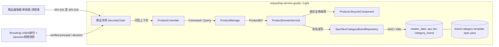
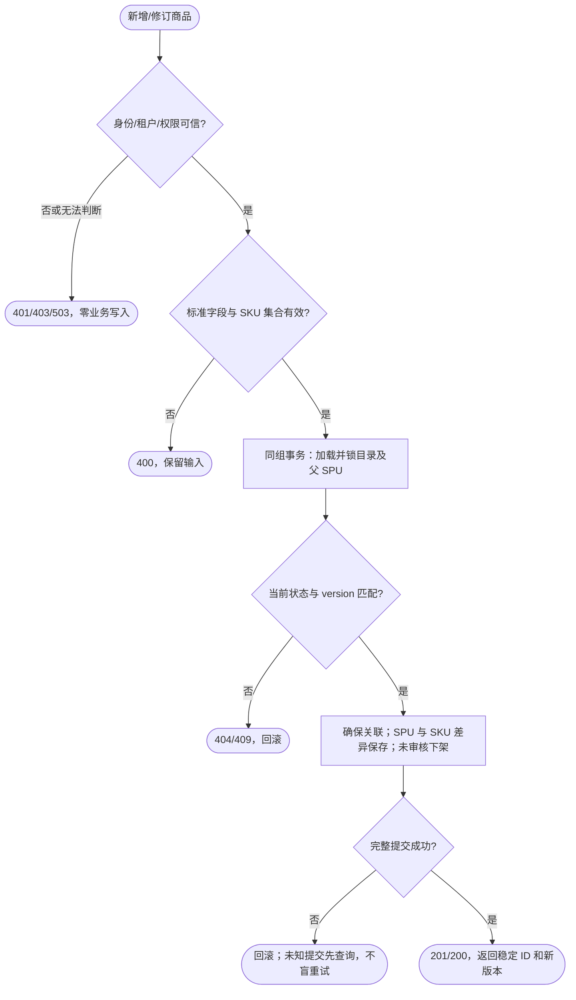
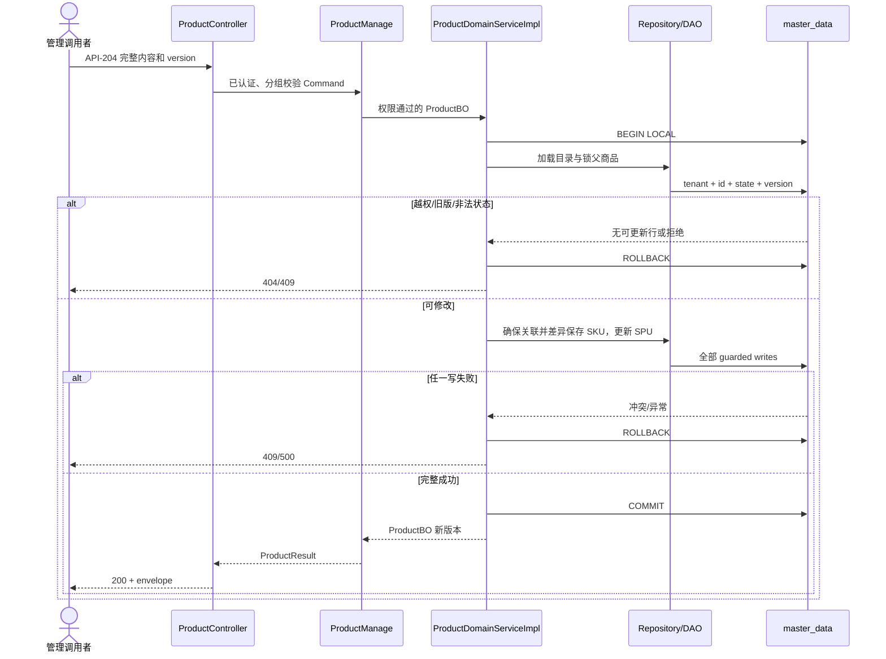
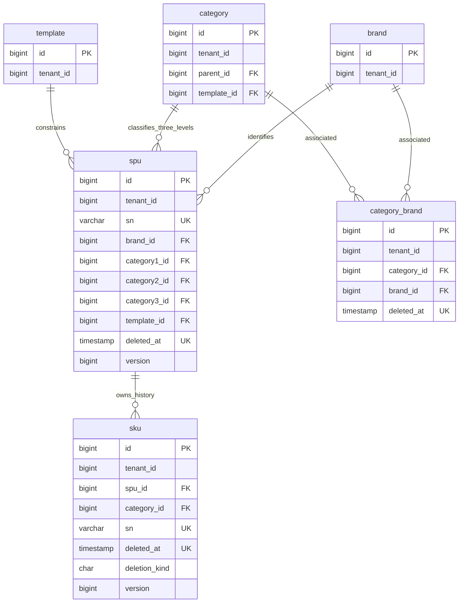

# 商品管理：SPU/SKU 与审核、上下架、回收站设计

| Field | Value |
| --- | --- |
| Document | `2026-10-09-10-55-product-management-lifecycle.md` |
| Template Version | `7` |
| Status | Review |
| Type | Feature |
| Complexity | Complex |
| Complexity Drivers | SPU/SKU 多表原子写入、软删除恢复、审核生命周期、乐观锁、租户与操作授权、目录关联写入所有权 |
| Created | 2026-10-09 10:55 Asia/Shanghai |
| Updated | 2026-10-09 12:08 Asia/Shanghai |
| Owner | mario |
| Repository | enjoyshop |
| Scope | enjoyshop-service/enjoyshop-service-goods 商品管理后端 |
| Change Surface | 新增商品聚合 REST、Manage/Domain/Repository、spu/sku、分类品牌关联确保写入、商品专用安全链、校验/错误/配置/测试；不创建前端 |
| Affected Chapters | §7, §8, §9, §10, §11, §13, §14, §15, §16, §17, §18 |
| Source Requirement | 用户附件《第4章 商品管理》与本轮已确认选择；附件本地路径见 EVD-001 |
| Baseline Revision | main / c3559b0dc0d743e936f712d97037849a8777dd2b；开始时 git status --short 为空 |
| Amends | [目录与文件 Spec](2026-09-28-21-50-distributed-file-catalog-lookups.md) §5.3 DEC-103、§11 category_brand writer：商品保存新增 ensure 写入者，其他目录管理仍外部负责 |
| Supersedes | None |
| Depends On | [品牌 Spec](2026-09-23-17-16-enjoyshop-scaffold-brand-crud.md) §6、§10、§11、§16 的 Light/MP/品牌表边界；[目录与文件 Spec](2026-09-28-21-50-distributed-file-catalog-lookups.md) §9、§11 的目录表与既有查询/上传契约 |
| Related Specs | None |
| Related Plans | [商品管理实施Plan](../plan/2026-10-09-11-54-product-management-implementation.md) |

## 1. Summary

本需求是商品聚合的完整管理流程，而非两个表的独立 CRUD：以一个请求保存 SPU 与 SKU 集合，后端生成 Snowflake ID 和 SKU 名称、品牌/分类快照，确保三级分类与品牌关联，然后提供编辑回显、审核自动上架、上下架、逻辑删除、恢复及永久删除。列表与回收站是这些流程的查询入口。

已确认只设计 goods 后端，保持 Egon-COLA 非 open Light。已有 SKU 保留 ID，按差异新增/软删除；仅下架商品可编辑，修改后重新审核。新接口必须区分读取、编辑、审核与永久删除权限。用户本轮确认按推荐方案，SPU/SKU与分类品牌关系均SINGLE/master_data同事务；授权采用Shoubing身份与Jianshen权限快照的现有组件。本文为Review，设计决策已闭合，尚未实施或运行验收，不因选择方案自动标记整份Spec Accepted。

## 2. Background and Current State

### 2.1 Business and user context

附件 §1 指定 Snowflake；§2 定义 SPU/SKU、组合保存、品牌分类关系和回显；§3 定义审核/上下架；§4 定义回收站。教程的 IdWorker、Fastjson、Date、tk.mybatis、字符串状态和独立 is_delete 不是当前项目技术合同。采用现有组件能力实现相同业务目标。

### 2.2 Repository evidence

下文 `M` 表示 `enjoyshop-service/enjoyshop-service-goods`，`J` 表示 `M/src/main/java/top/egon/enjoyshop/goods`，`R` 表示 `M/src/main/resources`。它们是路径缩写，不是新模块。Egon 源码根为 `/Users/mario/SelfProject/Egon-COLA`；未检查运行中的数据库或服务。

| Evidence ID | Classification | Exact path/symbol/decision/command | Observed fact | Design significance | Verification limit/freshness |
| --- | --- | --- | --- | --- | --- |
| EVD-001 | User request | `/Users/mario/.codex/attachments/c780c2c6-0510-4b09-8e3d-3e0a396240fb/Pasted text.txt` §1–4 | 全生命周期及组合保存 | REQ-001–012 | 附件示例有缺陷，不能当已批准实现 |
| EVD-002 | Static repository | `M/pom.xml`，Egon 根 `pom.xml` | Java 21、parent/Egon 5.4.1、Boot 3.5.16；Validation、ID、MP-SDJ、Jackson、MapStruct、WebMVC、Shoubing、Yuheng OpenAPI 已依赖 | 无需引入 ID/JSON/CRUD/Swagger 依赖 | 源码与 POM，不是 resolved runtime |
| EVD-003 | Static repository | `J/adapter/goods/BrandController.java`、`application/goods/BrandManage.java`、`infrastructure/goods/service/impl/BrandDomainServiceImpl.java` | Controller → Manage → Domain Service → Repository → DAO | 延续 Light 职责 | 静态调用链 |
| EVD-004 | Static repository | `R/db/egon-mp/V20260929_001__initialize_catalog_lookup_schema.sql` | category/template/spec/para/category_brand 已建表设计，全部 SINGLE/master_data，关联有生命周期+active 唯一索引 | 不重建目录；ensure 关联并发依靠唯一键 | 无 live schema 证明 |
| EVD-005 | Static repository | `R/db/egon-mp/repository-manifest.json` | 最高版本 20260929_001；尚无 spu/sku | 一次逻辑变更新增 20261009_001 | 不修改旧 SQL/checksum |
| EVD-006 | Static repository | `J/start/config/NativeHttpSecurityConfiguration.java` | 上传有专用认证链，兜底 permitAll；CORS 只允许 GET/POST/OPTIONS | 新商品链必须独立保护，CORS 增加 PUT/DELETE | 不推断既有公开接口已授权 |
| EVD-007 | Static repository | `J/adapter/filter/TenantContextFilter.java` | X-Tenant-Id/X-Actor-Id 写 MDC，缺租户回落 1 | 新商品端点不能信任这些头 | 保持旧路由语义 |
| EVD-008 | Static repository | Egon `egon-cola-xingyuan/egon-cola-tianquan-shoubing/.../security/IdpBearerAuthenticationFilter.java`、`VerifiedTenantContextFilter.java` | 当前源码提供 verified principal/MDC 与 SCOPE_ authorities；不等同商品 RBAC | 先复用可信身份；业务权限须另核契约 | 兄弟源码不是 goods 已解析二进制证明 |
| EVD-009 | Static repository | Common MP `model/EgonModel.java`、`extension/EgonColaRepository.java`、`extension/EgonColaMapper.java` | ASSIGN_ID、tenant/audit/version/deletedAt；有 restoreById，需 restoreStatements allowlist | 不加 is_delete；恢复走组件 | 目标依赖能力需编译确认 |
| EVD-010 | Static repository | Common ID `snowflake/SnowflakeLongIdGenerator.java`、`R/application*.yml` | machine-id 0–1023；现有 max-clock-backward PT0.005S；nextId 为十进制字符串 | 不复制 IdWorker，不另配 workerId/datacenterId | 跨实例 machine-id 唯一是部署前提 |
| EVD-011 | Static repository | `J/adapter/handler/BaseExceptionHandler.java`、Common `ResultRecord`/`PageResultRecord` | 真实 envelope 有 success/code/status/message/data 或 records/page/traceId/timestamp；旧异常映射默认品牌码 | 新商品错误必须路由分流且保留旧码 | 静态 JSON 结构 |
| EVD-012 | Static repository | `enjoyshop-web/pom.xml` | 只有聚合 POM，无 UI 实现 | §12 N/A，不创建前端 | 用户已确认后端范围 |
| EVD-013 | Static repository | `M/lombok.config`、`src/test/.../architecture/LightPersistenceArchitectureTest.java`、POM bytecode plugin | Qualifier 会复制到构造参数；架构测试写死旧文件数量 | 新增持久化文件须同步准确清单 | 不削弱依赖方向约束 |
| EVD-014 | User decision | 本轮第一组选项答复 | 后端；稳定 SKU ID；下架编辑再审核；区分操作权限并保留缺失能力阻塞 | 核心设计约束 | 不是整份 Spec 的 Accepted 批准 |
| EVD-015 | Static repository + User decision | Egon `egon-cola-xingyuan/egon-cola-tianquan-jianshen/egon-cola-tianquan-jianshen-starter` 的 POM、security/Rbac3BearerAuthenticationFilter、authorization/DefaultAuthorizationService、cache/SingleFlightSnapshotLoader、client/HttpRbac3AuthorizationClient；用户“按照推荐方案进行即可” | starter版本5.4.1；已有可信subject/tenant/system快照绑定、权限与resource检查、受限cache、503失败语义 | 最小接入不需要手写权限引擎；选择SINGLE和Jianshen方向已确认 | 当前源码证据，实施仍核resolved artifact，未调用平台 |

### 2.3 Problem statement and gap

当前只有品牌 CRUD、目录读取与上传，没有 SPU/SKU 数据模型、API 或生命周期。category_brand 有表设计但没有对应 PO/DAO/Repository 写入链。教学样例缺失商品不存在校验、跨租户隔离、版本并发、SKU 一并永久清理；修改方法未展示事务且重建 ID；JSON 示例不是合法标准 JSON。设计必须补齐这些正确性边界。

### 2.4 Evidence and current-chain map

| Entry/trigger | Current call chain | Data read/written | External dependency | Consumers | Evidence |
| --- | --- | --- | --- | --- | --- |
| 品牌查询/修改 | BrandController → BrandManageImpl → BrandDomainServiceImpl → BrandRepository → BrandDAO/XML | brand；分类查询 join category/category_brand | PostgreSQL | 外部管理调用者 | EVD-003/004/011 |
| 上传 | POST /api/v1/files → 专用 SecurityChain → FileController → FileManage → FileDomainService → S3CompatibleObjectStorageAdapter | 外部对象 | Shoubing、S3 | 图片上传调用者 | EVD-006，目录 Spec §9 |
| 商品保存 | 当前不存在 | spu/sku 尚无 | 无现有商品调用者 | 本章管理 API 调用者 | EVD-001/005 |

## 3. Goals and Non-goals

### 3.1 Goals

实现可验收的商品聚合管理契约；复用 Snowflake、MP、目录、上传与统一 envelope；明确事务、软删除恢复、状态转换与授权边界。

### 3.2 Non-goals

不创建前端、不改品牌/目录既有公开契约、不创建分类/模板/运费管理 CRUD、不实现订单库存预扣/销量评价累加、不做搜索索引或 MQ 事件、不启动应用/数据库/浏览器、不执行 DDL。库存 num 在本章仅为编辑字段，后续订单库存设计不能绕过商品聚合版本。无“拒绝审核”业务：附件只有通过，不能擅自新增拒绝状态。

### 3.3 Change Surface and Design Depth

| Area/layer | Disposition | Exact repository evidence | Changed or preserved behavior/contract | Required Spec treatment | Chapter(s) |
| --- | --- | --- | --- | --- | --- |
| 商品 HTTP/Manage/Domain | Affected | J/adapter/goods、application/goods、domain/goods | 新增聚合保存、查询、状态命令 | 全契约/类型/状态/模式 | §7, §8, §9, §10, §13, §17, §18 |
| 商品与关系持久化 | Affected | J/infrastructure/goods，R/db/egon-mp | spu/sku 新表，category_brand 增 writer | 完整表、ER、索引、事务、迁移 | §7, §8, §10, §11, §16, §18 |
| 安全、异常、配置 | Affected | NativeHttpSecurityConfiguration、BaseExceptionHandler、application*.yml | 新商品专用保护、权限/可信租户、错误分流、CORS | 失败关闭，待授权契约补齐 | §7, §8, §9, §15, §16, §18 |
| 测试 | Affected | M/src/test 与现有 OpenAPI/Profile/Architecture 测试 | 新行为及旧边界回归 | focused/contract/persistence 分类 | §14 |
| 品牌与目录读 API | Context-only | BrandController、SpecDAO/XML | 既有路由、过滤、envelope 保留，保存时后台重读目录 | 不新增参数预检 API | 无目标章节 |
| 文件上传与教学样例 | Unchanged | FileController、domain/teaching、domain/user | 上传已有策略与示例代码保留 | 边界回归，不清理样例 | 无目标章节 |
| 前端 | Not applicable | enjoyshop-web/pom.xml、用户确认 | 无页面工程 | N/A，只有 API 消费建议 | §12 |

## 4. Requirements and Acceptance Criteria

| ID | Atomic requirement | Priority | Observable acceptance criteria | Source |
| --- | --- | --- | --- | --- |
| REQ-001 | 复用 Snowflake 分布式 ID | Must | SPU/SKU 新 ID 为正 BIGINT；JSON 使用十进制字符串，不出现 JS 精度损失或第二 ID 引擎 | 附件 §1 |
| REQ-002 | 新增保存一个 SPU | Must | 成功为未审核/下架/未删除；所有客户端状态/审计值不能覆盖服务端初值 | 附件 §2/§3 |
| REQ-003 | 同事务保存 SKU 集合 | Must | 一项失败 SPU/SKU/关系全回滚；SKU 名称与快照由后端生成 | 附件 §2.3.1 |
| REQ-004 | 确保三级分类品牌关联 | Must | 同关系并发保存最多一个有效关联；不删除历史目录关系 | 附件 §2.3.2 |
| REQ-005 | 查询商品聚合用于回显 | Must | 返回 SPU 与按稳定顺序排列的有效 SKU；不存在/越租户一致 404 | 附件 §2.3.3 |
| REQ-006 | 修改保留已有 SKU ID 并重新审核 | Must | 仅未删除且下架可编辑；差异增/改/软删；版本冲突无部分写入 | 附件 §2.3.4 + 用户确认 |
| REQ-007 | 审核通过自动上架 | Must | 删除状态拒绝；有效商品一次原子转换为已审核/上架 | 附件 §3.3.1 |
| REQ-008 | 下架商品 | Must | 未删除才允许；审核状态保持；重复同目标不重复变更 | 附件 §3.3.2 |
| REQ-009 | 已审核商品才可上架 | Must | 未审核/删除商品拒绝；不存在安全 404 | 附件 §3.3.3 |
| REQ-010 | 下架商品逻辑删除 | Must | deleted_at 非 NULL、审核清零、仍下架；有效SKU同事务软删为P，父子均不可通过有效商品查询 | 附件 §4.3.1 |
| REQ-011 | 还原回收站商品 | Must | 恢复未审核/下架，业务键占用时全回滚；不会恢复编辑时移除的 SKU | 附件 §4.3.2 |
| REQ-012 | 永久删除已逻辑删除商品 | Must | SPU 和全部关联 SKU（含历史软删）同事务清理，无孤儿；不删图片/目录关系 | 附件 §4.3.3 + 正确性补齐 |
| REQ-013 | 有效列表与回收站查询 | Must | 一个集合接口 deleted=false/true，分页有界且空 records=[]，不返回 SKU 大数组 | 用户确认后端完整流程 |
| REQ-014 | 区分商品操作权限和可信租户 | Must | 无认证 401、无权限 403、越租户 404；编辑身份不能审核/永久删除；授权能力缺失阻塞发布 | 用户确认 |
| REQ-015 | 保持工程、契约、DDL 历史边界 | Must | 无新项目/未授权依赖/旧 SQL 改写，品牌与上传回归一致 | 用户 AGENTS、技能与前序 Spec |

### 4.1 Scenario matrix

| Scenario | Actor/trigger | Preconditions | Main path | Alternative/failure path | Data/state change | Observable result | Requirements |
| --- | --- | --- | --- | --- | --- | --- | --- |
| 新增 | 编辑者提交 | 权限/目录/字段有效 | 生成 ID、确保关联、写聚合 | 空 SKU、错误分类、重复键 | 一次全提交或全回滚 | 201 或 400/409 | REQ-001–004 |
| 回显/列表 | 读取者 | 同租户权限 | 读聚合或分页 | 无数据/越租户 | 无写入 | 200 空列表或 404 | REQ-005/013 |
| 编辑 | 编辑者 | 下架有效、version 匹配 | 差异写 SKU、清审核 | 外来 SKU ID、上架、并发编辑 | version+1 或全回滚 | 200/409 | REQ-006 |
| 审核竞争 | 审核者与编辑者 | 共同旧 version | 只有先成功者提交 | 后成功者旧版请求拒绝 | 不存在审过旧内容后覆盖新内容 | 409 重新回显 | REQ-007/006 |
| 上下架 | 编辑者 | 有效；上架需通过 | 状态转换 | 删除/未审核 | 状态保持或原子变化 | 200/409 | REQ-008/009 |
| 删除/恢复 | 编辑者 | 下架或回收站 | 逻辑转换 | 上架删除、同货号重建后恢复 | 唯一约束冲突全回滚 | 409 | REQ-010/011 |
| 永久删除 | 清理者 | 删除且版本匹配 | 先清全部 SKU 后 SPU | DB 失败/权限不足 | 全回滚，无半清理 | 200/403/500 | REQ-012/014 |
| 响应丢失 | 任一写调用者 | DB 可能提交 | 查询真实状态/版本 | 不盲重发 POST | 不自动建立第二意图 | 人工确认后重试 | REQ-002/006/013 |
| 身份依赖不可用 | 调用者 | JWK/授权状态无法判断 | 失败关闭 | 无备用公开分支 | 无业务写入 | 503，不自动重试写操作 | REQ-014 |
| 并发相同分类品牌 | 两编辑者 | 不同商品同分类品牌 | 受目录行锁顺序保护，唯一键兜底 | 外部 writer 冲突 | 一条有效关系，商品事务冲突回滚可重试 | 201 或 409 | REQ-004 |

### 4.2 Use-case analysis

#### 4.2.1 Actor inventory

| Actor ID | Actor/role | Goal and responsibility | Entry/channel | Permission/tenant context | Evidence |
| --- | --- | --- | --- | --- | --- |
| ACTOR-001 | 商品编辑者 | 创建/回显/编辑/上下架/回收 | 商品 REST | read/write，同租户 | 附件 §2/§3/§4，用户确认 |
| ACTOR-002 | 商品审核者 | 审核当前版本 | 商品 REST | audit，同租户 | 附件 §3，用户确认独立权限 |
| ACTOR-003 | 回收站清理者 | 永久清理 | 商品 REST | purge，同租户 | 附件 §4，用户确认独立权限 |
| ACTOR-004 | 外部目录 owner | 提供品牌/分类/模板有效数据 | 既有外部管理 | 不在本项目新建管理 API | 前序 DEC-103 |

#### 4.2.2 Use-case artifact

| ID | Use case/goal | Primary actor | Supporting actors/systems | Trigger | Preconditions | Main success outcome | Alternatives/failures | Postconditions | Requirements | Interfaces/pages | Tests |
| --- | --- | --- | --- | --- | --- | --- | --- | --- | --- | --- | --- |
| UC-001 | 建立可审核的商品聚合 | ACTOR-001 | ACTOR-004 | 提交完整商品 | write、字段/目录有效 | SPU/SKU/关联一次落库 | 重复、校验、DB 失败 | 成功待审核下架；失败无部分聚合 | REQ-001–004 | API-203 | TEST-201/202/203 |
| UC-002 | 查找并修订商品内容 | ACTOR-001 | ACTOR-004 | 列表选择、回显、提交修订 | read/write、下架、当前版本 | 原 SKU ID 保留、新内容待审核 | 无数据、外来 SKU、旧版、上架 | 成功版本+1；失败旧内容保留 | REQ-005/006/013 | API-201/202/204 | TEST-204/205/210 |
| UC-003 | 审核并发布商品 | ACTOR-002 | 无 | 确认当前内容 | audit、未删除、当前版本 | 审核通过且上架 | 越权、并发内容变化 | 成功审核/上架；失败不变 | REQ-007/014 | API-205 | TEST-206/211 |
| UC-004 | 控制销售可见性 | ACTOR-001 | 无 | 上架或下架 | write、未删除；上架已审核 | 改变销售状态 | 未审核/删除/旧版 | 保留内容与审核事实 | REQ-008/009 | API-206/207 | TEST-206 |
| UC-005 | 回收与还原商品 | ACTOR-001 | 无 | 删除或回收站恢复 | write、下架；恢复目标为已删 | 从有效列表转回收站或反向 | 重建货号冲突、旧版 | 恢复后未审核下架；失败不变 | REQ-010/011/013 | API-208/209/201 | TEST-207/208 |
| UC-006 | 永久清理回收站 | ACTOR-003 | 无 | 明确确认永久删除 | purge、已删、当前版本 | 无 SPU/任何历史 SKU | 权限、并发、DB 失败 | 全部清理或全部保留 | REQ-012/014 | API-210 | TEST-209/211 |

## 5. Constraints, Assumptions, and Decisions

### 5.1 Confirmed constraints

仅写 Spec；不写 Plan/生产代码/迁移、不启动进程。不改历史 SQL/校验和。本次不实际引入依赖；设计允许已确认推荐接入的Jianshen starter 5.4.1（详见§15.1）。保持 goods 单应用 Light；复杂生命周期必须使用实际模式。遵循用户本轮 AGENTS；实现若需要提交，每个逻辑任务最多一次，当前不提交。

### 5.2 Small-gap assumptions

| ID | Inference | Repository evidence | Why locally reversible | Impact if wrong |
| --- | --- | --- | --- | --- |
| ASM-201 | 商品业务表沿用无 tb_ 前缀：spu、sku | 当前 brand/category/spec | 尚无产品表，可在评审期改名 | 修改文档及未来生成配置 |
| ASM-202 | 新路由 /api/v1/products | BrandController 既有 /api/v1 规范 | 新接口无现存消费者 | 用户评审可改资源词，不触及旧接口 |

### 5.3 Resolved decisions

| ID | Decision | Decision owner | Evidence and rationale | Requirements |
| --- | --- | --- | --- | --- |
| DEC-201 | 仅 goods 后端；列表及回收站查询纳入 | User | 第一组答复 | REQ-013/015 |
| DEC-202 | 保留已有 SKU ID、差异更新；仅下架编辑，修改后未审核 | User | 第一组答复，避免不必要身份变化 | REQ-006 |
| DEC-203 | 独立 read/write/audit/purge 操作授权；不能用登录代替权限 | User | 第一组答复；缺失能力记阻塞 | REQ-014 |
| DEC-204 | 复用 Snowflake/MP/Light；本章不发布 Event | Repository + 附件 | 已有能力；没有下游订阅/索引要求 | REQ-001/015 |
| DEC-206 | 标准对象/数组，货号和条码租户内有效唯一；至少一SKU，禁规格恰好一SKU；freightId仅保存不算运费 | User | 第二组答复：采用上述结构与边界 | REQ-002/003/006/011 |
| DEC-205 | spu/sku与category_brand均SINGLE/master_data，在一个LOCAL事务原子保存 | User | 本轮“按照推荐方案进行即可”；主动选择已有目录同库，接受集中容量边界 | REQ-003/004 |
| DEC-207 | 复用Shoubing USER身份 + Jianshen授权快照；goods最小新增top.egon:egon-cola-tianquan-jianshen-starter:5.4.1，read/write/audit/purge独立权限，失败关闭 | User | 本轮批准推荐接入；当前源码AuthorizationService/PermissionRequest/Rbac3BearerAuthenticationFilter具备所需契约，§15.1展开 | REQ-014 |
| DEC-208 | 持久化、单表保存输入、单表结果投影分别设计必要转换；聚合Mapper通过uses委托，不重复子字段映射。商品专用转换为CUSTOM业务扩展，通用PO/DAO/XML/Repo与表BO仍GEN；不生成另一套单表Command/HTTP | User | 用户指出单表同样需要转换并要求修复；本轮按真实职责修正清单，不能以文件数量限制必要转换 | REQ-003/005/006/015 |

### 5.4 Open major decisions

None。DEC-205/207已由用户确认推荐方案，DEC-208记录本轮转换职责修复。运行环境的IdP/Jianshen地址、Redis凭据、系统/资源注册、角色授权和当前classpath版本一致性，是明确部署/实施验证输入，不是未决设计选项。不自动创建平台数据、部署服务或升级其它依赖；如果实施时5.4.1实际artifact缺少这里核对的API，停止该步骤并报具体差异，不能退回公开访问。

## 6. Project Technology Context

| Concern | Current choice | Repository evidence | Constraint on design |
| --- | --- | --- | --- |
| Java/Boot | Java 21 / Boot 3.5.16 / Egon 5.4.1 | EVD-002 | 不兼容教程 Boot2/JDK8 |
| Web/API | MVC；Yuheng starter 包含 springdoc，Egon 根管理 2.8.17 | M/pom.xml、Egon pom.xml | io.swagger.v3；沿用 generated OAS 与 MockMvc |
| Persistence | PostgreSQL、MP-SDJ、STRATEGY、LOCAL | R/application*.yml | 单组写；DDL 分布式 runner |
| Config | base/dev/test/prod + imported egon-mybatis-plus-sharding.yml | R | 添加表映射/allowlist 时五处结构一致 |
| Test | JUnit5/AssertJ/Mockito/MockMvc/H2 fixture/bytecode verifier | M/src/test、POM | H2 不证明 PG 索引/锁/DDL |

### 6.1 Java architecture profile and capability baseline

| Architecture profile | Archetype/template or base package | Exact evidence and verifier | Existing deviations | Design action |
| --- | --- | --- | --- | --- |
| Egon-COLA Light（非 open） | Egon `egon-cola-archetypes/source-projects/egon-cola-source-light`；base top.egon.enjoyshop.goods | 源树 domain/application/infrastructure/adapter/facade/common/start；M/pom.xml bytecode architecture verify；LightPersistenceArchitectureTest | 原样例保留，既有业务扩展在 goods 包；文件数量断言需更新 | 保持精确包职责，不增加 biz.* 或 Maven 模块 |
| Need | Spring/JDK candidate | Spring Boot Starter candidate | Egon-COLA/module candidate | Proven gap | Decision/dependency impact |
| --- | --- | --- | --- | --- | --- |
| ID | 无需另写算法 | 已有 ID starter | LongIdGenerator/snowflakeIdGenerator → MP identifier | 无 | Keep，无新依赖 |
| 持久化/恢复 | JDBC transaction | 已有 MP-SDJ | EgonModel/Repository/Mapper.restoreById | 永久删除需具名受保护 SQL | Keep；不绕过 guard |
| 转换/校验 | Jakarta、Jackson、MapStruct | 已有 Validation | BaseConverter/BaseForwardConverter、ValidationUtils、groups | 产品跨字段规则缺失 | Add 一组约束，不写万能 Utils |
| 目录引用 | 后台具名 SQL | 现有 PostgreSQL | existing tables、BrandRepository、SpecRepository | 关系确保 writer 和按 ID 引用读取 | Add 必要关系持久化，不新增预检 HTTP |
| REST/OAS | MVC/MockMvc/Jackson | 已有 Yuheng OpenAPI | BrandController/OpenApiContractTest | 无 | Keep，不新增 Springfox/GraphQL 接口 |
| 身份/权限 | SecurityContext | 已有 Shoubing | Verified principal；Jianshen AuthorizationService/PermissionRequest、snapshot绑定 | 原POM未消费权限starter | 用户已批准最小接入5.4.1；本次不改POM |

### 6.2 User-mandated Java rule compliance

| Literal rule | Affected? | Repository evidence | Exact design decision | Files/types/interfaces | Validation/test evidence | Status/blocker |
| --- | --- | --- | --- | --- | --- | --- |
| Rule 1 | Yes | EVD-003 | carrier 有 Command/Query/Result/BO/PO，behavior 有 Service/Repository/Converter/Component；不加无语义 Data | §8/§10 完整类型 | TEST-212 | PASS |
| Rule 2 | Yes | Validation starter、EgonModel groups | 每个层间 @Valid/@Validated；Create/Update 分组；跨字段约束；PO 只校验 DDL 形状 | §10.3 | TEST-201/204/212 | PASS |
| Rule 3 | Yes | M/lombok.config、MapStruct、BaseConverter | 普通载体 class：@Data @NoArgsConstructor @AllArgsConstructor @Accessors(chain=true) @Builder；PO @SuperBuilder @EqualsAndHashCode(callSuper=true) | §10.1/10.4 | TEST-212 | PASS |
| Rule 4 | Yes | Qualifier copyableAnnotations | 每个业务类 @Slf4j、具名 Bean、@RequiredArgsConstructor、final @Qualifier；禁止字段 Autowired | §8.3/§15 | TEST-212 | PASS |
| Rule 5 | Yes | JDK/现有 Commons | 只用 JDK/已用 Commons/Guava；不用 Hutool/Fastjson/Tika/新工具 | 所有新符号 | import gate | PASS |
| Rule 6 | Yes | Jackson config + ResultRecord | 字段 camelCase；ID 显式字符串；状态 @EnumValue/@JsonValue；未知码拒绝；输入未知字段拒绝只限新 command | §9/10 | TEST-210/212 | PASS |
| Rule 7 | Yes | 四环境+导入文件 | 同结构新表映射与 lifecycle/root allowlist；值可不同；不改旧配置身份值 | §16 | ProfileKeyParityTest | PASS |
| Rule 9 | Yes | 多阶段生命周期与 guards | Specification 模式 ProductLifecycleComponent；表驱动组合规则，无按状态 switch 业务派发 | §13 | TEST-206/207 | PASS |
| Rule 10 | Yes | EgonModel Instant/LocalDateTime | 审计 Instant；deletedAt UTC LocalDateTime 微秒；API ISO UTC | §10/11 | TEST-212 | PASS |
| Rule 11 | Yes | exact Light、MP/ID/DDL 现有依赖 | 不混层；业务键+deleted_at 和 active 部分唯一双约束；C/Q 无本章 Event | §7/11/16 | TEST-203/208/212 | PASS |

## 7. Architecture Design

### 7.0 Minimum-design baseline and element-necessity audit

| Proposed element | Change | Requirements | Existing/direct alternative | Concrete inadequacy of alternative | Added calls/state/coupling/failures/migration/operations | Verdict |
| --- | --- | --- | --- | --- | --- | --- |
| ProductController 与 10 个操作 | New | REQ-002–014 | 品牌 CRUD 无商品语义 | 不能原子保存聚合/审核/回收 | 新契约、测试、权限组件依赖；无新进程 | Add |
| ProductManage/DomainService 与必要转换 | New | REQ-003/006/014 | Controller 直接 SQL | 破坏当前 Light 职责及非 HTTP 校验 | 一条现有层级调用链 | Add |
| spu/sku PO/DAO/XML/Repository | New | REQ-001–012 | brand 或 Map 动态存储 | 无商品字段/关系/版本 | 两表和索引、一次 SQL 版本 | Add |
| CategoryBrandPO/DAO/Repository | New writer | REQ-004 | 现有目录查询不写关联 | 缺具名 guarded 写入口 | 复用已建表；并发冲突 | Add |
| ProductLifecycleComponent | New | REQ-006–012 | 多命令各自 if/switch | 审核、删除、编辑共同约束易分散 | 一份规则注册，非法组合拒绝 | Add |
| 已有目录/上传 API | Keep | REQ-004/015 | 新增获取保存参数 API | backend 能派生，重复预检无价值 | 不增加网络往返 | Keep；参数预检 Remove |
| 业务Cache/Outbox/Statemachine额外dependencies | None | REQ-015 | 同步共享库/规则组合 | 没有下游或性能需求 | 无新增业务基础设施；权限复用Jianshen自有Redis snapshot，见§15.1 | Remove |
| 权限接入 | Candidate | REQ-014 | 只认证 USER | 不能区分审核与清理 | 已批准Jianshen starter 5.4.1 | Add，DEC-207已确认 |
| ProductAuthorizationComponent + Jianshen starter | New/Reuse | REQ-014 | 仅USER认证或10个方法重复检查 | 认证不含业务权限；集中bound context和三态错误避免漏检 | 一个现有snapshot客户端依赖、短TTL权限Redis；无新本地权限表 | Add，用户DEC-207批准 |
| Path | Network calls | Client states | Server contracts/state | Failure and TOCTOU points | Additional user/business value |
| --- | --- | --- | --- | --- | --- |
| 直接保存基线 | 1 个提交 | 提交/结果/错误 | 聚合保存 | 提交时后台重验目录 | 一次完成保存 |
| 选定设计 | 1 个管理提交；服务端权限cache miss最多另取一次snapshot，编辑另有独立回显 | 同上，409 重新回显 | 聚合+version+权限 | 回显与提交间变化由 CAS 拒绝 | 正确权限和稳定身份，不增加预检往返 |

单表转换必要性（REQ-003/005/006，Add）：PO↔BO是存储字段语义边界，SaveCommand→BO限制写入暴露，BO→Result限制读出暴露；聚合uses复用，无新增网络往返、持久状态或平台依赖。Json field codec承载现有Jackson无法由generic template推断的字段泛型，不处理业务规则。完整类型/文件见§8与§10.4。

### 7.1 System Architecture Design

下图为DEC-205/206/207确认后的设计。所有业务数据由 goods 写入，身份/授权由可信平台负责；没有跨服务 DB+MQ 双写。



| Module/component | Capability and data owned | Inputs/outputs | Allowed dependencies | Forbidden responsibility | Requirements |
| --- | --- | --- | --- | --- | --- |
| ProductController | HTTP/OAS/绑定/响应状态 | §9 envelope | Manage、converter | 直接 DAO、写业务状态 | REQ-002–014 |
| ProductManageImpl | 用户意图、鉴权门、输入分组、转换 | Command/Query/Result | Domain Service、application converter | 持有 PO/DAO 或客户端租户作为授权 | REQ-014/015 |
| ProductDomainServiceImpl | 商品原子事务/目录引用校验/聚合版本 | ProductBO 与领域操作 | Repository、LifecycleComponent | HTTP/平台 SDK 泄漏领域接口 | REQ-003–012 |
| Repository | guarded 持久化/tenant/受限生命周期 SQL | PO/具名 Query | DAO/XML、MP | 审核政策或开放通用删库 | REQ-001/010–012 |
| Platform owner | 可信身份/操作授权 | decision + tenant/subject | 外部平台 | 商品字段和事务 | REQ-014 |

### 7.2 High-Level Design

#### 7.2.1 Critical business/control flowchart



#### 7.2.2 High-level decision and quality matrix

| Concern/use case | Required behavior | Selected mechanism | Failure/degradation behavior | Trade-off | Verification | Requirements |
| --- | --- | --- | --- | --- | --- | --- |
| 原子保存 | 不出现孤立 SPU/SKU/关联 | 推荐 SINGLE/master_data + LOCAL | 任一步失败全回滚 | 单库商品容量边界，需显式确认 | TEST-202/203 | REQ-003/004 |
| 并发状态 | 审核不能发布被同时改写内容 | 父行锁+version CAS，所有 SKU 编辑 bump 父版本 | 旧 version 409 | 需要回显版本 | TEST-205/206 | REQ-006/007 |
| 安全 | 身份与权限分别证明 | 专用链+可信上下文+独立授权 | 未判定失败关闭 | 新增平台可用性依赖；部署输入必须就绪 | TEST-211 | REQ-014 |
| 有界查询 | 列表不搬运 SKU 大对象 | 1-based page，pageSize≤100，详情 SKU≤100 | 非法参数 400 | 不承诺分页快照 | TEST-210 | REQ-005/013 |

### 7.3 Detailed Design

#### 7.3.1 Detailed component collaboration

1. 商品链先校验USER身份并加载可信RBAC上下文，建立 verified tenant/subject；忽略 X-Tenant-Id/X-Actor-Id 对新端点的授权意义。现有 TenantContextFilter 继续服务旧路由；商品保护范围不允许它覆盖 trusted MDC。
2. Controller 绑定并选择 Create/Update validation group，拒绝未知字段；映射为共享 application Command，不增加一套近似 DTO。
3. Manage 校验代理入口及权限，再映射 ProductBO 调用 Domain Service。非 HTTP 调用仍必须携带可信上下文；不可通过直接 Manage 调用绕过权限。
4. Domain 写入口一个事务。目录按 ID、tenant、deleted_at IS NULL 验证：一级根→二级→三级父链；三级 templateId 与提交一致；品牌存在；规格/参数来自模板。引用行在同组按 category ID 升序、brand、template 顺序加锁，外部 writer 须按同样锁顺序或唯一冲突回滚。
5. 新增分配 SPU/SKU ID，初始审核0/上架0、计数0；SKU name 按模板 spec.seq,id 的确定顺序拼接值，禁用规格 name=SPU name。categoryName/brandName/categoryId/spuId 均派生。
6. 修改锁当前 SPU，验证 version、下架未删。SKU ID 必须属于此 SPU/tenant 且未被移除；有 ID 更新，无 ID 新增，缺席旧有效 ID 软删。保持已存在 SKU 的 ID/createTime/saleNum/commentNum/sn，禁止客户端覆盖；SKU 自有 MP version 由事务内载入，客户端只控制父聚合 expectedVersion。
7. 并发写以父 SPU CAS 作为聚合互斥门，SKU 更新检查每个影响行数；所有子操作失败回滚。SKU 列表顺序按 id ASC，不把 Map 迭代顺序当名称业务顺序。
8. 审核/上下架/软删除/恢复由 §10.6 同一规则源生成目标状态。保存与状态命令不发布 Event；本章没有 MQ 消费者，日志不是 Event。

#### 7.3.2 Critical-path Mermaid swimlane



#### 7.3.3 Transactions, consistency, concurrency, and idempotency

| Concern/state change | Owner and boundary | Mechanism/isolation/lock | Concurrent or duplicate behavior | Commit/visibility point | Failure result | Requirements/tests |
| --- | --- | --- | --- | --- | --- | --- |
| 聚合写 | ProductDomainServiceImpl | LOCAL；READ_COMMITTED 写，SPU FOR UPDATE + tenant/id/version predicate | 同父版本最多一次有效修改 | DB commit | 全回滚/409 | REQ-003/006，TEST-202/205 |
| 目录关联 | 同商品事务 | 锁目录，uk_category_brand_active 兜底；不吞 DuplicateKey 后继续 PG 失败事务 | 外部 writer 竞争导致整个事务冲突；调用者重新读后再提交 | 同一次 commit | 409，无部分商品 | REQ-004，TEST-203 |
| 详情/列表 | Domain query transaction | 推荐 REPEATABLE_READ；详情两次查询和 list/count 同快照 | 跨页不承诺同快照 | 查询快照 | 404/500 | REQ-005/013 |
| POST 新增 | 无持久幂等收据 | 推荐 sn active unique 仅防业务重复 | 不承诺重放返回原结果；重复 409 | commit | 响应未知先按 sn 查询；不自动重试 | REQ-002，TEST-203 |
| PUT/DELETE 状态 | tenant+spuId+expectedVersion | 目标状态相同且 version 当前可 no-op；旧版仍 409；purge 已不存在返回 true | 不重新生成 ID，不重复计数 | commit | 不越过版本检查 | REQ-007–012，TEST-206/209 |

#### 7.3.4 Failure semantics, recovery, and reconciliation

| Failure point | Detection | Immediate control flow | Data/transaction state | Retry and idempotency | Caller/frontend result | Recovery/reconciliation owner | Verification |
| --- | --- | --- | --- | --- | --- | --- | --- |
| 输入/目录错误 | Bean Validation/目录约束 | 400 拒绝 | 无提交 | 修正后提交 | 保留输入 | 调用者/目录 owner | TEST-201/204 |
| 认证/授权拒绝 | 身份/决策结果 | 拒绝，无 SQL | 无写 | 401 登录；403 不重试 | 401/403 | 平台 owner | TEST-211 |
| 权限依赖超时 | Jianshen HttpRbac3AuthorizationClient/SingleFlightSnapshotLoader | 失败关闭 | 无写 | 不自动重试写请求 | 503 | 平台 owner | TEST-211 |
| CAS/唯一冲突 | 0 rows/constraint name | 409，事务 rollback | 完整旧聚合保留 | 重新回显，明确新意图 | 409 | 调用者 | TEST-203/205/208 |
| Snowflake 时钟失败 | 组件已定义异常 | 不换 UUID，不继续写 | 无提交 | 检查机器时钟再提交 | 503 安全错误 | 运维检查 machineId/NTP | TEST-201 |
| DB 语句或 commit 未知 | transaction exception | 不把未知结果说成成功 | 可能提交，不能自动补偿删数据 | 查询 tenant+sn/id/version 判定 | 500，人工核对 | goods 运维+调用者 | TEST-202，真实 DB 待授权 |
| 永久删除途中失败 | SKU/SPU 影响行检查/SQL 错误 | 全回滚 | 原数据保留 | 同租户重新查询 | 500/409 | goods owner | TEST-209 |
| DDL 部分目标提交 | ddl_history/runner failure | 停止新端点发布 | 每个目标独立进度 | 同 checksum 续跑，禁止 repair | 无运行验收声称 | 运维 | §16/TEST-213 |

#### 7.3.5 Observability and operational boundaries

业务类 @Slf4j；日志含 traceId、tenantId、spuId、action、expected/newVersion、result/errorCode、elapsedMs；不打印 token、图片完整 URL、商品 HTML 或整个请求。Domain commit 后记录成功；回滚记录结果，不能把已执行 SQL 当成功。沿用既有 HTTP Micrometer，不加监控框架；错误码/操作是低基数字段，商品/用户 ID 仅日志，不作为 metric label。身份依赖连续失败或商品写 5xx 时运维按 traceId 查询真实聚合，不自动重发或清库。当前只验证设计，告警阈值由部署 owner 基于实际负载配置，不虚构延迟 SLO。

#### 7.3.6 Conclusion evidence chain

| Conclusion | Repository/user evidence | Constraint or requirement | Design decision | Consequence and trade-off | Verification and acceptance evidence |
| --- | --- | --- | --- | --- | --- |
| 一个商品聚合而非独立 SKU CRUD | EVD-001/003 + DEC-202 | REQ-003/006，稳定身份 | 一个 Manage/Domain 写入口 + 子集合差异 | 所有 SKU 修改 bump 父版本；无单 SKU 写 API | TEST-202/204/205 |
| 保持本地原子写 | EVD-004 + LOCAL guard | REQ-004 | SINGLE，DEC-205已确认 | 容量集中；消除跨组提交与异步窗口 | TEST-203，用户选择 |
| 权限与身份分别证明 | EVD-006/007/008 + DEC-203 | REQ-014 | 新链失败关闭；§15.1复用既有Jianshen可信授权 | 平台部署输入未就绪时阻止发布；不扩散到旧公开路由 | TEST-211 + 平台合同 |

## 8. Package Structure and Code File Tree

### 8.1 Current relevant tree

```text
enjoyshop-service/enjoyshop-service-goods/
├── pom.xml / lombok.config
├── src/main/java/top/egon/enjoyshop/goods/
│   ├── adapter/goods/BrandController.java, SpecController.java, FileController.java
│   ├── application/goods/BrandManage.java, BrandManageImpl.java
│   ├── domain/goods/BrandDomainService.java, SpecDomainService.java
│   ├── infrastructure/goods/{po,dao,repo,service/impl}
│   ├── adapter/handler/BaseExceptionHandler.java
│   └── start/config/NativeHttpSecurityConfiguration.java
└── src/main/resources/db/egon-mp/repository-manifest.json
```

### 8.2 Target tree

路径以 J/R 为根，详见 EVD-002。以下为已选定目标清单，非实现顺序。`GEN` 是 native Light 生成器选定初始 CREATE scaffolding；`CUSTOM` 是聚合、状态规则和具名 SQL 扩展。商品不提供独立 SPU/SKU CRUD HTTP，避免绕过聚合规则。模板名不授权生成未选中的 controller/manage。

```text
M/pom.xml                                                        MODIFY approved Jianshen starter 5.4.1
J/
├── adapter/goods/ProductController.java                         CREATE CUSTOM
├── application/goods/
│   ├── ProductManage.java, ProductManageImpl.java                 CREATE CUSTOM
│   ├── ProductAuthorizationComponent.java                        CREATE CUSTOM
│   ├── ProductSaveCommand.java, SpuSaveCommand.java, SkuSaveCommand.java
│   ├── ProductIdQuery.java, ProductPageQuery.java, ProductLifecycleCommand.java
│   ├── ProductResult.java, SpuResult.java, SkuResult.java, ProductSummaryResult.java
│   ├── ProductStateResult.java, ProductQueryConverter.java         CREATE CUSTOM
│   ├── ProductSpuSaveConverter.java, ProductSkuSaveConverter.java   CREATE CUSTOM
│   ├── ProductSpuResultConverter.java, ProductSkuResultConverter.java CREATE CUSTOM
│   └── ProductApplicationConverter.java                          CREATE CUSTOM
├── domain/goods/
│   ├── ProductDomainService.java, ProductBO.java                  CREATE CUSTOM
│   ├── SpuBO.java, SkuBO.java                                    CREATE GEN domain-model
│   ├── ProductDomainQuery.java, ProductActionEnum.java, ProductSkuDeletionKindEnum.java             CREATE CUSTOM
│   ├── ProductLifecycleComponent.java, ProductStateBO.java        CREATE CUSTOM
│   └── CatalogReferenceBO.java                                   CREATE CUSTOM
├── infrastructure/goods/
│   ├── po/SpuPO.java, SkuPO.java, CategoryBrandPO.java              CREATE GEN po
│   ├── dao/SpuDAO.java, SkuDAO.java, CategoryBrandDAO.java          CREATE GEN dao
│   ├── repo/SpuRepository.java, SkuRepository.java, CategoryBrandRepository.java CREATE GEN repo + CUSTOM methods
│   └── service/impl/
│       ├── ProductDomainServiceImpl.java                         CREATE CUSTOM
│       ├── ProductSpuPersistenceConverter.java, ProductSkuPersistenceConverter.java CREATE CUSTOM product mappings
│       └── ProductJsonFieldConverter.java                         CREATE CUSTOM JSON-field codec

├── common/json/ProductIdDeserializer.java                         CREATE CUSTOM
├── common/validation/ProductValidationGroup.java                 CREATE CUSTOM
├── common/validation/ValidProductComposition.java                 CREATE CUSTOM
├── common/validation/ProductCompositionValidator.java            CREATE CUSTOM
├── common/enums/GoodsErrorStatus.java                            MODIFY appended product codes
├── adapter/handler/BaseExceptionHandler.java                     MODIFY product-only error branching
├── start/config/NativeHttpSecurityConfiguration.java             MODIFY product chain/CORS
├── start/config/OpenApiConfig.java                               MODIFY bearer scheme only
└── adapter/filter/TenantContextFilter.java                       MODIFY only product path bypass of untrusted MDC
R/
├── mybatis/mapper/goods/SpuDAO.xml, SkuDAO.xml, CategoryBrandDAO.xml CREATE GEN + CUSTOM named queries
├── db/egon-mp/V20261009_001__initialize_product_schema.sql         CREATE one version, future implementation only
├── db/egon-mp/repository-manifest.json                            MODIFY append checksum
├── application.yml, application-dev.yml, application-test.yml, application-prod.yml MODIFY parity
└── egon-mybatis-plus-sharding.yml                                MODIFY parity
```

权限接入仅新增application/goods/ProductAuthorizationComponent.java，复用现有Jianshen AuthorizationService，不编造平台RPC或新permission store。M/pom.xml新增已批准的Jianshen starter 5.4.1；其余平台源码不改。已建 category_brand 的四件持久化 scaffolding 仅消费旧 CREATE 定义，旧 SQL 不改。生成器已有选项 `persistence-crud`、`domain-model`；Plan 必须核对 v2 文件表及字段类型/约束，遇到自定义文件冲突停止，不能手写替代 GEN 文件。若 native 模板不能表达聚合 BO 特殊字段，聚合 ProductBO 为 CUSTOM；表 BO 字段继续生成并在授权 Plan 内扩展。

### 8.3 Package and file responsibilities

| Operation | Path/package | Symbols | Responsibility | Dependencies | Requirements |
| --- | --- | --- | --- | --- | --- |
| Create | J/adapter/goods/ProductController.java | §9 operationId 同名方法 | 绑定/校验/REST/OAS，不实现状态规则 | productManage | REQ-002–014 |
| Create | J/application/goods/ProductManage*.java | create/update/detail/page/audit/pull/put/delete/restore/purge | 操作授权、应用 Command→领域 BO→Result | productDomainService、converter；ProductAuthorizationComponent/AuthorizationService | REQ-002–014 |
| Create | J/domain/goods/ProductDomainService.java | 同名领域操作 | 与基础设施隔离的业务端口 | BO/Query | REQ-003–012 |
| Create | J/infrastructure/goods/service/impl/ProductDomainServiceImpl.java | 领域端口实现 | 同组事务、目录校验、差异 SKU | spu/sku/categoryBrandRepository、lifecycle | REQ-003–012 |
| Create | J/domain/goods/ProductLifecycleComponent.java | evaluate(action,current) | Specification 规则组合，返回 ProductStateBO | ProductActionEnum | REQ-006–012 |
| Create | J/common/validation/ProductCompositionValidator.java | isValid | 集合/规格组合无 DB 校验；目录有效性留领域事务 | Jakarta constraint | REQ-003/006 |
| Create | J/infrastructure/goods/{po,dao,repo}、R/mybatis/mapper/goods | §11 具名操作 | guarded CRUD、受限恢复/物理删除 SQL、投影 | MP/具名 XML | REQ-001–013 |
| Modify | SecurityConfiguration/TenantContextFilter/OpenApiConfig | productSecurityFilterChain / bearerAuth | 只扩新路由，认证后 trusted context，旧路由不变 | 现有 Shoubing；授权契约§15.1 | REQ-014/015 |
| Modify | BaseExceptionHandler/GoodsErrorStatus | product 错误分流 | 不把 SKU 冲突映射为 BRAND_NAME_DUPLICATED | CommonException | REQ-006/014/015 |
| Modify | M/src/test/.../architecture/LightPersistenceArchitectureTest.java | 数量及精确新文件清单 | 保留原架构规则，数量更新为实际 inventory | JUnit5 | REQ-015 |
| Create/Modify | J/application/goods/ProductAuthorizationComponent.java；M/pom.xml | requirePermission(String permissionCode)；Jianshen5.4.1 | 所有Manage操作共享可信context/permission+resource校验 | authorizationService、Rbac3ContextAuthentication，具名Bean见§15.1 | REQ-014 |

所有新增 concrete 业务类统一 @Slf4j；ProductIdDeserializer是Jackson框架扩展、无业务状态/依赖注入，不创建Spring Bean或额外logger。Spring Bean 名为类名首字母小写，Domain 实现 Bean 固定 `productDomainService`，Manage 实现固定 `productManage`，repository 固定 `spuRepository`/`skuRepository`/`categoryBrandRepository`，converter 为 MapStruct 生成 `*ConverterImpl`，DAO 为 `spuDAO` 等，与已有 Mapper 习惯一致。constructor 使用 @RequiredArgsConstructor，所有依赖 final + exact @Qualifier，M/lombok.config 已复制 Qualifier。

## 9. Interface Definitions

### 9.0 API protocol and documentation governance

仅新商品 REST；CQE L1：Command/Query 类型区别来自创建、版本更新、状态 guard、列表 projection 的实际验证差异；同库，不加 bus、read-store 或 Event。已有 GraphQL 样例 Unchanged，没有新商品 GraphQL consumer，所以不扩 SDL。

| Concern | Decision/evidence |
| --- | --- |
| Protocol selection | REST，沿用 BrandController 的 MVC/v1；无额外 GraphQL consumer |
| CQE application level | L1，共享 Domain/Repository；Query 无写或发 Event |
| REST source of truth | Code-first ProductController mapping + command groups + Jackson + io.swagger.v3 annotations |
| GraphQL source of truth | N/A，原样例 SDL 不包含商品且本需求不新增 GraphQL |
| Springdoc/OpenAPI compatibility | 现有 Yuheng WebMVC starter，Boot3.5.16、springdoc 管理2.8.17；版本以 resolved POM 为准，生成 OAS 实际 version 同既有 BrandOpenApiContractTest，无擅自升级3.1 |
| Legacy Swagger/Springfox status | 新增代码禁止 Springfox/Swagger2；沿用现有 v3 注解 |
| Security and documentation exposure | 新 scheme bearerAuth/type HTTP/bearer/JWT；permission 不是 OAuth scheme；docs/UI 既有 Yuheng 策略不改，新端点声明 USER 安全，授权绑定 DEC-207 |
| Contract publication and drift gate | ProductOpenApiContractTest 在 MockMvc GET /v3/api-docs，Jackson 解析所有新增路径/ID/status/schema/security；不发布远程平台 |

### 9.1 Interface Inventory

所有路由为新设计，非声称源码已存在：由 ASM-202 的新 ProductController `@RequestMapping("/api/v1/products")` + 下列方法组成；沿用当前无 application context-prefix 的路径形式。不虚构网关域名或 `/spu` 兼容端点。权限 `read/write/audit/purge` 对应§15.1固定商品permission code，不是OAuth scope。

| ID | Change/necessity verdict | Name/purpose | Kind | API style/CQE role | Consumer | Owner | Method + URL / GraphQL field / symbol / topic | Operation ID/schema source | Input | Output | Auth/tenant | Error model | Idempotency/version | Requirements |
| --- | --- | --- | --- | --- | --- | --- | --- | --- | --- | --- | --- | --- | --- | --- |
| API-201 | New/Add | 查询商品及回收站列表 | HTTP | REST Query | 管理调用者 | goods | `GET /api/v1/products` | `listProducts` | ProductPageQuery | PageResultRecord<ProductSummaryResult> | USER/read、trusted tenant | §9.2错误 | Query只读 | REQ-013/REQ-014 |
| API-202 | New/Add | 查询商品聚合 | HTTP | REST Query | 管理调用者 | goods | `GET /api/v1/products/{spuId}` | `getProduct` | ProductIdQuery | ResultRecord<ProductResult> | USER/read、trusted tenant | §9.2错误 | Query只读 | REQ-005/REQ-014 |
| API-203 | New/Add | 新增商品 | HTTP | REST Command | 管理调用者 | goods | `POST /api/v1/products` | `createProduct` | ProductSaveCommand/Create | ResultRecord<ProductResult> | USER/write、trusted tenant | §9.2错误 | §7.3.3版本规则 | REQ-001/002/003/004/REQ-014 |
| API-204 | New/Add | 完整替换可编辑内容 | HTTP | REST Command | 管理调用者 | goods | `PUT /api/v1/products/{spuId}` | `updateProduct` | ProductSaveCommand/Update | ResultRecord<ProductResult> | USER/write、trusted tenant | §9.2错误 | §7.3.3版本规则 | REQ-006/REQ-014 |
| API-205 | New/Add | 审核并上架 | HTTP | REST Command | 管理调用者 | goods | `PUT /api/v1/products/{spuId}/approval` | `approveProduct` | ProductLifecycleCommand | ResultRecord<ProductStateResult> | USER/audit、trusted tenant | §9.2错误 | §7.3.3版本规则 | REQ-007/REQ-014 |
| API-206 | New/Add | 下架 | HTTP | REST Command | 管理调用者 | goods | `PUT /api/v1/products/{spuId}/withdrawal` | `withdrawProduct` | ProductLifecycleCommand | ResultRecord<ProductStateResult> | USER/write、trusted tenant | §9.2错误 | §7.3.3版本规则 | REQ-008/REQ-014 |
| API-207 | New/Add | 上架 | HTTP | REST Command | 管理调用者 | goods | `PUT /api/v1/products/{spuId}/publication` | `publishProduct` | ProductLifecycleCommand | ResultRecord<ProductStateResult> | USER/write、trusted tenant | §9.2错误 | §7.3.3版本规则 | REQ-009/REQ-014 |
| API-208 | New/Add | 逻辑删除 | HTTP | REST Command | 管理调用者 | goods | `DELETE /api/v1/products/{spuId}` | `deleteProduct` | version Query | ResultRecord<Boolean> | USER/write、trusted tenant | §9.2错误 | §7.3.3版本规则 | REQ-010/REQ-014 |
| API-209 | New/Add | 还原商品 | HTTP | REST Command | 管理调用者 | goods | `PUT /api/v1/products/{spuId}/restoration` | `restoreProduct` | ProductLifecycleCommand | ResultRecord<ProductStateResult> | USER/write、trusted tenant | §9.2错误 | §7.3.3版本规则 | REQ-011/REQ-014 |
| API-210 | New/Add | 永久删除 | HTTP | REST Command | 管理调用者 | goods | `DELETE /api/v1/products/{spuId}/purge` | `purgeProduct` | version Query | ResultRecord<Boolean> | USER/purge、trusted tenant | §9.2错误 | §7.3.3版本规则 | REQ-012/REQ-014 |

### 9.2 Per-interface Detailed Contracts

以下推荐合同依赖 DEC-205，权限细节依赖 DEC-207。不是已批准公共接口。共同 envelope 直接复用 common-core；不创建 Swagger 专用 wrapper。默认 `Cache-Control: no-store` 用于管理结果，Content-Type application/json。Header Authorization 仅 Bearer；Cookie/Multipart 均 None。错误处理保留 Shoubing 自己的认证 JSON，与业务 envelope 明确区分。

#### 9.2.1 API-201 — 查询商品/回收站列表

##### Necessity and interaction-cost decision

| Concern | Decision |
| --- | --- |
| Change classification | New |
| Independent consumer goal | 查询商品/回收站列表，对应§4 UC；不是获取另一个请求参数 |
| Parameter ownership and derivation | 调用者选择内容/目标ID/已显示version；后端从verified身份取得tenant/subject，从目录派生快照/关系 |
| Direct/no-new-interface alternative | 品牌/上传无法承载商品目标；本操作直接满足REQ-013；不增加预检 |
| Caller use of result | 显示结果/回显或确认变更，不能把内部上下文转交下一请求 |
| Round trips and failure points | 一次请求；目录与权限提交时重验；冲突重新读取 |
| Verdict | Add，REQ-013 |

##### API style and CQE semantics

| Concern | Decision/evidence |
| --- | --- |
| Protocol style | REST Query |
| CQE role | Query，owner ProductManage/Domain；L1共享库 |
| Resource/task semantics | `GET /api/v1/products`；查询商品/回收站列表 |
| Read/write and side effects | 只读，不创建关联/事件 |
| Consistency and idempotency | §7.3.3；查询快照，无跨页快照保证 |
| Why this style | 沿用现有goods REST消费者；不额外增加GraphQL入口 |

##### Identity and purpose

| Concern | Definition |
| --- | --- |
| Purpose/owner/consumer | 查询商品/回收站列表/goods/管理API调用者 |
| Protocol and endpoint | `GET /api/v1/products`；新Controller设计，ASM-202 |
| Content type/version | application/json；v1；GET/DELETE无body |
| Auth/permission/tenant | USER + enjoyshop:product:read；trusted tenant/subject，不接受调用方权限/tenant字段；DEC-207：§15.1可信Jianshen权限检查 |
| Timeout/retry/rate limit | 沿用容器timeout；无自动写重试；集合与字段有界；不新增限流基础设施 |
| Idempotency/concurrency | §7.3.3；读无副作用 |

##### Request parameters

| Name | Location | Type/format | Required/null | Default | Validation/range/enum | Meaning | Example | Source |
| --- | --- | --- | --- | --- | --- | --- | --- | --- |
| Authorization | Header | Bearer string | Required/nonblank | None | Shoubing USER验证；不得SERVICE回退 | 身份 | Bearer synthetic | 可信平台 |
| pageNo/pageSize | Query | int | Optional，显式空拒绝 | 1/10 | ≥1 / 1–100；offset溢出拒绝 | 分页 | 1/10 | 调用者 |
| deleted | Query | boolean | Optional/non-null | false | true只回收站，false只有效 | 生命周期筛选 | true | 调用者 |
| sn | Query | string | Optional；空串拒绝 | None | trim、1–64，精确大小写匹配 | 货号筛选与未知提交核对 | P30-001 | 调用者 |
| name | Query | string | Optional；空串拒绝 | None | trim、1–200；字面包含匹配，转义SQL通配符 | 搜索 | 华为 | 调用者 |
| status | Query | enum string | Optional | None | 0/1；deleted=true时仅0或不传 | 审核筛选 | 0 | 调用者 |
| isMarketable | Query | boolean | Optional | None | deleted=true时仅false或不传 | 销售状态 | false | 调用者 |

Body/Cookie/Multipart: None。sort 不开放；固定 id DESC。count/list 同查询快照，跨页插入可能导致 offset 位移，不承诺全局快照。按 tenant + deleted 的主列表索引服务，无无限全量模式。name 包含检索不添加无证据全文索引，成本受租户与页大小限制。

##### Success response

HTTP 200。 Content-Type application/json；Cache-Control no-store。payload类型/来源见§10；新增与修改返回完整聚合，状态命令返回小型投影。

```jsonc
{
  "success": true, // 操作是否成功
  "code": 10000, // 稳定结果码；成功10000
  "status": "SUCCESS", // 稳定状态编码，程序以code/status分支
  "message": "success", // 安全可显示说明
  "records": [ // 本页商品摘要，空时[]
    {
      "id": "200001", // 正BIGINT十进制字符串；创建输入禁止
      "sn": "P30-001", // 非空1–64字符货号/条码；trim，区分大小写，已存在身份不可修改
      "name": "华为P30", // SPU非空1–200；SKU名称后端派生
      "image": "https://media.example.com/p30.png", // 可选HTTPS URL，≤500字符，空串为无图
      "status": "0", // 稳定状态编码，程序以code/status分支
      "isMarketable": false, // 后端上架标记
      "isDelete": false, // 由父SPU deleted_at是否非NULL派生
      "version": 0 // 父聚合乐观版本，整数≥0；所有有效写+1
    }
  ],
  "page": { // 分页元信息
    "total": 1, // 当前筛选总行数
    "pageNo": 1, // 页码从1开始
    "pageSize": 10, // 页大小，1–100，默认10
    "pages": 1, // 总页数
    "hasNext": false, // 有下一页
    "hasPrevious": false // 有上一页
  },
  "traceId": "test-product-trace", // 请求追踪，可null
  "timestamp": 1791514500000 // 响应Unix毫秒
}
```

##### Error responses

| Condition | HTTP/protocol status | Business code | Response shape | Retryable | Frontend handling |
| --- | --- | --- | --- | --- | --- |
| 参数格式/集合/引用输入错误 | 400 | PRODUCT_REQUEST_INVALID/610201 | ResultRecord，字段校验用既有FieldErrorsVO | 修正后 | 保留输入，显示字段错误 |
| USER认证缺失/失效 | 401 | Shoubing reasonCode；非HTTP可信门用Common UNAUTHORIZED/401000 | filter双字段JSON或ResultRecord | 重新登录后 | 不当作商品不存在 |
| 无操作权限 | 403 | Jianshen reasonCode 或 PRODUCT_FORBIDDEN/610206 | filter双字段JSON或Manage门ResultRecord | No | 禁用动作；不泄露目标内容 |
| 身份/授权状态无法判断 | 503 | Shoubing/Jianshen reasonCode 或 PRODUCT_AUTHORIZATION_UNAVAILABLE/610208 | 对应组件双字段JSON或ResultRecord | 查询可手动重试，写不自动 | 稍后核对状态 |
| 无当前可见商品 | 404 | PRODUCT_NOT_FOUND/610202 | ResultRecord | No | 回到列表；仅详情/更新/状态/删除适用 |
| 旧版本/非法状态/重复货号条码或恢复冲突 | 409 | PRODUCT_VERSION_CONFLICT/610203、PRODUCT_STATE_CONFLICT/610204、PRODUCT_BUSINESS_KEY_DUPLICATED/610205 | ResultRecord | 重新回显/修正后 | 不直接覆盖他人变更 |
| ID组件时钟故障 | 503 | PRODUCT_ID_UNAVAILABLE/610207 | ResultRecord | 人工修复后 | 不换算法重试 |
| 未映射DB/程序错误 | 500 | PRODUCT_INTERNAL_ERROR/610299 | ResultRecord | 不自动 | 记录traceId核对真实提交 |

400/401/403/503/500适用于全部新操作；404不适用于列表/新增；409仅命令有写竞争，查询不声明；ID故障仅新增/新增SKU/新增关联时可达。JSON语法绑定失败data=null；Bean字段错误复用FieldErrorsVO的fieldErrors[{field,constraint,message}]，不回显rejectedValue。认证保留组件自己返回格式，不能文档伪装统一envelope。

```jsonc
{
  "success": false, // 操作是否成功
  "code": 610204, // 稳定结果码；成功10000
  "status": "PRODUCT_STATE_CONFLICT", // 稳定状态编码，程序以code/status分支
  "message": "product state does not allow this operation", // 安全可显示说明
  "data": null, // 业务结果；错误可null
  "traceId": "test-product-trace", // 请求追踪，可null
  "timestamp": 1791514500000 // 响应Unix毫秒
}
```

```jsonc
{
  "code": "JWT_EXPIRED", // 稳定结果码；成功10000
  "message": "Tianquan-Shoubing authentication failed" // 安全可显示说明
}
```

##### Interface logic for frontend and consumers

1. 以可信 USER、同租户 `read` 权限进入；调用方头不控制上下文。
2. 先USER身份与RBAC上下文，再绑定/分组校验；Manage操作权限检查必须先于目录/资源查询；错误不暴露跨租户存在性。
3. 根据deleted和筛选执行count+page；无结果200 []；具体guards见§10.6。
4. 只读快照，无外部调用和业务写入。
5. 不生成关联或业务事件。
6. 无自动写重试；列表与详情错误按上表返回。
7. 消费者显示加载/提交状态，写期间禁用重复提交；成功刷新列表/详情；409保留表单并重新回显，403停止动作，401登录；永久删除必须明确确认。无本次前端代码，无轮询需求。

##### Documentation contract

| Concern | Decision/evidence |
| --- | --- |
| Documentation authority | ProductController#listProducts，Code-first |
| REST OpenAPI operation / GraphQL SDL operation | operationId=`listProducts`；`GET /api/v1/products` |
| Annotation/mapping ownership | Controller映射方法@Operation/@ApiResponses/@SecurityRequirement(name="bearerAuth")；@Tag(name="product") |
| Generated schema elements | §10请求/响应；参数位置及required；相应200/201、可达错误；认证格式单独schema；201 Location；no-store header |
| Compatibility and drift proof | ProductOpenApiContractTest：paths/method/unique ID/generic wrapper/enum/ID string/required/security/response精确断言；沿用旧OAS测试 |
| Target | Required annotation/configuration | Exact values/source | Generated OAS effect | Verification |
| --- | --- | --- | --- | --- |
| ProductController#listProducts | @Operation/@ApiResponses/@SecurityRequirement | `listProducts`、summary=查询商品/回收站列表、bearerAuth、上表可达status | 正确path与responses；GET/DELETE无requestBody | TEST-210 |
| Command/Result fields | @Schema、Jackson、Bean Validation | §10精确字段，ID format数字字符串，状态0/1；不可写派生字段 | components与runtime一致 | TEST-201/210 |

##### Compatibility and verification

新增v1契约无既有商品消费者，不提供教程URL兼容层；品牌/目录/上传原有契约保持。覆盖REQ-013和REQ-014的成功、错误、租户、版本、未知字段与OAS生成。所有示例为合成数据；示例状态用于说明返回形状，真实内容/version由当前数据库提交结果决定。

#### 9.2.2 API-202 — 查询商品聚合

##### Necessity and interaction-cost decision

| Concern | Decision |
| --- | --- |
| Change classification | New |
| Independent consumer goal | 查询商品聚合，对应§4 UC；不是获取另一个请求参数 |
| Parameter ownership and derivation | 调用者选择内容/目标ID/已显示version；后端从verified身份取得tenant/subject，从目录派生快照/关系 |
| Direct/no-new-interface alternative | 品牌/上传无法承载商品目标；本操作直接满足REQ-005；不增加预检 |
| Caller use of result | 显示结果/回显或确认变更，不能把内部上下文转交下一请求 |
| Round trips and failure points | 一次请求；目录与权限提交时重验；冲突重新读取 |
| Verdict | Add，REQ-005 |

##### API style and CQE semantics

| Concern | Decision/evidence |
| --- | --- |
| Protocol style | REST Query |
| CQE role | Query，owner ProductManage/Domain；L1共享库 |
| Resource/task semantics | `GET /api/v1/products/{spuId}`；查询商品聚合 |
| Read/write and side effects | 只读，不创建关联/事件 |
| Consistency and idempotency | §7.3.3；查询快照，无跨页快照保证 |
| Why this style | 沿用现有goods REST消费者；不额外增加GraphQL入口 |

##### Identity and purpose

| Concern | Definition |
| --- | --- |
| Purpose/owner/consumer | 查询商品聚合/goods/管理API调用者 |
| Protocol and endpoint | `GET /api/v1/products/{spuId}`；新Controller设计，ASM-202 |
| Content type/version | application/json；v1；GET/DELETE无body |
| Auth/permission/tenant | USER + enjoyshop:product:read；trusted tenant/subject，不接受调用方权限/tenant字段；DEC-207：§15.1可信Jianshen权限检查 |
| Timeout/retry/rate limit | 沿用容器timeout；无自动写重试；集合与字段有界；不新增限流基础设施 |
| Idempotency/concurrency | §7.3.3；读无副作用 |

##### Request parameters

| Name | Location | Type/format | Required/null | Default | Validation/range/enum | Meaning | Example | Source |
| --- | --- | --- | --- | --- | --- | --- | --- | --- |
| Authorization | Header | Bearer string | Required/nonblank | None | Shoubing USER验证；不得SERVICE回退 | 身份 | Bearer synthetic | 可信平台 |
| spuId | Path | decimal string/Long | Required/non-null | None | [1-9][0-9]{0,18}且≤Long.MAX_VALUE，禁止科学计数/前导0 | 商品ID | 200001 | 目标资源 |
| deleted | Query | boolean | Optional | false | true只读取回收站详情，false只有效，不能同时包含 | 可见范围 | false | 调用者 |

Body/Cookie/Multipart: None。

##### Success response

HTTP 200。 Content-Type application/json；Cache-Control no-store。payload类型/来源见§10；新增与修改返回完整聚合，状态命令返回小型投影。

```jsonc
{
  "success": true, // 操作是否成功
  "code": 10000, // 稳定结果码；成功10000
  "status": "SUCCESS", // 稳定状态编码，程序以code/status分支
  "message": "success", // 安全可显示说明
  "data": { // 业务结果；错误可null
    "spu": { // 商品主信息
      "id": "200001", // 正BIGINT十进制字符串；创建输入禁止
      "sn": "P30-001", // 非空1–64字符货号/条码；trim，区分大小写，已存在身份不可修改
      "name": "华为P30", // SPU非空1–200；SKU名称后端派生
      "caption": "手机", // 0–300字符，默认空串
      "brandId": "12", // 同租户有效品牌ID字符串
      "category1Id": "558", // 同租户一级根分类ID字符串
      "category2Id": "559", // 二级ID，父必须一级
      "category3Id": "560", // 三级ID，父必须二级
      "templateId": "42", // 必须等于三级分类模板ID
      "freightId": "0", // 可选非负ID，0表示未指定；只保存不计算运费
      "image": "https://media.example.com/p30.png", // 可选HTTPS URL，≤500字符，空串为无图
      "images": [ // HTTPS URL数组，0–10项，不含null，默认[]
        "https://media.example.com/p30.png"
      ],
      "saleService": [ // 售后条目数组，0–20项，每项1–100字符
        "七天包退"
      ],
      "introduction": "<p>商品说明</p>", // 0–20000字符HTML说明，存储内容，展示方必须净化
      "isEnableSpec": true, // 是否启用规格；false恰好一SKU且specItems/spec为空
      "specItems": { // 规格名→候选值数组；由模板约束
        "颜色": [ // 示例规格键，来自模板，非固定协议属性
          "红"
        ],
        "内存": [ // 示例规格键，来自模板，非固定协议属性
          "64G"
        ]
      },
      "paraItems": { // 参数名→值；由模板约束
        "出厂年份": "2019" // 示例参数键，来自模板，非固定协议属性
      },
      "saleNum": 0, // 服务端销量，初始0，本章不写用户值
      "commentNum": 0, // 服务端评价数，初始0
      "status": "0", // 稳定状态编码，程序以code/status分支
      "isMarketable": false, // 后端上架标记
      "isDelete": false, // 由父SPU deleted_at是否非NULL派生
      "version": 0, // 父聚合乐观版本，整数≥0；所有有效写+1
      "createTime": "2026-10-09T02:55:00Z", // 服务端创建Instant，ISO8601 UTC
      "updateTime": "2026-10-09T02:55:00Z", // 服务端修改Instant，ISO8601 UTC
      "deletedAt": null // UTC本地微秒删除时间，输出ISO文本或null，不接收用户值
    },
    "skuList": [ // 有效SKU，id升序，1–100项
      {
        "id": "200002", // 正BIGINT十进制字符串；创建输入禁止
        "spuId": "200001", // 所属SPU ID，服务端派生
        "sn": "10192010292", // 非空1–64字符货号/条码；trim，区分大小写，已存在身份不可修改
        "num": 100, // 库存整数0–2147483647，本章无订单扣减
        "alertNum": 20, // 预警整数0–2147483647，可大于库存
        "price": 900000, // 人民币分整数1–2147483647，禁止小数元
        "weight": 130, // 克整数0–2147483647
        "spec": { // 规格名→单值，须在SPU specItems中
          "颜色": "红", // 示例规格键，来自模板，非固定协议属性
          "内存": "64G" // 示例规格键，来自模板，非固定协议属性
        },
        "image": "https://media.example.com/p30.png", // 可选HTTPS URL，≤500字符，空串为无图
        "images": [ // HTTPS URL数组，0–10项，不含null，默认[]
          "https://media.example.com/p30.png"
        ],
        "status": "1", // 稳定状态编码，程序以code/status分支
        "name": "华为P30 红 64G", // SPU非空1–200；SKU名称后端派生
        "categoryId": "560", // 三级类目ID，服务端派生
        "categoryName": "手机", // 保存时类目名称快照
        "brandName": "华为", // 保存时品牌名称快照
        "saleNum": 0, // 服务端销量，初始0，本章不写用户值
        "commentNum": 0, // 服务端评价数，初始0
        "createTime": "2026-10-09T02:55:00Z", // 服务端创建Instant，ISO8601 UTC
        "updateTime": "2026-10-09T02:55:00Z" // 服务端修改Instant，ISO8601 UTC
      }
    ]
  },
  "traceId": "test-product-trace", // 请求追踪，可null
  "timestamp": 1791514500000 // 响应Unix毫秒
}
```

##### Error responses

| Condition | HTTP/protocol status | Business code | Response shape | Retryable | Frontend handling |
| --- | --- | --- | --- | --- | --- |
| 参数格式/集合/引用输入错误 | 400 | PRODUCT_REQUEST_INVALID/610201 | ResultRecord，字段校验用既有FieldErrorsVO | 修正后 | 保留输入，显示字段错误 |
| USER认证缺失/失效 | 401 | Shoubing reasonCode；非HTTP可信门用Common UNAUTHORIZED/401000 | filter双字段JSON或ResultRecord | 重新登录后 | 不当作商品不存在 |
| 无操作权限 | 403 | Jianshen reasonCode 或 PRODUCT_FORBIDDEN/610206 | filter双字段JSON或Manage门ResultRecord | No | 禁用动作；不泄露目标内容 |
| 身份/授权状态无法判断 | 503 | Shoubing/Jianshen reasonCode 或 PRODUCT_AUTHORIZATION_UNAVAILABLE/610208 | 对应组件双字段JSON或ResultRecord | 查询可手动重试，写不自动 | 稍后核对状态 |
| 无当前可见商品 | 404 | PRODUCT_NOT_FOUND/610202 | ResultRecord | No | 回到列表；仅详情/更新/状态/删除适用 |
| 旧版本/非法状态/重复货号条码或恢复冲突 | 409 | PRODUCT_VERSION_CONFLICT/610203、PRODUCT_STATE_CONFLICT/610204、PRODUCT_BUSINESS_KEY_DUPLICATED/610205 | ResultRecord | 重新回显/修正后 | 不直接覆盖他人变更 |
| ID组件时钟故障 | 503 | PRODUCT_ID_UNAVAILABLE/610207 | ResultRecord | 人工修复后 | 不换算法重试 |
| 未映射DB/程序错误 | 500 | PRODUCT_INTERNAL_ERROR/610299 | ResultRecord | 不自动 | 记录traceId核对真实提交 |

400/401/403/503/500适用于全部新操作；404不适用于列表/新增；409仅命令有写竞争，查询不声明；ID故障仅新增/新增SKU/新增关联时可达。JSON语法绑定失败data=null；Bean字段错误复用FieldErrorsVO的fieldErrors[{field,constraint,message}]，不回显rejectedValue。认证保留组件自己返回格式，不能文档伪装统一envelope。

```jsonc
{
  "success": false, // 操作是否成功
  "code": 610204, // 稳定结果码；成功10000
  "status": "PRODUCT_STATE_CONFLICT", // 稳定状态编码，程序以code/status分支
  "message": "product state does not allow this operation", // 安全可显示说明
  "data": null, // 业务结果；错误可null
  "traceId": "test-product-trace", // 请求追踪，可null
  "timestamp": 1791514500000 // 响应Unix毫秒
}
```

```jsonc
{
  "code": "JWT_EXPIRED", // 稳定结果码；成功10000
  "message": "Tianquan-Shoubing authentication failed" // 安全可显示说明
}
```

##### Interface logic for frontend and consumers

1. 以可信 USER、同租户 `read` 权限进入；调用方头不控制上下文。
2. 先USER身份与RBAC上下文，再绑定/分组校验；Manage操作权限检查必须先于目录/资源查询；错误不暴露跨租户存在性。
3. 按tenant/id/deleted读取SPU+有效SKU；快照一致；具体guards见§10.6。
4. 只读快照，无外部调用和业务写入。
5. 不生成关联或业务事件。
6. 无自动写重试；列表与详情错误按上表返回。
7. 消费者显示加载/提交状态，写期间禁用重复提交；成功刷新列表/详情；409保留表单并重新回显，403停止动作，401登录；永久删除必须明确确认。无本次前端代码，无轮询需求。

##### Documentation contract

| Concern | Decision/evidence |
| --- | --- |
| Documentation authority | ProductController#getProduct，Code-first |
| REST OpenAPI operation / GraphQL SDL operation | operationId=`getProduct`；`GET /api/v1/products/{spuId}` |
| Annotation/mapping ownership | Controller映射方法@Operation/@ApiResponses/@SecurityRequirement(name="bearerAuth")；@Tag(name="product") |
| Generated schema elements | §10请求/响应；参数位置及required；相应200/201、可达错误；认证格式单独schema；201 Location；no-store header |
| Compatibility and drift proof | ProductOpenApiContractTest：paths/method/unique ID/generic wrapper/enum/ID string/required/security/response精确断言；沿用旧OAS测试 |
| Target | Required annotation/configuration | Exact values/source | Generated OAS effect | Verification |
| --- | --- | --- | --- | --- |
| ProductController#getProduct | @Operation/@ApiResponses/@SecurityRequirement | `getProduct`、summary=查询商品聚合、bearerAuth、上表可达status | 正确path与responses；GET/DELETE无requestBody | TEST-210 |
| Command/Result fields | @Schema、Jackson、Bean Validation | §10精确字段，ID format数字字符串，状态0/1；不可写派生字段 | components与runtime一致 | TEST-201/210 |

##### Compatibility and verification

新增v1契约无既有商品消费者，不提供教程URL兼容层；品牌/目录/上传原有契约保持。覆盖REQ-005和REQ-014的成功、错误、租户、版本、未知字段与OAS生成。所有示例为合成数据；示例状态用于说明返回形状，真实内容/version由当前数据库提交结果决定。

#### 9.2.3 API-203 — 新增商品

##### Necessity and interaction-cost decision

| Concern | Decision |
| --- | --- |
| Change classification | New |
| Independent consumer goal | 新增商品，对应§4 UC；不是获取另一个请求参数 |
| Parameter ownership and derivation | 调用者选择内容/目标ID/已显示version；后端从verified身份取得tenant/subject，从目录派生快照/关系 |
| Direct/no-new-interface alternative | 品牌/上传无法承载商品目标；本操作直接满足REQ-001/002/003/004；不增加预检 |
| Caller use of result | 显示结果/回显或确认变更，不能把内部上下文转交下一请求 |
| Round trips and failure points | 一次请求；目录与权限提交时重验；冲突重新读取 |
| Verdict | Add，REQ-001/002/003/004 |

##### API style and CQE semantics

| Concern | Decision/evidence |
| --- | --- |
| Protocol style | REST Command |
| CQE role | Command，owner ProductManage/Domain；L1共享库 |
| Resource/task semantics | `POST /api/v1/products`；新增商品 |
| Read/write and side effects | §10.6规则内同步写聚合，审计字段更新；无Event或外部对象删除 |
| Consistency and idempotency | §7.3.3；父version控制；POST无重放幂等保证；PUT/DELETE目标效果规则见下 |
| Why this style | 沿用现有goods REST消费者；不额外增加GraphQL入口 |

##### Identity and purpose

| Concern | Definition |
| --- | --- |
| Purpose/owner/consumer | 新增商品/goods/管理API调用者 |
| Protocol and endpoint | `POST /api/v1/products`；新Controller设计，ASM-202 |
| Content type/version | application/json；v1；GET/DELETE无body |
| Auth/permission/tenant | USER + enjoyshop:product:write；trusted tenant/subject，不接受调用方权限/tenant字段；DEC-207：§15.1可信Jianshen权限检查 |
| Timeout/retry/rate limit | 沿用容器timeout；无自动写重试；集合与字段有界；不新增限流基础设施 |
| Idempotency/concurrency | §7.3.3；版本不匹配409；无自动CAS重试 |

##### Request parameters

| Name | Location | Type/format | Required/null | Default | Validation/range/enum | Meaning | Example | Source |
| --- | --- | --- | --- | --- | --- | --- | --- | --- |
| Authorization | Header | Bearer string | Required/nonblank | None | Shoubing USER验证；不得SERVICE回退 | 身份 | Bearer synthetic | 可信平台 |
| spu | Body | SpuSaveCommand | Required/non-null | None | §10字段规则，嵌套@Valid | 主信息 | 下例 | 调用者 |
| skuList | Body | List<SkuSaveCommand> | Required/non-null | None | 1–100，不含null；ID/条码/规格组合不重复 | SKU集合 | 下例 | 调用者 |

Cookie/Multipart: None。输入未知字段拒绝；SKU派生 id、name、spuId、categoryName/brandName、销量/审计/上架/删除/审核均不接收。允许的 SKU status 为1正常/2停用；教程3删除不在编辑输入，删除由差异集合管理。

```jsonc
{
  "spu": { // 商品主信息
    "sn": "P30-001", // 非空1–64字符货号/条码；trim，区分大小写，已存在身份不可修改
    "name": "华为P30", // SPU非空1–200；SKU名称后端派生
    "caption": "手机", // 0–300字符，默认空串
    "brandId": "12", // 同租户有效品牌ID字符串
    "category1Id": "558", // 同租户一级根分类ID字符串
    "category2Id": "559", // 二级ID，父必须一级
    "category3Id": "560", // 三级ID，父必须二级
    "templateId": "42", // 必须等于三级分类模板ID
    "freightId": "0", // 可选非负ID，0表示未指定；只保存不计算运费
    "image": "https://media.example.com/p30.png", // 可选HTTPS URL，≤500字符，空串为无图
    "images": [ // HTTPS URL数组，0–10项，不含null，默认[]
      "https://media.example.com/p30.png"
    ],
    "saleService": [ // 售后条目数组，0–20项，每项1–100字符
      "七天包退"
    ],
    "introduction": "<p>商品说明</p>", // 0–20000字符HTML说明，存储内容，展示方必须净化
    "isEnableSpec": true, // 是否启用规格；false恰好一SKU且specItems/spec为空
    "specItems": { // 规格名→候选值数组；由模板约束
      "颜色": [ // 示例规格键，来自模板，非固定协议属性
        "红"
      ],
      "内存": [ // 示例规格键，来自模板，非固定协议属性
        "64G"
      ]
    },
    "paraItems": { // 参数名→值；由模板约束
      "出厂年份": "2019" // 示例参数键，来自模板，非固定协议属性
    }
  },
  "skuList": [ // 有效SKU，id升序，1–100项
    {
      "sn": "10192010292", // 非空1–64字符货号/条码；trim，区分大小写，已存在身份不可修改
      "num": 100, // 库存整数0–2147483647，本章无订单扣减
      "alertNum": 20, // 预警整数0–2147483647，可大于库存
      "price": 900000, // 人民币分整数1–2147483647，禁止小数元
      "weight": 130, // 克整数0–2147483647
      "spec": { // 规格名→单值，须在SPU specItems中
        "颜色": "红", // 示例规格键，来自模板，非固定协议属性
        "内存": "64G" // 示例规格键，来自模板，非固定协议属性
      },
      "image": "https://media.example.com/p30.png", // 可选HTTPS URL，≤500字符，空串为无图
      "images": [ // HTTPS URL数组，0–10项，不含null，默认[]
        "https://media.example.com/p30.png"
      ],
      "status": "1" // 稳定状态编码，程序以code/status分支
    }
  ]
}
```

##### Success response

HTTP 201；Location: `/api/v1/products/200001`。 Content-Type application/json；Cache-Control no-store。payload类型/来源见§10；新增与修改返回完整聚合，状态命令返回小型投影。

```jsonc
{
  "success": true, // 操作是否成功
  "code": 10000, // 稳定结果码；成功10000
  "status": "SUCCESS", // 稳定状态编码，程序以code/status分支
  "message": "success", // 安全可显示说明
  "data": { // 业务结果；错误可null
    "spu": { // 商品主信息
      "id": "200001", // 正BIGINT十进制字符串；创建输入禁止
      "sn": "P30-001", // 非空1–64字符货号/条码；trim，区分大小写，已存在身份不可修改
      "name": "华为P30", // SPU非空1–200；SKU名称后端派生
      "caption": "手机", // 0–300字符，默认空串
      "brandId": "12", // 同租户有效品牌ID字符串
      "category1Id": "558", // 同租户一级根分类ID字符串
      "category2Id": "559", // 二级ID，父必须一级
      "category3Id": "560", // 三级ID，父必须二级
      "templateId": "42", // 必须等于三级分类模板ID
      "freightId": "0", // 可选非负ID，0表示未指定；只保存不计算运费
      "image": "https://media.example.com/p30.png", // 可选HTTPS URL，≤500字符，空串为无图
      "images": [ // HTTPS URL数组，0–10项，不含null，默认[]
        "https://media.example.com/p30.png"
      ],
      "saleService": [ // 售后条目数组，0–20项，每项1–100字符
        "七天包退"
      ],
      "introduction": "<p>商品说明</p>", // 0–20000字符HTML说明，存储内容，展示方必须净化
      "isEnableSpec": true, // 是否启用规格；false恰好一SKU且specItems/spec为空
      "specItems": { // 规格名→候选值数组；由模板约束
        "颜色": [ // 示例规格键，来自模板，非固定协议属性
          "红"
        ],
        "内存": [ // 示例规格键，来自模板，非固定协议属性
          "64G"
        ]
      },
      "paraItems": { // 参数名→值；由模板约束
        "出厂年份": "2019" // 示例参数键，来自模板，非固定协议属性
      },
      "saleNum": 0, // 服务端销量，初始0，本章不写用户值
      "commentNum": 0, // 服务端评价数，初始0
      "status": "0", // 稳定状态编码，程序以code/status分支
      "isMarketable": false, // 后端上架标记
      "isDelete": false, // 由父SPU deleted_at是否非NULL派生
      "version": 0, // 父聚合乐观版本，整数≥0；所有有效写+1
      "createTime": "2026-10-09T02:55:00Z", // 服务端创建Instant，ISO8601 UTC
      "updateTime": "2026-10-09T02:55:00Z", // 服务端修改Instant，ISO8601 UTC
      "deletedAt": null // UTC本地微秒删除时间，输出ISO文本或null，不接收用户值
    },
    "skuList": [ // 有效SKU，id升序，1–100项
      {
        "id": "200002", // 正BIGINT十进制字符串；创建输入禁止
        "spuId": "200001", // 所属SPU ID，服务端派生
        "sn": "10192010292", // 非空1–64字符货号/条码；trim，区分大小写，已存在身份不可修改
        "num": 100, // 库存整数0–2147483647，本章无订单扣减
        "alertNum": 20, // 预警整数0–2147483647，可大于库存
        "price": 900000, // 人民币分整数1–2147483647，禁止小数元
        "weight": 130, // 克整数0–2147483647
        "spec": { // 规格名→单值，须在SPU specItems中
          "颜色": "红", // 示例规格键，来自模板，非固定协议属性
          "内存": "64G" // 示例规格键，来自模板，非固定协议属性
        },
        "image": "https://media.example.com/p30.png", // 可选HTTPS URL，≤500字符，空串为无图
        "images": [ // HTTPS URL数组，0–10项，不含null，默认[]
          "https://media.example.com/p30.png"
        ],
        "status": "1", // 稳定状态编码，程序以code/status分支
        "name": "华为P30 红 64G", // SPU非空1–200；SKU名称后端派生
        "categoryId": "560", // 三级类目ID，服务端派生
        "categoryName": "手机", // 保存时类目名称快照
        "brandName": "华为", // 保存时品牌名称快照
        "saleNum": 0, // 服务端销量，初始0，本章不写用户值
        "commentNum": 0, // 服务端评价数，初始0
        "createTime": "2026-10-09T02:55:00Z", // 服务端创建Instant，ISO8601 UTC
        "updateTime": "2026-10-09T02:55:00Z" // 服务端修改Instant，ISO8601 UTC
      }
    ]
  },
  "traceId": "test-product-trace", // 请求追踪，可null
  "timestamp": 1791514500000 // 响应Unix毫秒
}
```

##### Error responses

| Condition | HTTP/protocol status | Business code | Response shape | Retryable | Frontend handling |
| --- | --- | --- | --- | --- | --- |
| 参数格式/集合/引用输入错误 | 400 | PRODUCT_REQUEST_INVALID/610201 | ResultRecord，字段校验用既有FieldErrorsVO | 修正后 | 保留输入，显示字段错误 |
| USER认证缺失/失效 | 401 | Shoubing reasonCode；非HTTP可信门用Common UNAUTHORIZED/401000 | filter双字段JSON或ResultRecord | 重新登录后 | 不当作商品不存在 |
| 无操作权限 | 403 | Jianshen reasonCode 或 PRODUCT_FORBIDDEN/610206 | filter双字段JSON或Manage门ResultRecord | No | 禁用动作；不泄露目标内容 |
| 身份/授权状态无法判断 | 503 | Shoubing/Jianshen reasonCode 或 PRODUCT_AUTHORIZATION_UNAVAILABLE/610208 | 对应组件双字段JSON或ResultRecord | 查询可手动重试，写不自动 | 稍后核对状态 |
| 无当前可见商品 | 404 | PRODUCT_NOT_FOUND/610202 | ResultRecord | No | 回到列表；仅详情/更新/状态/删除适用 |
| 旧版本/非法状态/重复货号条码或恢复冲突 | 409 | PRODUCT_VERSION_CONFLICT/610203、PRODUCT_STATE_CONFLICT/610204、PRODUCT_BUSINESS_KEY_DUPLICATED/610205 | ResultRecord | 重新回显/修正后 | 不直接覆盖他人变更 |
| ID组件时钟故障 | 503 | PRODUCT_ID_UNAVAILABLE/610207 | ResultRecord | 人工修复后 | 不换算法重试 |
| 未映射DB/程序错误 | 500 | PRODUCT_INTERNAL_ERROR/610299 | ResultRecord | 不自动 | 记录traceId核对真实提交 |

400/401/403/503/500适用于全部新操作；404不适用于列表/新增；409仅命令有写竞争，查询不声明；ID故障仅新增/新增SKU/新增关联时可达。JSON语法绑定失败data=null；Bean字段错误复用FieldErrorsVO的fieldErrors[{field,constraint,message}]，不回显rejectedValue。认证保留组件自己返回格式，不能文档伪装统一envelope。

```jsonc
{
  "success": false, // 操作是否成功
  "code": 610204, // 稳定结果码；成功10000
  "status": "PRODUCT_STATE_CONFLICT", // 稳定状态编码，程序以code/status分支
  "message": "product state does not allow this operation", // 安全可显示说明
  "data": null, // 业务结果；错误可null
  "traceId": "test-product-trace", // 请求追踪，可null
  "timestamp": 1791514500000 // 响应Unix毫秒
}
```

```jsonc
{
  "code": "JWT_EXPIRED", // 稳定结果码；成功10000
  "message": "Tianquan-Shoubing authentication failed" // 安全可显示说明
}
```

##### Interface logic for frontend and consumers

1. 以可信 USER、同租户 `write` 权限进入；调用方头不控制上下文。
2. 先USER身份与RBAC上下文，再绑定/分组校验；Manage操作权限检查必须先于目录/资源查询；错误不暴露跨租户存在性。
3. 后台验证目录，Snowflake ID，确保关系并创建聚合；具体guards见§10.6。
4. ProductDomainServiceImpl拥有一个LOCAL事务；检查全部影响行数，无跨库写。
5. 后端派生名称/状态/审计；没有Event、对象存储删除、销量变动。
6. 版本冲突/唯一冲突全回滚；未知提交先查询；purge目标不存在返回true，其他不存在404。
7. 消费者显示加载/提交状态，写期间禁用重复提交；成功刷新列表/详情；409保留表单并重新回显，403停止动作，401登录；永久删除必须明确确认。无本次前端代码，无轮询需求。

##### Documentation contract

| Concern | Decision/evidence |
| --- | --- |
| Documentation authority | ProductController#createProduct，Code-first |
| REST OpenAPI operation / GraphQL SDL operation | operationId=`createProduct`；`POST /api/v1/products` |
| Annotation/mapping ownership | Controller映射方法@Operation/@ApiResponses/@SecurityRequirement(name="bearerAuth")；@Tag(name="product") |
| Generated schema elements | §10请求/响应；参数位置及required；相应200/201、可达错误；认证格式单独schema；201 Location；no-store header |
| Compatibility and drift proof | ProductOpenApiContractTest：paths/method/unique ID/generic wrapper/enum/ID string/required/security/response精确断言；沿用旧OAS测试 |
| Target | Required annotation/configuration | Exact values/source | Generated OAS effect | Verification |
| --- | --- | --- | --- | --- |
| ProductController#createProduct | @Operation/@ApiResponses/@SecurityRequirement | `createProduct`、summary=新增商品、bearerAuth、上表可达status | 正确path与responses；GET/DELETE无requestBody | TEST-210 |
| Command/Result fields | @Schema、Jackson、Bean Validation | §10精确字段，ID format数字字符串，状态0/1；不可写派生字段 | components与runtime一致 | TEST-201/210 |

##### Compatibility and verification

新增v1契约无既有商品消费者，不提供教程URL兼容层；品牌/目录/上传原有契约保持。覆盖REQ-001/002/003/004和REQ-014的成功、错误、租户、版本、未知字段与OAS生成。所有示例为合成数据；示例状态用于说明返回形状，真实内容/version由当前数据库提交结果决定。

#### 9.2.4 API-204 — 完整替换可编辑内容

##### Necessity and interaction-cost decision

| Concern | Decision |
| --- | --- |
| Change classification | New |
| Independent consumer goal | 完整替换可编辑内容，对应§4 UC；不是获取另一个请求参数 |
| Parameter ownership and derivation | 调用者选择内容/目标ID/已显示version；后端从verified身份取得tenant/subject，从目录派生快照/关系 |
| Direct/no-new-interface alternative | 品牌/上传无法承载商品目标；本操作直接满足REQ-006；不增加预检 |
| Caller use of result | 显示结果/回显或确认变更，不能把内部上下文转交下一请求 |
| Round trips and failure points | 一次请求；目录与权限提交时重验；冲突重新读取 |
| Verdict | Add，REQ-006 |

##### API style and CQE semantics

| Concern | Decision/evidence |
| --- | --- |
| Protocol style | REST Command |
| CQE role | Command，owner ProductManage/Domain；L1共享库 |
| Resource/task semantics | `PUT /api/v1/products/{spuId}`；完整替换可编辑内容 |
| Read/write and side effects | §10.6规则内同步写聚合，审计字段更新；无Event或外部对象删除 |
| Consistency and idempotency | §7.3.3；父version控制；POST无重放幂等保证；PUT/DELETE目标效果规则见下 |
| Why this style | 沿用现有goods REST消费者；不额外增加GraphQL入口 |

##### Identity and purpose

| Concern | Definition |
| --- | --- |
| Purpose/owner/consumer | 完整替换可编辑内容/goods/管理API调用者 |
| Protocol and endpoint | `PUT /api/v1/products/{spuId}`；新Controller设计，ASM-202 |
| Content type/version | application/json；v1；GET/DELETE无body |
| Auth/permission/tenant | USER + enjoyshop:product:write；trusted tenant/subject，不接受调用方权限/tenant字段；DEC-207：§15.1可信Jianshen权限检查 |
| Timeout/retry/rate limit | 沿用容器timeout；无自动写重试；集合与字段有界；不新增限流基础设施 |
| Idempotency/concurrency | §7.3.3；版本不匹配409；无自动CAS重试 |

##### Request parameters

| Name | Location | Type/format | Required/null | Default | Validation/range/enum | Meaning | Example | Source |
| --- | --- | --- | --- | --- | --- | --- | --- | --- |
| Authorization | Header | Bearer string | Required/nonblank | None | Shoubing USER验证；不得SERVICE回退 | 身份 | Bearer synthetic | 可信平台 |
| spuId | Path | decimal string/Long | Required/non-null | None | [1-9][0-9]{0,18}且≤Long.MAX_VALUE，禁止科学计数/前导0 | 商品ID | 200001 | 目标资源 |
| spu | Body | SpuSaveCommand | Required/non-null | None | §10字段规则，嵌套@Valid | 主信息 | 下例 | 调用者 |
| skuList | Body | List<SkuSaveCommand> | Required/non-null | None | 1–100，不含null；ID/条码/规格组合不重复 | SKU集合 | 下例 | 调用者 |

Cookie/Multipart: None。输入未知字段拒绝；SKU派生 id、name、spuId、categoryName/brandName、销量/审计/上架/删除/审核均不接收。允许的 SKU status 为1正常/2停用；教程3删除不在编辑输入，删除由差异集合管理。

```jsonc
{
  "version": 3, // 父聚合乐观版本，整数≥0；所有有效写+1
  "spu": { // 商品主信息
    "sn": "P30-001", // 非空1–64字符货号/条码；trim，区分大小写，已存在身份不可修改
    "name": "华为P30", // SPU非空1–200；SKU名称后端派生
    "caption": "手机", // 0–300字符，默认空串
    "brandId": "12", // 同租户有效品牌ID字符串
    "category1Id": "558", // 同租户一级根分类ID字符串
    "category2Id": "559", // 二级ID，父必须一级
    "category3Id": "560", // 三级ID，父必须二级
    "templateId": "42", // 必须等于三级分类模板ID
    "freightId": "0", // 可选非负ID，0表示未指定；只保存不计算运费
    "image": "https://media.example.com/p30.png", // 可选HTTPS URL，≤500字符，空串为无图
    "images": [ // HTTPS URL数组，0–10项，不含null，默认[]
      "https://media.example.com/p30.png"
    ],
    "saleService": [ // 售后条目数组，0–20项，每项1–100字符
      "七天包退"
    ],
    "introduction": "<p>商品说明</p>", // 0–20000字符HTML说明，存储内容，展示方必须净化
    "isEnableSpec": true, // 是否启用规格；false恰好一SKU且specItems/spec为空
    "specItems": { // 规格名→候选值数组；由模板约束
      "颜色": [ // 示例规格键，来自模板，非固定协议属性
        "红"
      ],
      "内存": [ // 示例规格键，来自模板，非固定协议属性
        "64G"
      ]
    },
    "paraItems": { // 参数名→值；由模板约束
      "出厂年份": "2019" // 示例参数键，来自模板，非固定协议属性
    }
  },
  "skuList": [ // 有效SKU，id升序，1–100项
    {
      "sn": "10192010292", // 非空1–64字符货号/条码；trim，区分大小写，已存在身份不可修改
      "num": 100, // 库存整数0–2147483647，本章无订单扣减
      "alertNum": 20, // 预警整数0–2147483647，可大于库存
      "price": 900000, // 人民币分整数1–2147483647，禁止小数元
      "weight": 130, // 克整数0–2147483647
      "spec": { // 规格名→单值，须在SPU specItems中
        "颜色": "红", // 示例规格键，来自模板，非固定协议属性
        "内存": "64G" // 示例规格键，来自模板，非固定协议属性
      },
      "image": "https://media.example.com/p30.png", // 可选HTTPS URL，≤500字符，空串为无图
      "images": [ // HTTPS URL数组，0–10项，不含null，默认[]
        "https://media.example.com/p30.png"
      ],
      "status": "1", // 稳定状态编码，程序以code/status分支
      "id": "200002" // 正BIGINT十进制字符串；创建输入禁止
    }
  ]
}
```

##### Success response

HTTP 200。 Content-Type application/json；Cache-Control no-store。payload类型/来源见§10；新增与修改返回完整聚合，状态命令返回小型投影。

```jsonc
{
  "success": true, // 操作是否成功
  "code": 10000, // 稳定结果码；成功10000
  "status": "SUCCESS", // 稳定状态编码，程序以code/status分支
  "message": "success", // 安全可显示说明
  "data": { // 业务结果；错误可null
    "spu": { // 商品主信息
      "id": "200001", // 正BIGINT十进制字符串；创建输入禁止
      "sn": "P30-001", // 非空1–64字符货号/条码；trim，区分大小写，已存在身份不可修改
      "name": "华为P30", // SPU非空1–200；SKU名称后端派生
      "caption": "手机", // 0–300字符，默认空串
      "brandId": "12", // 同租户有效品牌ID字符串
      "category1Id": "558", // 同租户一级根分类ID字符串
      "category2Id": "559", // 二级ID，父必须一级
      "category3Id": "560", // 三级ID，父必须二级
      "templateId": "42", // 必须等于三级分类模板ID
      "freightId": "0", // 可选非负ID，0表示未指定；只保存不计算运费
      "image": "https://media.example.com/p30.png", // 可选HTTPS URL，≤500字符，空串为无图
      "images": [ // HTTPS URL数组，0–10项，不含null，默认[]
        "https://media.example.com/p30.png"
      ],
      "saleService": [ // 售后条目数组，0–20项，每项1–100字符
        "七天包退"
      ],
      "introduction": "<p>商品说明</p>", // 0–20000字符HTML说明，存储内容，展示方必须净化
      "isEnableSpec": true, // 是否启用规格；false恰好一SKU且specItems/spec为空
      "specItems": { // 规格名→候选值数组；由模板约束
        "颜色": [ // 示例规格键，来自模板，非固定协议属性
          "红"
        ],
        "内存": [ // 示例规格键，来自模板，非固定协议属性
          "64G"
        ]
      },
      "paraItems": { // 参数名→值；由模板约束
        "出厂年份": "2019" // 示例参数键，来自模板，非固定协议属性
      },
      "saleNum": 0, // 服务端销量，初始0，本章不写用户值
      "commentNum": 0, // 服务端评价数，初始0
      "status": "0", // 稳定状态编码，程序以code/status分支
      "isMarketable": false, // 后端上架标记
      "isDelete": false, // 由父SPU deleted_at是否非NULL派生
      "version": 4, // 父聚合乐观版本，整数≥0；所有有效写+1
      "createTime": "2026-10-09T02:55:00Z", // 服务端创建Instant，ISO8601 UTC
      "updateTime": "2026-10-09T03:00:00Z", // 服务端修改Instant，ISO8601 UTC
      "deletedAt": null // UTC本地微秒删除时间，输出ISO文本或null，不接收用户值
    },
    "skuList": [ // 有效SKU，id升序，1–100项
      {
        "id": "200002", // 正BIGINT十进制字符串；创建输入禁止
        "spuId": "200001", // 所属SPU ID，服务端派生
        "sn": "10192010292", // 非空1–64字符货号/条码；trim，区分大小写，已存在身份不可修改
        "num": 100, // 库存整数0–2147483647，本章无订单扣减
        "alertNum": 20, // 预警整数0–2147483647，可大于库存
        "price": 900000, // 人民币分整数1–2147483647，禁止小数元
        "weight": 130, // 克整数0–2147483647
        "spec": { // 规格名→单值，须在SPU specItems中
          "颜色": "红", // 示例规格键，来自模板，非固定协议属性
          "内存": "64G" // 示例规格键，来自模板，非固定协议属性
        },
        "image": "https://media.example.com/p30.png", // 可选HTTPS URL，≤500字符，空串为无图
        "images": [ // HTTPS URL数组，0–10项，不含null，默认[]
          "https://media.example.com/p30.png"
        ],
        "status": "1", // 稳定状态编码，程序以code/status分支
        "name": "华为P30 红 64G", // SPU非空1–200；SKU名称后端派生
        "categoryId": "560", // 三级类目ID，服务端派生
        "categoryName": "手机", // 保存时类目名称快照
        "brandName": "华为", // 保存时品牌名称快照
        "saleNum": 0, // 服务端销量，初始0，本章不写用户值
        "commentNum": 0, // 服务端评价数，初始0
        "createTime": "2026-10-09T02:55:00Z", // 服务端创建Instant，ISO8601 UTC
        "updateTime": "2026-10-09T03:00:00Z" // 服务端修改Instant，ISO8601 UTC
      }
    ]
  },
  "traceId": "test-product-trace", // 请求追踪，可null
  "timestamp": 1791514500000 // 响应Unix毫秒
}
```

##### Error responses

| Condition | HTTP/protocol status | Business code | Response shape | Retryable | Frontend handling |
| --- | --- | --- | --- | --- | --- |
| 参数格式/集合/引用输入错误 | 400 | PRODUCT_REQUEST_INVALID/610201 | ResultRecord，字段校验用既有FieldErrorsVO | 修正后 | 保留输入，显示字段错误 |
| USER认证缺失/失效 | 401 | Shoubing reasonCode；非HTTP可信门用Common UNAUTHORIZED/401000 | filter双字段JSON或ResultRecord | 重新登录后 | 不当作商品不存在 |
| 无操作权限 | 403 | Jianshen reasonCode 或 PRODUCT_FORBIDDEN/610206 | filter双字段JSON或Manage门ResultRecord | No | 禁用动作；不泄露目标内容 |
| 身份/授权状态无法判断 | 503 | Shoubing/Jianshen reasonCode 或 PRODUCT_AUTHORIZATION_UNAVAILABLE/610208 | 对应组件双字段JSON或ResultRecord | 查询可手动重试，写不自动 | 稍后核对状态 |
| 无当前可见商品 | 404 | PRODUCT_NOT_FOUND/610202 | ResultRecord | No | 回到列表；仅详情/更新/状态/删除适用 |
| 旧版本/非法状态/重复货号条码或恢复冲突 | 409 | PRODUCT_VERSION_CONFLICT/610203、PRODUCT_STATE_CONFLICT/610204、PRODUCT_BUSINESS_KEY_DUPLICATED/610205 | ResultRecord | 重新回显/修正后 | 不直接覆盖他人变更 |
| ID组件时钟故障 | 503 | PRODUCT_ID_UNAVAILABLE/610207 | ResultRecord | 人工修复后 | 不换算法重试 |
| 未映射DB/程序错误 | 500 | PRODUCT_INTERNAL_ERROR/610299 | ResultRecord | 不自动 | 记录traceId核对真实提交 |

400/401/403/503/500适用于全部新操作；404不适用于列表/新增；409仅命令有写竞争，查询不声明；ID故障仅新增/新增SKU/新增关联时可达。JSON语法绑定失败data=null；Bean字段错误复用FieldErrorsVO的fieldErrors[{field,constraint,message}]，不回显rejectedValue。认证保留组件自己返回格式，不能文档伪装统一envelope。

```jsonc
{
  "success": false, // 操作是否成功
  "code": 610204, // 稳定结果码；成功10000
  "status": "PRODUCT_STATE_CONFLICT", // 稳定状态编码，程序以code/status分支
  "message": "product state does not allow this operation", // 安全可显示说明
  "data": null, // 业务结果；错误可null
  "traceId": "test-product-trace", // 请求追踪，可null
  "timestamp": 1791514500000 // 响应Unix毫秒
}
```

```jsonc
{
  "code": "JWT_EXPIRED", // 稳定结果码；成功10000
  "message": "Tianquan-Shoubing authentication failed" // 安全可显示说明
}
```

##### Interface logic for frontend and consumers

1. 以可信 USER、同租户 `write` 权限进入；调用方头不控制上下文。
2. 先USER身份与RBAC上下文，再绑定/分组校验；Manage操作权限检查必须先于目录/资源查询；错误不暴露跨租户存在性。
3. 锁父行校验下架/version；差异SKU保存，清审核；具体guards见§10.6。
4. ProductDomainServiceImpl拥有一个LOCAL事务；检查全部影响行数，无跨库写。
5. 后端派生名称/状态/审计；没有Event、对象存储删除、销量变动。
6. 版本冲突/唯一冲突全回滚；未知提交先查询；purge目标不存在返回true，其他不存在404。
7. 消费者显示加载/提交状态，写期间禁用重复提交；成功刷新列表/详情；409保留表单并重新回显，403停止动作，401登录；永久删除必须明确确认。无本次前端代码，无轮询需求。

##### Documentation contract

| Concern | Decision/evidence |
| --- | --- |
| Documentation authority | ProductController#updateProduct，Code-first |
| REST OpenAPI operation / GraphQL SDL operation | operationId=`updateProduct`；`PUT /api/v1/products/{spuId}` |
| Annotation/mapping ownership | Controller映射方法@Operation/@ApiResponses/@SecurityRequirement(name="bearerAuth")；@Tag(name="product") |
| Generated schema elements | §10请求/响应；参数位置及required；相应200/201、可达错误；认证格式单独schema；201 Location；no-store header |
| Compatibility and drift proof | ProductOpenApiContractTest：paths/method/unique ID/generic wrapper/enum/ID string/required/security/response精确断言；沿用旧OAS测试 |
| Target | Required annotation/configuration | Exact values/source | Generated OAS effect | Verification |
| --- | --- | --- | --- | --- |
| ProductController#updateProduct | @Operation/@ApiResponses/@SecurityRequirement | `updateProduct`、summary=完整替换可编辑内容、bearerAuth、上表可达status | 正确path与responses；GET/DELETE无requestBody | TEST-210 |
| Command/Result fields | @Schema、Jackson、Bean Validation | §10精确字段，ID format数字字符串，状态0/1；不可写派生字段 | components与runtime一致 | TEST-201/210 |

##### Compatibility and verification

新增v1契约无既有商品消费者，不提供教程URL兼容层；品牌/目录/上传原有契约保持。覆盖REQ-006和REQ-014的成功、错误、租户、版本、未知字段与OAS生成。所有示例为合成数据；示例状态用于说明返回形状，真实内容/version由当前数据库提交结果决定。

#### 9.2.5 API-205 — 审核并上架

##### Necessity and interaction-cost decision

| Concern | Decision |
| --- | --- |
| Change classification | New |
| Independent consumer goal | 审核并上架，对应§4 UC；不是获取另一个请求参数 |
| Parameter ownership and derivation | 调用者选择内容/目标ID/已显示version；后端从verified身份取得tenant/subject，从目录派生快照/关系 |
| Direct/no-new-interface alternative | 品牌/上传无法承载商品目标；本操作直接满足REQ-007；不增加预检 |
| Caller use of result | 显示结果/回显或确认变更，不能把内部上下文转交下一请求 |
| Round trips and failure points | 一次请求；目录与权限提交时重验；冲突重新读取 |
| Verdict | Add，REQ-007 |

##### API style and CQE semantics

| Concern | Decision/evidence |
| --- | --- |
| Protocol style | REST Command |
| CQE role | Command，owner ProductManage/Domain；L1共享库 |
| Resource/task semantics | `PUT /api/v1/products/{spuId}/approval`；审核并上架 |
| Read/write and side effects | §10.6规则内同步写聚合，审计字段更新；无Event或外部对象删除 |
| Consistency and idempotency | §7.3.3；父version控制；POST无重放幂等保证；PUT/DELETE目标效果规则见下 |
| Why this style | 沿用现有goods REST消费者；不额外增加GraphQL入口 |

##### Identity and purpose

| Concern | Definition |
| --- | --- |
| Purpose/owner/consumer | 审核并上架/goods/管理API调用者 |
| Protocol and endpoint | `PUT /api/v1/products/{spuId}/approval`；新Controller设计，ASM-202 |
| Content type/version | application/json；v1；GET/DELETE无body |
| Auth/permission/tenant | USER + enjoyshop:product:audit；trusted tenant/subject，不接受调用方权限/tenant字段；DEC-207：§15.1可信Jianshen权限检查 |
| Timeout/retry/rate limit | 沿用容器timeout；无自动写重试；集合与字段有界；不新增限流基础设施 |
| Idempotency/concurrency | §7.3.3；版本不匹配409；无自动CAS重试 |

##### Request parameters

| Name | Location | Type/format | Required/null | Default | Validation/range/enum | Meaning | Example | Source |
| --- | --- | --- | --- | --- | --- | --- | --- | --- |
| Authorization | Header | Bearer string | Required/nonblank | None | Shoubing USER验证；不得SERVICE回退 | 身份 | Bearer synthetic | 可信平台 |
| spuId | Path | decimal string/Long | Required/non-null | None | [1-9][0-9]{0,18}且≤Long.MAX_VALUE，禁止科学计数/前导0 | 商品ID | 200001 | 目标资源 |
| version | Body | long | Required/non-null | None | ≥0；不得提交任意status | 父聚合expectedVersion | 3 | 当前回显 |

Query/Cookie/Multipart: None。

```jsonc
{
  "version": 3 // 父聚合乐观版本，整数≥0；所有有效写+1
}
```

##### Success response

HTTP 200。 Content-Type application/json；Cache-Control no-store。payload类型/来源见§10；新增与修改返回完整聚合，状态命令返回小型投影。

```jsonc
{
  "success": true, // 操作是否成功
  "code": 10000, // 稳定结果码；成功10000
  "status": "SUCCESS", // 稳定状态编码，程序以code/status分支
  "message": "success", // 安全可显示说明
  "data": { // 业务结果；错误可null
    "id": "200001", // 正BIGINT十进制字符串；创建输入禁止
    "status": "1", // 稳定状态编码，程序以code/status分支
    "isMarketable": true, // 后端上架标记
    "isDelete": false, // 由父SPU deleted_at是否非NULL派生
    "version": 4 // 父聚合乐观版本，整数≥0；所有有效写+1
  },
  "traceId": "test-product-trace", // 请求追踪，可null
  "timestamp": 1791514500000 // 响应Unix毫秒
}
```

##### Error responses

| Condition | HTTP/protocol status | Business code | Response shape | Retryable | Frontend handling |
| --- | --- | --- | --- | --- | --- |
| 参数格式/集合/引用输入错误 | 400 | PRODUCT_REQUEST_INVALID/610201 | ResultRecord，字段校验用既有FieldErrorsVO | 修正后 | 保留输入，显示字段错误 |
| USER认证缺失/失效 | 401 | Shoubing reasonCode；非HTTP可信门用Common UNAUTHORIZED/401000 | filter双字段JSON或ResultRecord | 重新登录后 | 不当作商品不存在 |
| 无操作权限 | 403 | Jianshen reasonCode 或 PRODUCT_FORBIDDEN/610206 | filter双字段JSON或Manage门ResultRecord | No | 禁用动作；不泄露目标内容 |
| 身份/授权状态无法判断 | 503 | Shoubing/Jianshen reasonCode 或 PRODUCT_AUTHORIZATION_UNAVAILABLE/610208 | 对应组件双字段JSON或ResultRecord | 查询可手动重试，写不自动 | 稍后核对状态 |
| 无当前可见商品 | 404 | PRODUCT_NOT_FOUND/610202 | ResultRecord | No | 回到列表；仅详情/更新/状态/删除适用 |
| 旧版本/非法状态/重复货号条码或恢复冲突 | 409 | PRODUCT_VERSION_CONFLICT/610203、PRODUCT_STATE_CONFLICT/610204、PRODUCT_BUSINESS_KEY_DUPLICATED/610205 | ResultRecord | 重新回显/修正后 | 不直接覆盖他人变更 |
| ID组件时钟故障 | 503 | PRODUCT_ID_UNAVAILABLE/610207 | ResultRecord | 人工修复后 | 不换算法重试 |
| 未映射DB/程序错误 | 500 | PRODUCT_INTERNAL_ERROR/610299 | ResultRecord | 不自动 | 记录traceId核对真实提交 |

400/401/403/503/500适用于全部新操作；404不适用于列表/新增；409仅命令有写竞争，查询不声明；ID故障仅新增/新增SKU/新增关联时可达。JSON语法绑定失败data=null；Bean字段错误复用FieldErrorsVO的fieldErrors[{field,constraint,message}]，不回显rejectedValue。认证保留组件自己返回格式，不能文档伪装统一envelope。

```jsonc
{
  "success": false, // 操作是否成功
  "code": 610204, // 稳定结果码；成功10000
  "status": "PRODUCT_STATE_CONFLICT", // 稳定状态编码，程序以code/status分支
  "message": "product state does not allow this operation", // 安全可显示说明
  "data": null, // 业务结果；错误可null
  "traceId": "test-product-trace", // 请求追踪，可null
  "timestamp": 1791514500000 // 响应Unix毫秒
}
```

```jsonc
{
  "code": "JWT_EXPIRED", // 稳定结果码；成功10000
  "message": "Tianquan-Shoubing authentication failed" // 安全可显示说明
}
```

##### Interface logic for frontend and consumers

1. 以可信 USER、同租户 `audit` 权限进入；调用方头不控制上下文。
2. 先USER身份与RBAC上下文，再绑定/分组校验；Manage操作权限检查必须先于目录/资源查询；错误不暴露跨租户存在性。
3. 未删除；审核通过并自动上架；具体guards见§10.6。
4. ProductDomainServiceImpl拥有一个LOCAL事务；检查全部影响行数，无跨库写。
5. 后端派生名称/状态/审计；没有Event、对象存储删除、销量变动。
6. 版本冲突/唯一冲突全回滚；未知提交先查询；purge目标不存在返回true，其他不存在404。
7. 消费者显示加载/提交状态，写期间禁用重复提交；成功刷新列表/详情；409保留表单并重新回显，403停止动作，401登录；永久删除必须明确确认。无本次前端代码，无轮询需求。

##### Documentation contract

| Concern | Decision/evidence |
| --- | --- |
| Documentation authority | ProductController#approveProduct，Code-first |
| REST OpenAPI operation / GraphQL SDL operation | operationId=`approveProduct`；`PUT /api/v1/products/{spuId}/approval` |
| Annotation/mapping ownership | Controller映射方法@Operation/@ApiResponses/@SecurityRequirement(name="bearerAuth")；@Tag(name="product") |
| Generated schema elements | §10请求/响应；参数位置及required；相应200/201、可达错误；认证格式单独schema；201 Location；no-store header |
| Compatibility and drift proof | ProductOpenApiContractTest：paths/method/unique ID/generic wrapper/enum/ID string/required/security/response精确断言；沿用旧OAS测试 |
| Target | Required annotation/configuration | Exact values/source | Generated OAS effect | Verification |
| --- | --- | --- | --- | --- |
| ProductController#approveProduct | @Operation/@ApiResponses/@SecurityRequirement | `approveProduct`、summary=审核并上架、bearerAuth、上表可达status | 正确path与responses；GET/DELETE无requestBody | TEST-210 |
| Command/Result fields | @Schema、Jackson、Bean Validation | §10精确字段，ID format数字字符串，状态0/1；不可写派生字段 | components与runtime一致 | TEST-201/210 |

##### Compatibility and verification

新增v1契约无既有商品消费者，不提供教程URL兼容层；品牌/目录/上传原有契约保持。覆盖REQ-007和REQ-014的成功、错误、租户、版本、未知字段与OAS生成。所有示例为合成数据；示例状态用于说明返回形状，真实内容/version由当前数据库提交结果决定。

#### 9.2.6 API-206 — 下架

##### Necessity and interaction-cost decision

| Concern | Decision |
| --- | --- |
| Change classification | New |
| Independent consumer goal | 下架，对应§4 UC；不是获取另一个请求参数 |
| Parameter ownership and derivation | 调用者选择内容/目标ID/已显示version；后端从verified身份取得tenant/subject，从目录派生快照/关系 |
| Direct/no-new-interface alternative | 品牌/上传无法承载商品目标；本操作直接满足REQ-008；不增加预检 |
| Caller use of result | 显示结果/回显或确认变更，不能把内部上下文转交下一请求 |
| Round trips and failure points | 一次请求；目录与权限提交时重验；冲突重新读取 |
| Verdict | Add，REQ-008 |

##### API style and CQE semantics

| Concern | Decision/evidence |
| --- | --- |
| Protocol style | REST Command |
| CQE role | Command，owner ProductManage/Domain；L1共享库 |
| Resource/task semantics | `PUT /api/v1/products/{spuId}/withdrawal`；下架 |
| Read/write and side effects | §10.6规则内同步写聚合，审计字段更新；无Event或外部对象删除 |
| Consistency and idempotency | §7.3.3；父version控制；POST无重放幂等保证；PUT/DELETE目标效果规则见下 |
| Why this style | 沿用现有goods REST消费者；不额外增加GraphQL入口 |

##### Identity and purpose

| Concern | Definition |
| --- | --- |
| Purpose/owner/consumer | 下架/goods/管理API调用者 |
| Protocol and endpoint | `PUT /api/v1/products/{spuId}/withdrawal`；新Controller设计，ASM-202 |
| Content type/version | application/json；v1；GET/DELETE无body |
| Auth/permission/tenant | USER + enjoyshop:product:write；trusted tenant/subject，不接受调用方权限/tenant字段；DEC-207：§15.1可信Jianshen权限检查 |
| Timeout/retry/rate limit | 沿用容器timeout；无自动写重试；集合与字段有界；不新增限流基础设施 |
| Idempotency/concurrency | §7.3.3；版本不匹配409；无自动CAS重试 |

##### Request parameters

| Name | Location | Type/format | Required/null | Default | Validation/range/enum | Meaning | Example | Source |
| --- | --- | --- | --- | --- | --- | --- | --- | --- |
| Authorization | Header | Bearer string | Required/nonblank | None | Shoubing USER验证；不得SERVICE回退 | 身份 | Bearer synthetic | 可信平台 |
| spuId | Path | decimal string/Long | Required/non-null | None | [1-9][0-9]{0,18}且≤Long.MAX_VALUE，禁止科学计数/前导0 | 商品ID | 200001 | 目标资源 |
| version | Body | long | Required/non-null | None | ≥0；不得提交任意status | 父聚合expectedVersion | 3 | 当前回显 |

Query/Cookie/Multipart: None。

```jsonc
{
  "version": 3 // 父聚合乐观版本，整数≥0；所有有效写+1
}
```

##### Success response

HTTP 200。 Content-Type application/json；Cache-Control no-store。payload类型/来源见§10；新增与修改返回完整聚合，状态命令返回小型投影。

```jsonc
{
  "success": true, // 操作是否成功
  "code": 10000, // 稳定结果码；成功10000
  "status": "SUCCESS", // 稳定状态编码，程序以code/status分支
  "message": "success", // 安全可显示说明
  "data": { // 业务结果；错误可null
    "id": "200001", // 正BIGINT十进制字符串；创建输入禁止
    "status": "1", // 稳定状态编码，程序以code/status分支
    "isMarketable": false, // 后端上架标记
    "isDelete": false, // 由父SPU deleted_at是否非NULL派生
    "version": 4 // 父聚合乐观版本，整数≥0；所有有效写+1
  },
  "traceId": "test-product-trace", // 请求追踪，可null
  "timestamp": 1791514500000 // 响应Unix毫秒
}
```

##### Error responses

| Condition | HTTP/protocol status | Business code | Response shape | Retryable | Frontend handling |
| --- | --- | --- | --- | --- | --- |
| 参数格式/集合/引用输入错误 | 400 | PRODUCT_REQUEST_INVALID/610201 | ResultRecord，字段校验用既有FieldErrorsVO | 修正后 | 保留输入，显示字段错误 |
| USER认证缺失/失效 | 401 | Shoubing reasonCode；非HTTP可信门用Common UNAUTHORIZED/401000 | filter双字段JSON或ResultRecord | 重新登录后 | 不当作商品不存在 |
| 无操作权限 | 403 | Jianshen reasonCode 或 PRODUCT_FORBIDDEN/610206 | filter双字段JSON或Manage门ResultRecord | No | 禁用动作；不泄露目标内容 |
| 身份/授权状态无法判断 | 503 | Shoubing/Jianshen reasonCode 或 PRODUCT_AUTHORIZATION_UNAVAILABLE/610208 | 对应组件双字段JSON或ResultRecord | 查询可手动重试，写不自动 | 稍后核对状态 |
| 无当前可见商品 | 404 | PRODUCT_NOT_FOUND/610202 | ResultRecord | No | 回到列表；仅详情/更新/状态/删除适用 |
| 旧版本/非法状态/重复货号条码或恢复冲突 | 409 | PRODUCT_VERSION_CONFLICT/610203、PRODUCT_STATE_CONFLICT/610204、PRODUCT_BUSINESS_KEY_DUPLICATED/610205 | ResultRecord | 重新回显/修正后 | 不直接覆盖他人变更 |
| ID组件时钟故障 | 503 | PRODUCT_ID_UNAVAILABLE/610207 | ResultRecord | 人工修复后 | 不换算法重试 |
| 未映射DB/程序错误 | 500 | PRODUCT_INTERNAL_ERROR/610299 | ResultRecord | 不自动 | 记录traceId核对真实提交 |

400/401/403/503/500适用于全部新操作；404不适用于列表/新增；409仅命令有写竞争，查询不声明；ID故障仅新增/新增SKU/新增关联时可达。JSON语法绑定失败data=null；Bean字段错误复用FieldErrorsVO的fieldErrors[{field,constraint,message}]，不回显rejectedValue。认证保留组件自己返回格式，不能文档伪装统一envelope。

```jsonc
{
  "success": false, // 操作是否成功
  "code": 610204, // 稳定结果码；成功10000
  "status": "PRODUCT_STATE_CONFLICT", // 稳定状态编码，程序以code/status分支
  "message": "product state does not allow this operation", // 安全可显示说明
  "data": null, // 业务结果；错误可null
  "traceId": "test-product-trace", // 请求追踪，可null
  "timestamp": 1791514500000 // 响应Unix毫秒
}
```

```jsonc
{
  "code": "JWT_EXPIRED", // 稳定结果码；成功10000
  "message": "Tianquan-Shoubing authentication failed" // 安全可显示说明
}
```

##### Interface logic for frontend and consumers

1. 以可信 USER、同租户 `write` 权限进入；调用方头不控制上下文。
2. 先USER身份与RBAC上下文，再绑定/分组校验；Manage操作权限检查必须先于目录/资源查询；错误不暴露跨租户存在性。
3. 未删除；下架并保持审核；具体guards见§10.6。
4. ProductDomainServiceImpl拥有一个LOCAL事务；检查全部影响行数，无跨库写。
5. 后端派生名称/状态/审计；没有Event、对象存储删除、销量变动。
6. 版本冲突/唯一冲突全回滚；未知提交先查询；purge目标不存在返回true，其他不存在404。
7. 消费者显示加载/提交状态，写期间禁用重复提交；成功刷新列表/详情；409保留表单并重新回显，403停止动作，401登录；永久删除必须明确确认。无本次前端代码，无轮询需求。

##### Documentation contract

| Concern | Decision/evidence |
| --- | --- |
| Documentation authority | ProductController#withdrawProduct，Code-first |
| REST OpenAPI operation / GraphQL SDL operation | operationId=`withdrawProduct`；`PUT /api/v1/products/{spuId}/withdrawal` |
| Annotation/mapping ownership | Controller映射方法@Operation/@ApiResponses/@SecurityRequirement(name="bearerAuth")；@Tag(name="product") |
| Generated schema elements | §10请求/响应；参数位置及required；相应200/201、可达错误；认证格式单独schema；201 Location；no-store header |
| Compatibility and drift proof | ProductOpenApiContractTest：paths/method/unique ID/generic wrapper/enum/ID string/required/security/response精确断言；沿用旧OAS测试 |
| Target | Required annotation/configuration | Exact values/source | Generated OAS effect | Verification |
| --- | --- | --- | --- | --- |
| ProductController#withdrawProduct | @Operation/@ApiResponses/@SecurityRequirement | `withdrawProduct`、summary=下架、bearerAuth、上表可达status | 正确path与responses；GET/DELETE无requestBody | TEST-210 |
| Command/Result fields | @Schema、Jackson、Bean Validation | §10精确字段，ID format数字字符串，状态0/1；不可写派生字段 | components与runtime一致 | TEST-201/210 |

##### Compatibility and verification

新增v1契约无既有商品消费者，不提供教程URL兼容层；品牌/目录/上传原有契约保持。覆盖REQ-008和REQ-014的成功、错误、租户、版本、未知字段与OAS生成。所有示例为合成数据；示例状态用于说明返回形状，真实内容/version由当前数据库提交结果决定。

#### 9.2.7 API-207 — 上架

##### Necessity and interaction-cost decision

| Concern | Decision |
| --- | --- |
| Change classification | New |
| Independent consumer goal | 上架，对应§4 UC；不是获取另一个请求参数 |
| Parameter ownership and derivation | 调用者选择内容/目标ID/已显示version；后端从verified身份取得tenant/subject，从目录派生快照/关系 |
| Direct/no-new-interface alternative | 品牌/上传无法承载商品目标；本操作直接满足REQ-009；不增加预检 |
| Caller use of result | 显示结果/回显或确认变更，不能把内部上下文转交下一请求 |
| Round trips and failure points | 一次请求；目录与权限提交时重验；冲突重新读取 |
| Verdict | Add，REQ-009 |

##### API style and CQE semantics

| Concern | Decision/evidence |
| --- | --- |
| Protocol style | REST Command |
| CQE role | Command，owner ProductManage/Domain；L1共享库 |
| Resource/task semantics | `PUT /api/v1/products/{spuId}/publication`；上架 |
| Read/write and side effects | §10.6规则内同步写聚合，审计字段更新；无Event或外部对象删除 |
| Consistency and idempotency | §7.3.3；父version控制；POST无重放幂等保证；PUT/DELETE目标效果规则见下 |
| Why this style | 沿用现有goods REST消费者；不额外增加GraphQL入口 |

##### Identity and purpose

| Concern | Definition |
| --- | --- |
| Purpose/owner/consumer | 上架/goods/管理API调用者 |
| Protocol and endpoint | `PUT /api/v1/products/{spuId}/publication`；新Controller设计，ASM-202 |
| Content type/version | application/json；v1；GET/DELETE无body |
| Auth/permission/tenant | USER + enjoyshop:product:write；trusted tenant/subject，不接受调用方权限/tenant字段；DEC-207：§15.1可信Jianshen权限检查 |
| Timeout/retry/rate limit | 沿用容器timeout；无自动写重试；集合与字段有界；不新增限流基础设施 |
| Idempotency/concurrency | §7.3.3；版本不匹配409；无自动CAS重试 |

##### Request parameters

| Name | Location | Type/format | Required/null | Default | Validation/range/enum | Meaning | Example | Source |
| --- | --- | --- | --- | --- | --- | --- | --- | --- |
| Authorization | Header | Bearer string | Required/nonblank | None | Shoubing USER验证；不得SERVICE回退 | 身份 | Bearer synthetic | 可信平台 |
| spuId | Path | decimal string/Long | Required/non-null | None | [1-9][0-9]{0,18}且≤Long.MAX_VALUE，禁止科学计数/前导0 | 商品ID | 200001 | 目标资源 |
| version | Body | long | Required/non-null | None | ≥0；不得提交任意status | 父聚合expectedVersion | 3 | 当前回显 |

Query/Cookie/Multipart: None。

```jsonc
{
  "version": 3 // 父聚合乐观版本，整数≥0；所有有效写+1
}
```

##### Success response

HTTP 200。 Content-Type application/json；Cache-Control no-store。payload类型/来源见§10；新增与修改返回完整聚合，状态命令返回小型投影。

```jsonc
{
  "success": true, // 操作是否成功
  "code": 10000, // 稳定结果码；成功10000
  "status": "SUCCESS", // 稳定状态编码，程序以code/status分支
  "message": "success", // 安全可显示说明
  "data": { // 业务结果；错误可null
    "id": "200001", // 正BIGINT十进制字符串；创建输入禁止
    "status": "1", // 稳定状态编码，程序以code/status分支
    "isMarketable": true, // 后端上架标记
    "isDelete": false, // 由父SPU deleted_at是否非NULL派生
    "version": 4 // 父聚合乐观版本，整数≥0；所有有效写+1
  },
  "traceId": "test-product-trace", // 请求追踪，可null
  "timestamp": 1791514500000 // 响应Unix毫秒
}
```

##### Error responses

| Condition | HTTP/protocol status | Business code | Response shape | Retryable | Frontend handling |
| --- | --- | --- | --- | --- | --- |
| 参数格式/集合/引用输入错误 | 400 | PRODUCT_REQUEST_INVALID/610201 | ResultRecord，字段校验用既有FieldErrorsVO | 修正后 | 保留输入，显示字段错误 |
| USER认证缺失/失效 | 401 | Shoubing reasonCode；非HTTP可信门用Common UNAUTHORIZED/401000 | filter双字段JSON或ResultRecord | 重新登录后 | 不当作商品不存在 |
| 无操作权限 | 403 | Jianshen reasonCode 或 PRODUCT_FORBIDDEN/610206 | filter双字段JSON或Manage门ResultRecord | No | 禁用动作；不泄露目标内容 |
| 身份/授权状态无法判断 | 503 | Shoubing/Jianshen reasonCode 或 PRODUCT_AUTHORIZATION_UNAVAILABLE/610208 | 对应组件双字段JSON或ResultRecord | 查询可手动重试，写不自动 | 稍后核对状态 |
| 无当前可见商品 | 404 | PRODUCT_NOT_FOUND/610202 | ResultRecord | No | 回到列表；仅详情/更新/状态/删除适用 |
| 旧版本/非法状态/重复货号条码或恢复冲突 | 409 | PRODUCT_VERSION_CONFLICT/610203、PRODUCT_STATE_CONFLICT/610204、PRODUCT_BUSINESS_KEY_DUPLICATED/610205 | ResultRecord | 重新回显/修正后 | 不直接覆盖他人变更 |
| ID组件时钟故障 | 503 | PRODUCT_ID_UNAVAILABLE/610207 | ResultRecord | 人工修复后 | 不换算法重试 |
| 未映射DB/程序错误 | 500 | PRODUCT_INTERNAL_ERROR/610299 | ResultRecord | 不自动 | 记录traceId核对真实提交 |

400/401/403/503/500适用于全部新操作；404不适用于列表/新增；409仅命令有写竞争，查询不声明；ID故障仅新增/新增SKU/新增关联时可达。JSON语法绑定失败data=null；Bean字段错误复用FieldErrorsVO的fieldErrors[{field,constraint,message}]，不回显rejectedValue。认证保留组件自己返回格式，不能文档伪装统一envelope。

```jsonc
{
  "success": false, // 操作是否成功
  "code": 610204, // 稳定结果码；成功10000
  "status": "PRODUCT_STATE_CONFLICT", // 稳定状态编码，程序以code/status分支
  "message": "product state does not allow this operation", // 安全可显示说明
  "data": null, // 业务结果；错误可null
  "traceId": "test-product-trace", // 请求追踪，可null
  "timestamp": 1791514500000 // 响应Unix毫秒
}
```

```jsonc
{
  "code": "JWT_EXPIRED", // 稳定结果码；成功10000
  "message": "Tianquan-Shoubing authentication failed" // 安全可显示说明
}
```

##### Interface logic for frontend and consumers

1. 以可信 USER、同租户 `write` 权限进入；调用方头不控制上下文。
2. 先USER身份与RBAC上下文，再绑定/分组校验；Manage操作权限检查必须先于目录/资源查询；错误不暴露跨租户存在性。
3. 未删除且审核1；上架；具体guards见§10.6。
4. ProductDomainServiceImpl拥有一个LOCAL事务；检查全部影响行数，无跨库写。
5. 后端派生名称/状态/审计；没有Event、对象存储删除、销量变动。
6. 版本冲突/唯一冲突全回滚；未知提交先查询；purge目标不存在返回true，其他不存在404。
7. 消费者显示加载/提交状态，写期间禁用重复提交；成功刷新列表/详情；409保留表单并重新回显，403停止动作，401登录；永久删除必须明确确认。无本次前端代码，无轮询需求。

##### Documentation contract

| Concern | Decision/evidence |
| --- | --- |
| Documentation authority | ProductController#publishProduct，Code-first |
| REST OpenAPI operation / GraphQL SDL operation | operationId=`publishProduct`；`PUT /api/v1/products/{spuId}/publication` |
| Annotation/mapping ownership | Controller映射方法@Operation/@ApiResponses/@SecurityRequirement(name="bearerAuth")；@Tag(name="product") |
| Generated schema elements | §10请求/响应；参数位置及required；相应200/201、可达错误；认证格式单独schema；201 Location；no-store header |
| Compatibility and drift proof | ProductOpenApiContractTest：paths/method/unique ID/generic wrapper/enum/ID string/required/security/response精确断言；沿用旧OAS测试 |
| Target | Required annotation/configuration | Exact values/source | Generated OAS effect | Verification |
| --- | --- | --- | --- | --- |
| ProductController#publishProduct | @Operation/@ApiResponses/@SecurityRequirement | `publishProduct`、summary=上架、bearerAuth、上表可达status | 正确path与responses；GET/DELETE无requestBody | TEST-210 |
| Command/Result fields | @Schema、Jackson、Bean Validation | §10精确字段，ID format数字字符串，状态0/1；不可写派生字段 | components与runtime一致 | TEST-201/210 |

##### Compatibility and verification

新增v1契约无既有商品消费者，不提供教程URL兼容层；品牌/目录/上传原有契约保持。覆盖REQ-009和REQ-014的成功、错误、租户、版本、未知字段与OAS生成。所有示例为合成数据；示例状态用于说明返回形状，真实内容/version由当前数据库提交结果决定。

#### 9.2.8 API-208 — 逻辑删除

##### Necessity and interaction-cost decision

| Concern | Decision |
| --- | --- |
| Change classification | New |
| Independent consumer goal | 逻辑删除，对应§4 UC；不是获取另一个请求参数 |
| Parameter ownership and derivation | 调用者选择内容/目标ID/已显示version；后端从verified身份取得tenant/subject，从目录派生快照/关系 |
| Direct/no-new-interface alternative | 品牌/上传无法承载商品目标；本操作直接满足REQ-010；不增加预检 |
| Caller use of result | 显示结果/回显或确认变更，不能把内部上下文转交下一请求 |
| Round trips and failure points | 一次请求；目录与权限提交时重验；冲突重新读取 |
| Verdict | Add，REQ-010 |

##### API style and CQE semantics

| Concern | Decision/evidence |
| --- | --- |
| Protocol style | REST Command |
| CQE role | Command，owner ProductManage/Domain；L1共享库 |
| Resource/task semantics | `DELETE /api/v1/products/{spuId}`；逻辑删除 |
| Read/write and side effects | §10.6规则内同步写聚合，审计字段更新；无Event或外部对象删除 |
| Consistency and idempotency | §7.3.3；父version控制；POST无重放幂等保证；PUT/DELETE目标效果规则见下 |
| Why this style | 沿用现有goods REST消费者；不额外增加GraphQL入口 |

##### Identity and purpose

| Concern | Definition |
| --- | --- |
| Purpose/owner/consumer | 逻辑删除/goods/管理API调用者 |
| Protocol and endpoint | `DELETE /api/v1/products/{spuId}`；新Controller设计，ASM-202 |
| Content type/version | application/json；v1；GET/DELETE无body |
| Auth/permission/tenant | USER + enjoyshop:product:write；trusted tenant/subject，不接受调用方权限/tenant字段；DEC-207：§15.1可信Jianshen权限检查 |
| Timeout/retry/rate limit | 沿用容器timeout；无自动写重试；集合与字段有界；不新增限流基础设施 |
| Idempotency/concurrency | §7.3.3；版本不匹配409；无自动CAS重试 |

##### Request parameters

| Name | Location | Type/format | Required/null | Default | Validation/range/enum | Meaning | Example | Source |
| --- | --- | --- | --- | --- | --- | --- | --- | --- |
| Authorization | Header | Bearer string | Required/nonblank | None | Shoubing USER验证；不得SERVICE回退 | 身份 | Bearer synthetic | 可信平台 |
| spuId | Path | decimal string/Long | Required/non-null | None | [1-9][0-9]{0,18}且≤Long.MAX_VALUE，禁止科学计数/前导0 | 商品ID | 200001 | 目标资源 |
| version | Query | long | Required/non-null | None | ≥0；重复参数拒绝 | 父聚合expectedVersion | 3 | 当前回显 |

Body/Cookie/Multipart: None。

##### Success response

HTTP 200。 Content-Type application/json；Cache-Control no-store。payload类型/来源见§10；新增与修改返回完整聚合，状态命令返回小型投影。

```jsonc
{
  "success": true, // 操作是否成功
  "code": 10000, // 稳定结果码；成功10000
  "status": "SUCCESS", // 稳定状态编码，程序以code/status分支
  "message": "success", // 安全可显示说明
  "data": true, // 业务结果；错误可null
  "traceId": "test-product-trace", // 请求追踪，可null
  "timestamp": 1791514500000 // 响应Unix毫秒
}
```

##### Error responses

| Condition | HTTP/protocol status | Business code | Response shape | Retryable | Frontend handling |
| --- | --- | --- | --- | --- | --- |
| 参数格式/集合/引用输入错误 | 400 | PRODUCT_REQUEST_INVALID/610201 | ResultRecord，字段校验用既有FieldErrorsVO | 修正后 | 保留输入，显示字段错误 |
| USER认证缺失/失效 | 401 | Shoubing reasonCode；非HTTP可信门用Common UNAUTHORIZED/401000 | filter双字段JSON或ResultRecord | 重新登录后 | 不当作商品不存在 |
| 无操作权限 | 403 | Jianshen reasonCode 或 PRODUCT_FORBIDDEN/610206 | filter双字段JSON或Manage门ResultRecord | No | 禁用动作；不泄露目标内容 |
| 身份/授权状态无法判断 | 503 | Shoubing/Jianshen reasonCode 或 PRODUCT_AUTHORIZATION_UNAVAILABLE/610208 | 对应组件双字段JSON或ResultRecord | 查询可手动重试，写不自动 | 稍后核对状态 |
| 无当前可见商品 | 404 | PRODUCT_NOT_FOUND/610202 | ResultRecord | No | 回到列表；仅详情/更新/状态/删除适用 |
| 旧版本/非法状态/重复货号条码或恢复冲突 | 409 | PRODUCT_VERSION_CONFLICT/610203、PRODUCT_STATE_CONFLICT/610204、PRODUCT_BUSINESS_KEY_DUPLICATED/610205 | ResultRecord | 重新回显/修正后 | 不直接覆盖他人变更 |
| ID组件时钟故障 | 503 | PRODUCT_ID_UNAVAILABLE/610207 | ResultRecord | 人工修复后 | 不换算法重试 |
| 未映射DB/程序错误 | 500 | PRODUCT_INTERNAL_ERROR/610299 | ResultRecord | 不自动 | 记录traceId核对真实提交 |

400/401/403/503/500适用于全部新操作；404不适用于列表/新增；409仅命令有写竞争，查询不声明；ID故障仅新增/新增SKU/新增关联时可达。JSON语法绑定失败data=null；Bean字段错误复用FieldErrorsVO的fieldErrors[{field,constraint,message}]，不回显rejectedValue。认证保留组件自己返回格式，不能文档伪装统一envelope。

```jsonc
{
  "success": false, // 操作是否成功
  "code": 610204, // 稳定结果码；成功10000
  "status": "PRODUCT_STATE_CONFLICT", // 稳定状态编码，程序以code/status分支
  "message": "product state does not allow this operation", // 安全可显示说明
  "data": null, // 业务结果；错误可null
  "traceId": "test-product-trace", // 请求追踪，可null
  "timestamp": 1791514500000 // 响应Unix毫秒
}
```

```jsonc
{
  "code": "JWT_EXPIRED", // 稳定结果码；成功10000
  "message": "Tianquan-Shoubing authentication failed" // 安全可显示说明
}
```

##### Interface logic for frontend and consumers

1. 以可信 USER、同租户 `write` 权限进入；调用方头不控制上下文。
2. 先USER身份与RBAC上下文，再绑定/分组校验；Manage操作权限检查必须先于目录/资源查询；错误不暴露跨租户存在性。
3. 下架未删除；清审核并逻辑删父SPU与有效SKU（原因P）；具体guards见§10.6。
4. ProductDomainServiceImpl拥有一个LOCAL事务；检查全部影响行数，无跨库写。
5. 后端派生名称/状态/审计；没有Event、对象存储删除、销量变动。
6. 版本冲突/唯一冲突全回滚；未知提交先查询；purge目标不存在返回true，其他不存在404。
7. 消费者显示加载/提交状态，写期间禁用重复提交；成功刷新列表/详情；409保留表单并重新回显，403停止动作，401登录；永久删除必须明确确认。无本次前端代码，无轮询需求。

##### Documentation contract

| Concern | Decision/evidence |
| --- | --- |
| Documentation authority | ProductController#deleteProduct，Code-first |
| REST OpenAPI operation / GraphQL SDL operation | operationId=`deleteProduct`；`DELETE /api/v1/products/{spuId}` |
| Annotation/mapping ownership | Controller映射方法@Operation/@ApiResponses/@SecurityRequirement(name="bearerAuth")；@Tag(name="product") |
| Generated schema elements | §10请求/响应；参数位置及required；相应200/201、可达错误；认证格式单独schema；201 Location；no-store header |
| Compatibility and drift proof | ProductOpenApiContractTest：paths/method/unique ID/generic wrapper/enum/ID string/required/security/response精确断言；沿用旧OAS测试 |
| Target | Required annotation/configuration | Exact values/source | Generated OAS effect | Verification |
| --- | --- | --- | --- | --- |
| ProductController#deleteProduct | @Operation/@ApiResponses/@SecurityRequirement | `deleteProduct`、summary=逻辑删除、bearerAuth、上表可达status | 正确path与responses；GET/DELETE无requestBody | TEST-210 |
| Command/Result fields | @Schema、Jackson、Bean Validation | §10精确字段，ID format数字字符串，状态0/1；不可写派生字段 | components与runtime一致 | TEST-201/210 |

##### Compatibility and verification

新增v1契约无既有商品消费者，不提供教程URL兼容层；品牌/目录/上传原有契约保持。覆盖REQ-010和REQ-014的成功、错误、租户、版本、未知字段与OAS生成。所有示例为合成数据；示例状态用于说明返回形状，真实内容/version由当前数据库提交结果决定。

#### 9.2.9 API-209 — 还原商品

##### Necessity and interaction-cost decision

| Concern | Decision |
| --- | --- |
| Change classification | New |
| Independent consumer goal | 还原商品，对应§4 UC；不是获取另一个请求参数 |
| Parameter ownership and derivation | 调用者选择内容/目标ID/已显示version；后端从verified身份取得tenant/subject，从目录派生快照/关系 |
| Direct/no-new-interface alternative | 品牌/上传无法承载商品目标；本操作直接满足REQ-011；不增加预检 |
| Caller use of result | 显示结果/回显或确认变更，不能把内部上下文转交下一请求 |
| Round trips and failure points | 一次请求；目录与权限提交时重验；冲突重新读取 |
| Verdict | Add，REQ-011 |

##### API style and CQE semantics

| Concern | Decision/evidence |
| --- | --- |
| Protocol style | REST Command |
| CQE role | Command，owner ProductManage/Domain；L1共享库 |
| Resource/task semantics | `PUT /api/v1/products/{spuId}/restoration`；还原商品 |
| Read/write and side effects | §10.6规则内同步写聚合，审计字段更新；无Event或外部对象删除 |
| Consistency and idempotency | §7.3.3；父version控制；POST无重放幂等保证；PUT/DELETE目标效果规则见下 |
| Why this style | 沿用现有goods REST消费者；不额外增加GraphQL入口 |

##### Identity and purpose

| Concern | Definition |
| --- | --- |
| Purpose/owner/consumer | 还原商品/goods/管理API调用者 |
| Protocol and endpoint | `PUT /api/v1/products/{spuId}/restoration`；新Controller设计，ASM-202 |
| Content type/version | application/json；v1；GET/DELETE无body |
| Auth/permission/tenant | USER + enjoyshop:product:write；trusted tenant/subject，不接受调用方权限/tenant字段；DEC-207：§15.1可信Jianshen权限检查 |
| Timeout/retry/rate limit | 沿用容器timeout；无自动写重试；集合与字段有界；不新增限流基础设施 |
| Idempotency/concurrency | §7.3.3；版本不匹配409；无自动CAS重试 |

##### Request parameters

| Name | Location | Type/format | Required/null | Default | Validation/range/enum | Meaning | Example | Source |
| --- | --- | --- | --- | --- | --- | --- | --- | --- |
| Authorization | Header | Bearer string | Required/nonblank | None | Shoubing USER验证；不得SERVICE回退 | 身份 | Bearer synthetic | 可信平台 |
| spuId | Path | decimal string/Long | Required/non-null | None | [1-9][0-9]{0,18}且≤Long.MAX_VALUE，禁止科学计数/前导0 | 商品ID | 200001 | 目标资源 |
| version | Body | long | Required/non-null | None | ≥0；不得提交任意status | 父聚合expectedVersion | 3 | 当前回显 |

Query/Cookie/Multipart: None。

```jsonc
{
  "version": 3 // 父聚合乐观版本，整数≥0；所有有效写+1
}
```

##### Success response

HTTP 200。 Content-Type application/json；Cache-Control no-store。payload类型/来源见§10；新增与修改返回完整聚合，状态命令返回小型投影。

```jsonc
{
  "success": true, // 操作是否成功
  "code": 10000, // 稳定结果码；成功10000
  "status": "SUCCESS", // 稳定状态编码，程序以code/status分支
  "message": "success", // 安全可显示说明
  "data": { // 业务结果；错误可null
    "id": "200001", // 正BIGINT十进制字符串；创建输入禁止
    "status": "0", // 稳定状态编码，程序以code/status分支
    "isMarketable": false, // 后端上架标记
    "isDelete": false, // 由父SPU deleted_at是否非NULL派生
    "version": 4 // 父聚合乐观版本，整数≥0；所有有效写+1
  },
  "traceId": "test-product-trace", // 请求追踪，可null
  "timestamp": 1791514500000 // 响应Unix毫秒
}
```

##### Error responses

| Condition | HTTP/protocol status | Business code | Response shape | Retryable | Frontend handling |
| --- | --- | --- | --- | --- | --- |
| 参数格式/集合/引用输入错误 | 400 | PRODUCT_REQUEST_INVALID/610201 | ResultRecord，字段校验用既有FieldErrorsVO | 修正后 | 保留输入，显示字段错误 |
| USER认证缺失/失效 | 401 | Shoubing reasonCode；非HTTP可信门用Common UNAUTHORIZED/401000 | filter双字段JSON或ResultRecord | 重新登录后 | 不当作商品不存在 |
| 无操作权限 | 403 | Jianshen reasonCode 或 PRODUCT_FORBIDDEN/610206 | filter双字段JSON或Manage门ResultRecord | No | 禁用动作；不泄露目标内容 |
| 身份/授权状态无法判断 | 503 | Shoubing/Jianshen reasonCode 或 PRODUCT_AUTHORIZATION_UNAVAILABLE/610208 | 对应组件双字段JSON或ResultRecord | 查询可手动重试，写不自动 | 稍后核对状态 |
| 无当前可见商品 | 404 | PRODUCT_NOT_FOUND/610202 | ResultRecord | No | 回到列表；仅详情/更新/状态/删除适用 |
| 旧版本/非法状态/重复货号条码或恢复冲突 | 409 | PRODUCT_VERSION_CONFLICT/610203、PRODUCT_STATE_CONFLICT/610204、PRODUCT_BUSINESS_KEY_DUPLICATED/610205 | ResultRecord | 重新回显/修正后 | 不直接覆盖他人变更 |
| ID组件时钟故障 | 503 | PRODUCT_ID_UNAVAILABLE/610207 | ResultRecord | 人工修复后 | 不换算法重试 |
| 未映射DB/程序错误 | 500 | PRODUCT_INTERNAL_ERROR/610299 | ResultRecord | 不自动 | 记录traceId核对真实提交 |

400/401/403/503/500适用于全部新操作；404不适用于列表/新增；409仅命令有写竞争，查询不声明；ID故障仅新增/新增SKU/新增关联时可达。JSON语法绑定失败data=null；Bean字段错误复用FieldErrorsVO的fieldErrors[{field,constraint,message}]，不回显rejectedValue。认证保留组件自己返回格式，不能文档伪装统一envelope。

```jsonc
{
  "success": false, // 操作是否成功
  "code": 610204, // 稳定结果码；成功10000
  "status": "PRODUCT_STATE_CONFLICT", // 稳定状态编码，程序以code/status分支
  "message": "product state does not allow this operation", // 安全可显示说明
  "data": null, // 业务结果；错误可null
  "traceId": "test-product-trace", // 请求追踪，可null
  "timestamp": 1791514500000 // 响应Unix毫秒
}
```

```jsonc
{
  "code": "JWT_EXPIRED", // 稳定结果码；成功10000
  "message": "Tianquan-Shoubing authentication failed" // 安全可显示说明
}
```

##### Interface logic for frontend and consumers

1. 以可信 USER、同租户 `write` 权限进入；调用方头不控制上下文。
2. 先USER身份与RBAC上下文，再绑定/分组校验；Manage操作权限检查必须先于目录/资源查询；错误不暴露跨租户存在性。
3. 已删除；恢复父SPU为未审核下架和P原因SKU，检查货号/条码冲突；具体guards见§10.6。
4. ProductDomainServiceImpl拥有一个LOCAL事务；检查全部影响行数，无跨库写。
5. 后端派生名称/状态/审计；没有Event、对象存储删除、销量变动。
6. 版本冲突/唯一冲突全回滚；未知提交先查询；purge目标不存在返回true，其他不存在404。
7. 消费者显示加载/提交状态，写期间禁用重复提交；成功刷新列表/详情；409保留表单并重新回显，403停止动作，401登录；永久删除必须明确确认。无本次前端代码，无轮询需求。

##### Documentation contract

| Concern | Decision/evidence |
| --- | --- |
| Documentation authority | ProductController#restoreProduct，Code-first |
| REST OpenAPI operation / GraphQL SDL operation | operationId=`restoreProduct`；`PUT /api/v1/products/{spuId}/restoration` |
| Annotation/mapping ownership | Controller映射方法@Operation/@ApiResponses/@SecurityRequirement(name="bearerAuth")；@Tag(name="product") |
| Generated schema elements | §10请求/响应；参数位置及required；相应200/201、可达错误；认证格式单独schema；201 Location；no-store header |
| Compatibility and drift proof | ProductOpenApiContractTest：paths/method/unique ID/generic wrapper/enum/ID string/required/security/response精确断言；沿用旧OAS测试 |
| Target | Required annotation/configuration | Exact values/source | Generated OAS effect | Verification |
| --- | --- | --- | --- | --- |
| ProductController#restoreProduct | @Operation/@ApiResponses/@SecurityRequirement | `restoreProduct`、summary=还原商品、bearerAuth、上表可达status | 正确path与responses；GET/DELETE无requestBody | TEST-210 |
| Command/Result fields | @Schema、Jackson、Bean Validation | §10精确字段，ID format数字字符串，状态0/1；不可写派生字段 | components与runtime一致 | TEST-201/210 |

##### Compatibility and verification

新增v1契约无既有商品消费者，不提供教程URL兼容层；品牌/目录/上传原有契约保持。覆盖REQ-011和REQ-014的成功、错误、租户、版本、未知字段与OAS生成。所有示例为合成数据；示例状态用于说明返回形状，真实内容/version由当前数据库提交结果决定。

#### 9.2.10 API-210 — 永久删除

##### Necessity and interaction-cost decision

| Concern | Decision |
| --- | --- |
| Change classification | New |
| Independent consumer goal | 永久删除，对应§4 UC；不是获取另一个请求参数 |
| Parameter ownership and derivation | 调用者选择内容/目标ID/已显示version；后端从verified身份取得tenant/subject，从目录派生快照/关系 |
| Direct/no-new-interface alternative | 品牌/上传无法承载商品目标；本操作直接满足REQ-012；不增加预检 |
| Caller use of result | 显示结果/回显或确认变更，不能把内部上下文转交下一请求 |
| Round trips and failure points | 一次请求；目录与权限提交时重验；冲突重新读取 |
| Verdict | Add，REQ-012 |

##### API style and CQE semantics

| Concern | Decision/evidence |
| --- | --- |
| Protocol style | REST Command |
| CQE role | Command，owner ProductManage/Domain；L1共享库 |
| Resource/task semantics | `DELETE /api/v1/products/{spuId}/purge`；永久删除 |
| Read/write and side effects | §10.6规则内同步写聚合，审计字段更新；无Event或外部对象删除 |
| Consistency and idempotency | §7.3.3；父version控制；POST无重放幂等保证；PUT/DELETE目标效果规则见下 |
| Why this style | 沿用现有goods REST消费者；不额外增加GraphQL入口 |

##### Identity and purpose

| Concern | Definition |
| --- | --- |
| Purpose/owner/consumer | 永久删除/goods/管理API调用者 |
| Protocol and endpoint | `DELETE /api/v1/products/{spuId}/purge`；新Controller设计，ASM-202 |
| Content type/version | application/json；v1；GET/DELETE无body |
| Auth/permission/tenant | USER + enjoyshop:product:purge；trusted tenant/subject，不接受调用方权限/tenant字段；DEC-207：§15.1可信Jianshen权限检查 |
| Timeout/retry/rate limit | 沿用容器timeout；无自动写重试；集合与字段有界；不新增限流基础设施 |
| Idempotency/concurrency | §7.3.3；版本不匹配409；无自动CAS重试 |

##### Request parameters

| Name | Location | Type/format | Required/null | Default | Validation/range/enum | Meaning | Example | Source |
| --- | --- | --- | --- | --- | --- | --- | --- | --- |
| Authorization | Header | Bearer string | Required/nonblank | None | Shoubing USER验证；不得SERVICE回退 | 身份 | Bearer synthetic | 可信平台 |
| spuId | Path | decimal string/Long | Required/non-null | None | [1-9][0-9]{0,18}且≤Long.MAX_VALUE，禁止科学计数/前导0 | 商品ID | 200001 | 目标资源 |
| version | Query | long | Required/non-null | None | ≥0；重复参数拒绝 | 父聚合expectedVersion | 3 | 当前回显 |

Body/Cookie/Multipart: None。

##### Success response

HTTP 200。 Content-Type application/json；Cache-Control no-store。payload类型/来源见§10；新增与修改返回完整聚合，状态命令返回小型投影。

```jsonc
{
  "success": true, // 操作是否成功
  "code": 10000, // 稳定结果码；成功10000
  "status": "SUCCESS", // 稳定状态编码，程序以code/status分支
  "message": "success", // 安全可显示说明
  "data": true, // 业务结果；错误可null
  "traceId": "test-product-trace", // 请求追踪，可null
  "timestamp": 1791514500000 // 响应Unix毫秒
}
```

##### Error responses

| Condition | HTTP/protocol status | Business code | Response shape | Retryable | Frontend handling |
| --- | --- | --- | --- | --- | --- |
| 参数格式/集合/引用输入错误 | 400 | PRODUCT_REQUEST_INVALID/610201 | ResultRecord，字段校验用既有FieldErrorsVO | 修正后 | 保留输入，显示字段错误 |
| USER认证缺失/失效 | 401 | Shoubing reasonCode；非HTTP可信门用Common UNAUTHORIZED/401000 | filter双字段JSON或ResultRecord | 重新登录后 | 不当作商品不存在 |
| 无操作权限 | 403 | Jianshen reasonCode 或 PRODUCT_FORBIDDEN/610206 | filter双字段JSON或Manage门ResultRecord | No | 禁用动作；不泄露目标内容 |
| 身份/授权状态无法判断 | 503 | Shoubing/Jianshen reasonCode 或 PRODUCT_AUTHORIZATION_UNAVAILABLE/610208 | 对应组件双字段JSON或ResultRecord | 查询可手动重试，写不自动 | 稍后核对状态 |
| 无当前可见商品 | 404 | PRODUCT_NOT_FOUND/610202 | ResultRecord | No | 回到列表；仅详情/更新/状态/删除适用 |
| 旧版本/非法状态/重复货号条码或恢复冲突 | 409 | PRODUCT_VERSION_CONFLICT/610203、PRODUCT_STATE_CONFLICT/610204、PRODUCT_BUSINESS_KEY_DUPLICATED/610205 | ResultRecord | 重新回显/修正后 | 不直接覆盖他人变更 |
| ID组件时钟故障 | 503 | PRODUCT_ID_UNAVAILABLE/610207 | ResultRecord | 人工修复后 | 不换算法重试 |
| 未映射DB/程序错误 | 500 | PRODUCT_INTERNAL_ERROR/610299 | ResultRecord | 不自动 | 记录traceId核对真实提交 |

400/401/403/503/500适用于全部新操作；404不适用于列表/新增；409仅命令有写竞争，查询不声明；ID故障仅新增/新增SKU/新增关联时可达。JSON语法绑定失败data=null；Bean字段错误复用FieldErrorsVO的fieldErrors[{field,constraint,message}]，不回显rejectedValue。认证保留组件自己返回格式，不能文档伪装统一envelope。

```jsonc
{
  "success": false, // 操作是否成功
  "code": 610204, // 稳定结果码；成功10000
  "status": "PRODUCT_STATE_CONFLICT", // 稳定状态编码，程序以code/status分支
  "message": "product state does not allow this operation", // 安全可显示说明
  "data": null, // 业务结果；错误可null
  "traceId": "test-product-trace", // 请求追踪，可null
  "timestamp": 1791514500000 // 响应Unix毫秒
}
```

```jsonc
{
  "code": "JWT_EXPIRED", // 稳定结果码；成功10000
  "message": "Tianquan-Shoubing authentication failed" // 安全可显示说明
}
```

##### Interface logic for frontend and consumers

1. 以可信 USER、同租户 `purge` 权限进入；调用方头不控制上下文。
2. 先USER身份与RBAC上下文，再绑定/分组校验；Manage操作权限检查必须先于目录/资源查询；错误不暴露跨租户存在性。
3. 已删除；先删全部历史SKU，再删除父SPU；具体guards见§10.6。
4. ProductDomainServiceImpl拥有一个LOCAL事务；检查全部影响行数，无跨库写。
5. 后端派生名称/状态/审计；没有Event、对象存储删除、销量变动。
6. 版本冲突/唯一冲突全回滚；未知提交先查询；purge目标不存在返回true，其他不存在404。
7. 消费者显示加载/提交状态，写期间禁用重复提交；成功刷新列表/详情；409保留表单并重新回显，403停止动作，401登录；永久删除必须明确确认。无本次前端代码，无轮询需求。

##### Documentation contract

| Concern | Decision/evidence |
| --- | --- |
| Documentation authority | ProductController#purgeProduct，Code-first |
| REST OpenAPI operation / GraphQL SDL operation | operationId=`purgeProduct`；`DELETE /api/v1/products/{spuId}/purge` |
| Annotation/mapping ownership | Controller映射方法@Operation/@ApiResponses/@SecurityRequirement(name="bearerAuth")；@Tag(name="product") |
| Generated schema elements | §10请求/响应；参数位置及required；相应200/201、可达错误；认证格式单独schema；201 Location；no-store header |
| Compatibility and drift proof | ProductOpenApiContractTest：paths/method/unique ID/generic wrapper/enum/ID string/required/security/response精确断言；沿用旧OAS测试 |
| Target | Required annotation/configuration | Exact values/source | Generated OAS effect | Verification |
| --- | --- | --- | --- | --- |
| ProductController#purgeProduct | @Operation/@ApiResponses/@SecurityRequirement | `purgeProduct`、summary=永久删除、bearerAuth、上表可达status | 正确path与responses；GET/DELETE无requestBody | TEST-210 |
| Command/Result fields | @Schema、Jackson、Bean Validation | §10精确字段，ID format数字字符串，状态0/1；不可写派生字段 | components与runtime一致 | TEST-201/210 |

##### Compatibility and verification

新增v1契约无既有商品消费者，不提供教程URL兼容层；品牌/目录/上传原有契约保持。覆盖REQ-012和REQ-014的成功、错误、租户、版本、未知字段与OAS生成。所有示例为合成数据；示例状态用于说明返回形状，真实内容/version由当前数据库提交结果决定。

### 9.2.11 Shared validation-error shape

这是所有商品方法共同复用的已有FieldErrorsVO结构，与§9.2错误表逐项对应；业务失败data=null，字段失败data.fieldErrors非null，认证失败仍双字段JSON。数组元素按输入字段位置排序，不回显拒绝值。

```jsonc
{
  "success": false, // 操作失败
  "code": 610201, // PRODUCT_REQUEST_INVALID
  "status": "PRODUCT_REQUEST_INVALID", // 稳定状态标识
  "message": "product request is invalid", // 安全错误摘要
  "data": { // Bean Validation字段错误
    "fieldErrors": [ // 嵌套字段路径，不含敏感拒绝值
      {
        "field": "skuList[0].price", // 保留完整输入路径，避免只截最后一个属性无法定位SKU
        "constraint": "Min", // 生效约束名称
        "message": "must be greater than or equal to 1" // 安全字段说明
      }
    ]
  },
  "traceId": "test-product-trace", // 追踪ID，可空
  "timestamp": 1791514500000 // 响应Unix毫秒
}
```

BaseExceptionHandler的原method violation映射会截取最后属性；新商品分支应保留skuList[index].field相对请求路径，品牌/规格既有映射不变。输入严格数字字符串与未知字段校验，只限定新商品Command与Query；不改变旧接口Jackson全局策略。

### 9.3 OpenAPI 3 and springdoc annotation plan

在既有 OpenApiConfig 仅增加 bearerAuth securitySchemes，保留既有 info/Bean 名称和 docs 环境策略，避免全局开启安全影响品牌。ProductController 级 @Tag(product)；每个方法单独 @Operation 与 §9.2 的 operationId。请求 @Parameter 描述路径/query、@ParameterObject 展开 page Query；有 body 时 Spring @RequestBody 与 OpenAPI 注解显式区分。响应实际泛型 envelope，不加 fake wrapper；200/201 与可达错误显式 @ApiResponse/@Content。认证两个字段输出独立schema不得误用ResultRecord。若现有 starter 泛型生成不正确，先以测试证明，再评审最小修复，不能自动加 customizer。

| Target | Required annotation/configuration | Exact values/source | Generated OAS effect | Verification |
| --- | --- | --- | --- | --- |
| OpenApiConfig existing Bean | components.securitySchemes bearerAuth | HTTP bearer JWT，§9.0，保持既有info与docs曝光 | bearerAuth机制，不将操作permission写成OAuth scopes | ProductOpenApiContractTest |
| ProductController十个mapped methods | @Operation/@ApiResponses/@SecurityRequirement/@Tag；精确参数/RequestBody/Schema | 各API-201至210逐项§9.2 operationId、method/path、success/errors/Location与no-store | 真实十个operation、具体泛型wrapper/安全错误oneOf，无fake端点 | ProductOpenApiContractTest paths/schema/status/header/security assertions |
| Command/Result models | Bean Validation/Jackson为运行时权威，@Schema补非显然含义 | §9.2/10 string IDs、分价格、nullable time、readonly投影 | required/type/format/range与实际serialization一致 | ProductCompositionValidationTest/ProductConverterTest及OAS assertions |

### 9.4 API contract generation and blocking gate

| Gate ID | Applicability | Status | Evidence | Finding | Required action/exception |
| --- | --- | --- | --- | --- | --- |
| API-GATE-001 | Applicable | PASS | §4 UC、§7.0、§9.1/9.2 | 十个独立操作，无参数预检 | None |
| API-GATE-002 | Applicable | PASS | EVD-003、§9.0 | REST L1同库；无新GraphQL | None |
| API-GATE-003 | Applicable | PASS | DEC-205/206、§9.2/10.6 | layout、REST状态/参数/版本合同已确认 | None |
| API-GATE-004 | Not applicable | N/A | §9.0，已有SDL仅样例，本需求不改 | 无商品GraphQL | None |
| API-GATE-005 | Applicable | PASS | DEC-206、§9.2、§10 | 用户确认标准对象/数组/唯一边界，字段已一致 | None |
| API-GATE-006 | Applicable | PASS | EVD-015、§15.1、DEC-207 | 可信USER/RBAC权限/资源、tenant、错误与缓存策略明确 | None |
| API-GATE-007 | Applicable | PASS | M/pom、OpenApiConfig、§9.3 | 复用v3/springdoc，无新依赖 | None |
| API-GATE-008 | Applicable | PASS | BrandOpenApiContractTest、§14 | MockMvc+Jackson生成验证可行，未执行新测试 | 实现时运行 |
| API-GATE-009 | Applicable | PASS | §19、DEC-205/206/207、§15.1 | 输入/状态/表/授权跨章一致 | None |

### 9.5 Internal service operation contracts

这部分只定义真实应用/领域边界，不增加RPC/HTTP包装。ProductManage位于application/goods，ProductDomainService位于domain/goods，应用接口/实现使用@Validated；领域接口保留Jakarta参数约束，Spring @Validated及Create/Update/Detail/Page分组位于Infrastructure实现；Domain不依赖Spring或持久化框架。Manage的权限门必须作用所有公开调用入口（§15.1）；Domain实现只由已授权Manage访问，若后续新增消息/RPC入口必须另设计认证，不能公开调用绕过。

| ID | Symbol/signature | Consumer | Input | Output | Auth/tenant | Requirements |
| --- | --- | --- | --- | --- | --- | --- |
| INTERNAL-201 | `ProductResult ProductManage#detail(ProductIdQuery query)` | ProductController | ProductIdQuery query | ProductResult | trusted tenant/read | REQ-005 |
| INTERNAL-202 | `PageResultRecord<ProductSummaryResult> ProductManage#page(ProductPageQuery query)` | ProductController | ProductPageQuery query | PageResultRecord<ProductSummaryResult> | trusted tenant/read | REQ-013 |
| INTERNAL-203 | `ProductResult ProductManage#create(ProductSaveCommand command)` | ProductController | ProductSaveCommand command | ProductResult | trusted tenant/write | REQ-002/003/004 |
| INTERNAL-204 | `ProductResult ProductManage#update(Long spuId, ProductSaveCommand command)` | ProductController | Long spuId, ProductSaveCommand command | ProductResult | trusted tenant/write | REQ-006 |
| INTERNAL-205 | `ProductStateResult ProductManage#audit(ProductLifecycleCommand command)` | ProductController | ProductLifecycleCommand command | ProductStateResult | trusted tenant/audit | REQ-007 |
| INTERNAL-206 | `ProductStateResult ProductManage#pull(ProductLifecycleCommand command)` | ProductController | ProductLifecycleCommand command | ProductStateResult | trusted tenant/write | REQ-008 |
| INTERNAL-207 | `ProductStateResult ProductManage#put(ProductLifecycleCommand command)` | ProductController | ProductLifecycleCommand command | ProductStateResult | trusted tenant/write | REQ-009 |
| INTERNAL-208 | `boolean ProductManage#delete(ProductLifecycleCommand command)` | ProductController | ProductLifecycleCommand command | boolean | trusted tenant/write | REQ-010 |
| INTERNAL-209 | `ProductStateResult ProductManage#restore(ProductLifecycleCommand command)` | ProductController | ProductLifecycleCommand command | ProductStateResult | trusted tenant/write | REQ-011 |
| INTERNAL-210 | `boolean ProductManage#purge(ProductLifecycleCommand command)` | ProductController | ProductLifecycleCommand command | boolean | trusted tenant/purge | REQ-012 |
| INTERNAL-211 | `ProductBO ProductDomainService#detail(ProductDomainQuery query)` | ProductManageImpl | ProductDomainQuery query | ProductBO | trusted tenant/read | REQ-005 |
| INTERNAL-212 | `PageResultRecord<SpuBO> ProductDomainService#page(ProductDomainQuery query)` | ProductManageImpl | ProductDomainQuery query | PageResultRecord<SpuBO> | trusted tenant/read | REQ-013 |
| INTERNAL-213 | `ProductBO ProductDomainService#create(ProductBO value)` | ProductManageImpl | ProductBO value | ProductBO | trusted tenant/write | REQ-002/003/004 |
| INTERNAL-214 | `ProductBO ProductDomainService#update(ProductBO value)` | ProductManageImpl | ProductBO value | ProductBO | trusted tenant/write | REQ-006 |
| INTERNAL-215 | `ProductStateBO ProductDomainService#audit(Long spuId, Long expectedVersion)` | ProductManageImpl | Long spuId, Long expectedVersion | ProductStateBO | trusted tenant/audit | REQ-007 |
| INTERNAL-216 | `ProductStateBO ProductDomainService#pull(Long spuId, Long expectedVersion)` | ProductManageImpl | Long spuId, Long expectedVersion | ProductStateBO | trusted tenant/write | REQ-008 |
| INTERNAL-217 | `ProductStateBO ProductDomainService#put(Long spuId, Long expectedVersion)` | ProductManageImpl | Long spuId, Long expectedVersion | ProductStateBO | trusted tenant/write | REQ-009 |
| INTERNAL-218 | `boolean ProductDomainService#delete(Long spuId, Long expectedVersion)` | ProductManageImpl | Long spuId, Long expectedVersion | boolean | trusted tenant/write | REQ-010 |
| INTERNAL-219 | `ProductStateBO ProductDomainService#restore(Long spuId, Long expectedVersion)` | ProductManageImpl | Long spuId, Long expectedVersion | ProductStateBO | trusted tenant/write | REQ-011 |
| INTERNAL-220 | `boolean ProductDomainService#purge(Long spuId, Long expectedVersion)` | ProductManageImpl | Long spuId, Long expectedVersion | boolean | trusted tenant/purge | REQ-012 |
| INTERNAL-221 | `void ProductAuthorizationComponent#requirePermission(String permissionCode)` | ProductManageImpl所有公开操作 | 后端固定四种permissionCode之一 | 无返回；只在ALLOW时正常返回 | verified USER/system/tenant/resource | REQ-014 |

#### 9.5.1 INTERNAL-201 — ProductManage#detail

##### Necessity and interaction-cost decision

Add；REQ-005必须穿过现有Light真实职责边界。消费方ProductController；无新网络请求/新存储，不能Controller直接DAO。直接复用共享应用Command/Query，不新增同字段DTO。

##### Identity and purpose

`ProductResult ProductManage#detail(ProductIdQuery query)`；in-process、同步、无HTTP媒体/URL/额外协议；操作语义与同名§7/10.6动作一致；tenant/subject来自可信上下文，read在Manage门验证，DEC-207已确认，具体binding见§15.1。

##### Request parameters

ProductIdQuery query 必须非null；id为正Long、version≥0；嵌套spu/sku组约束§10.3.1；Query按detail/page组，无业务写。领域ProductBO.id与版本由Manage经MapStruct绑定，不能来自另租户PO。字段来源/默认/null/规格/时间均精确复用§10/11，非框架自动猜测。

##### Success response

返回ProductResult，query可空记录集但不是null page；detail不存在抛not-found。Result/BO所有字段见§10，page父记录无SKU集合，避免列表N+1；域page返回SpuBO而非application Result，应用converter投影summary。非网络协议无JSON wrapper，Controller才包既有envelope。

##### Error responses

CommonException PRODUCT_REQUEST_INVALID/NOT_FOUND/VERSION_CONFLICT/STATE_CONFLICT/BUSINESS_KEY_DUPLICATED，准确触发条件复用同操作§9.2；查询无状态写冲突。ID failure与DB exception安全翻译由adapter统一完成，域不输出HTTP；授权拒绝/不可用由Manage可信门返回，不能catch后继续业务。

##### Interface logic for consumers

先校验可信上下文/权限和方法组，再按§7.3与§10.6执行detail；read快照、无关联写/Event；映射结果只跨真实BO/Result/PO边界。无自动CAS重试/消息发布；未知写结果由调用者按id/sn查询核对。Controller控制HTTP回显/刷新，内部服务没有前端状态或polling。

##### Compatibility and verification

新接口无旧调用方；保持BrandManage/BrandDomainService签名不变。各组正负例、非HTTP代理校验、租户/版本/字段mapping与对应REQ测试见§14；未来独立入口不能跳过Manage授权门。

#### 9.5.2 INTERNAL-202 — ProductManage#page

##### Necessity and interaction-cost decision

Add；REQ-013必须穿过现有Light真实职责边界。消费方ProductController；无新网络请求/新存储，不能Controller直接DAO。直接复用共享应用Command/Query，不新增同字段DTO。

##### Identity and purpose

`PageResultRecord<ProductSummaryResult> ProductManage#page(ProductPageQuery query)`；in-process、同步、无HTTP媒体/URL/额外协议；操作语义与同名§7/10.6动作一致；tenant/subject来自可信上下文，read在Manage门验证，DEC-207已确认，具体binding见§15.1。

##### Request parameters

ProductPageQuery query 必须非null；id为正Long、version≥0；嵌套spu/sku组约束§10.3.1；Query按detail/page组，无业务写。领域ProductBO.id与版本由Manage经MapStruct绑定，不能来自另租户PO。字段来源/默认/null/规格/时间均精确复用§10/11，非框架自动猜测。

##### Success response

返回PageResultRecord<ProductSummaryResult>，query可空记录集但不是null page；detail不存在抛not-found。Result/BO所有字段见§10，page父记录无SKU集合，避免列表N+1；域page返回SpuBO而非application Result，应用converter投影summary。非网络协议无JSON wrapper，Controller才包既有envelope。

##### Error responses

CommonException PRODUCT_REQUEST_INVALID/NOT_FOUND/VERSION_CONFLICT/STATE_CONFLICT/BUSINESS_KEY_DUPLICATED，准确触发条件复用同操作§9.2；查询无状态写冲突。ID failure与DB exception安全翻译由adapter统一完成，域不输出HTTP；授权拒绝/不可用由Manage可信门返回，不能catch后继续业务。

##### Interface logic for consumers

先校验可信上下文/权限和方法组，再按§7.3与§10.6执行page；read快照、无关联写/Event；映射结果只跨真实BO/Result/PO边界。无自动CAS重试/消息发布；未知写结果由调用者按id/sn查询核对。Controller控制HTTP回显/刷新，内部服务没有前端状态或polling。

##### Compatibility and verification

新接口无旧调用方；保持BrandManage/BrandDomainService签名不变。各组正负例、非HTTP代理校验、租户/版本/字段mapping与对应REQ测试见§14；未来独立入口不能跳过Manage授权门。

#### 9.5.3 INTERNAL-203 — ProductManage#create

##### Necessity and interaction-cost decision

Add；REQ-002/003/004必须穿过现有Light真实职责边界。消费方ProductController；无新网络请求/新存储，不能Controller直接DAO。直接复用共享应用Command/Query，不新增同字段DTO。

##### Identity and purpose

`ProductResult ProductManage#create(ProductSaveCommand command)`；in-process、同步、无HTTP媒体/URL/额外协议；操作语义与同名§7/10.6动作一致；tenant/subject来自可信上下文，write在Manage门验证，DEC-207已确认，具体binding见§15.1。

##### Request parameters

ProductSaveCommand command 必须非null；id为正Long、version≥0；嵌套spu/sku组约束§10.3.1；create用Create组，update用Update组，状态命令只含后端资源id及expectedVersion。领域ProductBO.id与版本由Manage经MapStruct绑定，不能来自另租户PO。字段来源/默认/null/规格/时间均精确复用§10/11，非框架自动猜测。

##### Success response

返回ProductResult，只有整个事务成功才返回；返回类型为boolean时成功为true，其他为已提交对象，无假异步接受。Result/BO所有字段见§10，page父记录无SKU集合，避免列表N+1；域page返回SpuBO而非application Result，应用converter投影summary。非网络协议无JSON wrapper，Controller才包既有envelope。

##### Error responses

CommonException PRODUCT_REQUEST_INVALID/NOT_FOUND/VERSION_CONFLICT/STATE_CONFLICT/BUSINESS_KEY_DUPLICATED，准确触发条件复用同操作§9.2；查询无状态写冲突。ID failure与DB exception安全翻译由adapter统一完成，域不输出HTTP；授权拒绝/不可用由Manage可信门返回，不能catch后继续业务。

##### Interface logic for consumers

先校验可信上下文/权限和方法组，再按§7.3与§10.6执行create；domain单LOCAL事务，所有version/guarded效果检查，任一步失败rollback；映射结果只跨真实BO/Result/PO边界。无自动CAS重试/消息发布；未知写结果由调用者按id/sn查询核对。Controller控制HTTP回显/刷新，内部服务没有前端状态或polling。

##### Compatibility and verification

新接口无旧调用方；保持BrandManage/BrandDomainService签名不变。各组正负例、非HTTP代理校验、租户/版本/字段mapping与对应REQ测试见§14；未来独立入口不能跳过Manage授权门。

#### 9.5.4 INTERNAL-204 — ProductManage#update

##### Necessity and interaction-cost decision

Add；REQ-006必须穿过现有Light真实职责边界。消费方ProductController；无新网络请求/新存储，不能Controller直接DAO。直接复用共享应用Command/Query，不新增同字段DTO。

##### Identity and purpose

`ProductResult ProductManage#update(Long spuId, ProductSaveCommand command)`；in-process、同步、无HTTP媒体/URL/额外协议；操作语义与同名§7/10.6动作一致；tenant/subject来自可信上下文，write在Manage门验证，DEC-207已确认，具体binding见§15.1。

##### Request parameters

Long spuId, ProductSaveCommand command 必须非null；id为正Long、version≥0；嵌套spu/sku组约束§10.3.1；create用Create组，update用Update组，状态命令只含后端资源id及expectedVersion。update的spuId由路径传递，映射覆盖领域SpuBO.id，客户端无根spu.id。字段来源/默认/null/规格/时间均精确复用§10/11，非框架自动猜测。

##### Success response

返回ProductResult，只有整个事务成功才返回；返回类型为boolean时成功为true，其他为已提交对象，无假异步接受。Result/BO所有字段见§10，page父记录无SKU集合，避免列表N+1；域page返回SpuBO而非application Result，应用converter投影summary。非网络协议无JSON wrapper，Controller才包既有envelope。

##### Error responses

CommonException PRODUCT_REQUEST_INVALID/NOT_FOUND/VERSION_CONFLICT/STATE_CONFLICT/BUSINESS_KEY_DUPLICATED，准确触发条件复用同操作§9.2；查询无状态写冲突。ID failure与DB exception安全翻译由adapter统一完成，域不输出HTTP；授权拒绝/不可用由Manage可信门返回，不能catch后继续业务。

##### Interface logic for consumers

先校验可信上下文/权限和方法组，再按§7.3与§10.6执行update；domain单LOCAL事务，所有version/guarded效果检查，任一步失败rollback；映射结果只跨真实BO/Result/PO边界。无自动CAS重试/消息发布；未知写结果由调用者按id/sn查询核对。Controller控制HTTP回显/刷新，内部服务没有前端状态或polling。

##### Compatibility and verification

新接口无旧调用方；保持BrandManage/BrandDomainService签名不变。各组正负例、非HTTP代理校验、租户/版本/字段mapping与对应REQ测试见§14；未来独立入口不能跳过Manage授权门。

#### 9.5.5 INTERNAL-205 — ProductManage#audit

##### Necessity and interaction-cost decision

Add；REQ-007必须穿过现有Light真实职责边界。消费方ProductController；无新网络请求/新存储，不能Controller直接DAO。直接复用共享应用Command/Query，不新增同字段DTO。

##### Identity and purpose

`ProductStateResult ProductManage#audit(ProductLifecycleCommand command)`；in-process、同步、无HTTP媒体/URL/额外协议；操作语义与同名§7/10.6动作一致；tenant/subject来自可信上下文，audit在Manage门验证，DEC-207已确认，具体binding见§15.1。

##### Request parameters

ProductLifecycleCommand command 必须非null；id为正Long、version≥0；嵌套spu/sku组约束§10.3.1；create用Create组，update用Update组，状态命令只含后端资源id及expectedVersion。领域ProductBO.id与版本由Manage经MapStruct绑定，不能来自另租户PO。字段来源/默认/null/规格/时间均精确复用§10/11，非框架自动猜测。

##### Success response

返回ProductStateResult，只有整个事务成功才返回；返回类型为boolean时成功为true，其他为已提交对象，无假异步接受。Result/BO所有字段见§10，page父记录无SKU集合，避免列表N+1；域page返回SpuBO而非application Result，应用converter投影summary。非网络协议无JSON wrapper，Controller才包既有envelope。

##### Error responses

CommonException PRODUCT_REQUEST_INVALID/NOT_FOUND/VERSION_CONFLICT/STATE_CONFLICT/BUSINESS_KEY_DUPLICATED，准确触发条件复用同操作§9.2；查询无状态写冲突。ID failure与DB exception安全翻译由adapter统一完成，域不输出HTTP；授权拒绝/不可用由Manage可信门返回，不能catch后继续业务。

##### Interface logic for consumers

先校验可信上下文/权限和方法组，再按§7.3与§10.6执行audit；domain单LOCAL事务，所有version/guarded效果检查，任一步失败rollback；映射结果只跨真实BO/Result/PO边界。无自动CAS重试/消息发布；未知写结果由调用者按id/sn查询核对。Controller控制HTTP回显/刷新，内部服务没有前端状态或polling。

##### Compatibility and verification

新接口无旧调用方；保持BrandManage/BrandDomainService签名不变。各组正负例、非HTTP代理校验、租户/版本/字段mapping与对应REQ测试见§14；未来独立入口不能跳过Manage授权门。

#### 9.5.6 INTERNAL-206 — ProductManage#pull

##### Necessity and interaction-cost decision

Add；REQ-008必须穿过现有Light真实职责边界。消费方ProductController；无新网络请求/新存储，不能Controller直接DAO。直接复用共享应用Command/Query，不新增同字段DTO。

##### Identity and purpose

`ProductStateResult ProductManage#pull(ProductLifecycleCommand command)`；in-process、同步、无HTTP媒体/URL/额外协议；操作语义与同名§7/10.6动作一致；tenant/subject来自可信上下文，write在Manage门验证，DEC-207已确认，具体binding见§15.1。

##### Request parameters

ProductLifecycleCommand command 必须非null；id为正Long、version≥0；嵌套spu/sku组约束§10.3.1；create用Create组，update用Update组，状态命令只含后端资源id及expectedVersion。领域ProductBO.id与版本由Manage经MapStruct绑定，不能来自另租户PO。字段来源/默认/null/规格/时间均精确复用§10/11，非框架自动猜测。

##### Success response

返回ProductStateResult，只有整个事务成功才返回；返回类型为boolean时成功为true，其他为已提交对象，无假异步接受。Result/BO所有字段见§10，page父记录无SKU集合，避免列表N+1；域page返回SpuBO而非application Result，应用converter投影summary。非网络协议无JSON wrapper，Controller才包既有envelope。

##### Error responses

CommonException PRODUCT_REQUEST_INVALID/NOT_FOUND/VERSION_CONFLICT/STATE_CONFLICT/BUSINESS_KEY_DUPLICATED，准确触发条件复用同操作§9.2；查询无状态写冲突。ID failure与DB exception安全翻译由adapter统一完成，域不输出HTTP；授权拒绝/不可用由Manage可信门返回，不能catch后继续业务。

##### Interface logic for consumers

先校验可信上下文/权限和方法组，再按§7.3与§10.6执行pull；domain单LOCAL事务，所有version/guarded效果检查，任一步失败rollback；映射结果只跨真实BO/Result/PO边界。无自动CAS重试/消息发布；未知写结果由调用者按id/sn查询核对。Controller控制HTTP回显/刷新，内部服务没有前端状态或polling。

##### Compatibility and verification

新接口无旧调用方；保持BrandManage/BrandDomainService签名不变。各组正负例、非HTTP代理校验、租户/版本/字段mapping与对应REQ测试见§14；未来独立入口不能跳过Manage授权门。

#### 9.5.7 INTERNAL-207 — ProductManage#put

##### Necessity and interaction-cost decision

Add；REQ-009必须穿过现有Light真实职责边界。消费方ProductController；无新网络请求/新存储，不能Controller直接DAO。直接复用共享应用Command/Query，不新增同字段DTO。

##### Identity and purpose

`ProductStateResult ProductManage#put(ProductLifecycleCommand command)`；in-process、同步、无HTTP媒体/URL/额外协议；操作语义与同名§7/10.6动作一致；tenant/subject来自可信上下文，write在Manage门验证，DEC-207已确认，具体binding见§15.1。

##### Request parameters

ProductLifecycleCommand command 必须非null；id为正Long、version≥0；嵌套spu/sku组约束§10.3.1；create用Create组，update用Update组，状态命令只含后端资源id及expectedVersion。领域ProductBO.id与版本由Manage经MapStruct绑定，不能来自另租户PO。字段来源/默认/null/规格/时间均精确复用§10/11，非框架自动猜测。

##### Success response

返回ProductStateResult，只有整个事务成功才返回；返回类型为boolean时成功为true，其他为已提交对象，无假异步接受。Result/BO所有字段见§10，page父记录无SKU集合，避免列表N+1；域page返回SpuBO而非application Result，应用converter投影summary。非网络协议无JSON wrapper，Controller才包既有envelope。

##### Error responses

CommonException PRODUCT_REQUEST_INVALID/NOT_FOUND/VERSION_CONFLICT/STATE_CONFLICT/BUSINESS_KEY_DUPLICATED，准确触发条件复用同操作§9.2；查询无状态写冲突。ID failure与DB exception安全翻译由adapter统一完成，域不输出HTTP；授权拒绝/不可用由Manage可信门返回，不能catch后继续业务。

##### Interface logic for consumers

先校验可信上下文/权限和方法组，再按§7.3与§10.6执行put；domain单LOCAL事务，所有version/guarded效果检查，任一步失败rollback；映射结果只跨真实BO/Result/PO边界。无自动CAS重试/消息发布；未知写结果由调用者按id/sn查询核对。Controller控制HTTP回显/刷新，内部服务没有前端状态或polling。

##### Compatibility and verification

新接口无旧调用方；保持BrandManage/BrandDomainService签名不变。各组正负例、非HTTP代理校验、租户/版本/字段mapping与对应REQ测试见§14；未来独立入口不能跳过Manage授权门。

#### 9.5.8 INTERNAL-208 — ProductManage#delete

##### Necessity and interaction-cost decision

Add；REQ-010必须穿过现有Light真实职责边界。消费方ProductController；无新网络请求/新存储，不能Controller直接DAO。直接复用共享应用Command/Query，不新增同字段DTO。

##### Identity and purpose

`boolean ProductManage#delete(ProductLifecycleCommand command)`；in-process、同步、无HTTP媒体/URL/额外协议；操作语义与同名§7/10.6动作一致；tenant/subject来自可信上下文，write在Manage门验证，DEC-207已确认，具体binding见§15.1。

##### Request parameters

ProductLifecycleCommand command 必须非null；id为正Long、version≥0；嵌套spu/sku组约束§10.3.1；create用Create组，update用Update组，状态命令只含后端资源id及expectedVersion。领域ProductBO.id与版本由Manage经MapStruct绑定，不能来自另租户PO。字段来源/默认/null/规格/时间均精确复用§10/11，非框架自动猜测。

##### Success response

返回boolean，只有整个事务成功才返回；返回类型为boolean时成功为true，其他为已提交对象，无假异步接受。Result/BO所有字段见§10，page父记录无SKU集合，避免列表N+1；域page返回SpuBO而非application Result，应用converter投影summary。非网络协议无JSON wrapper，Controller才包既有envelope。

##### Error responses

CommonException PRODUCT_REQUEST_INVALID/NOT_FOUND/VERSION_CONFLICT/STATE_CONFLICT/BUSINESS_KEY_DUPLICATED，准确触发条件复用同操作§9.2；查询无状态写冲突。ID failure与DB exception安全翻译由adapter统一完成，域不输出HTTP；授权拒绝/不可用由Manage可信门返回，不能catch后继续业务。

##### Interface logic for consumers

先校验可信上下文/权限和方法组，再按§7.3与§10.6执行delete；domain单LOCAL事务，所有version/guarded效果检查，任一步失败rollback；映射结果只跨真实BO/Result/PO边界。无自动CAS重试/消息发布；未知写结果由调用者按id/sn查询核对。Controller控制HTTP回显/刷新，内部服务没有前端状态或polling。

##### Compatibility and verification

新接口无旧调用方；保持BrandManage/BrandDomainService签名不变。各组正负例、非HTTP代理校验、租户/版本/字段mapping与对应REQ测试见§14；未来独立入口不能跳过Manage授权门。

#### 9.5.9 INTERNAL-209 — ProductManage#restore

##### Necessity and interaction-cost decision

Add；REQ-011必须穿过现有Light真实职责边界。消费方ProductController；无新网络请求/新存储，不能Controller直接DAO。直接复用共享应用Command/Query，不新增同字段DTO。

##### Identity and purpose

`ProductStateResult ProductManage#restore(ProductLifecycleCommand command)`；in-process、同步、无HTTP媒体/URL/额外协议；操作语义与同名§7/10.6动作一致；tenant/subject来自可信上下文，write在Manage门验证，DEC-207已确认，具体binding见§15.1。

##### Request parameters

ProductLifecycleCommand command 必须非null；id为正Long、version≥0；嵌套spu/sku组约束§10.3.1；create用Create组，update用Update组，状态命令只含后端资源id及expectedVersion。领域ProductBO.id与版本由Manage经MapStruct绑定，不能来自另租户PO。字段来源/默认/null/规格/时间均精确复用§10/11，非框架自动猜测。

##### Success response

返回ProductStateResult，只有整个事务成功才返回；返回类型为boolean时成功为true，其他为已提交对象，无假异步接受。Result/BO所有字段见§10，page父记录无SKU集合，避免列表N+1；域page返回SpuBO而非application Result，应用converter投影summary。非网络协议无JSON wrapper，Controller才包既有envelope。

##### Error responses

CommonException PRODUCT_REQUEST_INVALID/NOT_FOUND/VERSION_CONFLICT/STATE_CONFLICT/BUSINESS_KEY_DUPLICATED，准确触发条件复用同操作§9.2；查询无状态写冲突。ID failure与DB exception安全翻译由adapter统一完成，域不输出HTTP；授权拒绝/不可用由Manage可信门返回，不能catch后继续业务。

##### Interface logic for consumers

先校验可信上下文/权限和方法组，再按§7.3与§10.6执行restore；domain单LOCAL事务，所有version/guarded效果检查，任一步失败rollback；映射结果只跨真实BO/Result/PO边界。无自动CAS重试/消息发布；未知写结果由调用者按id/sn查询核对。Controller控制HTTP回显/刷新，内部服务没有前端状态或polling。

##### Compatibility and verification

新接口无旧调用方；保持BrandManage/BrandDomainService签名不变。各组正负例、非HTTP代理校验、租户/版本/字段mapping与对应REQ测试见§14；未来独立入口不能跳过Manage授权门。

#### 9.5.10 INTERNAL-210 — ProductManage#purge

##### Necessity and interaction-cost decision

Add；REQ-012必须穿过现有Light真实职责边界。消费方ProductController；无新网络请求/新存储，不能Controller直接DAO。直接复用共享应用Command/Query，不新增同字段DTO。

##### Identity and purpose

`boolean ProductManage#purge(ProductLifecycleCommand command)`；in-process、同步、无HTTP媒体/URL/额外协议；操作语义与同名§7/10.6动作一致；tenant/subject来自可信上下文，purge在Manage门验证，DEC-207已确认，具体binding见§15.1。

##### Request parameters

ProductLifecycleCommand command 必须非null；id为正Long、version≥0；嵌套spu/sku组约束§10.3.1；create用Create组，update用Update组，状态命令只含后端资源id及expectedVersion。领域ProductBO.id与版本由Manage经MapStruct绑定，不能来自另租户PO。字段来源/默认/null/规格/时间均精确复用§10/11，非框架自动猜测。

##### Success response

返回boolean，只有整个事务成功才返回；返回类型为boolean时成功为true，其他为已提交对象，无假异步接受。Result/BO所有字段见§10，page父记录无SKU集合，避免列表N+1；域page返回SpuBO而非application Result，应用converter投影summary。非网络协议无JSON wrapper，Controller才包既有envelope。

##### Error responses

CommonException PRODUCT_REQUEST_INVALID/NOT_FOUND/VERSION_CONFLICT/STATE_CONFLICT/BUSINESS_KEY_DUPLICATED，准确触发条件复用同操作§9.2；查询无状态写冲突。ID failure与DB exception安全翻译由adapter统一完成，域不输出HTTP；授权拒绝/不可用由Manage可信门返回，不能catch后继续业务。

##### Interface logic for consumers

先校验可信上下文/权限和方法组，再按§7.3与§10.6执行purge；domain单LOCAL事务，所有version/guarded效果检查，任一步失败rollback；映射结果只跨真实BO/Result/PO边界。无自动CAS重试/消息发布；未知写结果由调用者按id/sn查询核对。Controller控制HTTP回显/刷新，内部服务没有前端状态或polling。

##### Compatibility and verification

新接口无旧调用方；保持BrandManage/BrandDomainService签名不变。各组正负例、非HTTP代理校验、租户/版本/字段mapping与对应REQ测试见§14；未来独立入口不能跳过Manage授权门。

#### 9.5.11 INTERNAL-211 — ProductDomainService#detail

##### Necessity and interaction-cost decision

Add；REQ-005必须穿过现有Light真实职责边界。消费方ProductManageImpl；无新网络请求/新存储，不能Controller直接DAO。直接复用领域BO/Query与标量版本，不新增同字段DTO。

##### Identity and purpose

`ProductBO ProductDomainService#detail(ProductDomainQuery query)`；in-process、同步、无HTTP媒体/URL/额外协议；操作语义与同名§7/10.6动作一致；tenant/subject来自可信上下文，read在Manage门验证，DEC-207已确认，具体binding见§15.1。

##### Request parameters

ProductDomainQuery query 必须非null；id为正Long、version≥0；嵌套spu/sku组约束§10.3.1；Query按detail/page组，无业务写。领域ProductBO.id与版本由Manage经MapStruct绑定，不能来自另租户PO。字段来源/默认/null/规格/时间均精确复用§10/11，非框架自动猜测。

##### Success response

返回ProductBO，query可空记录集但不是null page；detail不存在抛not-found。Result/BO所有字段见§10，page父记录无SKU集合，避免列表N+1；域page返回SpuBO而非application Result，应用converter投影summary。非网络协议无JSON wrapper，Controller才包既有envelope。

##### Error responses

CommonException PRODUCT_REQUEST_INVALID/NOT_FOUND/VERSION_CONFLICT/STATE_CONFLICT/BUSINESS_KEY_DUPLICATED，准确触发条件复用同操作§9.2；查询无状态写冲突。ID failure与DB exception安全翻译由adapter统一完成，域不输出HTTP；授权拒绝/不可用由Manage可信门返回，不能catch后继续业务。

##### Interface logic for consumers

先校验可信上下文/权限和方法组，再按§7.3与§10.6执行detail；read快照、无关联写/Event；映射结果只跨真实BO/Result/PO边界。无自动CAS重试/消息发布；未知写结果由调用者按id/sn查询核对。Controller控制HTTP回显/刷新，内部服务没有前端状态或polling。

##### Compatibility and verification

新接口无旧调用方；保持BrandManage/BrandDomainService签名不变。各组正负例、非HTTP代理校验、租户/版本/字段mapping与对应REQ测试见§14；未来独立入口不能跳过Manage授权门。

#### 9.5.12 INTERNAL-212 — ProductDomainService#page

##### Necessity and interaction-cost decision

Add；REQ-013必须穿过现有Light真实职责边界。消费方ProductManageImpl；无新网络请求/新存储，不能Controller直接DAO。直接复用领域BO/Query与标量版本，不新增同字段DTO。

##### Identity and purpose

`PageResultRecord<SpuBO> ProductDomainService#page(ProductDomainQuery query)`；in-process、同步、无HTTP媒体/URL/额外协议；操作语义与同名§7/10.6动作一致；tenant/subject来自可信上下文，read在Manage门验证，DEC-207已确认，具体binding见§15.1。

##### Request parameters

ProductDomainQuery query 必须非null；id为正Long、version≥0；嵌套spu/sku组约束§10.3.1；Query按detail/page组，无业务写。领域ProductBO.id与版本由Manage经MapStruct绑定，不能来自另租户PO。字段来源/默认/null/规格/时间均精确复用§10/11，非框架自动猜测。

##### Success response

返回PageResultRecord<SpuBO>，query可空记录集但不是null page；detail不存在抛not-found。Result/BO所有字段见§10，page父记录无SKU集合，避免列表N+1；域page返回SpuBO而非application Result，应用converter投影summary。非网络协议无JSON wrapper，Controller才包既有envelope。

##### Error responses

CommonException PRODUCT_REQUEST_INVALID/NOT_FOUND/VERSION_CONFLICT/STATE_CONFLICT/BUSINESS_KEY_DUPLICATED，准确触发条件复用同操作§9.2；查询无状态写冲突。ID failure与DB exception安全翻译由adapter统一完成，域不输出HTTP；授权拒绝/不可用由Manage可信门返回，不能catch后继续业务。

##### Interface logic for consumers

先校验可信上下文/权限和方法组，再按§7.3与§10.6执行page；read快照、无关联写/Event；映射结果只跨真实BO/Result/PO边界。无自动CAS重试/消息发布；未知写结果由调用者按id/sn查询核对。Controller控制HTTP回显/刷新，内部服务没有前端状态或polling。

##### Compatibility and verification

新接口无旧调用方；保持BrandManage/BrandDomainService签名不变。各组正负例、非HTTP代理校验、租户/版本/字段mapping与对应REQ测试见§14；未来独立入口不能跳过Manage授权门。

#### 9.5.13 INTERNAL-213 — ProductDomainService#create

##### Necessity and interaction-cost decision

Add；REQ-002/003/004必须穿过现有Light真实职责边界。消费方ProductManageImpl；无新网络请求/新存储，不能Controller直接DAO。直接复用领域BO/Query与标量版本，不新增同字段DTO。

##### Identity and purpose

`ProductBO ProductDomainService#create(ProductBO value)`；in-process、同步、无HTTP媒体/URL/额外协议；操作语义与同名§7/10.6动作一致；tenant/subject来自可信上下文，write在Manage门验证，DEC-207已确认，具体binding见§15.1。

##### Request parameters

ProductBO value 必须非null；id为正Long、version≥0；嵌套spu/sku组约束§10.3.1；create用Create组，update用Update组，状态命令只含后端资源id及expectedVersion。领域ProductBO.id与版本由Manage经MapStruct绑定，不能来自另租户PO。字段来源/默认/null/规格/时间均精确复用§10/11，非框架自动猜测。

##### Success response

返回ProductBO，只有整个事务成功才返回；返回类型为boolean时成功为true，其他为已提交对象，无假异步接受。Result/BO所有字段见§10，page父记录无SKU集合，避免列表N+1；域page返回SpuBO而非application Result，应用converter投影summary。非网络协议无JSON wrapper，Controller才包既有envelope。

##### Error responses

CommonException PRODUCT_REQUEST_INVALID/NOT_FOUND/VERSION_CONFLICT/STATE_CONFLICT/BUSINESS_KEY_DUPLICATED，准确触发条件复用同操作§9.2；查询无状态写冲突。ID failure与DB exception安全翻译由adapter统一完成，域不输出HTTP；授权拒绝/不可用由Manage可信门返回，不能catch后继续业务。

##### Interface logic for consumers

先校验可信上下文/权限和方法组，再按§7.3与§10.6执行create；domain单LOCAL事务，所有version/guarded效果检查，任一步失败rollback；映射结果只跨真实BO/Result/PO边界。无自动CAS重试/消息发布；未知写结果由调用者按id/sn查询核对。Controller控制HTTP回显/刷新，内部服务没有前端状态或polling。

##### Compatibility and verification

新接口无旧调用方；保持BrandManage/BrandDomainService签名不变。各组正负例、非HTTP代理校验、租户/版本/字段mapping与对应REQ测试见§14；未来独立入口不能跳过Manage授权门。

#### 9.5.14 INTERNAL-214 — ProductDomainService#update

##### Necessity and interaction-cost decision

Add；REQ-006必须穿过现有Light真实职责边界。消费方ProductManageImpl；无新网络请求/新存储，不能Controller直接DAO。直接复用领域BO/Query与标量版本，不新增同字段DTO。

##### Identity and purpose

`ProductBO ProductDomainService#update(ProductBO value)`；in-process、同步、无HTTP媒体/URL/额外协议；操作语义与同名§7/10.6动作一致；tenant/subject来自可信上下文，write在Manage门验证，DEC-207已确认，具体binding见§15.1。

##### Request parameters

ProductBO value 必须非null；id为正Long、version≥0；嵌套spu/sku组约束§10.3.1；create用Create组，update用Update组，状态命令只含后端资源id及expectedVersion。领域ProductBO.id与版本由Manage经MapStruct绑定，不能来自另租户PO。字段来源/默认/null/规格/时间均精确复用§10/11，非框架自动猜测。

##### Success response

返回ProductBO，只有整个事务成功才返回；返回类型为boolean时成功为true，其他为已提交对象，无假异步接受。Result/BO所有字段见§10，page父记录无SKU集合，避免列表N+1；域page返回SpuBO而非application Result，应用converter投影summary。非网络协议无JSON wrapper，Controller才包既有envelope。

##### Error responses

CommonException PRODUCT_REQUEST_INVALID/NOT_FOUND/VERSION_CONFLICT/STATE_CONFLICT/BUSINESS_KEY_DUPLICATED，准确触发条件复用同操作§9.2；查询无状态写冲突。ID failure与DB exception安全翻译由adapter统一完成，域不输出HTTP；授权拒绝/不可用由Manage可信门返回，不能catch后继续业务。

##### Interface logic for consumers

先校验可信上下文/权限和方法组，再按§7.3与§10.6执行update；domain单LOCAL事务，所有version/guarded效果检查，任一步失败rollback；映射结果只跨真实BO/Result/PO边界。无自动CAS重试/消息发布；未知写结果由调用者按id/sn查询核对。Controller控制HTTP回显/刷新，内部服务没有前端状态或polling。

##### Compatibility and verification

新接口无旧调用方；保持BrandManage/BrandDomainService签名不变。各组正负例、非HTTP代理校验、租户/版本/字段mapping与对应REQ测试见§14；未来独立入口不能跳过Manage授权门。

#### 9.5.15 INTERNAL-215 — ProductDomainService#audit

##### Necessity and interaction-cost decision

Add；REQ-007必须穿过现有Light真实职责边界。消费方ProductManageImpl；无新网络请求/新存储，不能Controller直接DAO。直接复用领域BO/Query与标量版本，不新增同字段DTO。

##### Identity and purpose

`ProductStateBO ProductDomainService#audit(Long spuId, Long expectedVersion)`；in-process、同步、无HTTP媒体/URL/额外协议；操作语义与同名§7/10.6动作一致；tenant/subject来自可信上下文，audit在Manage门验证，DEC-207已确认，具体binding见§15.1。

##### Request parameters

Long spuId, Long expectedVersion 必须非null；id为正Long、version≥0；嵌套spu/sku组约束§10.3.1；create用Create组，update用Update组，状态命令只含后端资源id及expectedVersion。领域ProductBO.id与版本由Manage经MapStruct绑定，不能来自另租户PO。字段来源/默认/null/规格/时间均精确复用§10/11，非框架自动猜测。

##### Success response

返回ProductStateBO，只有整个事务成功才返回；返回类型为boolean时成功为true，其他为已提交对象，无假异步接受。Result/BO所有字段见§10，page父记录无SKU集合，避免列表N+1；域page返回SpuBO而非application Result，应用converter投影summary。非网络协议无JSON wrapper，Controller才包既有envelope。

##### Error responses

CommonException PRODUCT_REQUEST_INVALID/NOT_FOUND/VERSION_CONFLICT/STATE_CONFLICT/BUSINESS_KEY_DUPLICATED，准确触发条件复用同操作§9.2；查询无状态写冲突。ID failure与DB exception安全翻译由adapter统一完成，域不输出HTTP；授权拒绝/不可用由Manage可信门返回，不能catch后继续业务。

##### Interface logic for consumers

先校验可信上下文/权限和方法组，再按§7.3与§10.6执行audit；domain单LOCAL事务，所有version/guarded效果检查，任一步失败rollback；映射结果只跨真实BO/Result/PO边界。无自动CAS重试/消息发布；未知写结果由调用者按id/sn查询核对。Controller控制HTTP回显/刷新，内部服务没有前端状态或polling。

##### Compatibility and verification

新接口无旧调用方；保持BrandManage/BrandDomainService签名不变。各组正负例、非HTTP代理校验、租户/版本/字段mapping与对应REQ测试见§14；未来独立入口不能跳过Manage授权门。

#### 9.5.16 INTERNAL-216 — ProductDomainService#pull

##### Necessity and interaction-cost decision

Add；REQ-008必须穿过现有Light真实职责边界。消费方ProductManageImpl；无新网络请求/新存储，不能Controller直接DAO。直接复用领域BO/Query与标量版本，不新增同字段DTO。

##### Identity and purpose

`ProductStateBO ProductDomainService#pull(Long spuId, Long expectedVersion)`；in-process、同步、无HTTP媒体/URL/额外协议；操作语义与同名§7/10.6动作一致；tenant/subject来自可信上下文，write在Manage门验证，DEC-207已确认，具体binding见§15.1。

##### Request parameters

Long spuId, Long expectedVersion 必须非null；id为正Long、version≥0；嵌套spu/sku组约束§10.3.1；create用Create组，update用Update组，状态命令只含后端资源id及expectedVersion。领域ProductBO.id与版本由Manage经MapStruct绑定，不能来自另租户PO。字段来源/默认/null/规格/时间均精确复用§10/11，非框架自动猜测。

##### Success response

返回ProductStateBO，只有整个事务成功才返回；返回类型为boolean时成功为true，其他为已提交对象，无假异步接受。Result/BO所有字段见§10，page父记录无SKU集合，避免列表N+1；域page返回SpuBO而非application Result，应用converter投影summary。非网络协议无JSON wrapper，Controller才包既有envelope。

##### Error responses

CommonException PRODUCT_REQUEST_INVALID/NOT_FOUND/VERSION_CONFLICT/STATE_CONFLICT/BUSINESS_KEY_DUPLICATED，准确触发条件复用同操作§9.2；查询无状态写冲突。ID failure与DB exception安全翻译由adapter统一完成，域不输出HTTP；授权拒绝/不可用由Manage可信门返回，不能catch后继续业务。

##### Interface logic for consumers

先校验可信上下文/权限和方法组，再按§7.3与§10.6执行pull；domain单LOCAL事务，所有version/guarded效果检查，任一步失败rollback；映射结果只跨真实BO/Result/PO边界。无自动CAS重试/消息发布；未知写结果由调用者按id/sn查询核对。Controller控制HTTP回显/刷新，内部服务没有前端状态或polling。

##### Compatibility and verification

新接口无旧调用方；保持BrandManage/BrandDomainService签名不变。各组正负例、非HTTP代理校验、租户/版本/字段mapping与对应REQ测试见§14；未来独立入口不能跳过Manage授权门。

#### 9.5.17 INTERNAL-217 — ProductDomainService#put

##### Necessity and interaction-cost decision

Add；REQ-009必须穿过现有Light真实职责边界。消费方ProductManageImpl；无新网络请求/新存储，不能Controller直接DAO。直接复用领域BO/Query与标量版本，不新增同字段DTO。

##### Identity and purpose

`ProductStateBO ProductDomainService#put(Long spuId, Long expectedVersion)`；in-process、同步、无HTTP媒体/URL/额外协议；操作语义与同名§7/10.6动作一致；tenant/subject来自可信上下文，write在Manage门验证，DEC-207已确认，具体binding见§15.1。

##### Request parameters

Long spuId, Long expectedVersion 必须非null；id为正Long、version≥0；嵌套spu/sku组约束§10.3.1；create用Create组，update用Update组，状态命令只含后端资源id及expectedVersion。领域ProductBO.id与版本由Manage经MapStruct绑定，不能来自另租户PO。字段来源/默认/null/规格/时间均精确复用§10/11，非框架自动猜测。

##### Success response

返回ProductStateBO，只有整个事务成功才返回；返回类型为boolean时成功为true，其他为已提交对象，无假异步接受。Result/BO所有字段见§10，page父记录无SKU集合，避免列表N+1；域page返回SpuBO而非application Result，应用converter投影summary。非网络协议无JSON wrapper，Controller才包既有envelope。

##### Error responses

CommonException PRODUCT_REQUEST_INVALID/NOT_FOUND/VERSION_CONFLICT/STATE_CONFLICT/BUSINESS_KEY_DUPLICATED，准确触发条件复用同操作§9.2；查询无状态写冲突。ID failure与DB exception安全翻译由adapter统一完成，域不输出HTTP；授权拒绝/不可用由Manage可信门返回，不能catch后继续业务。

##### Interface logic for consumers

先校验可信上下文/权限和方法组，再按§7.3与§10.6执行put；domain单LOCAL事务，所有version/guarded效果检查，任一步失败rollback；映射结果只跨真实BO/Result/PO边界。无自动CAS重试/消息发布；未知写结果由调用者按id/sn查询核对。Controller控制HTTP回显/刷新，内部服务没有前端状态或polling。

##### Compatibility and verification

新接口无旧调用方；保持BrandManage/BrandDomainService签名不变。各组正负例、非HTTP代理校验、租户/版本/字段mapping与对应REQ测试见§14；未来独立入口不能跳过Manage授权门。

#### 9.5.18 INTERNAL-218 — ProductDomainService#delete

##### Necessity and interaction-cost decision

Add；REQ-010必须穿过现有Light真实职责边界。消费方ProductManageImpl；无新网络请求/新存储，不能Controller直接DAO。直接复用领域BO/Query与标量版本，不新增同字段DTO。

##### Identity and purpose

`boolean ProductDomainService#delete(Long spuId, Long expectedVersion)`；in-process、同步、无HTTP媒体/URL/额外协议；操作语义与同名§7/10.6动作一致；tenant/subject来自可信上下文，write在Manage门验证，DEC-207已确认，具体binding见§15.1。

##### Request parameters

Long spuId, Long expectedVersion 必须非null；id为正Long、version≥0；嵌套spu/sku组约束§10.3.1；create用Create组，update用Update组，状态命令只含后端资源id及expectedVersion。领域ProductBO.id与版本由Manage经MapStruct绑定，不能来自另租户PO。字段来源/默认/null/规格/时间均精确复用§10/11，非框架自动猜测。

##### Success response

返回boolean，只有整个事务成功才返回；返回类型为boolean时成功为true，其他为已提交对象，无假异步接受。Result/BO所有字段见§10，page父记录无SKU集合，避免列表N+1；域page返回SpuBO而非application Result，应用converter投影summary。非网络协议无JSON wrapper，Controller才包既有envelope。

##### Error responses

CommonException PRODUCT_REQUEST_INVALID/NOT_FOUND/VERSION_CONFLICT/STATE_CONFLICT/BUSINESS_KEY_DUPLICATED，准确触发条件复用同操作§9.2；查询无状态写冲突。ID failure与DB exception安全翻译由adapter统一完成，域不输出HTTP；授权拒绝/不可用由Manage可信门返回，不能catch后继续业务。

##### Interface logic for consumers

先校验可信上下文/权限和方法组，再按§7.3与§10.6执行delete；domain单LOCAL事务，所有version/guarded效果检查，任一步失败rollback；映射结果只跨真实BO/Result/PO边界。无自动CAS重试/消息发布；未知写结果由调用者按id/sn查询核对。Controller控制HTTP回显/刷新，内部服务没有前端状态或polling。

##### Compatibility and verification

新接口无旧调用方；保持BrandManage/BrandDomainService签名不变。各组正负例、非HTTP代理校验、租户/版本/字段mapping与对应REQ测试见§14；未来独立入口不能跳过Manage授权门。

#### 9.5.19 INTERNAL-219 — ProductDomainService#restore

##### Necessity and interaction-cost decision

Add；REQ-011必须穿过现有Light真实职责边界。消费方ProductManageImpl；无新网络请求/新存储，不能Controller直接DAO。直接复用领域BO/Query与标量版本，不新增同字段DTO。

##### Identity and purpose

`ProductStateBO ProductDomainService#restore(Long spuId, Long expectedVersion)`；in-process、同步、无HTTP媒体/URL/额外协议；操作语义与同名§7/10.6动作一致；tenant/subject来自可信上下文，write在Manage门验证，DEC-207已确认，具体binding见§15.1。

##### Request parameters

Long spuId, Long expectedVersion 必须非null；id为正Long、version≥0；嵌套spu/sku组约束§10.3.1；create用Create组，update用Update组，状态命令只含后端资源id及expectedVersion。领域ProductBO.id与版本由Manage经MapStruct绑定，不能来自另租户PO。字段来源/默认/null/规格/时间均精确复用§10/11，非框架自动猜测。

##### Success response

返回ProductStateBO，只有整个事务成功才返回；返回类型为boolean时成功为true，其他为已提交对象，无假异步接受。Result/BO所有字段见§10，page父记录无SKU集合，避免列表N+1；域page返回SpuBO而非application Result，应用converter投影summary。非网络协议无JSON wrapper，Controller才包既有envelope。

##### Error responses

CommonException PRODUCT_REQUEST_INVALID/NOT_FOUND/VERSION_CONFLICT/STATE_CONFLICT/BUSINESS_KEY_DUPLICATED，准确触发条件复用同操作§9.2；查询无状态写冲突。ID failure与DB exception安全翻译由adapter统一完成，域不输出HTTP；授权拒绝/不可用由Manage可信门返回，不能catch后继续业务。

##### Interface logic for consumers

先校验可信上下文/权限和方法组，再按§7.3与§10.6执行restore；domain单LOCAL事务，所有version/guarded效果检查，任一步失败rollback；映射结果只跨真实BO/Result/PO边界。无自动CAS重试/消息发布；未知写结果由调用者按id/sn查询核对。Controller控制HTTP回显/刷新，内部服务没有前端状态或polling。

##### Compatibility and verification

新接口无旧调用方；保持BrandManage/BrandDomainService签名不变。各组正负例、非HTTP代理校验、租户/版本/字段mapping与对应REQ测试见§14；未来独立入口不能跳过Manage授权门。

#### 9.5.20 INTERNAL-220 — ProductDomainService#purge

##### Necessity and interaction-cost decision

Add；REQ-012必须穿过现有Light真实职责边界。消费方ProductManageImpl；无新网络请求/新存储，不能Controller直接DAO。直接复用领域BO/Query与标量版本，不新增同字段DTO。

##### Identity and purpose

`boolean ProductDomainService#purge(Long spuId, Long expectedVersion)`；in-process、同步、无HTTP媒体/URL/额外协议；操作语义与同名§7/10.6动作一致；tenant/subject来自可信上下文，purge在Manage门验证，DEC-207已确认，具体binding见§15.1。

##### Request parameters

Long spuId, Long expectedVersion 必须非null；id为正Long、version≥0；嵌套spu/sku组约束§10.3.1；create用Create组，update用Update组，状态命令只含后端资源id及expectedVersion。领域ProductBO.id与版本由Manage经MapStruct绑定，不能来自另租户PO。字段来源/默认/null/规格/时间均精确复用§10/11，非框架自动猜测。

##### Success response

返回boolean，只有整个事务成功才返回；返回类型为boolean时成功为true，其他为已提交对象，无假异步接受。Result/BO所有字段见§10，page父记录无SKU集合，避免列表N+1；域page返回SpuBO而非application Result，应用converter投影summary。非网络协议无JSON wrapper，Controller才包既有envelope。

##### Error responses

CommonException PRODUCT_REQUEST_INVALID/NOT_FOUND/VERSION_CONFLICT/STATE_CONFLICT/BUSINESS_KEY_DUPLICATED，准确触发条件复用同操作§9.2；查询无状态写冲突。ID failure与DB exception安全翻译由adapter统一完成，域不输出HTTP；授权拒绝/不可用由Manage可信门返回，不能catch后继续业务。

##### Interface logic for consumers

先校验可信上下文/权限和方法组，再按§7.3与§10.6执行purge；domain单LOCAL事务，所有version/guarded效果检查，任一步失败rollback；映射结果只跨真实BO/Result/PO边界。无自动CAS重试/消息发布；未知写结果由调用者按id/sn查询核对。Controller控制HTTP回显/刷新，内部服务没有前端状态或polling。

##### Compatibility and verification

新接口无旧调用方；保持BrandManage/BrandDomainService签名不变。各组正负例、非HTTP代理校验、租户/版本/字段mapping与对应REQ测试见§14；未来独立入口不能跳过Manage授权门。

#### 9.5.21 INTERNAL-221 — ProductAuthorizationComponent#requirePermission

##### Necessity and interaction-cost decision

Add，为REQ-014在十个Manage操作复用相同真实可信边界，避免只保护HTTP或重复遗漏检查；委托既有AuthorizationService而非另建权限引擎。没有客户端预检或额外新协议。

##### Identity and purpose

application/goods/ProductAuthorizationComponent#requirePermission(String permissionCode)，in-process同步，无HTTP路径；@Validated，命名productAuthorizationComponent。仅Manage调用，资源固定enjoyshop.product。

##### Request parameters

permissionCode @NotBlank，只允许§15.1四个服务端已定义编码；不得从body/query/header读取。identity/system/tenant/subject来自Rbac3ContextAuthentication，非参数。绑定一致性和空值/非法tenant拒绝精确见§15.1.2。

##### Success response

void；唯有存在可信上下文且permission/resource决策ALLOW才正常返回。Manage之后开始目录/商品事务；不输出或存储token/permission snapshot。

##### Error responses

无USER401，已认证但上下文配置缺失或null/INDETERMINATE决策503/610208，DENY403/610206，snapshot绑定错误403；错误由商品advice安全输出。禁止catch后继续调用Domain。

##### Interface logic for consumers

校验permission和trustedcontext→PermissionRequest.api(permissionCode,"enjoyshop.product")→AuthorizationService.requirePermission→核对Decision/tenant结果→ALLOW返回；无业务SQL/事务/事件，缓存/平台调用均由既有组件承担。发生错误前置终止Manage操作，内部无UI/polling，HTTP消费者规则见§9.2。

##### Compatibility and verification

不影响BrandManage/FileManage，只有商品Manage调用。ProductAuthorizationComponentTest及TEST-211覆盖四permission、resource、context/decision缺失、tenant伪造、失败关闭及非HTTPManage入口；平台live proof仍是实施/部署验收，不是本轮已执行。

## 10. POJO and Data Model Design

### 10.1 POJO role classification and class necessity

所有普通载体为可变 class，完整 Lombok baseline；已有 ResultRecord/PageResultRecord/PageQuery 是现存不可变基础合同，不因本需求改写。VO 在当前工程是 View Object，本设计不增加逐层 VO；application Result 为真实输出边界，绝不公开 PO。新增 ProductStateResult 是小型状态响应，不能公开领域 ProductStateBO。

| Object/path | Selected role | Owner/boundary and consumers | Why a distinct class is necessary or reuse is safe | Mapping owner | Requirements |
| --- | --- | --- | --- | --- | --- |
| application/goods/ProductSaveCommand | Command | HTTP→Manage，Create/Update groups | 一次完整聚合意图；复用分组避免新增近似 create/update DTO | ProductApplicationConverter | REQ-002/006 |
| SpuSaveCommand/SkuSaveCommand | Command nested | 输入嵌套 | 仅允许用户可写字段，不泄漏审计/状态 | ProductSkuSaveConverter，由ProductApplicationConverter聚合 | REQ-003/006 |
| ProductIdQuery/ProductPageQuery | Query | Controller→Manage | 明确目标可见范围与列表分页；不复用PO | 同上 | REQ-005/013 |
| ProductLifecycleCommand | Command | Controller→Manage | 复用 id/version，action由映射方法服务端选择；客户端无action字段 | 同上 | REQ-007–012 |
| ProductResult/SpuResult/SkuResult/ProductSummaryResult/ProductStateResult | Result | Manage→HTTP | 聚合、嵌套内容、列表摘要、状态投影确实不同，复用查询/保存结果 | ProductQueryConverter | REQ-005/013 |
| ProductBO/SpuBO/SkuBO | BO | Domain端口 | 商品聚合与持久字段分离；不加重复Entity | persistence/application converters | REQ-003/006 |
| ProductStateBO | BO | Lifecycle→Domain | 规则目标状态，无HTTP/DB技术字段 | application转换到ProductStateResult | REQ-007–011 |
| CatalogReferenceBO | BO | Repository→Domain | 具名引用查询结果：brandName/categoryName/template/spec/para；无原始Map投影 | MyBatis显式resultMap，只是SQL结果绑定不做对象复制 | REQ-003/004 |
| ProductDomainQuery | Query | Domain→Repository | 同租户过滤、页面与生命周期范围 | application converter | REQ-005/013 |
| SpuPO/SkuPO/CategoryBrandPO | PO | infrastructure内部 | EgonModel继承，仅业务字段，DDL形状约束 | ProductSpuPersistenceConverter/ProductSkuPersistenceConverter | REQ-001–012 |
| ProductTransitionBO（ProductLifecycleComponent私有嵌套record） | immutable value-object | 规则注册内部 | 非业务实体、不可变Predicate与Function配置，零持久状态，无额外Spring Bean | None | REQ-007–012 |
| ProductActionEnum/ProductSkuDeletionKindEnum | enum行为码 | Domain规则/PO删除语义 | action闭集合与SKU回收原因必须稳定 | @EnumValue/@JsonValue按边界 | REQ-006–012 |

### 10.2 Persistence objects, ORM entities, and business data objects

SpuPO/SkuPO/CategoryBrandPO 分别继承 EgonModel<自身>，具备相同 ID、tenant、审计、version、deletedAt 生命周期，是唯一合法持久化父类，不新建业务 BaseEntity。BO/Command/Result 不继承 PO。Repository 的框架继承合法；业务 service 使用组合不继承。

### 10.3 Field design

精确业务字段以§9 jsonc和§11完整列表为同一合同；本表定义wire/Java差异及非持久字段，不能由实现者再猜。

| Model.field | Type | Required/null/default | Validation and semantics | Source/mapping | Requirements |
| --- | --- | --- | --- | --- | --- |
| ProductSaveCommand.spu/skuList | SpuSaveCommand/List<SkuSaveCommand> | 非null，SKU1–100 | @NotNull/@Size/@Valid；Create不收SKU id；Update允许旧id | request→ProductBO | REQ-002/003/006 |
| ProductSaveCommand.version | Long | Create必须null/不传；Update必须≥0 | @Null(Create)、@NotNull+@Min(Update) | 父expectedVersion，不放spu输入 | REQ-006 |
| 所有ID（spuId、brandId、分类、template、SKU id） | Long，外部数字字符串 | 必需业务引用非null正数；SKU新id为空 | 按§9路径严格解析；Command引用Jackson使用明确string coercion策略，number输入拒绝，禁止浮点；所有输出@JsonSerialize(ToStringSerializer) | BIGINT↔decimal string | REQ-001 |
| freightId | Long | 可选0，非负 | freightId外部数字字符串或0规则统一为字符串，见下修正；无查询/运费计算 | 直接保存 | REQ-003 |
| sn | String | 非空1–64 | trim；大小写区分；SPU/SKU旧sn不变 | 业务键 | REQ-002/006 |
| name/caption/introduction | String | name非空，其他默认空 | @NotBlank+@Size；长度200/300/20000；HTML仅存储不得直接执行 | SPU字段 | REQ-002/006 |
| image/images/saleService | String/List<String>/List<String> | 默认空串/[]/[] | URL≤500，只HTTPS；images≤10、saleService≤20×100，元素非null非空 | 持久TEXT标准JSON，不能逗号串 | REQ-003 |
| specItems/paraItems/spec | Map<String,List<String>>/Map<String,String>/Map<String,String> | 默认{}；启用规格时有效集合 | keys和值1–120，≤20规格，每规格≤100候选，组合唯一；para≤100键，值≤1000；拒绝空值、未知规格/参数名；不强制列出所有笛卡尔积 | 模板目录重验 | REQ-003/006 |
| isEnableSpec | Boolean | 必填，无默认猜测 | false:一SKU、specItems={}、spec={}；true:SKU每个模板选中规格都有单值 | SPU→SKU约束 | REQ-003 |
| price/num/alertNum/weight | Integer | 全必填 | price1–INT_MAX分；其他0–INT_MAX；无double/小数，alert可大于num | SKU整数列 | REQ-003 |
| SkuSaveCommand.status | String/enum | 默认1 | 1可售SKU/2停用；3不作为本合同状态，删除只由父isDelete与内部deletedAt/P/E表达；商品上架时至少1项status1 | SKU业务状态，不替代父销售/审核 | REQ-003/009 |
| ProductResult.spu.isDelete | Boolean | 总有值 | 仅由父deletedAt派生 | 不新增is_delete列 | REQ-010 |
| audit/isMarketable/saleNum/commentNum/version/time | 输出只读 | 服务端生成 | 审核0/1；商品售价分/库存整数；Instant UTC，deletedAt UTC文本微秒 | PO→BO→Result | REQ-005–011 |
| ProductPageQuery | PageQuery字段+name/sn/status/isMarketable/deleted | §9.2.1默认/范围 | 不允许任意sort；1-based，pageSize≤100 | DomainQuery | REQ-013 |

freightId 是 ID，外部统一十进制字符串：未指定为 `"0"`；数据库BIGINT默认0，不提供存在性查询。未知字段：ProductSaveCommand/SpuSaveCommand/SkuSaveCommand/ProductLifecycleCommand以@JsonAnySetter的rejectUnknown(String,JsonNode)拒绝任意未知属性（IllegalArgumentException由现有绑定错误映射为400）；不能仅写@JsonIgnoreProperties(ignoreUnknown=false)却依赖已全局关闭的FAIL_ON_UNKNOWN_PROPERTIES。严格输入ID字段@JsonDeserialize(using=ProductIdDeserializer.class)，该Jackson StdDeserializer只接收VALUE_STRING并校验十进制格式/Long范围（freightId唯一允许0）；不得全局改ObjectMapper影响旧品牌。所有字段的默认与null行为由绑定后Create/Update group校验。标准JSON不接收教程单引号字符串。

ProductLifecycleCommand包含spuId/version供Controller→Manage复用：HTTP请求只允许version，spuId采用@Null(HttpStateInput)拒绝客户端填入；Controller验证后从路径设置spuId，Manage使用@NotNull/@Positive(StateCall)与version @Min校验。删除Query参数由Controller构造同类命令；不把“只读Jackson忽略”误称为输入拒绝。Create/Update、HttpStateInput/StateCall、Detail/Page组由ProductValidationGroup显式定义并提供proxy与nested负例测试。

领域补充字段：ProductBO={SpuBO spu,List<SkuBO> skuList,Long expectedVersion}，SpuBO/SkuBO的字段与PO业务及继承生命周期列一一对应；不向HTTP露tenantId/createUserId/updateUserId/deletionKind。ProductStateBO={Long id,String status,Boolean marketable,Boolean deleted,Long version,Boolean hasActiveSku,Boolean referencesValid}；后两字段是当前事务检验事实，不新增DB列，不接受HTTP输入。ProductStateResult只投影id/status/isMarketable/isDelete/version。ProductActionEnum封闭集合CREATE/EDIT/AUDIT/PULL/PUT/DELETE/RESTORE/PURGE，客户端不得传action。ProductDomainQuery含id/deleted/page/name/sn/status/isMarketable，id查询与page查询分组不同。CatalogReferenceBO只含brandId/brandName/category1Id/category2Id/category3Id/categoryName/templateId及有序规格定义、参数定义，引用表行由具名join验证同tenant，排序来自seq,id。

### 10.3.1 Representation, construction, and validation

Command/Query/Result/BO：@Data、@NoArgsConstructor、@AllArgsConstructor、@Accessors(chain=true)、@Builder，无Object callSuper=true。PO 使用兼容 EgonModel 的 @SuperBuilder 与 @EqualsAndHashCode(callSuper=true)。持久化删除原因 enum 稳定 P/E + @EnumValue；输出状态 enum @JsonValue，输入@JsonCreator拒绝未知值；不使用ordinal。

| Boundary | Validation/groups | Normalization/order | Error/test |
| --- | --- | --- | --- |
| HTTP→Controller | @Validated(Create/Update)、@Valid嵌套；Path Positive，state version Min0 | trim业务字符串；先认证后验证 | 400 FieldErrorsVO，TEST-201 |
| Controller→Manage | 接口/实现@Validated，Save按方法组；共享Command不弱化 | 同metadata，无二次规则副本 | 非HTTP负例TEST-212 |
| Manage→Domain | @Valid ProductBO，@Validated；Save/State/Query对应组 | MapStruct派生领域输入，不接受tenant覆盖 | TEST-204/211/212 |
| Domain→Repository | @Valid PO/DomainQuery，允许仅DB形状的metadata；state guard归Domain | typed命令与加载快照 | TEST-202/208 |
| Repository→DAO | EgonColaModelValidationGroups Insert/Update/Delete/Restore/Query/Persisted；@Valid，MP拦截填充后校验 | NOT NULL仅@NotNull，不擅自加业务@NotBlank | TEST-212/213 |
| direct/manual入口 | ValidationUtils只调用相同Jakarta metadata | 无Spring proxy的测试/调用显式组触发 | TEST-212 |

跨字段 `@ValidProductComposition`/ProductCompositionValidator 只验证集合/字段关系；目录状态和tenant不能依赖validator查询旧数据，必须事务内重验。未涉及电话号码，libphonenumber N/A；不引入该依赖。

### 10.4 Object flow and mapping relationships

单表转换属于必要职责，最小设计只能避免重复转换和无消费者的类，不能排除单表输入/输出/持久转换。商品聚合组合这些转换；不以一次模板输出的数量决定领域模型。

| Converter | Contract | Owner/Bean | Exact mapping policy |
| --- | --- | --- | --- |
| ProductSpuPersistenceConverter | BaseConverter<SpuPO,SpuBO> | infrastructure/goods/service/impl / productSpuPersistenceConverterImpl | 全部业务与继承metadata双向；typed JSON字段委托ProductJsonFieldConverter；mergeForUpdate忽略不可改id/tenant/createAudit/counters，以数据库快照保留这些字段 |
| ProductSkuPersistenceConverter | BaseConverter<SkuPO,SkuBO> | 同包 / productSkuPersistenceConverterImpl | 同样双向；oldSKU id/createAudit/sn/counters/version在mergeForUpdate保留；库存/价格/规格为已验证写字段；P/E与deletedAt只在生命周期命令设置 |
| ProductSpuSaveConverter | BaseForwardConverter<SpuSaveCommand,SpuBO> | application/goods / productSpuSaveConverterImpl | 映射SPU用户可写字段；不映射tenant/audit/review/marketable/deleted/counters，id与父version在聚合映射通过可信路径/已校验参数绑定；Create/Update使用已有validation groups |
| ProductSkuSaveConverter | BaseForwardConverter<SkuSaveCommand,SkuBO> | application/goods / productSkuSaveConverterImpl | 映射用户可写SKU字段；Create组必须无id，Update组可携带属于此聚合的旧id；SKU名字、spuId、分类/品牌快照与审计/销量不来自输入 |
| ProductSpuResultConverter | BaseForwardConverter<SpuBO,SpuResult> | application/goods / productSpuResultConverterImpl | 输出完整SPU合同，isDelete由deletedAt派生；包含权威status/version/times，排除tenant/actor；另具名toSummary用于分页，避免另建同字段Mapper |
| ProductSkuResultConverter | BaseForwardConverter<SkuBO,SkuResult> | application/goods / productSkuResultConverterImpl | 输出完整SKU合同及后端快照，排除tenant/actor/deletionKind/内部行version；ID输出字符串由Result字段Jackson控制 |
| ProductApplicationConverter | BaseForwardConverter<ProductSaveCommand,ProductBO> | application/goods / productApplicationConverterImpl | @Mapper(uses={ProductSpuSaveConverter.class,ProductSkuSaveConverter.class})；只映射spu、skuList、version→expectedVersion及Query，更新path id用显式额外参数；不重新声明子字段映射 |
| ProductQueryConverter | BaseForwardConverter<ProductBO,ProductResult> | application/goods / productQueryConverterImpl | @Mapper(uses={ProductSpuResultConverter.class,ProductSkuResultConverter.class})；聚合投影只组装spu/skuList；summary委托SPU Result Converter；状态ProductStateBO→ProductStateResult是独立小投影 |
| ProductJsonFieldConverter | BaseForwardConverter<String,JsonNode> + typed named field methods | infrastructure/goods/service/impl / productJsonFieldConverter | Boot ObjectMapper解码/编码单个JSON TEXT字段，named decodeImages/decodeSpecItems/decodeParaItems/decodeSpec/encode方法带准确泛型；不拿整PO/BO序列化作对象转换 |

ProductJsonFieldConverter是可注入的具名Component，@Slf4j/@RequiredArgsConstructor，final @Qualifier("jacksonObjectMapper") ObjectMapper；字段解码失败抛安全PRODUCT_INTERNAL_ERROR，不吞错误变空数组/对象。持久Mapper用@Mapper(uses=ProductJsonFieldConverter.class)和qualifiedByName消费codec，避免给MapStruct interface添加无法自动构造的final字段。只有metadata/规则状态改变由业务拥有，跨对象字段转换由这些Common Converter完成；禁止BeanUtils/manual copy或业务service通过get/set复制整个对象。

内部Create/Update保存的差异由已存在Command组与父聚合版本决定，不因为generic模板产出CreateSpuCommand/UpdateSpuCommand就新增这些未被真实入口消费的重复载体。删除/恢复/P/E动作不重建全表内容；若需要PO状态patch，持久Converter的具名projection方法接受已定义领域状态/标量版本并排除其它业务字段。没有独立DeleteSkuCommand HTTP或Controller。

#### 10.4.1 Generator and business-mapping ownership

当前CLI `converter`固定生成persistence/create/update/delete/result五种，并使用其generic单表Command/Result类型。它没有单独converterKind选择开关；本设计不编造参数、不把已生成catalog文件改名复制、不改ftl。GEN清单只含当前tool能正确表达的通用持久骨架和表BO。上述Product前缀Mapper有真实商品特有的typedJSON、审计保护、P/E及共享Save分组/结果字段语义，属于CUSTOM业务映射，复用Common BaseConverter而非另建转换基础设施。

这一区分的依据是实际字段/消费者和生命周期差异，不是名称前缀或“最小文件数”。若实现中的Mapper只重复通用catalog转换且无这些差异，应复用生成物而不能靠换名字规避ownership。Plan逐文件列出每个必要Mapper、MapStruct uses依赖与子映射单独测试；本轮用户“修复一下”授权这项明确的Spec/Plan修订，不修改generator源码、库依赖或公共wire合同。

### 10.5 Reuse, inheritance, and composition decisions

不增加每层同字段 DTO/VO，Command跨Controller→Manage可安全复用同所有权与分组；Domain/ProductBO与PO是真实业务/持久边界。既有Common envelope record保持；新业务对象不因为字段少改record。只有EgonModel持久化继承，所有业务协作使用组合。

### 10.6 State transitions and lifecycle

以下状态统一由 `(deletedAt是否为空,status,isMarketable)` 决定，不增加冗余isDelete持久列。初态未删/0/false；有效允许(0,false)、(1,true)、(1,false)；删除态仅(0,false)。SKU业务status1/2与父可见性分开；任何上架都要求至少一个有效status1 SKU。当前模板/引用有效性在保存/审核/重新上架时重验，目录失效返回409，不能审核旧失效内容。

| Operation | Allowed current state/guard | Target | SKU side effect | Invalid result |
| --- | --- | --- | --- | --- |
| Create | 字段/目录有效 | 未删/0/false，version0 | 所有SKU创建，ID服务端 | 400/409 |
| Edit | 未删且false、expectedVersion匹配 | 未删/0/false，version+1 | 保留旧id、差异保存，缺席SKU软删原因E | 409 |
| Audit | 未删、version匹配、目录有效、≥1正常SKU | 未删/1/true，version+1 | 不重建/不改SKU库存 | 409 |
| Pull | 未删、version匹配 | 未删/status保持/false | 无 | 409 |
| Put | 未删/status1、version匹配、目录有效、≥1正常SKU | 未删/1/true | 无 | 409 |
| Delete | 未删/false、version匹配 | 删除/0/false | 仅当前有效SKU同事务软删原因P；历史E不改 | 409 |
| Restore | 已删/0/false、version匹配 | 未删/0/false | 仅恢复原因P的SKU；E永不由整商品restore恢复；货号/条码任何冲突全回滚 | 409 |
| Purge | 已删、version匹配 | 无SPU | 清理此SPU所有SKU（包括P/E历史） | 非回收站409；不存在200 true |

重复操作：version先校验。Delete必须通过受限include-deleted查询才能判定已删除no-op，普通active-only getById不能实现该语义。当前version且已满足Audit/Pull/Put目标可no-op返回当前状态；对未删除资源Restore明确409，Delete已删用当前version返回true；旧version不得因为目标已满足而绕过409。删除时SKU也软删，释放有效条码；恢复可能被另一商品有效SKU占用而失败，这是明确的恢复冲突，不得悄悄换ID/条码。SKU删除原因仅数据库技术字段，不新增客户端状态参数。

### 10.7 Relational model consistency

ProductBO代表一个SPU与1–100个当前有效SKU；删除态回显读原因P而非历史E；应用端口无单SKU写入口。spu/sku/category_brand的tenant一致性必须由显式条件与Domain校验共同保证，不能把仅id FK说成复合租户FK。ER结构与§11一致。

## 11. Database Design

已确认目标为 PostgreSQL + SINGLE/master_data（DEC-205）；这是用户选择的同库原子保存，并非未经批准改变业务默认分片。当前其余STANDARD_TENANT_ID业务的两PRIMARY shard_0/shard_1及组件统一2n表数保持，无新增第二层分片。spu/sku/category_brand不参与2n计数，tenant_id仍强制非null并作为每个读写谓词。schema沿用master_data连接search_path；未验证实际schema名称与数据库版本，不硬编码环境库名。

### 11.1 Table Inventory

| Table | Existing/new | Purpose and owner | Read/write paths | Change | DDL script | Requirements |
| --- | --- | --- | --- | --- | --- | --- |
| spu | New | goods商品主记录 | SpuRepository/DAO | Create | db/egon-mp/V20261009_001__initialize_product_schema.sql | REQ-001–013 |
| sku | New | goods库存变体 | SkuRepository/DAO | Create | 同一20261009_001 | REQ-003/006/010–012 |
| category_brand | Existing | 目录关系，goods增加ensure writer | CategoryBrandRepository | writer/locking语义扩展，无表修改 | None；原20260929_001保持 | REQ-004 |

### 11.2 Per-table Detailed Design

三张表已有/新增共同生命周期列逐列如下：每张均完整包含，PO继承不再声明。原category_brand common字段以EVD-004为准确权威，新表同型。

| Column | Native type | Length/precision | Null | Default | Generated | PK/FK/unique/check | Meaning | Source/mapping | Example |
| --- | --- | --- | --- | --- | --- | --- | --- | --- | --- |
| id | BIGINT | 64bit | No | None | snowflake ASSIGN_ID | PK | 稳定身份 | EgonModel.id | 200001 |
| tenant_id | BIGINT | 64bit | No | None | trusted context | 所有访问谓词 | 租户 | EgonModel.tenantId | 1 |
| create_user_id | VARCHAR(128) | 128 | No | migration（沿用已有） | 审计填充 | None | 创建主体 | EgonModel | user-1 |
| create_time | TIMESTAMP(6) WITH TIME ZONE | µs | No | CURRENT_TIMESTAMP | 审计填充 | None | 创建Instant | EgonModel | UTC instant |
| update_user_id | VARCHAR(128) | 128 | No | migration | 审计填充 | None | 修改主体 | EgonModel | user-2 |
| update_time | TIMESTAMP(6) WITH TIME ZONE | µs | No | CURRENT_TIMESTAMP | 审计填充 | None | 修改Instant | EgonModel | UTC instant |
| deleted_at | TIMESTAMP(6) WITHOUT TIME ZONE | µs | Yes | NULL | UTC时钟 | 生命周期唯一组合 | 有效为空/删除非空 | EgonModel.deletedAt | 2026-10-09 03:00:00.000001 |
| version | BIGINT | 64bit | No | 0 | CAS递增 | CHECK≥0 | 行版本 | EgonModel.version | 3 |

#### 11.2.1 spu

##### Purpose, ownership, and lifecycle

goods/ProductDomainService唯一商品事务writer；读取者为管理查询，不是公开商城搜索。SINGLE/master_data、tenant隔离。下架→软删→手动恢复/永久删除，无自动过期/清理job。容量/每日增长未提供，不能声明大规模分片性能；用户选择SINGLE需接受后续扩容另立Spec。软删保留说明与审计，不存token。

##### Complete column design

除共同八列，全部业务列如下；每列PO camelCase映射。

| Column | Native type | Length/precision | Null | Default | Generated | PK/FK/unique/check | Meaning | Source/mapping | Example |
| --- | --- | --- | --- | --- | --- | --- | --- | --- | --- |
| sn | VARCHAR(64) | VARCHAR(64) | No | None | 领域派生或已验证输入 | 生命周期+有效唯一 | 货号，trim不可变 | PO.sn ↔ §10字段 | P30-001 |
| name | VARCHAR(200) | VARCHAR(200) | No | None | 领域派生或已验证输入 | length | SPU名 | PO.name ↔ §10字段 | 华为P30 |
| caption | VARCHAR(300) | VARCHAR(300) | No | '' | 领域派生或已验证输入 | length | 副标题 | PO.caption ↔ §10字段 | 手机 |
| brand_id | BIGINT | BIGINT | No | None | 领域派生或已验证输入 | FK brand(id) RESTRICT | 品牌引用 | PO.brandId ↔ §10字段 | 12 |
| category1_id | BIGINT | BIGINT | No | None | 领域派生或已验证输入 | FK category(id) RESTRICT | 一级分类 | PO.category1Id ↔ §10字段 | 558 |
| category2_id | BIGINT | BIGINT | No | None | 领域派生或已验证输入 | FK category(id) RESTRICT | 二级分类 | PO.category2Id ↔ §10字段 | 559 |
| category3_id | BIGINT | BIGINT | No | None | 领域派生或已验证输入 | FK category(id) RESTRICT | 三级分类 | PO.category3Id ↔ §10字段 | 560 |
| template_id | BIGINT | BIGINT | No | None | 领域派生或已验证输入 | FK template(id) RESTRICT | 三级模板 | PO.templateId ↔ §10字段 | 42 |
| freight_id | BIGINT | BIGINT | No | 0 | 领域派生或已验证输入 | CHECK≥0 | 只保存不校验的运费引用，0未指定 | PO.freightId ↔ §10字段 | 0 |
| image | VARCHAR(500) | VARCHAR(500) | No | '' | 领域派生或已验证输入 | length | 主图，可空串 | PO.image ↔ §10字段 | https://media.example.com/p.png |
| images | TEXT | TEXT | No | '[]' | 领域派生或已验证输入 | 标准JSON数组 | 最多10图片URL | PO.images ↔ §10字段 | [] |
| sale_service | TEXT | TEXT | No | '[]' | 领域派生或已验证输入 | 标准JSON数组 | 售后服务 | PO.saleService ↔ §10字段 | [] |
| introduction | TEXT | TEXT | No | '' | 领域派生或已验证输入 | 应用≤20000 | HTML说明 | PO.introduction ↔ §10字段 | 说明 |
| spec_items | TEXT | TEXT | No | '{}' | 领域派生或已验证输入 | 标准JSON对象 | 规格集合 | PO.specItems ↔ §10字段 | {} |
| para_items | TEXT | TEXT | No | '{}' | 领域派生或已验证输入 | 标准JSON对象 | 参数 | PO.paraItems ↔ §10字段 | {} |
| sale_num | INTEGER | INTEGER | No | 0 | 领域派生或已验证输入 | CHECK≥0 | 销量，本章仅初始化 | PO.saleNum ↔ §10字段 | 0 |
| comment_num | INTEGER | INTEGER | No | 0 | 领域派生或已验证输入 | CHECK≥0 | 评价数，本章仅初始化 | PO.commentNum ↔ §10字段 | 0 |
| status | CHAR(1) | CHAR(1) | No | '0' | 领域派生或已验证输入 | CHECK IN(0,1) | 审核0待审/1通过 | PO.status ↔ §10字段 | 0 |
| is_marketable | BOOLEAN | BOOLEAN | No | false | 领域派生或已验证输入 | §10.6合法状态CHECK | 上架 | PO.isMarketable ↔ §10字段 | false |
| is_enable_spec | BOOLEAN | BOOLEAN | No | None | 领域派生或已验证输入 | 应用集合约束 | 是否启用规格 | PO.isEnableSpec ↔ §10字段 | true |

##### Keys, relationships, and constraints

PK id；业务唯一键(tenant_id,sn,deleted_at)+active部分唯一。CHAR status只有0/1；CHECK禁止未审核上架与删除上架/已审核。四个目录引用id FK RESTRICT在同master_data建表；tenant与分类父链/template一致由Domain同时验证，不谎称单id FK证明租户。货号大小写区分，不能用空串模拟缺失。

##### Index inventory and per-index justification

| Index | Type/unique | Ordered columns/expressions | Predicate/include | Query and operation | Cardinality/selectivity | Sort/coverage role | Write/storage cost | Decision |
| --- | --- | --- | --- | --- | --- | --- | --- | --- |
| spu_pkey | btree unique | id | None | detail/CAS/purge | Snowflake高选择性 | 单记录 | PK基础成本 | Add |
| uk_spu_lifecycle | btree unique | tenant_id,sn,deleted_at | None | 货号历史生命周期 | 每生命周期一行 | 历史键冲突兜底 | 每次删/恢复更新 | Add |
| uk_spu_active | btree unique | tenant_id,sn | deleted_at IS NULL | create/restore冲突和sn查询 | 有效唯一 | 点查 | 每次新增/恢复检查 | Add |
| idx_spu_active_page | btree | tenant_id,id DESC | deleted_at IS NULL | list deleted=false固定排序 | 按租户，无真实容量数据 | 稳定id DESC，剩余status/name过滤 | 一条有效行索引 | Add |
| idx_spu_deleted_page | btree | tenant_id,id DESC | deleted_at IS NOT NULL | 回收站list | 回收行量未知 | 同排序 | 只回收行 | Add |

不得仅生命周期索引就声称NULL有效唯一；两个unique均保留。删除时间取UTC微秒，同时选择大于该tenant/sn历史删除最大值的时间（必要时+1微秒），并发同键由unique兜底，防止等时间重复历史删除。恢复与同名重建竞争由active唯一拒绝，全聚合rollback。不要加每个筛选字段的猜测索引；实现后实际PG EXPLAIN确认部分页索引，name包含可扫描租户候选，不宣称高性能。

##### Access patterns and SQL shape

select detail：tenant_id=:trustedTenant AND id=:id AND deleted_at状态，0/1行；详情再查询sku。写先FOR UPDATE父行，CAS WHERE id/tenant/version/当前state，期望1行；页面count/list相同filter，ORDER BY id DESC LIMIT pageSize OFFSET，0–100行。tenant/name/sn均bind参数，LIKE字面通配转义；没有跨租户扫描或N+1。状态CAS不是任意QueryWrapper。

| Operation | Caller | Predicate/join/order | Expected rows | Index/constraint | Lock/isolation | Failure/idempotency |
| --- | --- | --- | --- | --- | --- | --- |
| detail/include-deleted | ProductDomainServiceImpl.detail → SpuRepository.selectByLifecycle | tenant+id+deleted范围 | 0/1 | spu_pkey | read快照 | 不可见404 |
| page/count | ProductDomainServiceImpl.page → SpuRepository.selectPage/countPage | tenant+deleted+filters，id DESC | 0–100/1 count | active/deleted页索引 | 同read快照 | 空records；跨页无快照 |
| guarded create/update/state | ProductDomainServiceImpl写入口 → SpuRepository | tenant+id+version+state | 1 | PK/unique | 父FOR UPDATE + CAS，LOCAL | 0行409；全rollback |
| restore/purge | ProductDomainServiceImpl.restore/purge → SpuRepository | tenant+id+version+deleted IS NOT NULL | 1，purge不存在0 | PK/active unique | 父锁，同事务 | restore冲突409，purge不存在true |

##### Migration and historical-data handling

一个新20261009_001脚本，在MASTER_DATA分支CREATE spu再sku与约束/索引；SHARD为空安全分支，未知role拒绝。spu无历史数据可回填；非空同名未纳管表由runner阻断，不擅自采用。manifest追加SHA-256真实SQL字节，Spec无SQL文件故不伪造checksum；Plan在文件创建后计算。DDL目标schema advisory lock；新表建索引无旧表大规模回填，但目录FK检查/锁发布前核实。旧版本应用忽略新表，可回滚应用保留数据，不DROP新表。

##### Transaction, consistency, and recovery

Domain拥有spu/sku/关系同事务；CAS与行锁避免丢更新。未知commit按id/sn/version重读；不自动删除“疑似失败”商品。SPU restore组件需allowlist和事务；SKU专用恢复同时清P标记，不能用只清deleted_at的基础语句。父status在delete清0，恢复不额外“再审核”。错误恢复用新SQL版本而非改历史。

#### 11.2.2 sku

##### Purpose, ownership, and lifecycle

同goods父聚合writer，没有独立HTTP CRUD；SINGLE/master_data，同父LOCAL组。当前有效SKU、产品回收P、编辑移除E三类生命周期；后者不会被恢复商品带回来。删除态parent回显只展示P；永久删除清全部历史。最多100当前有效SKU，历史数量未提供，不虚构容量上限。

##### Complete column design

包含共同八列与下列完整业务列。

| Column | Native type | Length/precision | Null | Default | Generated | PK/FK/unique/check | Meaning | Source/mapping | Example |
| --- | --- | --- | --- | --- | --- | --- | --- | --- | --- |
| spu_id | BIGINT | BIGINT | No | None | 领域派生或已验证输入 | FK spu(id) RESTRICT | 所属父，id不可变 | PO.spuId ↔ §10字段 | 200001 |
| sn | VARCHAR(64) | VARCHAR(64) | No | None | 领域派生或已验证输入 | 业务双唯一 | 条码，不可改旧SKU条码 | PO.sn ↔ §10字段 | 10192010292 |
| name | VARCHAR(3000) | VARCHAR(3000) | No | None | 领域派生或已验证输入 | length | SPU名与确定规格值拼接 | PO.name ↔ §10字段 | 华为P30 红 64G |
| price | INTEGER | INTEGER | No | None | 领域派生或已验证输入 | CHECK1..INT_MAX | 人民币分 | PO.price ↔ §10字段 | 900000 |
| num | INTEGER | INTEGER | No | None | 领域派生或已验证输入 | CHECK≥0 | 库存 | PO.num ↔ §10字段 | 100 |
| alert_num | INTEGER | INTEGER | No | None | 领域派生或已验证输入 | CHECK≥0 | 预警 | PO.alertNum ↔ §10字段 | 20 |
| weight | INTEGER | INTEGER | No | None | 领域派生或已验证输入 | CHECK≥0 | 克 | PO.weight ↔ §10字段 | 130 |
| image | VARCHAR(500) | VARCHAR(500) | No | '' | 领域派生或已验证输入 | length | 图片 | PO.image ↔ §10字段 | https://media.example.com/p.png |
| images | TEXT | TEXT | No | '[]' | 领域派生或已验证输入 | 标准JSON数组 | 图片集合 | PO.images ↔ §10字段 | [] |
| spec | TEXT | TEXT | No | '{}' | 领域派生或已验证输入 | 标准JSON对象 | 规格组合 | PO.spec ↔ §10字段 | {} |
| category_id | BIGINT | BIGINT | No | None | 领域派生或已验证输入 | FK category(id) RESTRICT | 三级类别 | PO.categoryId ↔ §10字段 | 560 |
| category_name | VARCHAR(120) | VARCHAR(120) | No | None | 领域派生或已验证输入 | length | 类别保存快照 | PO.categoryName ↔ §10字段 | 手机 |
| brand_name | VARCHAR(120) | VARCHAR(120) | No | None | 领域派生或已验证输入 | length | 品牌快照 | PO.brandName ↔ §10字段 | 华为 |
| sale_num | INTEGER | INTEGER | No | 0 | 领域派生或已验证输入 | CHECK≥0 | 销量 | PO.saleNum ↔ §10字段 | 0 |
| comment_num | INTEGER | INTEGER | No | 0 | 领域派生或已验证输入 | CHECK≥0 | 评价数 | PO.commentNum ↔ §10字段 | 0 |
| status | CHAR(1) | CHAR(1) | No | '1' | 领域派生或已验证输入 | CHECK IN(1,2) | 变体启用/停用，非父上架 | PO.status ↔ §10字段 | 1 |
| deletion_kind | CHAR(1) | CHAR(1) | Yes | NULL | 领域派生或已验证输入 | CHECK NULL/P/E与deleted_at一致 | 产品回收P、编辑移除E，技术原因不对外 | PO.deletionKind ↔ §10字段 | P |

##### Keys, relationships, and constraints

PK id、FK spu RESTRICT；tenant校验以及每个写WHERE trusted tenant/spu。SKU有效条码tenant内唯一；历史删键组合deleted_at；父回收软删SKU释放active条码，restore冲突原样失败。当前规格组合由父锁下统一规范化（按模板id排序值对）检查唯一，不新增 hash-key 表或“按Map输出顺序”比较。CHECK使有效SKU deletion_kind=NULL，已删必须P/E。SKU字段没有独立is_delete或status3存储；父查询可派生删除信息。

##### Index inventory and per-index justification

| Index | Type/unique | Ordered columns/expressions | Predicate/include | Query and operation | Cardinality/selectivity | Sort/coverage role | Write/storage cost | Decision |
| --- | --- | --- | --- | --- | --- | --- | --- | --- |
| sku_pkey | btree unique | id | None | 修改已知SKU | 高选择性ID | 点查 | 基础PK | Add |
| uk_sku_lifecycle | btree unique | tenant_id,sn,deleted_at | None | 重复软删历史身份 | 历史语义 | 唯一兜底 | 软删更新 | Add |
| uk_sku_active | btree unique | tenant_id,sn | deleted_at IS NULL | create/restore条码冲突 | 有效唯一 | 点查 | active写检查 | Add |
| idx_sku_parent | btree | tenant_id,spu_id,id | None | 详情有效/P筛选、修改加载、永久删全部 | 当前≤100，历史未知 | 父集合id排序；一次索引服务全部生命周期 | 一份所有行索引 | Add |

NULL/重复微秒规则同spu，对tenant/sn选择严格增长删除时间。idx_sku_parent不使用active predicate，因为purge和P回显需要历史；不再机械加一份active同前缀索引。pg执行计划/真实量未验证，计划中的EXPLAIN不得替代runtime证据。

##### Access patterns and SQL shape

`selectBySpuLifecycle` WHERE tenant_id AND spu_id AND（active 或 deletion_kind=P），ORDER BY id ASC；不含编辑移除E。`selectAllBySpuForPurge`不受active过滤，tenant+父id必须显式。修改子行CAS自有version，父锁序后按SKU id顺序；期望每个更新1行。`markDeletedForProduct`同时写deleted_at/deletion_kind=P/version+1/audit，不能先设置P后触发CHECK再删。`markRemovedForEdit`单语句E。恢复P单条受限语句同时清deleted_at/deletion_kind、version+1并检查冲突；不使用仅clear deleted_at的基类恢复造成CHECK冲突。上述具名XML在MP lifecycle/write guard白名单注册，继承CRUD用于普通增改，禁止原始连接/禁用guard。

| Operation | Caller | Predicate/join/order | Expected rows | Index/constraint | Lock/isolation | Failure/idempotency |
| --- | --- | --- | --- | --- | --- | --- |
| selectBySpuLifecycle | ProductDomainServiceImpl.detail/update → SkuRepository | tenant+spu_id+active或P，id ASC | 当前1–100 | idx_sku_parent | 父快照/父写锁 | 不包含E |
| insert/update | ProductDomainServiceImpl.create/update → SkuRepository | tenant+id+spu+version | 每条1 | PK/active unique | 父事务/子CAS | 任一冲突全rollback |
| markDeletedForProduct/markRemovedForEdit/restoreForProduct | ProductDomainServiceImpl.delete/update/restore → SkuRepository | tenant+spu_id+id+version+生命周期 | 每目标1 | PK/parent/unique | 同父事务 | P/E原子标记；恢复冲突全rollback |
| purgeAllBySpu | ProductDomainServiceImpl.purge → SkuRepository | tenant+spu_id，无deleted过滤 | 所有历史SKU行数 | idx_sku_parent | 同父事务，SKU先删 | 失败全rollback |

##### Migration and historical-data handling

同20261009_001，先spu后sku；无存量SKU数据迁移，无旧文件更改。删除原因字段是本需求正确恢复所必需，不在历史表追加ALTER。模板对CHAR CHECK与TEXT字段生成能力须v2 plan检验，复杂CHECK agent在approved Plan下实现；不手写初始GEN文件。

##### Transaction, consistency, and recovery

全部加入父LOCAL事务，父回收→P标记与父deleted_at同commit；恢复父+全部P同commit。E保留；purge先SKU DELETE再SPU DELETE，不能漏逻辑删除过滤后的历史行。错误/冲突任一处全部回滚。还原在数据库唯一约束兜底，并发条码重建导致409，不丢已回收原SKU。

#### 11.2.3 category_brand

##### Purpose, ownership, and lifecycle

现有目录关联SINGLE/master_data，外部目录owner仍可管理；新增goods只ensure三级category+brand有效关系。商品修改品牌后不删除旧关系、删除商品亦不删关系，该表是目录发现关系，非“当前商品数量”派生物。应用权限只赋给内部商品事务，未新增公开管理接口。

##### Complete column design

共同八列原样EVD-004；仅两列：category_id BIGINT NOT NULL无默认，FK category(id) RESTRICT，来自已验证category3Id；brand_id BIGINT NOT NULL无默认，FK brand(id) RESTRICT，来自已验证brandId。对应CategoryBrandPO.categoryId/brandId，示例560/12；继承字段与所有现有列均不改。

| Column | Native type | Length/precision | Null | Default | Generated | PK/FK/unique/check | Meaning | Source/mapping | Example |
| --- | --- | --- | --- | --- | --- | --- | --- | --- | --- |
| category_id | BIGINT | 64bit | No | None | 已验证三级分类 | FK category(id) RESTRICT；组合unique | 所属分类 | CategoryBrandPO.categoryId | 560 |
| brand_id | BIGINT | 64bit | No | None | 已验证品牌 | FK brand(id) RESTRICT；组合unique | 品牌 | CategoryBrandPO.brandId | 12 |

共同八列逐列复用§11.2完整表与原20260929_001，不改变类型、默认、约束、owner填充或checksum。

##### Keys, relationships, and constraints

现有PK id；uk_category_brand_lifecycle(tenant_id,category_id,brand_id,deleted_at)+active部分unique不改。已有仅id FK不证明跨租户一致；goods保存校验两引用同tenant，XML确保相同上下文。softdeleted关联存在则不恢复原ID而新建有效关系，原历史保持。

##### Index inventory and per-index justification

| Index | Type/unique | Ordered columns/expressions | Predicate/include | Query and operation | Cardinality/selectivity | Sort/coverage role | Write/storage cost | Decision |
| --- | --- | --- | --- | --- | --- | --- | --- | --- |
| category_brand_pkey | btree unique | id | None | 基础生命周期 | identity | 点查 | 已有 | Retain |
| uk_category_brand_lifecycle | btree unique | tenant_id,category_id,brand_id,deleted_at | None | 历史关系唯一 | 完整关系高选择性 | 历史键兜底 | 已有 | Retain |
| uk_category_brand_active | btree unique | tenant_id,category_id,brand_id | deleted_at IS NULL | ensureActive及按分类关联查询 | 每组合最多一有效行 | 精确存在检查 | 新增writer产生真实索引写 | Retain |

不新增索引，不修改旧NULL/删除语义；外部owner重复软删同精度问题沿用前序约束，本次不擅自改其行为。goods ensure不删除关系所以不会新增该历史时间碰撞路径。

##### Access patterns and SQL shape

ensureActive：已验证tenant+category3Id+brandId，0/1 active row；不存在经EgonRepository.save新行ASSIGN_ID。按固定目录锁顺序序列化同组合goods创建；外部owner未同锁时unique冲突使全商品rollback，不能吞DuplicateKey后继续SQL。品牌分类读取既有SQL保留，后续能发现该关系。

| Operation | Caller | Predicate/join/order | Expected rows | Index/constraint | Lock/isolation | Failure/idempotency |
| --- | --- | --- | --- | --- | --- | --- |
| ensureActive select | ProductDomainServiceImpl.create/update → CategoryBrandRepository | tenant+category_id+brand_id+deleted IS NULL | 0/1 | uk_category_brand_active | 先锁目录，父事务 | 存在不写 |
| save missing relation | ProductDomainServiceImpl.create/update → CategoryBrandRepository.save | verified tenant/category/brand | 1 | active/lifecycle unique | 同商品LOCAL | 外部并发唯一冲突整事务rollback |

##### Migration and historical-data handling

无DDL/no checksum变更；仅初始scaffolding消费原CREATE表；需要检查codegen是否有同路径归属，存在无state文件则停止而非覆盖。上线不回填/不删除既有目录关联。

##### Transaction, consistency, and recovery

已确认布局下与spu/sku同物理master_data/LOCAL；不允许跨组writer或目录关系独立REQUIRES_NEW先提交。商品失败不留下关系副作用；更新保持历史已存在关系。外部writer竞争→409/整事务rollback，用户按当前状态再提交。

### 11.3 Entity-relationship diagram

Relational model change: Yes。以下同名ER实体对应master_data当前schema逻辑表，不带环境schema硬编码。spu/sku新表，category_brand writer受影响；brand/category/template邻居表不改。spu至少一个当前SKU是应用层集合约束，SQL层允许创建事务中间短暂0行。



物理表FK只关联ID，应用强制同tenant。spec/para是模板校验读取邻居，结构没有本次变化：沿用EVD-004 template_id FK与deleted_at过滤，Domain保存/审核时读取一次，未向其新增写入。目录FK删除RESTRICT，不级联毁掉产品；产品永久清理由显式同事务SKU先删，不使用隐式CASCADE或删除目录/图片。ER `UK`表示参与组合唯一，不是单列唯一。

## 12. Frontend Page Design

Scope disposition: Not applicable。EVD-012证明只有enjoyshop-web聚合POM，用户DEC-201明确仅后端。无新增页面、路由、组件、状态store或设计系统。§9消费者交互说明属于接口合同，不是未经批准的前端实施。

## 13. Design Patterns and Architecture Principles

### 13.1 Selected patterns

生命周期按动作与当前状态组合有真实复杂分支，选择 Specification 模式，落在domain/goods/ProductLifecycleComponent。一份 `EnumMap<ProductActionEnum,ProductTransitionBO>`规则表由具名 component构建：每规则含组合Predicate<ProductStateBO>、明确target transformation与副作用类别。谓词表示未删除/下架/审核/正常SKU/当前版本，and组合，错误使用规则中固定GoodsErrorStatus。action由具体Manage方法后端选择，客户端无法任意dispatch；未知action/注册缺项启动失败，不反射派发，不把字符串状态写进多个if/switch。

ProductTransitionBO为component内私有静态record，仅不可变谓词/转换配置、无持久实体身份，防御性构造保证非null；不为每个动作创建Spring类或工厂。模式的变更点是guard/目标状态/副作用，不是数据库写法；事务仍由Domain实现拥有。规则测试完整枚举有效/无效组合、重复目标、deleted+marketable非法状态。版本校验与CAS不因Predicate评估通过而取消。

### 13.2 Rejected patterns and simpler alternative

不引入Spring Statemachine/Outbox、策略注册工厂、业务BaseService或事件总线：没有异步消费者和复杂机器生命周期需求。直接SKU差异集合算法（id集合比较）清晰，非变化轴无需人为加Strategy。只将多动作生命周期的共用guards与目标状态规格化，避免神奇通用执行器。

### 13.3 Architecture principles

遵循exact Light依赖方向：adapter→application→domain端口，infrastructure实现domain并组合Repository→DAO；domain不依赖Spring Security/HTTP/PO，只有当前Light已有的Spring Bean协作形态。application转换只依赖BO/Result；禁止infrastructure引用application Result。必要新表、类和API全部由REQ支撑；无额外缓存、跨服务、模块层，YAGNI由§7.0验证。唯一持久继承EgonModel，业务composition，保证失败可隔离测试。

## 14. Test Design

以下为未来实现测试，当前Spec任务未执行Java测试。单元用JUnit5/Mockito，持久化/contract用现有PersistenceTestSupport与MockMvc；PG真实SQL、锁、FK与多进程ID是独立人工授权门，不自动启动PG/Redis/Testcontainers。

| ID | Level | Target | Scenario/input | Expected assertion | Test double/data | Tool/path | Requirements |
| --- | --- | --- | --- | --- | --- | --- | --- |
| TEST-201 | Unit/validation | ProductCompositionValidator/SaveCommand/ID | 空/101SKU、负price、小数、未知字段/enum、号码字符串、禁规格/重复组合、clock failure | 正例通过；错误400或503；无第二ID引擎 | 合成目录、mock ID | src/test/.../common/validation/ProductCompositionValidationTest.java | REQ-001–003 |
| TEST-202 | Persistence | ProductDomainServiceImpl | 中途SKU或commit失败 | SPU/SKU/新增关系完整rollback；审计/版本正确 | H2 fixture；PG单独门 | src/test/.../infrastructure/goods/ProductAggregatePersistenceTest.java | REQ-003/006 |
| TEST-203 | Persistence/concurrency | CategoryBrand/Spu/Sku unique | 同货号、条码、同目录组合并发，跨tenant同键 | 有效键唯一/跨租户可同名；冲突无部分写入 | 两连接PG需授权；H2不代PG证明 | src/test/.../infrastructure/goods/ProductUniquenessTest.java | REQ-002/004 |
| TEST-204 | Unit | ProductDomainServiceImpl.update | 旧id保留、新id生成、缺席E、外来SKU、分类父链错误 | 稳定id/createTime/counters；错误无写 | repository mocks | src/test/.../infrastructure/goods/ProductUpdateTest.java | REQ-005/006 |
| TEST-205 | Persistence | parent CAS | audit与edit同version竞争；子修改失败 | 只有一聚合完整成功，失败全回滚 | 显式并发fixture | ProductAggregatePersistenceTest.java | REQ-006/007 |
| TEST-206 | Unit | ProductLifecycleComponent | action×state×version，已审核无正常SKU | 合法转换准确，非法guard/重复目标行为准确 | 不用DB规则测试 | src/test/.../domain/goods/ProductLifecycleComponentTest.java | REQ-007–009 |
| TEST-207 | Persistence | product recycle | 上架删除拒绝，activeSKU→P，历史E保留 | 父/子同commit，active列表不见 | 合成多SKU | ProductAggregatePersistenceTest.java | REQ-010 |
| TEST-208 | Persistence/PG | restore | 同sn/条码重建冲突、P恢复、E不恢复、同微秒历史删除 | 不换identity，不冲突才原子恢复；重复历史键可创建 | PG授权门 | ProductUniquenessTest.java | REQ-011 |
| TEST-209 | Persistence | purge | 非回收拒绝，全部P/E清理、删子后故障、重复purge | 无孤儿/全rollback/不存在true | H2 + PG门 | ProductAggregatePersistenceTest.java | REQ-012 |
| TEST-210 | Contract | ProductController/OAS | 十个原子route/operationId、envelope、pagination、所有可达status/headers/security/unknown field | 完整generated document与wire一致；query不写；空数组 | MockMvc/Jackson | src/test/.../adapter/goods/ProductControllerWebTest.java、ProductOpenApiContractTest.java | REQ-005/013/015 |
| TEST-211 | Security | 新专用chain/Manage | 无token、SERVICE、伪造tenant/actor、编辑者audit/purge、跨tenant、权限故障 | 401/403/404/503，零业务写；旧品牌/上传策略保留 | 平台decision fake，不能代替实测授权 | src/test/.../start/config/ProductSecurityContractTest.java | REQ-014 |
| TEST-212 | Static/mapping/wiring | converter/Bean/profile/architecture | 完整Lombok、Qualifier、MapStruct敏感字段排除、ID序列化、枚举、java.time、groups proxy | 方向与规则无弱化；测试原有数量改为确切新清单 | 本地编译及源码检视 | ProfileKeyParityTest、LightPersistenceArchitectureTest、ProductConverterTest | REQ-015 |
| TEST-213 | DDL/PG | manifest/runner | 旧hash不变、新脚本checksum、role目标、重复/partial/unknown | 单版本/sql+history目标原子，失败可续跑无repair | 静态与未来PG分开 | src/test/.../infrastructure/ddl/ProductDdlContractTest.java | REQ-015 |

拟定最小可执行验证命令（实施后运行，不是本轮已执行）：

```bash
mvn -f enjoyshop-service/enjoyshop-service-goods/pom.xml -Dtest=ProductCompositionValidationTest,ProductLifecycleComponentTest,ProductUpdateTest,ProductConverterTest test
mvn -f enjoyshop-service/enjoyshop-service-goods/pom.xml -Dtest=ProductControllerWebTest,ProductOpenApiContractTest,ProductAggregatePersistenceTest,ProductSecurityContractTest,ProfileKeyParityTest,BrandControllerWebTest,BrandOpenApiContractTest,FileOpenApiContractTest,SpecOpenApiContractTest test
mvn -f enjoyshop-service/enjoyshop-service-goods/pom.xml verify
```

PG验证查询设计：查active重复sn/条码必须0行，SKU orphan必须0行、P/E与deleted_at非法组合0行、deleted父却active子0行；验证回收restore冲突后父/子状态仍原样、EXPLAIN两个列表和parent集合查询索引。禁止将H2测试解释为分片放置或PG UNIQUE/lock证据。

## 15. Non-functional and Cross-cutting Design

安全：商品集合/详情同样read授权，不能仅保护写。read/write/audit/purge具体注册来自DEC-207与§15.1，不使用客户端roles/scopes/actor header或本地教学users表授权。tenant必须正Long verified主体，不缺省为1；没有tenant的USER对本章失败关闭。可信principal先于业务MDC建立，异常/finally清理。旧品牌路由继续原策略，上传链继续既有策略，新增商品链优先于public fallback，避免过滤链顺序使请求落入permitAll。

商品HTML只储存，不在后端执行；调用方显示须净化。不新增图片下载/删除/URL探测，以免额外外部请求或SSRF。上传返回稳定HTTPS URL可复用；空图片允许，不在本章复制文件验证器。请求/集合/价格/文本上界见§10，分页≤100防无限查询；无数据量证据不引入缓存/搜索/新索引。日志与metric沿用§7.3.5。权限缓存/查询失败或决策不可判定时503失败关闭，不使用过期allow作降级；缓存和撤销边界按§15.1配置，不能声称即时撤销。

### 15.1 Confirmed identity and authorization integration

#### 15.1.1 Component reuse, dependency and file ownership

采用已存在的 `top.egon:egon-cola-tianquan-jianshen-starter:5.4.1`，仅在M/pom.xml增加一个依赖，版本与goods已有Egon/Shoubing 5.4.1一致。批准依据是用户对本文推荐接入方向的“按照推荐方案进行即可”；本次只设计，不改POM/下载。starter传递依赖包含jianshen-contract/core、已有Shoubing、Spring Security/AOP、common-data-desensitize及redisson-spring-boot-starter。goods已有Redisson、AOP、Security和Shoubing，因此实施必须dependency-tree确认版本收敛并保留现有RedissonAutoConfigurationV2排除；不能增加第二共享Redis客户端。Jianshen独立rbac3RuntimeRedissonClient是组件原有权限runtime连接，不替换业务Redis配置。generic field module不增加商品字段权限注解，不改旧输出。

新application/goods/ProductAuthorizationComponent拥有明确的 `@Component("productAuthorizationComponent")`、@Slf4j、@RequiredArgsConstructor；final依赖 `@Qualifier("authorizationService") AuthorizationService`。ProductManageImpl每个public操作首先调用此门；HTTP验证已完成，门必须先于任何目录/商品查询和业务写。领域接口不引入Security/权限组件依赖。组件不存业务权限数据、不接收客户端角色/scopes/tenant头。

选择programmatic `AuthorizationService.requirePermission(PermissionRequest.api(permissionCode, resourceCode))`，而不是仅用@RequiresPermission：现有Rbac3MethodAuthorizationManager会把DENY与INDETERMINATE都折为not granted，不能完整表达本设计的403/503区别。无另一个权限引擎，仅对existing Decision三态做边界错误映射。所有入口的代理/直接Manage调用测试保证相同门。

#### 15.1.2 Identity chain and permission mapping

商品专用SecurityFilterChain仅匹配 `/api/v1/products` 与子路径，优先于public fallback；过滤顺序 `idpBearerAuthenticationFilter` → `rbac3BearerAuthenticationFilter` → AnonymousAuthenticationFilter。使用addFilterBefore/After明确相对顺序，两个Servlet外层register-filter均false。旧上传chain仅已有身份filter，不插入Jianshen；旧品牌/目录公开链不插入任何新filter。USER endpoint policy覆盖商品路径，SERVICE绝不回退。

Shoubing verifiedTenantContextFilter绑定的tenantId/subject MDC包围整个商品下游调用；Jianshen只接受已认证的IdentityPrincipal，加载snapshot后建立Rbac3AuthenticationToken。ProductAuthorizationComponent从Rbac3ContextAuthentication.context().identity()读取正Long tenant及subject，再验证snapshot.systemCode=`enjoyshop-goods`、tenantId、identitySub与identity一致。MDC和已验证identity必须一致，错误配置不能信任先前X-Tenant-Id。TenantContextFilter只对商品路径跳过用户头MDC，旧路由保持。无认证401（非HTTPManage门使用Common ResultCode.UNAUTHORIZED/401000并由商品advice映射401）；已认证但缺RBAC上下文是配置/runtime错误503；snapshot绑定不匹配403；权限decision null/INDETERMINATE503；DENY403；只有ALLOW才进入业务。主体是Shoubing subject而非客户端actor或本地教学用户ID。

| Permission code | Resource code | ProductManage operations | Meaning |
| --- | --- | --- | --- |
| enjoyshop:product:read | enjoyshop.product | detail/page | 同租户有效商品与回收站读取 |
| enjoyshop:product:write | enjoyshop.product | create/update/pull/put/delete/restore | 创建/修订/销售状态及可恢复删除 |
| enjoyshop:product:audit | enjoyshop.product | audit | 审核通过并自动上架 |
| enjoyshop:product:purge | enjoyshop.product | purge | 不可恢复清理 |

平台systemCode采用`enjoyshop-goods`，对应商品应用system授权快照；API resource为`enjoyshop.product`。平台owner登记以上四个permission和resource，并在系统/app-entry与角色授权中分别授予；不能因为用户具有write就隐含audit/purge，审核者与清理者读取需要另授read。system/app的部署ID由平台注册返回，在部署配置中使用，不新建本地查询接口获取它。具体角色人员分配是运维业务数据，不写默认超级管理员/seed授权。

#### 15.1.3 Exact configuration and runtime costs

在base/dev/test/prod保持同一key结构，环境地址/凭据可不同；测试profile用fake snapshot及H2，不自动连接外部Redis/IdP。prefix `egon.cola.platform.tianquan.jianshen` 来自Rbac3StarterProperties：

| Key under prefix | Target value/source | Validation/exposure |
| --- | --- | --- |
| enabled | true（部署）；测试用受控配置和fakes | 必需beans缺失启动失败，不permitAll |
| register-filter | false | 仅商品SecurityChain管理filter |
| system-code | enjoyshop-goods | 与snapshot一致 |
| runtime.redis-enabled | true（部署） | 复用组件runtime实现 |
| runtime.redis-address / database / password-file | 专用runtime Redis部署输入 / 非负db / 外部secret文件 | 禁止输出secret或复用不同配置语义的业务client |
| runtime.timeout | PT2S | 原组件Duration |
| authorization.endpoint | 外部Jianshen HTTPS基地址；本地允许loopback HTTP | HttpRbac3AuthorizationClient校验，禁止redirect |
| authorization.cache-ttl | PT1S | loader允许最小1秒，缩短权限缓存窗口 |
| authorization.near-cache-ttl | PT0S | 关闭本地near命中，仍复用Redis snapshot store |
| authorization.maximum-jitter | PT0S | 禁止默认jitter额外延长短TTL |
| authorization.fetch-timeout | PT1S | 组件支持100ms–5s，无自动fetch/write重试 |
| authorization.service-token.enabled | true | 使用tenant-aware SERVICE凭据调用平台snapshot |
| authorization.service-token.resource-uri / scopes | 平台Jianshen resource URI与snapshot API所需SERVICE scopes部署输入 | 不把商品USER permission当SERVICE scope；private_key_jwt沿用Shoubing ServiceOAuth2Client配置 |

Rbac3StarterAutoConfiguration实际使用已有Shoubing IdpServiceOAuth2Client/IdpStarterProperties建立HttpTenantServiceTokenSupplier；其service-token下token-endpoint/client-id/key-id/private-key-file字段不能替代Shoubing实际凭据配置。沿用Shoubing service client配置，并核资源URI、scope、tokenEndpoint与注册相符，不向代码提交密钥。`rbac3BearerAuthenticationFilter`与`authorizationService`必须存在，商品配置需明确注入所需beans，使缺失在启动时失败，不用ObjectProvider静默省略。

现有client调用 `GET /internal/v1/authorization/snapshots/current?systemCode=enjoyshop-goods`，Authorization为tenant-aware SERVICE token，X-Egon-Subject-Token为已验证USER token，通过VerifiedUserTokenCarrier传递；不会客户端自填identitySub。该路由是平台已有Context-only合同，不新增平台API、不复制client。cache miss最多一个snapshot fetch（可能另需SERVICE token更新）；以system+tenant+subject single-flight合并同实例并发。cache key不包括商品ID，所以不新增商品级权限cache。

撤销采用组件原有短TTL重新获取；不引入新的MQ invalidation订阅或宣称即时撤销。PT1S+零near/jitter约束缓存驻留，实际生效还受平台快照/Redis可见性、网络和正在处理请求影响；不把这些静态值等同全链路1秒SLA。有效且绑定的未过期缓存可以授权；过期、cache读取异常、fetch失败/timeout没有stale-allow降级。无snapshot时新增可用性依赖Jianshen和runtime Redis，故503是可观察结果。商品事务开始前取得授权，不持DB锁远程fetch；已有授权在请求中间被撤销的竞态不承诺实时回滚。

#### 15.1.4 Errors, documentation and verification

Shoubing身份失败沿用双字段401/503 JSON；Jianshen filter加载snapshot拒绝/不可用沿用组件双字段403/503 JSON（message=`Tianquan-Jianshen authorization context is unavailable`）。Manage门把权限DENY映射610206/403、INDETERMINATE映射610208/503为商品ResultRecord。ProductController OAS每个方法明确两种403/503可能schema（oneOf现有filter error与ResultRecord）；不能把filter拒绝伪装同envelope。BaseExceptionHandler新分支要显式处理401000业务码、AccessDeniedException/AuthorizationDeniedException与RuntimeUnavailableException，避免全局generic Exception误变品牌500；保留旧路径行为。商品方法不加RBACAPIResource/RequiresPermission以避免重复拦截将不可用折403；只用上述门。

TEST-211覆盖Shoubing→Jianshen→Manage顺序、上下文清理、伪造tenant/subject、SERVICE拒绝、resource缺失、read/write/audit/purge组合、cache过期/Redis异常/fetch超时/unknown/null decision、部署beans缺失与旧上传/品牌链不变。新增M/src/test/java/top/egon/enjoyshop/goods/application/goods/ProductAuthorizationComponentTest.java用existing AuthorizationService假决策隔离测试；Contract/OpenAPI测试断言filter双字段与业务envelope，dependency-tree与四profile绑定属于实施门。平台真实注册、授权撤销和身份证明仅用户授权的live验收才能完成，文档不宣称已经运行。

## 16. Compatibility, Migration, Rollout, and Rollback

新数据库变更只有R/db/egon-mp/V20261009_001__initialize_product_schema.sql与manifest尾部checksum；原20260913_001/20260923_001/20260929_001不改，历史Flyway路径下B/V同样不改，不新引Flyway/repair。旧品牌/目录/上传契约全部保留。本Spec修订前序仅category_brand确保writer，未赋予goods分类模板管理权限。

配置key parity：application.yml/dev/test/prod/imported egon-mybatis-plus-sharding.yml 中，推荐spu/sku的type=SINGLE、data-source=master_data；其它STANDARD表拓扑不动。restore lifecycle exact statement ID登记与自定义P/E删除/恢复/purge root write guard登记必须四环境对应，不能全局关闭guards。产品新endpoint USER policy与Jianshen授权键按§15.1.3精确配置，不增加虚构配置名。CORS现有allowed methods扩PUT/DELETE，保留origin精确allowlist、Authorization/Content-Type/Location规则，不新增通配origin/credentials。其余ID配置不改。

商品权限/资源注册与授权组件配置先就绪，DDL全部物理目标manifest前缀校验成功后才能放行新端点。部署由用户/owner执行，本任务不调用平台写接口、不启动服务或数据库。SINGLE MASTER_DATA SQL及history一个目标原子，其他物理SHARD空分支history仍各自独立，部分目标失败不能假装整体回滚。应用回滚保留新增表和数据，旧版本不提供商品API；不自动DROP恢复旧代码“干净状态”。永久删除不可通过部署回滚恢复，必须操作确认和部署backup策略，当前不执行此操作。

## 17. Alternatives and Decisions

| Option | New elements and interactions | Advantages | Disadvantages/risks | Repository fit | Decision and rationale |
| --- | --- | --- | --- | --- | --- |
| A SINGLE/master_data，同步聚合+关系 | 两新表、已有关系writer、一事务 | 满足附件保存原子性，无新消息依赖 | 商品集中容量，后续分片另立Spec | 延续目录SINGLE/LOCAL | Selected，DEC-205用户批准 |
| B STANDARD_TENANT_ID商品+异步关联 | 分片+事件/outbox/消费者/补偿 | 业务分片容量 | 关联可见延迟、额外依赖/运维；无法声称同步全原子 | default业务分片可用 | 用户若选需另读Outbox规范并修订，不先实施 |
| C STANDARD商品+目录预建关系 | 无关联writer | 保持现有目录外部owner | 新增时关联缺失就拒绝，与附件自动新增关系不同 | 保持边界 | 必须用户改REQ-004才可选 |
| 重建所有SKU ID | 旧数据物理删再插 | 教程代码短 | 破坏身份/历史/未来订单关联 | 不符合用户选择 | Rejected，DEC-202 |
| 状态各方法if/switch | 无共享规则 | 初始直接 | guard易漂移，不满足复杂逻辑规则 | 与强制模式要求冲突 | Rejected；Specification规则组合 |

## 18. Risks and Open Questions

| ID | Risk/question | Probability | Impact | Mitigation or decision owner | Status |
| --- | --- | --- | --- | --- | --- |
| RISK-201 | 商品权限平台资源与角色授权未部署 | Medium | 新端点不能通过真实授权验收 | §15.1/16部署owner注册与实测，失败关闭 | Deployment prerequisite |
| RISK-202 | SINGLE集中容量边界 | Medium | 后续扩容要数据迁移 | DEC-205已确认同库原子性；扩容另立Spec | Design decision closed |
| RISK-203 | 输入结构与货号条码唯一性 | Medium | wire/schema/restore冲突 | DEC-206已确认，各章采用标准JSON与有效唯一 | Closed |
| RISK-204 | 旧二进制/源码API漂移 | Medium | restore/身份binding能力可能不同 | Plan核resolved dependencies，不把兄弟源码当classpath | Open implementation gate |
| RISK-205 | P/E恢复与部分唯一PG语义 | Medium | 丢恢复历史或重复码 | §10.6/11精确区分，PG测试门 | Designed, runtime未验证 |
| RISK-206 | Snowflake机器ID部署冲突 | Medium | 不同节点重复ID | 运维分配0–1023唯一机器ID，时钟故障拒绝 | 部署前置 |
| RISK-207 | 外部目录writer与新增商品竞争 | Medium | UNIQUE冲突、死锁 | 固定锁顺序，冲突全rollback；实际PG验证 | Designed, runtime未验证 |

## 19. Traceability Matrix

| Requirement | Use case | Affected area/chapter | Context-only or unchanged boundary | Interface/model/database/frontend | Tests | Acceptance evidence |
| --- | --- | --- | --- | --- | --- | --- |
| REQ-001 | UC-001 | §7–11/13–18 | 品牌/目录/上传合同保留 | API-203，ID/SpuPO/SkuPO；frontend N/A | TEST-201 | §4 REQ-001 可观察标准；目前仅设计证据 |
| REQ-002 | UC-001 | §7–11/13–18 | 品牌/目录/上传合同保留 | API-203，ProductSaveCommand/spu；frontend N/A | TEST-201/203 | §4 REQ-002 可观察标准；目前仅设计证据 |
| REQ-003 | UC-001 | §7–11/13–18 | 品牌/目录/上传合同保留 | API-203，ProductBO/sku/目录快照；frontend N/A | TEST-201/202 | §4 REQ-003 可观察标准；目前仅设计证据 |
| REQ-004 | UC-001 | §7–11/13–18 | 品牌/目录/上传合同保留 | API-203/204，category_brand ensure；frontend N/A | TEST-203 | §4 REQ-004 可观察标准；目前仅设计证据 |
| REQ-005 | UC-002 | §7–11/13–18 | 品牌/目录/上传合同保留 | API-202，ProductResult；frontend N/A | TEST-204/210 | §4 REQ-005 可观察标准；目前仅设计证据 |
| REQ-006 | UC-002 | §7–11/13–18 | 品牌/目录/上传合同保留 | API-204，聚合差异与version；frontend N/A | TEST-204/205 | §4 REQ-006 可观察标准；目前仅设计证据 |
| REQ-007 | UC-003 | §7–11/13–18 | 品牌/目录/上传合同保留 | API-205，生命周期audit；frontend N/A | TEST-206/211 | §4 REQ-007 可观察标准；目前仅设计证据 |
| REQ-008 | UC-004 | §7–11/13–18 | 品牌/目录/上传合同保留 | API-206，生命周期pull；frontend N/A | TEST-206 | §4 REQ-008 可观察标准；目前仅设计证据 |
| REQ-009 | UC-004 | §7–11/13–18 | 品牌/目录/上传合同保留 | API-207，生命周期put；frontend N/A | TEST-206 | §4 REQ-009 可观察标准；目前仅设计证据 |
| REQ-010 | UC-005 | §7–11/13–18 | 品牌/目录/上传合同保留 | API-208，父/子软删除P；frontend N/A | TEST-207 | §4 REQ-010 可观察标准；目前仅设计证据 |
| REQ-011 | UC-005 | §7–11/13–18 | 品牌/目录/上传合同保留 | API-209，恢复仅P，唯一键；frontend N/A | TEST-208 | §4 REQ-011 可观察标准；目前仅设计证据 |
| REQ-012 | UC-006 | §7–11/13–18 | 品牌/目录/上传合同保留 | API-210，全部历史永久清理；frontend N/A | TEST-209 | §4 REQ-012 可观察标准；目前仅设计证据 |
| REQ-013 | UC-002/005 | §7–11/13–18 | 品牌/目录/上传合同保留 | API-201，ProductPageQuery/summary；frontend N/A | TEST-210 | §4 REQ-013 可观察标准；目前仅设计证据 |
| REQ-014 | UC-001–006 | §7–11/13–18 | 品牌/目录/上传合同保留 | API-201–210，USER+独立操作权限，DEC-207；frontend N/A | TEST-211 | §4 REQ-014 可观察标准；目前仅设计证据 |
| REQ-015 | UC-001–006 | §7–11/13–18 | 品牌/目录/上传合同保留 | API-201–210，Light/MP/单DDL版本/旧契约保持；frontend N/A | TEST-212/213 | §4 REQ-015 可观察标准；目前仅设计证据 |

## 20. Review and Acceptance

### 20.1 Original-request fidelity

附件四组能力全部进入REQ与UC；额外correctness是租户/版本/事务/孤儿清理。明确不擅自新增审核拒绝、运费管理、前端、库存订单或业务Event。稳定SKU/重新审核按用户最新选择替代教程重建行为。

### 20.2 Repository and technical fidelity

核对当前main、干净基线、POM/source/SQL/测试。父版本、Common API与平台源码准确路径见EVD，未取得classpath一致性或live实例证据，放入实施门而不虚构。教学样例保留，数量约束只为真实新增文件调整，不以本任务清理其它代码。

### 20.3 Cross-section consistency

逐项核对ID字符串/BIGINT、cent整数、audit0/1、父删除+子P/E、active/lifecycle双唯一、CAS、默认null/[]/{}与各接口例子。商品端点不暴露PO或领域state；所有读只读、无虚假Event。Header与§3.3 Affected集合一致；完整affected table包含关系writer，不将其标成只读背景。DEC-205/207按用户推荐选择和EVD-015源码证据关闭；实现/部署前置不冒充运行验收。

### 20.4 Relationship and effective-design review

前序文件不修改。本次Amends只增加category_brand内部ensure writer：原外部owner仍管理目录，品牌/分类/规格查询及上传仍是前序合同。现有品牌公开路由不因新商品保护顺带改认证；前序“保留其他现有路由策略”不限制尚未存在的新增商品API必须公开。没有Supersedes/新Plan/自动Accepted。

### 20.5 Blocking Manual Check

| Check ID | Applicability | Status | Evidence | Finding | Required action/exception |
| --- | --- | --- | --- | --- | --- |
| MC-ARCH-001 | Applicable | PASS | EVD-003/013、§6.1/7/8 | exact非open Light，无新模块/事件store | None |
| MC-REUSE-001 | Applicable | PASS | §6.1 ledger、MP/ID/Common/平台源码实际检视 | 已查能力，未重复ID/JSON/CRUD/Swagger | None |
| MC-DEP-001 | Applicable | PASS | EVD-015、DEC-207、§15.1.1 | 最小新增Jianshen 5.4.1已获用户批准，传递影响已记录 | 实施时核classpath，不是本轮运行证据 |
| MC-NAME-001 | Applicable | PASS | §8/10类型清单 | 全部有语义role，无Data/Info载体 | None |
| MC-VALID-001 | Applicable | PASS | §10.3.1、API-GATE-005/006、§15.1 | 分组/嵌套/可信身份与每层校验合同闭合 | None |
| MC-MODEL-001 | Applicable | PASS | §10/11、DEC-205/206 | class/继承、有效唯一、SKU回收P/E与布局明确 | None |
| MC-CONVERT-001 | Applicable | PASS | §10.4明确generic与方向 | BaseConverter/Forward，无全对象JSON映射或manual copy | None |
| MC-LOG-001 | Applicable | PASS | §7.3.5/8.3 | Slf4j、稳定标识、敏感字段排除 | None |
| MC-BEAN-001 | Applicable | PASS | EVD-013、§8.3 | named Beans/final/RequiredArgsConstructor/Qualifier传播 | None |
| MC-UTIL-001 | Applicable | PASS | §6.2 Rule5 | 只现有JDK/Commons/Guava，无新增工具依赖 | None |
| MC-JSON-001 | Applicable | PASS | DEC-206、§9.2/10、API-GATE-005 | Jackson/ID字符串/枚举与已确认输入格式一致 | None |
| MC-TIME-001 | Applicable | PASS | EVD-009、§10/11 | Instant与UTC LocalDateTime µs；无Date | None |
| MC-CONFIG-001 | Applicable | PASS | §16、§15.1.3、API-GATE-006 | 四环境新表/allowlist/权限配置key结构一致 | 实施时执行ProfileKeyParityTest |
| MC-PATTERN-001 | Applicable | PASS | §13/TEST-206 | Specification规则组合，单组件，无业务switch派发 | None |
| MC-SCOPE-001 | Applicable | PASS | DEC-201、§3.3/8 | 只有goods新能力及必要config/tests | None |
| MC-TEST-001 | Applicable | PASS | §14、API-GATE-008 | unit/MockMvc/OAS/H2/真实PG分开，命令为未来执行 | 实施阶段运行，不声称已pass |
| MC-BLOCKER-001 | Applicable | PASS | §5.4、API-GATE全表、DEC-205/206/207 | 无未决设计；部署与runtime验收前置明确 | None |

### 20.6 Final verdict

PASS — Ready for user review

用户本轮推荐方案确认已关闭DEC-205/207；设计层面完整，可以供用户审核。未写Plan/代码、未下载dependency或运行Java/平台/数据库。平台权限注册与发布配置按§15.1/16由用户或部署owner提供，测试设计不等于测试通过。strict校验只证明结构、链接、追踪。

## Java / CQE contract review

POJO class与enum规则：§10，MC-MODEL/JSON。组件/MP复用：§6.1，MC-REUSE/DEP。注解分层校验：§10.3.1，MC-VALID。业务键+deleted_at+NULL/重复精度：§11，MC-MODEL/TEST。C/Q明确且无本章Event，所以不添加伪投递或Outbox；MC-ARCH/TEST。source-grounded Light：§6.1/8。未验证运行PG、平台权限、组件实际解析版本，不声称交付。

## Backend generation and dependency evidence

验证过Egon `/scripts/egon-codegen.sh`源码入口，资源preflight PASS；只支持native Light CREATE，需显式本地EGON_CODEGEN_CLASSPATH。当前未执行generator plan/apply（本任务Spec-only），因此不追加SQL journal。未来选择 logicalTables spu/sku/category_brand，后者消费既有20260929_001不改SQL；新增消费20261009_001，manifest字节hash实施时生成。输出根M，po/dao/mapper-xml/repo及Spu/Sku domain-model初始catalog类型为GEN；商品专用持久化/Save/Result/聚合转换为CUSTOM业务映射；聚合/规则/CQE结果及具名查询为CUSTOM，禁止为绕过冲突手写GEN。v2 plan检查精确输出清单、模板/状态指纹、自定义文件冲突、字段类型和Common classpath；工具缺失BLOCKED_TOOLING，不自动下载。任何generator plan若成为最后授权动作或apply成功，要append docs/egon/codegen/ddl-consumption-log.md；这不是PG执行历史。


## 21. 已批准的 MP 生命周期能力修正（2026-10-09）

用户在集中兼容性提案后明确“批准，开始改动吧”。该授权覆盖现有MP Starter的小范围受控生命周期策略及必要goods接线；不需要再次确认同一范围。
EVD-009的restore API来自现有源码，不代表此前缓存jar或SQLguard支持本Spec。刷新jar后7测试6通过1ERROR LOGIC_DELETE_TIMESTAMP_REQUIRED，真实能力差距是guard对历史集合/单调UTC/restore标记/物理purge的限制。

DEC-211：生命周期新增按精确statement ID绑定的typed policy，默认空，启动校验、运行期不可变快照。Scope区分ID、PARENT、PAGE、COUNT、ALL_PARENT、MONOTONE_DELETE、RESTORE、PURGE_ID、PURGE_PARENT。历史读必须有权威tenant、目标表及有界key/page；active分支维持原保护；ALL_PARENT仅正数父键范围。MONOTONE_DELETE仅承认自表、同tenant/sn且微秒单调的预定义UTC形状，不承认任意表达式。RESTORE仅在原allowlist中增加显式列置NULL，仍要求原deletedAt精确CAS。PURGE需事务，ID自身deletedAt/version精确绑定，PARENT须EXISTS同tenant/id/deletedAt/version父项并关联同父键；父子删同组LOCAL，未注册永久删除仍禁止。

保持原商品10接口、4权限、状态/SKU ID/JSON、单SQL版本。原allowed-root-statements的值是键列名，不是表名；goods纠正为id/spu_id，不增加忽略表、不关闭guard、不用直接JDBC绕过。
组件范围仅MP Starter Properties、ContractValidator、TenantIdGuardInnerInterceptor、LocalWriteGuardInnerInterceptor及必要生命周期guard测试；每个组件单一logical task最多一个最终focused commit。不得触及Egon-COLA其他已有脏文件。

§15.1绑定实现校准：Jianshen AuthorizationDecision.subjectId是snapshot.rbac3UserId，不是Shoubing subject。身份验证仍核对snapshot.identitySub与identity.subject；决策绑定核对tenantId、rbac3UserId、permissionCode、authVersion/policyVersion。审计MDC userId仍为Shoubing subject，不能替换为本地教学用户。该字段解释不改变4权限或外部API。

§21架构校准：字节码ARCH-002/006/009禁止Domain技术框架与Starter业务引用。ProductLifecycleComponent保持纯领域Specification，由Infrastructure ProductDomainConfiguration具名装配；P/E编码枚举在Common保持EnumValue/JsonValue；ProductOpenApiConfiguration位于Adapter使用既有OpenApiCustomizer，Startup仅通用metadata/securityScheme。分组/权限/编码/请求与响应合同不变，校验不可转为手工单点或减少。
