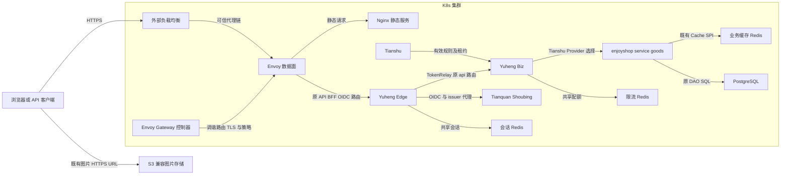
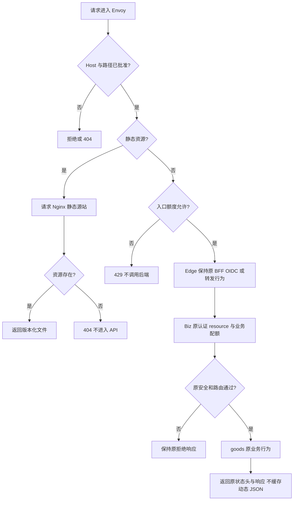
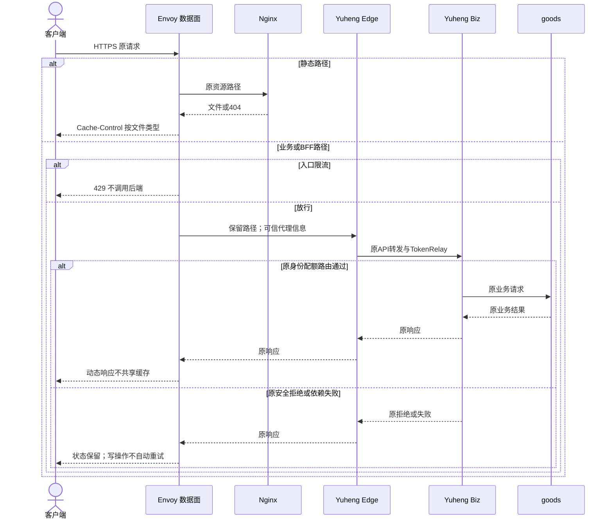

# 首页高可用：动静分离、Yuheng 与 K8s 入口架构

| Field | Value |
| --- | --- |
| Document | `2026-10-09-16-39-homepage-kubernetes-gateway-architecture.md` |
| Template Version | `7` |
| Status | Accepted |
| Type | Architecture |
| Complexity | Complex |
| Complexity Drivers | K8s 外部入口与平台业务网关分工、BFF/OIDC 信任边界、多副本限流、缓存一致性与部署故障恢复 |
| Created | 2026-10-09 16:39 Asia/Shanghai |
| Updated | 2026-10-09 21:35 Asia/Shanghai |
| Owner | mario |
| Repository | enjoyshop |
| Scope | 第5章首页高可用的系统架构与部署基线；入口、静态资源、缓存职责、限流及运行验收 |
| Change Surface | 设计后续 deployment/k8s 的入口/静态服务/治理/部署契约和验收文档；不新增 Java、广告 API/表、页面，不修改 Egon-COLA 平台源码；本轮仅创建本 Spec |
| Affected Chapters | §7, §8, §13, §14, §15, §16, §17, §18 |
| Source Requirement | 用户附件《第5章 网站首页高可用 nginx+lua》；用户要求“基于我的 egon-cola…服务后续会部署到 k8s…先给我方案”，并确认上一轮推荐方案审核通过、指定 writing-spec |
| Baseline Revision | main / 74060d5c5e36cec00cfbb814160002394f017cd7；已有未跟踪商品管理 Spec 与 Plan 保留不动；平台源码为另一个只读工作区快照，不声称与本提交同版本 |
| Amends | None |
| Supersedes | None |
| Depends On | [品牌与工程骨架 Spec](2026-09-23-17-16-enjoyshop-scaffold-brand-crud.md) §§5.4、6.1：保持 goods Light，不自建业务网关；[目录与文件 Spec](2026-09-28-21-50-distributed-file-catalog-lookups.md) §§9、16：保持 S3 图片与上传安全契约 |
| Related Specs | [商品管理 Spec](2026-10-09-10-55-product-management-lifecycle.md) §§1、9、11，仅供背景，不继承其 Review 状态为已接受规范 |
| Related Plans | [首页部署配置准备Plan](../plan/2026-10-09-18-55-homepage-gateway-deployment-preparation.md) |

## 1. Summary

采用动静分离：静态站点独立托管；图片继续使用既有 S3 兼容对象存储；K8s 外部流量入口采用 Gateway API + Envoy Gateway；已有 Yuheng Edge 负责浏览器 BFF/OIDC，Yuheng Biz 负责业务路由和治理。Java 业务查询复用 Egon Spring Cache 的 L1 Guava + L2 Redisson，不把广告查询、数据库访问和缓存更新搬到 Lua。

用户已接受技术方向。本文件仍为 Review，因为本轮首次形成具体 Spec，方向批准不代表新增细节、实际部署或业务开发已完成。本 Spec 是系统架构/部署基线，不是广告业务功能 Spec；原始问题聚焦“nginx/OpenResty/其他网关”和 K8s。广告 CRUD、广告读取契约、匿名站点租户映射及前端需在对应功能设计中闭合，不能凭教学代码或本架构图生成生产接口。

成功判据是职责唯一、动静分离、无重复业务网关和缓存、明确多副本/依赖故障边界，且可据此准备部署 Plan。环境参数及发布验收见 §15、§16；没有实际集群时，文档通过不等于可以部署。

## 2. Background and Current State

### 2.1 Business and user context

教程以 OpenResty 直读 MySQL、写 Redis、本机共享内存缓存广告，再按 IP 漏桶限流。目标是减少首页回源并保护系统，而不是必须使用 Lua。教程的 SQL 拼接、root worker、公开 ad_update、缺少 Redis TTL/错误处理、多节点失效与故障切换，不进入本设计。

### 2.2 Repository evidence

路径缩写：M=`enjoyshop-service/enjoyshop-service-goods`；J=`M/src/main/java/top/egon/enjoyshop/goods`；E=`/Users/mario/SelfProject/Egon-COLA`；Y=`E/egon-cola-xingyuan/egon-cola-yuheng`。缩写只定位现有文件，不是新增模块。

| Evidence ID | Classification | Exact path/symbol/decision/command | Observed fact | Design significance | Verification limit/freshness |
| --- | --- | --- | --- | --- | --- |
| EVD-001 | User decision | 本会话上一轮方案及“确认…审核通过” | 接受 Envoy 入口、Yuheng、静态独立托管与 Java 缓存方向 | 无需重新选择技术栈 | 只批准方向，不授权安装/部署/启动 |
| EVD-002 | Static repository | M/pom.xml；M/src/test/java/top/egon/enjoyshop/goods/architecture/LightPersistenceArchitectureTest.java | Java 21、Egon parent 5.4.1；MP-SDJ、Cache、Shoubing/Jianshen 和 HTTP 注册依赖已有；测试约束 Repository/DAO/PO | 保持非 open Light 与当前持久化所有权 | 未执行测试，非运行证明 |
| EVD-003 | Static repository | M/src/main/resources/application.yml 与 application-dev.yml/application-test.yml/application-prod.yml；J/infrastructure/config/RedisConfig.java | 缓存开启，已有 L1/L2/锁/TTL 配置；goods 宿主负责 Redis | 不再建设 OpenResty 缓存 | 当前配置不证明 Redis HA |
| EVD-004 | Static repository | E/egon-cola-components/egon-cola-component-common/egon-cola-component-common-cache-spring-boot-starter/README.zh-CN.md §§4–6；core/EgonColaTwoLevelCache.java | 租户键与 MDC 强制；事务后失效；Pub/Sub 失效 L1；故障回源、TTL 最终一致 | 缓存能力复用，不能承诺即时全局下架或 Redis 故障无影响 | 源码/README，不是多进程验收 |
| EVD-005 | Static repository | Y/yuheng-edge-gateway/pom.xml；src/main/resources/application.yml；edge/controller/EdgeSessionController.java；edge/config/EdgeSecurityConfiguration.java | SCG WebFlux BFF、Redis Session、TokenRelay；/api/** 转 Biz；/bff、OIDC 与 issuer 代理已有 | Envoy 不重复实现登录/授权 | 不证明 enjoyshop 前端已接入 BFF |
| EVD-006 | Static repository | Y/README.zh-CN.md；Y/yuheng-biz-gateway/src/main/resources/application.yml；Y/yuheng-runtime-core/.../traffic/service/DistributedTokenBucketRateLimiter.java | 自研 Biz 通过 Tianshu 发现 Provider；存在 Redis 原子令牌桶及 DENY/LOCALFALLBACK | 集群入口与业务治理分离；严格配额不用本地 fallback | 未验证启用规则与真实配额键解析 |
| EVD-007 | Static repository | enjoyshop-web/pom.xml；rg --files 全仓文件清单 | web 仅空聚合 POM；未发现首页静态产物、广告模块、deployment/k8s | 不伪称已有首页可发布，不新增完整业务模块 | 文件检索是本次静态快照 |
| EVD-008 | Static repository | J/adapter/goods/FileController.java；J/start/config/NativeHttpSecurityConfiguration.java；M/src/main/resources/db/egon-mp/repository-manifest.json | POST /api/v1/files 有专用认证链、10 MiB 文件/11 MiB multipart；DB 使用受管 manifest | 入口不得吞并上传鉴权、限制或改 DB | 未测公网上传与资源 audience 兼容 |
| EVD-009 | Official primary source | [Gateway API](https://gateway-api.sigs.k8s.io/guides/getting-started/introduction/)；[Envoy 限流](https://gateway.envoyproxy.io/docs/concepts/rate-limiting/)；[可信 IP](https://gateway.envoyproxy.io/docs/tasks/security/restrict-ip-access/) | 标准需控制器实现；限流扩展资源；local 不共享；IP 依赖可信代理配置 | Gateway API 与 Envoy CRD 分层管理 | 2026-10-09 核对；未选集群版本，非安装验证 |
| EVD-010 | Official primary source | [社区 ingress-nginx 退役公告](https://kubernetes.io/blog/2025/11/11/ingress-nginx-retirement/) | 公告说明 2026-03 停止维护 | 新部署不选社区 ingress-nginx；普通 Nginx 静态服务不受此结论替代 | 2026-10-09 核对 |

### 2.3 Problem statement and gap

现有 goods 是业务服务，并非首页 Web Server。Yuheng 是平台业务入口，并非静态文件源站，也不管理 K8s Gateway。当前缺少本应用部署路由、版本/证书/网络清单和运行验收。需要建立部署契约，不能通过引入 Lua 或复制 Spring Cloud Gateway 解决职责缺口。

### 2.4 Evidence and current-chain map

| Entry/trigger | Current call chain | Data read/written | External dependency | Consumers | Evidence |
| --- | --- | --- | --- | --- | --- |
| goods HTTP | Controller → Manage → Domain Service → Repository → DAO/XML | 租户业务表；某些 Repository 有缓存 | PostgreSQL、Redis | 当前 API 调用者 | EVD-002、003、008 |
| 平台浏览器 API | Yuheng Edge /api/** → TokenRelay → Yuheng Biz → Provider | Redis Session、规则与租约快照 | Shoubing、Tianshu、Provider | 平台浏览器/Bearer 客户端 | EVD-005、006；不代表 enjoyshop 已联通 |
| 缓存读与写后失效 | Spring Cache SPI → EgonColaTwoLevelCache → Redis；提交后更新/通知其他 L1 | 缓存副本，不是业务源数据 | Redis Pub/Sub | 当前 Java 缓存调用方 | EVD-004 |
| 首页静态请求 | 当前仓库无可部署前端产物 | 无 | 无已证实源站 | 教程预期浏览器 | EVD-007 |

## 3. Goals and Non-goals

### 3.1 Goals

确认静态托管、K8s 入口、平台业务治理、缓存的唯一责任；给出后续部署文件和配置的所有权、路由规则、故障/回滚及验收边界。使未来广告设计遵循已选技术方向。

### 3.2 Non-goals

不设计或实现广告 CRUD/API/数据库/页面，不为不存在的广告模块指定完整类树；不修改商品管理、上传或既有安全链；不迁移 Token/audience；不新增 Maven 依赖、Outbox、Service Mesh、APISIX 或自写 Lua；不安装控制器、运行数据库/集群/服务、打开浏览器、部署或提交本地其他文档。CDN 是后续性能选项，不是首期必需部署。

### 3.3 Change Surface and Design Depth

| Area/layer | Disposition | Exact repository evidence | Changed or preserved behavior/contract | Required Spec treatment | Chapter(s) |
| --- | --- | --- | --- | --- | --- |
| K8s 入口与静态部署契约 | Affected | EVD-005–010；目标 deployment/k8s | 新增入口路由与部署职责；只在后续 Plan 创建清单 | 详细路由/安全/HA/回滚设计 | §7, §8, §13, §14, §15, §16, §17, §18 |
| Java 缓存组件与限流组件 | Context-only | EVD-003、004、006 | 复用现有缓存及令牌桶；不新增缓存区域/POJO/算法 | 引用能力与限制；运行验收约束 | §7, §13, §14, §15 |
| goods API、鉴权、DTO | Unchanged | EVD-008；ProductController.java、NativeHttpSecurityConfiguration.java | 保留 method/path、参数、封装、认证/授权与文档 | 边界证明，不展开 API 设计 | §9, §10 |
| 业务数据库/DDL | Unchanged | EVD-008；db/egon-mp/repository-manifest.json | 不增表、不改查询/约束/拓扑/事务 | 无 ER 重画，无迁移 | §11 |
| 首页页面、广告业务 | Not applicable | EVD-007；原始请求聚焦网关选择 | 本仓无该页面/模块，本 Spec 不创建 | N/A，未来功能需专属 Spec | §10, §12 |
| 平台源码与部署资源 | Context-only | EVD-005、006 | 平台 owner 负责 Edge/Biz/Tianshu 等实例；本项目只消费稳定边界 | 接入前验收，禁止跨仓源码修改 | §7, §8, §16 |

## 4. Requirements and Acceptance Criteria

| ID | Atomic requirement | Priority | Observable acceptance criteria | Source |
| --- | --- | --- | --- | --- |
| REQ-001 | 静态资源与 API 请求分流 | Must | 静态资源命中源站不经 Java；API 不进入 SPA fallback | 上轮已批准动静分离 |
| REQ-002 | K8s 使用 Envoy Gateway 实现 Gateway API 入口 | Must | 路由归属及 Accepted/ResolvedRefs/Programmed 检查明确；不引入社区 ingress-nginx | 已批准入口技术方向 |
| REQ-003 | 保留 Yuheng Edge/Biz 和可信身份职责 | Must | 入口不执行业务权限；原认证/租户校验保持；新增匿名接口不能由通配路由绕过保护 | 已批准 Yuheng 分工 |
| REQ-004 | 业务缓存使用 Egon Java 两级组件 | Must | 没有 Lua 数据库访问/公开刷新路由/独立 Redis 数据结构；文档说明 TTL 一致性与广告时间约束 | 已批准缓存方向 |
| REQ-005 | 入口保护与业务配额分别拥有唯一执行点 | Must | 明确 local 与全局区别；严格配额不随 Pod 扩容线性增加；Redis 失败不得伪称严格额度 | 已批准限流方向 |
| REQ-006 | 多副本、依赖故障和滚动退出有验收边界 | Must | 节点/Pod 失效、控制面重启、依赖失败、drain 有独立验收；单 Redis 不宣称 HA | 原章节高可用及 K8s 部署 |
| REQ-007 | 保持静态发布、上传与业务契约兼容 | Must | 上传限制/认证、图片 URL、API wire contract、既有 DB 均保持；静态文件有版本和回滚 | 最小安全改动、已批准 S3 |
| REQ-008 | 当前只交付可审核的 Spec | Must | 仅新 Spec；严格验证通过；无 Plan、代码/清单执行或服务启动 | 用户 writing-spec 与 AGENTS |

### 4.1 Scenario matrix

| Scenario | Actor/trigger | Preconditions | Main path | Alternative/failure path | Data/state change | Observable result | Requirements |
| --- | --- | --- | --- | --- | --- | --- | --- |
| 静态首次访问 | 浏览者打开 / | 静态产物已发布 | Envoy → 静态源站 | 源站失败返回 5xx，不回退到 goods | 无业务写入 | HTML/资源可用，Java 零调用 | REQ-001、007 |
| API/BFF 访问 | 浏览器/API 客户端 | 已配置 route/resource/token | Envoy → Edge → Biz → goods | 认证/授权失败保持原响应，不改成 HTML | 原业务按现有契约执行 | 响应与既有端点一致 | REQ-002、003、007 |
| 错误路径/文档探测 | 未授权访客 | 非公开路径 | 不匹配公开业务路由 | 拦截 /actuator 与 docs；不得进入静态 fallback | 无 | 404 或访问拒绝；内部数据不暴露 | REQ-001、003 |
| 突发与重复写请求 | 恶意/正常客户端 | 入口政策已验收 | token bucket 容量内放行 | 429；代理不重试写请求 | 不增加业务重复写 | 业务审计无重复调用 | REQ-005、007 |
| Redis 故障 | 请求中 Redis 不可用 | 缓存/会话/限流依赖独立 | 组件按原策略处理 | 缓存回源需受控；认证与严格配额不可 fail-open | 无新增数据修复 | 可定位依赖类别；不爆量回源 | REQ-004、005、006 |
| Pod 删除/升级 | 运维滚动更新 | ≥2 副本、Ready 和 drain | 停接新请求→完成在途→退出 | 超时取消，有监控；写结果未知不自动重试 | 只保留真实已提交状态 | 存活实例继续服务 | REQ-006、007 |
| 控制面或 Tianshu 暂不可用 | 外部依赖失败 | 已有有效规则/租约 | 已有数据面按有效快照运行 | 无有效规则/发现状态的冷启动不得 Ready | 不修改规则 | 可观测降级，非无限期沿用过期租约 | REQ-006 |
| 静态版本回滚 | 发布者撤销版本 | 旧资源仍保留 | 恢复前一 HTML/镜像 | 资源缺失阻止切换 | 静态版本变化；无 DB 变化 | 页面引用完整，无新旧文件混合覆盖 | REQ-007 |
| Spec 验收 | 决策 owner 审核 | 仅文档改动 | 静态证据→设计→严格校验 | 校验失败修正文档；不部署补证据 | 新文档 | Review，可审核 | REQ-008 |

### 4.2 Use-case analysis

| Actor ID | Actor/role | Goal and responsibility | Entry/channel | Permission/tenant context | Evidence |
| --- | --- | --- | --- | --- | --- |
| ACTOR-001 | 网站浏览者/API 客户端 | 获取页面或调用已有业务 | HTTPS、已有 API | API 保持原身份/租户要求 | 教程及 EVD-005、008 |
| ACTOR-002 | 发布/运维 owner | 发布并恢复入口和静态服务 | 受控部署流水线/集群 API | namespace 最小 RBAC，凭据来自 Secret | 用户 K8s 目标 |
| ACTOR-003 | 设计审核 owner | 审核方案边界与证据 | 本 Spec | mario | EVD-001 |

| ID | Use case/goal | Primary actor | Supporting actors/systems | Trigger | Preconditions | Main success outcome | Alternatives/failures | Postconditions | Requirements | Interfaces/pages | Tests |
| --- | --- | --- | --- | --- | --- | --- | --- | --- | --- | --- | --- |
| UC-001 | 快速获取静态页面和资源 | ACTOR-001 | Envoy、静态源站/S3 | 打开网站 | 已发布完整产物和 TLS | 获取一致版本资源，API 独立 | 静态失败/API 不误返 HTML | 无业务数据变更 | REQ-001、002、007 | 既有网站目标；无新业务 API | TEST-001、002、008 |
| UC-002 | 安全调用已有业务 | ACTOR-001 | Edge、Biz、goods、身份系统 | 发起 API | 凭据/资源绑定与路由验收 | 原业务结果，限流有边界 | 拒绝/超时/配额失败；写请求不代理重试 | 原事务语义保持 | REQ-003、004、005、007 | 原 /api/**、BFF/OIDC | TEST-003、004、005、009 |
| UC-003 | 维持服务并安全发布恢复 | ACTOR-002 | K8s、数据面、Tianshu | 故障/发布/回滚 | 有健康副本及已归档版本 | 流量迁移，依赖故障可定位 | drain/Ready 失败停止发布；保持旧版本 | 无 DB 自动修复 | REQ-002、006、007 | K8s 资源、内部探针 | TEST-006、007、008、010 |
| UC-004 | 审核完整架构规格 | ACTOR-003 | 静态校验器 | 审核文档 | 仓库与技能资源已核对 | 可追溯设计与运行门禁 | 文档缺陷由编写者修复 | 仅文档，状态 Review | REQ-008 | 本文 §20 | TEST-011 |

## 5. Constraints, Assumptions, and Decisions

### 5.1 Confirmed constraints

遵循用户提供 AGENTS：不启动服务或打开浏览器，不改无关文件，既有迁移不可修改；本 Spec 不涉及任何 DDL，亦不解决历史 Flyway 与受管 DDL 的差异。新 Spec 用 Template 7，当前只产文档。后续 Plan/实现须重新确认工作树、部署 owner 和实际集群版本。

### 5.2 Small-gap assumptions

| ID | Inference | Repository evidence | Why locally reversible | Impact if wrong |
| --- | --- | --- | --- | --- |
| ASM-001 | 应用部署设计文件统一定位 deployment/k8s | EVD-007：当前无部署目录；使用常见按平台归档路径 | 仅新增文件路径，未绑定运行资源 | Plan 可改路径，不改业务契约 |
| ASM-002 | 文档区分 app namespace 与 platform namespace，允许同命名空间合并 | EVD-005：平台与 goods 独立部署边界 | namespace 字符串是部署输入，职责不变 | 跨 namespace 时必须有显式 ReferenceGrant/NetworkPolicy |

### 5.3 Resolved decisions

| ID | Decision | Decision owner | Evidence and rationale | Requirements |
| --- | --- | --- | --- | --- |
| DEC-001 | Envoy Gateway + Gateway API；Nginx 仅静态源站；CDN 可后加 | mario | 已批准方案，EVD-009、010 | REQ-001、002 |
| DEC-002 | 复用 Edge/Biz；不新建 enjoyshop_gateway 或复制鉴权/注册发现 | mario | 已批准方案，EVD-005、006、既有骨架 §5.4 | REQ-003 |
| DEC-003 | Java 两级缓存是业务缓存唯一所有者，网关不连接业务数据库 | mario | 已批准方案，EVD-003、004 | REQ-004 |
| DEC-004 | 入口 local 保护，业务共享配额在 Yuheng；不额外部署 Envoy 全局 RLS | mario | 已批准分工；EVD-006 已有分布式 limiter | REQ-005 |
| DEC-005 | 本文件为架构 Spec；不扩展为广告功能实现或修改其他 Spec | 本次范围解释 | 原问题聚焦网关、K8s；EVD-007 无广告/前端 | REQ-008 |

### 5.4 Open major decisions

本架构范围无待选技术路线。§15 的域名/版本/证书/配额/集群参数是未执行的部署输入，不可猜测或作为上线许可。广告功能的可见性 SLA、匿名租户归属和 API 属独立功能决策；本 Spec 不作假定，不允许据此开放新匿名路径。

## 6. Project Technology Context

| Concern | Current choice | Repository evidence | Constraint on design |
| --- | --- | --- | --- |
| Runtime/build | Java 21、Egon parent 5.4.1、Maven wrapper | M/pom.xml、mvnw | 不增加/升级 Java 依赖 |
| HTTP/持久化 | Spring MVC goods、MP-SDJ/PostgreSQL、受管 manifest | M/pom.xml、EVD-008 | 既有 API 与数据库不变 |
| 平台 | Edge=SCG WebFlux BFF；Biz=自研数据面；Tianshu=租约发现 | EVD-005、006 | Envoy 不替代业务注册发现 |
| 缓存 | Spring Cache、Guava L1、Redisson L2 | EVD-003、004 | TTL 最终一致，无天然严格全局即时失效 |
| 前端 | enjoyshop-web 只有 POM | EVD-007 | 发布前必须提供真实静态产物；不声称已建页面 |
| 新部署系统 | 选择 Envoy Gateway；实际安装/版本未提供 | EVD-001、009 | 使用兼容矩阵发布清单，不依赖 latest |

### 6.1 Java architecture profile and capability baseline

| Architecture profile | Archetype/template or base package | Exact evidence and verifier | Existing deviations | Design action |
| --- | --- | --- | --- | --- |
| Egon-COLA Light，native/non-open | E/egon-cola-archetypes/source-projects/egon-cola-source-light；top.egon.enjoyshop.goods | M/pom.xml；M/src/test/java/top/egon/enjoyshop/goods/architecture/LightPersistenceArchitectureTest.java；模板同名 verifier | 教学样例和命名遗留，不在本次范围 | 保留 adapter→application→domain→infrastructure Repository→DAO；不改包或增 Java 类 |

| Need | Spring/JDK candidate | Spring Boot Starter candidate | Egon-COLA/module candidate | Proven gap | Decision/dependency impact |
| --- | --- | --- | --- | --- | --- |
| K8s 外部入口 | 无业务 JVM 需求 | 已有 Edge 不管理 Gateway API | Yuheng 平台不是 K8s controller | 缺集群入口所有者 | 已批准外部 Envoy，非新增 Maven 依赖 |
| 业务缓存 | Spring Cache | goods 已有 cache starter | EgonColaTwoLevelCacheManager | 本任务无组件缺口 | Keep；不新建 cache manager |
| 身份/BFF | Spring Security/OAuth2 | 平台 Edge 已有 | Edge + Shoubing；goods 原安全链 | 需运行验证版本契约，不是复制实现理由 | Keep，不改 token/audience |
| 严格共享配额 | 本地桶不能共享 | 不新增 RedisRateLimiter | DistributedTokenBucketRateLimiter | 策略配置/真实维度需接入验证 | Keep，禁止假定现有规则已开启 |
| 静态服务 | Nginx 文件服务 | 不需要 Boot | S3 兼容存储已选 | 无前端产物 | 后续静态镜像部署，不生成业务工程 |

### 6.2 User-mandated Java rule compliance

本 Spec 不新增或改动 Java、Spring profile、DTO、DAO、SQL、Event；以下 N/A 只适用于该变更面，不是后续 Java 功能的规范豁免。

| Literal rule | Affected? | Repository evidence | Exact design decision | Files/types/interfaces | Validation/test evidence | Status/blocker |
| --- | --- | --- | --- | --- | --- | --- |
| Rule 1 | No | §8 无 Java target | 不新增载体或行为类 | 既有 Java 保持 | TEST-011 diff 范围检查 | N/A |
| Rule 2 | No | §9 无新增方法/handoff | 保留既有分层校验 | NativeHttpSecurityConfiguration 等不变 | TEST-003 保持原响应 | N/A |
| Rule 3 | No | §10 类型不变 | 无 POJO/record/Converter 设计 | 原类型不变 | TEST-011 | N/A |
| Rule 4 | No | §8 无业务 Bean | 不新增 logger/Bean/injection | 原 Bean 不变 | TEST-011 | N/A |
| Rule 5 | No | §8 无工具类/POM | 不新增工具依赖 | POM 不变 | TEST-011 | N/A |
| Rule 6 | No | §9 wire 不变 | 保持 Boot Jackson，不生成响应包装器 | 原 JSON 类型不变 | TEST-003 | N/A |
| Rule 7 | No | §8 不改 application*.yml | 集群部署输入独立管理，不制造 Spring 新键 | base/dev/test/prod 不变 | TEST-011 | N/A |
| Rule 9 | No | 本任务是部署架构，§13 无新复杂 Java 逻辑 | 复用现有路由/限流流水线与 Cache-Aside；不建策略类 | 无新业务类 | TEST-004、011 | N/A |
| Rule 10 | No | 无新 Java 时间字段 | 不改时间模型；部署 timeout 是 CRD 语义 | 原 java.time 不变 | TEST-011 | N/A |
| Rule 11 | No | §6.1 已确认 Light；§11 schema 不变 | 保持组件/MP/CQE；不发布新 Event，不生成模块/DDL | 原 Light/manifest 不变 | TEST-011 | N/A |

## 7. Architecture Design

### 7.0 Minimum-design baseline and element-necessity audit

先比较直接用外部 LB→Yuheng 并单独托管静态的基线。基线没有集群路由控制器、声明式 TLS/路径/状态协调能力，不能满足已批准 K8s 入口目标，因此增加 Envoy，但不重复业务治理。

| Proposed element | Change | Requirements | Existing/direct alternative | Concrete inadequacy of alternative | Added calls/state/coupling/failures/migration/operations | Verdict |
| --- | --- | --- | --- | --- | --- | --- |
| Envoy Gateway 数据面/控制器、Gateway API 对象 | New | REQ-002、006 | LB 直达 Edge | 缺本应用声明式静态/API 分流与控制器调谐 | 1 个代理 hop；CRD/version/RBAC、配置失败边界 | Add |
| Nginx 静态 Deployment | New | REQ-001、007 | Java 托管、S3 静态站点 | Java 托管耦合发布/扩容；首期静态镜像可明确回滚；S3 站点仍可作为后续替代 | 镜像、2 副本、资源版本；无业务 DB 权限 | Add（后续真实前端产物到位后） |
| 图片 S3 URL | Keep | REQ-007 | 再加 FastDFS/网关字节转发 | 现有 S3 已满足，无新增理由 | 无新存储或 API | Keep |
| Edge/Biz/Tianshu 与既有共享 limiter | Keep | REQ-003、005 | 新 enjoyshop Gateway、入口二次鉴权 | 现有平台已拥有责任 | 保持原网络 hops，不增加第二业务控制面 | Keep |
| Java Spring Cache | Keep | REQ-004 | OpenResty shared dict→Redis | 增加独立失效机制/业务权限/数据格式 | 保持原缓存 state，无新缓存区域 | Keep |
| OpenResty/Lua、Envoy RLS、Service Mesh、CDN | New（未选） | REQ-004、005、008 | 原有组件/静态源站 | 首期无必须缺口；CDN 待有压测收益 | 如选会增加运行依赖和故障面 | Remove（不进入首期） |
| 广告 API/表/页面/公开刷新 job | New（未选） | REQ-008 | 独立业务 Spec | 当前请求不决定完整业务契约 | 不新增接口/业务状态 | Remove（本 Spec 范围外） |

| Path | Network calls | Client states | Server contracts/state | Failure and TOCTOU points | Additional user/business value |
| --- | --- | --- | --- | --- | --- |
| Direct baseline | 客户端一次业务请求；LB→Edge→Biz→goods 3 个内部转发段 | 原 loading/success/error | 原业务、会话/规则 | LB/平台/Provider | 保持原 API |
| Selected design | 客户端仍一次；LB→Envoy→Edge→Biz→goods 4 段；静态路径 LB→Envoy→Nginx，不调用 Java | API 不增加预查询状态 | 新路由/TLS配置，不增业务契约 | 额外 Envoy 跳；没有 fetch-then-forward 参数 API | K8s 路由调谐与独立静态发布 |

### 7.1 System Architecture Design



图中 Redis 是逻辑用途分离，不宣称现有独立实例。会话/身份及严格限流不应受可驱逐业务缓存同一资源池挤压；物理实例和 HA 由环境 owner 在发布清单确认。不自动引入新实例。Tianshu 引导链及各平台服务依赖保持原设计。

| Module/component | Capability and data owned | Inputs/outputs | Allowed dependencies | Forbidden responsibility | Requirements |
| --- | --- | --- | --- | --- | --- |
| Envoy 控制器/数据面 | 集群路由、TLS、入口资源保护 | LB HTTPS→ClusterIP | 配置 API、K8s Secret、目标 Service | 业务数据库/广告缓存/角色判定/Token 签发 | REQ-002、003、005 |
| Nginx | 只读版本化前端文件 | 原静态 URL | 镜像文件 | Lua、DB/Redis、业务鉴权 | REQ-001、007 |
| Yuheng Edge/Biz | 原会话、认证/resource 绑定、路由/治理 | 原 BFF/API→Provider | 身份/Tianshu/既有治理存储 | 静态托管、广告写入 | REQ-003、005 |
| goods 与其 Repository | 原业务与业务缓存 | 原 API 与 SQL | 原 MP/Cache | 管理入口 CRD | REQ-004、007 |
| 发布 owner | immutable 镜像、路由/证书版本 | 已批准清单→集群 | 最小 RBAC、Secret | 自动 repair/改历史 DDL | REQ-006、007 |

### 7.2 High-Level Design

#### 7.2.1 Critical business/control flowchart



#### 7.2.2 High-level decision and quality matrix

| Concern/use case | Required behavior | Selected mechanism | Failure/degradation behavior | Trade-off | Verification | Requirements |
| --- | --- | --- | --- | --- | --- | --- |
| 静态与 API 隔离 | API 永不返回 SPA HTML | 精确路由优于根前缀；静态 fallback 有路径排除 | 资源缺失 404、API 保持原响应 | 独立静态源站 | TEST-001、002 | REQ-001 |
| 安全与租户 | 入口不信任客户端身份头 | 原 Edge TrustedIdentityHeaderFilter、Biz/resource 及 goods 安全链 | 验证失败不 fail-open | 未验收资源绑定禁止上线 | TEST-003、009 | REQ-003 |
| 严格配额 | 多副本共享 | 复用 Yuheng 分布式桶；严格规则 DENY | Redis 故障拒绝；LOCALFALLBACK 只可作为非严格可用性策略 | 配额依赖 Redis；入口 local 随实例变化 | TEST-004、005 | REQ-005 |
| 可用性 | 节点失效仍有可用数据面 | 至少2副本、跨节点、Ready/drain | 冷启动缺有效规则不得 Ready | 集群须有足够节点/余量 | TEST-006、007 | REQ-006 |
| 缓存正确性 | 唯一 owner 和已知一致性边界 | 原 Cache SPI | Pub/Sub 丢失受 TTL 限制；不是全局强一致 | 广告 SLA 需功能 Spec | TEST-005、011 | REQ-004 |
| 发布兼容 | 客户端不混用资源版本 | immutable 静态镜像/hash 资源；保留前版 | 回退前版，禁止覆盖 hash 文件 | 资源保留容量 | TEST-008 | REQ-007 |

### 7.3 Detailed Design

#### 7.3.1 Detailed component collaboration

路由由 app HTTPRoute 引用平台 owner 已提供的 Edge ClusterIP。跨 namespace 使用最小 ReferenceGrant：仅 app namespace 的 HTTPRoute 可引用指定 Edge Service；不得放开整个 namespace 服务。现有 Edge 上游指向 Biz 的稳定 Service DNS，Biz 的下游继续由 Tianshu Provider 发现。仅配置部署注入，不改平台源码；若平台版本无对应配置能力，停止该接入并记录需要另立平台变更 Spec。

| 匹配规则（同一站点域名） | backend | 重写/缓存/安全 | 责任及验收 |
| --- | --- | --- | --- |
| /api 前缀、/bff 前缀、/oauth2/authorization 前缀、/login/oauth2/code 前缀 | 平台 yuheng-edge Service | 保留完整 path/query；不缓存 Cookie/Authorization 请求与响应；无代理重试 | Edge 当前 routes/controller/security；TEST-003、009 |
| /tenants、/platform 前缀 | 同 Edge | 保持现有 issuer 代理，不自行拆解 issuer 路径 | 仅批准域名/租户 issuer 路径，逐环境核对公开 origin |
| /actuator、/v3/api-docs、/swagger-ui、/graphql、/mcp | 无公开 backend | 首期无此入口，不能落入 SPA fallback | docs/GraphQL/MCP 现有运行不受修改；需要公开须独立确认 |
| 根 / 与静态文件 | enjoyshop-static Service | 静态 Nginx；前述特殊前缀必须排除；不存在文件返回404 | 真实产物到位后创建静态 Deployment |

路径前缀使用 Gateway API PathPrefix 的路径段语义，禁止用正则扩大范围。由于根 / 会匹配所有路径，Nginx 配置还必须对非静态 API/docs 前缀显式拒绝；不能仅凭“未定义业务 HTTPRoute”就宣称 API/docs 已拒绝。首页无 SPA 产物时只用文件存在检查；未来 history 路由 fallback 需独立页面设计确认。

保留 HTTP 方法、query、Content-Type、Location、Set-Cookie、业务状态与 body；不增加代理 JSON 包装器。429/502/503/504 是传输层结果，客户端不能假定每个结果都是业务 JSON。公网 HTTP 只重定向 HTTPS；不得重写 OIDC callback path 或 issuer。外部证书由 Secret 提供，Envoy→Edge 保持现有 HTTPS 并校验证书名称/CA，禁止 skip TLS verification；对应版本必须支持并验收 BackendTLSPolicy。

匿名广告路线在架构上可不建立 BFF Session，但当前没有可核对的 endpoint/可信租户规则，因此本轮**不配置任何匿名绕行路由**。未来功能 Spec 才能明确具体 Method+URL、公开数据范围、站点映射、候选缓存时间筛选与失效 SLA。现有 /api/** 不能整体直通 goods。

#### 7.3.2 Critical-path Mermaid swimlane



OIDC/BFF 本地接口由 Edge 自己处理；图中 Edge→Biz 分支仅表示 API，不把 /bff 或 callback 当作 Biz 请求。

#### 7.3.3 Transactions, consistency, concurrency, and idempotency

| Concern/state change | Owner and boundary | Mechanism/isolation/lock | Concurrent or duplicate behavior | Commit/visibility point | Failure result | Requirements/tests |
| --- | --- | --- | --- | --- | --- | --- |
| 路由/TLS配置 | 集群控制器；发布者是配置 owner | 声明式调谐、条件检查、归档资源版本 | 不承诺所有 proxy 同时切换；变更须向后兼容 | Accepted/ResolvedRefs/Programmed 与流量验收均完成 | 维持可用前版或停止发布 | REQ-002 / TEST-010 |
| 业务命令 | 既有 Manage/Domain 事务 | 本 Spec 无事务修改 | 代理不自动重试 POST/PUT/PATCH/DELETE；未知提交交原调用者处理 | 原 DB 提交点 | 原错误/提交未知，入口不补偿 | REQ-007 / TEST-003 |
| 缓存副本 | 既有 Repository/Cache manager | 原事务后 put/evict、TTL/PubSub | 不承诺跨 Pod 强一致；不直接写 Redisson 结构 | 按既有组件提交后语义 | L2故障按组件策略回源；新增广告需受控回源设计 | REQ-004 / TEST-005 |
| BFF Session与撤销 | 既有 Edge/身份系统 | 原 Redis Session/token 管理 | 不依赖 Nginx/Envoy sticky session 维持正确性 | 原 session/身份契约 | 存储失效不得放开认证 | REQ-003 / TEST-009 |
| 严格配额 | Biz分布式 limiter | Redis 原子桶、policyId/stateEpoch/keyHash | 同一业务额度跨实例共享；local不是严格额外额度 | limiter.acquire 的原子判定 | DENY，不伪称 LOCALFALLBACK 仍严格 | REQ-005 / TEST-004 |

#### 7.3.4 Failure semantics, recovery, and reconciliation

| Failure point | Detection | Immediate control flow | Data/transaction state | Retry and idempotency | Caller/frontend result | Recovery/reconciliation owner | Verification |
| --- | --- | --- | --- | --- | --- | --- | --- |
| Envoy controller停止 | 调谐条件/控制器告警 | 保留已有数据面；禁止未生效版本发布 | 业务数据不变 | 发布者恢复控制器再验收；不盲目反复 apply | 新配置未生效，已有流量能力实测 | 集群 owner | TEST-007、010 |
| 后端未 Ready | Service endpoint/503 | 不选该实例；阻止发布扩大 | 无新增入口事务 | 首期不配置代理重试，含GET；避免多层重试叠加 | 5xx；原客户端策略 | 平台/app owner | TEST-006 |
| 会话/身份Redis失败 | 原 Edge/身份日志指标 | 保持原拒绝，不退化匿名写 | 无入口修复 | 不复制/补发 token，不记录敏感值 | 原错误，需重新会话或恢复依赖 | 身份 owner | TEST-005、009 |
| 业务缓存Redis失败 | CACHE_L2_OPERATION_FAILED 与回源指标 | 原组件回源；发布前证实数据库受保护 | 原业务权威仍在DB | 入口无重试；需要新增 bulkhead 是后续功能/平台变更，不暗中新增 | 原 API结果或原失败 | app/Redis owner | TEST-005 |
| 配额Redis失败 | limiter degraded/unavailable | 严格桶DENY；入口local仍独立 | 业务调用未执行 | 不自动local替代严格配额 | 原限流/依赖拒绝；429与依赖失败码按平台实际契约 | 平台owner | TEST-004、005 |
| 静态源站失败/旧资源缺失 | 5xx/404、静态完整性检查 | 不回源Java；阻止切换或回滚完整旧产物 | 无业务写 | 客户端可重取静态，不重试业务命令 | 页面资源失败可定位 | 静态发布owner | TEST-001、008 |
| Tianshu失败/过期租约 | 规则/Provider健康与Ready | 原有效快照可用；不可维持过期Provider/冷启动伪Ready | 不改规则/租约历史 | 平台原协议恢复；无业务命令代理重试 | 原路由不可用结果 | 平台owner | TEST-007 |

#### 7.3.5 Observability and operational boundaries

入口记录 requestId/合法 trace context、route名、status、耗时、upstream结果；不记录 Cookie、Authorization、token、完整query/body。透传合法 traceparent/tracestate，遵循 Yuheng 原 trace 契约，不生成自定义 X-Trace-Id。指标维度只用固定 route、status class、backend、结果，tenantId/userId/IP 不作无界 label。

持续无 Ready backend、Gateway 条件失败、strict limiter降级计数非零立即阻断发布；入口连续5分钟5xx>1%或健康副本少于2触发告警建议，运行基线由 §15 发布清单确认。缓存回源率、Redis延迟、数据库连接池、静态404分别定位；不将 L2错误等同所有Redis用途失败。运维必须按具体 owner 执行排查/回滚，禁止 repair、删库或刷新全部租户缓存。

#### 7.3.6 Conclusion evidence chain

| Conclusion | Repository/user evidence | Constraint or requirement | Design decision | Consequence and trade-off | Verification and acceptance evidence |
| --- | --- | --- | --- | --- | --- |
| 入口与业务网关分工 | EVD-001、005、006、009 | REQ-002、003 | Envoy集群路由，Edge/Biz原业务 | 多1代理hop，但无二次业务权限控制面 | TEST-002、003、010 |
| 缓存不迁到Lua | EVD-003、004及已批准方向 | REQ-004 | 复用原Cache SPI与事务语义 | 仍需承认TTL最终一致，不扩展为强一致机制 | TEST-005、011；后续广告功能验收 |
| strict配额不依赖副本数 | EVD-006、009 | REQ-005 | Biz共享桶，入口local只保护 | Redis拒绝影响可用性，换取严格配额 | TEST-004、005 |
| 当前不配置匿名广告绕行 | EVD-007、008 | REQ-003、008 | 留在既有安全边界，功能Spec定义确切匿名接口 | 当前不交付广告功能，不削弱原API | TEST-003、011 |

## 8. Package Structure and Code File Tree

### 8.1 Current relevant tree

当前有 goods 的 src/main/java、src/main/resources/application*.yml 与 db/egon-mp，enjoyshop-web 仅 pom.xml，docs/egon/spec/plan 已有设计。无 deployment/k8s；平台 Edge/Biz 在外部 Egon-COLA 仓库，不是本仓新增业务模块。

### 8.2 Target tree

本轮只 CREATE 本 Spec。以下是后续已接受架构可据以编写 Plan 的配置目标，不是本轮已创建文件，也不授权执行部署；平台资源由平台owner已有部署提供，不复制其完整 Deployment。

```text
deployment/k8s/
├── README.md
├── release-inputs.schema.json
├── release-inputs.example.json
├── base/
│   ├── gateway.yaml
│   ├── routes.yaml
│   ├── static-deployment.yaml
│   ├── static-service.yaml
│   ├── static-nginx.conf
│   ├── availability.yaml
│   ├── network-policy.yaml
│   └── envoy-policies.yaml
├── platform-contract/
│   └── edge-reference-grant.yaml
└── acceptance.md
```

### 8.3 Package and file responsibilities

| Operation | Path/package | Symbols | Responsibility | Dependencies | Requirements |
| --- | --- | --- | --- | --- | --- |
| Create（本轮） | docs/egon/spec/2026-10-09-16-39-homepage-kubernetes-gateway-architecture.md | 架构规格 | 方向、边界、证据和验收；状态Review | 既有Spec及当前源码 | REQ-008 |
| Create（后续Plan） | deployment/k8s/README.md、acceptance.md | 发布/验收记录格式 | owner、所有输入与静态/运行检查；不嵌入Secret | §14–16 | REQ-002、006、008 |
| Create（后续Plan） | deployment/k8s/release-inputs.schema.json、release-inputs.example.json | §15字段清单 | 必填参数/类型/范围；例子不可当生产值；不引入渲染工具依赖 | 已有运维选择的渲染机制需在Plan记录 | REQ-002、005、007 |
| Create（后续Plan） | deployment/k8s/base/gateway.yaml、routes.yaml | Gateway、HTTPRoute | §7.3.1 route表及HTTPS listener，禁止通配跨namespace | 已安装GatewayClass/CRD、平台Service | REQ-001、002、003 |
| Create（产物到位后的Plan） | deployment/k8s/base/static-deployment.yaml、static-service.yaml、static-nginx.conf | enjoyshop-static Deployment/ClusterIP | ≥2副本、非root只读静态镜像、固定探针、API前缀排除 | 实际前端镜像与原图片URL | REQ-001、007 |
| Create（后续Plan） | deployment/k8s/base/availability.yaml | PDB、HPA | 静态服务minAvailable=1，HPA min=2/max为输入，CPU requests配合指标 | metrics API、足够节点；平台PDB/HPA由owner管理 | REQ-006 |
| Create（后续Plan） | deployment/k8s/base/network-policy.yaml | NetworkPolicy | 静态仅Envoy可访问；无DB/Redis出口；DNS如必要最小放行 | 实际CNI/namespace/labels | REQ-003 |
| Create（后续Plan） | deployment/k8s/base/envoy-policies.yaml | ClientTrafficPolicy、BackendTrafficPolicy、BackendTLSPolicy、EnvoyProxy配置 | 可信IP、本地限流、TLS校验、数据面副本；按选定版本schema | Envoy版本/CRD、Secret、proxy链清单 | REQ-002、005、006 |
| Create（平台owner审核后） | deployment/k8s/platform-contract/edge-reference-grant.yaml | ReferenceGrant | 仅指定app HTTPRoute→平台Edge Service | 跨namespace时必要；同namespace省略 | REQ-003 |

目录是配置组织，不是新Java层。禁止创建新的网关 Maven 工程；不生成广告 scaffold，因此无生成器调用、SQL journal或DDL版本。平台 owner需提供 Edge/Biz Service、TLS/SNI/CA、Ready/drain和Tianshu注册参数；本任务不更改外仓文件。

## 9. Interface Definitions

Scope disposition: Unchanged（业务操作）；Context-only（已有平台入口）。现有 POST /api/v1/files 由 FileController 与专用安全链拥有；ProductController /api/v1/products、BrandController /api/v1/brands、SpecController /api/v1/specs 的 method/path/输入/输出/错误/OpenAPI不变。平台 EdgeSessionController 的 GET /bff/session、GET /bff/csrf、POST /bff/logout 及 Spring Security OIDC路径不变。

这里只设计路由匹配与转发安全，没有新的 REST、GraphQL、RPC、Event、job 或内部 Service 操作；不分配虚构 API ID，不重写JSON或OpenAPI。全链路限流/代理错误是既有业务请求外的transport outcome，TEST-003检查原业务响应透传。匿名广告读取与刷新接口未存在且不进入本Spec，后续需要独立的原子操作契约与API-GATE审核。

## 10. POJO and Data Model Design

Scope disposition: Unchanged。J/adapter/goods/pojo/dto/FileUploadDTO.java、既有Product POJO及application/domain对象不变；不新增缓存数据类型或Java字段。广告PO/Query/Result为本次Not applicable：无广告业务设计授权或现有类，不能从教程的tb_ad直接创建生产模型。

## 11. Database Design

Scope disposition: Unchanged。M/src/main/resources/db/egon-mp/repository-manifest.json 与既有版本保持原样；不增广告表、不改变主数据/分片、索引、tenant/deleted_at、事务或DDL runner。Relational model change: No — §8无数据库target。无ER重画，既有classpath db/migration文件全部不可修改。

## 12. Frontend Page Design

N/A — EVD-007证明 enjoyshop-web 只有聚合POM，当前没有首页页面。本Spec不创建UI或选择前端框架。只约束后续静态产物如何部署、缓存及回滚；广告显示、轮播、空列表/默认图、API请求状态必须在后续功能Spec设计，不能宣称已可演示首页。

## 13. Design Patterns and Architecture Principles

复用 Cache-Aside：现有 Spring Cache manager→L1→L2→loader 是缓存读取/回填参与者，Repository 是业务失效声明入口，Pub/Sub listener负责其他节点L1失效。框架已实现合并加载、事务后操作、故障路径，本任务不编写另一套模板方法/策略类；有效性条件与即时失效不能凭命名自动获得。

部署级路由使用声明式匹配与既有网关过滤器流水线，不在Java中新增按路径if/else。总体Complex来自多个部署边界，不代表新增复杂业务逻辑。Strategy/State/Factory在当前无Java变体，拒绝新增注册表/继承层。未来广告简单时间筛选可直接计算；若出现渠道/人群/状态组合复杂规则，功能Spec必须按Java规则选择实际模式，此处不提前制造类型。

保持Light责任和信息隐藏：Envoy无DB凭据，静态服务无Redis权限，Java拥有业务；平台与应用通过原契约协作；不存在“先查询租户再转发租户ID”的新API。

## 14. Test Design

### 14.1 Unit tests

本Spec无新Java行为，故不新增Java单测。后续配置验证以schema和渲染结果为对象；不为了架构文档调用运行集成或数据库。

### 14.2 Integration, contract, persistence, component, and end-to-end tests

静态检查与真实集群验收分开。当前可执行技能资源校验、Spec strict、链接/章节检查、git diff --check。未来Plan须按确切版本确定schema验证命令；kustomize/helm/egctl若未安装不得自动下载；kubectl server dry-run访问集群属于显式授权后的检查，不作为离线证据。真实请求、Redis故障、Pod/节点故障、压测由用户/owner启动，未经授权不执行。

### 14.3 Test cases and data

| ID | Level | Target | Scenario/input | Expected assertion | Test double/data | Tool/path | Requirements |
| --- | --- | --- | --- | --- | --- | --- | --- |
| TEST-001 | Static + runtime | static-nginx.conf、静态源站 | /、hash js、缺失资源、特殊API前缀 | 静态成功；缺失404；不调用Java；API不返HTML | 实际发布产物及访问记录 | acceptance.md；运行HTTP由owner | REQ-001、007 |
| TEST-002 | Config + runtime | gateway/routes | 重叠前缀、Host、HTTP→HTTPS | 每类backend唯一；路径/query不改；错误Host拒绝 | 参数化部署清单 | CRD schema与Gateway条件 | REQ-001、002 |
| TEST-003 | Contract runtime | Edge→Biz→goods | 原API响应/认证拒绝/写请求未知结果 | method/body/状态/Location/Set-Cookie一致；无代理重试 | 原响应fixture、调用计数 | acceptance.md；原File/ProductSecurityContractTest作局部回归依据 | REQ-003、007 |
| TEST-004 | Distributed runtime | Yuheng limiter | 同一policy/key多Biz Pod请求，扩缩容 | 合计额度保持；DENY故障；local额度不宣称全局 | 同一环境namespace/policyId/stateEpoch/keyHash | 平台现有limiter测试与部署配额验收 | REQ-005 |
| TEST-005 | Fault runtime | 缓存/会话/配额Redis | 分别隔离每类Redis失败与恢复 | 无认证fail-open；strict拒绝；回源不超DB容量；恢复可观测 | 隔离测试环境，非生产破坏 | acceptance.md；组件原测试是局部证据 | REQ-004、005、006 |
| TEST-006 | Availability runtime | Envoy/static/平台Pods | 删除单Pod/单节点与滚动升级 | 不小于1健康副本服务；在途完成或有明确失败；冷启动规则不足不Ready | 至少2可调度节点 | 用户授权后集群故障记录 | REQ-006 |
| TEST-007 | Fault runtime | 控制器/Tianshu | 暂停控制器；Tianshu中断及租约过期 | 数据面已生效状态边界明确；不使用过期Provider；无规则冷启动拒Ready | 已归档规则与租约时序 | 平台owner验收 | REQ-006 |
| TEST-008 | Release runtime | 静态镜像和资源 | 浏览器缓存旧HTML、回滚、缺失hash | 前版引用仍可取；hash内容不覆盖；回滚完整 | 前后两版产物和资源校验 | acceptance.md；浏览器需用户明确要求 | REQ-007 |
| TEST-009 | Security runtime | proxy IP、TLS、OIDC | 伪造XFF/身份头、错误CA、callback及token资源不匹配 | 不可伪造可信身份/IP；错误CA拒绝；issuer/cookie/CSRF契约保持 | 真实proxy链、resource/audience配置 | 身份/平台owner记录 | REQ-003、005 |
| TEST-010 | Deployment validation | 渲染资源及release-inputs | 缺字段、CRD版本不匹配、无Grant、旧配置回滚 | 不发布不完整版本；Accepted/ResolvedRefs/Programmed；回退可用前版 | 选定cluster/Envoy/Gateway API matrix | 离线schema及授权后的server dry-run | REQ-002、006 |
| TEST-011 | Spec/static | 本Spec和工作树 | strict、链接、变更范围 | Spec通过；只有新Spec；无代码/Plan/SQL变更 | 本次基线 | validate_spec.py --strict；git diff --check | REQ-008、004 |

## 15. Non-functional and Cross-cutting Design

### 15.1 发布输入契约与门禁

下面字段由release-inputs schema统一记录；缺任何必需值就禁止生成可发布清单，不能用示例值补齐。实际值在后续环境准备记录中批准，不写入本Spec，也不据此擅自安装依赖。

| 输入 | 类型/约束 | 来源/保密 | 验证及运行意义 |
| --- | --- | --- | --- |
| clusterVersion、gatewayApiVersion、envoyGatewayVersion、envoyProxyImageDigest | 明确版本/sha256，禁止latest | 集群owner批准的兼容矩阵 | 校验CRD schema、扩展字段和GatewayClass.controllerName |
| appNamespace、platformNamespace、envoyNamespace、gatewayClassName | 非空合法K8s标识 | 环境owner | owner/RBAC/labels/ReferenceGrant准确 |
| publicHostname、publicOrigin、issuerUri、oidcCallbackUri | HTTPS绝对URI/合法域名；callback与原Edge registration一致 | 域名及身份owner | TLS/Secure cookie/CSRF/重定向原契约验收，不猜值 |
| tlsSecretName、edgeCaReference、edgeTlsServerName | 合法引用；CA/SNI必须匹配实际Edge证书 | Secret引用，不包含私钥或token值 | 禁止不校验backend TLS |
| edgeServiceName、edgeServicePort、staticServicePort | 实际Service端口1–65535 | 平台/应用owner | Edge容器默认8443不是自动等同Service端口 |
| trustedProxyChain、clientIpMode | 按LB/CDN/Envoy逐跳列明；hop/CIDR与实测一致 | 网络owner | 非任意XFF；用户IP不能都是LB地址；不自动固定1跳 |
| staticImageDigest、staticArtifactVersion、assetRetentionPolicy | 不可变镜像digest、版本及旧资源保留周期 | 前端发布owner；当前产物尚无 | 镜像存在、hash完整、非root；发布前版可取 |
| envoyReplicas、staticMinReplicas、staticMaxReplicas、resourceRequests/limits | min≥2，max≥min，资源为有效Quantity | 由容量测试确认 | HPA指标可用，max不是严格配额依据 |
| ingressLocalLimit、burst、bizPolicyRefs、quotaFailureMode | 正数/合法policy引用；严格策略DENY | 平台owner | local限制按实例，业务桶共享；不凭教材2r/s定生产值 |
| readyProbeContract、drainTimeout、terminationGracePeriod、requestTimeouts | 实际HTTP/端口探针；grace>drain+在途余量 | 平台源码及运维实测 | Edge当前client timeout=5s须与API耗时兼容；超过时另立配置变更，不静默猜改 |
| redisHaEvidence、dbCapacityEvidence、platformAdmissionEvidence | 测试记录/配置引用 | Redis/DB/平台owner | 证明failover、缓存回源容量、Tianshu注册/Provider地址可达及token准入 |

同一core字段集合应用于dev/test/prod发布输入，只有值可变；保留Spring application*.yml不动。基础清单不内置生产secret。platformAdmissionEvidence还必须记录 Pod唯一instanceId、有效租约、实际Provider注册地址/端口、端到端TLS以及PodIP可达性，不能把全体Provider都注册成一个Service地址又宣称实例发现已验证。

### 15.2 静态缓存与发布

带内容hash的JS/CSS/公开图片可使用Cache-Control: public,max-age=31536000,immutable；前提是同URL内容永不覆写。index.html使用Cache-Control: no-cache并提供ETag/Last-Modified验证，避免浏览器固定旧入口；无hash资源短缓存或no-cache。保留前版hash资源至已批准保留期结束，不用只保留最新镜像中的资源假装解决旧浏览器引用问题。S3 public URL保持原合同；若URL当前可覆盖，不设immutable。

动态JSON、登录、Cookie/Authorization、个性化/租户接口在Envoy/Nginx/CDN均不做共享响应缓存。未来公开广告响应若加边缘缓存，必须以单独设计确认缓存键、租户、时间边界、失效和降级，不能复用本期静态cache header。

### 15.3 缓存/广告后续约束

复用Egon租户键语义，缓存不是权威业务状态；只允许业务owner通过原Cache SPI操作，不手写Redisson数据结构。后续广告功能可缓存已发布候选并在每次读取按java.time时钟筛选有效区间，但本期不定义该候选模型、字段、SQL或缓存区域。时间筛选不能替代人工下架失效；Pub/Sub丢失、并发回源旧值和TTL抖动都要纳入可见性SLA。若要求即时全局下架，原TTL组件不满足，必须进一步审阅方案，不在当前架构中假定存在版本校验。

Redis故障时原组件会回源，不自带系统级全局回源额度。本期必须做容量门禁；若既有Biz保护无法限制DB回源，停止上线并在功能/平台Spec中设计有界并发、超时或默认图策略。不能把异常吞成空广告且不留记录，也不能为符合文档而修改通用cache starter。

### 15.4 HA、探针、网络与安全

Envoy数据面、静态服务和平台Edge/Biz及goods生产部署至少2副本，尽可能跨节点；PDB只保护自愿中断，不证明节点灾难容错；单节点集群无法满足跨节点验收。HPA须有requests/metrics、min/max和扩缩容稳定窗口；只写replicas不证明控制器/Redis/DB HA。

静态Pod runAsNonRoot、禁privilege escalation、只读root filesystem、可写临时目录使用emptyDir、不自动挂载serviceAccount token、无DB/Redis凭据。NetworkPolicy须由实际支持策略的CNI验证；仅声明YAML不证明隔离。goods及平台服务保持现有探针契约，liveness不得因暂时Redis/Tianshu失败造成全体重启；readiness以真实角色必需能力为准，需平台owner确认，不能只访问Spring管理端HTTP200就声称Biz数据面Ready。

静态健康探针使用专用本地文件并严格internal暴露，禁止用SPA fallback恒返200。数据面终止先停止新流量、drain、再退出；terminationGracePeriodSeconds要覆盖实际drain和在途时限，preStop不能靠固定sleep声称流量已摘除。

会话/撤销、限流、缓存Redis至少分用途ACL/key空间和容量监控；物理隔离/高可用证据归环境owner，不由此新增数据库。DB、对象存储、Redis的HA与备份恢复必须单独验收；本Spec不提供这些系统的部署/迁移方案。

## 16. Compatibility, Migration, Rollout, and Rollback

无业务/数据库迁移，无旧DDL内容修改。新入口先在隔离域名/测试namespace验收，禁止直接替换现有入口后才测试登录。发布前核对原publicOrigin、issuer、callback、Cookie、resource/audience、已注册Provider和所有平台版本；原goods Token契约与当前平台不同的情况下必须阻断接入，不能凭平台README自动迁移业务安全链。

静态产物未提供时，不创建带占位页面的“完成首页”Deployment。平台Service/Ready/TLS未验收时，不创建能指向虚构backend的生产路由。控制器/CRD安装由cluster owner负责，应用owner提交所选版本schema验证后的路由/策略；本架构批准不授权实际安装。

实际切换须先证明新TLS/路由条件和原API一致，再以受控流量验证；通过后调整外部LB/DNS。保持旧入口可恢复和前版静态资源。回滚先恢复最后可用路由/镜像/TLS引用，不删除共享控制器或全局CRD，不关闭身份验证，不重置限流计数、不清全体租户缓存、不repair数据库。证书与OIDC注册如有变更需要身份owner确认回滚兼容，不能只回退应用镜像。

## 17. Alternatives and Decisions

| Option | New elements and interactions | Advantages | Disadvantages/risks | Repository fit | Decision and rationale |
| --- | --- | --- | --- | --- | --- |
| LB直达Yuheng+静态源站 | 无K8s路由controller | 代理hop较少 | 路由/TLS/静态入口协调需外部自行实现 | 可作为小规模过渡，不满足已选集群入口要求 | 未选目标方案 |
| Envoy Gateway+Yuheng+静态Nginx | 入口controller/数据面与静态服务 | 清楚分工，支持声明式K8s入口 | CRD兼容、TLS/IP配置、多1代理hop | 平台职责不变 | Selected：已批准方向 |
| OpenResty直读Redis/数据库 | Lua代码/连接池/业务缓存状态 | 特定极高吞吐公开数据可减少JVM路径 | 重复业务所有权、失效、权限、发布链 | goods已有两级缓存 | Rejected首期；有压测与公开数据契约再评估 |
| APISIX作为集群入口 | 新controller/plugin运维 | 已有团队经验时可选插件能力 | 当前无既有运维依据，仍需与Yuheng分工 | 不替代Egon业务所有权 | 当前不选，不宣称技术不可用 |
| S3静态站点/CDN替代Nginx | 外部静态托管/缓存配置 | 可减少集群静态负载 | 站点能力、私有bucket、域名/证书/回滚需环境证据 | S3图片已存在但静态站点未证实 | 后续替代选项；首期真实前端产物部署选Nginx |

## 18. Risks and Open Questions

| ID | Risk/question | Probability | Impact | Mitigation or decision owner | Status |
| --- | --- | --- | --- | --- | --- |
| RISK-001 | 当前无前端产物、广告模块 | High | 不能验收实际首页/广告 | 本Spec限定架构；后续功能Spec与产物owner | Open，非本轮文档完成阻塞 |
| RISK-002 | 实际集群/Envoy/CRD版本未知 | High | 清单字段或扩展不兼容 | §15输入门禁；Plan前需环境清单，禁止latest | Open，部署阻塞 |
| RISK-003 | 原goods与最新平台resource/token契约漂移 | Medium | 401/403或错误身份放行 | TEST-003、009；另立安全变更，不混入部署 | Open，接入阻塞 |
| RISK-004 | Redis故障回源或local额度随扩容变化 | Medium | DB过载/配额失真 | TEST-004、005、容量门禁和strict DENY | Open，运行验收 |
| RISK-005 | 新静态Pod缺前版hash资源 | Medium | 老HTML加载失败 | §15保留策略，TEST-008验证完整回滚 | Open，发布门禁 |
| RISK-006 | 原Edge默认5s请求时限不足以支持文件上传 | Medium | 原上传失败或结果未知 | 按真实上传时长/原body限制验收；需要更改平台参数先明确scope | Open，接入阻塞 |

没有未关闭的本范围架构选择。上述运行风险明确禁止未经验证上线；不是以Spec PASS替代环境门禁。

## 19. Traceability Matrix

| Requirement | Use case | Affected area/chapter | Context-only or unchanged boundary | Interface/model/database/frontend | Tests | Acceptance evidence |
| --- | --- | --- | --- | --- | --- | --- |
| REQ-001 | UC-001 | 入口静态分流 §7、8、14、15 | 原API保持 | routes/static target；页面N/A | TEST-001、002 | 静态无Java、API不返HTML |
| REQ-002 | UC-001、UC-003 | Envoy/Gateway §7、8、14、16、17 | 平台Service稳定边界 | 版本/路由配置，不新API | TEST-002、010 | CRD/路由条件及原业务一致 |
| REQ-003 | UC-002 | 信任与TLS §7、8、14、15、16 | 原goods/Edge安全链 | 原API/Token不变 | TEST-003、009 | 不伪造身份/IP，不放开匿名 |
| REQ-004 | UC-002 | 缓存职责 §7、13、14、15、18 | Cache manager与Repository保持 | 无新cache region/模型/表 | TEST-005、011 | 无Lua读库、明确最终一致 |
| REQ-005 | UC-002 | 入口policy与配额 §7、8、14、15、18 | 原Biz limiter复用 | policy refs/输入字段 | TEST-004、005、009 | 扩容共享配额、故障DENY |
| REQ-006 | UC-003 | 部署/故障 §7、8、14、15、16、18 | Tianshu快照/租约原语义 | 无数据库迁移 | TEST-005、006、007、010 | Ready/drain/依赖恢复记录 |
| REQ-007 | UC-001、UC-002、UC-003 | 兼容发布 §7、8、14、15、16、17、18 | 文件API/DB保持 | 静态资源不覆盖hash | TEST-001、003、008 | API与图片URL不破坏、完整回滚 |
| REQ-008 | UC-004 | 新Spec §8、14 | 其他文档/代码/Plan保留 | 当前只有本文 | TEST-011 | 资源preflight与strict；无服务启动 |

§8每个未来文件映射上述REQ。§15全部输入映射REQ-002/003/005/006/007，不新增业务状态；架构图参与者均是现有组件或§8部署资源，无隐藏业务模块。

## 20. Review and Acceptance

### 20.1 Original-request fidelity

覆盖第5章动静分离、缓存、限流与K8s部署的架构问题。用户已批准上一轮方向，本Spec不重问；没有将“写方案”误当实施或部署授权。广告完整业务与页面非本次网关决策范围；相关限制明确，不用教程代码推断未知业务合同。

### 20.2 Repository and technical fidelity

当前goods、平台Edge/Biz/cache/limiter源文件、Light模板/verifier、POM、profile、DDL manifest、历史Spec已静态核对。源码说明能力，不证明已接入或高可用。Egon平台README可能未完整列出Edge模块，因此以实际POM/config/controller为接入证据。

### 20.3 Cross-section consistency

REQ/UC/路由/目标文件/图与测试一致；图中的匿名广告绕行不出现，/bff本地接口不当Biz请求，图中的Redis是逻辑角色。没有新API、Java对象、ER或业务写事务；App与platform namespace及ReferenceGrant一致。Changed chapters与§3.3一致。配置/运行门禁和文档审查各自判定。

### 20.4 Relationship and effective-design review

保持骨架Light/不自建gateway及文件/S3安全契约；无Amends/Supersedes，不改变商品管理Review文档。上一轮方向批准记录为EVD-001，当前详细Spec状态Review；Related Plans=None，本轮不创建Plan。

### 20.5 Blocking Manual Check

这些结果是设计手工审查，不声称生产部署通过。每项分别对§8变更面、源码边界和§14验证设计核对。

| Check ID | Applicability | Status | Evidence | Finding | Required action/exception |
| --- | --- | --- | --- | --- | --- |
| MC-ARCH-001 | Applicable | PASS | §6.1、EVD-002、Light模板和原verifier | 保持native Light，不增Java层或网关工程 | None |
| MC-REUSE-001 | Applicable | PASS | §6.1能力ledger、EVD-003–006、§7.0 | 复用cache/BFF/limiter；不重建业务基础设施 | None |
| MC-DEP-001 | Applicable | PASS | EVD-001、§7.0、§15 | Envoy外部架构已批准；当前无安装/POM变动，版本门禁独立 | None |
| MC-NAME-001 | Not applicable | N/A | §8只设计部署文件，没有Java target | 无新增或改名Java类型 | None |
| MC-VALID-001 | Not applicable | N/A | §9无新Java/API handoff | 原Bean Validation保持，配置输入另按schema审核 | None |
| MC-MODEL-001 | Not applicable | N/A | §10、11及§8目标清单 | 无POJO、枚举、业务唯一键/DDL变化 | None |
| MC-CONVERT-001 | Not applicable | N/A | §10原DTO与转换器不变 | 无新跨层映射 | None |
| MC-LOG-001 | Not applicable | N/A | §8无Java业务类 | 没有新的Slf4j责任；入口运维日志已在§7.3.5设计 | None |
| MC-BEAN-001 | Not applicable | N/A | §8无Bean/wiring源码变更 | 原依赖注入保持 | None |
| MC-UTIL-001 | Not applicable | N/A | §8无工具类/依赖 | 无新增库或复制工具 | None |
| MC-JSON-001 | Not applicable | N/A | §9业务wire不变；§10类型不变 | 不新增Java JSON序列化栈/包装 | None |
| MC-TIME-001 | Not applicable | N/A | §10无新Java日期/时间字段 | 不改变原java.time边界 | None |
| MC-CONFIG-001 | Applicable | PASS | §15.1、§8、Rule7 | 部署输入core字段一致；application各profile不变；秘密仅引用 | None |
| MC-PATTERN-001 | Applicable | PASS | §13及§7.0 | 复用Cache-Aside/既有过滤流水线；无新复杂Java业务 | None |
| MC-SCOPE-001 | Applicable | PASS | §3.3、8；基线有两个未跟踪文档 | 当前仅新Spec；不改平台源码、旧设计、DDL或功能 | None |
| MC-TEST-001 | Applicable | PASS | §14 TEST-001–011；§16门禁 | 静态与真实运行验收分离；CQE/Event无新增操作 | None |
| MC-BLOCKER-001 | Applicable | PASS | §5.4、18、以上各MC；§9无Affected外部API | 当前架构选择闭合；已列环境/运行阻塞，不伪称上线完成 | None |

### 20.6 Final verdict

PASS — Ready for user review

本轮已执行：技能 `validate_skill_resources.py` PASS（33 Markdown、40资源）；`validate_spec.py docs/egon/spec/2026-10-09-16-39-homepage-kubernetes-gateway-architecture.md --strict` PASS；`git diff --check` 与新文件的 `git diff --no-index --check /dev/null` 均通过。工作树仅增加本Spec，原两个未跟踪商品管理文档保持；未执行Java构建、数据库、集群或浏览器验收。

结论仅表示Spec内部完整、可审核。§15必填环境输入、真实静态产物及§14运行验收未满足前，不得发布；用户下一步明确请求Plan时，才制定配置实施计划。

## 审批元数据同步

本设计已由用户在本会话明确“审核通过”；当前仅同步 Header Status=Accepted 及 Updated，不改任何规范性技术设计。正文关于 Review、写作阶段只交付Spec的说明保留为形成文档时的历史记录。Accepted表示设计已接受，实际K8s资源与运行验收仍按既有范围后续补齐，不标记Implemented。
