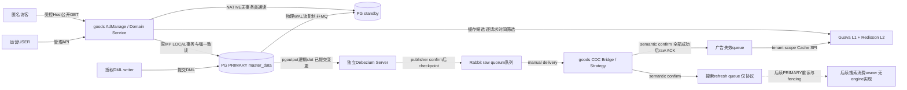
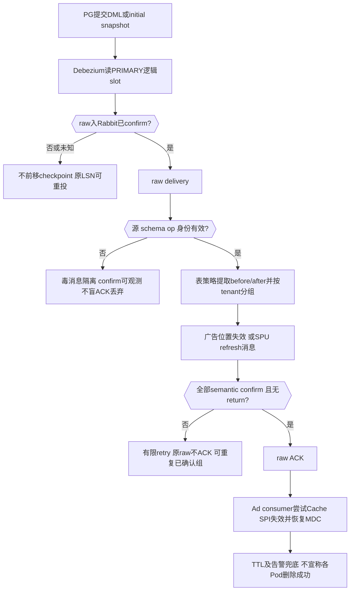
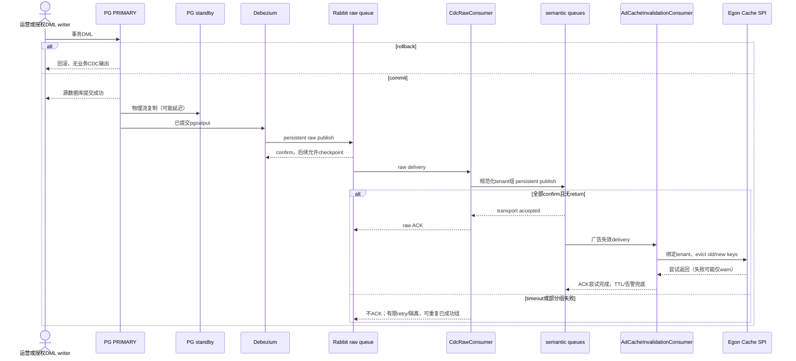
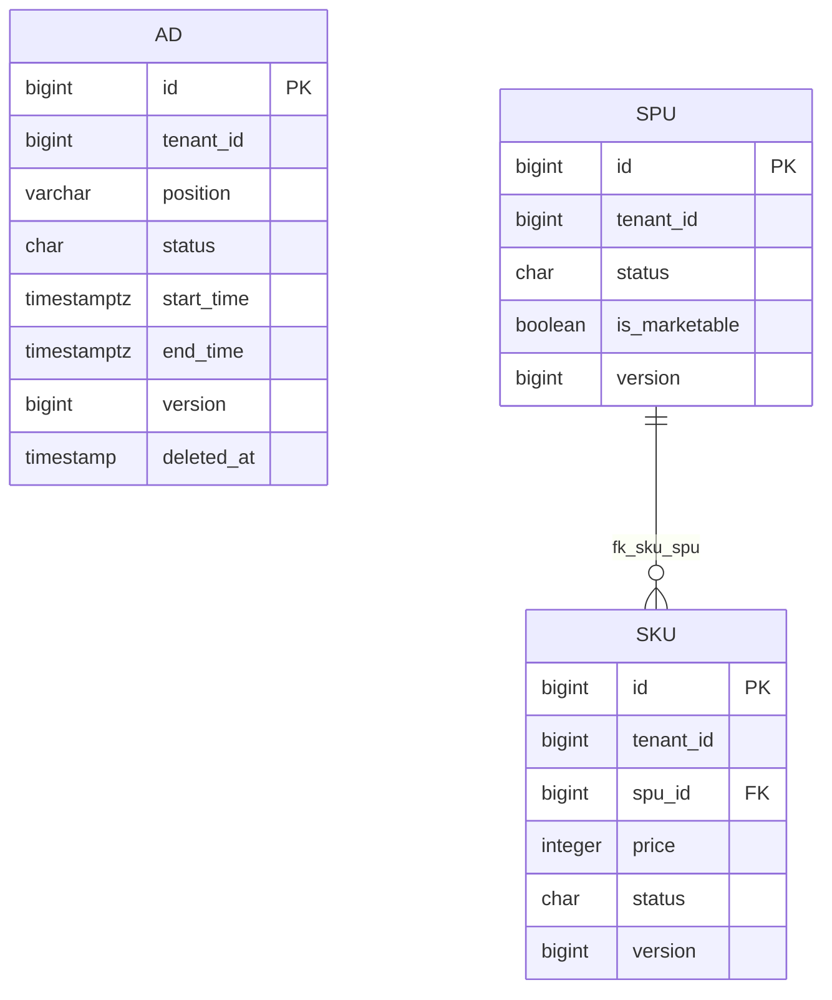

# PostgreSQL 主从、NATIVE 读写分离与 CDC 广告同步设计

| Field | Value |
| --- | --- |
| Document | `2026-10-10-14-48-postgresql-cdc-advertisement-synchronization.md` |
| Template Version | `7` |
| Status | Accepted |
| Type | Feature |
| Complexity | Complex |
| Complexity Drivers | PostgreSQL物理复制/逻辑解码、读写路由、多租户匿名站点、广告写入/时间窗口/两级缓存、RabbitMQ重复/乱序/恢复与搜索协议 |
| Created | 2026-10-10 14:48 Asia/Shanghai |
| Updated | 2026-10-10 16:33 Asia/Shanghai |
| Owner | mario |
| Repository | enjoyshop |
| Scope | goods Light广告管理/公开读取/缓存；应用NATIVE读写分离配置；独立Debezium Server配置与goods CDC规范化/缓存消费；搜索仅事件与消费合同 |
| Change Surface | 新增广告API/POJO/ad表与索引、原spu/sku REPLICA IDENTITY、新CDC/Rabbit协议及应用配置/测试/运维文档；不改Egon组件源码、不建搜索引擎或页面 |
| Affected Chapters | §7, §8, §9, §10, §11, §13, §14, §15, §16, §17, §18 |
| Source Requirement | 附件第6章；用户确认pgsql主从/读写分离探索、Debezium Server+RabbitMQ、NATIVE不改组件、本期完整广告管理/匿名域名租户/缓存、搜索协议后续接引擎，并要求写完整Spec |
| Baseline Revision | main / 7e6a5065cae81836cfa6744f51fba686f8f8df92；前一部署准备实现d4e392a，既有4份文档已由mario提交，本轮不修改；另一个Egon-COLA工作区只读静态证据 |
| Amends | [首页架构](2026-10-09-16-39-homepage-kubernetes-gateway-architecture.md) §§3.2、7.3.1、15.3：新增本文广告后端和精确匿名GET边界，不扩大api通配；[商品管理](2026-10-09-10-55-product-management-lifecycle.md) §§3、7、15：只补充CDC搜索刷新协议，商品REST/状态与SPU/SKU字段继续保持 |
| Supersedes | None |
| Depends On | [品牌骨架](2026-09-23-17-16-enjoyshop-scaffold-brand-crud.md) §§5.4、6.1：native Light/MP；[目录文件](2026-09-28-21-50-distributed-file-catalog-lookups.md) §§9、16：上传与S3 URL；[首页架构](2026-10-09-16-39-homepage-kubernetes-gateway-architecture.md) §§7、15、16：入口/缓存/部署边界 |
| Related Specs | [商品管理](2026-10-09-10-55-product-management-lifecycle.md) §§9–11为既有运行合同背景；该文档Header仍Review，本轮以当前源码为基线，不擅自升级其审批状态 |
| Related Plans | [PostgreSQL CDC 与广告实施Plan](../plan/2026-10-10-16-13-postgresql-cdc-advertisement-implementation.md) |

## 1. Summary

采用三条分工明确的链：**PostgreSQL物理流复制**把PRIMARY数据库复制到standby；**既有Egon MP-SDJ + NATIVE ShardingSphere规则**决定应用写主/读从；**PRIMARY逻辑解码pgoutput → 独立Debezium Server → RabbitMQ → goods规范化/消费**把已提交行变更变成广告失效和商品刷新通知。RabbitMQ不复制数据库，standby也不是CDC消费目标。

本期在现有goods native Light中增加广告管理REST、匿名广告读取、可信站点域名→tenant映射、Java L1/L2候选缓存和CDC失效。搜索只发布可重试、可去重的刷新事件，定义未来消费者的PRIMARY重读、fencing及tombstone义务；不新增搜索工程/ES客户端/索引表或宣称索引已同步。

用户已明确关闭技术和范围选择，并在本轮确认Spec全文、批准Domain Jakarta约束修正；本Spec为Accepted，可据此写Plan，实现仍须Plan审核。实际PG/Rabbit/Debezium发行版、地址、证书、replication slot、主从/故障与WAL容量是发布输入；本轮不安装、启动、连接基础设施或执行SQL。来源SQL用PostgreSQL而不是教程的MySQL binlog/Canal。

## 2. Background and Current State

### 2.1 Business and user context

教程通过Canal看tb_ad、tb_spu，发送广告位/spuId，再异步HTTP刷新Lua或Feig​​n查询SKU写ES。其缺陷包括异步回调已返回即ACK、删除没有after、广告位只处理新值、上/下架队列迟到复活、无稳定事件身份/租户/确认、全量导入无界、删除还依赖查询“正常SKU”。本设计保留目标并更换整条数据事实来源与可靠性合同。

### 2.2 Repository evidence

M=`enjoyshop-service/enjoyshop-service-goods`，J=`M/src/main/java/top/egon/enjoyshop/goods`，R=`M/src/main/resources`，E=`/Users/mario/SelfProject/Egon-COLA`；C=`E/egon-cola-components/egon-cola-component-common/egon-cola-component-common-mybatis-plus-sharding-jdbc-ext-spring-boot-starter`。缩写不是新增模块。

| Evidence ID | Classification | Exact path/symbol/decision/command | Observed fact | Design significance | Verification limit/freshness |
| --- | --- | --- | --- | --- | --- |
| EVD-001 | User decision | 本轮两次问题答复及最新“继续，把Spec写完整” | 批准独立Debezium Server+Rabbit；选择应用NATIVE，不改组件；匿名Host映射；广告完整后端；搜索仅合同 | 所有重大范围/技术选择以此为准 | 非安装/部署授权 |
| EVD-002 | Static repository | M/pom.xml；M/src/test/java/top/egon/enjoyshop/goods/architecture/LightPersistenceArchitectureTest.java | Java21/Egon5.4.1；MP-SDJ、AMQP、Cache、Validation、MapStruct、springdoc/身份已有 | native Light，零新增应用依赖 | 未执行构建，不证明实际broker |
| EVD-003 | Static repository | R/egon-mybatis-plus-sharding.yml；application.yml；V20260913_001；实际5.4.1 JAR | 三PRIMARY、STRATEGY/LOCAL；spu/sku/catalog为SINGLE。SQL仅SHARD建school_classes_0/_1及class_course_schedules_0/_1；实际STANDARD_TENANT_ID会把三PRIMARY纳入并生成_t0/_t1/_t2，二者不一致 | 用户已批准NATIVE以SQL两库×两表为目标，不复制旧STRATEGY错误布局；不改组件/历史SQL，已有数据需发布前验证 | 只静态源码/JAR/SQL证据，无真实PG数据/路由证明 |
| EVD-004 | Static repository | C/.../bootstrap/EgonColaShardingYamlLoader.java load/assembleStrategy；TopologyValidator.validate/addSingle | NATIVE已有loadNative；STRATEGY当前不生成READWRITE_SPLITTING；validator识别该rule并保留profile | NATIVE是已批准逃生舱，不能仅改mode宣称分流 | 需后续真实路由与profile/fingerprint测试 |
| EVD-005 | Static repository | J/infrastructure/goods/service/impl/ProductDomainServiceImpl.java；domain/goods/ProductLifecycleComponent.java | audit自动上架；pull/put/deletion/restore/purge；SPU/SKU同组LOCAL，QUERY有RR事务 | CDC捕获提交事实，不改业务状态规则；不只盯0→1 | 不能推断direct SQL遵守业务状态机 |
| EVD-006 | Static repository | J/infrastructure/mq/impl/RabbitMqMessageServiceImpl.java；RabbitMqConfig.java | 原样例afterCommit发送，无持久意图；AMQP已有 | 原样例保持；CDC桥使用独立confirm/return/ACK合同 | afterCommit不能声称原子可靠投递 |
| EVD-007 | Static repository | E/.../transactional-outbox-starter/.../OutboxMybatisPlusAutoConfiguration.validateStoreInfrastructure；OutboxManagedDdlInitializer | 校验单PRIMARY；当前宿主3PRIMARY不兼容 | 不采用Outbox，不改组件/拓扑凑兼容 | 已读源码，不引用README作为运行证明 |
| EVD-008 | Static repository | E/.../common-cache.../core/EgonColaTwoLevelCache.java get/evict；Manager.publish | 事务读绕cache；get(loader)可先命中后加载；evict/publish吞Redis失败为warn；PubSub/TTL最终一致 | cache外层不能被事务包住；ACK只能指失效尝试，不虚称所有Pod已删除 | 无live Redis证明 |
| EVD-009 | Static repository | J/adapter/filter/TenantContextFilter.java；start/config/NativeHttpSecurityConfiguration.java；ProductAuthorizationComponent | legacy默认tenant1且信任header；product跳过legacy并由USER/RBAC上下文负责 | 新广告路径必须跳过legacy；公开Host映射和管理身份分开 | 不改已有legacy/user/teaching安全语义 |
| EVD-010 | Static repository | common-core ResultRecord、PageResultRecord；EgonModel；J/adapter/handler/BaseExceptionHandler.java | ResultRecord ALWAYS包含7字段；PageResultRecord包含8字段、用records/page；PO继承审计/tenant/version/deletedAt | 无新信封；明确Ad错误路由与OpenAPI | 静态读取，未生成新OAS |
| EVD-011 | Static repository | R/db/egon-mp/repository-manifest.json；V20261009_001；全仓rg --files | 最新脚本20261009_001；无广告/搜索；web只有POM；sku.price为整数分 | 新增一个DDL版本；无页面/ES依赖；不能在删除后查正常SKU决定移除 | 未连DB/查询ddl_history |
| EVD-012 | Official primary source | [PostgreSQL logical decoding](https://www.postgresql.org/docs/17/logicaldecoding-explanation.html)；[Debezium PG](https://debezium.io/documentation/reference/stable/connectors/postgresql.html) | pgoutput/slots；旧行由replica identity决定；slot可能保留WAL；PG17+failover slot需配置条件 | WAL/old值/恢复机制来自官方约束 | 2026-10-10核对，实际部署版本仍需固定 |
| EVD-013 | Official primary source | [Debezium Server Rabbit sink](https://debezium.io/documentation/reference/3.2/operations/debezium-server.html)；[Rabbit confirms](https://www.rabbitmq.com/docs/confirms)；[alternate exchange](https://www.rabbitmq.com/docs/ae) | 独立Server无需Kafka服务器；AMQP sink有ackTimeout；producer confirm独立于consumer处理 | 分阶段ACK，绑定/AE不得缺失；不依赖不存在的mandatory开关 | 文档配置是设计依据，不证明选定发行版已验证 |
| EVD-014 | Official primary source | [ShardingSphere5.5.3 NATIVE读写规则](https://shardingsphere.apache.org/document/5.5.3/en/user-manual/shardingsphere-jdbc/yaml-config/rules/readwrite-splitting/) | dataSourceGroups/writeDataSourceName/readDataSourceNames；transactionalReadQueryStrategy PRIMARY | 复用原DataSource/事务管理器，不新建路由器 | 事务/组合SINGLE规则需真实PG验证 |

### 2.3 Problem statement and gap

应用没有广告源数据/CRUD/缓存区域，没有CDC或搜索协议。当前PG路由全部PRIMARY，增加replica角色不会凭空组装分流。现有样例MQ不适合作为本任务durable change source。新设计从数据库已提交WAL捕获，涵盖受控服务写入和授权直接行DML，不许误把SQL事务未提交内容发布。

### 2.4 Evidence and current-chain map

| Entry/trigger | Current call chain | Data read/written | External dependency | Consumers | Evidence |
| --- | --- | --- | --- | --- | --- |
| 商品命令 | ProductController→Manage→ProductDomainServiceImpl→Repository→DAO | public.spu/sku/category_brand，LOCAL/master_data | PG | 管理客户端 | EVD-005 |
| 原样例MQ | Domain event service→MqMessageService→TransactionCompletionExecutor→RabbitTemplate | 无durable outbox | Rabbit | user/course样例 | EVD-006 |
| 缓存 | Spring Cache→Guava/Redisson→DAO loader | L1/L2副本 | Redis/PG | 当前Repository调用方 | EVD-008 |
| 数据源启动 | Common physical pools→YamlLoader→TopologyValidator→logical factory | typed policy/profile，不复制数据 | PG/ShardingSphere | goods | EVD-003/004 |
| 首页广告 | 无当前入口/表/模块 | 无 | 无 | 教程预期访客/运营 | EVD-011 |

## 3. Goals and Non-goals

### 3.1 Goals

将第6章迁移到PG主从、NATIVE路由、CDC→Rabbit，详细设计广告后端完整路径和搜索同步协议；关闭双写/旧值/租户/ACK/乱序/恢复边界。保留原商品、上传、身份和分片数据语义。

### 3.2 Non-goals

不写Plan或实现、不运行服务/SQL/部署/浏览器；不改Egon组件、不引入Canal/Kafka/Feign/新的Spring网关/Outbox；不建广告UI或选择前端框架；不接搜索引擎/做真实索引或搜索API。本期只支持选定表的INSERT/UPDATE/DELETE和initial snapshot，TRUNCATE、任意DDL、跨租户数据迁移不是自动修复/业务操作；出现对应信号进入可观测隔离/重建流程，不静默声称同步完毕。

### 3.3 Change Surface and Design Depth

| Area/layer | Disposition | Exact repository evidence | Changed or preserved behavior/contract | Required Spec treatment | Chapter(s) |
| --- | --- | --- | --- | --- | --- |
| 广告后端与公开身份范围 | Affected | EVD-009/011；新增adapter.goods广告入口及domain/ad、infrastructure/ad | 新CRUD/匿名读/验证/权限/缓存 | 完整合同、类/表/测试 | §7, §8, §9, §10, §11, §13, §14, §15, §16, §17, §18 |
| 应用NATIVE配置/主从/CDC协议 | Affected | EVD-003/004/012–014 | 替换应用STRATEGY table块，增read replicas/Native规则；外部CDC配置 | 详细别名/事务/slot/发布/恢复 | §7, §8, §9, §10, §11, §13, §14, §15, §16, §17, §18 |
| spu/sku replica identity及商品刷新消息 | Affected | EVD-005/011 | 只改变CDC旧行信息；消息合同，新业务列/API不变 | 七项metadata变更设计/消息协议 | §7, §8, §9, §10, §11, §14, §15, §16, §18 |
| 商品REST/状态/Java实现 | Context-only | ProductController、ProductDomainServiceImpl、原spec | 请求/返回/权限/状态不变；不在命令里再发同步MQ | 原边界与回归 | §7, §9, §14, §16 |
| Egon Cache/MP/Yuheng组件 | Context-only | EVD-004/007/008；AuthenticationMode.NONE | 消费现有API；不改源码或谎称支持能力 | 准确局限/测试门禁 | §7, §14 |
| 搜索引擎/索引存储与前端 | Not applicable | EVD-011；用户本期只合同 | 无模块/engine/UI target | N/A，不提前建工程/DDL | §12 |
| 当前部署准备5文件 | Unchanged | deployment/k8s/check.sh等、d4e392a | 39字段offline checker及审计不重开、不改 | 一条保持记录 | §16 |

## 4. Requirements and Acceptance Criteria

| ID | Atomic requirement | Priority | Observable acceptance criteria | Source |
| --- | --- | --- | --- | --- |
| REQ-001 | 分清物理复制、路由、CDC | Must | PRIMARY→standby不走MQ；逻辑slot只接PRIMARY；ordinary read与事务读有不同路由 | 用户pgsql主从要求 |
| REQ-002 | 应用使用NATIVE且不改组件 | Must | Native+无STRATEGY tables；保留全部业务表与SQL定义的2n目标/LOCAL；不声称旧STRATEGY已正确实现2n；配置各环境同键、真实路由和profile回归 | 已确认选择 |
| REQ-003 | Debezium Server直连Rabbit捕获提交DML | Must | 无Kafka服务；publication只ad/spu/sku；事务rollback不产生业务刷新；confirmed transport后才checkpoint | 已确认替代Canal |
| REQ-004 | 实现广告管理后端合同 | Must | 5个管理操作闭合，USER/RBAC、租户/version/软删除/字段约束完整 | 用户广告管理本期 |
| REQ-005 | 匿名读仅按可信站点映射租户 | Must | 公开GET只读；X-Tenant/Actor不能覆盖；未知Host404；默认tenant1不可用于此路径 | 用户确认 |
| REQ-006 | 广告两级缓存覆盖计划时间 | Must | 缓存候选、逐请求一次UTC时钟筛start≤now<end；PRIMARY回源；不包住缓存命中的事务；明确TTL/失效局限 | 第6章+首页已接受方向 |
| REQ-007 | CDC失效覆盖旧/新广告位及删除 | Must | update移动同时失效old/new，delete取before；重复/乱序只evict，跨租户before/after分组不串数据 | 教程缓存更新目标 |
| REQ-008 | 商品搜索仅刷新事件/消费合同 | Must | 覆盖spu/sku c/u/d/r、两次父归属变化；不根据旧UP/DOWN直接执行；future消费者PRIMARY重读+fence/tombstone | 用户搜索分期 |
| REQ-009 | 稳定身份、confirm/ACK/retry/DLQ | Must | 身份不取处理时间或broker deliveryTag；部分confirm/ACK丢失可重复安全重试；毒消息隔离；不宣称exactly once | 同步正确性隐含需求 |
| REQ-010 | 主从/CDC恢复可操作 | Must | 一slot一owner；WAL/offset/epoch/源角色/副本延迟监控；有promote/slot丢失/全量重建门禁；不RESET/repair历史 | 主从/部署要求 |
| REQ-011 | 数据/依赖/历史与接口兼容 | Must | 一个新SQL+manifest；旧SQL不变；无新应用依赖；原API/wire/S3/persistence框架保持 | AGENTS与技能 |
| REQ-012 | 文档可审查且不执行实现 | Must | Spec strict/关系/范围复核通过；Spec写作阶段无生产/test/DDL文件修改或运行动作；本轮用户另行批准编写关联Plan | 用户writing-spec |

### 4.1 Scenario matrix

| Scenario | Actor/trigger | Preconditions | Main path | Alternative/failure path | Data/state change | Observable result | Requirements |
| --- | --- | --- | --- | --- | --- | --- | --- |
| 广告create/edit/delete | 运营USER | 有权限/tenant/合法字段与version | 主库事务→提交→本机失效尝试+WAL | rollback无CDC；409不写 | 只ad同库 | 原同步CRUD结果，缓存最终收敛 | REQ-004/006/011 |
| 匿名首页读 | 访客 | Host登记 | tenant范围→候选cache→UTC筛选 | 未知Host404；非法slot400；缓存故障受控PRIMARY回源 | 无业务写 | 最多20项/空列表，no-store | REQ-005/006 |
| 计划开始/结束 | 时间到边界 | 候选已缓存 | 每次读检查窗口 | 没有定时MQ也不继续展示到期广告 | 无DB变更 | inclusive start/exclusive end | REQ-006 |
| 广告移动/删除/direct DML | 授权DB writer | RI FULL/有效row | before+after旧新position/tenant分组 | 缺before/key或非法源DLQ | 缓存evict，不覆写payload | 不漏旧广告位，不越tenant | REQ-003/007 |
| 商品上/下/删/恢复/SKU变更 | 管理者/DB writer | PG提交 | 各源row→spu刷新请求 | 旧up迟到不直写旧索引；hard delete无需查询正常SKU | 本期仅MQ事件 | 合同可重复消费 | REQ-008/009 |
| confirm成功后raw ACK丢失 | bridge停止 | raw仍有投递 | redelivery同身份重发 | 重复evict、futureTarget去重/条件写 | 不制造第二业务命令 | at-least-once边界清楚 | REQ-009 |
| 多tenant输出只有一个confirm | RAW处理 | 需2消息 | 全部confirm后ACK | 失败原消息重投，已成功输出允许重复 | 无bridgeDB双写 | 不丢未成功分组 | REQ-007/009 |
| Replica落后 | 普通query/缓存load | 异步standby | ordinary允许陈旧；loader/事务主读 | 副本失败不自动promote或默回主 | 无业务写 | 不用旧从库回填失效cache | REQ-001/002/006 |
| Redis失败 | 失效/读 | 原Cache组件 | 局部失效尝试+warn/TTL | API void吞失败不可虚称L2已删；回源有界；PG不可用503 | 无补偿业务写 | 告警和降级，非强一致 | REQ-006/007 |
| PG故障/slot丢失/消费者停滞 | DBA/运维 | 角色/offset/WAL记录 | fence旧主，按条件恢复slot或新epoch重建 | 不双owner、不擅自跳offset；WAL达到cap告警 | 复制/读取可暂停 | 可重建而非悄悄漏变更 | REQ-010 |
| 初始snapshot/毒消息重放 | CDC/运维 | 真实版本协议 | r刷新主库当前状态；original body保持 | truncated/DDL/未知schema隔离 | 无任意业务修复 | snapshot不是下游已完成证明 | REQ-003/008/009 |

### 4.2 Use-case analysis

| Actor ID | Actor/role | Goal and responsibility | Entry/channel | Permission/tenant context | Evidence |
| --- | --- | --- | --- | --- | --- |
| ACTOR-001 | 广告运营USER | 管理当前tenant广告 | 管理REST | Shoubing+Jianshen ad读写permission | EVD-001/009 |
| ACTOR-002 | 匿名站点访客 | 获取有效广告 | 公开GET | 已批准站点→公开tenant范围，非用户授权 | EVD-001 |
| ACTOR-003 | DBA/授权DML writer | PG数据/复制和恢复 | 数据库与运维流程 | 受限DB权限，不是公开API | 第6章+用户PG主从 |
| ACTOR-004 | 搜索消费owner | 后续把当前可售SKU集合投影 | Rabbit消息合同，engine另期 | trusted source、tenant/聚合范围 | EVD-001/008 |

| ID | Use case/goal | Primary actor | Supporting actors/systems | Trigger | Preconditions | Main success outcome | Alternatives/failures | Postconditions | Requirements | Interfaces/pages | Tests |
| --- | --- | --- | --- | --- | --- | --- | --- | --- | --- | --- | --- |
| UC-001 | 维护广告与上下线计划 | ACTOR-001 | goods/PG | 运营提交或查阅 | USER/RBAC/tenant，写有version | 合法内容提交或有界查询 | 校验/403/404/409/DB失败回滚 | 只有成功Command写ad | REQ-004/007/011 | API-001–005，UI不在本期 | TEST-001–006 |
| UC-002 | 读取当前站点有效广告 | ACTOR-002 | 域名映射/cache/PG | 首页访问 | 登记Host/合法position | 当前时间窗口公开投影 | Host缺失/错误参数/空/依赖失败 | 无业务写，无身份Header控制 | REQ-005/006 | API-006 | TEST-007–010 |
| UC-003 | 从已提交PG变更同步失效/刷新 | ACTOR-003 | Debezium/Rabbit/bridge/cache | 提交DML/snapshot | 允许源/RI FULL/可靠拓扑 | durable通知及合法失效尝试 | duplicate/confirm失败/poison/旧新tenant | 不回写源DB；桥ACK边界可验证 | REQ-001/003/007/009 | EVENT-001–003 | TEST-011–016 |
| UC-004 | 消费商品刷新协议 | ACTOR-004 | PRIMARY/后续索引adapter | refresh请求 | 未来consumer实现fence/去重/移除 | 后续当前可售集合与索引收敛 | stale/empty/hard delete/partial unknown | 本期只协议，engine不会伪实现 | REQ-008/009 | EVENT-003 | TEST-017 |
| UC-005 | 安全启用读写分离并恢复CDC | ACTOR-003 | 原MP/PG/Rabbit/运维 | 发布/故障 | 真实角色、版本、旧主fence | 路由/slot/offset可信，可重建 | replica lag/WAL cap/无failover slot停止而非跳过 | 旧SQL/history不变 | REQ-001/002/010/011 | 配置/运维合同 | TEST-018–022 |

## 5. Constraints, Assumptions, and Decisions

### 5.1 Confirmed constraints

使用已有native Light/MP-SDJ/Jackson/Cache/AMQP/Validation/MapStruct/springdoc/身份；不改Egon源码，不升级应用依赖。既有DDL及manifest已应用条目不可改。技术方向批准不是设计文档Accepted或安装/live运行授权。

### 5.2 Small-gap assumptions

| ID | Inference | Repository evidence | Why locally reversible | Impact if wrong |
| --- | --- | --- | --- | --- |
| ASM-001 | 广告作为goods里的ad业务包，不拆新服务 | 现有user/teaching/goods包及无新工程要求 | 在现有Light内增加业务纵切面 | 需要独立服务时另Spec/由archetype生成，不现在手写工程 |
| ASM-002 | name/position非业务唯一键，允许多个同名广告/每位多条 | 教程一个position广告列表 | 无额外业务UK，没有不必要adCode | 若以后要求业务码唯一，新增版本/联合deleted_at规则 |
| ASM-003 | region TTL：L1 10s+jitter2s，L2 30s+jitter5s；候选cap200、公开limit1..20 | 原组件支持独立region TTL与bounded缓存 | 参数可调整，不改公开数据含义 | 不构成更新后严格35s SLA；需容量/并发load测试 |
| ASM-004 | 源WATCH只master_data.public.ad/spu/sku | 商品与目录SINGLE当前拓扑 | 不需要捕获无关教学/用户表 | 将来业务分片迁移需扩源/新合同，不通配publication |

### 5.3 Resolved decisions

| ID | Decision | Decision owner | Evidence and rationale | Requirements |
| --- | --- | --- | --- | --- |
| DEC-001 | PG物理复制+NATIVE路由+Debezium pgoutput→Rabbit；无Kafka服务 | mario | 明确答复与最新范围 | REQ-001/002/003 |
| DEC-002 | 不改MP组件，使用现有NATIVE loader；不采用Outbox | mario | NATIVE选择；Outbox单主约束与direct SQL目标 | REQ-002/003/011 |
| DEC-003 | 本期广告CRUD/读/cache，搜索只有消息协议 | mario | 明确答复 | REQ-004–008 |
| DEC-004 | 广告读匿名，受控Host映射tenant；管理USER/RBAC | mario | 明确答复 | REQ-005 |
| DEC-005 | 消息是“重读/失效请求”，不复制旧行成最终cache/index | 设计推导 | lag/乱序与DELETE旧值；满足目标的最小可靠机制 | REQ-006–009 |
| DEC-006 | NATIVE显式按现有SQL两库×两表配置，不复制三PRIMARY/_t*的旧STRATEGY；旧数据/指纹发布前验证，不自动迁移或repair | mario | 本轮明确答复“批准按现有 SQL 配置 NATIVE”；EVD-003的JAR/SQL差异 | REQ-002/010/011 |

### 5.4 Open major decisions

None（本范围技术/业务选择已明确）。真实PG/Rabbit/Debezium正式发行版、证书、主从地址与发布容量属§15/16前置，不用latest或SNAPSHOT猜填；以包含已核对AMQP sink合同的正式版本建立矩阵。PG17+failover slot为条件能力，低版本必须采用明确重建方案，不能声称无缝故障切换。

## 6. Project Technology Context

| Concern | Current choice | Repository evidence | Constraint on design |
| --- | --- | --- | --- |
| 应用 | Java21、Egon parent5.4.1、Maven、SpringMVC | M/pom.xml | 不新增/升级应用starter/SDK |
| Persistence | MP-SDJ/PG/LOCAL，当前3 PRIMARY | EVD-003 | NATIVE保留逻辑组/2n/表归属；DDL只PRIMARY |
| AMQP/cache | spring-boot-starter-amqp、Redisson/Guava Cache | EVD-002/006/008 | 独立CDC factory/template/region，不改样例route |
| 身份/OAS | Shoubing/Jianshen与既有bearerAuth/springdoc MVC | EVD-009/010 | 新ad权限guard，不改product权限regex；prod docs仍关闭 |
| CDC runtime | 用户批准独立Debezium Server | EVD-001/013 | 外部发行版配置，不放Debezium/Kafka客户端到goods POM |

### 6.1 Java architecture profile and capability baseline

| Architecture profile | Archetype/template or base package | Exact evidence and verifier | Existing deviations | Design action |
| --- | --- | --- | --- | --- |
| Egon-COLA native/non-open Light | E/egon-cola-archetypes/source-projects/egon-cola-source-light；top.egon.enjoyshop.goods | M/pom.xml/原LightPersistenceArchitectureTest与模板同名verifier | 既有样例包不属于ad替换范围 | 保持adapter→application→domain；infra实现domain port并经Repository→DAO；不创造模块/新层 |

| Need | Spring/JDK candidate | Spring Boot Starter candidate | Egon-COLA/module candidate | Proven gap | Decision/dependency impact |
| --- | --- | --- | --- | --- | --- |
| 完整行CDC | PG WAL/pgoutput | 不使用应用DB+MQ双写 | Outbox单主不适用且漏direct SQL | 应用无CDC；用户要PG捕获 | 已批准外部Debezium Server；无新goods依赖 |
| 读写分离 | ShardingSphere NATIVE | 原MP-SDJ已提供物理/逻辑源 | Native loader/TopologyValidator | STRATEGY不输出RW规则 | 复用NATIVE，无组件改动 |
| 广告存储/校验/ID | Jakarta/JDK | 原Validation/MP | EgonModel/Repository/Mapper/LongIdGenerator | 缺ad table与业务纵切面 | Add业务；初始catalog生成器拥有 |
| 广告缓存 | Spring Cache/TransactionTemplate | 原Cache manager | Guava/Redisson/tenant KeyGuard | 缺ad region、PRIMARY callback | Add区域/策略，不建另一cache框架 |
| 发布/ACK | RabbitTemplate/CorrelationData/Configurer | 原AMQP | 原sampleafterCommit不足 | 缺raw→semantic可靠桥合同 | 独立模板及listener配置；confirm/mandatory；不改原发布器 |
| 业务复杂变体 | Specification/Strategy | 不引SSM | 原ProductLifecycleComponent等先例 | table/op/旧新归属与时间窗口 | CdcChangeStrategy+AdEligibilitySpecification，§13 |

### 6.2 User-mandated Java rule compliance

| Literal rule | Affected? | Repository evidence | Exact design decision | Files/types/interfaces | Validation/test evidence | Status/blocker |
| --- | --- | --- | --- | --- | --- | --- |
| Rule 1 | Yes | §8/10全类型清单 | PO/BO/Result/Command/Query/Event/Strategy/Validator语义后缀；无Info/Data/Param | 所有新类 | TEST-023命名/类型审查 | PASS |
| Rule 2 | Yes | 原Validation/ValidationUtils/MP组 | §10逐handoff @Valid/@Validated/groups；原生+AdWindow/URL/position constraints；非HTTP一样；无电话场景 | command/query/BO/PO/CDC/consumer | TEST-001/003/007/011/023 | PASS |
| Rule 3 | Yes | 原普通Command+EgonModel/MapStruct | 普通class全部@Data/@NoArgs/@AllArgs/@Accessors；root@Builder，PO@SuperBuilder/callSuper；BaseConverter或BaseForwardConverter | §10模型/mapper | TEST-023构造/映射compile | PASS |
| Rule 4 | Yes | lombok.config可复制Qualifier | 业务Bean @Slf4j/显式名称/@RequiredArgsConstructor/final@Qualifier；无手写业务注入 | §8全部行为类 | TEST-023 wiring/log | PASS |
| Rule 5 | Yes | 已有JDK/Commons/Guava | 不新增utility库；URI/BigInteger/MessageDigest JDK；不新造通用Utils | 校验与事件身份 | TEST-023 imports | PASS |
| Rule 6 | Yes | ResultRecord ALWAYS/Boot Jackson | 原信封；未知body用@JsonAnySetter拒；IDs十进制string，Instant ISOZ；enum@JsonValue，PO code@EnumValue | Ad/事件边界 | TEST-005/011/023,OAS gates | PASS |
| Rule 7 | Yes | base/dev/test/prod+imported sharding | §15矩阵同核心key；NATIVE移除全部STRATEGY tables，不只改mode | 配置全套 | TEST-018/023 | PASS |
| Rule 9 | Yes | 两类表语义+Ad时间过滤真实变体 | 必须Strategy/Specification，注册/失败测试§13；不以长switch替代 | 2个策略与eligibility | TEST-008/012/013 | PASS |
| Rule 10 | Yes | EgonModel审计Instant/deletedAt LocalDateTime | Ad start/end/UTC Clock/Duration/事件Instant；PGµs，删标UTC LocalDateTime沿用 | §10/11字段 | TEST-008/023 | PASS |
| Rule 11 | Yes | 原Light与MP；无自然UK的ad列表 | 唯一native Light，复用MP/受管DDL；ad无业务UK不假造code；原spu/sku UK不变；CQE经Rabbit | §8/11/13 | TEST-004/015/023 | PASS |

## 7. Architecture Design

### 7.0 Minimum-design baseline and element-necessity audit

直接afterCommit Rabbit不捕获direct SQL且有提交后进程宕机窗口；物理复制也不产生业务MQ通知。故选已有框架路由+外部CDC，不再让应用Command重复发同步事件。

| Proposed element | Change | Requirements | Existing/direct alternative | Concrete inadequacy of alternative | Added calls/state/coupling/failures/migration/operations | Verdict |
| --- | --- | --- | --- | --- | --- | --- |
| Debezium Server/slot/publication | New | REQ-003/010 | app afterCommit/Outbox | 不能覆盖任意授权DML，Outbox有单主约束 | 一外部进程、offset/WAL/恢复责任 | Add |
| NATIVE规则/REPLICA映射 | Expand | REQ-001/002 | 只改mode/修组件 | mode不输出RW；用户拒组件改动 | 应用承担规则/profile验收 | Add |
| ad表/CRUD/公开GET/cache region | New | REQ-004–007 | 仅消息合同 | 用户明确要求本期完整广告后端 | 1表/6API/1region/安全规则 | Add |
| raw→semantic bridge与2策略 | New | REQ-007/008/009 | 每消费者解析vendor row | 重复旧新/身份/source知识，搜索合同绑厂商 | 一规范化阶段，两种语义策略 | Add |
| 搜索refresh事件/队列 | New | REQ-008 | up/down独立指令 | 迟到UP可复活，DELETE后查正常SKU漏删除 | 只合同与durable待消费队列 | Add |
| cache/MP/AMQP/身份/wrapper | Keep | REQ-011 | 再造框架 | 原有满足，用其局限设验收 | 无新应用依赖 | Keep |
| 搜索engine/页面/Outbox/SSM/Kafka/组件补齐 | New（未选） | REQ-011/012 | 当前选定链 | 不是本期需要 | 不引入 | Remove |

| Path | Network calls | Client states | Server contracts/state | Failure and TOCTOU points | Additional user/business value |
| --- | --- | --- | --- | --- | --- |
| 直接广告读基线 | 1HTTP+1PG | 读loading/empty/error | 无ad实现，概念基线 | DB压力/租户/时间 | 可读广告 |
| 选定缓存读 | 仍1HTTP，L1可0下游；miss访问Redis+PRIMARY | 同一GET，无tenant预查询 | 1region/同业务数据 | stale fill/Redis/PRIMARY | 首页降负载且时间正确 |
| 变更同步 | Command不加MQ RTT；异步WAL→Rabbit raw→semantic | CRUD返回不等下游 | raw队列/2semantic队列 | confirm/ACK/slot/重复 | direct SQL可同步、业务不与MQ双写 |

### 7.1 System Architecture Design



| Module/component | Capability and data owned | Inputs/outputs | Allowed dependencies | Forbidden responsibility | Requirements |
| --- | --- | --- | --- | --- | --- |
| PG PRIMARY/standby | 源数据/物理复制 | SQL、WAL、replay | DBA配置 | 不把MQ当replica；不自动promote | REQ-001/010 |
| 原MP-SDJ/NATIVE | 路由/profile/LOCAL边界 | typed pools+NATIVE | 原ShardingSphere | 不新建应用路由器/复制数据库 | REQ-002/011 |
| Debezium | committed WAL→raw、source offset | 选定PRIMARY/pgoutput→Rabbit | 受限PG/MQ账户与持久offset | 不执广告权限/直接写cache/index | REQ-003/010 |
| CDC Bridge | vendor解析/source验证/语义事件 | raw→1..2 tenant分组消息 | Jackson/策略/Rabbit confirm | 不改业务表、不再afterCommit双写 | REQ-007–009 |
| Ad后端/Repository | tenant广告/缓存候选/失效声明 | HTTP或internal evict | MP/Cache/原身份 | 不直连replica回填、不建Lua | REQ-004–007 |
| Future search owner | 将来索引/receipt/fence状态 | EVENT-003→PRIMARY当前集合 | 下期正式adapter | 本期不假装已有索引 | REQ-008 |

### 7.2 High-Level Design

#### 7.2.1 Critical business/control flowchart



#### 7.2.2 High-level decision and quality matrix

| Concern/use case | Required behavior | Selected mechanism | Failure/degradation behavior | Trade-off | Verification | Requirements |
| --- | --- | --- | --- | --- | --- | --- |
| 提交事实 | rollback不发布 | PRIMARY WAL pgoutput | slot/checkpoint保留，不能跳offset | CDC运行复杂度 | TEST-011/021 | REQ-003 |
| stale read | cache miss不读延迟replica | 外层cache无事务，loader TransactionTemplate PRIMARY | PRIMARY失败503，不填旧从库 | 少部分读不能卸载到standby | TEST-009/018 | REQ-001/006 |
| 跨租户 | anonymous只读站点范围，MQ source可追溯 | Host whitelist+验证身份或trusted broker/source | 未登记Host404，未知source/row隔离 | 运维维护映射/权限 | TEST-006/007/012 | REQ-005/007 |
| 广告时间 | start inclusive/end exclusive | 缓存启用候选，每请求一次Clock | TTL+失效race最终一致，不instant SLA | 候选量cap200 | TEST-008/010 | REQ-006 |
| at-least-once | 不丢半成功tenant组 | stable eventId，confirm/return→raw ACK | retry3后durable DLQ；已成功组可能重复 | 不承诺exactly once | TEST-014/015 | REQ-009 |
| failover | 不双主/slot双owner | DBA fence+slot条件恢复/新epoch重建 | 没连续性证明停止CDC/发布 | 不是自动HA产品设计 | TEST-020/021 | REQ-010 |

### 7.3 Detailed Design

#### 7.3.1 Detailed component collaboration

**物理复制**按PostgreSQL cluster发生，不是每logical数据库一份独立复制。3个JDBC组可能同cluster不同DB，也可能各有cluster；发布清单必须映射cluster/server/database，不能从别名推断。每logical组保持1PRIMARY+≥1REPLICA；初始设计各1replica，仍保留master_data及2个tenant shard逻辑组。physical slots/base backup/standby.signal/认证/只读角色由DBA提供，不由应用执行。

**NATIVE**虚拟RW组名继续master_data/shard_0/shard_1；物理池为master_data_primary/master_data_replica_0等，logical-name保持原组名。每组 `writeDataSourceName` 指PRIMARY池，`readDataSourceNames`指REPLICA池，`transactionalReadQueryStrategy: PRIMARY`，`loadBalancerName: replica_round_robin`/type ROUND_ROBIN；LOCAL。!SINGLE逐表完整`logical_group.public.table`；!SHARDING保留原两个教学分片表的实际节点、tenant算法/参数/数量，不手写简化为单表。NATIVE无STRATEGY tables，所有物理池仍由Common工厂创建，不在native-rules文件再写dataSources。

**强读**管理detail、写后回显、广告候选loader、未来商品聚合projection在PRIMARY事务；普通允许陈旧的无事务query才用REPLICA。原商品readOnly/RR事务保留，不为“增加读从比例”删事务。AdRepository.cachedCandidates(AdDomainQuery)作为public非final @Cacheable(sync=true)入口，不允许上层活跃事务包住；其miss body复用命名TransactionTemplate（REQUIRES_NEW/readOnly/RR）执行AdDAO候选SQL，返回后再由cache写L1/L2。无新服务-Repository循环注入。

**CDC范围**master_data数据库publication只public.ad、public.spu、public.sku；每库一connector/slot，一个active Debezium owner，副本/热备不能同时占同slot。pgoutput，initial snapshot，保持before/after/op/source，value JSON且schemas.enable=false，不用SMT丢旧值；tombstones.on.delete=false，不把Kafka tombstone概念带到AMQP。spu/sku/ad用RI FULL，桥能提取delete前tenant/spu/position。

**消息拓扑**命名含环境隔离vhost，不在MQ payload放secret：

| Exchange / Queue | 类型与用途 | 绑定/owner | 可靠性与限界 |
| --- | --- | --- | --- |
| enjoyshop.cdc.raw.v1 / enjoyshop.cdc.normalize.v1 | topic / durable quorum | 固定routing key master-data；仅Debezium可写raw | raw queue SingleActiveConsumer=true，prefetch32；另设unrouted AE policy到durable隔离queue，启CDC前验证绑定/AE |
| enjoyshop.sync.v1 / enjoyshop.ad.invalidate.v1 | topic / durable quorum | ad.invalidate.v1；Ad listener | 一个queue竞争消费，L1跨Pod靠原cache PubSub/TTL，不错误要求每Pod重复消费 |
| enjoyshop.sync.v1 / enjoyshop.search.refresh.v1 | topic / durable quorum | product.refresh.v1；engine另期 | 本期无真实search listener；消息retention/容量发布前登记，不能消费后假装indexed |
| 每consumer的 .dead / .unrouted | durable quorum隔离 | DLX/AE运维policy配置 | quarantine保留original body/身份；确认隔离后才释放输入；quota/retention按容量，不无限内存 |

Debezium AMQP sink按官方rabbitmq合同（5672/受控TLS连接设置），deliveryMode=2、ackTimeout、固定exchange/routingKey、autoCreateRoutingKey=false；运维先建真实队列/绑定，不能用default空exchange或自动建stream queue替代既定quorum queue。AE使用broker policy，不假定sink支持mandatory属性；确认所选正式版本sink成功confirm后才提交offset。无route若AE也缺失，confirm不证明目标queue收到；启动/变更门禁必须阻断该缺口，故不宣称仅开confirm就不会丢。

bridge独立cdcRabbitTemplate mandatory=true/correlated confirms/returns；使用原RabbitConnectionFactory，不修改样例MqRouteEnum发布策略。CdcRawConsumer读取Message bytes/Channel，独立cdcRabbitListenerContainerFactory应用宿主已有finite retry能力（3次、1s→2s→4s，max10s、defaultRequeueRejected=false、MANUAL）；不可用时返回配置错误，不手写无限requeue。永久invalid直接reject(false)进入已验收的durable dead-letter路径。quorum DLX配置at-least-once dead lettering/overflow reject-publish能力必须在真实版本验证；不支持或目标不可用时暂停/告警而非静默丢弃。

每raw最多2个tenant组。Ad策略取before/after `(tenant_id,position)` union；Product策略取spu行id或sku行spu_id及对应tenant union。同tenant合并、去重、确定排序，稳定EID用SHA256(canonical source alias/epoch、schema/table、op、row PK、lsn/tx/record-order、source.ts_ms、before/after事实hash、目标tenant及routing key)，排除bridge当前时间、broker deliveryTag/attempt。所有已确认输出后raw ACK；中途失败重试整条raw，重复组仍相同消息身份。unknown source/table、缺FULL旧值/PK、版本不支持、非法tenant、truncation进入隔离，不能用默认tenant0/1补值。

**缓存**只存启用且未删除的候选（包括未来时间窗口）；SQL单tenant/position排序sort_order,id，取cap+1=201，超过cap返回503/AD_DATA_LIMIT，不截断假装全部正确。公开请求按一次UTC Clock筛窗口并取limit≤20。region AdCandidates采用ASM-003 TTL；key为可信tenantId+':' +position，无任意query key。管理成功写在同事务内通过AdRepository.evictPositions调用原Cache SPI，提交后执行；CDC处理直接尝试对应tenant old/new keys，无HTTP ad_update。

原Cache.evict/publish会吞Redis失败为warn。因此Ad consumer ACK只表示合法失效尝试完成，**不证明L2删除、全部Pod失效或强一致**；不根据不存在的异常编造retry成功。业务层不直接写Redisson内部结构、不改组件。告警+TTL兜底；在途旧loader晚回填仍可延迟收敛，最大TTL35s从缓存填充算，不宣称更新后35s硬SLA。Redis读失败按原组件回源，PRIMARY loader timeout/并发容量和数据库池需发布验证，PRIMARY失败不回填空值/旧副本来掩盖故障。

#### 7.3.2 Critical-path Mermaid swimlane



#### 7.3.3 Transactions, consistency, concurrency, and idempotency

| Concern/state change | Owner and boundary | Mechanism/isolation/lock | Concurrent or duplicate behavior | Commit/visibility point | Failure result | Requirements/tests |
| --- | --- | --- | --- | --- | --- | --- |
| Ad Command | AdDomainServiceImpl/master_data | LOCAL事务、行锁+expectedVersion+继承MP CAS | stale409；重复DELETE终态true；create不提供新幂等键且不自动retry | PGcommit，不等待CDC | rollback无变更通知 | REQ-004/TEST-002–004 |
| PG→raw | Debezium/slot/offset | committed WAL、confirm后checkpoint | 停机/replay可重复；单slot单owner | broker接受≠业务完成 | offset不前移，WAL告警/恢复 | REQ-003/TEST-011/021 |
| raw→semantic | Bridge，无业务DB事务 | 每目标confirm+mandatory/returns后ACK | 半成功可重发；相同源/tenant身份稳定 | 全部transport accepted | 3retry后durable隔离 | REQ-009/TEST-014/015 |
| Ad失效 | Cache组件/Ad consumer | positive tenant scope，evict union | 重复/乱序多evict安全；不写旧值 | 合法尝试+TTL最终一致 | Rediswarn不冒报全局删除 | REQ-006/007/TEST-010/016 |
| Future index | 后续search owner | PRIMARY重读一致快照；durable receipt/fencing/tombstone | 旧up事件不能直接重新写doc；外部超时需相同identity及条件版本 | 实际目标结果/receipt前不ACK | part/unknown需恢复，不查询active SKU来猜原删除集 | REQ-008/TEST-017 |

#### 7.3.4 Failure semantics, recovery, and reconciliation

| Failure point | Detection | Immediate control flow | Data/transaction state | Retry and idempotency | Caller/frontend result | Recovery/reconciliation owner | Verification |
| --- | --- | --- | --- | --- | --- | --- | --- |
| Ad version/validation | guard/constraints | 400/409，不写 | 无提交 | 用户纠正/重新读取，无盲retry | 保留表单/当前version | 运营 | TEST-001/002 |
| PG PRIMARY不可达 | repository/timeout | 写/强读503；原事务rollback | 未提交或明确unknown结果 | 写结果unknown不自动重发 | error/traceId；public不能装成[] | DBA/app | TEST-009/020 |
| replica lag/down | replay指标/连接失败 | ordinary陈旧或失败；不自动promote/默回主 | 原主数据仍权威 | owner移除/恢复reader、受控更新规则 | 不保证read-after-write | DBA | TEST-018/019 |
| raw publish confirm失败 | Debezium ackTimeout/error | 不advance offset | 已commit源行仍在WAL | 原LSN重读；slot/WAL cap不可忽略 | API源写已完成，下游延迟可见 | CDC owner | TEST-015/021 |
| raw route/AE缺失 | topology preflight/隔离计数 | 启CDC前拒绝/运行告警pause | 不声称目标已接受 | 恢复绑定并按offset/rebuild证据，不随意跳位点 | 同步lag而非虚假成功 | MQ owner | TEST-015/022 |
| bridge半成功/ACK丢失 | confirms/returns/停止 | raw不ACK或重投 | 部分输出已持久 | 原EID重试，相同租户组幂等 | transport重投不是双业务写 | app/MQ | TEST-014 |
| raw/semantic无效 | strict source/schema/validator | permanent隔离，不默认tenant | 源事实不修复 | 原body身份重放需owner，不能改JSON继续相同EID | 运维可定位DLQ | source owner | TEST-012/013 |
| Redis失效失败被吞 | CACHE_L2_OPERATION_FAILED/lag/TTL | ACK尝试，不作严格成功计数 | L2/他Pod可能仍旧 | 不虚构异常重试；TTL、修Redis及受控再次evict | 暂时陈旧，非即刻全局下架 | Redis/app | TEST-010/016 |
| slot/offset缺失或WAL删除 | PG/CDC状态 | 停CDC，不能resetskip | 源DB存在但连续性不足 | 新epoch+初始/全量重建；旧epoch不得复活旧投影 | 发布门禁 | DBA/CDC | TEST-020/021 |

#### 7.3.5 Observability and operational boundaries

日志只sourceAlias/epoch/eventId/tenant聚合ID/route/result/duration/attempt，不打印raw行全文、JWT、Cookie、MQ/DBsecret或私钥。CDC无法自动关联原HTTP trace，保留事件身份并创建新消费trace，不伪造已丢失的parent span。指标低基数source/route/result；tenant、spu、position不作无限label。

必须监控standby replay lag、pg_replication_slots.restart_lsn/confirmed_flush_lsn/WAL保留字节、DB/Redis池/回源、Debeziumactive owner/offset文件、raw/semantic backlog年龄、confirm/return/DLQ/unrouted、cache降级和source epoch。正常网络下CDC lag目标p95≤3s是验收目标而非已测承诺；缓存TTL不替代lag告警。WAL cap/磁盘阈值由真实峰值WAL速率×允许停顿窗口+余量计算，任何cap使slot失效时转恢复流程，不自动删slot释放磁盘。

#### 7.3.6 Conclusion evidence chain

| Conclusion | Repository/user evidence | Constraint or requirement | Design decision | Consequence and trade-off | Verification and acceptance evidence |
| --- | --- | --- | --- | --- | --- |
| 主从、路由、CDC拆分 | EVD-001/012/014 | REQ-001–003 | physical replication+nativeRW+pgoutput | 新CDC运维但不误用MQ复制DB | TEST-018–022 |
| 不改组件用Native | EVD-004/用户确认 | REQ-002/011 | 完整native规则，保留profiles/2n | 应用承担原分片规则验证 | TEST-018/023 |
| 旧新广告位只失效 | EVD-008及before/delete事实 | REQ-006/007 | union tenant/position，candidate PRIMARY load | cache最终一致，不按旧事件重填 | TEST-008–010/012/016 |
| 商品refresh非UP/DOWN指令 | EVD-005/用户搜索分期 | REQ-008/009 | 包含SKU变化，只通知PRIMARY重读 | 下期需目标receipt/fence，不假实现索引 | TEST-013/017 |

## 8. Package Structure and Code File Tree

### 8.1 Current relevant tree

当前J/{adapter,application,domain,infrastructure,start,common}为单Light项目；商品/品牌/catalog/上传已存在。R/application*.yml和egon-mybatis-plus-sharding.yml已配置；db/egon-mp 4版本；无ad/search。E组件源码为Context-only只读，不作为本Spec修改目标。

### 8.2 Target tree

下面是设计目标，不是当前已创建文件或实施顺序。ad初始catalog标GENERATED：native Light生成器使用一个CREATE-only ad定义视图；主新migration含ALTER RI时不得把整个mixed脚本直接送入CREATE-only工具，Plan须精确提取同一ad CREATE并做hash/语义一致校验。后续业务/自定义SQL和ALTER由agent实现；本轮不调用generator。

```text
J/adapter/goods/AdController.java
J/adapter/goods/AdOpenApiConfiguration.java
J/adapter/filter/AdPublicTenantFilter.java
J/application/ad/{AdManage.java,AdManageImpl.java,AdSaveCommand.java,AdLifecycleCommand.java,AdPageQuery.java,AdReadQuery.java,AdResult.java,AdPublicResult.java,AdApplicationConverter.java,AdResultConverter.java,AdPublicResultConverter.java,AdAuthorizationComponent.java}
J/domain/ad/{AdDomainService.java,AdBO.java,AdDomainQuery.java,AdStatusEnum.java,AdEligibilitySpecification.java}
J/infrastructure/ad/{po/AdPO.java,dao/AdDAO.java,repo/AdRepository.java,service/impl/AdDomainServiceImpl.java,service/impl/AdPersistenceConverter.java}
J/domain/sync/{CdcChangeStrategy.java,CdcRecordBO.java,CdcSourceCursorBO.java,AdInvalidationBO.java,ProductRefreshBO.java,AdCacheInvalidationEvent.java,ProductRefreshRequestedEvent.java,CdcOperationEnum.java}
J/infrastructure/sync/{AdCdcChangeStrategy.java,ProductCdcChangeStrategy.java,CdcEventIdentityComponent.java,CdcEventPublisher.java,AdInvalidationEventConverter.java,ProductRefreshEventConverter.java}
J/adapter/sync/{CdcRawConsumer.java,AdCacheInvalidationConsumer.java}
J/infrastructure/config/{AdConfiguration.java,AdProperties.java,CdcRabbitConfiguration.java,CdcSourceProperties.java}
J/common/validation/{AdValidationGroup.java,ValidAdWindow.java,AdWindowValidator.java,ValidAdPosition.java,AdPositionValidator.java,ValidAdUrl.java,AdUrlValidator.java}
R/mybatis/mapper/ad/AdDAO.xml
R/egon-ss-readwrite.yml
R/db/egon-mp/V20261010_001__initialize_advertisement_cdc.sql
M/codegen/ad-codegen.json
M/src/test/java/top/egon/enjoyshop/goods/{adapter/goods/AdControllerTest.java,adapter/goods/AdOpenApiContractTest.java,start/config/AdSecurityContractTest.java,application/ad/AdManageTest.java,infrastructure/ad/AdPersistenceTest.java,infrastructure/ad/AdCacheContractTest.java,infrastructure/sync/CdcContractTest.java,infrastructure/config/NativeReadwriteContractTest.java}
deployment/cdc/{README.md,debezium/application.properties,postgres/replication-contract.md,rabbit/topology-contract.md,acceptance.md}
```

### 8.3 Package and file responsibilities

| Operation | Path/package | Symbols | Responsibility | Dependencies | Requirements |
| --- | --- | --- | --- | --- | --- |
| Create/GENERATED | ad核心catalog链与AdDAO.xml（上树） | AdPO/DAO/Repository/Domain/Manage/Controller，见§10 | native Light初始脚手架，随后补具体业务；不存在对应ad样例需要删 | CREATE-only generator、MP/Validation | REQ-004/011 |
| Create/custom | AdEligibilitySpecification、AdProperties、AdPublicTenantFilter、AdAuthorizationComponent、三个约束及转换器 | §10/13命名Bean | 时间、站点、权限、URL/position；public投影不暴露PO | 原Clock/身份/MapStruct/Cache | REQ-004–007 |
| Create/custom | domain/sync、infrastructure/sync、adapter/sync（上树所有文件） | §9 EVENT-001–003，2Strategy与publisher | raw规范化、稳定ID、confirm→ACK、限定cache尝试 | 原AMQP/Jackson | REQ-003/007–009 |
| Create/custom | CdcRabbitConfiguration、CdcSourceProperties、AdConfiguration、AdOpenApiConfiguration | cdcRabbitTemplate/cdcRabbitListenerContainerFactory/cdcChangeStrategies/adPrimaryReadTransactionTemplate | 独立factory/template/registry，避免污染sample | 原RabbitConnectionFactory/TransactionManager | REQ-002/009/011 |
| Modify | J/adapter/filter/TenantContextFilter.java；J/start/config/NativeHttpSecurityConfiguration.java | shouldNotFilter/adSecurityFilterChain/公开GET边界 | 跳过ad legacy默认tenant；仅管理认证/权限 | 原identity/permissions filter | REQ-005 |
| Modify | J/adapter/handler/BaseExceptionHandler.java；J/common/enums/GoodsErrorStatus.java | adPath/error mapping及6103xx | 新ad请求/服务码，原product/brand/file不变 | 原ResultRecord/FieldErrorsVO | REQ-004/011 |
| Modify | R/application.yml、application-dev.yml、application-test.yml、application-prod.yml、egon-mybatis-plus-sharding.yml | §15核心key矩阵 | 清除STRATEGY tables、6物理池、region/公共站点/cdc配置 | 原typedproperties/NATIVE loader | REQ-002/006/011 |
| Create/Modify | 新SQL、R/db/egon-mp/repository-manifest.json、ad-codegen.json | 20261010_001+SHA256 | ad CREATE/索引及3表RI FULL；旧版本字节不变 | 原DDL runner | REQ-007/011 |
| Modify/Create | 原LightPersistenceArchitectureTest.java+上树所有新tests | §14 TEST-001–023 | 计数13→14仅ad PO/DAO/repo；生成DomainImpl计数对应新增；focused/契约/隔离runtime | 当前JUnit/MockMvc/原test工具 | REQ-011/012 |
| Create | deployment/cdc上树5文件 | source configuration / runtime contract | 独立Server配置与DB/MQ/恢复验收；不提供自行promote/install脚本 | 用户批准运行组件，环境owner | REQ-001/003/010 |

普通业务类均具体显式Bean名，registry只注册两种语义Strategy，无反射工厂。配置基础设施不是新增Maven module。初始代码生成不授权覆盖现有手工文件；旧user/teaching样例、旧MQ route与其已应用SQL不在替换范围。无UI/ES文件。

## 9. Interface Definitions

### 9.0 API protocol and documentation governance

| Concern | Decision/evidence |
| --- | --- |
| Protocol selection | 新广告REST code-first，6原子操作；消息是Rabbit协议，不伪造HTTP ad_update |
| CQE application level | 广告L1 Command/Query对象+共享表；CDC外部事实Event；搜索只合同，不增加读库/总线/事件溯源 |
| REST source of truth | AdController mappings/typedCommand/Validation/Jackson/OAS注解 |
| GraphQL source of truth | N/A，本期无GraphQL操作，既有样例保持 |
| Springdoc/OpenAPI compatibility | 已有MVC yuheng-starter-openapi-webmvc+Boot3.5系；复用已有bearerAuth，不引Springfox/UI依赖 |
| Legacy Swagger/Springfox status | 原goods Controller用io.swagger.v3；新代码仅同包注解 |
| Security and documentation exposure | 管理ad USER/RBAC；公开GET显式security=[]；prod文档仍enabled=false；路由不开放整个api |
| Contract publication and drift gate | AdOpenApiContractTest生成/read MockMvc /v3/api-docs；断言6method/path/operationId/wrapper/status/security/模型/unknown字段；不在本Spec启动应用 |

### 9.1 Interface Inventory

| ID | Change/necessity verdict | Name/purpose | Kind | API style/CQE role | Consumer | Owner | Method + URL / GraphQL field / symbol / topic | Operation ID/schema source | Input | Output | Auth/tenant | Error model | Idempotency/version | Requirements |
| --- | --- | --- | --- | --- | --- | --- | --- | --- | --- | --- | --- | --- | --- | --- |
| API-001 | New/Add | 运营查看有界广告列表 | HTTP | REST Query | ACTOR-001 | goods AdManage | GET /api/v1/ads | listAdvertisements/AdController | AdPageQuery | PageResultRecord<AdResult> | USER/RBAC/可信tenant | 原wrapper与ad6103xx/filter2字段 | Query无业务写 | REQ-004/005/006/011 |
| API-002 | New/Add | 运营编辑回显 | HTTP | REST Query | ACTOR-001 | goods AdManage | GET /api/v1/ads/{adId} | getAdvertisement/AdController | Long adId | ResultRecord<AdResult> | USER/RBAC/可信tenant | 原wrapper与ad6103xx/filter2字段 | Query无业务写 | REQ-004/005/006/011 |
| API-003 | New/Add | 运营新增广告 | HTTP | REST Command | ACTOR-001 | goods AdManage | POST /api/v1/ads | createAdvertisement/AdController | AdSaveCommand/Create | ResultRecord<AdResult> | USER/RBAC/可信tenant | 原wrapper与ad6103xx/filter2字段 | expectedVersion，DELETE终态幂等 | REQ-004/005/006/011 |
| API-004 | New/Add | 运营完整替换内容和启用计划 | HTTP | REST Command | ACTOR-001 | goods AdManage | PUT /api/v1/ads/{adId} | replaceAdvertisement/AdController | AdSaveCommand/Update | ResultRecord<AdResult> | USER/RBAC/可信tenant | 原wrapper与ad6103xx/filter2字段 | expectedVersion，DELETE终态幂等 | REQ-004/005/006/011 |
| API-005 | New/Add | 运营软删除广告 | HTTP | REST Command | ACTOR-001 | goods AdManage | DELETE /api/v1/ads/{adId} | deleteAdvertisement/AdController | adId+version query | ResultRecord<Boolean> | USER/RBAC/可信tenant | 原wrapper与ad6103xx/filter2字段 | expectedVersion，DELETE终态幂等 | REQ-004/005/006/011 |
| API-006 | New/Add | 匿名访客读取当前站点有效广告 | HTTP | REST Query | ACTOR-002 | goods AdManage | GET /api/v1/ad-slots/{position}/ads | listPublishedAdvertisements/AdController | AdReadQuery/position+limit | ResultRecord<List<AdPublicResult>> | 站点域名范围，无登录 | 原wrapper与ad6103xx/filter2字段 | Query无业务写 | REQ-004/005/006/011 |
| EVENT-001 | New/Add | PostgreSQL raw committed row | RabbitMQ | Event | CdcRawConsumer | CDC/bridge | enjoyshop.cdc.raw.v1 / master-data | schema v1/vendor fixture | Debezium before/after/source/op | ACK或retry/隔离 | trusted broker/source与row tenant | permanent/transient分开 | 稳定身份，at-least-once | REQ-003/009 |
| EVENT-002 | New/Add | 广告失效请求 | RabbitMQ | Event | AdCacheInvalidationConsumer | CDC/bridge | enjoyshop.sync.v1 / ad.invalidate.v1 | schema v1/vendor fixture | AdCacheInvalidationEvent | ACK或retry/隔离 | trusted broker/source与row tenant | permanent/transient分开 | 稳定身份，at-least-once | REQ-007/009 |
| EVENT-003 | New/Add | 商品当前状态刷新请求 | RabbitMQ | Event | 后续search consumer owner | CDC/bridge | enjoyshop.sync.v1 / product.refresh.v1 | schema v1/vendor fixture | ProductRefreshRequestedEvent | ACK或retry/隔离 | trusted broker/source与row tenant | permanent/transient分开 | 稳定身份，at-least-once | REQ-008/009 |

### 9.2 Per-interface Detailed Contracts

#### 9.2.1 API-001 — 运营查看有界广告列表

##### Necessity and interaction-cost decision

| Concern | Decision |
| --- | --- |
| Change classification | New，原仓库无广告接口；仅本原子GET /api/v1/ads |
| Independent consumer goal | 运营查看有界广告列表；真实运营管理目标，不是为另一个请求取内部参数 |
| Parameter ownership and derivation | 内容/已有resourceId/分页由客户端；tenant/actor/serverTime来自认证或受控站点，不在body/query |
| Direct/no-new-interface alternative | 原brand/product不是ad资源；新增此操作是直接最小方案，不另造ad_update/tenant lookup |
| Caller use of result | 显示列表/回显/提交结果；version用于真实并发保护 |
| Round trips and failure points | 1 HTTP；无预查询tenant步骤；DB或cache/PRIMARY错误在本操作体现 |
| Verdict | Add，REQ-004/005/006；运营查看有界广告列表 |

##### API style and CQE semantics

| Concern | Decision/evidence |
| --- | --- |
| Protocol style | REST Query，沿当前goods MVC/REST |
| CQE role | Query不写业务数据、不发业务MQ；cache/metrics是派生读优化 |
| Resource/task semantics | GET /api/v1/ads，只读资源 |
| Read/write and side effects | 管理读PRIMARY事务 |
| Consistency and idempotency | 返回语句/事务视图，不承诺跨页snapshot |
| Why this style | 明确广告CRUD与公开GET已有消费者角色；不引GraphQL/command bus/read-store |

##### Identity and purpose

| Concern | Definition |
| --- | --- |
| Purpose/owner/consumer | 运营查看有界广告列表；AdController→AdManage→AdDomainService→Repository |
| Protocol and endpoint | HTTP GET /api/v1/ads，应用无额外context prefix；入口精确route另由release owner配置 |
| Content type/version | application/json；资源v1；PageResultRecord<AdResult> |
| Auth/permission/tenant | 有效USER/Rbac3Context，system enjoyshop-goods；permission enjoyshop:ad:read，API scope enjoyshop.ad；tenant/actor/MDC与verified身份一致 |
| Timeout/retry/rate limit | 既有入口/DB预算；public服务loader设PT2S query/锁预算；无自动写重试；网络限流429为transport结果 |
| Idempotency/concurrency | Query安全可重复，empty data不是依赖失败 |

##### Request parameters

| Name | Location | Type/format | Required/null | Default | Validation/range/enum | Meaning | Example | Source |
| --- | --- | --- | --- | --- | --- | --- | --- | --- |
| Authorization | Header | Bearer USER | Required/nonblank | None | 原Shoubing+Jianshen；SERVICE/anonymous拒绝 | 可信用户身份，不是tenantHeader | Bearer REDACTED | 原identity |
| pageNo | Query | integer | Optional，缺省应用默认 | 1 | 1..1000000 | 从1分页 | 1 | 当前查询选择 |
| pageSize | Query | integer | Optional，缺省应用默认 | 20 | 1..100 | 有界页面 | 20 | 当前查询选择 |
| position | Query | string | Optional；提供时非blank | None | 合法位置配置；absent不滤，blank/null拒 | 精确广告位过滤 | web_index_lb | 当前查询选择 |
| status | Query | string enum | Optional；提供时非blank | None | 0/1，absent不滤 | 启用码过滤 | 1 | 当前查询选择 |

确定排序id DESC；只当前tenant且deleted_at IS NULL；pageSize20默认/max100，未知query/重复参数/未知sort拒400；无name模糊搜索或动态sort接口。count与records在同PRIMARY RR事务，单次结果一致；跨页并发新增可移动offset，无snapshot承诺。超出最后页records=[]且page.total为当前计数。

Body/Cookie/Multipart: None；GET/DELETE无body；未知/重复query拒400。X-Tenant-Id/X-Actor-Id不能授予新广告管理身份或覆盖公开映射。

##### Success response

HTTP 200 OK；Cache-Control: no-store，公开JSON也不做共享HTTP cache；原wrapper字段不省略，真实wire不含注释。

```jsonc
{
  "success": true, // 操作成功标识；不是CDC或索引已完成。
  "code": 10000, // 原稳定整数结果码。
  "status": "SUCCESS", // 结果状态；不同于data.status广告启用码。
  "message": "success", // 安全结果说明，客户端按code而非文字分支。
  "records": [ // 当前页非null数组，可为空，id DESC稳定顺序。
    {
      "id": "900000000000000001", // Snowflake标识，十进制string，正Long且不超过9223372036854775807。
      "name": "首页活动", // 广告名称，trim后1..120字符，名称允许重复。
      "position": "web_index_lb", // 广告位，1..64，受控配置allowedPositions；^[a-z][a-z0-9_]{0,63}$。
      "imageUrl": "https://media.example.test/product-media/ad-1.png", // 非空HTTPS图片URI，最长512，与已配置S3公开URL base一致；不含凭据。
      "targetUrl": "/activities/spring", // 1..1024，HTTPS绝对URI或站内/单斜杠路径；拒javascript、data、//外站与控制字符。
      "status": "1", // 广告启用码：0禁用、1启用；EnumValue/JsonValue同码。
      "startAt": "2026-10-10T00:00:00Z", // 必填Instant，ISO8601 UTC/offset入参，输出Z，精度最多微秒。
      "endAt": "2026-11-01T00:00:00Z", // 必填Instant，严格晚于startAt；有效区间右端不包含。
      "sortOrder": 0, // 必填整数0..1000000，越小越靠前；id作稳定tie-breaker。
      "version": 1 // 已提交整数Long版本；更新必填非负、创建缺省/null；不是CDC LSN。
    }
  ],
  "page": { // 原PageMetaRecord，不创建另一分页信封。
    "total": 1, // 当前tenant/过滤条件计数；无跨页snapshot承诺。
    "pageNo": 1, // 从1开始，默认1。
    "pageSize": 20, // 默认20，范围1..100。
    "pages": 1, // 原wrapper计算总页数，空列表为0。
    "hasNext": false, // 是否有下一页。
    "hasPrevious": false // 是否有前一页。
  },
  "traceId": "synthetic-ad-trace", // 原HTTP追踪标识，可null；CDC不伪关联HTTP父trace。
  "timestamp": 1791590400000 // wrapper生成UTC Unix毫秒，与source commit时间不同。
}
```

| Field path | Type/format | Required/null/default | Validation/enum/precision | Meaning and source | Frontend use |
| --- | --- | --- | --- | --- | --- |
| wrapper success/code/status/message/traceId/timestamp | 原boolean/int/string/nullable string/Unix ms | ALWAYS；traceId可null | 不重新定义信封 | common ResultRecord/PageResultRecord | 分支/追踪，不表示CDC完成 |
| records[].id | string | Required/non-null | 十进制string Long | Snowflake标识，十进制string，正Long且不超过9223372036854775807。 | 管理回显/并发控制 |
| records[].name | string | Required/non-null | 见上述字段约束 | 广告名称，trim后1..120字符，名称允许重复。 | 管理回显/并发控制 |
| records[].position | string | Required/non-null | 见上述字段约束 | 广告位，1..64，受控配置allowedPositions；^[a-z][a-z0-9_]{0,63}$。 | 管理回显/并发控制 |
| records[].imageUrl | string | Required/non-null | 见上述字段约束 | 非空HTTPS图片URI，最长512，与已配置S3公开URL base一致；不含凭据。 | 管理回显/并发控制 |
| records[].targetUrl | string | Required/non-null | 见上述字段约束 | 1..1024，HTTPS绝对URI或站内/单斜杠路径；拒javascript、data、//外站与控制字符。 | 管理回显/并发控制 |
| records[].status | string | Required/non-null | 0/1 string | 结果状态；不同于data.status广告启用码。 | 管理回显/并发控制 |
| records[].startAt | string | Required/non-null | ISO date-time UTCµs | 必填Instant，ISO8601 UTC/offset入参，输出Z，精度最多微秒。 | 管理回显/并发控制 |
| records[].endAt | string | Required/non-null | ISO date-time UTCµs | 必填Instant，严格晚于startAt；有效区间右端不包含。 | 管理回显/并发控制 |
| records[].sortOrder | integer | Required/non-null | 见上述字段约束 | 必填整数0..1000000，越小越靠前；id作稳定tie-breaker。 | 管理回显/并发控制 |
| records[].version | integer | Required/non-null | 见上述字段约束 | 已提交整数Long版本；更新必填非负、创建缺省/null；不是CDC LSN。 | 管理回显/并发控制 |

##### Error responses

| Condition | HTTP/protocol status | Business code | Response shape | Retryable | Frontend handling |
| --- | --- | --- | --- | --- | --- |
| 类型/范围/window/URL/unknown field/query | 400 | 610301 AD_REQUEST_INVALID | 原ResultRecord+FieldErrorsVO（字段校验）；其他validation可data=null | 修正后 | 保留输入/标字段 |
| 缺/非法USER Token | 401 | 原filter reason或401000 | filter code/message，或原ResultRecord | 登录后 | 重新登录，不猜tenant |
| 权限拒绝 | 403 | 610305 AD_FORBIDDEN | ResultRecord data=null；原RBAC filter可code/message | No | 禁止编辑，范围不泄漏 |
| 身份/授权/ID不可用 | 503 | 610308 AD_AUTHORIZATION_UNAVAILABLE / 610309 AD_ID_UNAVAILABLE | 原ResultRecord或filter code/message | No自动写重试 | 保留表单/trace |
| PRIMARY/query deadline/Redis降级后回源不可用 | 503 | 610304 AD_DEPENDENCY_UNAVAILABLE | ResultRecord data=null；不得当作空成功 | 只对GET受控backoff | 默认图或错误提示 |
| 非JSON写media（仅POST/PUT） | 415 | 原media错误策略 | 原ResultRecord | 修正请求 | 使用application/json |
| 未预料内部失败 | 500 | 610399 AD_INTERNAL_ERROR | masked ResultRecord | No自动写重试 | traceId诊断 |
| 入口限流/代理失败 | 429/502/503/504 | transport，不伪造adcode | 可能非JSON | 按入口策略 | 不强制所有结果有data |

```jsonc
{
  "success": false, // 操作成功标识；不是CDC或索引已完成。
  "code": 610301, // 原稳定整数结果码。
  "status": "AD_REQUEST_INVALID", // 结果状态；不同于data.status广告启用码。
  "message": "advertisement request is invalid", // 安全结果说明，客户端按code而非文字分支。
  "data": { // 本操作公开投影；失败可为null，不能省略wrapper字段。
    "fieldErrors": [ // 原FieldErrorsVO字段错误数组，不回显敏感值。
      {
        "field": "pageSize", // 安全输入路径。
        "constraint": "Max", // 命中的约束简名；沿原FieldViolationVO。
        "message": "must be less than or equal to 100" // 安全约束消息；不是新增reason字段。
      }
    ]
  },
  "traceId": "synthetic-ad-trace", // 原HTTP追踪标识，可null；CDC不伪关联HTTP父trace。
  "timestamp": 1791590400000 // wrapper生成UTC Unix毫秒，与source commit时间不同。
}
```

非field业务错误使用同7字段但data=null。认证filter特例：

```jsonc
{
  "code": "AUTHORIZATION_HEADER_INVALID", // 原认证filter字符串reason code；区别于ResultRecord整数code。
  "message": "Tianquan-Shoubing authentication failed" // 安全结果说明，客户端按code而非文字分支。
}
```

##### Interface logic for frontend and consumers

1. USER与enjoyshop:ad:read先验证；tenant仅原认证MDC。
2. 严格参数/AdPageQuery Page group；page默认与界限。
3. 构造AdDomainQuery；当前tenant active及精确position/status。
4. 在PRIMARY RR读取count/records，id DESC，max100；无cache/MQ。
5. 映射AdBO→AdResult；wrapper沿用，不新增审计字段对外。
6. DB失败503；无读后写/无跨页snapshot。
7. 客户端呈现loading/empty/error；仅查询可受控重试，页刷新不改变业务。

##### Documentation contract

| Concern | Decision/evidence |
| --- | --- |
| Documentation authority | Code-first AdController#listAdvertisements、Validation/Jackson，原common wrapper |
| REST OpenAPI operation / GraphQL SDL operation | explicit operationId listAdvertisements；GET /api/v1/ads，不新增GraphQL |
| Annotation/mapping ownership | 同mapped方法@Operation/@ApiResponses；bearerAuth + ad permission在description/runtime guard；permission不是OAuth scheme |
| Generated schema elements | Generated OAS effect: path/query/body按本表；HTTP成功码与Location（create）、no-store、所有material错误；PageResultRecord of AdResult完整schema，ID string/UTC时间/version integer |
| Compatibility and drift proof | AdOpenApiContractTest读取MockMvc /v3/api-docs与ads group，逐method/operationId/model/security/响应断言；原Brand/Product/File OAS保持 |

无requestBody时generated OAS也不得出现body；返回数组/boolean/page不使用fake wrapper DTO替代实际泛型类型。

##### Compatibility and verification

新增v1操作，没有现有广告客户端；将来运营/首页按本合同使用。原product/brand/file method、身份过滤、错误wire、上传与S3 URL保持不变。TEST-001–010覆盖本操作正/负/租户/并发/time/cache；TEST-005读取完整OAS、唯一operationId、全部request/response/security/schema属性。不存在页面代码，不把后端contract test声称为浏览器验收。

#### 9.2.2 API-002 — 运营编辑回显

##### Necessity and interaction-cost decision

| Concern | Decision |
| --- | --- |
| Change classification | New，原仓库无广告接口；仅本原子GET /api/v1/ads/{adId} |
| Independent consumer goal | 运营编辑回显；真实运营管理目标，不是为另一个请求取内部参数 |
| Parameter ownership and derivation | 内容/已有resourceId/分页由客户端；tenant/actor/serverTime来自认证或受控站点，不在body/query |
| Direct/no-new-interface alternative | 原brand/product不是ad资源；新增此操作是直接最小方案，不另造ad_update/tenant lookup |
| Caller use of result | 显示列表/回显/提交结果；version用于真实并发保护 |
| Round trips and failure points | 1 HTTP；无预查询tenant步骤；DB或cache/PRIMARY错误在本操作体现 |
| Verdict | Add，REQ-004/005/006；运营编辑回显 |

##### API style and CQE semantics

| Concern | Decision/evidence |
| --- | --- |
| Protocol style | REST Query，沿当前goods MVC/REST |
| CQE role | Query不写业务数据、不发业务MQ；cache/metrics是派生读优化 |
| Resource/task semantics | GET /api/v1/ads/{adId}，只读资源 |
| Read/write and side effects | 管理读PRIMARY事务 |
| Consistency and idempotency | 返回语句/事务视图，不承诺跨页snapshot |
| Why this style | 明确广告CRUD与公开GET已有消费者角色；不引GraphQL/command bus/read-store |

##### Identity and purpose

| Concern | Definition |
| --- | --- |
| Purpose/owner/consumer | 运营编辑回显；AdController→AdManage→AdDomainService→Repository |
| Protocol and endpoint | HTTP GET /api/v1/ads/{adId}，应用无额外context prefix；入口精确route另由release owner配置 |
| Content type/version | application/json；资源v1；ResultRecord<AdResult> |
| Auth/permission/tenant | 有效USER/Rbac3Context，system enjoyshop-goods；permission enjoyshop:ad:read，API scope enjoyshop.ad；tenant/actor/MDC与verified身份一致 |
| Timeout/retry/rate limit | 既有入口/DB预算；public服务loader设PT2S query/锁预算；无自动写重试；网络限流429为transport结果 |
| Idempotency/concurrency | Query安全可重复，empty data不是依赖失败 |

##### Request parameters

| Name | Location | Type/format | Required/null | Default | Validation/range/enum | Meaning | Example | Source |
| --- | --- | --- | --- | --- | --- | --- | --- | --- |
| Authorization | Header | Bearer USER | Required/nonblank | None | 原Shoubing+Jianshen；SERVICE/anonymous拒绝 | 可信用户身份，不是tenantHeader | Bearer REDACTED | 原identity |
| adId | Path | 十进制string→Long | Required | None | [1-9][0-9]{0,18}且≤Long.MAX，拒重复/溢出/负/decimal | 当前租户resource identity | 900000000000000001 | 已显示资源 |

Body/Cookie/Multipart: None；GET/DELETE无body；未知/重复query拒400。X-Tenant-Id/X-Actor-Id不能授予新广告管理身份或覆盖公开映射。

##### Success response

HTTP 200 OK；Cache-Control: no-store，公开JSON也不做共享HTTP cache；原wrapper字段不省略，真实wire不含注释。

```jsonc
{
  "success": true, // 操作成功标识；不是CDC或索引已完成。
  "code": 10000, // 原稳定整数结果码。
  "status": "SUCCESS", // 结果状态；不同于data.status广告启用码。
  "message": "success", // 安全结果说明，客户端按code而非文字分支。
  "data": { // 本操作公开投影；失败可为null，不能省略wrapper字段。
    "id": "900000000000000001", // Snowflake标识，十进制string，正Long且不超过9223372036854775807。
    "name": "首页活动", // 广告名称，trim后1..120字符，名称允许重复。
    "position": "web_index_lb", // 广告位，1..64，受控配置allowedPositions；^[a-z][a-z0-9_]{0,63}$。
    "imageUrl": "https://media.example.test/product-media/ad-1.png", // 非空HTTPS图片URI，最长512，与已配置S3公开URL base一致；不含凭据。
    "targetUrl": "/activities/spring", // 1..1024，HTTPS绝对URI或站内/单斜杠路径；拒javascript、data、//外站与控制字符。
    "status": "1", // 广告启用码：0禁用、1启用；EnumValue/JsonValue同码。
    "startAt": "2026-10-10T00:00:00Z", // 必填Instant，ISO8601 UTC/offset入参，输出Z，精度最多微秒。
    "endAt": "2026-11-01T00:00:00Z", // 必填Instant，严格晚于startAt；有效区间右端不包含。
    "sortOrder": 0, // 必填整数0..1000000，越小越靠前；id作稳定tie-breaker。
    "version": 1 // 已提交整数Long版本；更新必填非负、创建缺省/null；不是CDC LSN。
  },
  "traceId": "synthetic-ad-trace", // 原HTTP追踪标识，可null；CDC不伪关联HTTP父trace。
  "timestamp": 1791590400000 // wrapper生成UTC Unix毫秒，与source commit时间不同。
}
```

| Field path | Type/format | Required/null/default | Validation/enum/precision | Meaning and source | Frontend use |
| --- | --- | --- | --- | --- | --- |
| wrapper success/code/status/message/traceId/timestamp | 原boolean/int/string/nullable string/Unix ms | ALWAYS；traceId可null | 不重新定义信封 | common ResultRecord/PageResultRecord | 分支/追踪，不表示CDC完成 |
| data.id | string | Required/non-null | 十进制string Long | Snowflake标识，十进制string，正Long且不超过9223372036854775807。 | 管理回显/并发控制 |
| data.name | string | Required/non-null | 见上述字段约束 | 广告名称，trim后1..120字符，名称允许重复。 | 管理回显/并发控制 |
| data.position | string | Required/non-null | 见上述字段约束 | 广告位，1..64，受控配置allowedPositions；^[a-z][a-z0-9_]{0,63}$。 | 管理回显/并发控制 |
| data.imageUrl | string | Required/non-null | 见上述字段约束 | 非空HTTPS图片URI，最长512，与已配置S3公开URL base一致；不含凭据。 | 管理回显/并发控制 |
| data.targetUrl | string | Required/non-null | 见上述字段约束 | 1..1024，HTTPS绝对URI或站内/单斜杠路径；拒javascript、data、//外站与控制字符。 | 管理回显/并发控制 |
| data.status | string | Required/non-null | 0/1 string | 结果状态；不同于data.status广告启用码。 | 管理回显/并发控制 |
| data.startAt | string | Required/non-null | ISO date-time UTCµs | 必填Instant，ISO8601 UTC/offset入参，输出Z，精度最多微秒。 | 管理回显/并发控制 |
| data.endAt | string | Required/non-null | ISO date-time UTCµs | 必填Instant，严格晚于startAt；有效区间右端不包含。 | 管理回显/并发控制 |
| data.sortOrder | integer | Required/non-null | 见上述字段约束 | 必填整数0..1000000，越小越靠前；id作稳定tie-breaker。 | 管理回显/并发控制 |
| data.version | integer | Required/non-null | 见上述字段约束 | 已提交整数Long版本；更新必填非负、创建缺省/null；不是CDC LSN。 | 管理回显/并发控制 |

##### Error responses

| Condition | HTTP/protocol status | Business code | Response shape | Retryable | Frontend handling |
| --- | --- | --- | --- | --- | --- |
| 类型/范围/window/URL/unknown field/query | 400 | 610301 AD_REQUEST_INVALID | 原ResultRecord+FieldErrorsVO（字段校验）；其他validation可data=null | 修正后 | 保留输入/标字段 |
| 缺/非法USER Token | 401 | 原filter reason或401000 | filter code/message，或原ResultRecord | 登录后 | 重新登录，不猜tenant |
| 权限拒绝 | 403 | 610305 AD_FORBIDDEN | ResultRecord data=null；原RBAC filter可code/message | No | 禁止编辑，范围不泄漏 |
| 身份/授权/ID不可用 | 503 | 610308 AD_AUTHORIZATION_UNAVAILABLE / 610309 AD_ID_UNAVAILABLE | 原ResultRecord或filter code/message | No自动写重试 | 保留表单/trace |
| active记录不存在/越tenant/已删 | 404 | 610302 AD_NOT_FOUND | ResultRecord data=null | No | 返回列表/刷新 |
| PRIMARY/query deadline/Redis降级后回源不可用 | 503 | 610304 AD_DEPENDENCY_UNAVAILABLE | ResultRecord data=null；不得当作空成功 | 只对GET受控backoff | 默认图或错误提示 |
| 非JSON写media（仅POST/PUT） | 415 | 原media错误策略 | 原ResultRecord | 修正请求 | 使用application/json |
| 未预料内部失败 | 500 | 610399 AD_INTERNAL_ERROR | masked ResultRecord | No自动写重试 | traceId诊断 |
| 入口限流/代理失败 | 429/502/503/504 | transport，不伪造adcode | 可能非JSON | 按入口策略 | 不强制所有结果有data |

```jsonc
{
  "success": false, // 操作成功标识；不是CDC或索引已完成。
  "code": 610301, // 原稳定整数结果码。
  "status": "AD_REQUEST_INVALID", // 结果状态；不同于data.status广告启用码。
  "message": "advertisement request is invalid", // 安全结果说明，客户端按code而非文字分支。
  "data": { // 本操作公开投影；失败可为null，不能省略wrapper字段。
    "fieldErrors": [ // 原FieldErrorsVO字段错误数组，不回显敏感值。
      {
        "field": "adId", // 安全输入路径。
        "constraint": "Positive", // 命中的约束简名；沿原FieldViolationVO。
        "message": "must be greater than 0" // 安全约束消息；不是新增reason字段。
      }
    ]
  },
  "traceId": "synthetic-ad-trace", // 原HTTP追踪标识，可null；CDC不伪关联HTTP父trace。
  "timestamp": 1791590400000 // wrapper生成UTC Unix毫秒，与source commit时间不同。
}
```

非field业务错误使用同7字段但data=null。认证filter特例：

```jsonc
{
  "code": "AUTHORIZATION_HEADER_INVALID", // 原认证filter字符串reason code；区别于ResultRecord整数code。
  "message": "Tianquan-Shoubing authentication failed" // 安全结果说明，客户端按code而非文字分支。
}
```

##### Interface logic for frontend and consumers

1. USER与ad:read，派生tenant。
2. path数字string解析Long/Detail group。
3. 只当前tenant未删除ID；其他tenant与missing同404。
4. PRIMARY RR通过Repository named SQL取PO；无cache。
5. MapStruct→AdResult含已提交version。
6. 不得返回旧replica编辑依据；依赖失败503。
7. 消费者用显示内容编辑；写时仍重新校验version/权限。

##### Documentation contract

| Concern | Decision/evidence |
| --- | --- |
| Documentation authority | Code-first AdController#getAdvertisement、Validation/Jackson，原common wrapper |
| REST OpenAPI operation / GraphQL SDL operation | explicit operationId getAdvertisement；GET /api/v1/ads/{adId}，不新增GraphQL |
| Annotation/mapping ownership | 同mapped方法@Operation/@ApiResponses；bearerAuth + ad permission在description/runtime guard；permission不是OAuth scheme |
| Generated schema elements | Generated OAS effect: path/query/body按本表；HTTP成功码与Location（create）、no-store、所有material错误；ResultRecord of AdResult完整schema，ID string/UTC时间/version integer |
| Compatibility and drift proof | AdOpenApiContractTest读取MockMvc /v3/api-docs与ads group，逐method/operationId/model/security/响应断言；原Brand/Product/File OAS保持 |

无requestBody时generated OAS也不得出现body；返回数组/boolean/page不使用fake wrapper DTO替代实际泛型类型。

##### Compatibility and verification

新增v1操作，没有现有广告客户端；将来运营/首页按本合同使用。原product/brand/file method、身份过滤、错误wire、上传与S3 URL保持不变。TEST-001–010覆盖本操作正/负/租户/并发/time/cache；TEST-005读取完整OAS、唯一operationId、全部request/response/security/schema属性。不存在页面代码，不把后端contract test声称为浏览器验收。

#### 9.2.3 API-003 — 运营新增广告

##### Necessity and interaction-cost decision

| Concern | Decision |
| --- | --- |
| Change classification | New，原仓库无广告接口；仅本原子POST /api/v1/ads |
| Independent consumer goal | 运营新增广告；真实运营管理目标，不是为另一个请求取内部参数 |
| Parameter ownership and derivation | 内容/已有resourceId/分页由客户端；tenant/actor/serverTime来自认证或受控站点，不在body/query |
| Direct/no-new-interface alternative | 原brand/product不是ad资源；新增此操作是直接最小方案，不另造ad_update/tenant lookup |
| Caller use of result | 显示列表/回显/提交结果；version用于真实并发保护 |
| Round trips and failure points | 1 HTTP；无预查询tenant步骤；DB或cache/PRIMARY错误在本操作体现 |
| Verdict | Add，REQ-004/005/006；运营新增广告 |

##### API style and CQE semantics

| Concern | Decision/evidence |
| --- | --- |
| Protocol style | REST Command，沿当前goods MVC/REST |
| CQE role | Command同步LOCAL写ad；同步结果不等CDC或下游cache/index |
| Resource/task semantics | POST /api/v1/ads，创建下级资源 |
| Read/write and side effects | 源PG提交后Cache SPI失效尝试；WAL由外部CDC捕获，不再app发送第二同步消息 |
| Consistency and idempotency | POST不承诺请求幂等、未知提交结果不自动retry |
| Why this style | 明确广告CRUD与公开GET已有消费者角色；不引GraphQL/command bus/read-store |

##### Identity and purpose

| Concern | Definition |
| --- | --- |
| Purpose/owner/consumer | 运营新增广告；AdController→AdManage→AdDomainService→Repository |
| Protocol and endpoint | HTTP POST /api/v1/ads，应用无额外context prefix；入口精确route另由release owner配置 |
| Content type/version | application/json；资源v1；ResultRecord<AdResult> |
| Auth/permission/tenant | 有效USER/Rbac3Context，system enjoyshop-goods；permission enjoyshop:ad:write，API scope enjoyshop.ad；tenant/actor/MDC与verified身份一致 |
| Timeout/retry/rate limit | 既有入口/DB预算；public服务loader设PT2S query/锁预算；无自动写重试；网络限流429为transport结果 |
| Idempotency/concurrency | version以原MP Long整数语义；并发修改0行409；删除重复终态true；无Idempotency-Key新公共合同 |

##### Request parameters

| Name | Location | Type/format | Required/null | Default | Validation/range/enum | Meaning | Example | Source |
| --- | --- | --- | --- | --- | --- | --- | --- | --- |
| Authorization | Header | Bearer USER | Required/nonblank | None | 原Shoubing+Jianshen；SERVICE/anonymous拒绝 | 可信用户身份，不是tenantHeader | Bearer REDACTED | 原identity |
| name | Body | string | Required/non-null | None | trim后1..120 | 广告名称，trim后1..120字符，名称允许重复。 | 首页活动 | 运营输入 |
| position | Body | string | Required/non-null | None | 1..64，登记位置与语法 | 广告位，1..64，受控配置allowedPositions；^[a-z][a-z0-9_]{0,63}$。 | web_index_lb | 运营输入 |
| imageUrl | Body | string URI | Required/non-null | None | 1..512，HTTPS/S3公开base，不含secret | 非空HTTPS图片URI，最长512，与已配置S3公开URL base一致；不含凭据。 | https://media.example.test/product-media/ad-1.png | 运营输入 |
| targetUrl | Body | string URI/path | Required/non-null | None | 1..1024，HTTPS或单/路径，禁止//、javascript/data | 1..1024，HTTPS绝对URI或站内/单斜杠路径；拒javascript、data、//外站与控制字符。 | /activities/spring | 运营输入 |
| status | Body | AdStatusEnum wire string | Required/non-null | None | 0禁用/1启用；unknown/null拒 | 广告启用开关0/1，非ResultRecord.status。 | 1 | 运营输入 |
| startAt | Body | ISO8601 Instant | Required/non-null | None | UTC/offset、精度≤6fraction digits | 必填Instant，ISO8601 UTC/offset入参，输出Z，精度最多微秒。 | 2026-10-10T00:00:00Z | 运营输入 |
| endAt | Body | ISO8601 Instant | Required/non-null | None | 必须>end start，允许过去时间但不会展示 | 必填Instant，严格晚于startAt；有效区间右端不包含。 | 2026-11-01T00:00:00Z | 运营输入 |
| sortOrder | Body | integer | Required/non-null | None | 0..1000000，必须提供 | 必填整数0..1000000，越小越靠前；id作稳定tie-breaker。 | 0 | 运营输入 |
| version | Body | integer int64 | Optional，absent/null允许 | null | 非null在Create group拒400 | create不接受客户端版本 | null | 服务生成初始0 |

其他body字段（id/tenantId/actor/deletedAt等）由@JsonAnySetter统一拒400，不能只依赖全局fail-on-unknown-properties=false。复用AdSaveCommand，Create/Update继承Write/Default groups；跨字段@ValidAdWindow，URL/position custom ConstraintValidator；只在adapter规范化trim，无大小写隐式position改写。Content-Type必须application/json；不接受multipart/无body415/400。

```jsonc
{
  "name": "首页活动", // 广告名称，trim后1..120字符，名称允许重复。
  "position": "web_index_lb", // 广告位，1..64，受控配置allowedPositions；^[a-z][a-z0-9_]{0,63}$。
  "imageUrl": "https://media.example.test/product-media/ad-1.png", // 非空HTTPS图片URI，最长512，与已配置S3公开URL base一致；不含凭据。
  "targetUrl": "/activities/spring", // 1..1024，HTTPS绝对URI或站内/单斜杠路径；拒javascript、data、//外站与控制字符。
  "status": "1", // 广告启用开关0/1，非外层ResultRecord.status。
  "startAt": "2026-10-10T00:00:00Z", // 必填Instant，ISO8601 UTC/offset入参，输出Z，精度最多微秒。
  "endAt": "2026-11-01T00:00:00Z", // 必填Instant，严格晚于startAt；有效区间右端不包含。
  "sortOrder": 0 // 必填整数0..1000000，越小越靠前；id作稳定tie-breaker。
}
```

##### Success response

HTTP 201 Created；Location=/api/v1/ads/{新id}；Cache-Control: no-store，公开JSON也不做共享HTTP cache；原wrapper字段不省略，真实wire不含注释。

```jsonc
{
  "success": true, // 操作成功标识；不是CDC或索引已完成。
  "code": 10000, // 原稳定整数结果码。
  "status": "SUCCESS", // 结果状态；不同于data.status广告启用码。
  "message": "success", // 安全结果说明，客户端按code而非文字分支。
  "data": { // 本操作公开投影；失败可为null，不能省略wrapper字段。
    "id": "900000000000000001", // Snowflake标识，十进制string，正Long且不超过9223372036854775807。
    "name": "首页活动", // 广告名称，trim后1..120字符，名称允许重复。
    "position": "web_index_lb", // 广告位，1..64，受控配置allowedPositions；^[a-z][a-z0-9_]{0,63}$。
    "imageUrl": "https://media.example.test/product-media/ad-1.png", // 非空HTTPS图片URI，最长512，与已配置S3公开URL base一致；不含凭据。
    "targetUrl": "/activities/spring", // 1..1024，HTTPS绝对URI或站内/单斜杠路径；拒javascript、data、//外站与控制字符。
    "status": "1", // 广告启用码：0禁用、1启用；EnumValue/JsonValue同码。
    "startAt": "2026-10-10T00:00:00Z", // 必填Instant，ISO8601 UTC/offset入参，输出Z，精度最多微秒。
    "endAt": "2026-11-01T00:00:00Z", // 必填Instant，严格晚于startAt；有效区间右端不包含。
    "sortOrder": 0, // 必填整数0..1000000，越小越靠前；id作稳定tie-breaker。
    "version": 0 // 已提交整数Long版本；更新必填非负、创建缺省/null；不是CDC LSN。
  },
  "traceId": "synthetic-ad-trace", // 原HTTP追踪标识，可null；CDC不伪关联HTTP父trace。
  "timestamp": 1791590400000 // wrapper生成UTC Unix毫秒，与source commit时间不同。
}
```

| Field path | Type/format | Required/null/default | Validation/enum/precision | Meaning and source | Frontend use |
| --- | --- | --- | --- | --- | --- |
| wrapper success/code/status/message/traceId/timestamp | 原boolean/int/string/nullable string/Unix ms | ALWAYS；traceId可null | 不重新定义信封 | common ResultRecord/PageResultRecord | 分支/追踪，不表示CDC完成 |
| data.id | string | Required/non-null | 十进制string Long | Snowflake标识，十进制string，正Long且不超过9223372036854775807。 | 管理回显/并发控制 |
| data.name | string | Required/non-null | 见上述字段约束 | 广告名称，trim后1..120字符，名称允许重复。 | 管理回显/并发控制 |
| data.position | string | Required/non-null | 见上述字段约束 | 广告位，1..64，受控配置allowedPositions；^[a-z][a-z0-9_]{0,63}$。 | 管理回显/并发控制 |
| data.imageUrl | string | Required/non-null | 见上述字段约束 | 非空HTTPS图片URI，最长512，与已配置S3公开URL base一致；不含凭据。 | 管理回显/并发控制 |
| data.targetUrl | string | Required/non-null | 见上述字段约束 | 1..1024，HTTPS绝对URI或站内/单斜杠路径；拒javascript、data、//外站与控制字符。 | 管理回显/并发控制 |
| data.status | string | Required/non-null | 0/1 string | 结果状态；不同于data.status广告启用码。 | 管理回显/并发控制 |
| data.startAt | string | Required/non-null | ISO date-time UTCµs | 必填Instant，ISO8601 UTC/offset入参，输出Z，精度最多微秒。 | 管理回显/并发控制 |
| data.endAt | string | Required/non-null | ISO date-time UTCµs | 必填Instant，严格晚于startAt；有效区间右端不包含。 | 管理回显/并发控制 |
| data.sortOrder | integer | Required/non-null | 见上述字段约束 | 必填整数0..1000000，越小越靠前；id作稳定tie-breaker。 | 管理回显/并发控制 |
| data.version | integer | Required/non-null | 见上述字段约束 | 已提交整数Long版本；更新必填非负、创建缺省/null；不是CDC LSN。 | 管理回显/并发控制 |

##### Error responses

| Condition | HTTP/protocol status | Business code | Response shape | Retryable | Frontend handling |
| --- | --- | --- | --- | --- | --- |
| 类型/范围/window/URL/unknown field/query | 400 | 610301 AD_REQUEST_INVALID | 原ResultRecord+FieldErrorsVO（字段校验）；其他validation可data=null | 修正后 | 保留输入/标字段 |
| 缺/非法USER Token | 401 | 原filter reason或401000 | filter code/message，或原ResultRecord | 登录后 | 重新登录，不猜tenant |
| 权限拒绝 | 403 | 610305 AD_FORBIDDEN | ResultRecord data=null；原RBAC filter可code/message | No | 禁止编辑，范围不泄漏 |
| 身份/授权/ID不可用 | 503 | 610308 AD_AUTHORIZATION_UNAVAILABLE / 610309 AD_ID_UNAVAILABLE | 原ResultRecord或filter code/message | No自动写重试 | 保留表单/trace |
| PRIMARY/query deadline/Redis降级后回源不可用 | 503 | 610304 AD_DEPENDENCY_UNAVAILABLE | ResultRecord data=null；不得当作空成功 | 只对GET受控backoff | 默认图或错误提示 |
| 非JSON写media（仅POST/PUT） | 415 | 原media错误策略 | 原ResultRecord | 修正请求 | 使用application/json |
| 未预料内部失败 | 500 | 610399 AD_INTERNAL_ERROR | masked ResultRecord | No自动写重试 | traceId诊断 |
| 入口限流/代理失败 | 429/502/503/504 | transport，不伪造adcode | 可能非JSON | 按入口策略 | 不强制所有结果有data |

```jsonc
{
  "success": false, // 操作成功标识；不是CDC或索引已完成。
  "code": 610301, // 原稳定整数结果码。
  "status": "AD_REQUEST_INVALID", // 结果状态；不同于data.status广告启用码。
  "message": "advertisement request is invalid", // 安全结果说明，客户端按code而非文字分支。
  "data": { // 本操作公开投影；失败可为null，不能省略wrapper字段。
    "fieldErrors": [ // 原FieldErrorsVO字段错误数组，不回显敏感值。
      {
        "field": "endAt", // 安全输入路径。
        "constraint": "ValidAdWindow", // 命中的约束简名；沿原FieldViolationVO。
        "message": "must be after startAt" // 安全约束消息；不是新增reason字段。
      }
    ]
  },
  "traceId": "synthetic-ad-trace", // 原HTTP追踪标识，可null；CDC不伪关联HTTP父trace。
  "timestamp": 1791590400000 // wrapper生成UTC Unix毫秒，与source commit时间不同。
}
```

非field业务错误使用同7字段但data=null。认证filter特例：

```jsonc
{
  "code": "AUTHORIZATION_HEADER_INVALID", // 原认证filter字符串reason code；区别于ResultRecord整数code。
  "message": "Tianquan-Shoubing authentication failed" // 安全结果说明，客户端按code而非文字分支。
}
```

##### Interface logic for frontend and consumers

1. USER与ad:write先验证；actor/tenant来自认证。
2. Create group含Default constraints；trim后window/URL/slot，unknown拒绝。
3. AdBO id/version仅服务/MP生成，status按合法输入。
4. LOCAL/master_data save AdPO；成功后同事务登记Cache SPI evict当前position。
5. commit才返回201/Location/AdResult；业务不直接发同步MQ，WAL CDC独立。
6. 失败回滚不发事件；网络结果unknown不得自动重复POST。
7. 消费者保持pending/防双击；成功可预览但不承诺所有Pod立即更新。

##### Documentation contract

| Concern | Decision/evidence |
| --- | --- |
| Documentation authority | Code-first AdController#createAdvertisement、Validation/Jackson，原common wrapper |
| REST OpenAPI operation / GraphQL SDL operation | explicit operationId createAdvertisement；POST /api/v1/ads，不新增GraphQL |
| Annotation/mapping ownership | 同mapped方法@Operation/@ApiResponses；bearerAuth + ad permission在description/runtime guard；permission不是OAuth scheme |
| Generated schema elements | Generated OAS effect: path/query/body按本表；HTTP成功码与Location（create）、no-store、所有material错误；ResultRecord of AdResult完整schema，ID string/UTC时间/version integer |
| Compatibility and drift proof | AdOpenApiContractTest读取MockMvc /v3/api-docs与ads group，逐method/operationId/model/security/响应断言；原Brand/Product/File OAS保持 |

Create/Update共享AdSaveCommand的分组必填差异由AdOpenApiConfiguration复用现有ProductOpenApiConfiguration group投影方式，仅为已存在generator分组缺口建立AdCreateInput/AdUpdateInput schema，并做generated OAS/validation双向一致测试；不新增注解接口或每操作信封子类。

##### Compatibility and verification

新增v1操作，没有现有广告客户端；将来运营/首页按本合同使用。原product/brand/file method、身份过滤、错误wire、上传与S3 URL保持不变。TEST-001–010覆盖本操作正/负/租户/并发/time/cache；TEST-005读取完整OAS、唯一operationId、全部request/response/security/schema属性。不存在页面代码，不把后端contract test声称为浏览器验收。

#### 9.2.4 API-004 — 运营完整替换内容和启用计划

##### Necessity and interaction-cost decision

| Concern | Decision |
| --- | --- |
| Change classification | New，原仓库无广告接口；仅本原子PUT /api/v1/ads/{adId} |
| Independent consumer goal | 运营完整替换内容和启用计划；真实运营管理目标，不是为另一个请求取内部参数 |
| Parameter ownership and derivation | 内容/已有resourceId/分页由客户端；tenant/actor/serverTime来自认证或受控站点，不在body/query |
| Direct/no-new-interface alternative | 原brand/product不是ad资源；新增此操作是直接最小方案，不另造ad_update/tenant lookup |
| Caller use of result | 显示列表/回显/提交结果；version用于真实并发保护 |
| Round trips and failure points | 1 HTTP；无预查询tenant步骤；DB或cache/PRIMARY错误在本操作体现 |
| Verdict | Add，REQ-004/005/006；运营完整替换内容和启用计划 |

##### API style and CQE semantics

| Concern | Decision/evidence |
| --- | --- |
| Protocol style | REST Command，沿当前goods MVC/REST |
| CQE role | Command同步LOCAL写ad；同步结果不等CDC或下游cache/index |
| Resource/task semantics | PUT /api/v1/ads/{adId}，完整替换资源，不是PATCH |
| Read/write and side effects | 源PG提交后Cache SPI失效尝试；WAL由外部CDC捕获，不再app发送第二同步消息 |
| Consistency and idempotency | expectedVersion保护；重复PUT可409但不会重复业务副作用；DELETE终态重复成功 |
| Why this style | 明确广告CRUD与公开GET已有消费者角色；不引GraphQL/command bus/read-store |

##### Identity and purpose

| Concern | Definition |
| --- | --- |
| Purpose/owner/consumer | 运营完整替换内容和启用计划；AdController→AdManage→AdDomainService→Repository |
| Protocol and endpoint | HTTP PUT /api/v1/ads/{adId}，应用无额外context prefix；入口精确route另由release owner配置 |
| Content type/version | application/json；资源v1；ResultRecord<AdResult> |
| Auth/permission/tenant | 有效USER/Rbac3Context，system enjoyshop-goods；permission enjoyshop:ad:write，API scope enjoyshop.ad；tenant/actor/MDC与verified身份一致 |
| Timeout/retry/rate limit | 既有入口/DB预算；public服务loader设PT2S query/锁预算；无自动写重试；网络限流429为transport结果 |
| Idempotency/concurrency | version以原MP Long整数语义；并发修改0行409；删除重复终态true；无Idempotency-Key新公共合同 |

##### Request parameters

| Name | Location | Type/format | Required/null | Default | Validation/range/enum | Meaning | Example | Source |
| --- | --- | --- | --- | --- | --- | --- | --- | --- |
| Authorization | Header | Bearer USER | Required/nonblank | None | 原Shoubing+Jianshen；SERVICE/anonymous拒绝 | 可信用户身份，不是tenantHeader | Bearer REDACTED | 原identity |
| adId | Path | 十进制string→Long | Required | None | [1-9][0-9]{0,18}且≤Long.MAX，拒重复/溢出/负/decimal | 当前租户resource identity | 900000000000000001 | 已显示资源 |
| name | Body | string | Required/non-null | None | trim后1..120 | 广告名称，trim后1..120字符，名称允许重复。 | 首页活动 | 运营输入 |
| position | Body | string | Required/non-null | None | 1..64，登记位置与语法 | 广告位，1..64，受控配置allowedPositions；^[a-z][a-z0-9_]{0,63}$。 | web_index_lb | 运营输入 |
| imageUrl | Body | string URI | Required/non-null | None | 1..512，HTTPS/S3公开base，不含secret | 非空HTTPS图片URI，最长512，与已配置S3公开URL base一致；不含凭据。 | https://media.example.test/product-media/ad-1.png | 运营输入 |
| targetUrl | Body | string URI/path | Required/non-null | None | 1..1024，HTTPS或单/路径，禁止//、javascript/data | 1..1024，HTTPS绝对URI或站内/单斜杠路径；拒javascript、data、//外站与控制字符。 | /activities/spring | 运营输入 |
| status | Body | AdStatusEnum wire string | Required/non-null | None | 0禁用/1启用；unknown/null拒 | 广告启用开关0/1，非ResultRecord.status。 | 1 | 运营输入 |
| startAt | Body | ISO8601 Instant | Required/non-null | None | UTC/offset、精度≤6fraction digits | 必填Instant，ISO8601 UTC/offset入参，输出Z，精度最多微秒。 | 2026-10-10T00:00:00Z | 运营输入 |
| endAt | Body | ISO8601 Instant | Required/non-null | None | 必须>end start，允许过去时间但不会展示 | 必填Instant，严格晚于startAt；有效区间右端不包含。 | 2026-11-01T00:00:00Z | 运营输入 |
| sortOrder | Body | integer | Required/non-null | None | 0..1000000，必须提供 | 必填整数0..1000000，越小越靠前；id作稳定tie-breaker。 | 0 | 运营输入 |
| version | Body | integer int64 | Required/non-null | None | 0..Long.MAX，拒boolean/字符串/decimal；Update group | 期望MP版本 | 1 | 当前管理表示 |

其他body字段（id/tenantId/actor/deletedAt等）由@JsonAnySetter统一拒400，不能只依赖全局fail-on-unknown-properties=false。复用AdSaveCommand，Create/Update继承Write/Default groups；跨字段@ValidAdWindow，URL/position custom ConstraintValidator；只在adapter规范化trim，无大小写隐式position改写。Content-Type必须application/json；不接受multipart/无body415/400。

```jsonc
{
  "name": "首页活动", // 广告名称，trim后1..120字符，名称允许重复。
  "position": "web_index_lb", // 广告位，1..64，受控配置allowedPositions；^[a-z][a-z0-9_]{0,63}$。
  "imageUrl": "https://media.example.test/product-media/ad-1.png", // 非空HTTPS图片URI，最长512，与已配置S3公开URL base一致；不含凭据。
  "targetUrl": "/activities/spring", // 1..1024，HTTPS绝对URI或站内/单斜杠路径；拒javascript、data、//外站与控制字符。
  "status": "1", // 广告启用开关0/1，非外层ResultRecord.status。
  "startAt": "2026-10-10T00:00:00Z", // 必填Instant，ISO8601 UTC/offset入参，输出Z，精度最多微秒。
  "endAt": "2026-11-01T00:00:00Z", // 必填Instant，严格晚于startAt；有效区间右端不包含。
  "sortOrder": 0, // 必填整数0..1000000，越小越靠前；id作稳定tie-breaker。
  "version": 1 // 已提交整数Long版本；更新必填非负、创建缺省/null；不是CDC LSN。
}
```

##### Success response

HTTP 200 OK；Cache-Control: no-store，公开JSON也不做共享HTTP cache；原wrapper字段不省略，真实wire不含注释。

```jsonc
{
  "success": true, // 操作成功标识；不是CDC或索引已完成。
  "code": 10000, // 原稳定整数结果码。
  "status": "SUCCESS", // 结果状态；不同于data.status广告启用码。
  "message": "success", // 安全结果说明，客户端按code而非文字分支。
  "data": { // 本操作公开投影；失败可为null，不能省略wrapper字段。
    "id": "900000000000000001", // Snowflake标识，十进制string，正Long且不超过9223372036854775807。
    "name": "首页活动", // 广告名称，trim后1..120字符，名称允许重复。
    "position": "web_index_lb", // 广告位，1..64，受控配置allowedPositions；^[a-z][a-z0-9_]{0,63}$。
    "imageUrl": "https://media.example.test/product-media/ad-1.png", // 非空HTTPS图片URI，最长512，与已配置S3公开URL base一致；不含凭据。
    "targetUrl": "/activities/spring", // 1..1024，HTTPS绝对URI或站内/单斜杠路径；拒javascript、data、//外站与控制字符。
    "status": "1", // 广告启用码：0禁用、1启用；EnumValue/JsonValue同码。
    "startAt": "2026-10-10T00:00:00Z", // 必填Instant，ISO8601 UTC/offset入参，输出Z，精度最多微秒。
    "endAt": "2026-11-01T00:00:00Z", // 必填Instant，严格晚于startAt；有效区间右端不包含。
    "sortOrder": 0, // 必填整数0..1000000，越小越靠前；id作稳定tie-breaker。
    "version": 2 // 已提交整数Long版本；更新必填非负、创建缺省/null；不是CDC LSN。
  },
  "traceId": "synthetic-ad-trace", // 原HTTP追踪标识，可null；CDC不伪关联HTTP父trace。
  "timestamp": 1791590400000 // wrapper生成UTC Unix毫秒，与source commit时间不同。
}
```

| Field path | Type/format | Required/null/default | Validation/enum/precision | Meaning and source | Frontend use |
| --- | --- | --- | --- | --- | --- |
| wrapper success/code/status/message/traceId/timestamp | 原boolean/int/string/nullable string/Unix ms | ALWAYS；traceId可null | 不重新定义信封 | common ResultRecord/PageResultRecord | 分支/追踪，不表示CDC完成 |
| data.id | string | Required/non-null | 十进制string Long | Snowflake标识，十进制string，正Long且不超过9223372036854775807。 | 管理回显/并发控制 |
| data.name | string | Required/non-null | 见上述字段约束 | 广告名称，trim后1..120字符，名称允许重复。 | 管理回显/并发控制 |
| data.position | string | Required/non-null | 见上述字段约束 | 广告位，1..64，受控配置allowedPositions；^[a-z][a-z0-9_]{0,63}$。 | 管理回显/并发控制 |
| data.imageUrl | string | Required/non-null | 见上述字段约束 | 非空HTTPS图片URI，最长512，与已配置S3公开URL base一致；不含凭据。 | 管理回显/并发控制 |
| data.targetUrl | string | Required/non-null | 见上述字段约束 | 1..1024，HTTPS绝对URI或站内/单斜杠路径；拒javascript、data、//外站与控制字符。 | 管理回显/并发控制 |
| data.status | string | Required/non-null | 0/1 string | 结果状态；不同于data.status广告启用码。 | 管理回显/并发控制 |
| data.startAt | string | Required/non-null | ISO date-time UTCµs | 必填Instant，ISO8601 UTC/offset入参，输出Z，精度最多微秒。 | 管理回显/并发控制 |
| data.endAt | string | Required/non-null | ISO date-time UTCµs | 必填Instant，严格晚于startAt；有效区间右端不包含。 | 管理回显/并发控制 |
| data.sortOrder | integer | Required/non-null | 见上述字段约束 | 必填整数0..1000000，越小越靠前；id作稳定tie-breaker。 | 管理回显/并发控制 |
| data.version | integer | Required/non-null | 见上述字段约束 | 已提交整数Long版本；更新必填非负、创建缺省/null；不是CDC LSN。 | 管理回显/并发控制 |

##### Error responses

| Condition | HTTP/protocol status | Business code | Response shape | Retryable | Frontend handling |
| --- | --- | --- | --- | --- | --- |
| 类型/范围/window/URL/unknown field/query | 400 | 610301 AD_REQUEST_INVALID | 原ResultRecord+FieldErrorsVO（字段校验）；其他validation可data=null | 修正后 | 保留输入/标字段 |
| 缺/非法USER Token | 401 | 原filter reason或401000 | filter code/message，或原ResultRecord | 登录后 | 重新登录，不猜tenant |
| 权限拒绝 | 403 | 610305 AD_FORBIDDEN | ResultRecord data=null；原RBAC filter可code/message | No | 禁止编辑，范围不泄漏 |
| 身份/授权/ID不可用 | 503 | 610308 AD_AUTHORIZATION_UNAVAILABLE / 610309 AD_ID_UNAVAILABLE | 原ResultRecord或filter code/message | No自动写重试 | 保留表单/trace |
| active记录不存在/越tenant/已删 | 404 | 610302 AD_NOT_FOUND | ResultRecord data=null | No | 返回列表/刷新 |
| active expectedVersion不符或CAS0 | 409 | 610303 AD_VERSION_CONFLICT | ResultRecord data=null | 用户重读后 | 合并修改，不盲覆盖 |
| PRIMARY/query deadline/Redis降级后回源不可用 | 503 | 610304 AD_DEPENDENCY_UNAVAILABLE | ResultRecord data=null；不得当作空成功 | 只对GET受控backoff | 默认图或错误提示 |
| 非JSON写media（仅POST/PUT） | 415 | 原media错误策略 | 原ResultRecord | 修正请求 | 使用application/json |
| 未预料内部失败 | 500 | 610399 AD_INTERNAL_ERROR | masked ResultRecord | No自动写重试 | traceId诊断 |
| 入口限流/代理失败 | 429/502/503/504 | transport，不伪造adcode | 可能非JSON | 按入口策略 | 不强制所有结果有data |

```jsonc
{
  "success": false, // 操作成功标识；不是CDC或索引已完成。
  "code": 610301, // 原稳定整数结果码。
  "status": "AD_REQUEST_INVALID", // 结果状态；不同于data.status广告启用码。
  "message": "advertisement request is invalid", // 安全结果说明，客户端按code而非文字分支。
  "data": { // 本操作公开投影；失败可为null，不能省略wrapper字段。
    "fieldErrors": [ // 原FieldErrorsVO字段错误数组，不回显敏感值。
      {
        "field": "endAt", // 安全输入路径。
        "constraint": "ValidAdWindow", // 命中的约束简名；沿原FieldViolationVO。
        "message": "must be after startAt" // 安全约束消息；不是新增reason字段。
      }
    ]
  },
  "traceId": "synthetic-ad-trace", // 原HTTP追踪标识，可null；CDC不伪关联HTTP父trace。
  "timestamp": 1791590400000 // wrapper生成UTC Unix毫秒，与source commit时间不同。
}
```

非field业务错误使用同7字段但data=null。认证filter特例：

```jsonc
{
  "code": "AUTHORIZATION_HEADER_INVALID", // 原认证filter字符串reason code；区别于ResultRecord整数code。
  "message": "Tianquan-Shoubing authentication failed" // 安全结果说明，客户端按code而非文字分支。
}
```

##### Interface logic for frontend and consumers

1. USER/ad:write；path租户范围。
2. Update group与完整body，version required，不能partial PUT。
3. PRIMARY锁active row检查expectedVersion；不允许客户端改id/tenant/audit。
4. MapStruct merge内容，复用MP版本写；0行409，LOCAL事务。
5. 登记old/new位置SPI evict；commit后返回新version；CDC再次覆盖directSQL变化。
6. 重复PUT可version冲突，效果不重复；失败rollback，无盲重试。
7. 消费者重读/合并409；启用时间可未来，预览不等于已到展示窗口。

##### Documentation contract

| Concern | Decision/evidence |
| --- | --- |
| Documentation authority | Code-first AdController#replaceAdvertisement、Validation/Jackson，原common wrapper |
| REST OpenAPI operation / GraphQL SDL operation | explicit operationId replaceAdvertisement；PUT /api/v1/ads/{adId}，不新增GraphQL |
| Annotation/mapping ownership | 同mapped方法@Operation/@ApiResponses；bearerAuth + ad permission在description/runtime guard；permission不是OAuth scheme |
| Generated schema elements | Generated OAS effect: path/query/body按本表；HTTP成功码与Location（create）、no-store、所有material错误；ResultRecord of AdResult完整schema，ID string/UTC时间/version integer |
| Compatibility and drift proof | AdOpenApiContractTest读取MockMvc /v3/api-docs与ads group，逐method/operationId/model/security/响应断言；原Brand/Product/File OAS保持 |

Create/Update共享AdSaveCommand的分组必填差异由AdOpenApiConfiguration复用现有ProductOpenApiConfiguration group投影方式，仅为已存在generator分组缺口建立AdCreateInput/AdUpdateInput schema，并做generated OAS/validation双向一致测试；不新增注解接口或每操作信封子类。

##### Compatibility and verification

新增v1操作，没有现有广告客户端；将来运营/首页按本合同使用。原product/brand/file method、身份过滤、错误wire、上传与S3 URL保持不变。TEST-001–010覆盖本操作正/负/租户/并发/time/cache；TEST-005读取完整OAS、唯一operationId、全部request/response/security/schema属性。不存在页面代码，不把后端contract test声称为浏览器验收。

#### 9.2.5 API-005 — 运营软删除广告

##### Necessity and interaction-cost decision

| Concern | Decision |
| --- | --- |
| Change classification | New，原仓库无广告接口；仅本原子DELETE /api/v1/ads/{adId} |
| Independent consumer goal | 运营软删除广告；真实运营管理目标，不是为另一个请求取内部参数 |
| Parameter ownership and derivation | 内容/已有resourceId/分页由客户端；tenant/actor/serverTime来自认证或受控站点，不在body/query |
| Direct/no-new-interface alternative | 原brand/product不是ad资源；新增此操作是直接最小方案，不另造ad_update/tenant lookup |
| Caller use of result | 显示列表/回显/提交结果；version用于真实并发保护 |
| Round trips and failure points | 1 HTTP；无预查询tenant步骤；DB或cache/PRIMARY错误在本操作体现 |
| Verdict | Add，REQ-004/005/006；运营软删除广告 |

##### API style and CQE semantics

| Concern | Decision/evidence |
| --- | --- |
| Protocol style | REST Command，沿当前goods MVC/REST |
| CQE role | Command同步LOCAL写ad；同步结果不等CDC或下游cache/index |
| Resource/task semantics | DELETE /api/v1/ads/{adId}，软删除，已删终态幂等 |
| Read/write and side effects | 源PG提交后Cache SPI失效尝试；WAL由外部CDC捕获，不再app发送第二同步消息 |
| Consistency and idempotency | expectedVersion保护；重复PUT可409但不会重复业务副作用；DELETE终态重复成功 |
| Why this style | 明确广告CRUD与公开GET已有消费者角色；不引GraphQL/command bus/read-store |

##### Identity and purpose

| Concern | Definition |
| --- | --- |
| Purpose/owner/consumer | 运营软删除广告；AdController→AdManage→AdDomainService→Repository |
| Protocol and endpoint | HTTP DELETE /api/v1/ads/{adId}，应用无额外context prefix；入口精确route另由release owner配置 |
| Content type/version | application/json；资源v1；ResultRecord<Boolean> |
| Auth/permission/tenant | 有效USER/Rbac3Context，system enjoyshop-goods；permission enjoyshop:ad:write，API scope enjoyshop.ad；tenant/actor/MDC与verified身份一致 |
| Timeout/retry/rate limit | 既有入口/DB预算；public服务loader设PT2S query/锁预算；无自动写重试；网络限流429为transport结果 |
| Idempotency/concurrency | version以原MP Long整数语义；并发修改0行409；删除重复终态true；无Idempotency-Key新公共合同 |

##### Request parameters

| Name | Location | Type/format | Required/null | Default | Validation/range/enum | Meaning | Example | Source |
| --- | --- | --- | --- | --- | --- | --- | --- | --- |
| Authorization | Header | Bearer USER | Required/nonblank | None | 原Shoubing+Jianshen；SERVICE/anonymous拒绝 | 可信用户身份，不是tenantHeader | Bearer REDACTED | 原identity |
| adId | Path | 十进制string→Long | Required | None | [1-9][0-9]{0,18}且≤Long.MAX，拒重复/溢出/负/decimal | 当前租户resource identity | 900000000000000001 | 已显示资源 |
| version | Query | JSON语义整数Long的ASCII十进制 | Required/non-null | None | 0..9223372036854775807，无小数/空白/重复参数 | active row CAS版本 | 1 | 前次管理结果 |

Body/Cookie/Multipart: None；GET/DELETE无body；未知/重复query拒400。X-Tenant-Id/X-Actor-Id不能授予新广告管理身份或覆盖公开映射。

##### Success response

HTTP 200 OK；Cache-Control: no-store，公开JSON也不做共享HTTP cache；原wrapper字段不省略，真实wire不含注释。

```jsonc
{
  "success": true, // 操作成功标识；不是CDC或索引已完成。
  "code": 10000, // 原稳定整数结果码。
  "status": "SUCCESS", // 结果状态；不同于data.status广告启用码。
  "message": "success", // 安全结果说明，客户端按code而非文字分支。
  "data": true, // 本操作公开投影；失败可为null，不能省略wrapper字段。
  "traceId": "synthetic-ad-trace", // 原HTTP追踪标识，可null；CDC不伪关联HTTP父trace。
  "timestamp": 1791590400000 // wrapper生成UTC Unix毫秒，与source commit时间不同。
}
```

| Field path | Type/format | Required/null/default | Validation/enum/precision | Meaning and source | Frontend use |
| --- | --- | --- | --- | --- | --- |
| wrapper success/code/status/message/traceId/timestamp | 原boolean/int/string/nullable string/Unix ms | ALWAYS；traceId可null | 不重新定义信封 | common ResultRecord/PageResultRecord | 分支/追踪，不表示CDC完成 |
| data | boolean | Required/non-null | 见上述字段约束 | 本操作公开投影；失败可为null，不能省略wrapper字段。 | 管理回显/并发控制 |

active row需要version匹配；已删或该tenant无此ID均200/data=true，无越租户存在性泄漏。不存在不发更新；删除只更新deleted_at/version，远程图片不删。

##### Error responses

| Condition | HTTP/protocol status | Business code | Response shape | Retryable | Frontend handling |
| --- | --- | --- | --- | --- | --- |
| 类型/范围/window/URL/unknown field/query | 400 | 610301 AD_REQUEST_INVALID | 原ResultRecord+FieldErrorsVO（字段校验）；其他validation可data=null | 修正后 | 保留输入/标字段 |
| 缺/非法USER Token | 401 | 原filter reason或401000 | filter code/message，或原ResultRecord | 登录后 | 重新登录，不猜tenant |
| 权限拒绝 | 403 | 610305 AD_FORBIDDEN | ResultRecord data=null；原RBAC filter可code/message | No | 禁止编辑，范围不泄漏 |
| 身份/授权/ID不可用 | 503 | 610308 AD_AUTHORIZATION_UNAVAILABLE / 610309 AD_ID_UNAVAILABLE | 原ResultRecord或filter code/message | No自动写重试 | 保留表单/trace |
| active expectedVersion不符或CAS0 | 409 | 610303 AD_VERSION_CONFLICT | ResultRecord data=null | 用户重读后 | 合并修改，不盲覆盖 |
| PRIMARY/query deadline/Redis降级后回源不可用 | 503 | 610304 AD_DEPENDENCY_UNAVAILABLE | ResultRecord data=null；不得当作空成功 | 只对GET受控backoff | 默认图或错误提示 |
| 非JSON写media（仅POST/PUT） | 415 | 原media错误策略 | 原ResultRecord | 修正请求 | 使用application/json |
| 未预料内部失败 | 500 | 610399 AD_INTERNAL_ERROR | masked ResultRecord | No自动写重试 | traceId诊断 |
| 入口限流/代理失败 | 429/502/503/504 | transport，不伪造adcode | 可能非JSON | 按入口策略 | 不强制所有结果有data |

```jsonc
{
  "success": false, // 操作成功标识；不是CDC或索引已完成。
  "code": 610301, // 原稳定整数结果码。
  "status": "AD_REQUEST_INVALID", // 结果状态；不同于data.status广告启用码。
  "message": "advertisement request is invalid", // 安全结果说明，客户端按code而非文字分支。
  "data": { // 本操作公开投影；失败可为null，不能省略wrapper字段。
    "fieldErrors": [ // 原FieldErrorsVO字段错误数组，不回显敏感值。
      {
        "field": "version", // 安全输入路径。
        "constraint": "Min", // 命中的约束简名；沿原FieldViolationVO。
        "message": "must be greater than or equal to 0" // 安全约束消息；不是新增reason字段。
      }
    ]
  },
  "traceId": "synthetic-ad-trace", // 原HTTP追踪标识，可null；CDC不伪关联HTTP父trace。
  "timestamp": 1791590400000 // wrapper生成UTC Unix毫秒，与source commit时间不同。
}
```

非field业务错误使用同7字段但data=null。认证filter特例：

```jsonc
{
  "code": "AUTHORIZATION_HEADER_INVALID", // 原认证filter字符串reason code；区别于ResultRecord整数code。
  "message": "Tianquan-Shoubing authentication failed" // 安全结果说明，客户端按code而非文字分支。
}
```

##### Interface logic for frontend and consumers

1. USER/ad:write，可信tenant。
2. path与query version Detail/Delete group，无DELETE body。
3. PRIMARY锁包括deleted row；不存在/已删终态true，不披露越tenant存在。
4. active row对expectedVersion匹配并使用继承removeById/version保护；LOCAL事务。
5. 只成功active改变登记evict原position；不删除S3对象，不直接MQ双写。
6. 0行409/失败rollback；重复已删不会产生第二业务删除。
7. 消费者成功移除列表项，若409重读；陈旧cache等待已声明最终一致窗口。

##### Documentation contract

| Concern | Decision/evidence |
| --- | --- |
| Documentation authority | Code-first AdController#deleteAdvertisement、Validation/Jackson，原common wrapper |
| REST OpenAPI operation / GraphQL SDL operation | explicit operationId deleteAdvertisement；DELETE /api/v1/ads/{adId}，不新增GraphQL |
| Annotation/mapping ownership | 同mapped方法@Operation/@ApiResponses；bearerAuth + ad permission在description/runtime guard；permission不是OAuth scheme |
| Generated schema elements | Generated OAS effect: path/query/body按本表；HTTP200和400/401/403/409/503等本操作错误；ResultRecord of boolean完整schema，无resource DTO或Location |
| Compatibility and drift proof | AdOpenApiContractTest读取MockMvc /v3/api-docs与ads group，逐method/operationId/model/security/响应断言；原Brand/Product/File OAS保持 |

无requestBody时generated OAS也不得出现body；返回数组/boolean/page不使用fake wrapper DTO替代实际泛型类型。

##### Compatibility and verification

新增v1操作，没有现有广告客户端；将来运营/首页按本合同使用。原product/brand/file method、身份过滤、错误wire、上传与S3 URL保持不变。TEST-001–010覆盖本操作正/负/租户/并发/time/cache；TEST-005读取完整OAS、唯一operationId、全部request/response/security/schema属性。不存在页面代码，不把后端contract test声称为浏览器验收。

#### 9.2.6 API-006 — 匿名访客读取当前站点有效广告

##### Necessity and interaction-cost decision

| Concern | Decision |
| --- | --- |
| Change classification | New，原仓库无广告接口；仅本原子GET /api/v1/ad-slots/{position}/ads |
| Independent consumer goal | 匿名访客读取当前站点有效广告；公开内容读取不需要tenant预查询 |
| Parameter ownership and derivation | 内容/已有resourceId/分页由客户端；tenant/actor/serverTime来自认证或受控站点，不在body/query |
| Direct/no-new-interface alternative | 原brand/product不是ad资源；新增此操作是直接最小方案，不另造ad_update/tenant lookup |
| Caller use of result | 渲染有界广告卡片/轮播，无新请求转发参数 |
| Round trips and failure points | 1 HTTP；无预查询tenant步骤；DB或cache/PRIMARY错误在本操作体现 |
| Verdict | Add，REQ-004/005/006；匿名访客读取当前站点有效广告 |

##### API style and CQE semantics

| Concern | Decision/evidence |
| --- | --- |
| Protocol style | REST Query，沿当前goods MVC/REST |
| CQE role | Query不写业务数据、不发业务MQ；cache/metrics是派生读优化 |
| Resource/task semantics | GET /api/v1/ad-slots/{position}/ads，只读资源 |
| Read/write and side effects | 候选Cache+PRIMARY loader，逐读筛UTC窗口 |
| Consistency and idempotency | 返回语句/事务视图，不承诺跨页snapshot |
| Why this style | 明确广告CRUD与公开GET已有消费者角色；不引GraphQL/command bus/read-store |

##### Identity and purpose

| Concern | Definition |
| --- | --- |
| Purpose/owner/consumer | 匿名访客读取当前站点有效广告；AdController→AdManage→AdDomainService→Repository |
| Protocol and endpoint | HTTP GET /api/v1/ad-slots/{position}/ads，应用无额外context prefix；入口精确route另由release owner配置 |
| Content type/version | application/json；资源v1；ResultRecord<List<AdPublicResult>> |
| Auth/permission/tenant | 匿名；Host与app.ad.public-sites精确映射；忽略tenant/actor/Forwarded伪造输入，不fallback1 |
| Timeout/retry/rate limit | 既有入口/DB预算；public服务loader设PT2S query/锁预算；无自动写重试；网络限流429为transport结果 |
| Idempotency/concurrency | Query安全可重复，empty data不是依赖失败 |

##### Request parameters

| Name | Location | Type/format | Required/null | Default | Validation/range/enum | Meaning | Example | Source |
| --- | --- | --- | --- | --- | --- | --- | --- | --- |
| Host | Header/原request serverName | ASCII FQDN | Required | 无 | canonical lowercase精确登记；不信任任意X-Forwarded-Host | 公开站点选择，映射值由配置owner维护 | shop.example.test | 受控入口原Host |
| position | Path | string | Required | None | [a-z][a-z0-9_]{0,63}且登记allowedPositions，非法400 | 业务广告位，不作为租户身份 | web_index_lb | 首页布局 |
| limit | Query | integer | Optional，提供不可blank/null | 20 | 1..20；重复/未知query400 | 最大公开条数 | 10 | 首页布局 |

Body/Cookie/Multipart: None；GET/DELETE无body；未知/重复query拒400。X-Tenant-Id/X-Actor-Id不能授予新广告管理身份或覆盖公开映射。

##### Success response

HTTP 200 OK；Cache-Control: no-store，公开JSON也不做共享HTTP cache；原wrapper字段不省略，真实wire不含注释。

```jsonc
{
  "success": true, // 操作成功标识；不是CDC或索引已完成。
  "code": 10000, // 原稳定整数结果码。
  "status": "SUCCESS", // 结果状态；不同于data.status广告启用码。
  "message": "success", // 安全结果说明，客户端按code而非文字分支。
  "data": [ // 本操作公开投影；失败可为null，不能省略wrapper字段。
    {
      "id": "900000000000000001", // Snowflake标识，十进制string，正Long且不超过9223372036854775807。
      "name": "首页活动", // 广告名称，trim后1..120字符，名称允许重复。
      "imageUrl": "https://media.example.test/product-media/ad-1.png", // 非空HTTPS图片URI，最长512，与已配置S3公开URL base一致；不含凭据。
      "targetUrl": "/activities/spring" // 1..1024，HTTPS绝对URI或站内/单斜杠路径；拒javascript、data、//外站与控制字符。
    }
  ],
  "traceId": "synthetic-ad-trace", // 原HTTP追踪标识，可null；CDC不伪关联HTTP父trace。
  "timestamp": 1791590400000 // wrapper生成UTC Unix毫秒，与source commit时间不同。
}
```

| Field path | Type/format | Required/null/default | Validation/enum/precision | Meaning and source | Frontend use |
| --- | --- | --- | --- | --- | --- |
| wrapper success/code/status/message/traceId/timestamp | 原boolean/int/string/nullable string/Unix ms | ALWAYS；traceId可null | 不重新定义信封 | common ResultRecord/PageResultRecord | 分支/追踪，不表示CDC完成 |
| data[].id | string | Required/non-null | 十进制string Long | Snowflake标识，十进制string，正Long且不超过9223372036854775807。 | 公开渲染 |
| data[].name | string | Required/non-null | 见上述字段约束 | 广告名称，trim后1..120字符，名称允许重复。 | 公开渲染 |
| data[].imageUrl | string | Required/non-null | 见上述字段约束 | 非空HTTPS图片URI，最长512，与已配置S3公开URL base一致；不含凭据。 | 公开渲染 |
| data[].targetUrl | string | Required/non-null | 见上述字段约束 | 1..1024，HTTPS绝对URI或站内/单斜杠路径；拒javascript、data、//外站与控制字符。 | 公开渲染 |

无符合窗口的广告为data=[]，不是null；匿名响应不包含tenant/version/schedule/审计字段；按sortOrder ASC,id ASC取limit。超过候选cap201检测时返回503不静默截断候选。

##### Error responses

| Condition | HTTP/protocol status | Business code | Response shape | Retryable | Frontend handling |
| --- | --- | --- | --- | --- | --- |
| 类型/范围/window/URL/unknown field/query | 400 | 610301 AD_REQUEST_INVALID | 原ResultRecord+FieldErrorsVO（字段校验）；其他validation可data=null | 修正后 | 保留输入/标字段 |
| Host未登记或不合法 | 404 | 610306 AD_SITE_NOT_CONFIGURED | ResultRecord data=null，不显示可用tenant | No | 当前站点无内容 |
| 候选超过cap/数据格式不合法 | 503 | 610307 AD_DATA_LIMIT / 610310 AD_DATA_INVALID | ResultRecord data=null | No自动热retry | 默认图/记录trace |
| PRIMARY/query deadline/Redis降级后回源不可用 | 503 | 610304 AD_DEPENDENCY_UNAVAILABLE | ResultRecord data=null；不得当作空成功 | 只对GET受控backoff | 默认图或错误提示 |
| 非JSON写media（仅POST/PUT） | 415 | 原media错误策略 | 原ResultRecord | 修正请求 | 使用application/json |
| 未预料内部失败 | 500 | 610399 AD_INTERNAL_ERROR | masked ResultRecord | No自动写重试 | traceId诊断 |
| 入口限流/代理失败 | 429/502/503/504 | transport，不伪造adcode | 可能非JSON | 按入口策略 | 不强制所有结果有data |

```jsonc
{
  "success": false, // 操作成功标识；不是CDC或索引已完成。
  "code": 610301, // 原稳定整数结果码。
  "status": "AD_REQUEST_INVALID", // 结果状态；不同于data.status广告启用码。
  "message": "advertisement request is invalid", // 安全结果说明，客户端按code而非文字分支。
  "data": { // 本操作公开投影；失败可为null，不能省略wrapper字段。
    "fieldErrors": [ // 原FieldErrorsVO字段错误数组，不回显敏感值。
      {
        "field": "limit", // 安全输入路径。
        "constraint": "Max", // 命中的约束简名；沿原FieldViolationVO。
        "message": "must be less than or equal to 20" // 安全约束消息；不是新增reason字段。
      }
    ]
  },
  "traceId": "synthetic-ad-trace", // 原HTTP追踪标识，可null；CDC不伪关联HTTP父trace。
  "timestamp": 1791590400000 // wrapper生成UTC Unix毫秒，与source commit时间不同。
}
```

非field业务错误使用同7字段但data=null。认证filter特例：

```jsonc
{
  "code": "AUTHORIZATION_HEADER_INVALID", // 原认证filter字符串reason code；区别于ResultRecord整数code。
  "message": "Tianquan-Shoubing authentication failed" // 安全结果说明，客户端按code而非文字分支。
}
```

##### Interface logic for frontend and consumers

1. canonical Host映射登记site→tenant；legacy filter跳过此路径，无tenant1 fallback。
2. Public group校验position/limit/unknown/重复query；忽略X-Tenant/Actor及任意ForwardedHost。
3. 一次UTC Clock；从AdRepository cachedCandidates取启用/未删候选。
4. cache入口外无活跃事务，miss TransactionTemplate PRIMARY读取cap+1；过cap503。
5. AdEligibilitySpecification筛start≤now<end，sortOrder/id取limit，MapStruct公开投影。
6. Redis按原降级；PRIMARY不可用503不填假空；TTL/old-loader race不承诺即刻失效。
7. 消费者只渲染公开条目/空态/默认图，GET受控重试，不发tenant预查询或调用ad_update。

##### Documentation contract

| Concern | Decision/evidence |
| --- | --- |
| Documentation authority | Code-first AdController#listPublishedAdvertisements、Validation/Jackson，原common wrapper |
| REST OpenAPI operation / GraphQL SDL operation | explicit operationId listPublishedAdvertisements；GET /api/v1/ad-slots/{position}/ads，不新增GraphQL |
| Annotation/mapping ownership | 同mapped方法@Operation/@ApiResponses；public显式SecurityRequirements空数组，generated security=[] |
| Generated schema elements | Generated OAS effect: path/query/body按本表；HTTP200/400/404/503等本操作错误、Cache-Control no-store；ResultRecord of AdPublicResult array，ID string，不包含version/window/审计 |
| Compatibility and drift proof | AdOpenApiContractTest读取MockMvc /v3/api-docs与ads group，逐method/operationId/model/security/响应断言；原Brand/Product/File OAS保持 |

无requestBody时generated OAS也不得出现body；返回数组/boolean/page不使用fake wrapper DTO替代实际泛型类型。

##### Compatibility and verification

新增v1操作，没有现有广告客户端；将来运营/首页按本合同使用。原product/brand/file method、身份过滤、错误wire、上传与S3 URL保持不变。TEST-001–010覆盖本操作正/负/租户/并发/time/cache；TEST-005读取完整OAS、唯一operationId、全部request/response/security/schema属性。不存在页面代码，不把后端contract test声称为浏览器验收。

#### 9.2.7 EVENT-001 — PostgreSQL raw committed row

##### Necessity and interaction-cost decision

| Concern | Decision |
| --- | --- |
| Change classification | New消息合同，CDC Server→CdcRawConsumer |
| Independent consumer goal | 捕获数据库已提交DML（包括授权直接写）而非仅app afterCommit |
| Parameter ownership and derivation | 只DB source和受控registry；client不能造tenant/source/epoch；目标组来自before/after |
| Direct/no-new-interface alternative | 原afterCommit无法覆盖direct SQL且有丢窗口；不新增HTTP取值/forward接口 |
| Caller use of result | normalize输入事实 |
| Round trips and failure points | 异步Rabbit，confirm/ACK可重复；不是同步CRUD追加网络调用 |
| Verdict | Add，REQ-003/007/008/009；协议与引擎实现分开 |

##### Identity and purpose

| Concern | Definition |
| --- | --- |
| Purpose/owner/consumer | PostgreSQL raw committed row；CDC Server→CdcRawConsumer |
| Protocol and endpoint | RabbitMQ AMQP0.9.1；enjoyshop.cdc.raw.v1 / master-data；完整queue/AE/DLX见§7.3.1 |
| Content type/version | UTF-8 application/json；vendor JSON value schemas.enable=false，按选定正式版fixture验证 |
| Auth/permission/tenant | 受限broker账户+允许source registry+DB实际schema/table/row；header/body一致只是校验，不是授权；tenant绑定/恢复必须finally |
| Timeout/retry/rate limit | Publisher confirm有界（bridge5s；Debezium按ackTimeout发布输入）；consumer有限3次backoff；queue容量与WAL联动，不无限热重投 |
| Idempotency/concurrency | 重放raw稳定身份由桥计算，deliveryTag不是业务ID |

##### Request parameters

| Name | Location | Type/format | Required/null | Default | Validation/range/enum | Meaning | Example | Source |
| --- | --- | --- | --- | --- | --- | --- | --- | --- |
| before/after | Body | ObjectNode row/null | op决定 | 无 | c/r仅after；d仅before；u两侧身份完整；before要求RI FULL | 旧新业务归属 | 上例 | committed PG row |
| source | Body | object | Required | 无 | name/db/schema/table须匹配允许registry；live lsn必须unsigned64精确值 | 非用户源metadata | 上例 | Debezium |
| op | Body | string | Required for row | 无 | c/u/d/r；t隔离；heartbeat/transaction control仅确定形状才能ACK忽略 | 数据操作，非index动作 | c | vendor |
| transaction | Body | object/null | live尽量提供，snapshot可null | 无 | id string及total_order非负整数；无metadata不得用时间代替顺序 | 原事务关联 | 上例 | source |

```jsonc
{
  "before": null, // 旧行：create/snapshot为null，update/delete身份字段必须完整。
  "after": { // 新行：delete为null；before/after行type遵循固定CDC测试fixture。
    "id": 900000000000000001, // 原Debezium BIGINT JSON整数，禁止double丢精度；规范化事件/HTTP才用十进制string。
    "tenant_id": 41, // 真实row tenant bigint，正值，before/after均校验。
    "create_user_id": "operator-synthetic", // 原审计用户标识，仅内部raw/管理，不给匿名响应。
    "create_time": "2026-10-10T01:00:00Z", // 原审计Instant。
    "update_user_id": "operator-synthetic", // 原审计用户标识，不是MQ授权证明。
    "update_time": "2026-10-10T01:00:00Z", // 原更新Instant。
    "deleted_at": null, // 原软删除UTC LocalDateTime/null；CDC只需要其nullness，不制造新deleted标记。
    "version": 0, // 已提交整数Long版本；更新必填非负、创建缺省/null；不是CDC LSN。
    "name": "首页活动", // 广告名称，trim后1..120字符，名称允许重复。
    "position": "web_index_lb", // 广告位，1..64，受控配置allowedPositions；^[a-z][a-z0-9_]{0,63}$。
    "image_url": "https://media.example.test/product-media/ad-1.png", // PG列HTTPS URL；public投影imageUrl。
    "target_url": "/activities/spring", // PG列受控链接；public投影targetUrl。
    "status": "1", // 广告启用码：0禁用、1启用；EnumValue/JsonValue同码。
    "start_time": "2026-10-10T00:00:00Z", // PG timestamptz，由选定Debezium模式输出ISOZ。
    "end_time": "2026-11-01T00:00:00Z", // PG结束Instant；end>start。
    "sort_order": 0 // PG稳定广告排序。
  },
  "source": { // 允许的Debezium source字段，其他vendor metadata可兼容忽略。
    "name": "enjoyshop_cdc_master_e1", // 受控topic.prefix/source.name，registry将其精确映射到master_data/e1。
    "db": "goods_master", // 实际DB名，由source registry验证；不是外部输入。
    "schema": "public", // 允许物理schema，此处public。
    "table": "ad", // 允许表，不通配注册业务表。
    "lsn": 23816832, // 原PG source LSN integer，保留精度，以BigInteger/unsigned64转换；snapshot可null。
    "txId": 17, // 原source事务标识，snapshot可null。
    "ts_ms": 1791594000000, // 事实UTC Unix毫秒；接收时间不是事件顺序。
    "snapshot": false // r配套true/last快照标识；live为false，按选定版fixtures验证。
  },
  "op": "c", // pgoutput数据操作c/u/d/r；控制/truncate使用独立规则不混成数据。
  "transaction": { // Debezium原事务metadata，snapshot可null。
    "id": "17:23816832", // Debezium事务metadata标识，原string保留；不同于source.txId数值和业务id。
    "total_order": 1, // 原事务记录序号，启用provide.transaction.metadata，snapshot可null。
    "data_collection_order": 1 // 原集合内记录序号。
  }
}
```

展示一个create完整ad after行；spu/sku按§15列筛选只携带身份/状态必要字段，整表update即发refresh，不因所选列相同跳过；before/after row未知业务字段可按vendor兼容忽略但必需身份不得缺。JSON大整数不得先经double/JS解析；最大raw payload设置1MiB，超出永久隔离并告警，不能按partial row正常处理。

##### Success response

非HTTP，不返回ResultRecord/状态码。Debezium只有raw publisher confirm后才能markProcessed/flush offset；Bridge只有所有规范化消息confirm且无return才能basicAck原raw。ignored控制消息须确定合法形状且记录原因；snapshot传播不证明下游已追平。

##### Error responses

| Condition | HTTP/protocol status | Business code | Response shape | Retryable | Frontend handling |
| --- | --- | --- | --- | --- | --- |
| source/schema/body/header/tenant缺失或不允许 | reject(false)/durable隔离 | SYNC_SOURCE_INVALID / SYNC_SCHEMA_UNSUPPORTED / SYNC_IDENTITY_INVALID | 非HTTP；original body+safe reason由DLQ记录 | 修复后受控原身份重放 | 运维告警，客户端不解析MQ错误 |
| confirm timeout/nack/return/连接失败 | 不ACK/有限retry | SYNC_DELIVERY_UNAVAILABLE | broker与日志，不把失败转ResultRecord | 3次后隔离，已成功组可重复 | 原HTTP源命令已提交，观察lag |
| 未知提交/ACK丢失 | redelivery | SYNC_OUTCOME_UNKNOWN | 同一EID事实 | safe重复 | 不执行第二个业务Command |

MQ无JSON错误response：消费失败不把错误对象写回原业务topic；安全错误码属于日志/隔离metadata，保留original事实与事件身份。

##### Interface logic for frontend and consumers

1. Debezium仅PRIMARY/允许publication读取committed row或initial r；raw账户无任意业务topic权限。
2. Raw parser使用Boot Jackson bytes→CdcRecordBO；校验格式大小、允许source/epoch/schema/table/op和identity，不填默认tenant。
3. 确定合法control/tombstone行为；row op用表Strategy提取before/after目标，并按positive tenant分组/去重排序。
4. 不读replica、不写业务DB；纯facts→MapStruct Event，稳定EID排除接收时钟和deliveryTag。
5. 用cdcRabbitTemplate persistent/mandatory/correlation逐目标发布，等待confirm及returns。
6. 全部输出成功才ACKraw；半成功/超时原raw有限重投；永久坏消息隔离，原身份不变。
7. 无前端loading/poll接口；运维看lag/DLQ/slot，不能用source API成功推断MQ或index完成。

##### Compatibility and verification

新消息v1；semantic示例eventId为合成64hex，仅表示格式，真实fixture必须按canonical算法计算；rolling deploy先部署懂v1的validator/bridge/ad consumer及队列，再启CDC。不得改旧pending消息为新schema继续沿用同EID。Raw vendor fixture锁定正式Debezium版本；header/body/未知schema/canonical identity/half-confirm/replay/重复/旧新tenant/drop-safe控制/RI FULL/Delete/sourceSlot测试见TEST-011–017/021/022。future search合同测试验证不会因迟到up或missing-source仅跳过而留下旧doc；真实engine另期，不声称已生成索引。

#### 9.2.8 EVENT-002 — 广告失效请求

##### Necessity and interaction-cost decision

| Concern | Decision |
| --- | --- |
| Change classification | New消息合同，Bridge→AdCacheInvalidationConsumer |
| Independent consumer goal | 指定tenant广告候选失效，不用HTTP调用Lua |
| Parameter ownership and derivation | 只DB source和受控registry；client不能造tenant/source/epoch；目标组来自before/after |
| Direct/no-new-interface alternative | 原afterCommit无法覆盖direct SQL且有丢窗口；不新增HTTP取值/forward接口 |
| Caller use of result | 只Cache SPI evict |
| Round trips and failure points | 异步Rabbit，confirm/ACK可重复；不是同步CRUD追加网络调用 |
| Verdict | Add，REQ-003/007/008/009；协议与引擎实现分开 |

##### Identity and purpose

| Concern | Definition |
| --- | --- |
| Purpose/owner/consumer | 广告失效请求；Bridge→AdCacheInvalidationConsumer |
| Protocol and endpoint | RabbitMQ AMQP0.9.1；enjoyshop.sync.v1 / ad.invalidate.v1；完整queue/AE/DLX见§7.3.1 |
| Content type/version | UTF-8 application/json；整数schemaVersion=1；非HTTP信封 |
| Auth/permission/tenant | 受限broker账户+允许source registry+DB实际schema/table/row；header/body一致只是校验，不是授权；tenant绑定/恢复必须finally |
| Timeout/retry/rate limit | Publisher confirm有界（bridge5s；Debezium按ackTimeout发布输入）；consumer有限3次backoff；queue容量与WAL联动，不无限热重投 |
| Idempotency/concurrency | AMQP messageId=eventId，body/header schema/ID一致；相同内容重复安全，不宣称exactly once |

##### Request parameters

| Name | Location | Type/format | Required/null | Default | Validation/range/enum | Meaning | Example | Source |
| --- | --- | --- | --- | --- | --- | --- | --- | --- |
| eventId | Body | string | Required/non-null | None | 见§10字段边界 | 规范化事实/目标组稳定SHA256身份，64位hex；重投不换ID。 | aaaaaaaaaaaaaaaaaaaaaaaaaaaaaaaaaaaaaaaaaaaaaaaaaaaaaaaaaaaaaaaa | source/规范化目标组 |
| schemaVersion | Body | integer | Required/non-null | None | 固定1 | 固定整数1；未知版本永久隔离，非数据库version。 | 1 | source/规范化目标组 |
| tenantId | Body | string | Required/non-null | None | 见§10字段边界 | 正Long十进制string；源row与可信broker/source决定，不来自用户Header。 | 41 | source/规范化目标组 |
| sourceAlias | Body | string | Required/non-null | None | 受控registry精确别名，当前仅master_data | 受控逻辑数据源别名，本期master_data。 | master_data | source/规范化目标组 |
| sourceEpoch | Body | string | Required/non-null | None | registry精确匹配当前epoch；旧epoch隔离，不比较字符串大小 | 由登记source.name绑定的采集epoch；不是任意自增业务版本。 | e1 | source/规范化目标组 |
| sourceLsn | Body | string | nullable仅snapshot | None | live必需；高32位hex/低32位hex，精确unsigned64 | PG LSN canonical hex string，snapshot可null；不是排序用timestamp。 | 0/016B6D80 | source/规范化目标组 |
| sourceTxId | Body | string | nullable仅snapshot/无metadata | None | 原source.txId正/非负整数十进制string；live必需，snapshot可null | 原source transaction ID字符串，snapshot可null。 | 17 | source/规范化目标组 |
| sourceRecordOrder | Body | string | nullable仅snapshot/无metadata | None | 若transaction存在则>=1十进制string；snapshot/control可null | transaction.total_order的十进制string，无metadata/snapshot时可null。 | 1 | source/规范化目标组 |
| occurredAt | Body | string | Required/non-null | None | 合法ISO8601 Instant UTCZ，从source.ts_ms精确转换；缺失拒绝 | source.ts_ms转Instant ISOZ，snapshot可能是采集时刻而非原事务commit时刻；不取bridge重投时间。 | 2026-10-10T01:00:00Z | source/规范化目标组 |
| sourceTable | Body | string | Required/non-null | None | Ad事件仅ad；Product事件仅spu/sku；必须与route/registry一致 | 允许的源表ad/spu/sku之一，来自registry。 | ad | source/规范化目标组 |
| operation | Body | string | Required/non-null | None | 仅c/u/d/r，拒unknown | c/u/d/r，源事实操作；不能作为index up/down动作。 | u | source/规范化目标组 |
| positions | Body | array<string> | Required/non-null | None | 1..2、position语法合法唯一排序 | 本tenant需要失效的旧/新广告位，1..2唯一项，确定排序；允许已撤销的旧位但语法必须合法。 | 本例 | source/规范化目标组 |
| messageId/schema header | AMQP properties/headers | string / 1 | Required | None | 与body eventId/schemaVersion精确一致；不接受用户credential header | 重投关联 | synthetic | bridge |

```jsonc
{
  "eventId": "aaaaaaaaaaaaaaaaaaaaaaaaaaaaaaaaaaaaaaaaaaaaaaaaaaaaaaaaaaaaaaaa", // 规范化事实/目标组稳定SHA256身份，64位hex；重投不换ID。
  "schemaVersion": 1, // 固定整数1；未知版本永久隔离，非数据库version。
  "tenantId": "41", // 正Long十进制string；源row与可信broker/source决定，不来自用户Header。
  "sourceAlias": "master_data", // 受控逻辑数据源别名，本期master_data。
  "sourceEpoch": "e1", // 由登记source.name绑定的采集epoch；不是任意自增业务版本。
  "sourceLsn": "0/016B6D80", // PG LSN canonical hex string，snapshot可null；不是排序用timestamp。
  "sourceTxId": "17", // 原source transaction ID字符串，snapshot可null。
  "sourceRecordOrder": "1", // transaction.total_order的十进制string，无metadata/snapshot时可null。
  "occurredAt": "2026-10-10T01:00:00Z", // source.ts_ms转Instant ISOZ，snapshot可能是采集时刻而非原事务commit时刻；不取bridge重投时间。
  "sourceTable": "ad", // 允许的源表ad/spu/sku之一，来自registry。
  "operation": "u", // c/u/d/r，源事实操作；不能作为index up/down动作。
  "positions": [ // 本tenant需要失效的旧/新广告位，1..2唯一项，确定排序；允许已撤销的旧位但语法必须合法。
    "web_index_lb",
    "web_index_mobile"
  ]
}
```

consumer对本消息顶层/未知schema严格拒绝；lsn/tx/order仅source游标，snapshot允许null；不能把producer SPU version误当consuming target版本。数据字段无JWT/个人信息/原row全文。

##### Success response

非HTTP，不返回ResultRecord/状态码。Ad listener合法租户/positions验证后完成Cache SPI失效尝试，再basicAck；原SPI吞Redis错误的局限已写入§7，不把ACK当作各Pod/L2成功证明。

##### Error responses

| Condition | HTTP/protocol status | Business code | Response shape | Retryable | Frontend handling |
| --- | --- | --- | --- | --- | --- |
| source/schema/body/header/tenant缺失或不允许 | reject(false)/durable隔离 | SYNC_SOURCE_INVALID / SYNC_SCHEMA_UNSUPPORTED / SYNC_IDENTITY_INVALID | 非HTTP；original body+safe reason由DLQ记录 | 修复后受控原身份重放 | 运维告警，客户端不解析MQ错误 |
| confirm timeout/nack/return/连接失败 | 不ACK/有限retry | SYNC_DELIVERY_UNAVAILABLE | broker与日志，不把失败转ResultRecord | 3次后隔离，已成功组可重复 | 原HTTP源命令已提交，观察lag |
| 未知提交/ACK丢失 | redelivery | SYNC_OUTCOME_UNKNOWN | 同一EID事实 | safe重复 | 不执行第二个业务Command |
| Redis失败被SPI吞为warn | ACK失效尝试，不冒报全局删除 | CACHE_L2_OPERATION_FAILED /降级指标 | 原日志/TTL | 不伪造异常retry成功 | 暂时stale，告警与TTL |

MQ无JSON错误response：消费失败不把错误对象写回原业务topic；安全错误码属于日志/隔离metadata，保留original事实与事件身份。

##### Interface logic for frontend and consumers

1. 受限ad queue消费者验证body/schema/AMQP ID；来源是可信bridge，不能按Header tenant授权。
2. Validate正tenant和1..2合法positions，绑定并finally恢复原MDC/trace；空或越界永久隔离。
3. 仅计算本tenant AdCandidates key集合，允许已撤销旧position语法但不访问其他tenant。
4. 调用AdRepository/Cache SPI evict，不HTTP、不直写Redisson内部数据结构，不按row重填。
5. 记录失效尝试/时间/降级，不新增business row或receipt；重复evict天然可重复。
6. 原Cache吞Redis失败只warn，ACK语义是尝试；TTL+告警兜底，其他验证/处理异常按错误分类。
7. 匿名用户只读API观察最终数据；不新增前端刷新命令或轮询消费状态接口。

##### Compatibility and verification

新消息v1；semantic示例eventId为合成64hex，仅表示格式，真实fixture必须按canonical算法计算；rolling deploy先部署懂v1的validator/bridge/ad consumer及队列，再启CDC。不得改旧pending消息为新schema继续沿用同EID。Raw vendor fixture锁定正式Debezium版本；header/body/未知schema/canonical identity/half-confirm/replay/重复/旧新tenant/drop-safe控制/RI FULL/Delete/sourceSlot测试见TEST-011–017/021/022。future search合同测试验证不会因迟到up或missing-source仅跳过而留下旧doc；真实engine另期，不声称已生成索引。

#### 9.2.9 EVENT-003 — 商品刷新请求

##### Necessity and interaction-cost decision

| Concern | Decision |
| --- | --- |
| Change classification | New消息合同，Bridge→后续search consumer |
| Independent consumer goal | 让后续搜索重新读取当前聚合，不执行迟到的UP/DOWN指令 |
| Parameter ownership and derivation | 只DB source和受控registry；client不能造tenant/source/epoch；目标组来自before/after |
| Direct/no-new-interface alternative | 原afterCommit无法覆盖direct SQL且有丢窗口；不新增HTTP取值/forward接口 |
| Caller use of result | 未来PRIMARY当前快照+target fencing |
| Round trips and failure points | 异步Rabbit，confirm/ACK可重复；不是同步CRUD追加网络调用 |
| Verdict | Add，REQ-003/007/008/009；协议与引擎实现分开 |

##### Identity and purpose

| Concern | Definition |
| --- | --- |
| Purpose/owner/consumer | 商品刷新请求；Bridge→后续search consumer |
| Protocol and endpoint | RabbitMQ AMQP0.9.1；enjoyshop.sync.v1 / product.refresh.v1；完整queue/AE/DLX见§7.3.1 |
| Content type/version | UTF-8 application/json；整数schemaVersion=1；非HTTP信封 |
| Auth/permission/tenant | 受限broker账户+允许source registry+DB实际schema/table/row；header/body一致只是校验，不是授权；tenant绑定/恢复必须finally |
| Timeout/retry/rate limit | Publisher confirm有界（bridge5s；Debezium按ackTimeout发布输入）；consumer有限3次backoff；queue容量与WAL联动，不无限热重投 |
| Idempotency/concurrency | AMQP messageId=eventId，body/header schema/ID一致；相同内容重复安全，不宣称exactly once |

##### Request parameters

| Name | Location | Type/format | Required/null | Default | Validation/range/enum | Meaning | Example | Source |
| --- | --- | --- | --- | --- | --- | --- | --- | --- |
| eventId | Body | string | Required/non-null | None | 见§10字段边界 | 规范化事实/目标组稳定SHA256身份，64位hex；重投不换ID。 | aaaaaaaaaaaaaaaaaaaaaaaaaaaaaaaaaaaaaaaaaaaaaaaaaaaaaaaaaaaaaaaa | source/规范化目标组 |
| schemaVersion | Body | integer | Required/non-null | None | 固定1 | 固定整数1；未知版本永久隔离，非数据库version。 | 1 | source/规范化目标组 |
| tenantId | Body | string | Required/non-null | None | 见§10字段边界 | 正Long十进制string；源row与可信broker/source决定，不来自用户Header。 | 41 | source/规范化目标组 |
| sourceAlias | Body | string | Required/non-null | None | 受控registry精确别名，当前仅master_data | 受控逻辑数据源别名，本期master_data。 | master_data | source/规范化目标组 |
| sourceEpoch | Body | string | Required/non-null | None | registry精确匹配当前epoch；旧epoch隔离，不比较字符串大小 | 由登记source.name绑定的采集epoch；不是任意自增业务版本。 | e1 | source/规范化目标组 |
| sourceLsn | Body | string | nullable仅snapshot | None | live必需；高32位hex/低32位hex，精确unsigned64 | PG LSN canonical hex string，snapshot可null；不是排序用timestamp。 | 0/016B6D80 | source/规范化目标组 |
| sourceTxId | Body | string | nullable仅snapshot/无metadata | None | 原source.txId正/非负整数十进制string；live必需，snapshot可null | 原source transaction ID字符串，snapshot可null。 | 17 | source/规范化目标组 |
| sourceRecordOrder | Body | string | nullable仅snapshot/无metadata | None | 若transaction存在则>=1十进制string；snapshot/control可null | transaction.total_order的十进制string，无metadata/snapshot时可null。 | 1 | source/规范化目标组 |
| occurredAt | Body | string | Required/non-null | None | 合法ISO8601 Instant UTCZ，从source.ts_ms精确转换；缺失拒绝 | source.ts_ms转Instant ISOZ，snapshot可能是采集时刻而非原事务commit时刻；不取bridge重投时间。 | 2026-10-10T01:00:00Z | source/规范化目标组 |
| sourceTable | Body | string | Required/non-null | None | Ad事件仅ad；Product事件仅spu/sku；必须与route/registry一致 | 允许的源表ad/spu/sku之一，来自registry。 | sku | source/规范化目标组 |
| operation | Body | string | Required/non-null | None | 仅c/u/d/r，拒unknown | c/u/d/r，源事实操作；不能作为index up/down动作。 | u | source/规范化目标组 |
| spuIds | Body | array<string> | Required/non-null | None | 1..2、正十进制Long唯一排序 | 本tenant受影响SPU标识string，1..2唯一项，确定排序；不保证记录当前存在。 | 本例 | source/规范化目标组 |
| messageId/schema header | AMQP properties/headers | string / 1 | Required | None | 与body eventId/schemaVersion精确一致；不接受用户credential header | 重投关联 | synthetic | bridge |

```jsonc
{
  "eventId": "aaaaaaaaaaaaaaaaaaaaaaaaaaaaaaaaaaaaaaaaaaaaaaaaaaaaaaaaaaaaaaaa", // 规范化事实/目标组稳定SHA256身份，64位hex；重投不换ID。
  "schemaVersion": 1, // 固定整数1；未知版本永久隔离，非数据库version。
  "tenantId": "41", // 正Long十进制string；源row与可信broker/source决定，不来自用户Header。
  "sourceAlias": "master_data", // 受控逻辑数据源别名，本期master_data。
  "sourceEpoch": "e1", // 由登记source.name绑定的采集epoch；不是任意自增业务版本。
  "sourceLsn": "0/016B6D80", // PG LSN canonical hex string，snapshot可null；不是排序用timestamp。
  "sourceTxId": "17", // 原source transaction ID字符串，snapshot可null。
  "sourceRecordOrder": "1", // transaction.total_order的十进制string，无metadata/snapshot时可null。
  "occurredAt": "2026-10-10T01:00:00Z", // source.ts_ms转Instant ISOZ，snapshot可能是采集时刻而非原事务commit时刻；不取bridge重投时间。
  "sourceTable": "sku", // 允许的源表ad/spu/sku之一，来自registry。
  "operation": "u", // c/u/d/r，源事实操作；不能作为index up/down动作。
  "spuIds": [ // 本tenant受影响SPU标识string，1..2唯一项，确定排序；不保证记录当前存在。
    "900000000000000002"
  ]
}
```

consumer对本消息顶层/未知schema严格拒绝；lsn/tx/order仅source游标，snapshot允许null；不能把producer SPU version误当consuming target版本。数据字段无JWT/个人信息/原row全文。

##### Success response

非HTTP，不返回ResultRecord/状态码。本期没有真实搜索listener，不ACK作假消费。后续consumer只有当前snapshot被目标条件写/移除确认、durable receipt/fence状态完成后ACK；如选择先durable inbox再ACK，必须由下一期Spec明确其worker恢复合同。

##### Error responses

| Condition | HTTP/protocol status | Business code | Response shape | Retryable | Frontend handling |
| --- | --- | --- | --- | --- | --- |
| source/schema/body/header/tenant缺失或不允许 | reject(false)/durable隔离 | SYNC_SOURCE_INVALID / SYNC_SCHEMA_UNSUPPORTED / SYNC_IDENTITY_INVALID | 非HTTP；original body+safe reason由DLQ记录 | 修复后受控原身份重放 | 运维告警，客户端不解析MQ错误 |
| confirm timeout/nack/return/连接失败 | 不ACK/有限retry | SYNC_DELIVERY_UNAVAILABLE | broker与日志，不把失败转ResultRecord | 3次后隔离，已成功组可重复 | 原HTTP源命令已提交，观察lag |
| 未知提交/ACK丢失 | redelivery | SYNC_OUTCOME_UNKNOWN | 同一EID事实 | safe重复 | 不执行第二个业务Command |
| future target部分bulk/超时/旧fence/identity冲突 | 不正常ACK；按未来adapter隔离/重试 | INDEX_PARTIAL / INDEX_OUTCOME_UNKNOWN / SYNC_FENCE_REJECTED | 无本期HTTP结果 | 条件写+receipt恢复 | 下期索引owner确认，不查询正常SKU猜删除集 |

MQ无JSON错误response：消费失败不把错误对象写回原业务topic；安全错误码属于日志/隔离metadata，保留original事实与事件身份。

##### Interface logic for frontend and consumers

1. 未来consumer必须校验sourceEpoch/tenant/schema/id，durable身份和内容fingerprint由其owner持有。
2. 事件只表示源row变化，不能直接把operation或旧UP事件映射成当前可售。
3. 在同tenant/spu工作范围从PRIMARY事务读取当前SPU+SKU一致视图；missing/deleted/down或无可售SKU即期望空集合。
4. 目标必须以tenant:sku复合docId和SPU归属替换当前集合；删除该SPU全部已投影doc，不依赖刚删除后查正常SKU。
5. 同聚合receipt/fence/tombstone由未来consumer持久化；跨版本条件写需要monotonic fencing，旧/重复目标请求不能复活已移除doc。
6. 并发/迟到/partial bulk/超时未知按同identity重试、条件版本与reconciliation；仅local锁不能排除迟到远程请求；不能过早ACK。
7. 本期只提供protocol测试fake consumer，不创建engine/client/UI；完整projection-storage/query/重建/fence语义必须在搜索接入Spec闭合。

##### Compatibility and verification

新消息v1；semantic示例eventId为合成64hex，仅表示格式，真实fixture必须按canonical算法计算；rolling deploy先部署懂v1的validator/bridge/ad consumer及队列，再启CDC。不得改旧pending消息为新schema继续沿用同EID。Raw vendor fixture锁定正式Debezium版本；header/body/未知schema/canonical identity/half-confirm/replay/重复/旧新tenant/drop-safe控制/RI FULL/Delete/sourceSlot测试见TEST-011–017/021/022。future search合同测试验证不会因迟到up或missing-source仅跳过而留下旧doc；真实engine另期，不声称已生成索引。

### 9.3 OpenAPI 3 and springdoc annotation plan

| Target | Required annotation/configuration | Exact values/source | Generated OAS effect | Verification |
| --- | --- | --- | --- | --- |
| AdController6方法 | @Tag(ad)、@Operation固定operationId、@ApiResponses、@Parameter；Spring mapping/Validation为runtimeauthority | §9.2.1–6的method/path/参数/码；management bearerAuth，public security=[] | 唯一6操作，无ad_update/GET写操作 | TEST-005逐操作断言 |
| AdSaveCommand/AdPageQuery/AdReadQuery/Results | @Schema补业务/date/IDs；JsonAnySetter、EnumValue/JsonValue、Validation | §10字段和Create/Update group差异 | IDs string、UTCInstant、status0/1、versionint64、额外字段拒绝 | 序列化/BeanValidation/生成模型一致 |
| AdOpenApiConfiguration | 复用已存在bearerAuth及group投影customizer模式 | ads group只本6操作，Create/Update请求schema；不新建API接口或信封子类 | 原泛型wrapper解析，public无JWTrequirement | 无冲突/旧Brand/Product/File OAS保持 |
| 文档开关 | 原yuheng.openapi enabled与所有profiles同键 | prod false，isolated OAS test显式true | 不暴露internal/raw消息或secret | TEST-005/023 |

### 9.4 API contract generation and blocking gate

| Gate ID | Applicability | Status | Evidence | Finding | Required action/exception |
| --- | --- | --- | --- | --- | --- |
| API-GATE-001 | Applicable | PASS | §9.1/9.2六原子API | 管理/公开真实goal，无tenant-preflight | None |
| API-GATE-002 | Applicable | PASS | 每API REST/CQE与§9.0 | L1边界不制造新store/总线 | None |
| API-GATE-003 | Applicable | PASS | GET/POST/PUT/DELETE资源/结果/幂等/分页各合同 | 无GET刷新/DELETEbody，PUT完整替换 | None |
| API-GATE-004 | Not applicable | N/A | 本期无GraphQL入口/schema变化 | 既有sample只是Unchanged，不新增协议 | None |
| API-GATE-005 | Applicable | PASS | §9字段/完整jsonc、§10 groups/Jackson | Field表与UTC/IDs/enum/unknown一致 | None |
| API-GATE-006 | Applicable | PASS | §7/9身份/Host/tenant/secret/错误边界 | public数据范围不是JWT授权；管理USER/RBAC | None |
| API-GATE-007 | Applicable | PASS | 原MVC springdoc/bearerAuth及§9.3 | 只OAS3，不新增Springfox，Controllerown annotations | None |
| API-GATE-008 | Applicable | PASS | TEST-005/023 MockMvc生成OAS精确断言和命令§14 | 设计可验证，未声称已生成运行文档 | None |
| API-GATE-009 | Applicable | PASS | §10/11/19、每API对应entity和payload | 只公开投影，无tenant/audit/PO泄漏 | None |

## 10. POJO and Data Model Design

### 10.1 POJO role classification and class necessity

所有路径在§8；沿用Light语义，不新增DTO/Entity/DO镜像。DAO/Repository/Manage是行为对象，不计为POJO。REQ-004–009/011适用于本章。

| Type | Role | Owner and crossings | Separate-class justification/reuse | Mapping owner | Requirements |
| --- | --- | --- | --- | --- | --- |
| AdSaveCommand | Command | application；HTTP→Manage | create/update共享相同完整业务输入；groups表达version差异；不能暴露PO | AdApplicationConverter | REQ-004 |
| AdLifecycleCommand | Command | application；adapter绑定path adId+query version→Manage | delete任务语义，不用Query承载mutation；字段id/version由§9约束，无HTTP body | AdApplicationConverter映射AdBO | REQ-004 |
| AdPageQuery / AdReadQuery | Query | application；管理分页/匿名slot读 | 查询目标、权限、字段不同，不复用写Command；继承已有PageQuery仅复用分页字段 | AdApplicationConverter | REQ-004/005 |
| AdResult / AdPublicResult | Result | application→HTTP | 管理含version/window，匿名仅展示；隐私和序列化边界不同 | AdResultConverter / AdPublicResultConverter | REQ-004/005 |
| AdBO | BO | domain；业务有效性和源数据 | 领域业务字段与身份，不承载ORM/Jackson/OAS注解 | AdPersistenceConverter | REQ-004/006 |
| AdDomainQuery | Query | domain；Manage→Domain | 无Spring分页依赖，携已验证tenant/位置/状态/分页条件；不透传外部身份Header | AdApplicationConverter | REQ-004/005 |
| AdPO | PO | infrastructure；Repository→DAO | 继承EgonModel，唯一本表ORM表示，不向HTTP泄露 | AdPersistenceConverter | REQ-004/011 |
| CdcRecordBO / CdcSourceCursorBO | BO | sync domain；已验证raw事实/游标 | 规范化前后source字段与目标引用，厂商envelope只在adapter解码；避免领域依赖JsonNode | adapter解析、事实提取 | REQ-003/009 |
| AdInvalidationBO / ProductRefreshBO | BO | sync domain；Strategy输出 | 前者是tenant+position union，后者是tenant+SPU union；同tenant最多2目标；非源row全文 | 两个EventConverter | REQ-007/008 |
| AdCacheInvalidationEvent / ProductRefreshRequestedEvent | Event | goods→Rabbit消费者 | 外部schema v1、stable event identity，独立于业务BO，允许兼容版本演进 | AdInvalidationEventConverter / ProductRefreshEventConverter | REQ-007–009 |
| AdStatusEnum / CdcOperationEnum | Enum | domain | 业务码0/1；CDC c/u/d/r（控制消息另识别）；不使用字符串散落条件 | 已有EnumValue/JsonValue模式 | REQ-004/009 |
| AdProperties / CdcSourceProperties | Configuration properties | infrastructure | 已有Spring typed configuration模式；环境输入，不是业务传输对象 | Spring binder | REQ-005/010/011 |

### 10.2 Persistence objects, ORM entities, and business data objects

| Type | Role | Ownership | State and identity | Persistence | Requirements |
| --- | --- | --- | --- | --- | --- |
| AdPO extends EgonModel | PO | AdRepository | inherited id/tenant/actor/time/deletedAt/version；@TableName(ad)；业务列只声明一次 | public.ad SINGLE/master_data | REQ-004/011 |
| AdBO | BO | AdDomainService | id/tenant/version及8业务字段；删除状态内部可见；不是ORM Entity或聚合副本 | 经converter；无Spring/MP注解 | REQ-004/006 |
| CdcRecordBO | BO | Strategy | immutable source identity+经校验before/after目标事实；不持有Rabbit Channel或业务事务 | 无新表 | REQ-003/009 |
| 现有SpuPO/SkuPO | Unchanged PO | Product Repository | 现有字段/生命周期/价格Integer分保持 | 仅RI元数据变更 | REQ-008/011 |

### 10.3 Field design

下表业务字段集适用于AdSaveCommand、AdBO、AdPO和AdResult，差异列明确删减。HTTP字段§9表/示例为wire权威；数据库完整16列§11。输入必须提供8业务字段；没有隐含旧字段保留的PUT语义。

| Field | Java type | Validation/default/null | Meaning | Mapping/exposure | Requirements |
| --- | --- | --- | --- | --- | --- |
| id / tenantId | Long | 服务ID及verified正tenant；请求body禁止 | 技术身份/租户隔离 | id对外string；tenant只内部 | REQ-004/005 |
| name | String | trim后1..120，非null | 广告展示名，允许同名 | name；两种Result均有 | REQ-004 |
| position | String | 1..64，语法+allowedPositions；禁止任意cache key | 受控广告位 | position；仅管理Result | REQ-005/006 |
| imageUrl | String | HTTPS，长度≤512；现有S3公开base内URL，无userinfo/control/secret | 复用已上传图片 | image_url；两种Result | REQ-004/011 |
| targetUrl | String | HTTPS或单斜线相对路径，≤1024；禁止//、javascript/data、userinfo/control | 点击目标；不在服务端请求远端 | target_url；两种Result | REQ-004/005 |
| status | AdStatusEnum | wire0禁用/1启用，unknown/null400 | 运营开关，不表示当前时间已生效 | status CHAR(1)；管理Result | REQ-004/006 |
| startAt / endAt | Instant | 必需，offset ISO→UTC，≤微秒，end>start | start inclusive/end exclusive | start_time/end_time；管理Result | REQ-006 |
| sortOrder | Integer | 必需0..1000000；DDL默认0仅兼容DB写入 | 小值在前，id升序打破同序 | sort_order；管理Result | REQ-004/006 |
| version | Long | create absent/null；update/delete必需整数≥0；服务初始0 | MP乐观锁版本 | 管理Result保留int64；公开不暴露 | REQ-004 |
| createUserId/updateUserId | String | verified subject，≤128，不用caller Header | 审计用户 | inherited；外部均不返回 | REQ-004/005 |
| createTime/updateTime | Instant | 原MetaHandler UTC | 审计时间 | inherited TIMESTAMPTZ(6) | REQ-011 |
| deletedAt | LocalDateTime | 原MP UTC无时区逻辑删除；active null | 与既有EgonModel保持 | inherited timestamp(6)，外部不返回 | REQ-011 |
| pageNo/pageSize | Integer | 1..1000000 / 1..100，默认1/20 | 管理分页 | 现有PageMeta含pages，不另建page wrapper | REQ-004 |
| limit | Integer | public1..20默认20 | 展示上限，不等于候选缓存上限 | 仅AdReadQuery | REQ-005/006 |
| eventId/sourceEpoch/schemaVersion/tenantId | String/String/Integer/Long | §9事件表，header/body匹配，源登记；不可用投递时间派生ID | 稳定发布身份和分租户目标 | 仅Events/相关BO，不缓存为AdPO | REQ-009 |
| positions / spuIds | List<String> / List<Long> | 非空1..2，去重排序、元素非null、不可变副本 | old/new union grouped by tenant | 仅对应事件，具体wire §9 | REQ-007/008 |
| sourceCursor | CdcSourceCursorBO | source/table/op/PK，LSN/tx/order在snapshot按§9可null | 不同source不作裸LSN全局排序 | BO内部组合；Event converter按§9展平为sourceAlias/sourceEpoch/sourceLsn/sourceTxId/sourceRecordOrder/sourceTable/operation/occurredAt，无额外嵌套wire | REQ-009/010 |

### 10.3.1 Representation, construction, and validation

| Type/category | Representation | Construction/Lombok baseline | Validation/groups | Boundary | Reason and test |
| --- | --- | --- | --- | --- | --- |
| AdSaveCommand/AdLifecycleCommand及普通Query/Result/BO/Event | class | @Data/@NoArgsConstructor/@AllArgsConstructor/@Accessors(chain=true)/@Builder；根类不用callSuper；有继承用@SuperBuilder/@EqualsAndHashCode(callSuper=true)且父Builder可兼容 | Jakarta约束在adapter/application输入；Create/Update extends Write extends Default；@ValidAdWindow/@ValidAdPosition/@ValidAdUrl | @Validated group + @Valid嵌套；JsonAnySetter拒未知；沿ProductSaveCommand禁AllArgs JsonCreator歧义 | 可bind可生成，与原代码一致；TEST-001/006 |
| AdPO | class extends EgonModel | 上述普通class基线，继承Builder和callSuper；8common字段继承不重复 | DB CHECK+业务guard；不把外部Constraint作为唯一路径 | Repository写入validated BO | ORM沿既有PO；TEST-004/023 |
| Cdc BO/Event集合 | class | 普通class基线；集合入口List.copyOf，校验后保持不可变，不开放可变内部引用 | 源/schema/type/目标集合/长度校验；禁止宽松numeric coercion | raw/semantic消费边界 | 普通事实对象不滥用record；TEST-011–017 |
| Typed config | class | 沿当前@ConfigurationProperties及Lombok配置风格，不硬套业务Builder影响binder | @Validated启动校验，关闭时仍保证核心key可bind；启用必须完整registry/sites | 启用功能前fail closed | TEST-023 |
| Enum | enum | @EnumValue和@JsonValue使用原模式；明确fromValue拒unknown | wire与DB码一致 | DTO/PO/CDC分开解析 | TEST-001/006 |

没有新不可变值对象足以需要record；复用原ResultRecord/PageResultRecord属于既有合同，不改其representation。Domain BO/Query/Event可声明Jakarta约束与既有校验分组；不依赖Controller、Spring、MP、Security或Rabbit类型；Spring代理校验放在Manage/Infrastructure实现。这处Rule 2一致性修正已由mario在本轮明确批准，沿当前SpuBO做法，不新增依赖或业务行为。配置校验失败不默认tenant/source。普通业务/策略/消费者类@Slf4j，日志§15；构造注入@RequiredArgsConstructor，final依赖均明确@Qualifier，利用原lombok.config复制Qualifier。示例bean：adManage/adDomainService/adRepository/adDAO/adApplicationConverterImpl/adPersistenceConverterImpl/adResultConverterImpl/adPublicResultConverterImpl/adEligibilitySpecification/adClock/adPrimaryReadTransactionTemplate/adCdcChangeStrategy/productCdcChangeStrategy/cdcChangeStrategies/cdcEventPublisher/cdcRabbitTemplate/cdcRabbitListenerContainerFactory；禁字段@Autowired、无名同类型注入和泛用静态工具类。

### 10.4 Object flow and mapping relationships

| Flow | Owner/base | Explicit mapping | Deliberate unmapped fields |
| --- | --- | --- | --- |
| AdSaveCommand→AdBO | AdApplicationConverter extends BaseForwardConverter<AdSaveCommand,AdBO>；MapStruct | 8业务字段/version；来源tenant、actor、id由Manage verified context/ID Service补 | 不接受tenant/deleted/audit来自body |
| AdPageQuery/AdReadQuery→AdDomainQuery | AdApplicationConverter中的显式MapStruct方法 | 位置、status、分页/limit；verified site/admin tenant注入 | 无直接HttpServletRequest传域 |
| AdBO↔AdPO | AdPersistenceConverter extends BaseConverter<AdBO,AdPO>；MapStruct | 相同业务语义，startAt→startTime/endAt→endTime；枚举值/审计/版本由MP合同 | 不重复8common字段定义 |
| AdBO→AdResult/AdPublicResult | 两个BaseForwardConverter+MapStruct | Result含管理字段；Public白名单id/name/imageUrl/targetUrl，long ID用原string serializer | 禁泄漏tenant/version/window/audit/deletedAt |
| validated raw→CdcRecordBO→target BO | adapter解码+Strategy | 选择before/after根/位置、tenant union是计算，不是DTO属性机械复制 | 无完整SPU文本/图片/价格快照 |
| target BO→semantic Event | 两个BaseForwardConverter+MapStruct | stable identity、source cursor、schema和target；转换前归并/去重/排序 | 不在converter中调用DB/MQ/Clock改eventId |

所有新Converter使用项目现有BaseConverter/BaseForwardConverter、MapStruct；@Mapper(componentModel="spring", unmappedTargetPolicy=ERROR, builder disableBuilder=true)沿ProductApplicationConverter，生成Impl Bean名与@Qualifier精确一致（例如adApplicationConverterImpl），不把接口名称误当Bean名；禁止手写结构化字段搬运替代生成映射。动态raw JSON的严格schema解析和目标集合算法不强行伪装为MapStruct。复用已有Jackson ObjectMapper、Jakarta、Spring URI解析和标准MessageDigest SHA-256；不加JSON/日期/集合工具依赖。

### 10.5 Reuse, inheritance, and composition decisions

AdRepository沿EgonColaRepository+final @Getter baseMapper/@Qualifier+properties模式，无新Repository Port、无BaseAdService。Domain Service组合Repository/Specification/Converter；Manage组合verified guard、ID能力、Domain；Cache外层在AdRepository聚合读方法中调用loader，注入专用TransactionTemplate，不能Repository再注入Domain造成循环。生成器可产生既有Light标准服务接口，不能再制造一层同语义转发接口。

### 10.6 State transitions and lifecycle

ad状态0↔1由完整PUT操作；窗口时间不写回status；DELETE原MP软删且版本CAS，无restore/purge新接口。已删/跨租户/不存在删除统一true；管理GET404；公开永不展示已删。计划到期通过Clock筛选，无每条定时任务。CDC只发送事实触发，不执行业务状态转移，Outbox/SSM不启用。

### 10.7 Relational model consistency

AdBO业务字段与public.ad一致；Query/Result是特定投影。ad不关联SPU/品牌，不虚构ad→spu外键。spu/sku现有实际FK见§11；未来tenant:sku文档身份是搜索协议而非本期数据库表。

## 11. Database Design

### 11.1 Table Inventory

| Table | Existing/new | Purpose/owner | DAO/access | Change | New classpath SQL | Requirements |
| --- | --- | --- | --- | --- | --- | --- |
| public.ad | New | 广告源数据；goods | AdDAO/AdRepository | Create表/index/CHECK、RI FULL | db/egon-mp/V20261010_001__initialize_advertisement_cdc.sql | REQ-004/006/007/011 |
| public.spu | Existing | 商品源聚合；Product owner | 既有SpuDAO/Repository；CDC | Alter REPLICA IDENTITY FULL仅元数据 | 同一20261010_001 | REQ-008/011 |
| public.sku | Existing | SKU源；Product owner | 既有SkuDAO/Repository；CDC | Alter REPLICA IDENTITY FULL仅元数据 | 同一20261010_001 | REQ-008/011 |

publication/slot/physical replication配置归DBA，不是额外业务表/migration；没有本期inbox/outbox/search/cache持久表。

### 11.2 Per-table Detailed Design

#### 11.2.1 public.ad

##### Purpose, ownership, and lifecycle

goods唯一广告source of truth，single/master_data、LOCAL，与PG replica物理一致；当前没有广告历史数据，不从教程MySQL导入。运营管理，按tenant范围CRUD，soft-delete留审计。不可透传客户端tenant。无自然业务唯一键：position对应多条，同名允许；唯一技术主键id由既有ID服务取得，依赖失败503不造随机代替。

##### Complete column design

| Column | Native type | Null/default | Meaning | Constraint/mapping | Requirements |
| --- | --- | --- | --- | --- | --- |
| id | BIGINT | NOT NULL，无默认 | 全局技术ID | PK；AdPO继承Long，对外string | REQ-004 |
| tenant_id | BIGINT | NOT NULL，无默认 | verified tenant | CHECK>0；继承tenantId | REQ-005 |
| create_user_id | VARCHAR(128) | NOT NULL DEFAULT 'migration' | 原审计actor | inherited createUserId | REQ-011 |
| create_time | TIMESTAMP(6) WITH TIME ZONE | NOT NULL DEFAULT CURRENT_TIMESTAMP | UTC创建 | inherited Instant | REQ-011 |
| update_user_id | VARCHAR(128) | NOT NULL DEFAULT 'migration' | 原审计actor | inherited updateUserId | REQ-011 |
| update_time | TIMESTAMP(6) WITH TIME ZONE | NOT NULL DEFAULT CURRENT_TIMESTAMP | UTC更新 | inherited Instant | REQ-011 |
| deleted_at | TIMESTAMP(6) WITHOUT TIME ZONE | nullable，无默认 | active null，删除UTC wall time | 原MP逻辑删除；inherited LocalDateTime | REQ-011 |
| version | BIGINT | NOT NULL DEFAULT 0 | CAS | CHECK>=0，inherited Long | REQ-004 |
| name | VARCHAR(120) | NOT NULL，无默认 | 展示名 | CHECK长度1..120且trim不空 | REQ-004 |
| position | VARCHAR(64) | NOT NULL，无默认 | 广告位 | CHECK '^[a-z][a-z0-9_]{0,63}$'；配置成员在应用校验 | REQ-006 |
| image_url | VARCHAR(512) | NOT NULL，无默认 | 现有S3公开图片 | CHECK非空，完整URL边界在应用 | REQ-004 |
| target_url | VARCHAR(1024) | NOT NULL，无默认 | 点击路径/HTTPS | CHECK非空，URL策略在应用 | REQ-004 |
| status | CHAR(1) | NOT NULL DEFAULT '0' | 禁用0/启用1 | CHECK IN('0','1') | REQ-004 |
| start_time | TIMESTAMP(6) WITH TIME ZONE | NOT NULL，无默认 | 开始时刻 | Instant→startAt | REQ-006 |
| end_time | TIMESTAMP(6) WITH TIME ZONE | NOT NULL，无默认 | 结束时刻 | CHECK end_time>start_time | REQ-006 |
| sort_order | INTEGER | NOT NULL DEFAULT 0 | 稳定展示顺序 | CHECK0..1000000 | REQ-006 |

##### Keys, relationships, and constraints

PK(id)，无FK/业务UK。技术PK不用tenant/deleted_at复合，既有全局ID语义保持。以后若增加自然业务唯一键才设计“业务键+tenant_id+deleted_at”及PostgreSQL active NULL partial保护；本期不虚构adCode迫使唯一性。REPLICA IDENTITY FULL用于UPDATE旧tenant/position及DELETE before；不是把FULL当作唯一索引。直接SQL必须遵守约束/合法业务源，数据库CHECK不能覆盖站点URL配置。

##### Index inventory and per-index justification

| Index | Type/unique | Columns/predicate | Query/access justification | Cost and decision | Verification |
| --- | --- | --- | --- | --- | --- |
| ad_pkey | B-tree/Unique | (id) | 单row写锁/详情/CAS，用tenant补隔离谓词 | 内置PK，无重复id index | TEST-004 |
| idx_ad_active_slot | B-tree/nonunique | (tenant_id,position,sort_order,id) WHERE deleted_at IS NULL AND status='1' | PRIMARY候选读取，按sort_order,id，LIMIT201；future/start/end由内存同一次Clock筛 | 小active范围，两个等值前缀；不把now()放partial predicate | TEST-004/008/019 |
| idx_ad_admin_tenant_id | B-tree/nonunique | (tenant_id,id DESC) WHERE deleted_at IS NULL | 管理按tenant最新id分页及count | 位置/status可选filter；不先添加所有组合索引 | TEST-004/019，EXPLAIN按真实分布验证 |

##### Access patterns and SQL shape

| Operation | Caller | SQL/filter/order | Bounds/consistency | Index | Failure |
| --- | --- | --- | --- | --- | --- |
| candidate read | AdRepository loader | tenant+position+active+enabled，sort_order,id | LIMIT201，PRIMARY RR，2s预算 | idx_ad_active_slot | >200/timeout503 |
| admin page/count | AdDomainService | tenant+active，可选position/status；id DESC | page1..1000000，size≤100，同PRIMARY RR | idx_ad_admin_tenant_id | 依赖503，不装空 |
| detail/lock/CAS/delete | AdRepository | id+tenant，业务active/expectedVersion | 主库LOCAL锁/CAS，单row | ad_pkey | stale409/缺失404或delete true |

候选：`SELECT ... FROM ad WHERE tenant_id=:tenant AND position=:position AND deleted_at IS NULL AND status='1' ORDER BY sort_order,id LIMIT 201`；包括未来窗口，超过200即503/610307，不缓存截断集合。public limit不是SQL候选limit，筛选窗口后再取≤20。管理page/count在PRIMARY REPEATABLE_READ同事务；详情tenant+id+active。写先带tenant行锁，再原MP/CAS更新expectedVersion，禁止用自定义SQL绕过tenant/version/audit/逻辑删除；若行数0归409/404既定语义。DELETE已终态先判真，active使用CAS后软删；捕获old position与new position，事务提交后SPI evict。无JOIN/无unbounded全表public访问。

##### Migration and historical-data handling

只新增`db/egon-mp/V20261010_001__initialize_advertisement_cdc.sql`，下一合法version基于现latest20261009_001；Plan开始再次核实避免并发version冲突。沿`egon_migration.role=MASTER_DATA` guard执行CREATE ad+3索引/CHECK+三表RI FULL；SHARD明确no-op，未知role报错；同一个版本，不额外拆成RI迁移。manifest只追加path/version/最终SHA256，原SQL/manifest旧记录内容不变；现有Flyway历史不可编辑/repair。无历史广告backfill/NULL填补，初始CDC snapshot见§16。模板CREATE-only视图精确提取ad CREATE/index定义；ALTER不进入生成器；记录SQL journal和hash，禁止手写替代native生成能力。

##### Transaction, consistency, and recovery

LOCAL主库事务，乐观version+tenant锁；跨库事务不在本期。主库提交权威，CDC/cache另阶段最终一致；rollback不evict/not publish。NATIVE强读必须PRIMARY，ordinary弱读才可replica。缓存非主数据，可重新加载；广告请求依赖失败不得回空装成功。部署回退不drop ad、不删历史version；临时停入口/CDC并保留slot/offset/WAL，不能为释放容量盲删slot。

#### 11.2.2 public.spu

##### Purpose, ownership, and lifecycle

既有商品聚合SINGLE/master_data，由原ProductDomainService生命周期管理。新设计只把已提交行事件规范化为刷新请求，不改REST、PO、业务表结构/状态机。

##### Complete column design

**Affected-column set为空，所有既有列保持**；完整native DDL权威为`R/db/egon-mp/V20261009_001__initialize_product_schema.sql CREATE TABLE spu`，新决策仅`REPLICA IDENTITY FULL`。下表列出CDC使用字段及无变更语义，其他列不创建新设计。

| Column | Native type | Change/default/null | CDC use | Mapping | Requirements |
| --- | --- | --- | --- | --- | --- |
| id / tenant_id | BIGINT | 原NOT NULL；id PK | before/after targettenant+SPU身份 | 原SpuPO，不改 | REQ-008 |
| status | CHAR(1) | 原0/1 | 后续重读当前审核状态，不以旧值发UP命令 | 原enum | REQ-008 |
| is_marketable | BOOLEAN | 原NOT NULL DEFAULT FALSE | 未来当前可售判断 | 原Boolean | REQ-008 |
| deleted_at | TIMESTAMP(6) WITHOUT TIME ZONE | 原nullable UTC | soft-delete也触发刷新 | 原EgonModel | REQ-008/011 |
| version | BIGINT | 原NOT NULL DEFAULT0 CHECK>=0 | 原业务版本保留，不能作跨表LSN排序 | 原Long | REQ-009 |

##### Keys, relationships, and constraints

所有原FK、PK、CHECK、生命周期/active唯一键保持；FULL非新增PK。原brand/category/template引用不改变。直接更改tenant不提供业务API；CDC若遇有效before/after不同tenant分别发刷新清旧/新域，非法缺失身份隔离，不自动修复FK/商品业务数据。

##### Index inventory and per-index justification

| Index | Type/unique | Existing definition | Access justification | Change |
| --- | --- | --- | --- | --- |
| spu_pkey | B-tree/Unique | id | 当前根tenant/id重读，原详情/锁 | Keep |
| uk_spu_lifecycle | B-tree/Unique | tenant_id,sn,deleted_at | 原软删生命周期唯一合同 | Keep |
| uk_spu_active | B-tree/Unique partial | tenant_id,sn WHERE deleted_at IS NULL | 原NULL active唯一保护 | Keep |
| idx_spu_active_page | B-tree/nonunique partial | tenant_id,id DESC WHERE active | 原管理列表 | Keep |
| idx_spu_deleted_page | B-tree/nonunique partial | tenant_id,id DESC WHERE deleted | 原回收站 | Keep |

原`spu_pkey`、`uk_spu_lifecycle(tenant_id,sn,deleted_at)`、`uk_spu_active(tenant_id,sn) WHERE active`、`idx_spu_active_page`、`idx_spu_deleted_page`均保持原DDL。CDC扫描WAL，不加索引；未来按tenant/id PRIMARY重读复用PK。FULL会增WAL成本，不再复制所有文本字段为搜索payload。

##### Access patterns and SQL shape

| Operation | Caller | SQL/filter/order | Bounds/consistency | Index | Change |
| --- | --- | --- | --- | --- | --- |
| existing commands/queries | ProductDomainService/SpuRepository | 原tenant+lifecycle条件 | 原LOCAL/分页边界 | 原索引 | Unchanged |
| future current-root read | 搜索consumer后继合同 | id+tenant，包含deleted/缺失判断 | PRIMARY RR单根，允许missing空集合 | spu_pkey | 本期仅协议 |
| change capture | pgoutput/Debezium | 提交WAL，不查询业务index | slot/offset，c/u/d/r | 无新增 | RI FULL元数据 |


原商品DAO shape保持；future search通过tenant+id读取当前SPU且允许查已删/缺失来判断期望空集合，不只查询“可售SPU”后跳过。CDC publication抓取该表所有已提交c/u/d/r，不限status变迁，update name等也要发refresh。后续source快照读取同tenant所有SKU详见EVENT-003，不在本期实现DAO扩展。

##### Migration and historical-data handling

新单一20261010_001在MASTER_DATA仅`ALTER TABLE public.spu REPLICA IDENTITY FULL`；旧商品migration不动、不backfill业务字段。DBA在开始snapshot前核验relreplident='f'及publication/role读取权限；旧default identity不假设能提供old tenant。

##### Transaction, consistency, and recovery

原商品LOCAL事务保留；CDC commit后可多row输出重复refresh。当前业务完成不等价搜索完成。slot或epoch断裂需重建下游；只重放当前事件不能清除之前被硬删除的旧文档，必须全量集合对账/重建，见§16。

#### 11.2.3 public.sku

##### Purpose, ownership, and lifecycle

原SKU，single/master_data，变价/库存/图片/状态/软删/物理purge/父变更都需要刷新所属SPU；不是只看SPU上架字段。本期不扩展price类型、删除状态或约束。

##### Complete column design

**Affected-column set为空**；原完整列来自同一不可变SQL的`CREATE TABLE sku`。唯一新元数据FULL，列保持。

| Column | Native type | Change/default/null | CDC use | Mapping | Requirements |
| --- | --- | --- | --- | --- | --- |
| id / tenant_id / spu_id | BIGINT | 原NOT NULL，id PK | source PK和old/new tenant+SPU root | 原SkuPO | REQ-008 |
| status | CHAR(1) | 原'1'/'2' DEFAULT'1' | 未来重读active SKU判定 | 原枚举，不错当SPU0/1 | REQ-008 |
| deleted_at / deletion_kind | TIMESTAMP(6) WITHOUT TIME ZONE / CHAR(1) | 原nullable及成对CHECK | 触发refresh，future目标维护旧投影归属 | 原PO | REQ-008 |
| price | INTEGER | 原NOT NULL CHECK>=1 | 不放事件旧价格；变价也触发refresh | Integer分，禁止decimal元 | REQ-008/011 |
| version | BIGINT | 原NOT NULL DEFAULT0 | 非商品根全局version | 原Long | REQ-009 |

##### Keys, relationships, and constraints

原FK `sku.spu_id→spu.id ON DELETE RESTRICT`、category引用和删除CHECK/生命周期唯一键不变；该FK只id并不能独自证明tenant匹配，未来重读要带tenant和root验证。FULL保证硬删除before tenant/spu_id可用；不默认取after。无新外键/UK。

##### Index inventory and per-index justification

| Index | Type/unique | Existing definition | Access justification | Change |
| --- | --- | --- | --- | --- |
| sku_pkey | B-tree/Unique | id | 原SKU技术身份/写锁 | Keep |
| uk_sku_lifecycle | B-tree/Unique | tenant_id,sn,deleted_at | 原生命周期唯一合同 | Keep |
| uk_sku_active | B-tree/Unique partial | tenant_id,sn WHERE deleted_at IS NULL | 原active唯一保护 | Keep |
| idx_sku_parent | B-tree/nonunique | tenant_id,spu_id,id | 原聚合SKU读取、未来当前集合重读 | Keep |

保持`sku_pkey`、`uk_sku_lifecycle`、`uk_sku_active`和`idx_sku_parent(tenant_id,spu_id,id)`；future PRIMARY当前集合读复用parent索引，删除目标旧集合用未来投影membership而非源库正常SKU。CDC不加write开销索引。

##### Access patterns and SQL shape

| Operation | Caller | SQL/filter/order | Bounds/consistency | Index | Change |
| --- | --- | --- | --- | --- | --- |
| existing commands/queries | ProductDomainService/SkuRepository | 原tenant+spu_id/lifecycle | 原LOCAL聚合边界 | idx_sku_parent/sku_pkey | Unchanged |
| future current-set read | 搜索consumer后继合同 | tenant+spu_id，全归属集合，业务筛当前可售 | 与SPU同PRIMARY RR；目标membership另持久化 | idx_sku_parent | 本期仅协议 |
| change capture | pgoutput/Debezium | 提交WAL、old/new父根 | slot/offset，c/u/d/r | 无新增 | RI FULL元数据 |


原DAO保持；CDC对任何UPDATE生成old/new root union，若两个SPU且同tenant一个集合，不同tenant拆2输出。未来source read是同PRIMARY RR事务的SPU+所有相关SKU，业务判定后生成目标集合；必须覆盖根缺失、父迁移和不可售空集合。搜索查询/API/engine适配下一期设计，不在本期写SQL旁路原Service。

##### Migration and historical-data handling

同20261010_001 MASTER_DATA `ALTER TABLE public.sku REPLICA IDENTITY FULL`；旧DDL不可修改；initial snapshot仅当前行，历史硬删需要目标全量对账。无价格/历史SKU迁移。

##### Transaction, consistency, and recovery

商品业务同LOCAL主库事务；SKU单row事件可先后乱序，只作为重读触发。Future目标持久receipt/fence与移除tombstone才可处理迟到remote写，不以SKU当前version推断SPU全局顺序。不增加本期receipt表；这是搜索engine接入的必需后继合同。

### 11.3 Entity-relationship diagram



AD/SPU/SKU分别物理`public.ad/spu/sku`；展示全部受影响表及相关键，非重复完整列清单。ad无关系；SKU多对一真实FK，tenant一致仍由应用验证。其他原目录FK不在变更关系范围，不删除。

### 11.4 NATIVE topology and routing contract

| Logical group | PRIMARY physical name | REPLICA physical name | Rules/ownership | DDL target |
| --- | --- | --- | --- | --- |
| master_data | master_data_primary | master_data_replica_0 | SINGLE含全部原目录/spu/sku以及ad；RW group=master_data | 只有原逻辑MASTER_DATA主target |
| shard_0 | shard_0_primary | shard_0_replica_0 | 按SQL定义school_classes_0/_1、class_course_schedules_0/_1；RW group=shard_0 | 原SHARD主target |
| shard_1 | shard_1_primary | shard_1_replica_0 | 按SQL定义相同_0/_1表展开；RW group=shard_1 | 原SHARD主target |

使用现有DataSourceProperties，每pool role/logical-name明确；REPLICA和PRIMARY同logical-name，readwrite group使用这些physical names。新增`R/egon-ss-readwrite.yml` NATIVE提供`!READWRITE_SPLITTING dataSourceGroups`，每组writeDataSourceName/readDataSourceNames/transactionalReadQueryStrategy: PRIMARY/loadBalancerName: round_robin；`loadBalancers.round_robin.type: ROUND_ROBIN`。不在native YAML重新定义dataSources，Common factory仍创建连接池；不另造RoutingDataSource/事务管理器。

`!SINGLE`包含master_data.public.{spu,sku,users,roles,permissions,user_roles,role_permissions,courses,brand,category,template,spec,para,category_brand,ad}，其中ad唯一新增，其余完整保留所有profile有效规则；格式必须`logicalGroup.schema.table`；`!SHARDING`显式采用SQL定义的2n目标：school_classes分别为shard_0.public.school_classes_0/_1、shard_1.public.school_classes_0/_1；class_course_schedules同样展开，master_data不加入这两张分片表。两表database/table standard strategy均以tenant_id为键，复用当前EgonColaStandardTenantIdShardingAlgorithm（CLASS_BASED/strategy STANDARD），database target-order=shard_0,shard_1，table target-order=本表_0,本表_1；算法按现有Long.remainderUnsigned(tenantId,targetCount)取索引，非重新实现/移动数据。仅配置实际需要的binding，保留其他原Props。用户已批准此纠正，不复制旧STRATEGY的_t*及三主目标，不再把旧STRATEGY组装结果当作SQL正确布局基线。已有数据必须用只读目标/租户数据证据验证该NATIVE映射；未满足时停止发布、不自动迁表或repair历史指纹。所有profile的config-style设NATIVE且native-rules-resource=classpath:egon-ss-readwrite.yml同键，彻底移除旧STRATEGY tables块（含import/base覆盖）；mode设现能力支持的SHARDING_READWRITE并保持LOCAL。不能只写ad/spu/sku小片段遗失user/teaching/brand/catalog。

新AdDAO自定义语句沿Product模式使用selectByLifecycle/lockByLifecycle/selectPage/countPage/deleteVersionedById；在现有lifecycle.statement-policies追加Ad对应ID/PAGE/COUNT/MONOTONE_DELETE，versioned删除不走无版本deleteById；不追加restore/purge接口或忽略表名单。原Spu/Sku所有statement-policies/local-write-guard条目逐项保持，不因迁移tables块删除。AdLifecycleCommand字段adId @NotNull/@Positive、version @NotNull/@Min(0)，Manage入参@Valid，AdApplicationConverter以显式方法映射AdBO.id/version；通过原事务服务/Repository执行CAS。Domain不直接操作TenantContext；Repository沿现TenantIdProvider验证上下文。AdLifecycleCommand仅删除内部绑定path/query，无新的HTTPbody合同。

事务读在PRIMARY，advertisement管理/回源/未来索引PRIMARY读均有显式边界；普通非事务SELECT可路由REPLICA，读后写一致性不自动保证。Replica不可达按失败返回/运维移除reader，无隐式promotion、应用自动回主或健康检查产品假设。是否6pool是3个cluster还是同cluster下3database，由运维登记；**物理复制配置按cluster**，不是为每个JDBC pool启动一套HA。

TopologyValidator仍应提取完整logical profiles/schema；原SINGLE业务归属应保持，分片profile按已批准SQL目标纠正；新NATIVE的SQL目标布局与ad新增可能改变全局指纹，native指纹/ddl_history需要明确离线comparison与实际只读检查，严格失败先定位，不自动改fingerprint/checksum/repair。扩展只影响应用配置与契约测试，不修Egon STRATEGY assembler。

## 12. Frontend Page Design

### 12.1 Route, navigation, permission, and page ownership

N/A：当前enjoyshop-web只有POM，没有可修改前端路由或产物；用户本期要求广告模块后端设计，不授权创建管理页面/技术选型。运营客户端使用API-001–005，首页未来使用API-006；无新menu/前端tenant store。

### 12.2 Layout and component tree

N/A，无页面文件。§9公开列表是客户端合同，不创造组件树。

### 12.3 User flows, forms, and validation

消费合同：管理写入带8业务字段和update version；400展示字段问题、409重新读取version、401按原登录流程、403无权限；提交失败不自动重复create。公开空列表是正常空状态，503是依赖/容量失败，不等价“无广告”。不增加浏览器调用或表单实现。

### 12.4 UI state and API/data mapping

仅消费者要求：管理detail/page包含version；公开投影不返回tenant/版本/审计。网络429遵循入口Retry-After；登录JWT不参与公开Host选择。无本期页面状态测试。

### 12.5 Accessibility, responsiveness, and interaction safety

N/A，未触及页面、交互和视觉；未来UI独立Spec负责。后端URL方案限制见§9/10。

## 13. Design Patterns and Architecture Principles

### 13.1 Selected patterns

**Strategy**：CdcChangeStrategy两种具名实现处理ad目标位置和spu/sku商品根，显式白名单registry选择；变化点是不同表的before/after目标归并，不是每个op再造handler继承树。通用source验证/稳定ID/confirm→ACK仍统一。未来增加捕获表必须显式登记和协议，不让反射扫描默接新表。相比同消费者大量交叉条件，两个真正不同目标算法更可测试；遵循当前Product Specification组件组合模式。

**Specification**：AdEligibilitySpecification为纯domain资格判断（enabled、active、start≤now<end），接收一次Clock取得的Instant；Repository负责候选查/缓存，domain不访问Cache/Clock/Spring。否则时间判定会在缓存、HTTP、CDC处重复且容易把过期状态固化。仅一个明确资格对象，无generic规则引擎。

**Domain Service与Adapter**：沿Light Domain Service组合Repository与Specification；adapter解析厂商envelope、Rabbit通道和HTTP身份；领域不依赖厂商类。不为命名模式新增gateway接口/Fascade/BaseService。

### 13.2 Rejected patterns and simpler alternative

Outbox/SSM：用户选择DB CDC，宿主multi PRIMARY与现Starterguard冲突；不引入starter，不改组件、不双写同一事实。无业务MQ回调Command，不借SSM改变商品生命周期。无每条广告State类/定时任务；status+time predicate足够。无新CQRS读库/事件溯源、搜索插件Factory或Connector抽象，本期后继只有协议。

### 13.3 Architecture principles

保持`Controller→Manage→Domain Service→Repository→DAO/XML`；common只保留跨边界校验/enum；普通依赖具名构造注入；MapStruct处理不同role；没有横跨tenant的公共cache identity。保留原sample代码、持久化SQL、S3文件合同与商品规则，不用新任务做全仓清理。

## 14. Test Design

### 14.1 Unit tests

使用已有JUnit/Jakarta/Jackson/Mockito与Clock fixed；TEST-001/006–008/011–017不需DB/Rabbit/Redis。Fake publisher只验证协议控制流，不能证明broker持久化。至少表驱动覆盖c/u/d/r、same/different tenant/root、缺before、TOAST占位、invalid source、重复/乱序/半confirm。默认tests不启动任何external service/Testcontainers。

### 14.2 Integration, contract, persistence, component, and end-to-end tests

AdControllerTest/AdOpenApiContractTest以isolated MockMvc和受控依赖；原PersistenceTestSupport测试不能冒称PG真实语义。AdCacheContractTest精确模拟当前SPI：外层无事务、loader事务PRIMARY、缓存命中不调用loader、Redis evict swallowed failure仍尝试ACK。native离线加载检查profiles/全表rules/manifest，真实PG主从/RI FULL/slot/quorum/Redis多Pod属于**用户准备环境后主动运行**的验收；此Spec和后续默认build不启动环境。

### 14.3 Test cases and data

| ID | Level | Target/path | Case | Observable assertion | Fixture/command context | Requirements |
| --- | --- | --- | --- | --- | --- | --- |
| TEST-001 | Unit | application/ad/AdManageTest.java、adapter/goods/AdControllerTest.java | create/update groups、blank/unknown/URL/position/time精度、versiondecimal | 400字段code，零写入；Create非nullversion拒 | valid/invalid8字段 | REQ-004/011 |
| TEST-002 | Persistence contract | infrastructure/ad/AdPersistenceTest.java | 2个并发PUT相同version，cross tenant | 单成功单409；无串tenant/审计；old/new捕获 | 原test harness，PG语义另TEST-019 | REQ-004/007 |
| TEST-003 | Persistence contract | AdPersistenceTest.java | delete重复/missing/cross tenant/staleactive | 终态true，active stale409；softdelete只1条 | fixture2tenant | REQ-004/011 |
| TEST-004 | Persistence/static | AdPersistenceTest.java | 新DDL列/索引/RI role/manifestSHA，旧SQL字节 | 16列+8common继承、无旧SQL修改；仅主target | 新20261010_001 | REQ-004/011 |
| TEST-005 | OpenAPI contract | adapter/goods/AdOpenApiContractTest.java | MockMvc /v3/api-docs | 6operationId、schemas/groups、wrapper7字段、page.pages、security、201 Location；旧API不漂移 | 隔离docs开关 | REQ-004/005/011 |
| TEST-006 | Serialization unit | AdControllerTest.java / CdcContractTest.java | Long ID/enum/Instant/unknown schema | string IDs、int64version、UTC；JsonAnySetter拒unknown | ObjectMapper沿app设置 | REQ-004/009 |
| TEST-007 | Security contract | start/config/AdSecurityContractTest.java | admin USER/SERVICE/anonymous/RBAC；legacy header；publicHost伪造 | 管理401/403/身份一致；public忽略tenant/actor、未知Host404、无fallback1 | trusted contexts/fake hosts | REQ-004/005 |
| TEST-008 | Unit/cache contract | infrastructure/ad/AdCacheContractTest.java | start边界/end边界/未来/禁用/同sort/limit | start包含/end排除；一次Clock；候选200/201容量，稳定顺序 | fixed UTCClock | REQ-006 |
| TEST-009 | Failure contract | AdCacheContractTest.java / AdControllerTest.java | Redis读异常/PG超时/候选超限 | 有界回源、503不装[]；timeout无无限重试 | 故障stubs | REQ-006 |
| TEST-010 | Component-source contract | AdCacheContractTest.java | cache transaction bypass、swallowed evict、inflight旧loader | outer不事务；loaderREQUIRES_NEW PRIMARY；ACK只尝试；TTL非提交+35s硬SLA | 原Cache实现行为stub | REQ-006/007 |
| TEST-011 | Vendor fixture | infrastructure/sync/CdcContractTest.java | c/u/d/r/control/事务rollback、schema disabled | 已认可正式版fixture；unknown poison，明确control不误当row | committed vendor envelopes | REQ-003/009 |
| TEST-012 | Unit | CdcContractTest.java | 广告old/new tenant位置、deletebefore、缺失FULL | 各tenant union≤2；删除不取after；缺旧值隔离 | RI FULL语义fixtures | REQ-007 |
| TEST-013 | Unit | CdcContractTest.java | SPU/SKU更新/父迁移/tenant迁移/硬删 | root union完整；只refresh，不含旧索引快照或UP指令 | SKU before spu1→after spu2 | REQ-008 |
| TEST-014 | Publisher/ACK contract | CdcContractTest.java | 部分confirm/return/ACK丢失重投 | 全目标accepted前无ACK；重复eventId稳定，指纹匹配 | twoTenant输出+fake confirms | REQ-009 |
| TEST-015 | Failure contract | CdcContractTest.java | timeout/nack/unknown/retry耗尽 | 3次有界；永久fail reject到DLQ；不无限requeue | 1/2/4 backoff，5sconfirm | REQ-009 |
| TEST-016 | Listener contract | CdcContractTest.java | semantic源伪造/tenantHeader/旧epoch/重复顺序 | 验证源registry；scope清理；安全evict，不重填旧payload | 线程前后TenantContext断言 | REQ-005/007/009 |
| TEST-017 | Search protocol | CdcContractTest.java | delayed UP、harddelete、partial/unknown、membership/fence | 合同fake不从事件直接写旧doc；缺源期望空；ACK前目标确认；旧写需拒绝 | 无engine测试，仅协议 | REQ-008/009 |
| TEST-018 | Static/native | infrastructure/config/NativeReadwriteContractTest.java | 6池/NATIVE/完整rules/group/profile/LOCAL | 全部原业务表保留，分片targets与不可变SQL一致；明确拒旧_t*布局，无STRATEGY残留；事务PRIMARY配置 | YAML加载+topology对象 | REQ-002/011 |
| TEST-019 | Manual live PG | deployment/cdc/acceptance.md | PRIMARY写/read-only transaction、replica落后、TTL PRIMARY refill、DDL/EXPLAIN | pg_is_in_recovery路由证据，PG CAS/锁/微秒/RI正确；失败无默认回主 | 需实际PG主从，未运行 | REQ-001/002/006/011 |
| TEST-020 | Manual failover | acceptance.md | oldprimary fencing、slot同步/不连续offset、RPO | 连续性证据后恢复；否则新epoch重建，禁止双owner | 正式PG/Debezium matrix，未运行 | REQ-010 |
| TEST-021 | Manual CDC | acceptance.md | initial snapshot、rolledback DML、directSQL、selected-columns相同UPDATE、删/TOAST、restart/replay/WAL | 3表c/u/d/r不漏相关目标；rollback无event；offset/epoch可追溯 | 正式版Server持久volume，未运行 | REQ-003/007–010 |
| TEST-022 | Manual Rabbit/Redis | acceptance.md | quorum/confirm/AE缺binding/毒消息DLQ、多Podcache | unrouted隔离可重放；quorum durable dead-letter；L2失败不宣称失效；search queue保留无人ACK | 真实broker/Redis，未运行 | REQ-006/009/010 |
| TEST-023 | Static/architecture | NativeReadwriteContractTest.java、LightPersistenceArchitectureTest.java | key parity、doc开关、beans/converters/DDD、count、generator/journal | 14 PO/DAO/repo；旧层无漂移；source/Egon无修改 | 原architecture tests | REQ-011/012 |

后续Plan锁定具体test selectors；当前可设计的focused command为：

```bash
mvn -pl enjoyshop-service/enjoyshop-service-goods -am -Dtest=AdControllerTest,AdOpenApiContractTest,AdSecurityContractTest,AdManageTest,AdPersistenceTest,AdCacheContractTest,CdcContractTest,NativeReadwriteContractTest,LightPersistenceArchitectureTest -Dsurefire.failIfNoSpecifiedTests=false test
```

此命令**本轮未执行**，目标测试尚未实现。受影响原Product/Brand/File/identity/architecture tests在实现后回归；不做全仓无关测试。TEST-019–022是运行验收合同，环境owner启动/准备后才运行，不用H2/Fake通过替代。

## 15. Non-functional and Cross-cutting Design

### 15.1 Application configuration and all-profile parity

沿application.yml+dev/test/prod+被import sharding YAML；同key结构、只环境值差别，配置以存在的Properties API为准。不开启模块时不能误启external listener或anonymous route。公共读取是否启用由站点映射完整性决定，管理链仍verified身份。

| Key/owner | Design value | Parity/exposure rule | Failure behavior |
| --- | --- | --- | --- |
| MP-SDJ config-style/native-rules-resource/mode/transaction-default-type | NATIVE/classpath:egon-ss-readwrite.yml/SHARDING_READWRITE/LOCAL | 原typed key名称不自造；所有profile一致，无tables覆盖 | invalid rules启动失败；无STRATEGY fallback |
| physical datasource entries | 3PRIMARY+3REPLICA；logical-name分组 | 各环境同pool names/roles；DSN/secret环境注入 | PRIMARY/REPLICA不得连错角色 |
| app.ad.public-enabled/public-sites | 缺省false；sites为canonical hostname→positive tenant | dev/test用受控example；prod placeholder，启用须有效；不默认tenant1 | unknownHost404；重复/canonical冲突启动拒绝 |
| app.ad.allowed-positions/candidate-limit/public-limit | 明确允许位置；200/20 | 同结构，受控配置变更；不可由request扩展 | illegal400/overflow503 |
| app.ad.load-timeout | PT2S | TransactionTemplate+DAO timeout共同有界，预算小于网关 | 503/回源metric，不无限阻塞 |
| cache region AdCandidates | L1 TTL10s jitter2s；L2 TTL30s jitter5s | 使用原region配置字段及KeySerializer；scope tenant:position | 配置失效严拒，非手改Redisson存储 |
| app.cdc.enabled/source-registry | false/受控alias、epoch、schema.table、topic-prefix | listener显式开；多个服务副本可bridge，raw SingleActiveConsumer | 未登记/旧epoch隔离；不自动接受未知源 |
| app.cdc.max-payload-bytes/confirm-timeout | 1048576/PT5S | 处理前大小与解析限制，日志不复制正文 | oversize隔离/报警，不截断伪事件 |
| cdcRabbitTemplate/factory | persistent、mandatory、correlated confirm/returns；MANUAL ACK | 专用Bean；底层原connection factory能力需publisher-confirm-type=correlated、publisher-returns=true；原sample routes保持 | 不支持能力不得启bridge |
| cdc listener retry/DLQ | 3次backoff1/2/4s cap10s，prefetch32，single-active-consumer raw | 明确retry耗尽reject(false)；quorum dead-letter前置验收 | 不无限requeue或AUTO ACK |
| yuheng.openapi.enabled | 原非prod政策，prod=false | 原键所有profile保持；test隔离显式true | 不能为广告永久开prod文档 |

### 15.2 PostgreSQL physical replication and read/write separation

由DBA登记clusters/databases→logical groups，启physical streaming replication、replication角色/pg_hba/TLS，配置只读standby，记录primary/replica服务地址、lag监控/备份/PITR。异步复制存在RPO，不能声称故障零丢失；同步模式与提交可用性代价由环境owner固定并验收。应用LOCAL事务绝不跨3数据库写原子；CDC只捕获master_data源DB，其他分片不擅自纳入publication。

普通非事务读可能陈旧；管理员read-after-write与广告回源用PRIMARY事务。Replica路由不是HA控制器，故障时平台决定从group移除/修复readers，保持Failover职责在DB层。禁止应用凭连接错误自行promote/同时写两个primary。

### 15.3 Debezium source and offset lifecycle

独立Server进程/未来K8s Deployment；没有Kafka broker/Connect集群依赖。source为postgresql connector、pgoutput、PRIMARY、单个源DB，publication仅public.ad/spu/sku，`publication.autocreate.mode=disabled`由DBA提前建并授权；固定slot.name、topic.prefix/source registry、snapshot.mode=initial、`tombstones.on.delete=false`、JSON schemas.enable=false，before/after/source/op保留，不用unwrap删旧值；transaction metadata启用。`wal_level=logical`和slot/walsender预算按实际PG配置；只读/replication权限最小化；source捕获所有允许表DML，包括授权直接SQL。

选正式Debezium Server版本并锁digest，禁止latest/SNAPSHOT作为验收基线；正式版本选择、PG major、Rabbit major/特性、ShardingSphere已解析版本纳入Plan和release inputs，不改应用BOM。当前[Server3.2配置文档](https://debezium.io/documentation/reference/3.2/operations/debezium-server.html)为sink合同来源，不能把文档家族当成已安装版本证据。没有源码级sink实现验证声明。

source offset使用正式版本支持的持久file backing store+独立volume；内部Kafka Connect命名类不代表引入Kafka服务器。禁止emptyDir/随Pod丢offset；一源slot一activeServer，更新Recreate/受控fence，不双Pod抢slot；Pod副本/Lease不能替代DB角色fencing。offset flush/restart行为通过TEST-021实测，不伪造源端exactly once。

为减少SPU/SKU巨大TOAST正文，column include-list至少ad全部16列、spu id/tenant_id/status/is_marketable/deleted_at/version、sku id/tenant_id/spu_id/status/deleted_at/version；可保留必要审计source字段但不发布商品全文。依据[PostgreSQL connector列筛选规则](https://debezium.io/documentation/reference/3.2/connectors/postgresql.html)，**即使所选列未改变，name/price/stock等其余列UPDATE仍须触发refresh**：所选正式版必须支持并配置`skip.messages.without.change=false`，或保留足够源字段确保所有UPDATE仍输出；默认/实际效果由selected-columns相同UPDATE验收锁定，不满足则禁用列筛选而非悄悄漏同步。RI FULL仍有WAL成本，列筛选不消除源WAL开销；缺身份/旧根/TOAST unavailable placeholder进入隔离，不能补tenant1。

事务metadata启用时，raw固定路由会收到独立事务control：仅接受正式fixture确认的`status=BEGIN/END`、非空`id`、END非负`event_count`及`data_collections`集合（每项data_collection/event_count），不包含row op/before/after；来源以本期唯一源的受控producer权限+固定route绑定验证，不能由任意消息缺source就判control。BEGIN/END只记录关联/安全ACK，不生成业务事件、不代表cache/index处理完成；row中的transaction.total_order才用于身份。heartbeat.interval.ms=0本期不启心跳消息；未知非row/control均隔离。配置skipped.operations=none让收到的truncate信号隔离/报警，仍保留源权限/DDL门禁，因为DDL不保证事件可见。控制metadata envelope允许正式vendor附加字段，必需字段严格型别，不能借宽松解析绕过row身份。TEST-011区分合法控制与伪造缺source行。

### 15.4 RabbitMQ durability and routing boundaries

| Hop | Topology | Confirmation/ACK | Required durability policy |
| --- | --- | --- | --- |
| Debezium→raw | exchange enjoyshop.cdc.raw.v1，固定routing master-data；queue enjoyshop.cdc.normalize.v1 | sink broker confirm后才可checkpoint；消费者完成另算 | durable exchange+quorum queue；AMQP端口5672/TLS对应配置；deliveryMode2 |
| raw异常路由 | broker alternate exchange→durable quarantine | unrouted metric/报警及原身份受控重放 | AE policy预建/绑定验收；不假设sink mandatory option |
| bridge→semantic | topic enjoyshop.sync.v1；ad.invalidate.v1 / product.refresh.v1 | 独立template mandatory+returns+all correlated confirms，之后rawACK | 分别durable quorum queue enjoyshop.ad.invalidate.v1 / enjoyshop.search.refresh.v1 |
| consumer永久失败 | dedicated DLX/隔离queue | finite retry→reject(false) | broker实际quorum at-least-once dead-letter、overflow=reject-publish等前置；不能仅声明DLX就声称不丢 |

Debezium Rabbit sink在正式版本必须核验exchange/routingKey/ackTimeout=30000/deliveryMode=2以及**autoCreateRoutingKey=false**，拓扑由平台预建；不让自动建stream queue与预建quorum类型冲突。文档标题Stream不作为已证明quorum兼容的依据，TEST-022核验真正AMQP publisher对现队列工作；若不支持所选版则锁兼容正式版并更新release matrix，不静默换技术链。

[Publisher confirm与consumer ACK分属不同阶段](https://www.rabbitmq.com/docs/confirms)。不假设sink mandatory支持，利用[AE](https://www.rabbitmq.com/docs/ae)+binding preflight+quarantine覆盖“exchange存在但无目标queue仍confirm”情况。只有搜索queue durable就绪并有容量/保留/监控合同才启product route；本期不装fake search listener，无人ACK不能称同步完成。queue长度/字节/WAL停滞预算由容量输入确定；不得用TTL/drop-head悄悄丢业务事实。broker重放/DLQ数据仅授权operator可读，避免敏感原row传播。

### 15.5 Cache consistency and degradation

缓存对象是**enabled且active的候选集合**，key由tenant+position；HTTP每次一次UTC Clock过滤，不缓存最终时间窗口结果。候选包括未来计划，因此时间到点不依赖MQ定时通知；已过期候选也占cap，运营应禁用/清理，超cap明确503不偷偷丢未来条目。

Repository.cachedCandidates外层无事务：cache.get(key,loader)；loader注入`adPrimaryReadTransactionTemplate`，REQUIRES_NEW/readOnly/REPEATABLE_READ并query-timeout。loader结束事务再由Cache组件写入两级；若把@Transactional包住外层，现组件会绕cache，禁止此设计。写提交后SPI eviction为快速路径，CDC再覆盖直接SQL和跨Pod。

原Cache SPI可能吞L2/发布错误，listener ACK仅表示validated invalidation尝试完成；无法证明所有Pod删除成功，不虚构抛异常重试或改组件。L1≤12s/L2≤35s是**自每次fill起的TTL**，不是“源提交后35s内绝对新鲜”：旧loader可在失效后延迟写回，产生额外陈旧窗口；2s回源预算限制正常在途延迟，超时取消/连接行为仍需live验证。失效链有界、TTL/logs/恢复后再次evict兜底，无强一致/即时紧急下架SLA。若未来要求严格立即下架，应单独审核更强缓存generation/fencing方案。

cache读异常且确实抛出时受控PRIMARY回源；组件静默失败路径按已知结果处理，不能catch虚构异常。控制并发和连接预算避免Redis故障放大DB；PG失败503，非空列表降级装成功。public no-store防客户端/CDN另存超过窗口。

### 15.6 Security, errors, time, and observability

管理链Shoubing verified USER+Jianshen资源权限enjoyshop:ad:read/write；匿名精确GET/原Host allowlist，启用前入口保留可信Host、禁止非公开method；X-Forwarded-Host只在现有受信proxy合同下可用，默认不信任。域名是公开内容选择，不是登录资源授权，已知站点广告按公开设计返回。new paths跳过旧TenantContextFilter，filter finally清Tenant/MDC，无线程泄露；未知Host不fallbacktenant1。

UTCInstant和微秒precision跨HTTP/PG/Event保持；source.ts_ms不是bridge当前time，CDC与原HTTPtrace不能强绑。错误模型§9、临时依赖503、未知结果不自动重复业务写。日志@Slf4j仅safe event/source/route/aggregate/result/duration，指标低基数；监听lag/slot保留、confirm/return、DLQ/unrouted、cachewarn、PRIMARY回源压力。p95 CDC≤3s为正常网络目标待测，无已达成声称。

### 15.7 Kubernetes deployment responsibility

沿首页已选K8s/Envoy Gateway边界：goods承载原HTTP与本期listeners，独立Debezium Deployment仅一active source owner、Recreate更新，offset volume持久化且单writer；resource requests/limits、termination宽限和已有源checkpoint完成时间按正式版本实测。NetworkPolicy限定Server→PRIMARY/Rabbit、goods→PG/Redis/Rabbit，DB/MQsecret用Secret引用，不把replication endpoint暴露入口。PG主从由数据库平台/DBA维护，业务Pod不执行promote。health/readiness/probe只采用正式Server版本支持端点并验证故障行为，不编造健康API；readiness不替代slot owner fencing。namespace/domain/TLS/storageClass/版本/容量后续release inputs补齐，本期不写猜测可部署的manifest，不修改已完成deployment/k8s准备5文件。

## 16. Compatibility, Migration, Rollout, and Rollback

### 16.1 Compatibility and publication gates

新ads/ad-slots REST v1，不更改product/brand/files wire；旧user/teachingMQ保持。source registry受控、semantic schema1只新增topic，旧pending消息不改同EID。NATIVE保持原logical names、SINGLE业务归属、主DDL角色与LOCAL，分片profile按已批准SQL的两库×两表目标纠正；旧数据/指纹兼容性必须发布前验证；数据库/旧migration/checksum/history不repair。广告初始生成器只目标新文件，应用无需新Maven dependency，Egon源码只读。

上线必须完成：formal version/digest matrix、PG主从角色地址和RPO、TLS/secret、sites/tenant/allowedPositions、RBAC与精确Yuheng auth NONE route、NATIVE全表/profile比较、DDL history只读一致性、RI FULL/publication/slot/offset volume、Rabbit quorum/confirm/AE/DLQ与search backlog容量、Redis缓存TTL/告警、TEST-019–022实测。实际环境缺项阻止**部署**，不阻止本Spec范围和合同完成；后续Plan先配置准备/离线验收，再由用户补齐运行环境。

### 16.2 Initial snapshot, replay, and reconciliation

先预建queue/policy/权限与consumer兼容版，落新DDL/RI，完成Native路由验证；受控启动单Server initial snapshot。snapshot r事件触发PRIMARY当前态refresh，不直接把snapshot旧row写缓存/索引；初始snapshot完成≠搜索已完成。本期无搜索consumer，queue按发布门禁持续保存消息，后续搜索接入须从当前源做full rebuild+增量协调与membership全量对账，不把积压仅逐条消费假定可清所有历史孤儿文档。

运维重放保留original body/sourceEpoch/eventId与canonical fingerprint，目标tenant/header一致；修业务数据应提交新的合法SQL事实，不能改DLQ JSON沿用旧ID。允许source known control消息仅在vendor fixture精确证明时忽略；未知op/DDL/truncate输入隔离与报警。publication不会可靠表达所有DDL或TRUNCATE：源DB权限/运维变更门禁禁止未授权此类操作；确认表结构/数据截断则停CDC并受控重建，不能靠一条未必存在的事件兜底。

### 16.3 Failover and discontinuity

DBA先fence旧PRIMARY、防splitbrain，再promote具备物理复制连续性证明的standby；应用DSN和source endpoint随后受控切换。PG17+在支持的Debezium正式版启failover slots，仅当primary synchronized_standby_slots、standby slot sync和所有官方前置条件、slot位置及offset连续性已证明，才保持sourceEpoch续跑；参考[PG connector failover slots条件](https://debezium.io/documentation/reference/stable/connectors/postgresql.html)。不只因版本≥17就宣称自动CDC HA。

PG旧版/slot丢失/WAL已移除/offset丢失/rewind不连续：停发布，记录旧epoch和最后事实；新slot+新epoch+initial/full snapshot，bridge拒旧epoch。广告受控清相关cache→PRIMARY加载；搜索下期必须新generation全量构建/切换/孤儿清理与增量协调，不能只换epoch静默继续。从复制RPO中丢失的已确认源业务写不能由MQ自动补回，依备份/PITR和业务对账恢复。

### 16.4 Rollback

回退应用关闭new route/listener/CDC source，保留ad/新migration/slot/offset及DLQ；是否暂停slot保留受WAL容量SOP控制。组件无改动。NATIVE回STRATEGY必须作为明确配置回退并保持原主pool/logical profiles、不自动reset ddl_history；会失去读写分流，不能装作继续NATIVE。RI FULL回DEFAULT若必要须另期新migration，不能修改已发布20261010_001。即使回退也不drop业务数据、不删除search待消费事实。

## 17. Alternatives and Decisions

| Alternative | Selected/rejected | Evidence/reason | Cost/implication | Requirements |
| --- | --- | --- | --- | --- |
| PG物理复制+NATIVE+Debezium Server+Rabbit | Selected，用户确认 | 三种责任不同；现NATIVE能力已有 | 独立CDC进程/slots/WAL运维 | REQ-001–003 |
| STRATEGY补齐读写组装 | Rejected本期 | 用户暂不改组件；当前无生成RW | 应用维护完整native规则 | REQ-002/011 |
| application Outbox双写 | Rejected主链 | 用户要求覆盖DB同步；现单PRIMARYguard与宿主不兼容 | 直接SQL依CDC；无额外starter/表 | REQ-003/011 |
| PG CDC→Kafka→Rabbit | Rejected | 本场景用户已选直连，无必要新broker | 正式sink确认/版本实测不可省 | REQ-003/009 |
| 原教程HTTP ad_update/Lua cache | Rejected | 现缓存SPI+事务/租户/重试语义更明确 | Java候选缓存最终一致 | REQ-006/007 |
| search.up/down旧快照命令 | Rejected | 迟到/硬删除可能复活旧索引 | current PRIMARY重读+未来目标fence | REQ-008 |
| 每个广告定时发布缓存 | Rejected | start/end可每读检查；任务容易遗漏 | candidate cap/Clock成本 | REQ-006 |

## 18. Risks and Open Questions

所有重大技术/范围选择已由用户确认；无待用户选择的架构问题。以下是可测试限制/发布输入，不能标成已经运行通过。

| Risk/input | Impact | Mitigation/owner | Gate/evidence | Status |
| --- | --- | --- | --- | --- |
| NATIVE SINGLE+RW组合/原fingerprint | 错路由/启动history冲突 | 完整rules离线compare+PG实际主从只读验证；不repair | TEST-018/019/023 | Design closed；runtime pending |
| PG/Rabbit/Debezium版本与release digest未提供 | slot/queue/sink能力不匹配 | Plan固定正式matrix、source/confirm/quorum验收 | TEST-020–022 | Release input |
| RI FULL/WAL retention/TOAST开销 | 磁盘/延迟、slot失效 | DBA容量预算、lag/retained WAL警报；列筛选不得漏update | TEST-021 | Runtime pending |
| Async replication RPO/旧主splitbrain | 源数据丢失/CDC重复混乱 | 明确RPO、fence、连续性证明/新epoch重建 | TEST-020 | Runtime pending |
| Cache swallowed失效/旧loader回填 | 暂时陈旧、无法即时全局下架 | 明确TTL自fill，query budget/告警/controlled evict；不承诺强一致 | TEST-010/022 | Accepted design limit |
| source missing before/invalid tenant/未知DDL | 目标漏删/跨域 | RI FULL、registry、严格隔离、权限/变更门禁；full reconcile | TEST-012/013/021 | Design closed |
| Host配置/代理trust误配 | 暴露错误站点公开广告 | 正向站点登记，精确匿名GET，no fallback | TEST-007 | Release input |
| Search无人消费积压与过期删除事实 | 容量满/未来孤儿doc | 搜索queue容量门禁、保留无静默TTL，下一期full rebuild/fence设计 | TEST-017/022 | 明确分期限制 |
| 没有真实env/集群域名/secret | 不能发布 | 不安装/启动，本期Spec只定义合同；环境owner后续补齐 | §16.1 | Release input |

## 19. Traceability Matrix

| Requirement | Use case | Architecture/detail/files | Interface/model/data invariant | Frontend | Tests | Acceptance |
| --- | --- | --- | --- | --- | --- | --- |
| REQ-001 | UC-003/005 | §7/11.4/15.2；deployment/cdc/postgres/replication-contract.md | 物理复制≠Rabbit；事务主读 | N/A | TEST-018–020 | §4三链分工 |
| REQ-002 | UC-005 | §8/11.4；egon-ss-readwrite.yml及profiles | Native完整rules/LOCAL/no组件 | N/A | TEST-018/019/023 | §4原业务表保留、SQL目标2n明确、旧数据发布验证 |
| REQ-003 | UC-003 | §7/9/15.3；Server+raw consumer | EVENT-001，committed WAL only | N/A | TEST-011/015/021/022 | §4确认/rollback |
| REQ-004 | UC-001 | §8–11；Ad标准Light链 | API-001–005、AdSaveCommand/ad/CAS | 消费合同§12 | TEST-001–007 | §4完整管理 |
| REQ-005 | UC-002 | §7/9/10/15.6；tenant/security filters | API-006/Host白名单；无header tenant | 未来首页公开合同 | TEST-006/007/016 | §4unknownHost404 |
| REQ-006 | UC-002 | §7/10/11/15.5；AdRepository+Specification | candidate主读/逐读Clock/TTL非硬SLA | 公开Result | TEST-008–010/019/022 | §4时间与回源 |
| REQ-007 | UC-003 | §7/9/10；AdStrategy/consumer | EVENT-002，old/new tenant位置union | N/A | TEST-002/012/016/021 | §4移动/删除覆盖 |
| REQ-008 | UC-004 | §9–11/13/16；ProductStrategy+Event | EVENT-003，当前PRIMARY/receipt/fence/tombstone下期 | 无搜索UI | TEST-013/017/021 | §4只协议无engine |
| REQ-009 | UC-003/004 | §7/9/15.4；identity/publisher | EID稳定、全部confirm→ACK、finite/DLQ | N/A | TEST-006/011–017/022 | §4半成功重试不漏 |
| REQ-010 | UC-005 | §7/15/16；operational contracts | epoch/slot/offset/fence/fullrebuild | N/A | TEST-019–022 | §4恢复可操作 |
| REQ-011 | UC-001/005 | §6/8/10/11/16 | 一个新migration/旧wire/no新应用dep | 旧行为不变 | TEST-004–007/018/023 | §4兼容历史 |
| REQ-012 | UC-001–005 | 本文§20 | Spec Review，只文档范围 | N/A | 本文strict+diff检查 | §4无实现/启动 |

## 20. Review and Acceptance

### 20.1 Original-request fidelity

已确认PG主从/NATIVE/独立Debezium Server+Rabbit、不改Egon组件；广告管理5操作、匿名1操作及候选缓存完整；搜索仅事件和消费协议、没有engine/client/index存储设计越界。本期不实施；用户已确认本Spec，本轮只写关联Plan，执行须等待Plan审核。

### 20.2 Repository and technical fidelity

EVD-002–011为当前源码/POM/迁移与实际JAR证据；EVD-012–014为官方来源约束。Light链/具名注入/原ID身份/MapStruct/Cache/AMQP/managed DDL均沿现有能力。没有把源文件、H2/Fake或文档验证当作PG/Rabbit/Redis部署证明。

### 20.3 Cross-section consistency

核对6 API和3 Event inventory与逐项合同一致；16 ad列/8common继承/DTO投影对应；表inventory与ER三表对应；UTC/enum/id/version/page.pages等wire保持；old/new目标、部分confirm、cache吞异常和未来search fence在图/合同/风险中一致。所有REQ→UC→目标files/model→测试→验收闭合。

### 20.4 Relationship and effective-design review

Header指出首页匿名读取和广告后端的补充范围；商品只补同步协议，不改变生命周期/审批状态；不修改已存在Spec/Plan或部署准备文件。本文Status Accepted来源于本轮mario“confirmed spec doc”及后续约束修正批准，不表示实现或部署已完成。重大决策关闭，实际release inputs明确未满足。

### 20.5 Blocking Manual Check

下表PASS是**Spec设计审查**，非测试执行/部署验收；运行门禁仍§14/16。

| Check ID | Applicability | Status | Evidence | Finding | Required action/exception |
| --- | --- | --- | --- | --- | --- |
| MC-ARCH-001 | Applicable | PASS | EVD-002/§6/8/13及原LightPersistenceArchitectureTest | native Light依赖方向/目标树一致 | None |
| MC-REUSE-001 | Applicable | PASS | EVD-003–010/§7/10/15 | 原MP/Cache/AMQP/identity/MapStruct/springdoc能力；无平行路由器 | None |
| MC-DEP-001 | Applicable | PASS | M/pom.xml/§6/15.3 | 应用零新依赖；独立Server用户批准；无Springfox重复 | None |
| MC-NAME-001 | Applicable | PASS | §8/10 inventory | PO/BO/Command/Query/Result/Event语义后缀清楚，无DO镜像 | None |
| MC-VALID-001 | Applicable | PASS | §9/10.3.1 | groups/unknownbody、URL/时间、MQ/tenant边界和错误完整 | None |
| MC-MODEL-001 | Applicable | PASS | §10.3.1 | ordinary class完整Lombok/继承exceptions；集合防御副本 | None |
| MC-CONVERT-001 | Applicable | PASS | §10.4 | 每个converter继承BaseConverter/BaseForwardConverter+MapStruct，计算与搬字段分开 | None |
| MC-LOG-001 | Applicable | PASS | §7.3.5/10.3.1/15.6 | @Slf4j、safe字段/低基数，不打印rawsecret | None |
| MC-BEAN-001 | Applicable | PASS | §10.3.1及原lombok.config | 命名Bean/@Qualifier/final构造注入；无循环 | None |
| MC-UTIL-001 | Applicable | PASS | §10.4/现POM | 原Jackson/Spring/Jakarta+MessageDigest，不加工具依赖 | None |
| MC-JSON-001 | Applicable | PASS | §9/10、API-GATE-005/009 | 完整带meaning的jsonc、严格schema/ID/string/enum/wrapper | None |
| MC-TIME-001 | Applicable | PASS | §10/11/15 | Instant/UTC微秒，deletedAt沿旧UTC LocalDateTime，无Date工具 | None |
| MC-CONFIG-001 | Applicable | PASS | §11.4/15.1 | base/import/allprofiles同key、Native残块清除、prod文档关闭 | None |
| MC-PATTERN-001 | Applicable | PASS | §13.1/13.2 | Complex采用真实Strategy+Specification变化点，不引Outbox/SSM/工厂树 | None |
| MC-SCOPE-001 | Applicable | PASS | §3.3/8/12/18 | 本文仅Spec；不改组件/engine/页面/历史SQL/无关dirtydocs | None |
| MC-TEST-001 | Applicable | PASS | TEST-001–023与命令§14/API-GATE-008 | 默认离线，真实运行门禁独立，未宣称已运行 | None |
| MC-BLOCKER-001 | Applicable | PASS | §5.4/9.4/18/本表 | 无待选择重大架构问题；release缺项不伪称部署ready | None |

### 20.6 Final verdict

PASS — Ready for user review（设计结构校验结论）。设计范围、合同和审查门禁闭合；本轮用户已确认，Status已为Accepted，关联Plan待审。正式发布和真实PG/Rabbit/Redis/CDC/主从切换验收未执行，本文不表示可上线。原Spec写作阶段只新增此Spec；本轮另写关联Plan并按两项用户批准修正正文/元数据。实际执行validate_spec.py --strict通过；23个JSONC示例全部可解析、20章完整、无行末空白；git diff --check通过，原Spec交付时git status确认仅本文新增；当前Plan任务范围以关联Plan及交付检查为准。未执行Maven、迁移、generator或任何运行验收。

## Java / CQE contract review

广告L1 Command/Query/Result，CDC为外部已提交事实；原商品命令无重复MQ双写。PO继承EgonModel、字段时间/enum/JSON/验证/转换/显式Bean合同§6/10；软删无虚构自然UK，原商品active唯一键保持。Domain组件纯业务计算、输入可信身份由adapter/Manage负责。Outbox/SSM不采用，不改组件。

## Backend generation and dependency evidence

应用POM已有全部能力；独立Debezium Server用户已批准。当前没有依赖引入缺口/自动升级。后续native Light ad初始catalog必须先用`E/scripts/egon-codegen.sh`经v2 generator plan核查新文件列表，只输入新CREATE-only ad view；混合migration ALTER不得送generator，不覆盖既有手工文件；SQL消费journal/一致hash和一个新managed version在批准Plan中确定，§8/11。当前仅设计，不运行generator、不输出Plan、不创建源/test/config/DDL文件。
