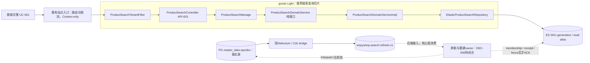
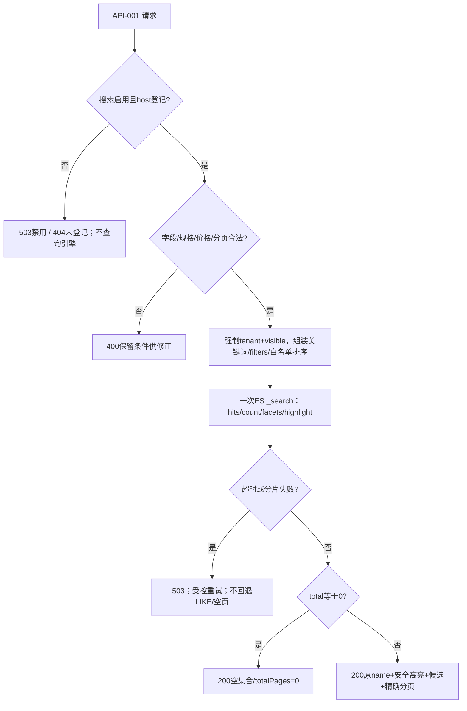
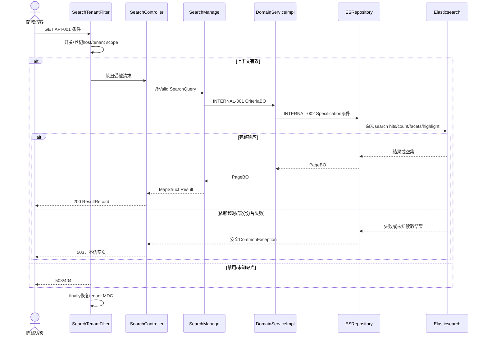

# 商品搜索引擎选型与 Elasticsearch 接入方案

| Field | Value |
| --- | --- |
| Document | `2026-10-11-09-34-product-search-engine-proposal.md` |
| Template Version | `7` |
| Status | `Draft` |
| Type | `Architecture` |
| Complexity | `Complex` |
| Complexity Drivers | ES/Doris选型、匿名多租户检索、异步投影、迟到写与删除恢复、外部部署尚未完成 |
| Created | `2026-10-11 09:34 Asia/Shanghai` |
| Updated | `2026-10-11 09:47 Asia/Shanghai` |
| Owner | mario |
| Repository | enjoyshop |
| Scope | goods 商品搜索后端的候选合同、ES投影和后续同步接入门禁；本次仅方案 |
| Change Surface | 本次只新增本Spec；目标为goods adapter/application/domain/infrastructure搜索查询、ES mapping、配置和测试；同步持久化与部署细节待后继设计闭合 |
| Affected Chapters | §7, §8, §9, §10, §11, §13, §14, §15, §16, §17, §18 |
| Source Requirement | 用户：这个基于es去做吧 或者 doris 探索一个方案，后续我部署完altp再具体对接。先给出方案；澄清：二选一。附件《第7章 商品搜索》 |
| Baseline Revision | `main@4e968affd7e5d8f7543d752cd971da9b7f295ae7`；已有未跟踪CDC Spec/Plan保持原样 |
| Amends | None |
| Supersedes | None |
| Depends On | [商品生命周期](2026-10-09-10-55-product-management-lifecycle.md) §9–11；[CDC同步](2026-10-10-14-48-postgresql-cdc-advertisement-synchronization.md) §9.2.9 EVENT-003、§11、§16 |
| Related Specs | [首页网关架构](2026-10-09-16-39-homepage-kubernetes-gateway-architecture.md) §7、§15；[目录与文件](2026-09-28-21-50-distributed-file-catalog-lookups.md) §9 |
| Related Plans | [Elasticsearch选型冻结与部署后接入阶段Plan](../plan/2026-10-11-10-01-elasticsearch-deferred-integration-plan.md) |

## 1. Summary

推荐二选一选择 **Elasticsearch**：商品名称全文检索、相关性排序、规格条件、品牌/分类聚合、高亮和分页是本次主体。Doris 4.x也具有中文倒排与BM25能力，不能用“Doris只能分析、不能搜索”作为排除理由；但官方当前开发文档说明不返回高亮片段，需要额外应用处理。没有已部署Doris复用优势的证据，因此ES更贴合教程功能，比较依据见§17。

PostgreSQL继续保存商品事实；ES只保存可重建的SKU搜索投影。沿用 goods 的非 open Light 架构，在当前模块扩展搜索能力，不新建独立服务，不双引擎部署。沿用已存在的 `ProductRefreshRequestedEvent` 与 RabbitMQ 搜索刷新队列；事件表示重新读取当前聚合的触发，不是把事件旧快照直接写入索引的指令。

本次产物是供审核的候选方案，不是部署或实现。查询语义和候选文档可先审核；ES版本/客户端依赖、中文分词实测、同步持久receipt/membership/fence的物理实现及重建协调需在部署后闭合。由于这些接入决策未完成，保留 `Draft` 和阻断结论，不能据本稿直接执行上线Plan。§5.4列出具体缺口，缺少环境不影响阅读和评估本方案。

## 2. Background and Current State

### 2.1 Business and user context

附件明确提出关键词、条件筛选、规格过滤、价格区间、分页、排序、高亮。附件示例是SKU列表，价格为整数分，使用旧 `ElasticsearchTemplate`、动态 `specMap.*` 字段、Fastjson及任意排序字段；这些是学习输入，不是当前仓库技术合同。教程页大小有20/30等不一致，本稿明确提出默认20、最大100的候选合同。

用户明确“二选一”，所以比较后只推荐ES，不把Doris放在在线搜索必经链路，也不规划同时接入两套客户端。`altp`没有被证实为产品名，不将其自动转换为额外数据库或部署任务。

### 2.2 Repository evidence

以下相对路径的 `G/` 统一指 `enjoyshop-service/enjoyshop-service-goods/`，`J/` 指 `G/src/main/java/top/egon/enjoyshop/goods/`，`R/` 指 `G/src/main/resources/`；这是文档路径缩写，实际文件均在该模块。外部仓库 `E/` 指 `/Users/mario/SelfProject/Egon-COLA/`。

| Evidence ID | Classification | Exact path/symbol/decision/command | Observed fact | Design significance | Verification limit/freshness |
| --- | --- | --- | --- | --- | --- |
| EVD-001 | User decision | 当前请求、附件及“二选一” | 要先方案，部署完成再接入 | 不改代码/POM、不连接外部环境 | 本轮授权仅文档 |
| EVD-002 | Static repository | `G/pom.xml`、`J/adapter/goods/ProductController.java` | Java21、archetypes-parent5.4.1、MVC、Validation、MapStruct、MP、AMQP、Yuheng OpenAPI | 复用现有技术栈，不抄教程旧客户端 | 未执行依赖解析，父仓库版本只作源码背景 |
| EVD-003 | Static repository | `J/infrastructure/goods/po/SpuPO.java`、`SkuPO.java`、`R/db/egon-mp/V20261009_001__initialize_product_schema.sql` | SPU审核/上下架与SKU状态、tenant/deleted/version；price为integer分 | SKU投影可由现有事实构造 | 未核验真实数据库 |
| EVD-004 | Static repository | `J/domain/sync/ProductRefreshRequestedEvent.java`、`J/infrastructure/sync/ProductCdcChangeStrategy.java` | 事件最多2个根，旧/新归属目标并集，schema v1 | 重读当前根并清理旧集合 | 无搜索消费完成证据 |
| EVD-005 | Static repository | `J/infrastructure/config/CdcRabbitConfiguration.java` | `enjoyshop.sync.v1` / `product.refresh.v1` → `enjoyshop.search.refresh.v1`；quorum、MANUAL ACK工厂、3次重试、DLX | 复用实际队列，不再搭建另一事件总线 | 搜索队列没有真实consumer |
| EVD-006 | Static repository | `J/infrastructure/goods/service/impl/ProductDomainServiceImpl.java#detail`、`R/mybatis/mapper/goods/SpuDAO.xml`、`SkuDAO.xml` | detail为RR，但找不到根抛404；SKU lifecycle读过滤deleted | 当前detail不能直接承担“根缺失→空投影”的恢复合同 | 后续同步读必须补充，不能宣称已有 |
| EVD-007 | Static repository | `J/adapter/filter/AdPublicTenantFilter.java`、`J/start/config/NativeHttpSecurityConfiguration.java` | 匿名广告使用已登记host→tenant；管理products有认证授权链 | 搜索匿名租户策略可参照，不能开放管理链 | Host/proxy真实信任链未核验 |
| EVD-008 | Static repository | `enjoyshop-web/pom.xml`、根目录文件清单 | web只有空聚合POM；不存在搜索页面 | 本次不规划页面/前端框架 | 后续页面独立任务 |
| EVD-009 | Static repository | `G/src/test/java/top/egon/enjoyshop/goods/architecture/LightPersistenceArchitectureTest.java`；`E/egon-cola-archetypes/source-projects/egon-cola-source-light/` | 现有Light领域接口、Manage、Repository和MP校验；Domain不引入Spring/MP | 选择唯一Light profile | 本次不运行架构测试 |
| EVD-010 | Static repository | `J/adapter/handler/BaseExceptionHandler.java`、`ProductOpenApiContractTest.java`；`E/egon-cola-components/egon-cola-component-common/egon-cola-component-common-core/.../ResultRecord.java` | 7字段ResultRecord；真实OAS可由MockMvc读取；现handler按路径识别错误 | 新search必须扩展错误分类，不误落品牌错误 | 未新增任何handler分支 |
| EVD-011 | Official documentation | §17官方链接，2026-10-11查询 | ES高亮/嵌套/分页；Doris4.x BM25与当前开发文档高亮缺口 | 有依据的选型建议 | 不代表用户部署版本具备对应能力 |

已检查本仓库及父路径的 `AGENTS.md` 文件清单，没有磁盘版适用文件；按用户本轮提供的AGENTS执行。未跟踪的 `docs/egon/spec/2026-10-10-14-48-postgresql-cdc-advertisement-synchronization.md` 和对应Plan已存在且不编辑；其协议还与当前Java交叉核对，不把未跟踪状态推断为未批准。

### 2.3 Problem statement and gap

现有 `GET /api/v1/products` 是受保护的管理分页，不是商城匿名全文搜索。当前代码未提供ES/Doris查询实现、mapping、搜索消费者或索引重建工具。商品可变字段及软/硬删除都需要处理；只重放SKU UPDATE、只按row.version覆盖，不能证明根级集合清理与跨请求迟到写安全。

### 2.4 Evidence and current-chain map

| Entry/trigger | Current call chain | Data read/written | External dependency | Consumers | Evidence |
| --- | --- | --- | --- | --- | --- |
| 商品管理HTTP | ProductController → ProductManageImpl → ProductDomainServiceImpl → Spu/SkuRepository → DAO/XML | PostgreSQL商品聚合 | Shoubing/Jianshen、MP | 管理调用方 | EVD-002/003/006 |
| 商品DB CDC | CdcRawConsumer → ProductCdcChangeStrategy → CdcEventPublisher → Rabbit search queue | 已有商品变更事实，只投刷新请求 | Debezium/Rabbit | 搜索consumer尚缺 | EVD-004/005、前驱EVENT-003 |
| 匿名广告读取 | AdPublicTenantFilter → AdController → AdManageImpl | 登记host/广告候选 | 既有缓存/PG | 首页调用方 | EVD-007 |

## 3. Goals and Non-goals

### 3.1 Goals

形成可审核的ES单引擎方案、稳定搜索语义、SKU文档与mapping、既有CDC接入边界及部署后验证清单。解决教程中任意排序、动态字段爆炸、规格误配、HTML高亮注入和不可售商品过滤问题。

### 3.2 Non-goals

本次不写Plan/生产代码/测试代码，不新增依赖，不运行项目/服务器/浏览器，不部署ES/Doris，不操作数据库、kubeconfig、MQ消息或alias。本次不改商品生命周期、订单/库存扣减、评价体系、网关平台、Egon组件或前端。搜索不承担下单可售/最终价格/库存强一致性；交易入口必须重验当前商品。销售数量按已有累计字段，未提供时间窗销量；不把评论条数当好评率，不把createTime当发布时间。

### 3.3 Change Surface and Design Depth

| Area/layer | Disposition | Exact repository evidence | Changed or preserved behavior/contract | Required Spec treatment | Chapter(s) |
| --- | --- | --- | --- | --- | --- |
| 搜索查询切片 | Affected | `J/adapter/goods/ProductController.java`为风格参考；目标`adapter/goods/ProductSearchController`等§8 | 新增候选搜索API/领域读端口，保留管理API | 候选完整合同和对象职责 | §7, §8, §9, §10, §13, §14 |
| ES投影 | Affected | EVD-003及§11候选mapping | 独立可重建SKU读模型、租户/可售过滤 | 文档字段、查询、alias与失败规则 | §7, §10, §11, §14, §15, §16 |
| 搜索配置与匿名边界 | Affected | `AdPublicTenantFilter`、四个application YAML | 专用搜索开关/站点登记/限额，管理链原样 | 候选配置与访问边界 | §7, §8, §9, §14, §15, §16 |
| 同步接入与选型评估 | Affected | ProductRefreshRequestedEvent、前驱§9.2.9/§16 | 本稿给接入不变量与未闭合门禁，不伪造consumer/DDL | 高层协作、风险、对比、后继条件 | §7, §14, §15, §16, §17, §18 |
| PG商品表及持久化 | Context-only | `R/db/egon-mp/V20261009_001__initialize_product_schema.sql` | 事实表、唯一键、SINGLE/master_data与LOCAL原样 | 字段来源及源快照边界；不增表/索引 | §11 |
| CDC生产端与广告 | Unchanged | `ProductCdcChangeStrategy`、`CdcRabbitConfiguration`、`AdController` | exchange/route/schema/publisher confirm/广告业务原样 | 现合同引用与后续回归 | §9, §16 |
| 管理API/GraphQL/文件 | Unchanged | ProductController、现SDL、文件Controller | 认证授权、管理合同及S3保持 | 只说明停止边界 | §9 |
| 前端页面 | Not applicable | `enjoyshop-web/pom.xml`没有页面 | 本次无页面实现 | N/A；API列消费者约定 | §12 |

## 4. Requirements and Acceptance Criteria

| ID | Atomic requirement | Priority | Observable acceptance criteria | Source |
| --- | --- | --- | --- | --- |
| REQ-001 | ES与Doris二选一的推荐 | Must | 同一组功能对比，有当前官方证据，选定一个推荐引擎 | 用户“二选一” |
| REQ-002 | 商品名称关键词检索 | Must | 中文/中英/型号测试集，name命中，空词为浏览；不开放任意DSL | 附件关键字 |
| REQ-003 | 分类、品牌精确筛选 | Must | category任一层ID，brandId精确过滤；跨租户无结果泄漏 | 附件条件筛选 |
| REQ-004 | 规格精确组合与候选面板 | Must | 同规格OR、不同规格AND；键和值同nested项；候选来自完整过滤集 | 附件规格过滤/聚合 |
| REQ-005 | 价格区间 | Must | 分为整数；上下界包含，可单边；反向/小数/负数400 | 附件价格 |
| REQ-006 | 有界分页 | Must | 1基页码、20默认、100上限、窗口≤10000；精确total/totalPages、空页不null | 附件分页 |
| REQ-007 | 白名单稳定排序 | Must | relevance、priceAsc/priceDesc、salesDesc、createdDesc；skuId固定次序 | 附件排序；无好评率来源 |
| REQ-008 | 安全名称高亮 | Must | 原始name保留；单独escaped HTML仅允许mark；无命中null | 附件高亮 |
| REQ-009 | 可售与租户隔离 | Must | SPU已审核且上架、SPU/SKU未删除、SKU启用才进入结果；tenant不由请求指定 | 现商品生命周期/匿名边界 |
| REQ-010 | 对接现商品刷新协议 | Must | 设计覆盖当前态、missing→空、membership、receipt、fence、迟到/重复/部分失败；未闭合禁止ACK/上线 | 前驱CDC消费协议 |
| REQ-011 | 可重建与受控切换 | Must | 新generation从PG构建+增量协调+孤儿校验；原子alias；旧代保留可诊断 | 用户后续接入/前驱§16 |
| REQ-012 | 部署后再接入 | Must | 本轮仅一份Spec，零代码/POM/SQL修改；环境值不虚构，实际验收均Not run | 用户先方案 |

### 4.1 Scenario matrix

| Scenario | Actor/trigger | Preconditions | Main path | Alternative/failure path | Data/state change | Observable result | Requirements |
| --- | --- | --- | --- | --- | --- | --- | --- |
| 中文关键词+品牌 | 买家 | 已登记站点、索引就绪 | name全文+filter | 空匹配返回空页 | 无业务写 | 列表/候选/高亮 | REQ-002/003/008/009 |
| 颜色红或蓝且内存64G | 买家 | 合法规格参数 | 每键nested过滤，键间AND | 超20键/非法编码400 | 无 | 不误命中错配键值 | REQ-004 |
| 只设最低价 | 买家 | 整数分 | gte后分页排序 | lower>upper400 | 无 | 包含边界 | REQ-005/006/007 |
| 分片超时或部分成功 | ES查询 | 查询已发出 | 完整成功200 | timed_out/failed_shards→503，不伪装空结果 | 无 | 可重试错误 | REQ-006/009 |
| 禁用/未知host/tenant注入 | 访问者 | 不可信上下文 | 边界先拒绝 | 不查询ES、不回落默认租户 | 无 | 503/404/400 | REQ-009/012 |
| 重复E1、E2后E1 | Rabbit重放 | 同epoch | 查持久receipt，或重新读当前 | fingerprint冲突隔离 | 仅投影 | 不重放旧payload | REQ-010 |
| 下架、删子SKU、根硬删除 | CDC | 变更已commit | 当前期望集合与目标membership对账 | 源不可读是失败，不能当空；硬删除是确认missing | 目标移除/持久tombstone | 最终收敛 | REQ-009/010 |
| 批写部分失败/响应丢失 | 消费者 | 有持久任务 | 逐item检查后安全恢复 | 未知完成不ACK、不以DB receipt代替ES完成 | 目标可能部分写 | 重试与DLQ可诊断 | REQ-010 |
| 全量重建期间变更 | 运维 | 新generation | snapshot+捕获增量+追平+校验+alias | 水位/epoch不连续则停止切换 | 新读代 | 不把旧扫描覆盖新态 | REQ-011 |
| 尚未部署引擎 | 用户 | 本轮现状 | 提交本稿 | 环境与依赖保持待接入门禁 | 仅文档 | 可审核方案 | REQ-001/012 |

### 4.2 Use-case analysis

#### 4.2.1 Actor inventory

| Actor ID | Actor/role | Goal and responsibility | Entry/channel | Permission/tenant context | Evidence |
| --- | --- | --- | --- | --- | --- |
| ACTOR-001 | 商城访客 | 找到SKU并缩小条件 | 候选API-001 | 已登记公开站点，非管理权限 | 用户附件 |
| ACTOR-002 | CDC生产系统 | 通知当前商品发生变化 | 已有ProductRefreshRequestedEvent | trusted broker/source/epoch/tenant | EVD-004/005 |
| ACTOR-003 | 部署运维/决策人 | 选引擎、完成接入与恢复验证 | 文档审核/后继运维流程 | 受控凭证/部署权限 | 用户“部署完…再对接” |

#### 4.2.2 Use-case artifact

| ID | Use case/goal | Primary actor | Supporting actors/systems | Trigger | Preconditions | Main success outcome | Alternatives/failures | Postconditions | Requirements | Interfaces/pages | Tests |
| --- | --- | --- | --- | --- | --- | --- | --- | --- | --- | --- | --- |
| UC-001 | 检索并筛选商品 | ACTOR-001 | ES/站点登记 | 输入关键词或筛选 | 候选匿名合同审核、host可信、开关与generation就绪 | 一次得到SKU页和候选 | 空集、非法条件、unknown host、依赖故障 | PG/MQ不变；失败不伪造200 | REQ-002–009 | API-001；无已建页面 | TEST-001–009 |
| UC-002 | 商品投影恢复到当前事实 | ACTOR-002 | PG/Rabbit/后续同步实现 | 商品刷新事件 | receipt/fence/storage方案获准并验证 | 目标集合收敛后ACK | 乱序、重复、missing、部分失败、epoch冲突 | 完成可证明；否则未ACK或DLQ | REQ-009/010 | 前驱EVENT-003；接入合同待闭合 | TEST-010–013 |
| UC-003 | 部署与重建搜索能力 | ACTOR-003 | PG/ES/CDC | 首次接入、灾难恢复、mapping变更 | 版本、TLS、权限、容量/水位已证明 | 新代追平与校验后切换 | 无连续性/孤儿/旧写复活则禁止切换 | 原事实/旧代/slot/offset保留 | REQ-001/011/012 | 后继运维合同，当前不造HTTP任务接口 | TEST-014–016 |

## 5. Constraints, Assumptions, and Decisions

### 5.1 Confirmed constraints

只出方案；不启动项目、不打开浏览器、不自动commit；不编辑任何旧Flyway/MP SQL与manifest。二选一单引擎；先推荐ES，部署后再具体接入。已有CDC只发当前态刷新请求，schema v1、tenant、epoch、LSN不变；不把 sourceEpoch 当可排序版本，不把sku.version当SPU根全序，不要求业务引入Outbox/SSM来替换既有MQ。

### 5.2 Small-gap assumptions

| ID | Inference | Repository evidence | Why locally reversible | Impact if wrong |
| --- | --- | --- | --- | --- |
| ASM-001 | 搜索类放`search`业务包、Controller放现`adapter/goods` | 商品/广告同Light模块现结构 | 内部路径，不改变profile | 在Plan阶段调整命名，无schema影响 |
| ASM-002 | 字段名称使用keywords/pageNo/pageSize，与附近分页习惯一致 | ProductPageQuery/附件 | 尚未发布的候选名 | 审核时统一即可，不迁移旧客户端 |

### 5.3 Resolved decisions

| ID | Decision | Decision owner | Evidence and rationale | Requirements |
| --- | --- | --- | --- | --- |
| DEC-001 | 本次只文档、实际接入推迟 | 用户 | 先方案、部署完再对接 | REQ-012 |
| DEC-002 | 两者只选一个方向 | 用户 | 澄清“二选一” | REQ-001 |
| DEC-003 | ES为本稿推荐，不标记已获采用 | 主agent方案建议 | §17功能差异/额外高亮负担 | REQ-001 |

### 5.4 Open major decisions

下表是审核及后续接入门禁，不要求用户此刻提供尚未部署的地址/密钥；不以缺值为由停止本次方案交付。

| ID | Question and options | Recommendation, not decision | Impact | Owner | Status |
| --- | --- | --- | --- | --- | --- |
| DEC-004 | ES方案采用及候选公开合同；若更偏分析可选Doris | 审核§9的匿名SKU/AND词项/严格候选/有界页语义并采用ES | 引擎、API与安全新增行为；尚未接受 | 用户 | Open |
| DEC-005 | ES client / 部署版本 / 中文analyzer | 官方Java client `co.elastic.clients:elasticsearch-java`，版本按实际ES和Jackson兼容矩阵锁定；中文优先测试内建cjk，未达召回再评估插件 | 当前G/pom未引入搜索client；需批准精确版本与传递影响后才改POM；不下载 | 用户/部署后设计 | BLOCKED_DEPENDENCY |
| DEC-006 | 同步持久控制存储与fence实现 | 倾向同master_data PG存储durable receipt/membership/fence，MP/managed DDL复用；单靠MQ顺序或Redis锁不足 | 需完整新表/索引/锁/CAS/逐SKU目标条件写；不在本稿发明未审核DDL | 用户/后继同步Spec | Open |
| DEC-007 | 环境与上线质量阈值 | 部署后确认TLS/roles/集群容量/词库/源连续性与§16门禁 | 具体对接与容量SLO未定，禁止声称上线ready | 用户/运维 | Deferred deployment gate |

本稿§9–11是可逐项审核的推荐合同；用户未认可前不作为已发布接口。DEC-006阻断同步实现完整设计，因此不为其编造consumer、receipt表或迁移版本；后继Spec必须完整闭合，不能只把本稿的高层“fence”字样变成实现承诺。详细数据库设计因该未决选择保留Draft，已完成的查询方案可以独立审核。

## 6. Project Technology Context

| Concern | Current choice | Repository evidence | Constraint on design |
| --- | --- | --- | --- |
| Language/runtime | Java21、Maven、archetypes-parent5.4.1 | G/pom.xml | 使用现构建/处理器 |
| HTTP/docs | MVC、Yuheng OpenAPI starter、OpenAPI3注解、已有generated OAS测试 | G/pom、ProductController/OpenApiContractTest | 新API走同体系，不加Springfox |
| Framework versions | E/pom.xml源码声明Boot3.5.16、springdoc2.8.17；本轮未解析goods实际classpath | EVD-002 | 对接Plan重新检查resolved版本，不能把源码背景冒充已解析JAR |
| Persistence | PG+Common MP-SDJ、managed db/egon-mp、NATIVE读写分流、LOCAL | R/egon-mybatis-plus-sharding.yml、egon-ss-readwrite.yml | 保留商品SINGLE/master_data；不选新拓扑 |
| Messaging | Spring AMQP/现CDC队列与schema | EVD-004/005 | 生产链原样；异步至少一次 |
| Testing | JUnit5/AssertJ/MockMvc、H2受控测试 | 已有测试源码 | 默认不启动外部ES/PG/Rabbit |

### 6.1 Java architecture profile and capability baseline

| Architecture profile | Archetype/template or base package | Exact evidence and verifier | Existing deviations | Design action |
| --- | --- | --- | --- | --- |
| Egon-COLA Light，非open、单goods Maven模块 | `E/egon-cola-archetypes/source-projects/egon-cola-source-light`；`top.egon.enjoyshop.goods` | EVD-009；当前Manage→DomainService→Repository→DAO | 业务目录平铺是现工程选择；教学样例仍在 | 保持同profile；不新增biz层/独立模块；Domain纯端口，不加ES/Spring类型 |

| Need | Spring/JDK candidate | Spring Boot Starter candidate | Egon-COLA/module candidate | Proven gap | Decision/dependency impact |
| --- | --- | --- | --- | --- | --- |
| 边界校验 | Jakarta Validation | 已有validation starter | ValidationUtils/附近分组 | 无 | Keep，不写重复Utils |
| 转换/结果 | MapStruct/Jackson | 当前处理器 | common-core BaseForwardConverter/ResultRecord | 搜索载荷需新类型 | Keep公共基类，Add实际投影 |
| PG/MQ/可观测 | MP、AMQP、Micrometer | 现G/pom | EgonModel、Repository、CDC事件 | 搜索consumer/控制状态缺失 | Keep，DEC-006待闭合 |
| ES查询 | 官方Java client；备选Spring RestClient+Jackson直调REST | 当前无ES starter | 检索E/components及goods未见商品ES适配组件 | 类型化query/response/transport与版本兼容缺口 | 优先client建议，DEC-005审批；不加Spring Data ES/旧RestHighLevelClient |
| 安全/公开站点 | Security FilterChain、IDN规范化 | 现安全依赖 | AdPublicTenantFilter为参照，非search现能力 | 搜索需独立route/scope | 新专用filter不扩大管理permitAll |
| 缓存 | 现Common cache+Redisson | 已有 | 广告缓存已存在 | 没有搜索缓存的当前测量需求 | Remove新增search cache，首期直接ES |

### 6.2 User-mandated Java rule compliance

| Literal rule | Affected? | Repository evidence | Exact design decision | Files/types/interfaces | Validation/test evidence | Status/blocker |
| --- | --- | --- | --- | --- | --- | --- |
| Rule 1 | Yes | EVD-002及§8 | Query/BO/DTO/Result/Service/Repository/Strategy后缀，无Info/Data | §8–10全部目标 | TEST-015静态命名 | PASS |
| Rule 2 | Yes | 现ValidationUtils和starter | §10每层@Valid/分组，直接入口metadata手工触发 | API-001/INTERNAL-001/002 | TEST-001/008/015 | PASS |
| Rule 3 | Yes | 现Lombok/converter/ResultRecord | 新普通class使用@Data/@NoArgsConstructor/@AllArgsConstructor/@Accessors(chain=true)/@Builder；仅已有ResultRecord复用record | §10 carriers/converters | TEST-007/015 | PASS |
| Rule 4 | Yes | G/lombok.config复制Qualifier | §8所有业务Bean @Slf4j、命名Bean、@RequiredArgsConstructor、final @Qualifier | §8业务组件 | TEST-015 | PASS |
| Rule 5 | Yes | 现JDK/Commons/Guava | 无自建Utils、无新utility依赖 | 高亮安全编码用现Commons/JDK | TEST-007/015 | PASS |
| Rule 6 | Yes | Jackson/ResultRecord | §9 wire以Jackson；枚举@JsonValue；不使用Fastjson，不ordinal | Query/Result/DTO/enum | TEST-007/009 | PASS |
| Rule 7 | Yes | R/application{,-dev,-test,-prod}.yml | §15候选核心keys四份一致，enabled=false | SearchProperties | TEST-015 | PASS |
| Rule 9 | Yes | 现ProductCdcChangeStrategy、ProductLifecycleComponent | 规格条件组合复杂：Specification；外部读取隔离：Repository/Adapter；不预造Doris策略 | SearchCriteriaBO/ElasticProductSearchRepository | TEST-002/004 | PASS |
| Rule 10 | Yes | 现create_time/timestamptz、Event Instant | Instant/Duration、UTC、epoch_millis；无java.util.Date | §10/11日期 | TEST-007/015 | PASS |
| Rule 11 | Yes | EVD-003/009 | 精确Light；PG原MP/DDL原样；MQ复用；控制持久化尚未完整，禁止伪完成 | §7/11/DEC-006 | TEST-010–016后续未运行 | BLOCKED |

## 7. Architecture Design

### 7.0 Minimum-design baseline and element-necessity audit

先评估直接扩展现管理PG分页：能精确条件过滤，却不能直接交付ES/Doris要求、可调中文全文相关性与原生高亮；不将其伪装全文搜索兜底。选择用户要求的单读引擎，承担同步成本；不再加引擎通用策略工厂、额外网关、聚合微服务、缓存或查询总线。

| Proposed element | Change | Requirements | Existing/direct alternative | Concrete inadequacy of alternative | Added calls/state/coupling/failures/migration/operations | Verdict |
| --- | --- | --- | --- | --- | --- | --- |
| 单匿名SKU搜索API | New | REQ-002–009 | 管理products页 | 管理授权/聚合对象/LIKE与商城搜索不同 | 1 HTTP合同与公开站点安全面 | Add |
| SearchManage/DomainService/ESRepository | New | REQ-002–009 | Controller直ES | 违背当前Light职责，泄漏DSL/依赖 | 进程内调用，无额外服务 | Add |
| Query/CriteriaBO/PageBO/ItemBO/Result/DTO及三个Converter | New | REQ-002–009 | 复用SKU PO或管理ProductResult | 公开曝光、facet/高亮及非持久语义不同 | §10列出必要边界；不每层复制一套 | Add |
| SKU实体ES投影+spec nested | New | REQ-004/009/011 | 动态specMap字段或整JSON terms | 键爆炸/字段误配；JSON枚举不等于规格facet | 分词索引/nested存储与同步、generation成本 | Add |
| 官方client依赖 | New proposal | REQ-002/012 | 现RestClient直REST | 可行备选但需自维护DSL/错误解析；正式client减轻适配 | 传递依赖/版本耦合；未批准，不改POM | Add pending DEC-005 |
| Rabbit v1事件 | Existing | REQ-010 | 再发新事件/Outbox | 已有协议足够触发，不新增双写事实 | 现队列积压与重试仍需验收 | Keep |
| 持久receipt/membership/fence | New proposal | REQ-010/011 | 仅队列顺序、分布式锁 | 无法约束已经发出且迟到的远端写，也无法清孤儿 | 存储DDL/锁/CAS/恢复成本待DEC-006 | Add pending DEC-006 |
| 拆分facets/获取tenant/查询引擎类型API | Proposed | REQ-004/009 | search一次返回；tenant后端derive | 原接口已够，拆分无独立收益 | 额外RTT、租户可控、状态竞态 | Remove |
| ES+Doris双写/可切换工厂/新search缓存 | Proposed | REQ-001 | 单ES | 无当前双引擎或缓存需求 | 双同步与失效/维护面 | Remove |

| Path | Network calls | Client states | Server contracts/state | Failure and TOCTOU points | Additional user/business value |
| --- | --- | --- | --- | --- | --- |
| PG管理基线 | 1 HTTP+PG | 列表 | 已有管理合同 | 当前DB读 | 不具全文与高亮 |
| 推荐ES搜索 | 1 HTTP+1 ES _search（hits/count/facets同时） | loading/empty/results/error | 新只读合同+异步读模型 | ES故障、刷新延迟、翻页漂移 | 所有教程搜索功能 |
| 分拆搜索/候选/tenant | 多HTTP | 多loading/race | 3合同 | 跨请求不一致 | 无额外价值，排除 |

### 7.1 System Architecture Design

#### 7.1.1 Architecture Mermaid view



虚线是后继待闭合能力，不能据图声称已经实现。匿名站点与ES仅允许受控服务通信；引擎地址/凭证/索引名不暴露给浏览器。

#### 7.1.2 Boundary and responsibility table

| Module/component | Capability and data owned | Inputs/outputs | Allowed dependencies | Forbidden responsibility | Requirements |
| --- | --- | --- | --- | --- | --- |
| SearchController/Manage | 公开输入/Result映射、租户上下文 | API-001→CriteriaBO→Result | common、DomainService | SQL/ES DSL、管理授权修改 | REQ-002–009 |
| DomainService/CriteriaBO | 搜索语义、Specification、公开可见规则 | INTERNAL-001 | domain/common | ES client、Spring/MP/OpenAPI | REQ-002–009 |
| DomainServiceImpl/Repository | 查询翻译、调用、完整响应校验 | INTERNAL-002→ES | domain、已有技术设施及获准client | 源商品写、直接消费代替事务证明 | REQ-002–009 |
| PG goods写链 | 商品事实/生命周期/最终交易条件 | 现Controller/Service/DAO | 当前MP体系 | 将ES当商品事实 | REQ-009 |
| 后继sync owner | 投影任务、membership、receipt、fence、重建水位 | 前驱EVENT-003 | PG当前态/ES条件写/Rabbit ACK | 旧事件up/down直接执行、没完成ACK | REQ-010/011 |

### 7.2 High-Level Design

#### 7.2.1 Critical business/control flowchart



#### 7.2.2 High-level decision and quality matrix

| Concern/use case | Required behavior | Selected mechanism | Failure/degradation behavior | Trade-off | Verification | Requirements |
| --- | --- | --- | --- | --- | --- | --- |
| 租户/公开可见性 | 不能越租户/返回不可售SKU | host登记派生tenant，所有hits/facets filter tenant+visible | 缺上下文fail closed | 需独立filter，Host信任链验收 | TEST-008/016 | REQ-009 |
| 搜索一致性 | 每次hits/count/facets同一过滤和同一次search | 严格候选口径，allow_partial_search_results=false | 分片失败整体503 | 精确total/分组增加开销 | TEST-003/009/016 | REQ-004/006 |
| 可恢复性 | 迟到写不能复活旧数据 | durable receipt/fence+tombstone+generation，后继完整设计 | 没闭合不开consumer | 多控制状态，不能宣称exactly-once | TEST-010–014 | REQ-010/011 |
| 容量/延迟 | 有界page/term/facet/timeout | 查询deadline候选2s、最多20规格键、100结果/页、100候选/维度 | 达预算503/截断标记；不增深页窗口 | SLO未测，只是保护预算 | TEST-005/016 | REQ-006/012 |

### 7.3 Detailed Design

#### 7.3.1 Detailed component collaboration

1. 专用Filter只匹配API-001；拒绝客户端tenant/tenantId字段，canonical host经独立search.public-sites映射为tenant。MDC上下文在finally恢复，不能沿用线程旧tenant；不直接信任用户的X-Tenant-Id或未经入口清洗的Forwarded。
2. Controller限制已知单值参数；唯一可多值是 `spec.<name>`。框架仅解码一次：`+`按URL规则表示空格，字面加号用`%2B`，禁止对 `%2B`字符串再replace；keywords只strip首尾，不擅改品牌/型号内空格或中文字词。
3. Manage调用注解/分组校验后将业务条件投影为SearchCriteriaBO，tenant来自上下文，领域端口独立校验。criteria组合采用Specification：固定Mandatory(tenant/visible) AND Keyword AND Category AND Brand AND Price AND每个SpecName；同键values为OR集合。
4. ESRepository将规格每键单独nested query：同一nested对象同时满足name与values；不同键是独立nested条件AND。name使用match AND词项，不用query_string，不支持调用方wildcard/script/DSL；空词match_all。只有name参与打分和高亮；caption保留展示不用作额外召回，避免未经请求的多字段语义。
5. 一次 `_search` 同时返回hits、精确 `track_total_hits=true`、在全部当前过滤之后的facets。分类按SKU叶类目分组，品牌按SPU.brandId及SKU保存的brandName，规格nested(name,value)并以reverse_nested父SKU计数。多分片terms计数可能近似：建议按key排序并读取截断/未返回桶指标，返回facet.truncated；固定_key顺序并只接受所选桶doc_count_error=0的完整响应；非零误差不能把count称exact，应返回610403。truncated描述未返回候选，不替代count准确性。不从当页SKU抽候选、不terms整spec JSON。
6. 采用“严格候选”口径：所有已选过滤作用于各facet；红色已选时颜色候选只列符合全部过滤的值。面板放开本维度筛选属于未来产品语义修改；本稿不暗中做disjunctive faceting。每维最多100桶，最多20规格键，所有truncation显式返回；实际大基数压测验证。
7. Sort白名单映射：relevance→`_score DESC, skuId ASC`；无关键词relevance→`skuId DESC`；priceAsc/Desc→price对应方向+skuId ASC；salesDesc→累计saleNum DESC+skuId ASC；createdDesc→skuCreatedAt DESC+skuId ASC。不公开sortField，skuId为数值long doc_values避免十进制字符串字典序。
8. offset=(pageNo-1)*pageSize使用long安全计算，offset+pageSize≤10000；拒绝超过窗口，暂不开放深页游标。`totalPages=ceil(total/pageSize)`可能超过窗口，`maxAccessiblePageNo=floor(10000/pageSize)`明确可访问限额；超total但在窗口内返回200空rows，总数/facets保留。翻页不承诺快照：并发更新可导致跨页漂移；未来有深页需求再设计PIT/search_after及签名游标。
9. 高亮用unified、`encoder=html`、固定`<mark>`/`</mark>`、name单个片段（最大200字符，最多1）。原name始终纯文本；独立nameHighlight允许null，安全策略见§10。标签不由请求提供；展示name用text，高亮按仅mark白名单使用。高亮缺少时不报错。
10. ES disabled/not-ready、deadline/transport错误、`timed_out=true`、failed_shards>0或输出结构非法统一503安全错误；未登记站点404；不强制下架实时全球一致，也不把旧库存当下单权限。无搜索结果缓存，无Query发事件/记业务历史。

#### 7.3.2 Critical-path Mermaid swimlane



#### 7.3.3 Transactions, consistency, concurrency, and idempotency

| Concern/state change | Owner and boundary | Mechanism/isolation/lock | Concurrent or duplicate behavior | Commit/visibility point | Failure result | Requirements/tests |
| --- | --- | --- | --- | --- | --- | --- |
| 查询 | ESRepository；无业务事务 | 一次ES搜索，禁止写 | 重试是新读取，跨页可漂移 | 引擎search当前refresh视图 | 503整体失败 | REQ-002–009/TEST-009 |
| 源事实 | 现商品DomainServiceImpl | 原LOCAL事务 | 现version/生命周期规则 | PG commit | 既有错误合同 | REQ-009/回归边界 |
| 当前聚合快照 | 后继sync owner | PRIMARY RR读取根及所有子SKU，含删除/缺失判断 | 不复用会404跳过的detail；不从replica判断删除 | 快照读完后构造期望集合 | 源不可读不当空 | REQ-010/TEST-010 |
| ES写/控制状态/ACK | 后继sync owner，DEC-006阻断 | PG控制事务与ES远端写不原子；需持久fence+逐doc条件写 | receipt覆盖E1/E2/E1；超时旧writer也被目标拒绝 | 全任务逐item已证实+持久完成后ACK | 未知不ACK，恢复读取/重试 | REQ-010/TEST-011–013 |

**同步后继必须满足的合同**：持久身份至少包含sourceAlias/sourceEpoch/tenant/eventId/目标generation，保存规范payload fingerprint；同身份变内容是永久冲突。每根维护旧target membership与当前源期望集合；并集对账，缺失根必须移除旧target，不是跳过。跨旧/新SPU或tenant事件按原集合处理，删除需要验证doc当前owner，不能删除已迁移到其他根的新doc。

fence必须在读取源快照之前获取，并由目标文档条件写拒绝旧token；进程锁、Rabbit single-active或SQL receipt仅解决其中一部分，不能拦截已发出的旧remote write。目标删除使用持久tombstone或等效可靠版本保护，不能依赖ES delete短期版本保留；GC须覆盖最大重放/未知请求窗口。`spu.version`不保证所有SKU变更都递增，`occurredAt`和sourceLsn也不是跨源/epoch的全局序。具体token分配、锁粒度、DDL、条件脚本、bulk item CAS及membership原子状态见DEC-006，**当前尚未闭合，不授权consumer实现或开启**。

#### 7.3.4 Failure semantics, recovery, and reconciliation

| Failure point | Detection | Immediate control flow | Data/transaction state | Retry and idempotency | Caller/frontend result | Recovery/reconciliation owner | Verification |
| --- | --- | --- | --- | --- | --- | --- | --- |
| 查询ES超时/429/分片错误 | deadline/HTTP/result | 返回503、记录安全code | 纯读 | HTTP不自动无限重试；消费者可手工重试 | 条件保留，不显示无商品 | 搜索owner | TEST-009 |
| 数据未部署/alias未ready | enabled/generation状态 | 搜索503；不造空index | 无 | 配好后重试 | 搜索暂不可用 | 用户/运维 | TEST-016 |
| PG当前态读取失败 | SQL/事务异常 | 不ACK，不生成空集合 | ES保持既有态 | 后继reuse 3次有界retry后DLX | 搜索可能短期陈旧 | sync owner | TEST-010/013 |
| ES bulk部分成功/请求超时 | item状态、持久attempt | 完成项/未知项区分；receipt不提前完成 | 部分/未知 | 原身份恢复与目标fence，不重发旧快照裸写 | 无同步完成保证 | sync owner | TEST-012 |
| epoch断裂、迟到旧writer | registry/fence比较 | 拒绝/隔离旧epoch；阻止旧目标写 | 保留tombstone | 不按时间或字符串epoch大小放行 | 重建期间按ready gate | DBA/sync owner | TEST-011/014 |
| 重建中失败 | checkpoint/水位/对账 | 不切alias，保留旧代 | 新代不完整 | 有界恢复或新代重建，不改PG | 原代继续或明确不可用 | 运维 | TEST-014 |

#### 7.3.5 Observability and operational boundaries

搜索owner在Repository结束时记录operation=search/result/error/latency，指标维度只用稳定operation/error，不能用关键词、tenantId、skuId、eventId作高基数标签。日志可包含traceId和已认证tenant的安全标识，不记token、连接串、完整搜索词、完整源row。消费者后继记录eventId/root/generation/epoch/attempt/item失败数量，receipt/fence/ACK阶段分别观察。query.errors、延迟、pending队列字节/最老年龄、DLQ数量、sync lag和重建水位由搜索/运维共同看护；DLQ>0、epoch错误、部分分片失败立即告警；延迟/积压阈值按部署后压测容量预算确定，当前没有实测SLO。

#### 7.3.6 Conclusion evidence chain

| Conclusion | Repository/user evidence | Constraint or requirement | Design decision | Consequence and trade-off | Verification and acceptance evidence |
| --- | --- | --- | --- | --- | --- |
| 推荐ES | 用户完整搜索功能；EVD-011 | REQ-001/008 | 单ES，Doris作备选比较 | 承担独立集群；减少自建高亮能力 | §17来源+TEST-016中文/高亮实测 |
| 复用既有CDC但不直接up/down | EVD-004/005/006；前驱EVENT-003 | REQ-010/011 | 当前态+membership+receipt+fence | 需要后继控制存储设计，不伪造已交付 | TEST-010–014；DEC-006仍阻断 |
| SKU文档+nested规格 | EVD-003/附件SKU列表 | REQ-004/006 | 单SKU hit且键值不拆开 | nested存储增加；不SPU折叠 | TEST-002/003/016 |
| 暂缓实际接入 | EVD-001、未知部署版本 | REQ-012 | 保留disabled，候选依赖不改POM | 设计可审核，尚非上线规范 | git diff+§20验证 |

## 8. Package Structure and Code File Tree

### 8.1 Current relevant tree

```text
G/
  pom.xml / lombok.config
  src/main/java/top/egon/enjoyshop/goods/
    adapter/goods/ProductController.java
    adapter/filter/AdPublicTenantFilter.java
    application/goods/ProductManage{,Impl}.java
    domain/goods/ProductDomainService.java
    domain/sync/ProductRefreshRequestedEvent.java
    infrastructure/goods/{repo,dao,po,service/impl}/
    infrastructure/sync/ProductCdcChangeStrategy.java
    infrastructure/config/CdcRabbitConfiguration.java
    start/config/NativeHttpSecurityConfiguration.java
  src/main/resources/{application*.yml,mybatis/mapper/goods/,db/egon-mp/}
```

### 8.2 Target tree

以下是**查询切片候选**，本次均未创建。只有文档本身为实际新增。同步worker、控制存储及其DDL因DEC-006开放，不列虚假的“完整target tree”；后继必须独立补全。

```text
J/
  adapter/goods/ProductSearchController.java                     CREATE
  adapter/filter/ProductSearchTenantFilter.java                  CREATE
  adapter/handler/BaseExceptionHandler.java                      MODIFY search路径错误映射
  application/search/
    ProductSearchQuery.java                                      CREATE
    ProductSearchPageResult.java / ProductSearchItemResult.java   CREATE
    SearchFacetResult.java / SearchFacetBucketResult.java        CREATE
    ProductSearchManage.java / ProductSearchManageImpl.java      CREATE
    ProductSearchResultConverter.java                            CREATE
    ProductSearchQueryConverter.java                             CREATE
  common/enums/{ProductSearchSortEnum.java,GoodsErrorStatus.java} CREATE / MODIFY
  common/validation/{ProductSearchValidationGroup.java,ValidProductSearch.java,
    ProductSearchValidator.java}                                 CREATE
  domain/search/
    SearchCriteriaBO.java / ProductSearchPageBO.java              CREATE
    ProductSearchItemBO.java / SearchFacetBO.java / SearchFacetBucketBO.java CREATE
    ProductSearchDomainService.java / ProductSearchRepository.java CREATE
  infrastructure/search/
    ProductSearchDocumentDTO.java / SearchSpecDTO.java            CREATE
    ProductSearchDocumentConverter.java                          CREATE
    ElasticProductSearchRepository.java                          CREATE
    service/impl/ProductSearchDomainServiceImpl.java             CREATE
  infrastructure/config/{ProductSearchProperties.java,ProductSearchConfiguration.java} CREATE
  start/config/NativeHttpSecurityConfiguration.java              MODIFY exact search route chain
R/
  search/product-sku-mapping.json                                CREATE engine mapping，非SQL
  application{,-dev,-test,-prod}.yml                              MODIFY aligned search keys
G/src/test/java/top/egon/enjoyshop/goods/
  adapter/goods/ProductSearchControllerWebTest.java               CREATE
  adapter/goods/ProductSearchOpenApiContractTest.java             CREATE
  infrastructure/search/ElasticProductSearchRepositoryTest.java  CREATE
  application/search/ProductSearchValidationTest.java            CREATE
  architecture/LightPersistenceArchitectureTest.java             MODIFY scoped package约束，保留数量约束
G/pom.xml                                                       仅DEC-005批准后MODIFY
```

### 8.3 Package and file responsibilities

| Operation | Path/package | Symbols | Responsibility | Dependencies | Requirements |
| --- | --- | --- | --- | --- | --- |
| Create proposed | J/adapter/goods、adapter/filter | Controller/Filter | route、参数绑定、登记host租户、安全scope | 现MVC/Jackson/ResultRecord | REQ-002–009 |
| Create proposed | J/application/search | Query/Result/Manage/Converter | 输入合同及结果投影；Result保留公开字段 | domain/common、MapStruct | REQ-002–009 |
| Create proposed | J/domain/search | 2纯接口及5 BO | 语义组合/只读结果；无Spring/ES依赖 | common validation | REQ-002–009 |
| Create proposed | J/infrastructure/search | Repository/Impl/DTO/Converter | DSL翻译、技术错误、ES文档转换 | 获准client、common转换 | REQ-002–009/012 |
| Create/Modify proposed | config、common、BaseExceptionHandler | properties/config/enum/validators/error | 核心配置与安全错误，不改管理错误 | 既有设施 | REQ-009/012 |
| Create proposed | R/search/product-sku-mapping.json | mapping | engine-native固定字段 | §11 | REQ-004/011 |
| Create/Modify proposed | G/src/test/... | §14测试 | 只测搜索及停止边界 | 现测试工具 | REQ-002–012 |

所有新具体业务组件均使用 `@Slf4j`；Spring Bean显式命名按lowerCamel类职责：productSearchController/productSearchTenantFilter/productSearchManage/productSearchDomainService/elasticProductSearchRepository/productSearchConfiguration；有依赖则 `@RequiredArgsConstructor`+每个final字段`@Qualifier`，已有lombok.config会复制。领域接口/BO不注册Spring Bean。Converter生成Bean分别productSearchResultConverterImpl/productSearchDocumentConverterImpl，若新增嵌套mapper须测试命名一致。保持组合，不新增BaseSearchService或Doris空实现。

现教学/user样例处于Unchanged，本次不以样例清理为理由删除。无CREATE关系表、无CRUD脚手架/新模块，故不运行codegen，不写SQL journal；后继DEC-006若批准新关系表，须用verified CREATE生成器、managed DDL及严格所有权规则，不能手写catalog套件代替生成。

## 9. Interface Definitions

### 9.0 API protocol and documentation governance

| Concern | Decision/evidence |
| --- | --- |
| Protocol selection | 候选REST Query、GET SKU集合搜索；现管理REST风格与消费者输入一致，无新增GraphQL façade |
| CQE application level | 因用户要求外部读引擎，推荐L3读投影；查询纯读，写仍PG、Event已由MQ送达；多存储一致性受DEC-006门禁 |
| REST source of truth | Code-first，候选ProductSearchController/Query/Result/BeanValidation/Jackson和OpenAPI3；本稿不是已发布OAS |
| GraphQL source of truth | N/A for added search capability；当前SDL与resolver保持Unchanged，不设计search字段 |
| Springdoc/OpenAPI compatibility | 现Yuheng MVC starter复用；E/pom源码Boot3.5.16/springdoc2.8.17；实际解析需TEST-015校验，不新引入springdoc |
| Legacy Swagger/Springfox status | G/pom及现Controller使用io.swagger.v3，不采用教程旧Swagger客户端配置 |
| Security and documentation exposure | 候选公开精确GET、host登记派生tenant、default disabled；OAS显式security=[]，生产不扩大既有docs暴露 |
| Contract publication and drift gate | 候选ProductSearchOpenApiContractTest以MockMvc读取/v3/api-docs，Jackson断言原有和新operationId/schema，TEST-009/015 |

### 9.1 Interface Inventory

| ID | Change/necessity verdict | Name/purpose | Kind | API style/CQE role | Consumer | Owner | Method + URL / GraphQL field / symbol / topic | Operation ID/schema source | Input | Output | Auth/tenant | Error model | Idempotency/version | Requirements |
| --- | --- | --- | --- | --- | --- | --- | --- | --- | --- | --- | --- | --- | --- | --- |
| API-001 | New/Add candidate | 商城SKU搜索 | HTTP | REST Query | ACTOR-001 | goods | GET /api/v1/product-search | searchProductSkus；候选Controller | ProductSearchQuery | ResultRecord<ProductSearchPageResult> | 登记host→tenant，匿名精确路由 | §9.2.1 | safe read，v1 | REQ-002–009 |
| INTERNAL-001 | New/Add candidate | 领域搜索 | Internal | Query | ProductSearchManage | goods domain | ProductSearchDomainService#search(SearchCriteriaBO) | 纯Java端口 | SearchCriteriaBO | ProductSearchPageBO | 显式服务端tenant | CommonException | 纯读，无事件 | REQ-002–009 |
| INTERNAL-002 | New/Add candidate | 查询投影库 | Internal | Query | DomainServiceImpl | goods infrastructure | ProductSearchRepository#search(SearchCriteriaBO) | Domain Repository端口 | SearchCriteriaBO | ProductSearchPageBO | 强制tenant+visible | CommonException | 纯读，无事件 | REQ-002–009 |

现 `ProductRefreshRequestedEvent` v1、exchange/route、管理HTTP/GraphQL均**Unchanged**，引用前驱§9.2.9而不重新定义wire。未来新增consumer、任务/重建方法必须由后继设计逐项inventory；不能把已有publisher视为搜索已完成。

### 9.2 Per-interface Detailed Contracts

#### 9.2.1 API-001 — 商城SKU搜索（候选）

##### Necessity and interaction-cost decision

| Concern | Decision |
| --- | --- |
| Change classification | New，尚未存在于当前Java mapping |
| Independent consumer goal | ACTOR-001检索、显示SKU并选择筛选，不是获得另一个Command参数 |
| Parameter ownership and derivation | 买家拥有关键词/筛选选择；tenant/visible/index/DSL由后端拥有；不能发送tenant |
| Direct/no-new-interface alternative | 管理products API需要权限且没有全文facet/高亮，不能替代匿名搜索 |
| Caller use of result | 直接显示页/候选/高亮；不要求前置租户API |
| Round trips and failure points | 1 HTTP+1 ES；无前置facet/tenant调用；后续点击/下单须权威重验 |
| Verdict | Add candidate，REQ-002–009；待DEC-004审核 |

##### API style and CQE semantics

| Concern | Decision/evidence |
| --- | --- |
| Protocol style | REST Query |
| CQE role | 只读ProductSearchManage；不变更PG、ES业务状态、不发消息 |
| Resource/task semantics | GET /api/v1/product-search 表示商品SKU搜索结果集合；无body/hidden Command |
| Read/write and side effects | 一次读ES；仅观测日志/metrics，无搜索历史写 |
| Consistency and idempotency | safe重复读；当前refresh视图最终一致；跨页不保证snapshot；精确total |
| Why this style | 教程消费者是一组筛选条件+分页，REST与现goods一致；不需graph selection |

##### Identity and purpose

| Concern | Definition |
| --- | --- |
| Purpose/owner/consumer | goods公开SKU搜索，ACTOR-001直接检索与筛选 |
| Protocol and endpoint | 候选HTTP GET /api/v1/product-search，暂无生产mapping |
| Content type/version | application/json，新增v1；无requestBody |
| Auth/permission/tenant | 匿名精确GET，登记host派生tenant；管理授权保持 |
| Timeout/retry/rate limit | 候选2s deadline、应用无自动retry，入口限流后继验收 |
| Idempotency/concurrency | 纯读重复执行；单次查询完整，跨页非snapshot |

应用候选映射为Controller类 `/api/v1/product-search` + 方法GET空path；当前 `application*.yml` 无额外context-path，部署gateway prefix待接入登记，文档不写假host。响应application/json，v1，HTTP200仅完整成功，`Cache-Control: no-store`。匿名公开仍需有效site，开关default=false；不复用products bearerAuth管理链。不在此URL开放其他方法或开放通配`/api/v1/products/**`。应用候选deadline2s且无查询自动重试；入口429保持入口既有合同，不由goods发明429包装。上线入口限流由既有Yuheng/Envoy配置，后继登记精确route，不在本次修改平台。

##### Request parameters

Path/Cookie/Multipart/Body：None。所有参数大小有界；unknown、重复单值、字面null均400。ID是正十进制、无前导0且≤Long.MAX_VALUE；wire string，转换边界保留精确值。Host来自servlet serverName，入口只允许登记域名；客户端可指定自己的访问域名，但不能任意指定tenant，proxy信任链待TEST-016。

| Name | Location | Type/format | Required/null | Default | Validation/range/enum | Meaning | Example | Source |
| --- | --- | --- | --- | --- | --- | --- | --- | --- |
| Host | Header/servlet | canonical DNS | 必须登记 | None | IDN ASCII/lowercase/末点处理沿Ad过滤风格；unknown404 | 公开站点 | 已登记真实域名，文档不代填 | servlet/部署登记 |
| keywords | Query | UTF-8 string | 可缺省，字面null非法 | 空字符串 | strip后0–100字符；不额外URL decode | name词项AND，空为浏览 | 手机 5G | 用户 |
| categoryId | Query | 十进制ID string | 可缺省 | 无 | 正Long；精确匹配categoryPathIds任一层 | 分类 | 1108 | 用户选项 |
| brandId | Query | 十进制ID string | 可缺省 | 无 | 正Long | 品牌 | 1001 | 用户选项 |
| spec.<name> | Query | 重复string参数 | 可缺省 | 空Map | 最多20键；键1–120字、值1–120字；每键1–20去重值；空/空白非法；数据按原unicode精确匹配 | 同键OR/键间AND；不存在键值只空集，不暴露其他租户 | spec.颜色=红&spec.颜色=蓝 | 用户选项 |
| minPrice | Query | integer/int32 | 可缺省 | 无 | 0–2147483647；只整数分 | 包含最低价 | 100000 | 用户输入 |
| maxPrice | Query | integer/int32 | 可缺省 | 无 | 同上且min≤max | 包含最高价 | 300000 | 用户输入 |
| pageNo | Query | integer/int32 | 可缺省 | 1 | 1–10000及offset+size≤10000；不clamp | 1基页码 | 1 | 用户 |
| pageSize | Query | integer/int32 | 可缺省 | 20 | 1–100 | 每页SKU数 | 20 | 用户 |
| sort | Query | string enum | 可缺省 | relevance | relevance/priceAsc/priceDesc/salesDesc/createdDesc，case敏感 | 白名单顺序 | priceAsc | 用户 |

合法多值示例：`GET /api/v1/product-search?keywords=手机&spec.颜色=红&spec.颜色=蓝&spec.内存=64G&minPrice=100000&sort=priceAsc&pageNo=1&pageSize=20`；上线URL需百分号编码；`8+128G`值应编码`8%2B128G`，不是再次替换解码后内容。

##### Success response

HTTP200，完整非null页，包括空页；7字段复用ResultRecord。示例是合成业务数据，不是当前真实索引返回。

```jsonc
{
  "success": true, // 现ResultRecord操作成功标志。
  "code": 10000, // Common ResultCode.SUCCESS。
  "status": "SUCCESS", // 现ResultCode枚举状态。
  "message": "success", // Common成功消息，调用方不按消息分支。
  "data": { // 非null ProductSearchPageResult。
    "rows": [ // SKU排序结果，空页为[]，不是SPU折叠。
      {
        "skuId": "9001", // sku.id十进制string；行标识。
        "spuId": "8001", // sku.spu_id对应商品。
        "name": "示例5G手机 红色 64G", // SKU原始名称，作为纯文本展示。
        "nameHighlight": "示例5G<mark>手机</mark> 红色 64G", // 安全编码片段，仅mark标签；无命中null。
        "price": 199900, // 整数分，不是浮点元。
        "image": "", // 现商品图片URL投影；无图空string，不返回凭证。
        "brandId": "1001", // 来自spu.brand_id，string ID。
        "brandName": "示例品牌", // sku.brand_name保存的名称快照。
        "categoryId": "1108", // SKU叶分类ID，string。
        "categoryName": "手机", // sku.category_name保存的名称快照。
        "specs": { // SKU现有规格Map<String,String>，仅该SKU具备的键。
          "颜色": "红", // 原spec JSON中的单值。
          "内存": "64G" // 原spec JSON中的单值。
        }
      }
    ],
    "total": 1, // 全部条件匹配SKU数，track_total_hits=true。
    "totalPages": 1, // ceil(total/pageSize)，total=0时0。
    "pageNo": 1, // 有效请求页码；从1开始。
    "pageSize": 20, // 有效页大小。
    "maxAccessiblePageNo": 500, // floor(10000/pageSize)，不等于totalPages。
    "facets": [ // 全部当前条件下的候选维度，不限于本页；无匹配时[]。
      {
        "kind": "brand", // brand/category/spec三种固定kind。
        "name": "品牌", // brand=品牌、category=分类、spec=实际规格名。
        "truncated": false, // 达桶/规格维度上限或引擎未返回全部时true。
        "buckets": [ // 按key稳定排序，最多100；count按匹配父SKU。
          {
            "key": "1001", // brand/category为ID string；spec为原值。
            "label": "示例品牌", // 展示名；spec与key相同，catalog快照同ID多名选skuId最小者。
            "count": 1 // 该桶匹配SKU数，不是nested行数。
          }
        ]
      }
    ],
    "facetsTruncated": false // 维度总数超过20或任一facet截断时true。
  },
  "traceId": null, // 现trace上下文值，可null；不是新编造trace字段。
  "timestamp": 1791672840000 // 现ResultRecord由Instant生成的Unix毫秒。
}
```

rows内字段全部非null，只有nameHighlight可null；specs无规格为{}。facets不回显未命中selected值，客户端保留已选条件；brand/category的label从匹配SKU按最小skuId确定，避免同ID快照不同名导致随机label。spec维度按name排序，bucket按key排序，ID排序按数值，count为long；页面rows顺序严格由sort决定。facetsTruncated补充维度总数截断可见性，不能因只返回20维而悄悄丢其它维度。

##### Error responses

新增候选错误码使用现GoodsErrorStatus的独立search段，正式实现前再次查重；已查当前仅61_01/02/03段，推荐61_04段。不会修改现brand/product/ad错误。Filter和Controller业务错误均用现ResultRecord，不加ProblemDetail并行格式。

| Condition | HTTP/protocol status | Business code | Response shape | Retryable | Frontend handling |
| --- | --- | --- | --- | --- | --- |
| 参数/格式/重复/unknown/page越窗非法 | 400 | 610401 SEARCH_REQUEST_INVALID | ResultRecord，结构错data=null，constraint时FieldErrorsVO | 修正后 | 保留条件、显示字段错误 |
| host未登记/缺tenant | 404 | 610402 SEARCH_SITE_NOT_CONFIGURED | ResultRecord data=null | 换合法站点 | 不提示跨租户存在 |
| 开关关/alias未ready/ES超时429或分片失败 | 503 | 610403 SEARCH_UNAVAILABLE | ResultRecord data=null | 可手工重试，应用无无限retry | 显示暂不可用，不画空列表 |
| 未预期内部错误 | 500 | 610499 SEARCH_INTERNAL_ERROR | ResultRecord data=null | 不自动 | 安全消息/trace |

```jsonc
{
  "success": false, // 操作失败，不返回假成功数据。
  "code": 610401, // 推荐请求校验码；其他错误按上表。
  "status": "SEARCH_REQUEST_INVALID", // 稳定status，待新增GoodsErrorStatus。
  "message": "搜索条件不合法", // 安全本地消息，不回显DSL/ES异常。
  "data": { // Bean Validation错误时复用FieldErrorsVO；结构错或其他错误为null。
    "fieldErrors": [ // 安全字段路径，不回显搜索词/token。
      {
        "field": "minPrice", // 出错输入字段。
        "constraint": "ValidProductSearch", // 约束名，复用现FieldViolationVO形状。
        "message": "最低价不能大于最高价" // 安全提示，消费者不按文案分支。
      }
    ]
  },
  "traceId": null, // 现traceId，可null。
  "timestamp": 1791672840000 // 响应生成Unix毫秒。
}
```

API-001无需Bearer，不新设401/403业务分支；仅公开站点与可见集合。入口自身鉴权/限流失败遵循既有入口合同，由后继集成验收明确归属。专用search SecurityFilterChain对于非法方法/其他路径denyAll，不能被现最低优先级permitAll链绕过。

##### Interface logic for frontend and consumers

1. 消费者保留自己的筛选状态，只发输入字段；tenant、索引名与DSL不发送。
2. 先判搜索开关/站点范围，再绑定/校验；字段范围、价格关联、规格参数和分页窗口在所有入口同一metadata验证。
3. 生成Specification，强制tenant/visible，并按关键词、品牌、分类、规格和价格读当前搜索视图。
4. 一次ES调用包含rows/count/facets，纯读无PG事务、无结果cache；字段只投影公开白名单。
5. 原name不覆盖；nameHighlight安全编码、facets/count/page派生；只记低基数观测，不发业务Event。
6. empty正常200；超时/部分分片失败503；重试读取最新视图，不保证与前次页一致；用户下单需另行重验当前商品。
7. 调用方loading保持输入、改变筛选重置pageNo=1；成功显示列表或空态，桶截断显示“候选未全部列出”；400定位字段，404站点不可用，503显示重试；不要求轮询、确认框、写入后列表失效或乐观更新。当前没有页面代码，以上为消费者合同。

##### Documentation contract

| Concern | Decision/evidence |
| --- | --- |
| Documentation authority | Code-first ProductSearchController、Query/Result/BeanValidation/Jackson，复用现Yuheng OpenAPI |
| REST OpenAPI operation / GraphQL SDL operation | operationId=`searchProductSkus`，GET /api/v1/product-search，tags=product-search |
| Annotation/mapping ownership | Controller保有映射和@Operation/@ApiResponses；独立@Operation(security={})生成security=[]，不继承管理bearer |
| Generated schema elements | GET无requestBody；所有query约束和spec.*多值规则、200/400/404/500/503、Cache-Control头、实际7字段ResultRecord；DTO ID string/int价格/nullable高亮 |
| Compatibility and drift proof | ProductSearchOpenApiContractTest MockMvc读/v3/api-docs并Jackson解析；TEST-009验证具体JSON pointer与旧管理operation不变 |

| Target | Required annotation/configuration | Exact values/source | Generated OAS effect | Verification |
| --- | --- | --- | --- | --- |
| Controller#search | @Operation/@ApiResponses/@Parameter + GET mapping | operationId=searchProductSkus；summary=检索商城商品SKU；description说明tenant/可售/最终一致/严格facets/窗口；response200/400/404/500/503 | 一个GET operation，security=[]，无body/deprecated=false，Cache-Control no-store | TEST-009 |
| Query/Result字段 | Jakarta及必要@Schema、@JsonValue/ID string serializer | §9字段表、价格int32、total int64、spec多值、nullable highlighter、sort enum | Schema与示例/校验一致 | TEST-001/007/009 |
| 动态spec参数文档 | @Parameter描述`spec.<name>`扩展语法；不造假的固定颜色参数 | 查询动态参数能力无固定OpenAPI name模式；运行支持多键 | OAS可描述repeatable string参数约定及完整示例，描述坦诚标注client需自行编码动态名字 | TEST-009人工+生成文档断言 |

##### Compatibility and verification

候选新增URL，不修改products页或教程URL；附件localhost9009路径未在当前仓库注册，不承诺兼容旧教程SDK。未来消费者需对ResultRecord新增字段容忍，入参strict。生成OAS测试读取真实文档而非手写fake JSON，断言path/GET/operationId/security/body absence、7wrapper字段、所有排序值、price边界、error/headers、unknown tenant无engine call。管理products的10个operationId和bearerAuth继续测试。若实际resolved springdoc默认安全继承或动态参数文档与本稿冲突，修精确注解并验证，禁止新增注解专用接口、wrapper subclass或fake endpoint。

#### 9.2.2 INTERNAL-001 — 领域搜索

##### Necessity and interaction-cost decision

| Concern | Decision |
| --- | --- |
| Change classification | New candidate，纯domain Service端口 |
| Independent consumer goal | ProductSearchManage取得完整领域页用于公开投影 |
| Parameter ownership and derivation | tenant来自Manage可信scope，用户只控制筛选 |
| Direct/no-new-interface alternative | Manage直ES违反现Light边界并泄漏技术协议 |
| Caller use of result | Manage转换公开Result并返回访客，非Command参数预取 |
| Round trips and failure points | 1进程内调用，0新网络/队列；校验/依赖错误向上保留 |
| Verdict | Add candidate，REQ-002–009，复用全程CriteriaBO |


##### Identity and purpose

纯domain接口 `ProductSearchPageBO search(@Valid @NotNull SearchCriteriaBO criteria)`，所属 `J/domain/search/ProductSearchDomainService.java`，实施Bean `productSearchDomainService`。无Spring/client类型；命名Result不用于domain。输入Query/结果BO边界不同，避免PO曝光。

##### Request parameters

criteria字段见§10，tenantId正Long、visible只能true、prices/specs/pages/sort同API；用SearchInternal group保证tenant+输入不变量。domain声明Jakarta约束，实现@Validated；调用Manual ValidationUtils仅覆盖非代理路径，不能以utility替代注解。

##### Success response

ProductSearchPageBO包含items、total、pageNo、pageSize、totalPages、maxAccessiblePageNo、facets、facetsTruncated，字段非null语义同§9；空items合法。无HTTP status/JSON合同，不发布Event。

##### Error responses

非法criteria→CommonException610401；缺可信tenant→610402；engine不可用→610403；内部→610499。错误code在Manage/adapter保持，不能吞为empty。纯读重试可再次执行，不要求幂等记录。

##### Interface logic for frontend and consumers

验证上下文及group→构造规范Specification→调用INTERNAL-002→校验完整PageBO→回传；无SQL/写/事件，无本地事务rollback。Manage借Converter产出Result，frontend规则见API-001，不产生单独UI状态。

##### Compatibility and verification

新增纯接口，无已发布consumer；输入约束在接口声明避免override strengthened constraint错误。TEST-001/004/009/015证明方法校验、可售固定条件与领域无技术依赖。

#### 9.2.3 INTERNAL-002 — 读取搜索投影

##### Necessity and interaction-cost decision

| Concern | Decision |
| --- | --- |
| Change classification | New candidate，domain-owned Repository端口 |
| Independent consumer goal | DomainServiceImpl读取投影并保持领域语义 |
| Parameter ownership and derivation | 范围条件来自CriteriaBO，engine alias/analyzer从后端config |
| Direct/no-new-interface alternative | 领域与client类型直接耦合违背现Light技术隔离 |
| Caller use of result | 领域页BO经应用公开，非另一个写操作的搬运 |
| Round trips and failure points | 内部端口0网络，底层1 ES RTT，transport/partial错误可观察 |
| Verdict | Add candidate，REQ-002–009；单ES实现，无引擎Factory |


##### Identity and purpose

`ProductSearchPageBO search(@Valid @NotNull SearchCriteriaBO criteria)`；接口路径 `J/domain/search/ProductSearchRepository.java`，实现 `J/infrastructure/search/ElasticProductSearchRepository.java` Bean elasticProductSearchRepository；query deadline候选2s，无自动业务写或重试。

##### Request parameters

同INTERNAL-001原CriteriaBO直接复用，无新的ESQueryDTO；schema/tenant/visible/窗口再次metadata验证；analyzer与alias由受控config提供，不在criteria。host/api无权指定索引。未知sort无法映射即610401。

##### Success response

完整ES成功转换成PageBO；返回Field由§10/11来源；传输解析由client/Jackson，业务转换由DocumentConverter；facets排序/计数/truncation按§7/9。

##### Error responses

transport timeout/TLS故障/429/alias缺失/response invalid/partial shards→610403；不泄漏引擎错误body；client程序缺陷→610499。无数据库transaction/rollback；重复query不保证相同snapshot。

##### Interface logic for frontend and consumers

验证Criteria→compile typed Specification到bool/filter/nested/sort→execute `_search`→验证所有分片和timed_out→转换docs/facets→PageBO。前端仅观察API-001；无额外provider/query先决条件。

##### Compatibility and verification

新增仅进程内接口；TEST-002/003/004/007/009用client fake返回真实协议形状，之后TEST-016对部署ES复核DSL/中文/桶精度，mock不作为运行时证据。

### 9.3 OpenAPI 3 and springdoc annotation plan

| Target | Required annotation/configuration | Exact values/source | Generated OAS effect | Verification |
| --- | --- | --- | --- | --- |
| ProductSearchController#search | @Operation、@ApiResponses、@Parameter、Spring GET/Validation | §9.2.1候选route、operationId、security=[]；只io.swagger.v3 | 公开GET，200/400/404/500/503，Cache-Control | TEST-009 |
| Query/Result/sort enum | @Schema仅必要非默认字段、Jakarta、Jackson | 价格分/ID string/nullable高亮/分页窗/动态spec描述 | 参数、枚举、Result泛型schema对齐 | TEST-001/007/009 |
| 既有metadata/docs config | Keep现Yuheng MVC starter和profile exposure | 不新建GroupedOpenApi/聚合；生产部署不扩大现/v3/api-docs与UI权限 | 元数据/既有管理schema不变 | TEST-009/015/016 |

### 9.4 API contract generation and blocking gate

| Gate ID | Applicability | Status | Evidence | Finding | Required action/exception |
| --- | --- | --- | --- | --- | --- |
| API-GATE-001 | Applicable | PASS | §7.0/9.1只有一个搜索operation | 直接显示SKU及facets，没有tenant预取 | None |
| API-GATE-002 | Applicable | PASS | §9.0/9.2.1明确REST Query | 用户指定读引擎，Query纯读 | None |
| API-GATE-003 | Applicable | PASS | §9.2.1完整参数/页/headers/errors | 候选GET安全，已有管理合同原样 | None |
| API-GATE-004 | Not applicable | N/A | 本次不扩展现GraphQL SDL | 没有新search GraphQL field | None |
| API-GATE-005 | Applicable | PASS | §9.2.1/10 wire/枚举/validation | 原name和安全高亮分开，7字段ResultRecord | None |
| API-GATE-006 | Applicable | BLOCKED | §5.4 DEC-004/007、§15 | 候选匿名host范围尚未审核，代理/限流实测后补 | 用户审核候选合同并部署后验收信任链 |
| API-GATE-007 | Applicable | PASS | EVD-002/010及§9.3 | 复用现MVC OpenAPI3，不引入第二文档体系 | None |
| API-GATE-008 | Applicable | PASS | §14 TEST-009及现ProductOpenApiContractTest | 生成OAS可MockMvc断言，本轮只是验证设计 | None |
| API-GATE-009 | Applicable | BLOCKED | §5.4 DEC-005/006、§7.3/11/16 | 查询字段一致；完整同步/fence与部署未闭合 | 后继Spec闭合后才能执行/上线 |

## 10. POJO and Data Model Design

### 10.1 POJO role classification and class necessity

| Object/path | Selected role | Owner/boundary and consumers | Why a distinct class is necessary or reuse is safe | Mapping owner | Requirements |
| --- | --- | --- | --- | --- | --- |
| application/search/ProductSearchQuery | Query | HTTP/Manage输入 | 公开筛选，不能暴露tenant/engine；不同于管理ProductPageQuery | QueryConverter单向映射，tenant经Context传入 | REQ-002–007 |
| domain/search/SearchCriteriaBO | BO/Specification | Manage→Domain→Repository | tenant强制范围和规范化语义；内部全程复用 | 无额外DomainQuery复制 | REQ-002–009 |
| domain/search/ProductSearchPageBO、ItemBO、SearchFacetBO、SearchFacetBucketBO | BO | Repository→Manage | 服务内部完整读页与facet语义，无ResultRecord/Springdoc | ResultConverter | REQ-004/006/008 |
| application/search/ProductSearchPageResult、ItemResult、SearchFacetResult、SearchFacetBucketResult | Result | 公开DTO视图 | 不含tenant/visible/version，价格/ID wire、少量高亮/facets不同于管理SkuResult | ResultConverter | REQ-002–009 |
| infrastructure/search/ProductSearchDocumentDTO、SearchSpecDTO | DTO | ES document边界 | ES存储字段、nested规格、控制token与公开projection不同；非PG PO | DocumentConverter | REQ-004/009/011 |
| common/enums/ProductSearchSortEnum | Enum | Query/Criteria | 明确5种排序码，@JsonValue；不使用ordinal/name偶然值 | 显式parse枚举编码 | REQ-007 |

VO在本profile表示View Object；本次没有新VO，复用FieldErrorsVO/FieldViolationVO。DAO不是carrier；本查询切片没有新PG DAO/PO。2层Result/BO套件是公开敏感字段隔离与技术字段差异，不额外每层新增Map响应包装。

### 10.2 Persistence objects, ORM entities, and business data objects

SPU/SKU PO沿现EgonModel、deletedAt/version/tenant原样（Context-only）。ES DocumentDTO不是ORM Entity，不extends EgonModel、不具有商品事实生命周期。公开Result不露sourceEpoch/fence/version/库存num/内部审计字段；库存0仍允许搜索展示，因为当前商品enabled不等于有库存，交易入口重验。

### 10.3 Field design

| Model.field | Type | Required/null/default | Validation and semantics | Source/mapping | Requirements |
| --- | --- | --- | --- | --- | --- |
| Query keywords/categoryId/brandId/minPrice/maxPrice/pageNo/pageSize/sort/specs | String/Long/Integer/enum/Map<String,List<String>> | 依§9输入默认，specs={} | 正ID、原生范围；价格/窗口跨字段custom；spec容器级约束 | HTTP参数绑定且仅一次URL解码 | REQ-002–007 |
| Criteria tenantId/visible | Long/boolean | 正Long且true，无默认租户 | 内部组@NotNull/@Positive；visible必须true | 可信站点context，调用方无字段 | REQ-009 |
| Criteria 其它输入 | 同Query语义字段 | 规范非nullkeywords/specs/pages/sort | 同metadata约束，immutable-copy集合 | QueryConverter+可信context，不用JSON往返 | REQ-002–007 |
| ItemBO/Result字段 | §9 rows完整字段；ID内部Long对外string、price Integer、nameHighlight nullable | 除highlight均非null，image可空string、specs={} | name plain；高亮安全；spec原Unicode | DocumentDTO经MapStruct→ItemBO→Result | REQ-002–009 |
| PageBO/Result字段 | rows/items List、total/totalPages Long、页/limit Integer、facets List、truncation boolean | 空为[]，total0/totalPages0 | exact count、窗口元数据 | 一次ES响应派生 | REQ-004/006 |
| FacetBO/Result.kind/name/truncated/buckets | String/String/boolean/List | 必填，kind3种值 | 多facet/桶上限§7；key/label String、count Long | ES聚合及稳定label选择 | REQ-004 |
| DocumentDTO字段 | §11完整mapping表 | 依§11 | 模型不作PG事实 | 未来当前快照投影 | REQ-009–011 |

### 10.3.1 Representation, construction, and validation

所有新普通carrier使用 `class + @Data @NoArgsConstructor @AllArgsConstructor @Accessors(chain=true) @Builder`；无父类，所以不加callSuper=true，不新造父类。生成constructor/builder编译检查；ResultRecord为现immutable record复用，不把DTO换成record。集合入口copy，组合阶段不可变语义。Date使用Instant/Duration，文档skuCreatedAt UTC epoch_millis，API不暴露日期字段；ResultRecord.timestamp保持现epoch millis。

| Handoff | 输入/Group | 校验/normalization | 结果/错误 | Verification |
| --- | --- | --- | --- | --- |
| HTTP→Controller | ProductSearchQuery / PublicSearch | 控制query名/次数，strip关键词，@Validated/PublicSearch + nested容器约束；custom ValidProductSearch检查range/window/spec数量 | 400/FieldErrorsVO | TEST-001 |
| Controller→Manage | 同Query / PublicSearch | @Valid @Validated接口代理，constraints不在override加强 | 610401 | TEST-001/015 |
| Manage→DomainService | CriteriaBO / InternalSearch | 组校验tenant/visible +全部输入，非代理入口ValidationUtils触发同metadata | 610401/402 | TEST-008/015 |
| DomainService→Repository | 同CriteriaBO / InternalSearch | @Valid/@Validated；固定Specification防遗漏Mandatory | 610401/403 | TEST-004/009 |
| ES→BO→Result | DTO约束+投影输出 | 非nullID/price/rows，total精确，安全高亮/桶计数；非法response不冒充用户错误 | 610403/499 | TEST-003/007/009 |
| MQ→未来sync | 现ProductRefreshRequestedEvent | 现Jakarta+未知字段/header匹配+registry、tenant/epoch、fingerprint；不能直接信任内部消息 | 后继永久隔离/有界retry | TEST-010–013 |

电话不在任何输入或输出，libphonenumber N/A；不新增依赖。复杂通用业务条件使用metadata/custom约束，ValidationUtils只做通用手工触发。

### 10.4 Object flow and mapping relationships

ProductSearchQueryConverter实现 `BaseForwardConverter<ProductSearchQuery,SearchCriteriaBO>`，生成Bean productSearchQueryConverterImpl；提供使用MapStruct `@Context` 的已验证tenant参数方法，公共toTarget只允许已经建立可信租户scope的Manage路径，无法派生tenant时610402失败。keywords/pages/sort/specs拷贝由MapStruct负责，tenant与visible只由服务端上下文及固定true设置，忽略任何caller来源。MapStruct `@AfterMapping` 在映射所有字段后触发InternalSearch组校验并冻结规格集合；无业务Service手工set/get映射。BaseForwardConverter对应可编译的默认单参方法委托context重载，使用当前TenantContextFilter/MDC及同metadata，不新造ContextDTO。Manage不绕过converter直接拼Criteria。TEST-001/008/015必须覆盖缺上下文、错误tenant及生成构造/Bean检查。

ProductSearchDocumentConverter实现 `BaseForwardConverter<ProductSearchDocumentDTO,ProductSearchItemBO>`，生成productSearchDocumentConverterImpl，注解MapStruct(componentModel=spring、implementationName默认)并显式Named规则；nested specs→原Map是MapStruct命名转换方法，拒duplicate key与非法值，不手工Service set/get。高亮来自search hit，作为投影上下文安全处理，不能把highlight写回DTO.name。

ProductSearchResultConverter实现 `BaseForwardConverter<ProductSearchPageBO,ProductSearchPageResult>`；定义嵌套ProductSearchItemBO→ProductSearchItemResult、SearchFacetBO→SearchFacetResult、SearchFacetBucketBO→SearchFacetBucketResult方法，ID经确定十进制string转换，无双向转换需求。items→rows字段明确Mapping；tenant/visible/fence永不进入Result；null顶层响应拒绝、空List保持[]。Jackson默认camelCase字段与合同一致，Result `@JsonInclude(ALWAYS)`保证highlight null存在；unknown输出允许消费者忽略，输入未知参数/字段拒绝；DTO严格存储mapping。禁止BeanUtils/Fastjson/Gson/JSON转换copy。

### 10.5 Reuse, inheritance, and composition decisions

两个纯端口沿Light domain所有权；DomainServiceImpl组合Repository，Manage组合Service+Converter，Controller只Manage。没有技术client进入domain或接口用于仅搬OpenAPI注解；无BaseService继承。Query与Criteria的差别是范围与生命周期，BO与公开Result是曝光边界，DocumentDTO是引擎存储边界。

### 10.6 State transitions and lifecycle

Query没有状态转移/receipt副作用。投影visible只由源事实决定；禁用/下架/删除必须最终不可搜索，复活仅合法当前态。后续receipt/fence状态与商品生命周期独立，不能改status含义，也不因为搜索故障回滚商品commit。重建代 BUILDING→CATCHING_UP→VERIFIED→ACTIVE，任意失败留旧代不切换；实际控制状态存储因DEC-006待闭合。

### 10.7 Relational model consistency

Relational model change: No — 本稿不增PG表/列/关系；EVD-003的FK/tenant/soft-delete键保持。源字段映射按§11；同步控制关系表是开放后继选择，未列本期表inventory，不伪造ER关系。

## 11. Database Design

本章Affected部分是ES document mapping/读模型，不是假设PG表发生变化。Relational model change: No — 原 `R/db/egon-mp/V20261009_001__initialize_product_schema.sql` 和manifest原样；原Flyway历史同样不可变。不画不必要的ER图；不把ES mapping称为由MP PostgreSQL DDL runner执行的SQL。

### 11.1 Table Inventory

关系表inventory为空：本次只推荐ES非关系读模型；spu/sku是Context-only，控制关系表待DEC-006批准并后继设计。以下为非关系存储inventory，不创建PG表。

候选实体索引 `enjoyshop-product-sku-<generation>`，读alias `enjoyshop-product-sku-read`；实际prefix需登记防多应用冲突，generation是受控部署标识不是随意时间版本。不在宿主启动自动建/删索引；mapping为固定字段JSON，受控运维apply。`_id=tenantId:skuId`，tenant隔离不是仅routing：每个query/facet强制tenant filter；首期不指定自定义routing，避免不同写/读漏routing导致假missing。

只有一个SKU投影，整SPU含nested SKU的方案未采用，因为需要SKU精确count/排序/分页；SPU折叠后inner_hits分页不能直接替代全SKU page。technical tombstone是否同索引visible=false或独立控制存储尚由DEC-006闭合；查询固定visible=true，不能裸query整索引。replica/shard数、refresh间隔、heap/disk/node分配不猜测，部署后依据最大SKU数/峰值QPS/规格基数/故障预算确定。

### 11.2 Per-table Detailed Design

N/A for changed relational tables — 无本次关系表变更；以下适用非关系SKU文档和索引设计，不将document字段识别为关系表。

**所有字段 `dynamic=strict`**；source业务写只能由sync owner，查询凭证read-only；控制token字段不在公开_source projection。普通文档代表一SKU；字段都来自同tenant当前源聚合；不会用SKU商品价格库存投影反向更新PG。

| Field | ES native type | Null/default | Index/doc_values | Source/mapping | Query/operation and reason |
| --- | --- | --- | --- | --- | --- |
| tenantId | keyword | 必填十进制string | indexed/doc_values | sku/spu tenant一致 | mandatory隔离filter；不依赖_id前缀 |
| skuId / spuId | long / long | 必填正Long | indexed/doc_values | sku.id/spu_id | SKU稳定tie、归属membership与控制；API转换string |
| name | text | 必填，≤3000源字 | analyzer=cjk candidate / same search_analyzer；index_options=offsets | sku.name | match AND/BM25/unified highlight；词库语料门禁 |
| price | integer | 必填≥1，分 | indexed/doc_values | sku.price | range/sort；请求允许0下界 |
| image | keyword | 必填可空string | index=false/doc_values=false | sku.image | 展示，不搜索、无需索引成本 |
| brandId | long | 必填 | indexed/doc_values | spu.brand_id | ID filter/facet；不能仅brandName过滤 |
| brandName | keyword | 必填 | index=false/doc_values=false | sku.brand_name快照 | source展示；facet label取稳定样本 |
| categoryId | long | 必填叶分类 | indexed/doc_values | sku.category_id | 叶分类facet |
| categoryName | keyword | 必填 | index=false/doc_values=false | sku.category_name快照 | source展示，不依名称精确过滤 |
| categoryPathIds | long数组 | 必填3层ID | indexed/doc_values | spu.category1_id/2/3 | 分类任意层terms过滤；非独立索引关系 |
| specs | nested | []合法、无null元素 | nested | sku.spec经Jackson解析Map | 键值绑定，不动态创建field；增加nested文档成本 |
| specs.name / specs.value | keyword / keyword | 每项必填非空、≤120 | indexed/doc_values | 原规格键/原单值 | 同nested name+value与聚合 |
| saleNum | integer | 必填≥0 | indexed/doc_values | sku.sale_num | 累计销量排序；非时间窗销量 |
| skuCreatedAt | date epoch_millis | 必填 | indexed/doc_values | sku.create_time → Instant UTC | 创建时间排序，不假装发布时间 |
| visible | boolean | 必填，无默认true | indexed/doc_values | 下面源谓词 | mandatory filter；tombstone不搜索 |
| sourceEpoch / projectionGeneration | keyword | 同步必填 | index=false/doc_values=false | registry/current generation | 恢复检查与诊断，公开不返回 |
| writeFence | long | 单调有效token，同步必填 | index=false/doc_values=false | 后续持久allocator，不是sku.version | 条件写拒迟到；方案尚DEC-006 |

源可见谓词：`spu.tenant_id=sku.tenant_id=currentTenant AND spu.deleted_at IS NULL AND spu.status='1' AND spu.is_marketable=true AND sku.deleted_at IS NULL AND sku.status='1'`。库存num=0不额外移出；未审核/下架/删除的SPU期望子集合为空。源不可读≠missing；只有在可信PRIMARY快照成功查不到根时才认定空。每SKU相同规格键只能一个值，与现商品DTO spec Map一致；多选是query OR，不让文档spec变数组多值。

名称分词先用不加插件的内建cjk作候选，**不是声称词级中文效果已达标**。部署后固定检验“手机/华为手机/5G/8+128G/型号连字符/空格”召回与高亮；若失败，再审批analysis-smartcn或其他词库插件/版本与词典变更策略，需要重建新代，不在线变更旧mapping。不能默认机器已安装IK，也不硬锁未知ES major。

参考查询形状仅表示合同，不是可直接执行的生产脚本：bool.must=[name match AND（若非空）]；bool.filter=[tenant,visible,categoryPathIds,brandId,price,每键nested(name&&terms values)]；sort白名单；track_total_hits=true；from/size窗口；highlight按§7；aggs包含brand/category、spec nested+reverse_nested，所有filters作用于hits与aggs，禁止使用移除tenant过滤的global aggregation。

### 11.3 Entity-relationship diagram

Relational model change: No — 本期spu/sku事实表及关系原样；ES是文档读模型，没有新增关系表；后继控制存储选择开放，当前不画虚假ER图。

**Source access and historical-data boundary**

PG Context-only：商品现type对应SINGLE `master_data.public.spu/sku`，NATIVE规则下业务LOCAL组不变；不是新STANDARD_TENANT_ID表，不重新规划2n拓扑。根读`WHERE id=:spuId AND tenant_id=:tenantId`复用spu_pkey，含deleted；子读`WHERE tenant_id=:tenantId AND spu_id=:spuId ORDER BY id`复用 `idx_sku_parent(tenant_id,spu_id,id)`，不加索引。当前 `SkuRepository#selectAllBySpuForPurge`已有全子集路径，根read接口及PRIMARY RR同步owner仍需后继设计，不能用SELECT失败当空。

关系模型/约束不改：已有业务唯一键 `(tenant_id,sn,deleted_at)` 加active partial guard解决NULL与重复软删除。搜索doc用稳定SKU身份，不拿sn作为_id，因此允许货号软删除后重新使用但ID不同。读快照必须一次LOCAL PRIMARY RR，root/all children同快照；不N+1读取品牌/规格目录，因为SKU已有名称/spec快照，SPU已有brandId和categoryPath。brand/category单独改名当前publication不会自动刷新SKU名称：首期展示保存的名称快照，与现商品读一致；若要求“总是最新目录名”需另行批准扩展CDC/重建影响，不隐含改目录写链。

全量只能从PG当前事实构建新generation，不从可能陈旧ES reindex视为权威恢复。mapping变更、epoch连续性丢失或未知孤儿需受控重建；旧代保留期限/容量与控制state GC后续确定。tombstone/fence跨失败窗口未证明之前不得上线。没有本次DDL apply/脚手架/manifest变化。

## 12. Frontend Page Design

N/A — `enjoyshop-web/pom.xml`为空聚合，当前无商城搜索页面及客户端。用户本次要后端选型方案，不新增前端工程；§9.2.1仅定义未来调用方必要字段和loading/empty/error消费约定，不引入页面route/store/design system。

## 13. Design Patterns and Architecture Principles

### 13.1 Selected patterns

| Pattern/principle | Concrete variation point or problem | Placement | Why direct code is insufficient | Repository alignment |
| --- | --- | --- | --- | --- |
| Specification | 关键词/精确filters/多规格AND-OR的组合 | domain/SearchCriteriaBO定义类型化规范，Repository递归编译为bool/nested | 拼接任意Map/字符串DSL易漏tenant、错配key/value；Mandatory不可由用户替换 | Light纯domain语义、技术实现在infrastructure |
| Adapter through Repository | ES协议/超时/partial分片与领域页语义差异 | Domain ProductSearchRepository + Elastic实现 | 直接Controller/client混合会泄漏DSL和技术异常 | 现Repository所有权与组合模式 |
| Domain Event reuse | 异步事实触发重读 | 现ProductRefreshRequestedEvent/Rabbit | 同步双写无法保证源业务与ES原子 | 保留当前CDC，而非再造事件bus |

Specification采用参数化组合形式，参与者是SearchCriteriaBO（规范）、ProductSearchDomainServiceImpl（强制规范建立者）及ElasticProductSearchRepository（规范解释器），无通用可扩展任意AST。规范是 `mandatory tenant+visible AND optional keyword AND optional category AND optional brand AND optional price AND all(specName -> any(specValues))`；KeywordSpecification仅name AND词项，TermSpecification为ID精确，RangeSpecification为双含边界，SpecChoiceSpecification为nested(name AND any(values))，它们是该BO的四种封闭条件语义而非额外Java类。每个选择点已在§7.3.1规定、未知输入已在边界拒绝；不通过用户字符串/反射选择实现。组装者始终保留Mandatory，解释器只能把其译为ES filter，不受请求控制。注册机制N/A：这里没有多实现Bean或registry，确有组合变化轴但没有运行时引擎变化轴。集合规范构建后复制，额外筛选只能在受控代码扩展字段与解释规则，并补组合及租户负例测试；不可保留一条“任意Map→任意DSL”后门。TEST-002/003/004验证AND/OR、同nested绑定、count相同规范及mandatory不能删除；TEST-015验证domain无client/Spring类型。

### 13.2 Rejected patterns and simpler alternative

不同时支持两引擎，故不加SearchEngineStrategyFactory、Doris预留空Bean；不引入Template Method继承、SQL拼接通用QueryBuilder、自制client/缓存框架。Spec复杂并不要求所有步骤都策略化：分页算式、headers、过滤开关是直接逻辑。同步状态不使用业务Spring Statemachine，沿既有MQ，不修改商品状态机。

### 13.3 Architecture principles

唯一Light profile；Controller→Manage→DomainService→Infrastructure Impl→Domain-owned Repository→ES，与PG持久化代码保持隔离。domain无Spring/MP/client。Composition/信息隐藏把source内部tenant/fence与公开rows分开，三个单向MapStructConverter承担真实语义投影；小任务不新增模块/网络层。测试把“参数组合正确”与“部署引擎能力真实成立”分开。

## 14. Test Design

### 14.1 Unit tests

先用现JUnit/AssertJ隔离校验与DSL组合：10001窗口、Long ID、价格关联、重复单值、spec AND/OR+错配、sort固定tie、原name与高亮转义。验证只读路径没有MQ/PG写，engine fake不替代中文索引实测。当前本轮未创建或运行这些测试。

### 14.2 Integration, contract, persistence, component, and end-to-end tests

MockMvc+test profile仿现ProductOpenApiContractTest，真生成 `/v3/api-docs`；无需启动长运行server。ES/PG/Rabbit集成必须在用户部署后单独运行，默认测试不能自动拉Testcontainers或连接生产。同步回归在DEC-006完整设计后分配实际文件；只有本稿高层验收不产生假测试class。

### 14.3 Test cases and data

| ID | Level | Target | Scenario/input | Expected assertion | Test double/data | Tool/path | Requirements |
| --- | --- | --- | --- | --- | --- | --- | --- |
| TEST-001 | Unit | ProductSearchValidationTest | absent/blank/unknown/dup、价格0/max/反向、page越窗 | 明确默认/400、全部边界调用一致 | 固定Query+Validator | G/src/test/.../application/search | REQ-002/005/006/012 |
| TEST-002 | Unit | ElasticProductSearchRepositoryTest | 颜色红/蓝AND内存64G、反例跨nested项 | 同键OR、键间AND，绑定同nested | typed DSL序列化 | infrastructure/search | REQ-004 |
| TEST-003 | Unit | Repository | facet不依当页、100桶/20维/计数 | 同全部条件、reverse_nested父计数、truncated显式 | ES固定响应 | infrastructure/search | REQ-003/004/006 |
| TEST-004 | Unit | Repository/Criteria | 5sort、价格同值、无词默认 | 白名单/tie、tenant+visible不可删除 | DSL snapshot | infrastructure/search | REQ-007/009 |
| TEST-005 | Unit | Validation/分页 | pageSize1/100、offset=9900、窗口末端、>total空页 | 200/400准确，totalPages及maxAccessible不同 | 12000总数fixture | application/search | REQ-006 |
| TEST-006 | Unit | 投影可见判定后继 | 下架/未审/软删/禁用SKU/库存0 | 前4不露、库存0按候选合同可露 | 当前聚合fixture | 后继sync测试，当前无class | REQ-009/010 |
| TEST-007 | Unit/Serialization | 两Converters/Jackson | XSS名称、无高亮、ID大于2^53、price=1、日期 | name原样、highlight编码仅mark、IDstring、分不变 | synthetic docs | infrastructure/search | REQ-008/009 |
| TEST-008 | Web/Security | ProductSearchControllerWebTest | 双host/unknown/fake tenant/线程复用/GET与其他方法 | tenant隔离含facets、fail closed、finally恢复、不开放管理 | MockMvc与engine mock | adapter/goods | REQ-009 |
| TEST-009 | Contract/Web | ProductSearchOpenApiContractTest | 真OAS/200/400/404/503、分片失败 | schema/operationId/no body/security=[]，7wrapper，旧operation原样 | MockMvc+Jackson | adapter/goods | REQ-002–009 |
| TEST-010 | PG/MQ集成后继 | 当前快照/consumer | 根missing/软删/子删/父迁移/源不可读 | 集合清理与源失败不同，PRIMARY RR | 真实隔离PG/Rabbit | 部署后后继Spec分配 | REQ-010 |
| TEST-011 | 并发集成后继 | fence/receipt | E1→E2→E1、旧remote延迟、epoch旧、SKU移根 | 旧写不复活、冲突隔离、不删新owner | 受控故障注入 | DEC-006闭合后 | REQ-010/011 |
| TEST-012 | ES/MQ集成后继 | bulk/ACK | 部分item成功、超时、receipt提交后ACK丢失 | 不提前ACK，持久身份安全恢复 | 真实ES/Rabbit+故障注入 | 后继sync验收 | REQ-010 |
| TEST-013 | MQ集成后继 | retry/DLQ | 毒消息/3次失败/旧schema | 永久隔离、有限retry/DLX，无无限requeue | 现broker topology | 部署后受控运行 | REQ-010 |
| TEST-014 | 运维集成后继 | rebuild/alias | 全量中增量/硬删/旧generation请求/offset断裂 | 水位和无孤儿证明，失败不切alias | 真实受控环境 | §16验收 | REQ-011 |
| TEST-015 | Static/build | profile/beans/Light/OAS | resolved client/Jackson、四配置keys、Qualifiers | 同key与命名/不漏字段/领域无技术类 | 当前build环境 | Maven scoped tests与rg | REQ-001/009/012 |
| TEST-016 | Manual/Load | 部署ES和入口 | 中文/5G/+型号、TLS/Host/filter、高基数facet、峰值负载 | 召回/高亮合格、无partial伪成功、资源预算可接受 | 用户部署及真实数据量 | 后续接入门禁 | REQ-001–012 |

可行的后续查询切片命令（**本轮未执行**）：`mvn -f enjoyshop-service/enjoyshop-service-goods/pom.xml -Dtest=ProductSearchValidationTest,ElasticProductSearchRepositoryTest,ProductSearchControllerWebTest,ProductSearchOpenApiContractTest test`。架构测试实际package为 `architecture`，后续用 `-Dtest=LightPersistenceArchitectureTest` 而非根据源码目录臆造包名。本次只运行Spec资源/结构验证与git文件范围检查；不报告实现编译或运行测试成功。

## 15. Non-functional and Cross-cutting Design

Security：候选匿名仅精确GET；独立search.public-sites allowlist，未知域404且不触ES；不得用tenant请求参数或任意X-Tenant-Id。源消息按trusted broker/registry/header-body匹配验证，MDC在finally恢复。ES访问TLS/CA校验，不关闭证书检查；query role只有read，sync role只写批准索引，运维建/alias权限分离。部署网络仅允许服务间，ES不暴露公网浏览器。搜索不是授权管理商品或下单。

性能预算是候选保护上限，不是实测SLO：关键词100字、20规格键/键20值、页100、窗口10000、facet每维100、spec维度20、查询deadline2s；同请求exact total可能昂贵，必须TEST-016。初期不给任意wildcard/正则/script，不增加缓存/语义向量/同义词服务。搜索容忍刷新延迟但不承诺即时全局下架；若业务需要下架立即强一致不可见，需额外权威校验和计数/分页语义重设计，属重大需求，不能用TTL含糊替代。

候选配置typed `ProductSearchProperties`、`@ConfigurationProperties(prefix="app.search",ignoreUnknownFields=false)`、`@Component("productSearchProperties")`、`@Validated`；不再通过EnableConfigurationProperties重复注册同一Bean。所有注入Qualifier精确引用productSearchProperties，Config只负责client和预算装配、不承担业务workflow。下列新增核心键必须在R的base/dev/test/prod同结构；secret只取外部引用，不把token写Spec/POM/log。

| Key | base | dev | test | prod | Validation/meaning |
| --- | --- | --- | --- | --- | --- |
| app.search.enabled | false | false | false | false | 上线前手工启用；关闭503而非假成功 |
| app.search.public-sites | {} | {} | {} | {} | enabled时必须正tenant/合法host；测试fixture注入，不给生产假域 |
| app.search.elasticsearch.endpoints | [] | [] | [] | [] | enabled要求登记HTTPS列表；不写localhost假ready |
| app.search.elasticsearch.read-alias | enjoyshop-product-sku-read | 同左 | 同左 | 同左 | 受控alias，仅合法字符；正式prefix登记 |
| app.search.elasticsearch.api-key | 空外部值 | 空外部值 | 空外部值 | 空外部值 | secret外部注入；enabled要求获准凭证；不打印 |
| app.search.elasticsearch.ca-resource | 空 | 空 | 空 | 空 | TLS信任材料，禁止trust-all；采用系统CA需显式登记 |
| app.search.query-timeout | 2s | 2s | 2s | 2s | Duration>0，与入口deadline兼容，候选预算 |

window/page/facet上限是v1合同常量，不做各环境可变化而导致API不同的散乱config。consumer.enabled目前不增加：同期consumer设计被DEC-006阻断；以后开启必须独立route/storage/epoch/generation门禁。现app.cdc.enabled、ad键和其他profile值不修改。docs生产暴露按现Yuheng配置保持，正式接入校验公网限制，不能因public search放开Swagger。异常信息只安全码/field路径，禁止ES内部JSON/SQL/凭证回显。

## 16. Compatibility, Migration, Rollout, and Rollback

当前交付仅文档，对现服务部署顺序没有变化。未来接入时保护所有现管理、广告、文件、GraphQL、source epoch、v1消息/queue，以及PG SQL历史。新搜索URL独立，旧教案URL不在当前compatibility承诺内；不改现SPU/SKU值/售价单位/ID。

部署后补充以下输入：ES精确version/image digest、node角色/数量/storage、TLS/CA/SNI、读/同步/运维role、允许的站点host/tenant、query QPS/峰值/总SKU/最大tenant/规格基数、可接受lag与恢复目标、PG PRIMARY路由、Rabbit队列容量/DLX/积压保留、sourceEpoch/offset/WAL连续性、同步fence控制存储设计。无需现在交密钥。

首次接入门禁：①DEC-004合同采用与DEC-005精确依赖获准；②DEC-006完整同步Spec（所有表/DDL/锁/fence/scripts/receipt、item结果/未知完成/ACK/GC）通过审核；③readonly client/mapping/中文语料/真实安全链验收；④当前PG全量构建新generation，捕获增量、追平、按tenant/root/SKU集合与价格/可见性抽样或全量对账，确认无孤儿；⑤alias仅指向一个VERIFIED代，原子切换后再开放public search。schema/filter/facet/错误/OAS先代码一致再上线。这里只定义门禁，不是实现Step Plan。

重建协调：必须证明snapshot与增量之间无gap；不能扫描结束后才开始接收变化。scan旧快照与consumer增量必须经同fence排序，或先构建再持久接收/回放所有扫描期变更并重读当前根；consumer启动/暂停与水位控制、积压retention由后继设计具体证明。无连续性时创建新epoch+新generation，不只改配置后消费积压。根硬删除与旧membership用完整集合对账清理；不能假设只重放消息一定消掉所有旧doc。

回滚：关闭search公开开关/新consumer，保留PG、queue、DLQ、offset、slot及控制receipt/tombstone。旧generation如果已停止增量不能盲切回：先补追平/重建并验证，否则服务明确不可用。不删除旧索引/业务数据来“恢复”，不修改SQL checksum/Flyway repair。旧代回收须确认无in-flight writer、保留足够最大重放/未知请求窗口且容量可接受，由后继SOP管理。

## 17. Alternatives and Decisions

官方资料于2026-10-11检索，能力描述与真实部署验收分开：

- [Elasticsearch highlighting](https://www.elastic.co/docs/reference/elasticsearch/rest-apis/highlighting)：搜索响应支持高亮片段；[nested type](https://www.elastic.co/docs/reference/elasticsearch/mapping-reference/nested)说明对象关联与nested成本；[pagination](https://www.elastic.co/docs/reference/elasticsearch/rest-apis/paginate-search-results)说明窗口与search_after/PIT。
- [Doris 4.x 倒排检索](https://doris.apache.org/docs/4.x/table-design/index/inverted-index/overview/)：倒排/中文/结构条件及4.0+ BM25/SEARCH；[当前开发版全文检索说明](https://doris.apache.org/docs/dev/key-features/full-text-search/)明确当前不返回highlight fragments。该限制是所查文档的当前状态，部署版必须重新验证，不永久断言所有版本都不支持。

| 需求/成本 | Elasticsearch | Doris | 对本项目的影响 |
| --- | --- | --- | --- |
| 中文全文/相关性 | 专用文本搜索；analyzer需语料验收 | 倒排中文可用；4.0+ BM25，低版本不能等同 | 不用“Doris不支持搜索”的过时理由 |
| 多条件/规格 | bool filter+nested；保持键值绑定 | SQL结构过滤/数组或属性token；需证明组合语义 | 两者都需固定字段，不能直接照抄动态Map |
| facets | 同_search聚合/嵌套父计数 | GROUP BY分析自然；多维成本要压测 | 对小在线过滤面板都能实现 |
| 高亮 | 原生highlighter+HTML encoder，固定tags | 所查官方开发文档不返回片段；需应用补充且对齐分词 | 当前明确高亮需求，使ES更直接 |
| 价格/分页/排序 | 单SKU检索/稳定tie，深页有PIT/search_after | SQL排序LIMIT与稳定键；需要特定快照/成本设计 | 本期浅页两者都可 |
| 聚合分析/经营报表 | 可聚合但本次无报表需求 | 更适合SQL多维分析场景 | 用户本次不是报表；不以未来可能为双部署理由 |
| 接入/运维 | 新ES集群、client、CDC投影、重建 | 新Doris集群、SQL客户端、导入/版本语义、应用高亮 | 当前无已部署平台可复用的证据 |

| Option | New elements and interactions | Advantages | Disadvantages/risks | Repository fit | Decision and rationale |
| --- | --- | --- | --- | --- | --- |
| A — direct/reuse baseline：PG现查询扩展 | 无外部引擎，SQL查询 | 最少新state，同事实源 | 与用户ES/Doris方向、中文相关性/高亮目标不合 | 现数据可读但非全文API | 不推荐为本任务最终方案；不作为错误时静默fallback |
| B — 单Elasticsearch | 搜索读模型/client/同步控制 | 覆盖本次全文与高亮，API/聚合单次响应 | 增量/迟到/删除/重建必须闭合，集群维护 | 复用现Rabbit刷新链和Light | **推荐**；待用户审核，不写Accepted |
| C — 单Doris | SKU宽表/倒排、SQL筛选/group、应用高亮 | 若已有Doris，可减少额外集群；分析扩展自然 | 高亮/分词对齐、版本/写序/读延迟需证明；无既有集群证据 | 复用PG事实与刷新协议，但adapter变化大 | 可行备选；本稿不同时实现 |

不规划ES+Doris或通用可切换抽象。若用户最终选择Doris，应修订本Draft：正式列出部署版能力、宽表key/import sequence/delete fence和高亮方案后再进入Plan，不保留一堆不可用ES类“占位”。

## 18. Risks and Open Questions

| ID | Risk/question | Probability | Impact | Mitigation or decision owner | Status |
| --- | --- | --- | --- | --- | --- |
| RISK-001 | analyzer召回/型号/加号与预期不同 | Medium | 有数据却检不到/高亮不一致 | TEST-016语料，DEC-005分词选择，mapping新代 | Open |
| RISK-002 | 根缺失与迟到写复活/移根误删除 | High | 不可售或旧SKU错误出现 | DEC-006全持久membership/fence/tombstone+故障注入 | Blocking integration |
| RISK-003 | 多维/精确total与SKU基数超预算 | Medium | 超时/ES资源过高 | 有界请求，TEST-016，真实容量确定 | Deferred deployment gate |
| RISK-004 | Host/proxy/client tenant注入 | Medium | 多租户泄漏 | 专用search filter、强制tenant含聚合、网络和入口allowlist | 待DEC-004/007 |
| RISK-005 | 搜索名称快照不跟随目录单独改名 | Medium | 名称展示延迟 | 采用现SKU快照语义；额外变更需独立批准 | Explicit limitation |
| RISK-006 | 中文高亮/XSS | Medium | 页面注入 | ES html encoder+固定mark、原文text、坏片段拒绝/回退null、TEST-007 | Design covered，未运行 |
| RISK-007 | queue积压/offset断裂/旧代回滚 | Medium | 丢变化或长期陈旧 | 不silent TTL/drop-head；重建门禁及保留旧状态 | 后继实测 |

## 19. Traceability Matrix

| Requirement | Use case | Affected area/chapter | Context-only or unchanged boundary | Interface/model/database/frontend | Tests | Acceptance evidence |
| --- | --- | --- | --- | --- | --- | --- |
| REQ-001 | UC-003 | §6/7/17 | 现POM未改 | 单ES推荐、client pending | TEST-015/016 | §17依据；选型未Accepted |
| REQ-002 | UC-001 | §7–11 | 商品name事实不改 | API-001/Criteria/name text | TEST-001/009/016 | AND词项、中文语料门禁 |
| REQ-003 | UC-001 | §7/9/11 | 目录/商品写原样 | brandId/categoryPathIds | TEST-003/008 | ID精确filter |
| REQ-004 | UC-001 | §7/9–11/13 | spec原Map单值 | specs nested/facets | TEST-002/003 | AND/OR绑定与truncation |
| REQ-005 | UC-001 | §9–11 | sku.price整数分原样 | min/max inclusive | TEST-001 | 边界/反向400 |
| REQ-006 | UC-001 | §7/9/10 | 无旧分页改变 | page/window/total | TEST-005/009 | exact total/窗口/空页 |
| REQ-007 | UC-001 | §7/9/11 | sales/创建字段原义 | 5sort/skuId tie | TEST-004 | 白名单与稳定tie |
| REQ-008 | UC-001 | §7/9/10 | name不覆写 | nameHighlight独立 | TEST-007/016 | XSS/无命中null |
| REQ-009 | UC-001/002 | §7/9–11/15 | 生命周期/授权链原样 | tenant/visible/filter | TEST-006/008/016 | 公开与聚合租户隔离 |
| REQ-010 | UC-002 | §7/14–16/18 | Event v1和原producer原样 | 当前態/receipt/fence门禁 | TEST-010–013 | DEC-006阻断，不宣称已消费 |
| REQ-011 | UC-003 | §7/11/16/18 | PG/offset/history不变 | generation/alias/tombstone | TEST-014/016 | 追平/无孤儿/失败不切 |
| REQ-012 | UC-003 | §5/8/14/16/20 | 全代码/数据/部署原样 | 仅新增本Spec | 本轮资源/strict验证+git范围检查 | §20准确报告未实施 |

## 20. Review and Acceptance

### 20.1 Original-request fidelity

原请求的七项教程能力均有REQ，ES/Doris二选一、实际部署后再接入均保留。好评率/时间窗销量/真实发布时间缺少当前事实字段，不以comments/saleNum/createTime伪充；本方案已说明排序范围。只推荐一种引擎，没有暗中扩大到前端/组件/双引擎。

### 20.2 Repository and technical fidelity

查当前POM、PO、DAO/XML、DomainService、Controller、错误处理/ResultRecord、CDC事件与拓扑、站点Filter、配置、架构测试、前驱Spec及空web聚合。新route明确是候选而非已注册。无Java/SQL/Config/POM修改；生成器/外部工程/环境没有运行。父仓库Boot/springdoc数字只是源码背景，未声称已验证goods resolved JAR。

### 20.3 Cross-section consistency

核对API/POJO/mapping按SKU计数、价格分、IDstring、AND/OR、nullable独立高亮、strict facets及明确truncated，source状态/epoch/fence字段不暴露。3幅Mermaid是查询推荐架构与失败路径；同步虚线明确尚未实施。检索目标tree只列可设计查询切片，同步storage后继开放、不会用本稿冒充完整执行方案。

### 20.4 Relationship and effective-design review

不改任何前驱规范或metadata；Depends On明确商品事实和既有CDC v1消费协议，Related网关/目录作为上下文。本稿未接受，不能生效为前驱amendment；未来若接受并闭合同步，应明确补充前驱§9.2.9未来consumer边界，不改变已有生产端协议。

### 20.5 Blocking Manual Check

本表PASS仅表示设计决定有证据，**不是实现已验证**。依赖批准、同步持久化和匿名合同审核仍BLOCKED，故不能标整体PASS。严格结构校验通过也不会改变这些状态。

| Check ID | Applicability | Status | Evidence | Finding | Required action/exception |
| --- | --- | --- | --- | --- | --- |
| MC-ARCH-001 | Applicable | PASS | EVD-009/§6.1/8/13 | 唯一非open Light、domain纯端口、MQ现路径 | None |
| MC-REUSE-001 | Applicable | PASS | §6.1 ledger与EVD-002/004/010 | Validation/Result/Converter/MP/AMQP/OpenAPI复用 | None |
| MC-DEP-001 | Applicable | BLOCKED | §5.4 DEC-005；G/pom无ES client | 具体version/transitive兼容未审批，本轮零依赖修改 | 部署后审批精确client/分词依赖 |
| MC-NAME-001 | Applicable | PASS | §8/10类型inventory | 全部suffix明确；无Info/Data新carrier | None |
| MC-VALID-001 | Applicable | PASS | §10.3.1+API-GATE-005 | 每层分组/native/custom元数据与非代理校验设计 | None |
| MC-MODEL-001 | Applicable | BLOCKED | §10普通class/§11 mapping；DEC-006 | 查询carrier完整；durable控制实体与迟到删除状态尚未完整 | 后继Spec完整控制storage/GC/生命周期 |
| MC-CONVERT-001 | Applicable | PASS | §10.4及Common BaseForwardConverter源码 | 三个单向MapStruct投影，无JSONcopy | None |
| MC-LOG-001 | Applicable | PASS | §7.3.5/8 | @Slf4j、安全可操作日志、低基数指标 | None |
| MC-BEAN-001 | Applicable | PASS | G/lombok.config+§8 | 显式Bean名、final Qualifier、Lombok传播 | None |
| MC-UTIL-001 | Applicable | PASS | §6.1/10/13 | 只现JDK/Commons/Guava，无新Utils/utility依赖 | None |
| MC-JSON-001 | Applicable | PASS | §9/10、ResultRecord源、API-GATE-005 | Jackson、7wrapper、enum @JsonValue、无ordinal | None |
| MC-TIME-001 | Applicable | PASS | §10/11/15 | Instant/Duration、UTC/epoch millis、创建不冒充发布时间 | None |
| MC-CONFIG-001 | Applicable | PASS | §15四profile矩阵+API-GATE-007 | 候选新增keys结构一致，均default disabled | None |
| MC-PATTERN-001 | Applicable | PASS | §7.0/13与TEST-002/004 | Specification组合与Repository适配、拒绝双引擎工厂 | None |
| MC-SCOPE-001 | Applicable | PASS | §3.3/8/本轮git检查 | 仅新增Spec、无前端/组件/SQL/业务修改 | None |
| MC-TEST-001 | Applicable | BLOCKED | §14 TEST-001–016、API-GATE-008/009 | 查询验证设计准确，同步物理symbols/DDL与运行证据待闭合 | DEC-006后继细化并部署后实测 |
| MC-BLOCKER-001 | Applicable | BLOCKED | DEC-004–007、MC-DEP/MODEL/TEST、API-GATE-006/009 | 推荐方案可审核，未达到可执行接入规范 | 用户审核推荐；部署后补同步/版本/运行门禁 |

### 20.6 Final verdict

**BLOCKED — User decision required**

本次“先给方案”产物已交付；推荐单Elasticsearch。此结论表示本稿不能直接作为implementation/deployment授权，不能代表用户已采用推荐。待审核ES与候选合同；实际部署后补精确依赖、中文能力及同步storage/fence/rebuild后继Spec，然后才请求Plan。现阶段不要求环境密钥/地址，不继续代码。文档validator结果与本稿Manual Check状态分别报告。
