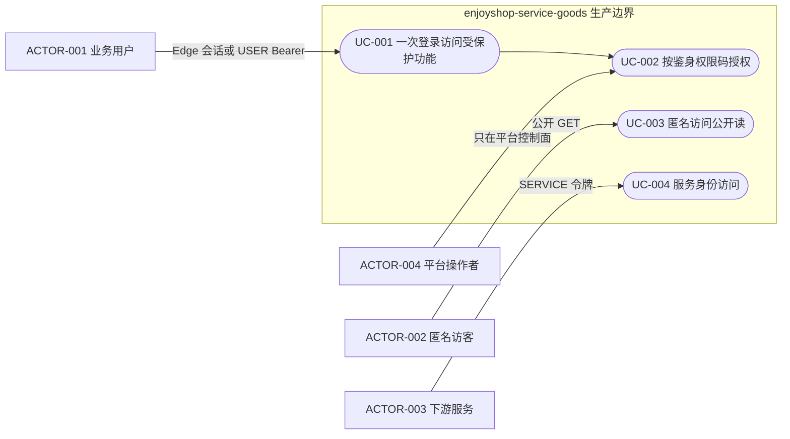
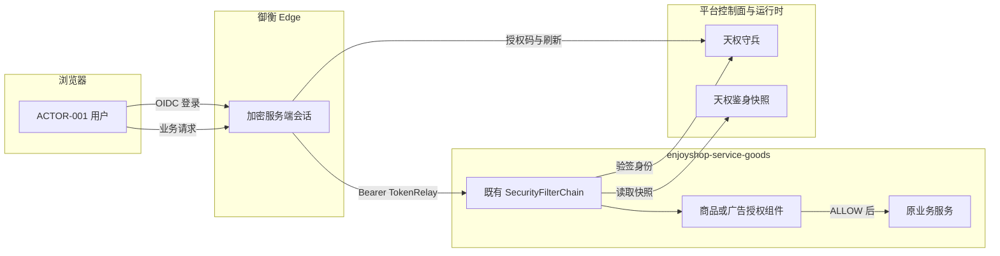
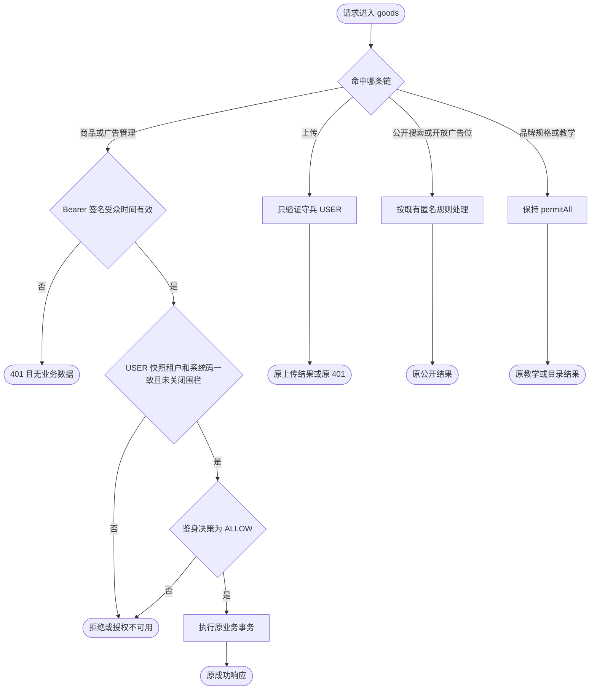
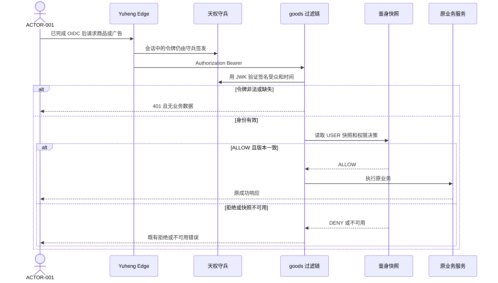

# 用户认证与 Egon-COLA 权限体系整合

| Field | Value |
| --- | --- |
| Document | `2026-10-13-10-15-platform-user-authentication-integration.md` |
| Template Version | `7` |
| Status | `Implemented` |
| Type | `Architecture` |
| Complexity | `Complex` |
| Complexity Drivers | 浏览器单点登录、网关转发与资源服务二次校验的信任边界；USER 身份令牌与鉴身授权快照分离；USER 与 SERVICE 主体不得混用；失败关闭与既有公开/教学路由的保留边界 |
| Created | `2026-10-13 10:15 CST` |
| Updated | `2026-10-13 10:43 CST` |
| Owner | mario |
| Repository | enjoyshop |
| Scope | enjoyshop-service-goods 的生产身份认证与功能授权边界；不新建认证服务，不修改天权守兵、鉴身或御衡源码 |
| Change Surface | 只新增生产认证边界契约测试，锁定现有守兵/鉴身过滤链并禁止畅购式第二套登录与令牌实现；不改现有 HTTP 合同、表、页面和平台控制面 |
| Affected Chapters | §7, §8, §13, §14, §15, §16, §17, §18 |
| Source Requirement | 用户给出的畅购第9章用户认证示例，以及随后明确的“以 egon-cola 为主要依据” |
| Baseline Revision | `main` / `507d417`；工作区另有未提交的商品搜索、广告 CDC 文档和 enjoyshop-web，本规格不修改它们 |
| Amends | None |
| Supersedes | None |
| Depends On | [首页网关架构](2026-10-09-16-39-homepage-kubernetes-gateway-architecture.md) §7：浏览器登录与令牌转发继续由御衡 Edge 负责，不新建 enjoyshop 网关；[文件目录与上传](2026-09-28-21-50-distributed-file-catalog-lookups.md) §9：`POST /api/v1/files` 保持守兵 USER Bearer，不在本规格改成鉴身功能权限；[广告同步](2026-10-10-14-48-postgresql-cdc-advertisement-synchronization.md) §7、§9：广告管理链与公开广告位读取保持原认证分界 |
| Related Specs | [商品生命周期](2026-10-09-10-55-product-management-lifecycle.md) 仍是 Review，只作为商品权限码已落地的背景，不把它的未接受文本升为规范；[品牌骨架](2026-09-23-17-16-enjoyshop-scaffold-brand-crud.md) §6：goods 保持 Light 剖面 |
| Related Plans | [平台认证边界契约测试计划](../plan/2026-10-13-10-30-platform-authentication-boundary-test.md) |

## 1. Summary

畅购第9章要求用户只登录一次，之后访问客户、订单、秒杀等受信任服务时都能识别身份，并在身份成立后按角色授权。该章的实现示例是独立认证服务、Spring Security OAuth2、本地 RSA 密钥库、JWT 自定义载荷、Redis 保存整段令牌、Cookie `uid`、Thymeleaf 登录页和逗号分隔的 URL 名单。

enjoyshop 不复制这套实现。身份、单点登录、OAuth2/OIDC、签名密钥和访问令牌只属于天权守兵；角色、功能权限、数据范围和授权快照只属于天权鉴身；浏览器会话和向业务服务转发 Bearer 只属于御衡 Edge。商品与广告管理已经按这个顺序校验。本规格把该边界写成可执行契约：现有路由行为不变，后续不得在 enjoyshop 内再造登录、发令牌或本地角色权限体系。

成功标准是职责不重复、USER 令牌不含权限、资源服务失败关闭，以及一个契约测试能阻止第二套认证栈进入 goods 模块。本轮不部署守兵、不跑通真实登录，也不创建订单、秒杀或客户微服务。

## 2. Background and Current State

### 2.1 Business and user context

教程把“查看个人信息、下单、秒杀”画成多个微服务，每个服务都要认证后再按角色授权。它同时介绍了微信、QQ 等第三方账号登录，以及 OAuth2 的客户端、资源拥有者、授权服务器和资源服务器。

用户随后要求以 Egon-COLA 为主要依据整合权限体系。因此教程提供的是业务目标：一次登录、跨服务识别身份、身份成功后再授权。教程里的密钥库口令、`JwtHelper`、Cookie `uid`、Thymeleaf 和 `URLFilter` 不是目标实现。

当前仓库只有 `enjoyshop-service-goods` 这一个业务服务。订单、秒杀和独立客户服务并不存在。生产权限已经体现在商品与广告接口，而不是教程中的本地用户角色表。

### 2.2 Repository evidence

| Evidence ID | Classification | Exact path/symbol/decision/command | Observed fact | Design significance | Verification limit/freshness |
| --- | --- | --- | --- | --- | --- |
| EVD-001 | User decision | 本轮对话“以 egon-cola 为主要依据” | 权限体系以平台组件为准，不按畅购示例自建认证服务 | 排除 Shiro、CAS 和 enjoyshop 内的授权服务器 | 不自动批准微信/QQ 联邦登录 |
| EVD-002 | Static repository | `enjoyshop-service-goods/pom.xml` 的 `egon-cola-tianquan-shoubing-starter` 与 `egon-cola-tianquan-jianshen-starter`，版本 `5.4.1` | goods 已依赖两个平台 Starter，没有 Thymeleaf，也没有自建授权服务器依赖 | 继续复用现有依赖 | 不证明运行中的守兵实例已签发令牌 |
| EVD-003 | Static repository | `NativeHttpSecurityConfiguration` | 关闭 formLogin、httpBasic、logout；`register-filter=true` 时启动失败；商品 `/api/v1/products/**` 与广告 `/api/v1/ads/**` 先装鉴身过滤器再装守兵过滤器并要求 authenticated；上传只装守兵过滤器；公开广告位与商品搜索按既有规则匿名或拒绝 | 生产链已经存在，本规格只锁定而不重排 | 未在本轮启动应用点击登录 |
| EVD-004 | Static repository | `ProductAuthorizationComponent`、`AdAuthorizationComponent` | 二者要求 `Rbac3ContextAuthentication`、`PrincipalType.USER`、租户与快照一致、系统码 `enjoyshop-goods`，再调用 `AuthorizationService.requirePermission`；权限码分别为 `enjoyshop:product:(read\|write\|audit\|purge)` 与 `enjoyshop:ad:(read\|write)` | 授权依据是鉴身决策，不是 JWT 里的 roles | 未连接真实鉴身 Redis |
| EVD-005 | Static platform source | 守兵 `README.md`；鉴身 `README.zh-CN.md` 与 `docs/architecture.md` | 守兵签发 USER/SERVICE 令牌，USER 令牌只有身份声明；鉴身拥有角色 DAG、激活集合和 Redis 授权快照；登录不选择角色；服务间授权走守兵 Service Grant，不进入鉴身用户决策 | 教程“JWT 中放 ROLE_VIP”被平台合同否定 | 平台源码是相邻工作区快照，不与 `507d417` 绑定为同一提交 |
| EVD-006 | Static platform source | `yuheng-edge-gateway` 的 `EdgeSecurityConfiguration`、`EdgeSessionController`、`TrustedIdentityHeaderFilter` | Edge 使用 OIDC 登录、加密服务端会话和 TokenRelay；浏览器不持有名为 `uid` 的整段 JWT Cookie | 单点登录会话属于 Edge，不属于 goods | 不证明 enjoyshop-web 已接入该 BFF |
| EVD-007 | Static repository | `adapter/user` 与 `domain/user` 的 `UserController`、`RoleController`、`PermissionController`、`RolePermissionAggregate` | 本地用户/角色/权限是 Light 教学样例，映射在 `/api/users` 与 `/api/roles/{roleCode}/permissions`，落在最低优先级 `permitAll` 链 | 它不是生产权限权威，本规格不把它改成鉴身 | 不删除教学样例，避免破坏原型合同 |
| EVD-008 | Static repository | `BrandController` `/api/v1/brands`、`SpecController` `/api/v1/specs` | 这两个已有控制器没有独立 SecurityFilterChain，因此落在默认 `permitAll` | 收紧它们会改变已接受的品牌/目录行为，不属于本轮 | 这是已知残留风险，不是新接口 |
| EVD-009 | Static repository | `application.yml` 与 dev/test/prod 的 `egon.cola.platform.tianquan` | 四份配置都有守兵 issuer、JWK、resource 与鉴身 Redis/endpoint 键；守兵 `enabled` 默认 `${TIANQUAN_SHOUBING_ENABLED:false}`；两个 `register-filter` 为 false | 不新增配置键；生产值仍由环境注入 | 未核对某一部署环境的真实密钥 |
| EVD-010 | Static platform search | 守兵 admin/oauth 与 README 边界 | 守兵自身是 OIDC 提供者并拥有授权码、同意和 RS256；检索到的实现没有微信或 QQ 社交登录提供者 | 第三方账号登录不能在 goods 里临时补一个 OAuth 客户端后自签 JWT | 不排除平台将来新增联邦登录 |

### 2.3 Problem statement and gap

教程要解决的问题是重复登录和各服务各自判断角色。平台已经有对应能力，goods 的商品、广告和上传也已经接入。缺口不是再写一个 `changgou_user_auth`，而是把“谁发令牌、谁判权限、网关校验之后资源服务还要不要自己校验”写成 enjoyshop 的约束，并防止教学样例里的本地角色被当成生产权限体系。

若不写这个边界，后续实现第9章时会引入第二套口令、密钥和 Redis 令牌。那样会与守兵 USER 令牌、鉴身快照版本和 Edge 会话同时存在，撤销和租户判断都无法闭合。

### 2.4 Evidence and current-chain map

| Entry/trigger | Current call chain | Data read/written | External dependency | Consumers | Evidence |
| --- | --- | --- | --- | --- | --- |
| 浏览器访问受保护商品或广告管理 | Edge OIDC 登录与会话，TokenRelay 附加 Bearer；goods 守兵过滤器验签；鉴身过滤器装入快照；`ProductAuthorizationComponent` 或 `AdAuthorizationComponent` 调 `AuthorizationService` | Edge 加密会话；守兵不把角色写入令牌；鉴身读取授权快照；goods 不写用户或令牌表 | 守兵、鉴身 Redis、御衡 Edge | 商品/广告管理调用方 | EVD-003、EVD-004、EVD-005、EVD-006 |
| 无 Bearer、令牌非法、权限不足或快照不可用 | 过滤器入口返回 401，或授权组件抛出 `CommonException` 401000 / 610206 / 610208 / 610305 | 不写业务表；不把匿名身份升级成已登录 | 守兵 JWK 或鉴身快照可能不可用 | 同一 HTTP 客户端 | EVD-003、EVD-004 |
| 教学用户/角色/权限或品牌、规格请求 | 最低优先级 `applicationSecurityFilterChain` 的 `permitAll` | 教学样例使用自身表；品牌/规格使用既有目录表 | 不调用鉴身决策 | 原型页面与既有品牌客户端 | EVD-007、EVD-008 |

## 3. Goals and Non-goals

### 3.1 Goals

- 用守兵完成一次身份认证，用鉴身完成功能授权，用 Edge 完成浏览器会话与 Bearer 转发。
- 保持商品、广告、上传、公开广告位和商品搜索的现有认证语义。
- 用契约测试禁止 goods 新增登录端点、本地 JWT 签发、Cookie `uid` 和授权服务器。
- 明确本地 `domain.user` 不是生产权限权威。

### 3.2 Non-goals

- 不创建订单、秒杀、客户或认证微服务，也不用 `egon-coding-create-new-module` 生成新工程。
- 不修改守兵、鉴身、御衡的平台源码、表结构或管理台。
- 不在 enjoyshop-web 增加登录页，不引入 Thymeleaf。
- 不实现微信、QQ、微博或其他社交账号登录；该能力若需要，必须另写守兵联邦登录规格。
- 不把品牌、规格、教学用户、教学课程从 `permitAll` 改成强制登录。那会改变已有合同。
- 不把文件上传改成鉴身功能权限检查。上传仍只验证守兵 USER Bearer。
- 不在本轮执行真实登录、真实 JWK 轮换或生产 Redis 连通性测试。

### 3.3 Change Surface and Design Depth

| Area/layer | Disposition | Exact repository evidence | Changed or preserved behavior/contract | Required Spec treatment | Chapter(s) |
| --- | --- | --- | --- | --- | --- |
| 认证与授权职责 | Affected | EVD-001、EVD-005、EVD-006 | 身份归守兵，授权归鉴身，浏览器会话归 Edge；goods 只验证和执行既有权限码 | 完整协作、失败和模式选择 | §7, §13, §15, §16, §17, §18 |
| 边界契约测试 | Affected | 当前没有阻止第二套认证栈的测试 | 新增测试锁定过滤链、遗留匿名控制器名单，并拒绝畅购式类型与依赖 | 精确测试文件与断言 | §8, §14 |
| 商品、广告、上传、公开读 | Context-only | `NativeHttpSecurityConfiguration`、两个 AuthorizationComponent、已接受的文件与广告规格 | method、path、权限码、401/403/不可用语义不变 | 只记录停止边界和回归命令 | §7, §14, §15 |
| 教学用户角色与品牌规格 | Unchanged | EVD-007、EVD-008 | 继续走默认 permitAll；本地 Role/Permission 仍是教学模型 | 不设计新接口或表 | §8, §14 |
| enjoyshop 外部 REST | Unchanged | 商品、广告、文件、搜索控制器 | 不新增登录或令牌 URL，不改请求和响应 | 点名现有路由，不重写 JSON | §9 |
| POJO 与 enjoyshop 表 | Not applicable | 无新的认证载体或令牌表 | 不新增 POJO，不改 DDL | 证据型不适用 | §10, §11 |
| enjoyshop-web | Unchanged | `enjoyshop-web/src/pages` 没有登录路由 | 不增加登录页或令牌存储 | 一条不变记录 | §12 |

## 4. Requirements and Acceptance Criteria

| ID | Atomic requirement | Priority | Observable acceptance criteria | Source |
| --- | --- | --- | --- | --- |
| REQ-001 | 身份认证只由守兵完成 | Must | goods 不提供登录、注销、授权码或令牌端点，不保存口令，不生成访问令牌 | 第9章认证服务；用户要求以 Egon-COLA 为主 |
| REQ-002 | 一次守兵登录可访问所有受众匹配且已授权的 goods 资源 | Must | 浏览器通过 Edge 会话换得的同一 USER Bearer 可调用商品和广告管理；不按接口再登录 | 第9章单点登录 |
| REQ-003 | 商品和广告管理在身份成立后按鉴身权限码授权 | Must | 权限码仍是现有 `enjoyshop:product:*` 与 `enjoyshop:ad:*`；决策读取快照而不是 JWT roles | 第9章“认证后按角色授权”；EVD-004、EVD-005 |
| REQ-004 | 资源服务不信任客户端自报角色或租户 | Must | 缺少、篡改或受众不匹配的 Bearer 不能进入业务写操作；网关转发不能替代 goods 验签 | 第9章网关校验；文件规格禁止信任身份头 |
| REQ-005 | 认证和授权失败时关闭，不降级为匿名成功 | Must | 未认证保持 401；商品无权限为 610206；广告无权限为 610305；快照或上下文不可用为对应 unavailable；不返回业务数据 | EVD-003、EVD-004 |
| REQ-006 | 服务间访问使用守兵 SERVICE 令牌 | Must | goods 不把用户 Access Token 转发给其他服务冒充该用户；SERVICE 主体不能通过商品/广告 USER 权限判断 | 第9章服务互访；鉴身 README 的 Service Grant 边界 |
| REQ-007 | 禁止把畅购示例认证栈加入 goods | Must | 不增加 JKS、`JwtHelper`、Cookie `uid`、整段 JWT 的 Redis 值、Thymeleaf 登录和逗号分隔 URLFilter | 示例代码与 EVD-001 |
| REQ-008 | 第三方社交登录不在 enjoyshop 实现 | Must | 仓库不新增微信或 QQ 的授权码交换、用户绑定表和自签令牌 | 第9章 1.2；EVD-010 与 DEC-003 |
| REQ-009 | 已有路由的认证分界保持不变 | Must | 商品和广告管理仍双重过滤；上传仍只有守兵；公开搜索与符合开关的广告位读取仍匿名；品牌、规格、教学接口仍不接入鉴身 | 已接受文件/广告/首页规格与 EVD-007、EVD-008 |
| REQ-010 | 契约测试锁定上述边界 | Must | 新增控制器若未归入既有生产链或显式遗留名单，测试失败；出现畅购式认证类型或新授权服务器依赖时测试失败 | 防止第二套权限体系 |

### 4.1 Scenario matrix

| Scenario | Actor/trigger | Preconditions | Main path | Alternative/failure path | Data/state change | Observable result | Requirements |
| --- | --- | --- | --- | --- | --- | --- | --- |
| 一次登录后调用商品管理 | 已登录 USER 通过 Edge 调用商品接口 | 守兵已发受众匹配的 USER 令牌；鉴身快照允许 `enjoyshop:product:read` 或 write/audit/purge | Edge 转发 Bearer，goods 验签并读取快照，组件得到 ALLOW | 令牌过期、受众错误、快照版本不一致或围栏关闭 | goods 不写令牌；业务写只在原商品事务中发生 | 原商品响应；失败时 401、610206 或 610208，且无业务数据 | REQ-002、REQ-003、REQ-004、REQ-005 |
| 已登录但没有广告权限 | USER 调用广告管理 | 身份有效，快照没有 `enjoyshop:ad:read` 或 write | 过滤器放行到组件，决策不是 ALLOW | 鉴身 Redis 不可用或快照缺失 | 不写广告行 | 610305，或不可用时 610308；不泄露广告内容 | REQ-003、REQ-005 |
| 服务令牌不能充当用户 | SERVICE 主体携带 client_credentials 令牌调用商品权限组件 | 令牌可被守兵按 SERVICE 规则识别 | 组件检查 `PrincipalType.USER` | 主体不是 USER，或租户/快照主体不一致 | 不写商品 | 拒绝，不进入鉴身用户 ALLOW 结果 | REQ-006 |
| 匿名读取公开搜索 | 未登录访客 | 请求是 GET `/api/v1/product-search` | 搜索链 permitAll | 其他搜索方法仍 denyAll | 不建立会话 | 与现有搜索合同一致 | REQ-009 |
| 遗留教学接口保持原样 | 调用 `/api/users` 或本地授权接口 | 无生产 Bearer | 默认链 permitAll，走教学应用服务 | 本规格不把它们改成 401 | 只影响教学样例自身数据 | 行为与当前教学实现一致，且测试证明它们不是生产 PEP | REQ-007、REQ-009、REQ-010 |

### 4.2 Use-case analysis

#### 4.2.1 Actor inventory

| Actor ID | Actor/role | Goal and responsibility | Entry/channel | Permission/tenant context | Evidence |
| --- | --- | --- | --- | --- | --- |
| ACTOR-001 | 业务用户 | 登录一次后访问自己获准的商品或广告功能 | 浏览器经 Edge，或直接携带守兵 USER Bearer | USER 令牌的 tenant 与 subject；权限在鉴身快照 | 第9章用户；EVD-004 |
| ACTOR-002 | 匿名访客 | 读取明确公开的搜索或广告位 | GET 公开路由 | 无用户主体；公开广告位还有既有 Host 映射 | 广告与搜索规格 |
| ACTOR-003 | 下游或旁路服务 | 以服务身份访问被授予的资源，不冒充用户 | 守兵 client_credentials | SERVICE scope 与目标 resource；不使用鉴身用户角色 | 鉴身 README 服务授权边界 |
| ACTOR-004 | 平台操作者 | 在守兵和鉴身控制面登记 Resource、客户端和权限 | 平台管理台，不是 goods API | 平台租户与应用 `enjoyshop-goods` | 守兵 README 的发放顺序 |

#### 4.2.2 Use-case artifact



| ID | Use case/goal | Primary actor | Supporting actors/systems | Trigger | Preconditions | Main success outcome | Alternatives/failures | Postconditions | Requirements | Interfaces/pages | Tests |
| --- | --- | --- | --- | --- | --- | --- | --- | --- | --- | --- | --- |
| UC-001 | 一次登录后访问受保护功能 | ACTOR-001 | Edge、守兵 | 打开需要身份的商品或广告功能 | 守兵 Resource 与 Edge 注册已配置 | 同一 USER 令牌通过验签 | 无令牌、过期、受众不匹配时 401 | 不创建 goods 会话或口令 | REQ-001、REQ-002、REQ-004 | 既有商品与广告路由；无新页面 | TEST-001 |
| UC-002 | 身份成立后按权限码授权 | ACTOR-001 | 鉴身快照、ACTOR-004 | 管理组件调用 requirePermission | USER 上下文、租户、系统码和快照一致 | ALLOW 后执行原业务 | 拒绝、围栏关闭或快照不可用 | 业务数据只在 ALLOW 后按原事务变化 | REQ-003、REQ-005 | 既有权限码，无新 URL | TEST-002、TEST-003 |
| UC-003 | 匿名访问公开读 | ACTOR-002 | 无 | 商品搜索或公开广告位 GET | 路由命中公开链；广告公开开关按既有配置 | 返回原公开合同 | 未开放的广告路由 denyAll | 不写入用户身份 | REQ-009 | 既有公开 GET | TEST-001 |
| UC-004 | 服务不以用户身份调用用户权限 | ACTOR-003 | 守兵 Service Grant | 服务令牌到达商品或广告组件 | 主体类型可识别 | USER 检查拒绝非 USER | 不得因 scope 存在而 ALLOW 用户权限 | 不改变用户激活角色 | REQ-006 | 无新服务接口 | TEST-002 |

#### 4.2.3 UC-001 — 一次登录访问受保护功能

触发是用户访问商品或广告管理。前置条件是 Edge 已把守兵授权码流程完成的访问令牌保存在服务端会话，或调用方直接提交 Bearer。成功时 goods 只验证令牌，不显示登录页。失败时返回既有 401 JSON，不重定向到 HTML。成功后的授权属于 UC-002。退出登录由 Edge 作废服务端会话并按平台登出队列处理刷新令牌；goods 没有自己的注销接口。

#### 4.2.4 UC-002 — 按鉴身权限码授权

触发是商品或广告应用服务进入写或读管理逻辑。前置条件是过滤器已经放入 `Rbac3ContextAuthentication`。成功是决策为 ALLOW，且租户、主体、权限码、authVersion、policyVersion 与快照一致。失败不部分执行业务写入。平台操作者若需要新增权限，在鉴身登记资源和角色，不调用 goods 的教学 `grantPermission`。

## 5. Constraints, Assumptions, and Decisions

### 5.1 Confirmed constraints

- goods 保持 Egon-COLA Light。认证代码只允许留在现有 `start.config` 与 `application.goods` / `application.ad`，不得新建 `biz` 层或认证模块。
- 守兵 USER 令牌不得携带角色、权限、数据范围或会话标识。鉴身 Starter 拒绝把这些声明当作授权依据。
- `register-filter` 必须保持 false。过滤器只能挂在明确的 SecurityFilterChain 上。
- 不新增 Maven 依赖。守兵与鉴身 Starter `5.4.1` 已经存在。
- 不新增配置键。dev、test、prod 与基础 `application.yml` 的守兵/鉴身键结构保持现状。
- 已接受的文件上传、广告公开读和首页 Edge 职责不被本规格改写。

### 5.2 Small-gap assumptions

| ID | Inference | Repository evidence | Why locally reversible | Impact if wrong |
| --- | --- | --- | --- | --- |
| ASM-001 | 教程中的商城用户与运营用户都映射为守兵 USER 主体，goods 不另建客户口令库 | goods 没有客户凭据表；守兵是唯一身份权威 | 只是主体映射，没有迁移数据 | 若将来要独立客户账号，必须新写规格；仍不得让 goods 自签 JWT |
| ASM-002 | “至少三个微服务”在本仓库落实为一个 goods 服务；将来的订单或秒杀服务必须复用同一平台，而不是在本规格里创建 | 仓库只有 goods 业务模块 | 不生成新模块，所以可在后续规格另选 | 若用户实际要求现在创建订单和秒杀，需要先走新模块技能，本文件不覆盖其业务表 |

### 5.3 Resolved decisions

| ID | Decision | Decision owner | Evidence and rationale | Requirements |
| --- | --- | --- | --- | --- |
| DEC-001 | 以守兵、鉴身、御衡 Edge 为认证授权实现，不采用畅购自建认证服务 | mario | 用户明确以 Egon-COLA 为主；EVD-002 至 EVD-006 显示能力已经存在 | REQ-001、REQ-002、REQ-007 |
| DEC-002 | JWT 只证明身份；角色授权只看鉴身快照 | 平台合同与 mario 的平台优先决定 | 守兵 README 写明 USER 令牌不含角色；现有组件已按快照决策 | REQ-003、REQ-004 |
| DEC-003 | 微信、QQ 等社交登录不进入本次 enjoyshop 设计 | mario 的平台优先决定，加上平台缺口 | EVD-010 没有社交提供者；在 goods 自建会形成第二套发令牌路径 | REQ-008 |
| DEC-004 | 不改品牌、规格、教学接口和文件上传的现有认证强度 | 已接受规格与本轮范围 | 改变它们会扩大到既有 API 合同；第9章整合不依赖这些修改 | REQ-009 |

### 5.4 Open major decisions

没有未决重大决策。社交登录已由 DEC-003 定为非目标。若以后要支持第三方账号，应另开守兵规格，而不是在本文件保留平行方案。

## 6. Project Technology Context

| Concern | Current choice | Repository evidence | Constraint on design |
| --- | --- | --- | --- |
| Language/runtime | Java 21，Spring Boot 3.5，父工程 Egon 5.4.1 | 文件规格与 goods POM | 不引入旧版 `spring-security-oauth2` 2.x |
| Module style | 单个 Light 服务 `enjoyshop-service-goods` | `adapter`、`application`、`domain`、`infrastructure`、`start` | 不新增 Maven 模块 |
| Security | Spring Security 过滤链加两个平台 Starter | `NativeHttpSecurityConfiguration` | formLogin 保持关闭 |
| Persistence | 业务表由 egon-mp 管理；认证状态不在 goods 库 | `src/main/resources/db/egon-mp` | 不为令牌或角色新增 DDL |
| Tests | JUnit 5、AssertJ、既有 Spring 切片 | `src/test/java/top/egon/enjoyshop/goods` | 新测试使用同一工具，不启动外部守兵 |
| Frontend | 无构建登录页的 enjoyshop-web 路由 | `enjoyshop-web/src/pages` | 不把令牌放到浏览器脚本 |

### 6.1 Java architecture profile and capability baseline

| Architecture profile | Archetype/template or base package | Exact evidence and verifier | Existing deviations | Design action |
| --- | --- | --- | --- | --- |
| Egon-COLA Light | `top.egon.enjoyshop.goods`，原型 light | goods 目录分层与 `LightPersistenceArchitectureTest`、`ArchetypeContractConvergenceTest` | 教学 user/teaching 包是原型样例，不是第二套生产架构 | 保持 Light；不把教学用户提升为生产 IAM |

| Need | Spring/JDK candidate | Spring Boot Starter candidate | Egon-COLA/module candidate | Proven gap | Decision/dependency impact |
| --- | --- | --- | --- | --- | --- |
| 用户认证与 SSO | Spring Security OAuth2 Client 只存在于 Edge/平台 | 不在 goods 新增 starter | 守兵 Starter 5.4.1 | 无 | 复用，不新增依赖 |
| 功能授权 | 无 JDK 权限库需要引入 | 无 | 鉴身 Starter 与 `AuthorizationService` | 无 | 复用现有组件 |
| 浏览器会话 | 不在 Servlet 服务保存会话 | 无 | 御衡 Edge Session 与 TokenRelay | 无 | goods 只接受 Bearer |
| 社交登录 | 无可复用的微信/QQ 提供者 | 无 | 守兵当前实现未见该提供者 | 有平台缺口 | 不在 goods 补实现；DEC-003 |
| 本地角色教学 | 无 | 无 | `domain.user` 教学聚合 | 它不能满足生产快照、租户和撤销 | 保留样例，生产路径不调用它 |

### 6.2 User-mandated Java rule compliance

本轮没有新的生产 Java 类型。规则只约束“不新增违反项”，不借测试类发明 POJO。

| Literal rule | Affected? | Repository evidence | Exact design decision | Files/types/interfaces | Validation/test evidence | Status/blocker |
| --- | --- | --- | --- | --- | --- | --- |
| Rule 1 | No | 无新生产类型；现有组件已带语义后缀 | 不新增 Command、DTO 或名为 Data/Info 的认证载体 | 无新生产文件 | TEST-001 确认没有新生产类型 | N/A |
| Rule 2 | No | 现有 `requirePermission` 已有 `@NotBlank` 与 `@Pattern` | 不新增层间对象，不改分组 | 现有两个授权组件 | 既有组件测试仍覆盖非法权限码 | N/A |
| Rule 3 | No | 无新数据载体 | 不新增 class、record 或转换器 | 无 | 无新映射 | N/A |
| Rule 4 | No | 现有组件已有 `@Slf4j`、Bean 名和 `@Qualifier` | 不新增 Spring 业务 Bean；测试类不是业务单例 | 现有 `productAuthorizationComponent`、`adAuthorizationComponent` | 架构测试继续要求具名 Bean | N/A |
| Rule 5 | No | 新测试只使用 JUnit 与 AssertJ | 不引入认证工具库 | 新测试文件 | POM 断言无新依赖 | N/A |
| Rule 6 | No | 无新 JSON 合同；401 体保持现有 Map 字段 | 不新增枚举或 `@JsonValue` | 现有入口点 code/message | 不改序列化 | N/A |
| Rule 7 | No | 四份 profile 已含同一组守兵/鉴身键 | 不增删键 | `application.yml`、dev、test、prod | 测试不改配置文件 | N/A |
| Rule 9 | Yes | 登录方式若在 goods 用 if/else 选择微信、口令或 QQ，就属于复杂分支 | 禁止在 goods 写该分支；变化点留在守兵 | 无新策略类 | TEST-004 拒绝本地登录策略类型 | PASS |
| Rule 10 | No | 令牌时间由守兵 `exp` 与平台 Instant 处理 | goods 不新增日期字段 | 无 | 无新时间映射 | N/A |
| Rule 11 | Yes | Light 目录与架构测试 | 保持 Light，不混合传统三层，不新建模具模块 | `start.config` 测试只读取现有链 | `LightPersistenceArchitectureTest` 仍须通过 | PASS |

## 7. Architecture Design

### 7.0 Minimum-design baseline and element-necessity audit

直接方案是继续使用已经接入的守兵过滤器、鉴身过滤器和两个授权组件，不增加运行时类。唯一新增物是契约测试，因为当前编译不能阻止有人按教程提交第二套认证服务。

| Proposed element | Change | Requirements | Existing/direct alternative | Concrete inadequacy of alternative | Added calls/state/coupling/failures/migration/operations | Verdict |
| --- | --- | --- | --- | --- | --- | --- |
| enjoyshop 认证微服务、JKS、登录 API | New | REQ-001、REQ-007 | 守兵已经签发令牌 | 教程实现会建立第二口令库和签名密钥 | 多一次发令牌、密钥泄露面、与 Edge 会话冲突 | Remove |
| Cookie uid 加 Redis 整令牌 | New | REQ-002、REQ-007 | Edge 加密会话加 Bearer 转发 | 整段 JWT 进 Redis 不能撤销鉴身快照，而且 Cookie 可被脚本读取设计更差 | 新的 Redis 键、过期双源、日志泄密 | Remove |
| 微信或 QQ 适配器 | New | REQ-008 | 不实现，等待守兵联邦能力 | 平台没有该提供者；goods 交换授权码后仍要自签令牌 | 外部密钥、绑定表、账号合并冲突 | Remove |
| 本地 RolePermissionAggregate 作为生产 PEP | Expand | REQ-003 | 鉴身快照与 `AuthorizationService` | 教学模型没有租户快照版本、围栏和字段权限 | 两套角色结果互相矛盾 | Remove |
| 现有商品/广告/上传过滤链 | Keep | REQ-003、REQ-009 | 已经是直接实现 | 没有缺口 | 无新增调用 | Keep |
| `PlatformAuthenticationBoundaryContractTest` | New | REQ-007、REQ-010 | 只靠代码评审记住边界 | 评审不能在每次构建时阻止新的 permitAll 控制器或新依赖 | 仅测试代码，无运行时状态 | Add |

| Path | Network calls | Client states | Server contracts/state | Failure and TOCTOU points | Additional user/business value |
| --- | --- | --- | --- | --- | --- |
| Direct baseline | 浏览器到 Edge 一次，Edge 到守兵完成既有 OIDC，业务请求由 Edge 转发到 goods；goods 验签并读鉴身快照 | Edge 服务端会话；浏览器不保存 JWT | 无新 URL；权限在鉴身快照 | 令牌过期与快照版本窗口仍是平台现有 1 秒缓存，不新增 | 满足一次登录和按权限授权 |
| Selected design | 与直接基线相同 | 与直接基线相同 | 只增加测试，不增加合同 | 不增加运行时失败点；测试失败会挡住第二套实现 | 把基线冻结为可构建约束 |

选择的设计就是直接基线加上一个测试。它是满足 REQ-010 的最少新增物。

### 7.1 System Architecture Design

生产调用的信任方向是：浏览器只与 Edge 建立会话；Edge 向守兵取得 USER 令牌并在转发时附上 Bearer；goods 独立验证签名、受众和时间，再按鉴身快照授权。Envoy 或 Edge 的转发成功不等于业务允许。goods 不回调守兵管理接口来判断每个商品权限，也不读取教学用户表。

#### 7.1.1 Architecture Mermaid view



#### 7.1.2 Boundary and responsibility table

| Module/component | Capability and data owned | Inputs/outputs | Allowed dependencies | Forbidden responsibility | Requirements |
| --- | --- | --- | --- | --- | --- |
| 天权守兵 | 身份、口令、客户端、授权码、签名密钥、USER/SERVICE 令牌 | 令牌与 JWK | 自身库和 Redis 投影 | 不保存 enjoyshop 商品角色树 | REQ-001、REQ-006 |
| 天权鉴身 | 角色、权限、激活集合、授权快照、围栏 | ALLOW、DENY 或不可用 | 自身 PostgreSQL 与授权 Redis | 不签发访问令牌，不管理登录会话 | REQ-003、REQ-005 |
| 御衡 Edge | 浏览器会话、OIDC 往返、TokenRelay、登出 | 上游 Bearer；不向 goods 发明新身份头合同 | 守兵与会话 Redis | 不实现商品权限，不托管 enjoyshop 静态登录页 | REQ-002、REQ-004 |
| goods 过滤链与授权组件 | 验证 Bearer 并执行既有权限码 | 401、403 或原业务响应 | 两个 Starter | 不发令牌，不读教学 Role 表做生产决定 | REQ-003、REQ-007、REQ-009 |

### 7.2 High-Level Design

用户登录发生在 Edge 与守兵之间。goods 只看见 Bearer。商品和广告管理在业务方法前调用各自授权组件。组件只接受 USER、匹配的租户和系统码 `enjoyshop-goods`。公开搜索和符合既有开关的广告位读取不进入该组件。文件上传只做守兵身份校验，不追加鉴身权限码，以遵守已接受文件规格。

服务调用若需要访问 goods 的用户功能，不能转发用户令牌。它应使用守兵为精确来源客户端、目标 Resource 和 scope 签发的 SERVICE 令牌；该令牌不能通过 `requirePermission` 的 USER 判断。本规格不新设计某一个服务间 URL。

#### 7.2.1 Critical business/control flowchart



#### 7.2.2 High-level decision and quality matrix

| Concern/use case | Required behavior | Selected mechanism | Failure/degradation behavior | Trade-off | Verification | Requirements |
| --- | --- | --- | --- | --- | --- | --- |
| 身份真实性 | 只有守兵签名且受众匹配的令牌算登录 | 守兵 JWK 与既有过滤器；Edge 只转发 | JWK 不可用或令牌非法时 401，不回退到请求头身份 | goods 不能在守兵宕机时继续信任旧浏览器 Cookie | TEST-001 | REQ-001、REQ-004 |
| 授权时效 | 权限变更不依赖重签 JWT | 鉴身不可变快照、版本和围栏；现有缓存 TTL 1 秒 | 快照缺失、版本不一致或 Redis 失败时拒绝或返回不可用 | 权限不是令牌内实时值；1 秒缓存不是即时吊销保证 | TEST-002、TEST-003 | REQ-003、REQ-005 |
| 单点登录范围 | 一次 Edge 登录访问多个已授权 goods 功能 | 同一 USER Bearer 复用；不建 goods 会话 | 受众不匹配的令牌即使签名正确也拒绝 | 不把“所有微服务”扩展成未建的订单和秒杀 | TEST-001 | REQ-002 |
| 机密与最小实现 | 不在 goods 存放口令、私钥和整段令牌 | 不新增存储和登录页 | 日志只保留现有错误码，不记录 Authorization | 社交登录因此不可用，直到平台提供 | TEST-004 | REQ-007、REQ-008 |

### 7.3 Detailed Design

#### 7.3.1 Detailed component collaboration

| Step | Caller -> callee | Contract/symbol | Input/output mapping | State/data effect | Failure behavior | Requirements |
| --- | --- | --- | --- | --- | --- | --- |
| 1 | 浏览器 -> Edge | 既有 OIDC 与 `oauthBffSession` | 授权码换服务端会话；响应不包含 goods 自定义令牌 | 只写 Edge 会话 | 登录失败不到达 goods | REQ-001、REQ-002 |
| 2 | Edge -> goods 过滤链 | TokenRelay 的 `Authorization: Bearer` | 原请求方法和路径不变 | goods 不写会话 | 无 Bearer 时按链返回 401 或公开链继续 | REQ-004 |
| 3 | `IdpBearerAuthenticationFilter` -> 守兵 JWK | 现有过滤器 | 验证 USER 或 SERVICE 身份声明 | SecurityContext 放入身份 | 非法 Bearer 使用现有 `AUTHORIZATION_HEADER_INVALID` | REQ-001、REQ-004 |
| 4 | `Rbac3BearerAuthenticationFilter` -> 鉴身 | 现有过滤器，仅商品和广告管理链 | 装入租户、subject、快照和围栏状态 | 不写 PostgreSQL | 快照不可用时不伪装 ALLOW | REQ-003、REQ-005 |
| 5 | 商品或广告 Manage -> 授权组件 | `requirePermission` | 输入只允许既有权限码正则 | ALLOW 后才进入原事务 | 非 USER、租户不一致、系统码不是 `enjoyshop-goods` 时拒绝 | REQ-003、REQ-006 |
| 6 | 授权组件 -> `AuthorizationService` | `PermissionRequest.api(code, resource)` | 商品资源名 `enjoyshop.product`；广告资源名 `enjoyshop.ad` | 读快照，不写角色 | INDETERMINATE 视为不可用；广告不可用码是 610308 | REQ-005 |

#### 7.3.2 Critical-path Mermaid swimlane



#### 7.3.3 Transactions, consistency, concurrency, and idempotency

| Concern/state change | Owner and boundary | Mechanism/isolation/lock | Concurrent or duplicate behavior | Commit/visibility point | Failure result | Requirements/tests |
| --- | --- | --- | --- | --- | --- | --- |
| USER 访问令牌 | 守兵签发，Edge 保存引用 | 平台令牌族和刷新规则；goods 无事务 | 重放同一 Bearer 只重复验签，不在 goods 记登录次数 | 守兵签发成功后令牌即有效，直到 exp 或平台撤销 | goods 验签失败则业务事务不开始 | REQ-001、REQ-004 / TEST-001 |
| 授权快照 | 鉴身控制面写入，运行时只读 | 版本、围栏和现有 1 秒缓存 | 权限刚被收回时，缓存窗口内可能仍看到旧快照；窗口外版本不一致必须拒绝 | 鉴身发布新快照后对后续决策生效 | 读失败不沿用“无规则即允许” | REQ-003、REQ-005 / TEST-002 |
| 商品或广告业务写入 | 原 Manage 事务 | 原乐观版本；授权在事务业务写之前 | 重复提交沿用原接口幂等规则 | 只有 ALLOW 后进入原提交点 | 授权失败回滚范围为空，因为业务写尚未开始 | REQ-005 / TEST-003 |

goods 不为认证打开新事务，也不把鉴身读取放进商品数据库事务里延长锁。

#### 7.3.4 Failure semantics, recovery, and reconciliation

| Failure point | Detection | Immediate control flow | Data/transaction state | Retry and idempotency | Caller/frontend result | Recovery/reconciliation owner | Verification |
| --- | --- | --- | --- | --- | --- | --- | --- |
| 无 Bearer 或签名/受众/时间失败 | 守兵过滤器或认证入口 | 401，不调用业务 | 无业务写入 | 调用方重新登录或更换令牌；goods 不重试 | 现有 JSON code `AUTHORIZATION_HEADER_INVALID` 或组件 401000 | 用户通过 Edge 重新认证 | TEST-001 |
| 权限不匹配 | 决策不是 ALLOW | 抛出商品 610206 或广告 610305 | 无业务写入 | 不可靠重试；需平台调整角色后重新请求 | 原错误体，不返回资源正文 | ACTOR-004 在鉴身修改授权 | TEST-002、TEST-003 |
| 快照、围栏或主体不一致 | 组件的 forbidden 或 unavailable | 拒绝或不可用 | 无业务写入 | 不可用可稍后重试；配置错误重试无效 | 不降级成匿名数据 | 平台操作者检查 Redis、系统码和 Resource | TEST-002 |
| Edge 会话还在但令牌已失效 | goods 验签失败 | 401 | Edge 会话可能仍在，直到其自身过期或登出 | 用户重新登录；goods 不修复 Edge 会话 | 401，不发 HTML 重定向 | Edge 登出与守兵刷新队列 | TEST-001 |
| 调用方丢失成功响应 | 原业务接口规则 | 不由认证层补写 | 业务是否提交只看原事务 | 沿用原 Idempotency-Key 或版本冲突 | 原接口的冲突或查询结果 | 原业务所有者 | 既有商品/广告测试 |

#### 7.3.5 Observability and operational boundaries

| Signal/runbook | Emitting owner and point | Fields/dimensions | Sensitive-data rule | Success/failure threshold | Alert/dashboard/operator action | Verification boundary |
| --- | --- | --- | --- | --- | --- | --- |
| 认证拒绝 | goods 认证入口和授权组件 | 路径、结果码、trace；不记录令牌 | 禁止记录 Authorization、Cookie、口令、JWK 私钥和刷新令牌 | 沿用现有错误码；本规格不新设告警阈值 | 401 上升时先查 issuer、JWK 和 Resource 受众 | 静态断言错误码；运行告警需部署后观察 |
| 授权不可用 | 授权组件 | 系统码 `enjoyshop-goods`、结果码，不含 subject 全文也可定位 trace | 不记录快照正文 | 鉴身 Redis 或 endpoint 失败即拒绝 | 平台操作者检查 `JIANSHEN_REDIS_ADDRESS` 与授权 endpoint | 组件测试覆盖不可用分支 |
| 契约被破坏 | `PlatformAuthenticationBoundaryContractTest` | 测试名与冲突的控制器或依赖 | 不包含密钥 | 构建失败即阻断合并 | 开发者把新路由归类或删除第二套认证代码 | TEST-001、TEST-004 |

#### 7.3.6 Conclusion evidence chain

| Conclusion | Repository/user evidence | Constraint or requirement | Design decision | Consequence and trade-off | Verification and acceptance evidence |
| --- | --- | --- | --- | --- | --- |
| 不新建 enjoyshop 认证服务 | EVD-001、EVD-002、EVD-005、EVD-006 | REQ-001、REQ-007 | 守兵发令牌，Edge 持有会话，goods 只校验 | 少一套密钥和口令；社交登录不能在本服务补上 | TEST-004 与无新登录 URL |
| 授权以鉴身快照为准而不是网关放行或 JWT 角色 | EVD-003、EVD-004、守兵“USER 令牌不含角色” | REQ-003、REQ-004、REQ-005 | 商品和广告管理在验签后执行 `requirePermission`；失败关闭 | 网关被绕过时仍安全；权限有不超过现有 1 秒缓存的可见延迟 | TEST-001、TEST-002、TEST-003 |

## 8. Package Structure and Code File Tree

### 8.1 Current relevant tree

```text
enjoyshop-service/enjoyshop-service-goods/src/main/java/top/egon/enjoyshop/goods/
├── start/config/NativeHttpSecurityConfiguration.java
├── application/goods/ProductAuthorizationComponent.java
├── application/ad/AdAuthorizationComponent.java
├── adapter/goods/ProductController.java
├── adapter/goods/AdController.java
├── adapter/goods/FileController.java
├── adapter/goods/ProductSearchController.java
├── adapter/goods/BrandController.java
├── adapter/goods/SpecController.java
├── adapter/user/controller/UserController.java
├── adapter/user/controller/RoleController.java
├── adapter/user/controller/PermissionController.java
└── domain/user/aggregates/RolePermissionAggregate.java
```

平台实现位于相邻工作区 `Egon-COLA/egon-cola-xingyuan` 的守兵、鉴身和 `yuheng-edge-gateway`。本规格不修改那些文件。

### 8.2 Target tree

```text
enjoyshop-service/enjoyshop-service-goods/src/test/java/top/egon/enjoyshop/goods/start/config/
└── PlatformAuthenticationBoundaryContractTest.java
```

不新增生产源码、配置、SQL 或前端文件。

### 8.3 Package and file responsibilities

| Operation | Path/package | Symbols | Responsibility | Dependencies | Requirements |
| --- | --- | --- | --- | --- | --- |
| Create | `src/test/java/top/egon/enjoyshop/goods/start/config/PlatformAuthenticationBoundaryContractTest.java` | `PlatformAuthenticationBoundaryContractTest` | 断言生产链、遗留匿名名单、过滤顺序和禁止的第二套认证实现 | JUnit 5、AssertJ、Spring 测试已有的安全夹具；只读 POM 与 class 扫描 | REQ-007、REQ-009、REQ-010 |

测试类不是 Spring Bean，不使用 `@Service`。它不调用外部网络。

生产链必须继续是：

- `productSecurityFilterChain` 匹配 `/api/v1/products` 与 `/api/v1/products/**`，鉴身过滤器在匿名过滤器之前，守兵过滤器在鉴身过滤器之前，最终 authenticated。
- `adSecurityFilterChain` 匹配 `/api/v1/ads` 与 `/api/v1/ads/**`，顺序同上。
- `publicAdSecurityFilterChain` 匹配 `/api/v1/ad-slots/**`，只在既有公开开关下允许对应 GET。
- `productSearchSecurityFilterChain` 只允许 GET `/api/v1/product-search`。
- `fileUploadSecurityFilterChain` 只匹配 POST `/api/v1/files`，只安装守兵过滤器。
- `applicationSecurityFilterChain` 保持最低优先级和 `permitAll`，但只允许下面的遗留控制器停留其上：`BrandController`、`SpecController`、`UserController`、`RoleController`、`PermissionController`、`CourseController`、`SchoolClassController`。

`AdController` 同时含有管理路径和公开路径，测试按方法加路径判断，不按类一刀切。新的 `@RestController` 若不在遗留名单、也不被上述生产匹配覆盖，测试失败。`BaseExceptionHandler` 是 `@RestControllerAdvice`，不算业务路由。

## 9. Interface Definitions

外部 HTTP 合同不变，因此不新增接口清单，也不重写请求和响应 JSON。

| Existing route/symbol | Consumer | Preserved invariant | Stopping reason | Focused verification |
| --- | --- | --- | --- | --- |
| 商品 `/api/v1/products` 及子路径 | 商品管理调用方 | 仍要求 USER 与 `enjoyshop:product:*`；错误码 401000、610206、610208 不变 | 商品规格与现有组件已定义正文 | TEST-002 与既有商品安全测试 |
| 广告管理 `/api/v1/ads` 及子路径 | 广告管理调用方 | 仍要求 USER 与 `enjoyshop:ad:read` 或 write；610305 与不可用码不变 | 已接受广告规格拥有正文 | TEST-003 |
| GET 公开广告位与 GET `/api/v1/product-search` | 匿名首页或搜索 | 匿名或 denyAll 规则不变 | 不属于认证栈替换 | TEST-001 |
| POST `/api/v1/files` | 上传客户端 | 只验证守兵 USER Bearer | 已接受文件规格 §9 | 既有上传安全测试，本规格不改断言 |
| `/api/v1/brands`、`/api/v1/specs`、教学 `/api/users`、`/api/courses`、`/api/school-classes` | 现有原型或目录客户端 | 仍由默认 permitAll 处理 | 改变它们是另一份 API 规格 | TEST-001 只确认它们留在遗留名单 |

没有新的登录、令牌、注销或第三方回调 URL。GraphQL 教学 schema `teaching.graphqls` 与 `user.graphqls` 不改变，也不把它们当成生产授权入口。

## 10. POJO and Data Model Design

Not applicable。本轮没有新的或修改的认证 POJO、Command、Query、Event 或视图对象。现有 `Rbac3ContextAuthentication` 和守兵身份类型属于平台 Starter，goods 只消费，不重新定义字段。教学 `User`、`Role`、`Permission` 保持原样，不映射为生产令牌载荷。

## 11. Database Design

Not applicable。enjoyshop 不新增用户、角色、令牌、授权码或密钥表，不修改 `db/egon-mp` 下的 SQL 和 manifest。守兵与鉴身的 PostgreSQL 和 Redis 由平台拥有，本仓库不编写它们的 DDL。商品和广告业务表的主键、租户和版本规则不变。

Relational model change: No — 本规格不改变任何 enjoyshop 物理表或关系。

## 12. Frontend Page Design

Unchanged。`enjoyshop-web/src/pages` 现有品牌、商品、广告、搜索、教学和用户原型页，没有登录路由。本规格不增加页面、不把 Access Token 写入 `localStorage`，也不把教程的 Vue 登录脚本放进 Thymeleaf。浏览器登录界面仍是守兵登录/同意页和御衡 Edge 的 OIDC 流程。enjoyshop-web 尚未接入该 BFF，接入工作不属于本文件。

## 13. Design Patterns and Architecture Principles

### 13.1 Selected patterns

| Pattern/principle | Concrete variation point or problem | Placement | Why direct code is insufficient | Repository alignment |
| --- | --- | --- | --- | --- |
| 平台 PEP，而不是 goods 内策略选择 | 口令、OIDC、将来可能的社交登录不能在业务服务分支 | 守兵控制面与 Edge；goods 只调用现有过滤器 | goods 里写登录策略会拥有不该拥有的密钥和用户绑定 | 鉴身 Starter 已是 PEP；商品组件已是直接调用 |
| 显式过滤链 | 不同路由的匿名、仅身份、身份加权限必须分开 | `NativeHttpSecurityConfiguration` 既有六个链 | 一个全局 `permitAll` 或一条逗号名单无法表达公开读与管理写的差别 | 已有链；测试只防止新路由逃逸 |

不新增策略接口、工厂或模板父类。登录方式的变化不属于 goods 的业务代码。

### 13.2 Rejected patterns and simpler alternative

| Candidate | Why rejected |
| --- | --- |
| Strategy：Password、WeChat、QQ 三个登录策略 | 违反 DEC-001 与 DEC-003；goods 没有这些密钥 |
| Template Method：统一 `AbstractAuthService` | 认证步骤跨 Edge、守兵、鉴身，不在一个继承树里 |
| 本地 Specification 重写角色继承 | 鉴身核心已有角色 DAG 与权限代数 |
| 把教学 `RolePermissionAggregate` 适配成生产端口 | 缺少租户快照、围栏和版本，适配会伪装成权威 |

### 13.3 Architecture principles

goods 继续依赖 Light 的 `adapter -> application -> domain` 方向。授权组件留在 application，过滤器配置留在 `start.config`，领域层不依赖 Spring Security。生产授权不调用 `domain.user`。信息隐藏体现在 JWT 载荷不含权限，权限细节只存在于鉴身快照。YAGNI 体现在不为未建的订单和秒杀服务预写抽象。测试只扫描现有控制器和 POM，不反射调用平台私有实现。

## 14. Test Design

### 14.1 Unit tests

`PlatformAuthenticationBoundaryContractTest` 不连接 Redis 或守兵。它加载现有测试安全配置或直接读取过滤链定义，断言：

- formLogin、httpBasic、logout 保持禁用。
- 两个 `register-filter` 配置为 true 时，对应链的初始化仍会拒绝启动。测试用现有配置属性驱动，不复制生产条件判断。
- 商品与广告管理链的过滤器顺序是守兵过滤器、鉴身过滤器、匿名过滤器。
- 上传链只有守兵过滤器。
- 第 8.3 节的遗留控制器名单与当前类路径完全一致；多一个或少一个 `@RestController` 都失败。
- `ProductAuthorizationComponent` 与 `AdAuthorizationComponent` 的权限码正则和 `PrincipalType.USER` 约束仍在。
- 类路径不存在 `LoginRedirectController`、`URLFilter`、`CreateJwtTest`、`AuthService` 这种畅购示例类型；POM 直接依赖不包含 `spring-boot-starter-thymeleaf` 与 `spring-security-oauth2-authorization-server`。

现有 `ProductAuthorizationComponentTest` 与 `AdManageTest` 继续负责匿名、非法权限码、拒绝和不可用，不在新测试里复制业务数据。

### 14.2 Integration, contract, persistence, component, and end-to-end tests

不新增数据库测试、不新增浏览器 E2E，也不启动 Edge。既有 `AdSecurityContractTest`、商品安全测试和文件上传 Web 测试是回归边界。本规格的契约测试是类路径和过滤链合同，不是线上登录验收。

### 14.3 Test cases and data

| ID | Level | Target | Scenario/input | Expected assertion | Test double/data | Tool/path | Requirements |
| --- | --- | --- | --- | --- | --- | --- | --- |
| TEST-001 | Contract | `PlatformAuthenticationBoundaryContractTest` | 扫描过滤链和控制器 | 六条链的匹配、公开规则和遗留名单与第 8.3 节一致 | 无外部服务 | JUnit 5，`src/test/java/.../start/config` | REQ-004、REQ-009、REQ-010 |
| TEST-002 | Unit regression | `ProductAuthorizationComponentTest` | 无身份、非 USER、拒绝、不可用、非法权限码 | 401000、610206、610208 与正则失败保持 | 现有测试夹具 | 既有测试 | REQ-003、REQ-005、REQ-006 |
| TEST-003 | Unit regression | 广告授权测试 | 无 `enjoyshop:ad:read` 或 write，以及不可用 | 610305 与广告不可用码保持 | 现有广告夹具 | `AdManageTest` 与广告安全合同 | REQ-003、REQ-005、REQ-009 |
| TEST-004 | Contract | 同一边界测试 | 扫描源码、类路径和 goods POM | 无畅购登录类型、无 Thymeleaf、无授权服务器依赖、无 Cookie `uid` 常量 | 只读文件 | AssertJ | REQ-001、REQ-007、REQ-008、REQ-010 |

执行命令：

```text
mvn -pl enjoyshop-service/enjoyshop-service-goods -am -Dtest=PlatformAuthenticationBoundaryContractTest,ProductAuthorizationComponentTest,AdManageTest,AdSecurityContractTest,LightPersistenceArchitectureTest -Dsurefire.failIfNoSpecifiedTests=false test
```

该命令证明边界测试和既有回归可以编译运行。它不证明生产守兵已签发令牌。

## 15. Non-functional and Cross-cutting Design

- 安全：生产管理接口的身份来源只有守兵 Bearer。请求头里的租户或操作者不能替代令牌。USER 与 SERVICE 不混用。
- 隐私：goods 不存储口令、刷新令牌、客户端密钥或私钥。日志禁止出现 Authorization 和 Cookie。
- 租户：商品和广告组件继续要求令牌租户、快照租户和 MDC 租户一致，且是正整数十进制文本。
- 性能：不增加网络跳点。鉴身缓存仍是现有 `cache-ttl: PT1S`、`near-cache-ttl: PT0S`、`fetch-timeout: PT1S`。本规格不承诺即时吊销。
- 可用性：守兵 JWK 或鉴身 Redis 不可用时拒绝受保护管理操作，公开读不受这两者影响。
- 审计：谁在何时获得角色仍由鉴身审计。goods 不新建登录审计表。
- 可维护性：新的生产路由必须进入已有链或先修改本规格。默认 permitAll 不是新接口的逃逸口。

品牌与规格目前仍匿名，包括写操作。这是 EVD-008 的残留风险，不是本规格引入的降级。收紧它们需要单独修订品牌规格。

## 16. Compatibility, Migration, Rollout, and Rollback

没有数据库迁移、没有双写、没有新的配置键。现有客户端继续使用原来的 URL、Bearer 头和错误码。教学接口和品牌接口的匿名行为保持不变，避免本规格突然把原型页面变成 401。

部署顺序不变：先有可用的守兵 Resource、JWK 和鉴身快照，再把现有环境变量 `TIANQUAN_SHOUBING_ENABLED`、issuer、JWK、resource URI 和鉴身 Redis 注入 goods。这些变量已经存在。本规格不把默认值从 false 改成 true，因为那会让没有平台依赖的本地测试启动失败。

回滚只需要撤回契约测试提交。没有令牌数据需要回放或清除。若测试在实现期发现遗留控制器名单与类路径不一致，应修正名单或先写修订规格，不能在测试里静默放行新的匿名管理接口。

平台源码、Edge 路由和 enjoyshop-web 不在回滚范围内，因为本轮不修改它们。

## 17. Alternatives and Decisions

| Option | New elements and interactions | Advantages | Disadvantages/risks | Repository fit | Decision and rationale |
| --- | --- | --- | --- | --- | --- |
| A — 复用守兵、鉴身和 Edge | 无新运行时调用；一个契约测试 | 一次登录、权限可撤销、没有第二套密钥 | 社交登录缺失；品牌写接口的历史匿名问题仍在 | 与现有 Starter、过滤链和已接受规格一致 | Selected。它满足除被明确排除的社交登录以外的第9章目标 |
| B — 按畅购示例新建认证服务 | 授权服务器、JKS、Redis 整令牌、Cookie uid、Thymeleaf、URLFilter | 与教程截图一致 | 与守兵令牌和鉴身快照冲突；口令与私钥进入业务仓库；旧 OAuth2 库不适配 Boot 3.5 | 与 DEC-001 和现有 POM 相反 | Rejected |
| C — 只在网关校验，资源服务信任转发头 | Edge 成为唯一 PEP | 少一次验签 | 绕过网关即可伪造身份；与文件规格和现有组件矛盾 | 平台明确要求资源服务验证 JWT | Rejected |

## 18. Risks and Open Questions

| ID | Risk/question | Probability | Impact | Mitigation or decision owner | Status |
| --- | --- | --- | --- | --- | --- |
| RISK-001 | 品牌和规格写接口仍在 permitAll | High | 知道 URL 的调用方可写目录数据 | 本规格显式保留并记录；若要收紧，由 mario 另开品牌修订规格 | Open |
| RISK-002 | enjoyshop-web 尚未接入 Edge，浏览器单点登录不能在当前静态页演示 | High | 只读本规格会误以为商城页面已经会登录 | 首页规格已说明该限制；接入 BFF 单独设计 | Open |
| RISK-003 | 鉴身 1 秒缓存使收回权限不能在同一秒生效 | Medium | 极短窗口内旧权限仍 ALLOW | 保持平台现有 TTL，不在 goods 再做一层更长缓存 | Open |
| RISK-004 | 相邻 Egon-COLA 工作区与 enjoyshop 提交不是同一个版本 | Medium | Starter 5.4.1 行为与工作区 README 可能漂移 | 以 goods POM 中的 5.4.1 合同和现有组件测试为准；升级 Starter 时重跑 TEST-001 至 TEST-003 | Open |
| RISK-005 | 将来订单或秒杀服务复制一份本地认证 | Medium | 再次出现多套角色 | ASM-002 要求新服务复用平台；新模块规格必须引用本文件 | Open |

这些是残留风险，不是等待选择的实现分叉。没有需要用户先回答才能冻结本设计的问题。

## 19. Traceability Matrix

| Requirement | Use case | Affected area/chapter | Context-only or unchanged boundary | Interface/model/database/frontend | Tests | Acceptance evidence |
| --- | --- | --- | --- | --- | --- | --- |
| REQ-001 | UC-001 | 职责边界 §7、§16、§17 | 守兵保持发令牌方 | 无新登录 URL；无新表；前端不变 | TEST-004 | goods 不签发令牌 |
| REQ-002 | UC-001 | Edge 与 Bearer 复用 §7、§15 | 商品和广告共用 USER 令牌语义 | 无新页面 | TEST-001 | 同一次登录不产生 goods 会话 |
| REQ-003 | UC-002 | 授权组件 §7、§13 | 权限码和系统码不变 | 无新模型 | TEST-002、TEST-003 | ALLOW 才进入业务 |
| REQ-004 | UC-001 | 验签 §7、§15 | 不信任租户头 | 既有 401 | TEST-001 | 非法 Bearer 无业务数据 |
| REQ-005 | UC-002 | 失败关闭 §7、§15 | 错误码不变 | 无新错误 JSON | TEST-002、TEST-003 | 拒绝与不可用可区分 |
| REQ-006 | UC-004 | USER 与 SERVICE 分界 §7 | 不新增服务间 URL | 无新表 | TEST-002 | 非 USER 不能通过用户权限 |
| REQ-007 | UC-001 | 禁止第二套栈 §8、§13、§14、§17 | 教学角色模型保持原样 | 无 JKS 或登录页 | TEST-004 | 类路径和 POM 断言 |
| REQ-008 | UC-001 | 社交登录排除 §7、§17、§18 | 守兵不在本轮修改 | 无绑定表 | TEST-004 | 无微信或 QQ 交换代码 |
| REQ-009 | UC-003 | 路由冻结 §8、§14、§16 | 上传、公开读、品牌、教学不变 | 第9章所列既有路由 | TEST-001、TEST-003 | 遗留名单与公开链一致 |
| REQ-010 | UC-001 | 契约测试 §8、§14 | 不改变运行时成功路径 | 无新接口 | TEST-001、TEST-004 | 未归类控制器导致构建失败 |

## 20. Review and Acceptance

### 20.1 Original-request fidelity

第9章的单点登录、认证后授权、网关转发、资源服务授权和服务间访问分别落到 REQ-001 至 REQ-006。示例中的具体框架和页面被 REQ-007 明确拒绝，因为用户要求以 Egon-COLA 为主，而且平台已经提供对应能力。社交登录被 REQ-008 定为非目标并说明平台缺口。订单、秒杀和客户微服务没有被悄悄纳入实现范围。

### 20.2 Repository and technical fidelity

过滤链、权限码、错误码、Starter 版本、遗留控制器和 Edge 会话都来自当前源码或已接受规格。平台行为引用了守兵和鉴身文档，并标明工作区版本不与 `507d417` 一起提交。没有把未运行的登录演示写成已验证。

### 20.3 Cross-section consistency

架构图、时序图、失败表和测试断言使用同一条路径：Edge 转发 Bearer，goods 验签，鉴身决策，失败不写业务。第9章没有新的外部 API，所以没有另写一套 JSON。数据库和前端保持不适用或不变。变更面中的 Affected 章节与文首一致。

### 20.4 Relationship and effective-design review

本文件不修订已接受规格的接口正文。它依赖首页规格的 Edge 职责、文件规格的上传认证和广告规格的管理/公开分界。商品生命周期规格仍是 Review，只作相关背景。没有被取代的旧认证规格。

### 20.5 Blocking Manual Check

| Check ID | Applicability | Status | Evidence | Finding | Required action/exception |
| --- | --- | --- | --- | --- | --- |
| MC-ARCH-001 | Applicable | PASS | goods Light 包结构和 `LightPersistenceArchitectureTest` | 保持 Egon-COLA Light，不新建模块或传统三层 | None |
| MC-REUSE-001 | Applicable | PASS | §6.1 复用表；守兵、鉴身、Edge 已存在 | 认证、授权、会话都找到了平台实现 | None |
| MC-DEP-001 | Not applicable | N/A | goods POM 已有 Starter 5.4.1；TEST-004 禁止新增授权服务器和 Thymeleaf | 没有待批准的新依赖 | None |
| MC-NAME-001 | Not applicable | N/A | §10 无新生产类型 | 不新增需要语义后缀的载体 | None |
| MC-VALID-001 | Not applicable | N/A | 无新的层间对象；现有权限码正则保留 | 没有新的校验边界 | None |
| MC-MODEL-001 | Not applicable | N/A | 无新 class 或 record | 没有新的构造注解决策 | None |
| MC-CONVERT-001 | Not applicable | N/A | 无新的认证对象需要跨层转换 | 不新增 Converter | None |
| MC-LOG-001 | Not applicable | N/A | 不新增业务 Bean；现有组件已有具名日志 | 测试类不是生产业务类 | None |
| MC-BEAN-001 | Not applicable | N/A | 不新增需注入的生产 Bean | 现有 `@Qualifier("authorizationService")` 保持 | None |
| MC-UTIL-001 | Not applicable | N/A | 新测试只用 JUnit 与 AssertJ | 不引入白名单外的认证工具 | None |
| MC-JSON-001 | Not applicable | N/A | 无新的外部 JSON；第9章保持既有错误体 | 不新增枚举编码或文档合同 | None |
| MC-TIME-001 | Not applicable | N/A | 无新时间字段；令牌 exp 由守兵处理 | goods 不引入 `java.util.Date` | None |
| MC-CONFIG-001 | Not applicable | N/A | EVD-009 四份配置键已对齐且本轮不增删 | 没有新的环境键需要配对 | None |
| MC-PATTERN-001 | Applicable | PASS | §13 拒绝 goods 内登录策略，复用平台 PEP | 复杂变化点不在 goods 用分支实现 | None |
| MC-SCOPE-001 | Applicable | PASS | §3.3 只把职责边界和契约测试标为 Affected | 品牌、上传、公开读和教学接口未被悄悄修改 | None |
| MC-TEST-001 | Applicable | PASS | TEST-001 至 TEST-004 与一条 Maven 命令 | 边界和既有回归可分开验证；不假装已经登录 | None |
| MC-BLOCKER-001 | Applicable | PASS | §5.4 无未决重大决策；上表其余行均为 PASS 或 N/A | 没有阻塞实现本边界测试的选择 | None |

### 20.6 Final verdict

PASS — Ready for user review

### 20.7 执行收尾

用户已确认本规格，并授权执行关联计划。唯一代码交付是 `b101577` 的 `PlatformAuthenticationBoundaryContractTest`。规格第 14 节的 Maven 命令于 2026-10-13 10:39 CST 退出码为 0，22 个测试通过，其中新契约测试 4 个。该状态只表示本文件定义的边界契约已经落地，不表示守兵已经签发真实令牌，也不关闭第 18 节仍保留的残留风险。

## Java / CQE contract review

- POJO、值对象和枚举：无新增。不把 JWT Map 设计成业务对象。
- 组件与 MP：不新增 Starter，不改 MyBatis 或分片。认证不进入商品库事务。
- 校验：无新边界。现有权限码正则继续是授权组件的入口约束。
- 软删除唯一性：无新业务唯一键。
- CQE：无新 Command、Query 或 Event。登录和授权不是商品领域事件，不引入 Outbox 或状态机。现有商品和广告命令在 ALLOW 之后保持原事务。
- DDD：保持 Light。教学 `domain.user` 不被提升为生产身份上下文。

## Backend generation and dependency evidence

不运行 `scripts/egon-codegen.sh`，因为没有新的 CREATE 目录表，也没有新的 Light 模块。不手写认证 PO、DAO 或 XML。依赖证据是 goods POM 中已经声明的守兵与鉴身 Starter `5.4.1`；本规格不申请追加依赖。平台控制面的表和密钥不由 enjoyshop 生成器管理。
