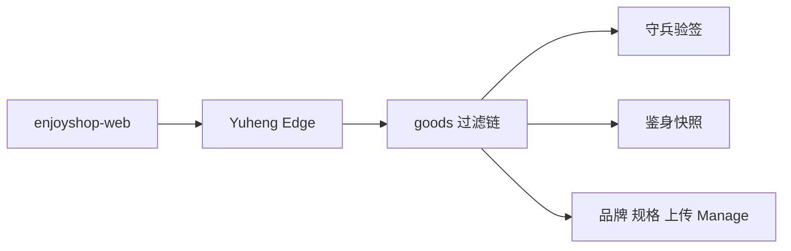
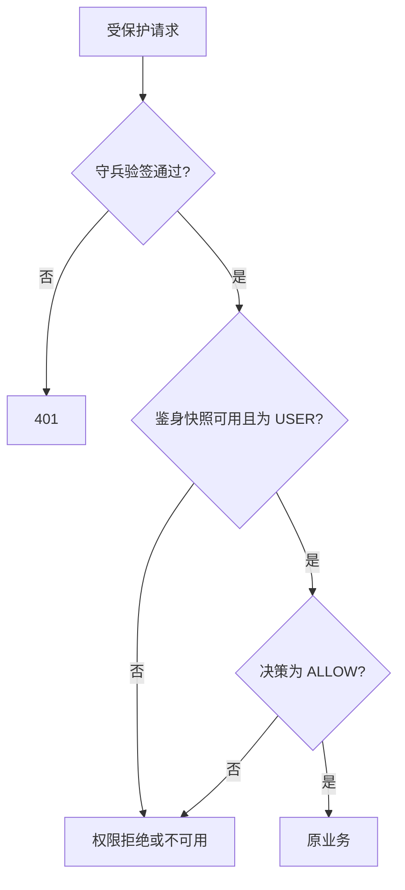
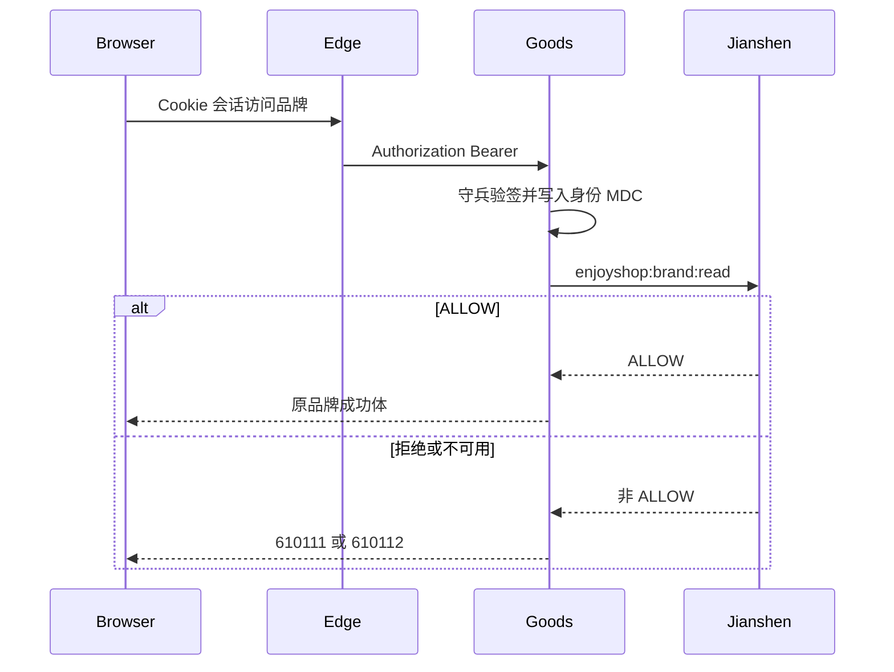

# 目录权限、样例接口删除与 Edge 登录接入

| Field | Value |
| --- | --- |
| Document | `2026-10-13-11-06-catalog-permission-and-edge-login.md` |
| Template Version | `7` |
| Status | `Accepted` |
| Type | `Feature` |
| Complexity | `Complex` |
| Complexity Drivers | 品牌、规格、上传从匿名或仅身份校验改为守兵加鉴身；教学与用户样例接口整段删除；网页只接御衡 Edge 会话 |
| Created | `2026-10-13 11:06 CST` |
| Updated | `2026-10-13 11:41 CST` |
| Owner | mario |
| Repository | enjoyshop |
| Scope | enjoyshop-service-goods 的品牌、规格、上传授权，以及样例接口删除；enjoyshop-web 的登录失败回跳和样例页面删除 |
| Change Surface | 为品牌、规格、上传补上与商品相同的守兵验签和鉴身权限码；删除用户与教学样例接口；网页继续走 Edge，不新增本地登录 |
| Affected Chapters | §7, §8, §9, §12, §13, §14, §15, §16 |
| Source Requirement | 用户要求重新分析并补上该有的权限，网页登录也要接入；随后确认品牌和规格读写都要权限码、样例接口删除、上传再加功能权限、网页接入已有 Edge 会话 |
| Baseline Revision | `main` / `17cfa79` |
| Amends | [认证边界](2026-10-13-10-15-platform-user-authentication-integration.md) DEC-004、§8.3 遗留匿名名单，以及“上传链不装鉴身过滤器、教学接口保留”；[品牌骨架](2026-09-23-17-16-enjoyshop-scaffold-brand-crud.md) §9 安全列中尚未执行的展示权限和运营角色；[文件目录](2026-09-28-21-50-distributed-file-catalog-lookups.md) 的上传认证条款：上传在守兵 USER 之外再要求鉴身权限 |
| Supersedes | None |
| Depends On | [首页网关](2026-10-09-16-39-homepage-kubernetes-gateway-architecture.md) §7：浏览器登录仍由御衡 Edge 的 BFF/OIDC 负责，goods 不新建登录端点 |
| Related Specs | [认证边界](2026-10-13-10-15-platform-user-authentication-integration.md) 的商品、广告、公开搜索和公开广告位结论继续有效 |
| Related Plans | [目录权限与 Edge 登录实现](../plan/2026-10-13-11-47-catalog-permission-and-edge-login.md) |

## 1. Summary

商品和广告管理已经用守兵验签、鉴身快照和显式 `requirePermission` 做了授权。品牌、规格仍在默认链上匿名；上传只验守兵身份；用户、角色、权限、课程、班级是 Light 原型样例，却同样匿名可写。网页已经有 Edge 的会话、CSRF 和登录跳转，但样例页面还在，业务 401 也不会回到登录页。

本规格按用户刚确认的选择补上缺口：品牌查询和写入、规格查询都要登录和权限码；上传在原有 USER 令牌上再要 `enjoyshop:file:write`；样例接口删除；网页不自建账号密码登录。公开商品搜索和公开广告位保持匿名。不使用 `@PreAuthorize`，也不新建认证服务。

## 2. Background and Current State

`ProductManageImpl` 与 `AdManageImpl` 在业务之前调用授权组件。`NativeHttpSecurityConfiguration` 对 `/api/v1/products/**` 和 `/api/v1/ads/**` 先装 `IdpBearerAuthenticationFilter`，再装 `Rbac3BearerAuthenticationFilter`。`POST /api/v1/files` 只装守兵过滤器。`/api/v1/brands/**` 与 `GET /api/v1/specs/category/{categoryName}` 落在 `permitAll` 的默认链。`TenantContextFilter` 对品牌、规格和上传仍接受 `X-Tenant-Id` 与 `X-Actor-Id`。

`enjoyshop-web` 的 `config.js` 默认 `authMode=bff`，`loginRegistrationId` 为空。`connection.js` 在配置为空时拒绝跳转，登录地址是 `/oauth2/authorization/{registrationId}`。`app.js` 仍挂着用户、权限、课程、班级四个样例路由。

### 2.4 Evidence and current-chain map

| Entry/trigger | Current chain | Evidence | Gap |
| --- | --- | --- | --- |
| 品牌读写 | 默认链 permitAll，Manage 只检查 MDC 里有没有操作人 | `BrandController`、`BrandManageImpl.requireOperator`、`TenantContextFilter` | 请求头就能冒充租户和操作人 |
| 规格查询与图片上传 | 规格匿名；上传只验守兵，不调用鉴身 | `SpecController`、`fileUploadSecurityFilterChain`、`FileManageImpl` | 规格无权限；上传没有功能权限码 |
| 样例接口与网页登录 | `/api/users`、课程、班级以及对应 GraphQL/RPC 可匿名调用；网页已有 Edge 按钮 | `UserController`、`CourseController`、`app.js`、`connection.js` | 样例仍对外；401 不回登录页 |

## 3. Goals and Non-goals

### 3.1 Goals

- 品牌查询要求 `enjoyshop:brand:read`，品牌写入要求 `enjoyshop:brand:write`。
- 规格查询要求 `enjoyshop:spec:read`。
- 上传保持守兵 USER 验签，并增加 `enjoyshop:file:write`。
- 删除用户与教学样例的 HTTP、GraphQL 和 RPC 接口，以及只为它们服务的代码和页面。
- 网页继续使用 Edge 会话；业务接口返回 401 时回到连接与登录页。

### 3.2 Non-goals

- 不改商品、广告管理、公开广告位和商品搜索的现有授权。
- 不在 goods 或网页里做账号密码登录，不把访问令牌写入 localStorage 或 sessionStorage。
- 不修改天权守兵、鉴身或御衡源码，不发明 OIDC registration ID。
- 不新增表、权限主数据或登录 URL。权限码由平台侧授予，本仓库只负责校验。

### 3.3 Change Surface and Design Depth

| Area/layer | Disposition | Exact repository evidence | Changed or preserved behavior/contract | Required Spec treatment | Chapter references |
| --- | --- | --- | --- | --- | --- |
| 品牌、规格、上传过滤链与授权组件 | Affected | `NativeHttpSecurityConfiguration`、三个 Manage | 三条路径改为守兵后鉴身，再按权限码允许 | 完整设计链、组件、模式、测试和失败码 | §7, §8, §13, §14, §15 |
| 七个既有 HTTP 操作的认证前置 | Affected | `BrandController`、`SpecController`、`FileController` | URL 与成功体不变，未授权不再进入业务 | 逐个操作写清认证、错误体和文档 | §9 |
| 样例用户与教学接口 | Affected | `adapter.user`、`adapter.teaching` 及对应领域、门面 | 这些接口不再存在 | 删除调用面和只服务于它们的代码 | §8, §16 |
| 网页登录与样例导航 | Affected | `app.js`、`connection.js`、`api.js` | 保留 Edge 登录；401 回登录页；去掉样例菜单 | 设计页面状态，不新做登录表单 | §12, §16 |
| 商品、广告、公开搜索、公开广告 | Unchanged | 现有四条过滤链与两个授权组件 | 权限码和匿名规则不动 | 只记录保持不变的原因 | §7 |
| 数据库 | Not applicable | 品牌、规格、文件都没有新的权限表 | 不新增 DDL | 说明权限不落在 goods 库 | §11 |

## 4. Requirements and Acceptance Criteria

| ID | Statement | Priority | Acceptance | Source |
| --- | --- | --- | --- | --- |
| REQ-001 | 品牌查询只允许持有 `enjoyshop:brand:read` 的 USER | Must | 无令牌 401；非 USER、拒绝或快照不一致为 610111；鉴身不可用为 610112 | 用户选择读写都要权限码 |
| REQ-002 | 品牌创建、更新、下架只允许 `enjoyshop:brand:write` | Must | 三个写方法在领域调用前检查该码；成功体和状态码不变 | 用户选择读写都要权限码 |
| REQ-003 | 分类规格查询只允许 `enjoyshop:spec:read` | Must | `GET /api/v1/specs/category/{categoryName}` 无权限时不查库；拒绝 610113，不可用 610114 | 用户选择读写都要权限码 |
| REQ-004 | 上传同时要求守兵 USER 和 `enjoyshop:file:write` | Must | 上传链同时安装两个过滤器；无功能权限为 610115，鉴身不可用为 610116 | 用户选择再加功能权限码 |
| REQ-005 | 用户与教学样例接口删除 | Must | HTTP、GraphQL、RPC 路径不再注册；前端不再引用这些页面 | 用户要求删除样例接口 |
| REQ-006 | 网页登录只走已有 Edge 会话 | Must | 未配置 registration ID 时登录按钮失败且不跳转；业务 401 进入 `#/connection`；不保存令牌 | 用户选择接入 Edge |
| REQ-007 | 品牌、规格、上传不再信任租户和操作人请求头 | Must | `TenantContextFilter` 跳过这三条路径 | 与商品链相同的身份来源 |
| REQ-008 | 公开搜索、公开广告、商品和广告管理保持现状 | Must | 现有权限码、公开 GET 和 denyAll 规则不变 | 本轮范围 |

### 4.1 Scenario matrix

| Scenario | Trigger | Result | Failure |
| --- | --- | --- | --- |
| 运营查询品牌 | 有效 USER 且快照允许 `enjoyshop:brand:read` | 原品牌列表 | 无令牌 401，拒绝 610111 |
| 运营写入品牌或上传图片 | 对应 write 权限且守兵身份成立 | 原成功体 | 权限不足或鉴身不可用，业务不执行 |
| 匿名或样例调用 | 无令牌访问品牌，或调用已删除的 `/api/users` | 401，或路由不存在 | 不得再靠 `X-Actor-Id` 写品牌 |

### 4.2 Use-case analysis

| ID | Use case/goal | Primary actor | Supporting actors | Trigger | Preconditions | Main outcome | Alternatives/failures | Postcondition | Requirements | Interface/page | Tests |
| --- | --- | --- | --- | --- | --- | --- | --- | --- | --- | --- | --- |
| UC-001 | 查看品牌和规格 | ACTOR-001 | ACTOR-003 | 打开品牌或规格页 | Edge 会话已转发 Bearer，且读权限允许 | 返回原查询结果 | 401、403、503 | 无数据变化 | REQ-001、REQ-003、REQ-006 | 品牌与规格 GET | TEST-001、TEST-002 |
| UC-002 | 维护品牌并上传图片 | ACTOR-001 | ACTOR-003 | 提交品牌表单或图片 | 写权限和上传权限允许 | 原创建、更新、删除或上传结果 | 权限拒绝时不写库、不写对象 | 只有 ALLOW 后改变数据 | REQ-002、REQ-004 | 品牌写与上传 | TEST-002、TEST-003 |
| UC-003 | 未授权访问被拒绝 | ACTOR-002 | 无 | 直接调用受保护 URL | 无有效 USER 或无权限码 | 401 或业务拒绝码 | 请求头租户被忽略 | 无业务副作用 | REQ-001、REQ-007 | 全部受保护路由 | TEST-001 |
| UC-004 | 样例功能消失 | ACTOR-001 | 无 | 打开旧的用户或课程地址 | 无 | 页面说明路径不存在，接口不再注册 | 无匿名写入 | 样例代码不再暴露 | REQ-005 | 原样例页面 | TEST-004 |
| UC-005 | 通过 Edge 登录后继续操作 | ACTOR-001 | ACTOR-003 | 点击平台登录或遇到 401 | BFF 模式且 registration ID 已配置 | 浏览器进入 Edge 授权地址；401 回到登录页 | ID 为空时停在当前页并提示 | 浏览器不保存访问令牌 | REQ-006 | `#/connection` | TEST-005 |

| ID | Actor | Evidence |
| --- | --- | --- |
| ACTOR-001 | 后台运营 | `enjoyshop-web` 的品牌、规格、上传页面 |
| ACTOR-002 | 未持有有效权限的调用方 | 当前匿名即可写品牌 |
| ACTOR-003 | 御衡 Edge | `connection.js` 已调用 `/bff/session` 与 `/oauth2/authorization/{registrationId}` |

## 5. Constraints, Assumptions, and Decisions

### 5.1 Confirmed constraints

- 身份仍只由守兵签发和验签，功能权限仍只由鉴身快照决定。
- 过滤链顺序与商品链相同：守兵过滤器、鉴身过滤器、匿名过滤器。两个 `register-filter` 仍必须为 false。
- 成功 JSON、URL、品牌乐观锁和上传 10 MiB 限制不变。
- 不新增 Maven 依赖。

### 5.2 Small-gap assumptions

| ID | Assumption | Evidence | If wrong |
| --- | --- | --- | --- |
| ASM-001 | 商品链已经依赖平台过滤器把租户和主体写入 MDC；品牌、规格、上传复用同一过滤器后，授权组件用同一组 MDC 比对 | `ProductAuthorizationComponent` 比对 `MDC tenantId/userId` 与令牌 | 比对失败时拒绝，不能退回请求头 |
| ASM-002 | 样例纵向删除后，品牌、商品、广告、搜索和 CDC 仍能编译 | `CdcRabbitConfiguration` 不引用 `RabbitMqConfig` 或 `MqRouteEnum`；样例表仍留在既有分片合同里 | 已由 DEC-007 关闭，不恢复匿名接口 |

### 5.3 Resolved decisions

| ID | Decision | Owner | Evidence | Requirements |
| --- | --- | --- | --- | --- |
| DEC-001 | 继续用授权组件的显式调用，不加方法安全注解 | mario | 商品和广告已经是这个形状 | REQ-001 至 REQ-004 |
| DEC-002 | 品牌读写和规格查询都要权限码 | mario | 用户确认推荐项 | REQ-001、REQ-002、REQ-003 |
| DEC-003 | 删除样例接口，而不是给它们再加一套教学权限 | mario | 用户明确要求删除 | REQ-005 |
| DEC-004 | 上传增加 `enjoyshop:file:write`，同时保留守兵 USER 验签 | mario | 用户否决“只验身份” | REQ-004 |
| DEC-005 | 网页只接 Edge，不新增本地登录 | mario | 用户确认推荐项；首页规格已规定 Edge | REQ-006 |
| DEC-006 | 公开搜索和公开广告保持匿名 | 既有规格 | 本轮用户没有要求关闭公开读 | REQ-008 |
| DEC-007 | 样例纵向整段删除，并改写只锁定样例的架构合同 | mario | 用户选择“整段删除并改写架构合同” | REQ-005 |

DEC-007 的删除范围是用户、教学样例包，以及只被它们引用的异常、GraphQL schema、`teaching_user_facade.proto`、样例 Mapper XML、`LightFacadeConverter`、`ExternalClientConfig`、`LocalAdapterConfiguration`、`RabbitMqConfig`、`MqRouteEnum`、`MqMessageService`、`RabbitMqMessageServiceImpl` 和 `TransactionCompletionExecutor`。`RabbitMqConfig` 的队列、死信和绑定只声明 `USER_IMPORTED` 与 `COURSE_IMPORTED`；CDC 使用独立的 `CdcRabbitConfiguration`，本轮不改 CDC，也不改它的哈希。`NativeReadwriteContractTest` 对这两个样例文件的 SHA-256 锁定随之删除，但 POM 不得引入 `debezium`、`kafka-clients`、`elasticsearch`、`transactional-outbox-starter` 的断言保留。基础设施下 `PO`、`DAO`、`Repository` 的计数从 14 改为删除样例后的 6；`DomainServiceImpl` 改为保留的品牌、商品、规格、文件、广告、搜索共 6 个。当前测试写成 10，磁盘上是 11，本轮不单独解释这个既有偏差，只把删除后的期望写成 6。

`ArchetypeContractConvergenceTest` 去掉要求样例领域服务、客户端、POJO、DAO、缓存、幂等、MQ 路由、样例异常、样例枚举、样例 Protobuf 和 `RecordingMqMessageService` 存在的断言。保留“Manage 实现不得引用 `RabbitTemplate`、`RedisTemplate`、`Repository`、`DAO`”以及品牌、商品、广告、搜索仍需满足的负向包约束。`DaoMonitorAspect` 与 `InfrastructureLogAspect` 不改。`app.integrations.rabbitmq.enabled` 与 `exchange` 保留，因为现有合同仍按 profile 读取这个开关，但删除后不再有样例队列 Bean。`spring.rabbitmq` 与 `app.cdc.enabled` 不动。

已有分片合同中的 `users`、`roles`、`permissions`、`courses` 等表名保持不变。本轮不新增、不修改、不删除 SQL。`StudentManagementApplication` 只从 `@MapperScan` 去掉 `infrastructure.user.dao` 与 `infrastructure.teaching.dao`，类名不改。`NativeRpcConfiguration` 删除 `lightFacadeConverter` Bean，保留 `nativeRpcValidation` 与 `nativeRpcValidationExceptionMapper`。`pom.xml` 只删除 `LightFacadeConverterImpl` 那一条 `facadeImplementationPackage`。

### 5.4 Open major decisions

没有未决重大决策。registration ID 是部署配置，仓库继续留空，不在规格里编造。

## 6. Project Technology Context

| Concern | Current choice | Repository evidence | Constraint on design |
| --- | --- | --- | --- |
| Language/runtime | Java 21，Spring Boot 3.5，Egon 5.4.1 | goods POM | 不新增登录依赖 |
| Module style | Light：`adapter`、`application`、`domain`、`infrastructure`、`start` | 现有包 | 新组件放在 `application.goods` |
| Web | 无构建步骤的静态页面，哈希路由 | `enjoyshop-web/src/app.js` | 不引入前端框架 |
| Security | 守兵与鉴身 Starter 5.4.1 | `NativeHttpSecurityConfiguration` | 复用现有过滤器 Bean |

### 6.1 Java architecture profile and capability baseline

| Architecture profile | Archetype/template or base package | Exact evidence and verifier | Existing deviations | Design action |
| --- | --- | --- | --- | --- |
| Egon-COLA Light | `top.egon.enjoyshop.goods` | 现有分层与 `LightPersistenceArchitectureTest` | 用户和教学包是原型样例 | 删除样例调用面，不改 Light 分层 |

| Need | Spring/JDK candidate | Spring Boot Starter candidate | Egon-COLA/module candidate | Proven gap | Decision/dependency impact |
| --- | --- | --- | --- | --- | --- |
| 品牌、规格、上传授权 | 无新安全库 | 不新增 starter | 现有守兵过滤器、鉴身过滤器和 `AuthorizationService` | 无 | 复用，不新增依赖 |
| 浏览器登录 | 无 | 无 | 御衡 Edge 已有 BFF | 网页尚未在 401 时回登录页 | 只改页面，不新增依赖 |

### 6.2 User-mandated Java rule compliance

| Literal rule | Affected? | Repository evidence | Exact design decision | Files/types/interfaces | Validation/test evidence | Status/blocker |
| --- | --- | --- | --- | --- | --- | --- |
| Rule 1 | No | 不新增 POJO 载体 | 授权组件沿用现有类名后缀 Component | 三个授权组件 | 无新 Command 或 DTO | N/A |
| Rule 2 | No | 现有品牌、规格、上传入参已有校验 | 不新增层间对象，不改分组 | 现有 Command 与 Query | 既有校验测试仍通过 | N/A |
| Rule 3 | No | 无新数据载体 | 不新增 class 载体、record 或转换器 | 无 | 无新映射 | N/A |
| Rule 4 | Yes | 商品授权组件已有名称、日志和 Qualifier | 三个新组件同样使用 `@Slf4j`、具名 `@Component`、`@RequiredArgsConstructor` 和 `@Qualifier` | 三个授权组件 | 架构测试与新增组件测试 | PASS |
| Rule 5 | No | 不引入工具库 | 只用 JDK 与现有平台 API | 无新工具类 | POM 不变 | N/A |
| Rule 6 | No | 错误仍走 `CommonException` 与 Jackson | 新错误码是枚举，不用 ordinal | `GoodsErrorStatus` 追加六个码 | 错误体测试 | N/A |
| Rule 7 | Yes | `ExternalClientConfig` 只绑定样例 `user-base-url` 与 `teaching-base-url` | 从已有这两键的 profile 中删除它们；`external-http.enabled`、守兵键和 `app.integrations.rabbitmq.enabled` 保留且默认值不变 | `application.yml`、`application-dev.yml`、`application-prod.yml` | `ProfileKeyParityTest` 的治理键不变 | PASS |
| Rule 9 | No | 权限判断与商品相同，是一次显式调用 | 不在 goods 增加登录方式分支 | 无新策略类 | 无第二套登录类型 | N/A |
| Rule 10 | No | 无新时间字段 | 不使用 `java.util` 日期 | 无 | 无新时间映射 | N/A |
| Rule 11 | Yes | Light 目录 | 新类只进入现有 application 与 start 包；删除样例不新建层 | 见第 8 章 | `LightPersistenceArchitectureTest` | PASS |

## 7. Architecture Design

### 7.0 Minimum-design baseline and element-necessity audit

| Proposed element | Change | Requirements | Existing/direct alternative | Concrete inadequacy of alternative | Added calls/state/coupling/failures/migration/operations | Verdict |
| --- | --- | --- | --- | --- | --- | --- |
| 品牌、规格、上传授权组件 | Add | REQ-001 至 REQ-004 | 在控制器上加 `@PreAuthorize` | 商品和广告没有这种方法注解，权限码和失败码会散落 | 每个受保护操作多一次鉴身调用；鉴身不可用时失败关闭 | Add |
| 品牌链和规格链 | Add | REQ-001、REQ-003、REQ-007 | 继续放在默认 permitAll 链 | 匿名和请求头身份仍然有效 | 多两条过滤链，无新网络协议 | Add |
| 上传链补鉴身过滤器 | Add | REQ-004 | 只保留守兵过滤器 | 无法取得鉴身快照，功能权限无法判断 | 上传多一个过滤器；register-filter 为 true 时仍拒绝启动 | Add |
| 本地登录页或 goods 令牌端点 | Remove | REQ-006 | Edge 已有 `/oauth2/authorization/{registrationId}` | 再做登录会形成第二套身份 | 无 | Remove |
| 样例用户和教学接口 | Remove | REQ-005 | 给样例再加教学权限码 | 用户要求删除，而不是继续暴露 | 删除调用面和只属于样例的代码 | Remove |

| Path | Network calls | Client states | Server state | Failure points | Operational cost |
| --- | --- | --- | --- | --- | --- |
| Direct baseline | 浏览器一次业务调用；Edge 转发已有 Bearer | 原页面加载、成功、错误 | 鉴身快照，无新会话 | 401、权限拒绝、鉴身不可用 | 平台授予新权限码 |
| Selected design | 同样一次业务调用；登录跳转只在按下登录或收到 401 时发生 | 增加未配置 registration ID 和 401 回登录页 | 不在 goods 保存登录态 | 与基线相同，再加样例路由消失 | 不新增 goods 进程或表 |

### 7.1 System Architecture Design



浏览器不直接向守兵换令牌。Edge 持有会话并把 Bearer 转发给 goods。goods 先验签，再按权限码问鉴身。商品、广告、公开搜索和公开广告不经过这张新图的新链。

### 7.2 High-Level Design

品牌、规格和上传都进入各自的认证链。授权组件确认主体是 USER、系统码是 `enjoyshop-goods`、租户和主体与 MDC 一致、没有被围栏挡住，然后请求对应资源上的权限。ALLOW 之后才进入现有 Manage。`TenantContextFilter` 不再为这三条路径写入请求头身份。

#### 7.2.2 High-level decision and quality matrix

| Concern/use case | Quality attribute | Decision | Failure behavior | Verification | Requirements |
| --- | --- | --- | --- | --- | --- |
| 品牌和规格读取 | 机密性 | 读权限码，拒绝请求头身份 | 401 或 610111、610113 | TEST-001、TEST-002 | REQ-001、REQ-003、REQ-007 |
| 品牌写入和上传 | 完整性 | 写权限在领域调用之前 | 拒绝时不写库、不写对象 | TEST-002、TEST-003 | REQ-002、REQ-004 |
| 网页登录 | 兼容现有 Edge | 不新增令牌存储 | registration ID 为空时不跳转 | TEST-005 | REQ-006 |

### 7.3 Detailed Design

资源名分别是 `enjoyshop.brand`、`enjoyshop.spec`、`enjoyshop.file`。权限码正则分别是 `enjoyshop:brand:(read|write)`、`enjoyshop:spec:read`、`enjoyshop:file:write`。新错误码追加为 610111、610112、610113、610114、610115、610116，不改已有码。

品牌查询调用 read，品牌创建、更新、删除调用 write。规格查询调用 read。上传调用 write。这些调用位于现有参数校验和领域调用之前。`BrandManageImpl.requireOperator()` 保留，但它看到的 `userId` 必须来自已验证身份，而不是 `X-Actor-Id`。



#### 7.3.6 Conclusion evidence chain

| Conclusion | Evidence | Constraint | Decision | Consequence | Verification |
| --- | --- | --- | --- | --- | --- |
| 品牌和规格不能继续匿名 | 默认链 permitAll，品牌规格却写了展示权限和运营角色 | 用户要求读写都加权限 | 新链加两个读权限和一个写权限 | 匿名请求不再进入 Manage | TEST-001、TEST-002 |
| 样例不能用加权限来保留 | 样例含本地角色，且用户要求删除 | 不把本地角色当成生产权限 | 删除样例调用面 | 前端样例页一并删除 | TEST-004 |



## 8. Package Structure and Code File Tree

```text
MODIFY enjoyshop-service/enjoyshop-service-goods/src/main/java/top/egon/enjoyshop/goods/start/config/NativeHttpSecurityConfiguration.java
MODIFY enjoyshop-service/enjoyshop-service-goods/src/main/java/top/egon/enjoyshop/goods/adapter/filter/TenantContextFilter.java
MODIFY enjoyshop-service/enjoyshop-service-goods/src/main/java/top/egon/enjoyshop/goods/common/enums/GoodsErrorStatus.java
CREATE enjoyshop-service/enjoyshop-service-goods/src/main/java/top/egon/enjoyshop/goods/application/goods/BrandAuthorizationComponent.java
CREATE enjoyshop-service/enjoyshop-service-goods/src/main/java/top/egon/enjoyshop/goods/application/goods/SpecAuthorizationComponent.java
CREATE enjoyshop-service/enjoyshop-service-goods/src/main/java/top/egon/enjoyshop/goods/application/goods/FileAuthorizationComponent.java
MODIFY BrandManage.java BrandManageImpl.java SpecManage.java SpecManageImpl.java FileManage.java FileManageImpl.java
MODIFY BrandController.java SpecController.java FileController.java
DELETE adapter/user adapter/teaching application/user application/teaching domain/user domain/teaching infrastructure/user infrastructure/teaching facade/user facade/teaching 及其镜像测试包
DELETE infrastructure/mq RabbitMqConfig LocalAdapterConfiguration ExternalClientConfig TransactionCompletionExecutor LightFacadeConverter
DELETE 六个样例 common 异常、graphql/user.graphqls、graphql/teaching.graphqls、teaching_user_facade.proto、mybatis/mapper/user、mybatis/mapper/teaching
MODIFY StudentManagementApplication.java NativeRpcConfiguration.java pom.xml application.yml application-dev.yml application-prod.yml
MODIFY ArchetypeContractConvergenceTest.java NativeReadwriteContractTest.java PlatformAuthenticationBoundaryContractTest.java
MODIFY NativeHttpCompatibilityTest.java NativeRpcConfigurationTest.java 以及品牌、规格、上传的 OpenAPI 合同测试
MODIFY enjoyshop-web/src/app.js src/api.js src/pages/connection.js
DELETE enjoyshop-web/src/pages/users.js enjoyshop-web/src/pages/teaching.js
MODIFY enjoyshop-web/test/api.test.mjs enjoyshop-web/test/contracts.test.mjs
```

| Operation | Path/package | Symbols | Responsibility | Dependencies | Requirements |
| --- | --- | --- | --- | --- | --- |
| Create | `application/goods/BrandAuthorizationComponent.java` | `brandAuthorizationComponent` | 校验 `enjoyshop.brand` 上的 read 或 write | 现有 `AuthorizationService` | REQ-001、REQ-002 |
| Create | `application/goods/SpecAuthorizationComponent.java` | `specAuthorizationComponent` | 校验 `enjoyshop.spec` 上的 read | 同上 | REQ-003 |
| Create | `application/goods/FileAuthorizationComponent.java` | `fileAuthorizationComponent` | 校验 `enjoyshop.file` 上的 write | 同上 | REQ-004 |
| Modify | `NativeHttpSecurityConfiguration` | `brandSecurityFilterChain`、`specSecurityFilterChain`、上传链 | 新链复制商品链；上传链补上鉴身过滤器 | 现有两个过滤器 Bean | REQ-001、REQ-003、REQ-004 |
| Modify | `TenantContextFilter` | `shouldNotFilter` | 跳过 `/api/v1/brands`、`/api/v1/specs`、`/api/v1/files` | 无 | REQ-007 |
| Delete | 用户与教学样例包，以及 DEC-007 点名的外部文件 | 样例 Controller、Resolver、Facade、样例 MQ | 不再注册样例接口，不保留样例队列 | 无生产调用方；CDC 独立 | REQ-005 |

新过滤链使用 `Ordered.LOWEST_PRECEDENCE - 6` 和 `- 7`，避免与现有 `-1` 到 `-5` 冲突。上传链仍只匹配 `POST /api/v1/files`。任一 `register-filter` 为 true 时，品牌链、规格链和上传链都在使用 `HttpSecurity` 之前抛出 `IllegalStateException`。

## 9. Interface Definitions

成功体保持控制器今天的字段。变化只发生在认证失败和两个新的业务拒绝码。删除的样例路由不再有契约。

### 9.0 API protocol and documentation governance

| Concern | Decision/evidence |
| --- | --- |
| Protocol selection | 七个操作继续是现有 HTTP REST；证据是 `BrandController`、`SpecController`、`FileController` |
| CQE application level | 保持现有同步 REST。查询是 Query，写入和上传是 Command。不新增事件总线 |
| REST source of truth | springdoc 注解继续位于现有控制器，`operationId` 不改 |
| GraphQL source of truth | 本轮删除用户和教学 GraphQL 样例，不新增 GraphQL schema |
| Springdoc/OpenAPI compatibility | 继续使用现有 `io.swagger.v3.oas.annotations`，不引入 Springfox |
| Legacy Swagger/Springfox status | goods 没有 Springfox 依赖，本轮不添加 |
| Security and documentation exposure | 三个控制器补充 Bearer 安全要求和 401、403、503 说明；文档不包含令牌样例 |
| Contract publication and drift gate | 成功体由既有 Web 测试锁定；新错误码由新增授权测试锁定 |

### 9.1 Interface Inventory

| ID | Change/necessity verdict | Name/purpose | Kind | API style/CQE role | Consumer | Owner | Method + URL / GraphQL field / symbol / topic | Operation ID/schema source | Input | Output | Auth/tenant | Error model | Idempotency/version | Requirements |
| --- | --- | --- | --- | --- | --- | --- | --- | --- | --- | --- | --- | --- | --- | --- |
| API-001 | Keep，只加认证 | 查询品牌集合 | Query | REST Query | 后台品牌页 | goods adapter | GET /api/v1/brands | listBrands | 现有查询参数 | 现有分页体 | USER 加 brand:read | 401、610111、610112，原 400 保留 | 只读 | REQ-001 |
| API-002 | Keep，只加认证 | 查询单个品牌 | Query | REST Query | 后台品牌页 | goods adapter | GET /api/v1/brands/{brandId} | getBrand | brandId | 现有品牌体 | USER 加 brand:read | 401、610111、610112，原 404 保留 | 只读 | REQ-001 |
| API-003 | Keep，只加认证 | 新增品牌 | Command | REST Command | 后台品牌页 | goods adapter | POST /api/v1/brands | createBrand | 现有 JSON | 201 与现有品牌体 | USER 加 brand:write | 401、610111、610112，原 409 保留 | 原乐观创建语义 | REQ-002 |
| API-004 | Keep，只加认证 | 更新品牌 | Command | REST Command | 后台品牌页 | goods adapter | PUT /api/v1/brands/{brandId} | updateBrand | 现有 JSON 与 version | 现有品牌体 | USER 加 brand:write | 401、610111、610112，原 409 保留 | version 防覆盖 | REQ-002 |
| API-005 | Keep，只加认证 | 下架品牌 | Command | REST Command | 后台品牌页 | goods adapter | DELETE /api/v1/brands/{brandId} | deleteBrand | brandId 与 version | 现有布尔体 | USER 加 brand:write | 401、610111、610112，原 404 保留 | 原删除语义 | REQ-002 |
| API-006 | Keep，只加认证 | 按分类查规格 | Query | REST Query | 后台规格页 | goods adapter | GET /api/v1/specs/category/{categoryName} | listSpecsByCategoryName | categoryName | 现有规格数组 | USER 加 spec:read | 401、610113、610114，原 610110 保留 | 只读 | REQ-003 |
| API-007 | Keep，加功能权限 | 上传商品图片 | Command | REST Command | 后台上传页 | goods adapter | POST /api/v1/files | uploadFile | multipart 文件 | 201 与公开 URL | USER 加 file:write | 401、610115、610116，原 400 与 413 保留 | 原上传语义 | REQ-004 |

### 9.2 Per-interface Detailed Contracts

下面七个操作共用同一认证顺序。每个操作的成功字段仍以当前控制器测试为准。

#### 9.2.1 API-001

##### Necessity and interaction-cost decision

| Concern | Decision |
| --- | --- |
| Change classification | 保留现有查询，只增加认证前置 |
| Independent consumer goal | 后台按条件查看品牌 |
| Parameter ownership and derivation | 过滤条件由调用方给出；租户来自令牌，不来自查询参数 |
| Direct/no-new-interface alternative | 不新增查询 URL |
| Caller use of result | 页面直接渲染品牌列表 |
| Round trips and failure points | 仍是一次 GET；新增 401 和权限失败 |
| Verdict | Keep |

##### API style and CQE semantics

| Concern | Decision/evidence |
| --- | --- |
| Protocol style | REST Query |
| CQE role | Query，无写入 |
| Resource/task semantics | `GET /api/v1/brands` 仍是品牌集合 |
| Read/write and side effects | 只读，权限失败无副作用 |
| Consistency and idempotency | 可安全重放 |
| Why this style | 现有控制器已经是 REST Query |

##### Identity and purpose

| Concern | Definition |
| --- | --- |
| Name | listBrands |
| Method and URL | GET /api/v1/brands |
| Purpose | 在 read 权限下返回原品牌分页 |

##### Request parameters

| Name | Location | Required | Rule |
| --- | --- | --- | --- |
| name | query | no | 最长 120 |
| letter | query | no | 单个字母 |
| seqMin | query | no | 大于等于 0 |
| seqMax | query | no | 大于等于 0，且不小于 seqMin |
| pageNo | query | no | 从 1 起 |
| pageSize | query | no | 1 到 500 |
| categoryName | query | no | 现有分类名规则 |
| Authorization | header | yes | Edge 转发的 Bearer |

##### Success response

```jsonc
{
  "success": true, // 查询成功
  "code": 10000, // 平台成功码
  "records": [ // 当前页的品牌列表
    {
      "id": 1948768293456580097, // 品牌雪花标识
      "name": "Acer", // 品牌名称
      "image": "https://cdn.example/a.png", // 图片 URL，可为 null
      "letter": "A", // 大写首字母
      "seq": 1, // 排序权重
      "version": 0 // 乐观锁版本
    }
  ],
  "page": { // 分页元数据
    "pageNo": 1, // 当前页
    "pageSize": 500, // 页大小
    "total": 1 // 总行数
  }
}
```

##### Error responses

```jsonc
{
  "code": "AUTHORIZATION_HEADER_INVALID", // 守兵验签失败
  "message": "Tianquan-Shoubing authentication failed" // 固定认证失败说明
}
```

```jsonc
{
  "success": false, // 权限失败
  "code": 610111, // BRAND_FORBIDDEN
  "status": "BRAND_FORBIDDEN", // 稳定状态名
  "message": "Brand permission is denied" // 权限被拒绝
}
```

##### Interface logic for frontend and consumers

1. 调用方通过 Edge 发送 Cookie，由 Edge 转发 Bearer。
2. 无 Bearer 或验签失败时显示 401，并回到登录页。
3. 权限不足时显示 610111，不重试写入。
4. 鉴身不可用时显示 610112。
5. 成功时按 `records` 和 `page` 渲染，不读取响应里的租户。
6. 参数错误仍是原来的 610101。
7. 页面不把令牌写入本地存储。

##### Documentation contract

| Concern | Decision/evidence |
| --- | --- |
| Documentation authority | `BrandController.listBrands` 的 springdoc 注解 |
| REST OpenAPI operation / GraphQL SDL operation | operationId `listBrands` |
| Annotation/mapping ownership | 控制器保持 `@Operation`，并增加 Bearer 与 401、403、503 响应 |
| Generated schema elements | 成功 schema 仍是现有分页和 `BrandVO` |
| Compatibility and drift proof | `BrandControllerWebTest` 继续锁定成功字段 |
| Generated OAS effect | 文档出现 `listBrands`，安全要求为 bearerAuth |

##### Compatibility and verification

URL、查询参数和成功字段不变。TEST-001 锁定过滤链，TEST-002 锁定 610111 与 610112。旧的匿名调用变为 401，这是本规格要求的不兼容变更。

#### 9.2.2 API-002

##### Necessity and interaction-cost decision

| Concern | Decision |
| --- | --- |
| Change classification | 保留详情查询，只增加 read 权限 |
| Independent consumer goal | 打开一个品牌 |
| Parameter ownership and derivation | brandId 由路径给出，租户来自令牌 |
| Direct/no-new-interface alternative | 不新增详情 URL |
| Caller use of result | 编辑表单使用返回的 version |
| Round trips and failure points | 一次 GET；新增认证失败 |
| Verdict | Keep |

##### API style and CQE semantics

| Concern | Decision/evidence |
| --- | --- |
| Protocol style | REST Query |
| CQE role | Query |
| Resource/task semantics | `GET /api/v1/brands/{brandId}` 仍是单个品牌 |
| Read/write and side effects | 只读 |
| Consistency and idempotency | 可重放 |
| Why this style | 现有 getBrand 已是 REST Query |

##### Identity and purpose

| Concern | Definition |
| --- | --- |
| Name | getBrand |
| Method and URL | GET /api/v1/brands/{brandId} |
| Purpose | 在 read 权限下返回一个品牌 |

##### Request parameters

| Name | Location | Required | Rule |
| --- | --- | --- | --- |
| brandId | path | yes | 正整数 |
| Authorization | header | yes | Bearer |

##### Success response

```jsonc
{
  "success": true, // 查询成功
  "code": 10000, // 平台成功码
  "data": { // 单个品牌
    "id": 1948768293456580097, // 品牌标识
    "name": "Acer", // 名称
    "image": "https://cdn.example/a.png", // 图片，可为 null
    "letter": "A", // 首字母
    "seq": 1, // 排序
    "version": 0 // 乐观锁
  }
}
```

##### Error responses

```jsonc
{
  "code": "AUTHORIZATION_HEADER_INVALID", // 未通过守兵验签
  "message": "Tianquan-Shoubing authentication failed" // 认证失败说明
}
```

```jsonc
{
  "success": false, // 没有 read 权限
  "code": 610111, // BRAND_FORBIDDEN
  "status": "BRAND_FORBIDDEN", // 状态名
  "message": "Brand permission is denied" // 拒绝说明
}
```

##### Interface logic for frontend and consumers

1. 编辑页用列表中的 id 调用详情。
2. 401 回到登录页。
3. 610111 表示没有读权限。
4. 610112 表示鉴身不可用。
5. 404 仍表示不可见，不泄露跨租户差异。
6. 成功后的 version 原样带回更新请求。
7. 不从响应推导租户。

##### Documentation contract

| Concern | Decision/evidence |
| --- | --- |
| Documentation authority | `BrandController.getBrand` |
| REST OpenAPI operation / GraphQL SDL operation | operationId `getBrand` |
| Annotation/mapping ownership | 现有 `@Operation` 补认证响应 |
| Generated schema elements | `ResultRecord` 与 `BrandVO` |
| Compatibility and drift proof | 现有详情测试锁定成功字段 |
| Generated OAS effect | `getBrand` 声明 bearerAuth |

##### Compatibility and verification

成功 JSON 的 data 仍是一个 BrandVO，字段和 404 不可见语义保持不变。原先不带令牌也能读到品牌的调用，从本规格起改为 401。没有 enjoyshop:brand:read、主体不是 USER，或快照与租户不一致时返回 610111，并且不查询品牌。鉴身超时返回 610112。TEST-002 覆盖这三种拒绝，现有详情测试继续锁定成功字段。

#### 9.2.3 API-003

##### Necessity and interaction-cost decision

| Concern | Decision |
| --- | --- |
| Change classification | 保留创建，增加 write 权限 |
| Independent consumer goal | 新建品牌 |
| Parameter ownership and derivation | 名称和图片由调用方给出；操作人来自令牌 |
| Direct/no-new-interface alternative | 不新增创建 URL |
| Caller use of result | 用返回的 id 和 Location 进入详情 |
| Round trips and failure points | 一次 POST；权限失败不写库 |
| Verdict | Keep |

##### API style and CQE semantics

| Concern | Decision/evidence |
| --- | --- |
| Protocol style | REST Command |
| CQE role | Command |
| Resource/task semantics | `POST /api/v1/brands` 创建一个品牌 |
| Read/write and side effects | 仅 ALLOW 后插入一行 |
| Consistency and idempotency | 同名重复仍返回原 409 |
| Why this style | 现有 createBrand 已是 REST Command |

##### Identity and purpose

| Concern | Definition |
| --- | --- |
| Name | createBrand |
| Method and URL | POST /api/v1/brands |
| Purpose | 在 write 权限下创建品牌 |

##### Request parameters

| Name | Location | Required | Rule |
| --- | --- | --- | --- |
| body | body | yes | 现有创建字段，不含租户和 id |
| Authorization | header | yes | Bearer |

##### Success response

```jsonc
{
  "success": true, // 创建成功
  "code": 10000, // 平台成功码
  "data": { // 新建后的品牌
    "id": 1948768293456580097, // 服务端分配的标识
    "name": "Acer", // 规范化后的名称
    "image": null, // 未提供图片
    "letter": "A", // 服务端计算的首字母
    "seq": 1, // 排序
    "version": 0 // 初始版本
  }
}
```

##### Error responses

```jsonc
{
  "code": "AUTHORIZATION_HEADER_INVALID", // 认证失败
  "message": "Tianquan-Shoubing authentication failed" // 失败说明
}
```

```jsonc
{
  "success": false, // 无 write 权限
  "code": 610111, // BRAND_FORBIDDEN
  "status": "BRAND_FORBIDDEN", // 状态名
  "message": "Brand permission is denied" // 拒绝说明
}
```

##### Interface logic for frontend and consumers

1. 提交前先取 Edge CSRF。
2. 401 回到登录页，不重复提交。
3. 610111 或 610112 时确认没有创建。
4. 原 409 表示名称冲突。
5. 201 的 Location 指向新资源。
6. 返回的 version 用于下一次更新。
7. 不在请求体里放租户或操作人。

##### Documentation contract

| Concern | Decision/evidence |
| --- | --- |
| Documentation authority | `BrandController.createBrand` |
| REST OpenAPI operation / GraphQL SDL operation | operationId `createBrand` |
| Annotation/mapping ownership | 现有 `@Operation` 补 401 和权限响应 |
| Generated schema elements | 请求体和 `BrandVO` 不变 |
| Compatibility and drift proof | 现有创建测试锁定 201 和成功字段 |
| Generated OAS effect | `createBrand` 要求 bearerAuth |

##### Compatibility and verification

创建成功仍是 201，Location 和 BrandVO 字段不变，名称冲突仍是原来的 409。没有 enjoyshop:brand:write 时不得插入品牌行，也不得分配新的雪花标识。TEST-002 在领域服务被调用之前断言 610111 或 610112。已有创建测试继续锁定成功体。

#### 9.2.4 API-004

##### Necessity and interaction-cost decision

| Concern | Decision |
| --- | --- |
| Change classification | 保留更新，增加 write 权限 |
| Independent consumer goal | 修改品牌展示信息 |
| Parameter ownership and derivation | version 由上一次响应回传 |
| Direct/no-new-interface alternative | 不新增更新 URL |
| Caller use of result | 用新 version 继续编辑 |
| Round trips and failure points | 一次 PUT；冲突仍是 409 |
| Verdict | Keep |

##### API style and CQE semantics

| Concern | Decision/evidence |
| --- | --- |
| Protocol style | REST Command |
| CQE role | Command |
| Resource/task semantics | `PUT /api/v1/brands/{brandId}` 整替换可编辑字段 |
| Read/write and side effects | 仅 ALLOW 后更新 |
| Consistency and idempotency | version 阻止静默覆盖 |
| Why this style | 现有 updateBrand 已是 REST Command |

##### Identity and purpose

| Concern | Definition |
| --- | --- |
| Name | updateBrand |
| Method and URL | PUT /api/v1/brands/{brandId} |
| Purpose | 在 write 权限下更新品牌 |

##### Request parameters

| Name | Location | Required | Rule |
| --- | --- | --- | --- |
| brandId | path | yes | 正整数 |
| body | body | yes | 现有更新字段，含 version |
| Authorization | header | yes | Bearer |

##### Success response

```jsonc
{
  "success": true, // 更新成功
  "code": 10000, // 平台成功码
  "data": { // 更新后的品牌
    "id": 1948768293456580097, // 同一品牌
    "name": "Acer", // 新名称
    "image": "https://cdn.example/a.png", // 新图片
    "letter": "A", // 首字母
    "seq": 2, // 新排序
    "version": 1 // 递增后的版本
  }
}
```

##### Error responses

```jsonc
{
  "code": "AUTHORIZATION_HEADER_INVALID", // 认证失败
  "message": "Tianquan-Shoubing authentication failed" // 失败说明
}
```

```jsonc
{
  "success": false, // 无 write 权限
  "code": 610111, // BRAND_FORBIDDEN
  "status": "BRAND_FORBIDDEN", // 状态名
  "message": "Brand permission is denied" // 拒绝说明
}
```

##### Interface logic for frontend and consumers

1. 编辑表单回传当前 version。
2. 401 不提交本地草稿到存储。
3. 610111 表示不能改。
4. 610112 表示暂时不能判断权限。
5. 409 表示版本冲突，刷新后再改。
6. 成功后替换页面中的 version。
7. 不发送 `X-Actor-Id`。

##### Documentation contract

| Concern | Decision/evidence |
| --- | --- |
| Documentation authority | `BrandController.updateBrand` |
| REST OpenAPI operation / GraphQL SDL operation | operationId `updateBrand` |
| Annotation/mapping ownership | 控制器保持 `@Operation`，并补 401、403、503 响应 |
| Generated schema elements | 更新请求和 `BrandVO` 不变 |
| Compatibility and drift proof | 现有更新测试锁定 version |
| Generated OAS effect | `updateBrand` 要求 bearerAuth |

##### Compatibility and verification

更新成功体、递增后的 version 和 409 版本冲突语义保持不变。权限被拒绝或鉴身不可用时不得写库，也不得把 version 加一。TEST-002 证明拒绝路径没有进入领域更新。现有更新测试继续锁定成功后的 version。

#### 9.2.5 API-005

##### Necessity and interaction-cost decision

| Concern | Decision |
| --- | --- |
| Change classification | 保留下架，增加 write 权限 |
| Independent consumer goal | 软删除品牌 |
| Parameter ownership and derivation | version 来自上一次读取 |
| Direct/no-new-interface alternative | 不新增删除 URL |
| Caller use of result | 成功后从列表移除 |
| Round trips and failure points | 一次 DELETE |
| Verdict | Keep |

##### API style and CQE semantics

| Concern | Decision/evidence |
| --- | --- |
| Protocol style | REST Command |
| CQE role | Command |
| Resource/task semantics | `DELETE /api/v1/brands/{brandId}` 仍是软删除 |
| Read/write and side effects | 仅 ALLOW 后写 deleted_at |
| Consistency and idempotency | 重复删除仍按原契约返回不可见 |
| Why this style | 现有 deleteBrand 已是 REST Command |

##### Identity and purpose

| Concern | Definition |
| --- | --- |
| Name | deleteBrand |
| Method and URL | DELETE /api/v1/brands/{brandId} |
| Purpose | 在 write 权限下下架品牌 |

##### Request parameters

| Name | Location | Required | Rule |
| --- | --- | --- | --- |
| brandId | path | yes | 正整数 |
| version | query | yes | 当前乐观锁 |
| Authorization | header | yes | Bearer |

##### Success response

```jsonc
{
  "success": true, // 下架成功
  "code": 10000, // 平台成功码
  "data": true // 原布尔结果
}
```

##### Error responses

```jsonc
{
  "code": "AUTHORIZATION_HEADER_INVALID", // 认证失败
  "message": "Tianquan-Shoubing authentication failed" // 失败说明
}
```

```jsonc
{
  "success": false, // 无 write 权限
  "code": 610111, // BRAND_FORBIDDEN
  "status": "BRAND_FORBIDDEN", // 状态名
  "message": "Brand permission is denied" // 拒绝说明
}
```

##### Interface logic for frontend and consumers

1. 删除前确认 version。
2. 401 取消删除并回登录页。
3. 610111 不改变列表。
4. 610112 提示稍后重试。
5. 原 404 表示已经不可见。
6. 成功后重新查询列表。
7. 不使用请求头充当操作人。

##### Documentation contract

| Concern | Decision/evidence |
| --- | --- |
| Documentation authority | `BrandController.deleteBrand` |
| REST OpenAPI operation / GraphQL SDL operation | operationId `deleteBrand` |
| Annotation/mapping ownership | 控制器保持 `@Operation`，并补 401、403、503 响应 |
| Generated schema elements | 布尔结果不变 |
| Compatibility and drift proof | 现有删除测试锁定成功体 |
| Generated OAS effect | `deleteBrand` 要求 bearerAuth |

##### Compatibility and verification

下架成功仍返回 data 为 true。重复删除仍按原契约表现为不可见，不改变软删除字段的含义。没有 write 权限或鉴身不可用时，deleted_at 不得被改写。TEST-002 在领域删除被调用之前断言拒绝。现有删除测试继续锁定成功布尔体。

#### 9.2.6 API-006

##### Necessity and interaction-cost decision

| Concern | Decision |
| --- | --- |
| Change classification | 保留规格查询，增加 read 权限 |
| Independent consumer goal | 按分类查看规格选项 |
| Parameter ownership and derivation | 分类名在路径中，租户来自令牌 |
| Direct/no-new-interface alternative | 不新增规格 URL |
| Caller use of result | 表单直接展示 name 和 options |
| Round trips and failure points | 一次 GET |
| Verdict | Keep |

##### API style and CQE semantics

| Concern | Decision/evidence |
| --- | --- |
| Protocol style | REST Query |
| CQE role | Query |
| Resource/task semantics | `GET /api/v1/specs/category/{categoryName}` 仍是分类下的规格 |
| Read/write and side effects | 只读 |
| Consistency and idempotency | 可重放 |
| Why this style | 现有 listSpecsByCategoryName 已是 REST Query |

##### Identity and purpose

| Concern | Definition |
| --- | --- |
| Name | listSpecsByCategoryName |
| Method and URL | GET /api/v1/specs/category/{categoryName} |
| Purpose | 在 spec:read 下返回规格选项 |

##### Request parameters

| Name | Location | Required | Rule |
| --- | --- | --- | --- |
| categoryName | path | yes | 现有分类名约束 |
| Authorization | header | yes | Bearer |

##### Success response

```jsonc
{
  "success": true, // 查询成功
  "code": 10000, // 平台成功码
  "data": [ // 该分类下的规格
    {
      "name": "颜色", // 规格名
      "options": ["红", "蓝"] // 按存储顺序的可选值
    }
  ]
}
```

##### Error responses

```jsonc
{
  "code": "AUTHORIZATION_HEADER_INVALID", // 认证失败
  "message": "Tianquan-Shoubing authentication failed" // 失败说明
}
```

```jsonc
{
  "success": false, // 无 read 权限
  "code": 610113, // SPEC_FORBIDDEN
  "status": "SPEC_FORBIDDEN", // 状态名
  "message": "Spec permission is denied" // 拒绝说明
}
```

##### Interface logic for frontend and consumers

1. 规格页提交分类名。
2. 401 回登录页。
3. 610113 表示不能看规格。
4. 610114 表示鉴身不可用。
5. 610110 仍表示分类名不合法。
6. 成功后渲染 options，空数组是合法结果。
7. 不发送 `X-Tenant-Id`。

##### Documentation contract

| Concern | Decision/evidence |
| --- | --- |
| Documentation authority | `SpecController.listSpecsByCategoryName` |
| REST OpenAPI operation / GraphQL SDL operation | operationId `listSpecsByCategoryName` |
| Annotation/mapping ownership | 现有 `@Operation` 补 Bearer 和权限响应 |
| Generated schema elements | `SpecOptionVO` 的 name 与 options |
| Compatibility and drift proof | 现有规格测试锁定成功数组 |
| Generated OAS effect | 该 operationId 要求 bearerAuth |

##### Compatibility and verification

成功 data 仍是规格名和选项数组，空数组仍是合法结果，分类名不合法仍返回 610110。匿名请求不再返回规格。没有 enjoyshop:spec:read 时返回 610113，鉴身不可用时返回 610114，并且不查询规格。TEST-003 锁定这两个新错误码。现有规格测试继续锁定成功数组。

#### 9.2.7 API-007

##### Necessity and interaction-cost decision

| Concern | Decision |
| --- | --- |
| Change classification | 保留上传，在守兵身份之外增加 file:write |
| Independent consumer goal | 上传一张商品图片 |
| Parameter ownership and derivation | 文件来自 multipart；身份来自令牌 |
| Direct/no-new-interface alternative | 不新增上传 URL |
| Caller use of result | 把返回的 URL 填入品牌或商品图片字段 |
| Round trips and failure points | 一次 POST；权限失败不调用对象存储 |
| Verdict | Keep |

##### API style and CQE semantics

| Concern | Decision/evidence |
| --- | --- |
| Protocol style | REST Command |
| CQE role | Command |
| Resource/task semantics | `POST /api/v1/files` 仍上传一张图片 |
| Read/write and side effects | 仅 ALLOW 后写对象 |
| Consistency and idempotency | 保持原上传语义，不新增去重 |
| Why this style | 现有 uploadFile 已是 REST Command |

##### Identity and purpose

| Concern | Definition |
| --- | --- |
| Name | uploadFile |
| Method and URL | POST /api/v1/files |
| Purpose | USER 且具有 file:write 时返回公开 URL |

##### Request parameters

| Name | Location | Required | Rule |
| --- | --- | --- | --- |
| file | form | yes | JPEG 或 PNG，不超过 10 MiB |
| Authorization | header | yes | Bearer |

##### Success response

```jsonc
{
  "success": true, // 上传成功
  "code": 10000, // 平台成功码
  "data": "https://cdn.example/product.png" // 稳定公开 URL
}
```

##### Error responses

```jsonc
{
  "code": "AUTHORIZATION_HEADER_INVALID", // 守兵验签失败
  "message": "Tianquan-Shoubing authentication failed" // 失败说明
}
```

```jsonc
{
  "success": false, // 无上传权限
  "code": 610115, // FILE_FORBIDDEN
  "status": "FILE_FORBIDDEN", // 状态名
  "message": "File permission is denied" // 拒绝说明
}
```

##### Interface logic for frontend and consumers

1. 选择图片后以 multipart 提交。
2. 401 回登录页，不保留令牌。
3. 610115 表示身份有效但没有上传权限。
4. 610116 表示鉴身不可用，对象不得被写成成功。
5. 400 和 413 仍表示内容或大小不合法。
6. 201 的 data 是可保存的 URL。
7. 浏览器使用 Cookie 和 CSRF，不使用本地令牌。

##### Documentation contract

| Concern | Decision/evidence |
| --- | --- |
| Documentation authority | `FileController.uploadFile` |
| REST OpenAPI operation / GraphQL SDL operation | operationId `uploadFile` |
| Annotation/mapping ownership | 控制器保持 `@Operation`，并同时说明守兵身份和 file:write |
| Generated schema elements | 成功 data 仍是字符串 URL |
| Compatibility and drift proof | `FileControllerWebTest` 锁定 201 和 401 体 |
| Generated OAS effect | `uploadFile` 继续声明 Bearer，并增加 403 |

##### Compatibility and verification

只有守兵令牌但没有 `enjoyshop:file:write` 的调用，从本规格起被拒绝。这是对文件规格“上传只需守兵 USER”条款的显式修订。JPEG、PNG、10 MiB 和 201 公开 URL 保持不变。TEST-003 证明拒绝发生在对象存储之前。

### 9.3 OpenAPI 3 and springdoc annotation plan

| Target | Required annotation/configuration | Exact values/source | Generated OAS effect | Verification |
| --- | --- | --- | --- | --- |
| 七个现有操作 | `@Operation` 与 `@SecurityRequirement(name = "bearerAuth")` | 控制器方法上的现有 operationId | OAS 列出原 operationId 和 Bearer | 现有 OpenAPI 合同测试加认证断言 |
| 权限失败 | `@ApiResponse` 403 与 503 | 新错误码 610111 至 610116 | 文档可见拒绝和不可用 | 授权组件测试 |
| 认证失败 | 现有 401 入口 | `AUTHORIZATION_HEADER_INVALID` | 文档保持该 JSON | 上传 Web 测试 |

### 9.4 API contract generation and blocking gate

| Gate ID | Applicability | Status | Evidence | Finding | Required action/exception |
| --- | --- | --- | --- | --- | --- |
| API-GATE-001 | Applicable | PASS | 七个操作都有唯一 Method 和 URL | 没有合并 CRUD，也没有新的转发接口 | 无额外动作 |
| API-GATE-002 | Applicable | PASS | 查询与命令沿用现有同步 REST | 不引入事件或第二存储 | 无额外动作 |
| API-GATE-003 | Applicable | PASS | 控制器已有 operationId 和 `@Operation` | REST 文档继续由 springdoc 生成 | 无额外动作 |
| API-GATE-004 | Not applicable | N/A | 本轮不新增 GraphQL，样例 GraphQL 删除 | 没有 GraphQL 合同要生成 | 无额外动作 |
| API-GATE-005 | Applicable | PASS | 认证顺序和错误码已写明 | 成功体没有被权限字段污染 | 无额外动作 |
| API-GATE-006 | Applicable | PASS | 不新增先查再转发的接口 | 租户从令牌取得 | 无额外动作 |
| API-GATE-007 | Applicable | PASS | 9.3 规定 Bearer 与 operationId | OpenAPI 与运行时注解是同一控制器 | 无额外动作 |
| API-GATE-008 | Applicable | PASS | 成功字段引用现有测试 | 不兼容点只限于原来匿名的调用 | 无额外动作 |
| API-GATE-009 | Applicable | PASS | TEST-001 至 TEST-005 | 每个新拒绝码都有测试 | 无额外动作 |

## 10. POJO and Data Model Design

不新增 POJO、record 或枚举以外的错误常量。`GoodsErrorStatus` 只追加六个错误码。品牌、规格和上传的现有 Command、Query、VO 字段不变。

## 11. Database Design

Not applicable。权限快照属于鉴身，不在 goods 库新建权限表，也不修改品牌、规格或文件相关表。

## 12. Frontend Page Design

`#/connection` 继续是唯一登录页。登录按钮在 `authMode` 不是 `bff` 或 `loginRegistrationId` 为空时显示“请先配置 BFF 模式和真实登录配置名称”，并且不改变地址。配置了 ID 时仍跳到 `/oauth2/authorization/{registrationId}`。

`api.js` 在 BFF 模式收到业务接口 401，且当前哈希不是 `#/connection` 时，把哈希改为 `#/connection`。删除对品牌、规格、用户路径发送 `X-Tenant-Id`、`X-Actor-Id`、`X-Operator-Id` 的逻辑。Bearer 开发模式可以保留 Authorization 头，但不再发送这些身份头。

导航删除“组织与教学”整组。删除 `users.js` 和 `teaching.js`。`connection.js` 的概览入口去掉用户与课程卡片，连接表单去掉旧的租户 ID 和操作人 ID。`#/users`、`#/permissions`、`#/courses`、`#/classes` 走现有的页面未找到状态。品牌、规格、上传、商品、广告和搜索页面保留，并依赖上面的 401 回跳。

## 13. Design Patterns and Architecture Principles

授权继续是商品已经使用的显式组件调用，不引入策略家族。品牌、规格、上传的差异只是权限码和资源名，用三个与 `ProductAuthorizationComponent` 同形的组件表达，避免一个组件里按路径分支。样例里的本地角色模型删除，防止它继续看起来像生产权限系统。

## 14. Test Design

| ID | Target | Expected result |
| --- | --- | --- |
| TEST-001 | `PlatformAuthenticationBoundaryContractTest` | 品牌链和规格链的匹配、过滤顺序和 register-filter 拒绝与商品链一致；上传链同时包含守兵和鉴身过滤器；控制器名单不再包含五个样例控制器 |
| TEST-002 | 品牌授权与 `BrandManageImpl` | read 和 write 的允许、拒绝、不可用、非 USER；拒绝时领域服务没有被调用 |
| TEST-003 | 规格授权与上传授权 | 610113、610114、610115、610116；上传拒绝时对象存储端口没有被调用 |
| TEST-004 | 样例删除与架构合同 | 样例 Controller、Resolver、Facade、样例 MQ 和 `LightFacadeConverter` 不存在；架构测试不再要求它们存在；前端测试不再导入已删除页面 |
| TEST-005 | `enjoyshop-web/test` | registration ID 为空时不跳转；401 响应把哈希改为 `#/connection`；请求不再附加租户和操作人身份头 |

执行时同时跑 goods 的现有品牌、规格、上传、商品授权和架构测试，以及网页测试。这些测试不启动真实守兵。

## 15. Non-functional and Cross-cutting Design

受保护路径的租户和操作人只来自守兵验证过的身份。`X-Tenant-Id` 与 `X-Actor-Id` 对品牌、规格、上传无效。服务令牌因为不是 USER 而被拒绝。鉴身超时或不确定结果失败关闭。公开搜索和公开广告继续不要求登录。日志沿用现有组件，不记录令牌。

## 16. Compatibility, Migration, Rollout, and Rollback

匿名访问品牌、规格和只持有身份令牌的上传会从本规格起失败。这是用户要求的行为变化。商品、广告和公开读的客户端不受影响。没有数据迁移。

回滚时恢复三条旧过滤链、三个授权调用、样例包和改写前的架构合同。不回滚数据库，因为本轮没有 DDL。网页回滚恢复样例菜单。平台里已经授予的新权限码可以留下，不由 goods 删除。

部署时把真实 Edge registration ID 填入 `enjoyshop-web/config.js` 或同等部署配置。仓库中的默认值继续为空。守兵开关的默认 false 不变。

## 17. Alternatives and Decisions

| Option | New elements and interactions | Advantages | Disadvantages/risks | Repository fit | Decision and rationale |
| --- | --- | --- | --- | --- | --- |
| A — 补权限、删除样例、沿用 Edge | 三个授权组件、两条新链、上传链加一个过滤器、删除样例页面 | 与商品授权一致，样例不再匿名 | 需要平台授予四个新权限码 | 复用现有 Starter 和 Edge | Selected。符合四项用户决定 |
| B — 只锁品牌写操作 | 一个写权限 | 查询仍可匿名演示 | 违背用户确认的读写都要权限 | 与品牌规格中的展示权限不符 | Rejected |
| C — 网页自建登录 | 登录表单和本地令牌 | 不依赖 Edge 配置 | 形成第二套身份，违反首页规格 | 与 DEC-005 相反 | Rejected |

## 18. Risks and Open Questions

| ID | Risk/question | Probability | Impact | Mitigation or decision owner | Status |
| --- | --- | --- | --- | --- | --- |
| RISK-001 | 平台还没有授予四个新权限码 | High | 正确登录的运营也会收到拒绝 | 上线前由平台管理员授予；goods 不内置放行 | Open |
| RISK-002 | 架构测试硬性依赖样例包 | Medium | 构建失败 | DEC-007 已改写合同并删除样例纵向，不恢复匿名接口 | Closed |
| RISK-003 | 部署配置忘记填写 registration ID | High | 登录按钮不能跳转 | 页面明确提示；仓库不写假 ID | Open |

这些是上线前的操作风险，不是还要用户选择的设计分叉。

## 19. Traceability Matrix

| Requirement | Use case | Affected area/chapter | Context-only or unchanged boundary | Interface/model/database/frontend | Tests | Acceptance evidence |
| --- | --- | --- | --- | --- | --- | --- |
| REQ-001 | UC-001、UC-003 | §7、§9 | 品牌成功体不变 | API-001、API-002 | TEST-001、TEST-002 | 无 read 权限不能查询 |
| REQ-002 | UC-002 | §7、§9 | 品牌写成功体不变 | API-003、API-004、API-005 | TEST-002 | 无 write 权限不写库 |
| REQ-003 | UC-001 | §7、§9 | 规格成功体不变 | API-006 | TEST-003 | 无 spec:read 不查询 |
| REQ-004 | UC-002 | §7、§9 | 上传成功 URL 不变 | API-007 | TEST-003 | 无 file:write 不写对象 |
| REQ-005 | UC-004 | §8、§12 | 商品页面保留 | 样例路由删除 | TEST-004 | 样例类型和页面不存在 |
| REQ-006 | UC-005 | §12 | Edge 登录地址不变 | `#/connection` | TEST-005 | 空 registration ID 不跳转，401 回登录页 |
| REQ-007 | UC-003 | §7、§15 | 公开搜索仍用自己的站点租户 | 三条路径跳过请求头过滤器 | TEST-001 | 请求头不能改变租户 |
| REQ-008 | UC-001 | §7 | 商品、广告、公开读不变 | 无新 URL | TEST-001 | 旧权限码和公开规则仍在 |

| Use case | Requirement | Test |
| --- | --- | --- |
| UC-001 | REQ-001、REQ-003、REQ-006 | TEST-001、TEST-002 |
| UC-002 | REQ-002、REQ-004 | TEST-002、TEST-003 |
| UC-003 | REQ-001、REQ-007 | TEST-001 |
| UC-004 | REQ-005 | TEST-004 |
| UC-005 | REQ-006 | TEST-005 |

## 20. Review and Acceptance

### 20.1 Original-request fidelity

用户要求补上缺少的权限、接入网页登录，并允许改前端。品牌和规格的读写权限、样例删除、上传功能权限、Edge 登录都来自随后的明确选择。样例删除在发现架构测试硬依赖后，由用户再次选定整段删除并改写架构合同。公开读和商品广告授权没有被扩大。

### 20.2 Repository and technical fidelity

过滤链、请求头过滤器、网页登录按钮和样例控制器都来自当前源码。成功字段来自现有 VO 和控制器测试。没有把未配置的 registration ID 写成已经登录。

### 20.3 Cross-section consistency

权限码、资源名、错误码、过滤链和测试编号在第 7、9、14、19 章一致。删除样例没有被写成加教学权限。

### 20.4 Relationship and effective-design review

本文件修订认证规格里“品牌、规格、教学、上传保持原样”的决定，修订品牌规格尚未执行的权限文字，并修订文件规格只验身份的上传规则。首页规格的 Edge 职责保持有效。商品和广告部分不修订。

### 20.5 Blocking Manual Check

| Check ID | Applicability | Status | Evidence | Finding | Required action/exception |
| --- | --- | --- | --- | --- | --- |
| MC-ARCH-001 | Applicable | PASS | 第 6.1 节 Light 剖面 | 新类进入现有包，样例删除不新建层 | 无额外动作 |
| MC-REUSE-001 | Applicable | PASS | 第 7.0 节复用守兵、鉴身和 Edge | 没有新的登录组件 | 无额外动作 |
| MC-DEP-001 | Not applicable | N/A | POM 已有 Starter 5.4.1 | 没有待批准的新依赖 | 无额外动作 |
| MC-NAME-001 | Not applicable | N/A | 不新增 POJO 载体 | 组件名沿用 AuthorizationComponent | 无额外动作 |
| MC-VALID-001 | Not applicable | N/A | 不新增层间对象 | 现有校验分组保持 | 无额外动作 |
| MC-MODEL-001 | Not applicable | N/A | 无新 class 载体或 record | 没有新的构造注解选择 | 无额外动作 |
| MC-CONVERT-001 | Not applicable | N/A | 无新转换 | 不绕过现有转换器 | 无额外动作 |
| MC-LOG-001 | Applicable | PASS | 第 6.2 节 Rule 4 | 三个组件使用 `@Slf4j`，不记录令牌 | 无额外动作 |
| MC-BEAN-001 | Applicable | PASS | 具名 Component、构造注入和 Qualifier | 与商品授权组件相同 | 无额外动作 |
| MC-UTIL-001 | Not applicable | N/A | 无新工具类 | 不引入白名单外的库 | 无额外动作 |
| MC-JSON-001 | Applicable | PASS | 第 9 章错误体沿用 Jackson 和 CommonException | 不用 ordinal 做错误码 | 无额外动作 |
| MC-TIME-001 | Not applicable | N/A | 无新时间字段 | 不引入旧日期类型 | 无额外动作 |
| MC-CONFIG-001 | Applicable | PASS | DEC-007 只删除样例 HTTP 基址 | 守兵默认 false 与 `external-http.enabled` 保持；四份 profile 不新增键 | 无额外动作 |
| MC-PATTERN-001 | Applicable | PASS | 第 13 章复用显式授权组件 | 没有登录策略分支 | 无额外动作 |
| MC-SCOPE-001 | Applicable | PASS | 第 3.2 节排除商品、广告和公开读 | 没有顺手重做这些合同 | 无额外动作 |
| MC-TEST-001 | Applicable | PASS | TEST-001 至 TEST-005 | 新拒绝和样例删除都有断言 | 无额外动作 |
| MC-BLOCKER-001 | Applicable | PASS | 第 5.4 节没有未决设计选择 | 剩余风险是上线操作，不阻止设计 | 无额外动作 |

### 20.6 Final verdict

PASS — Ready for user review
