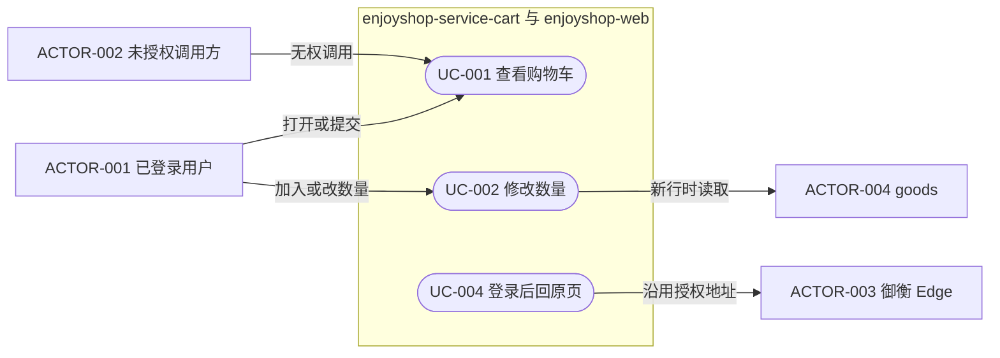
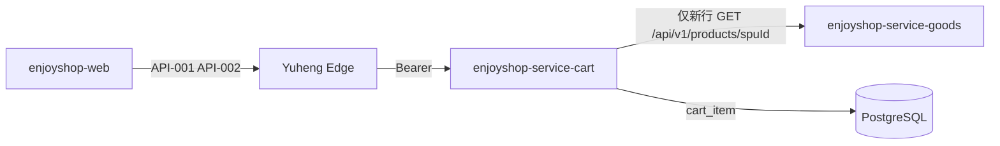
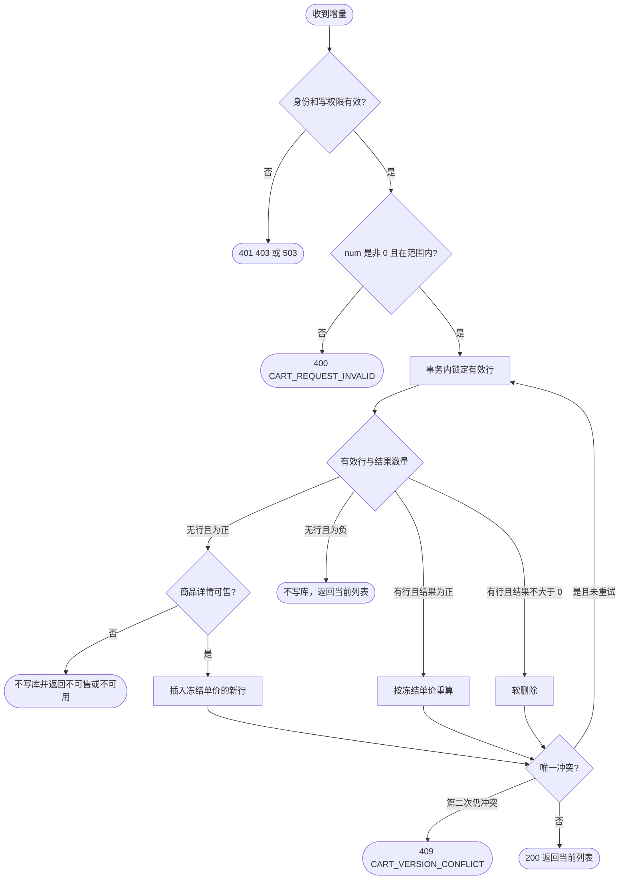
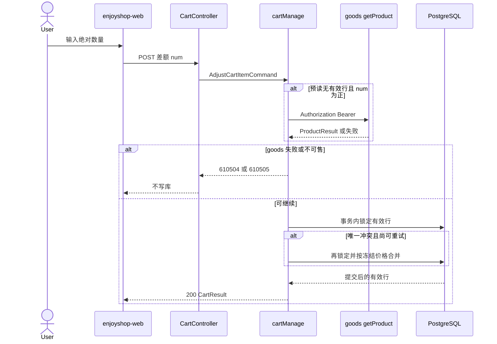
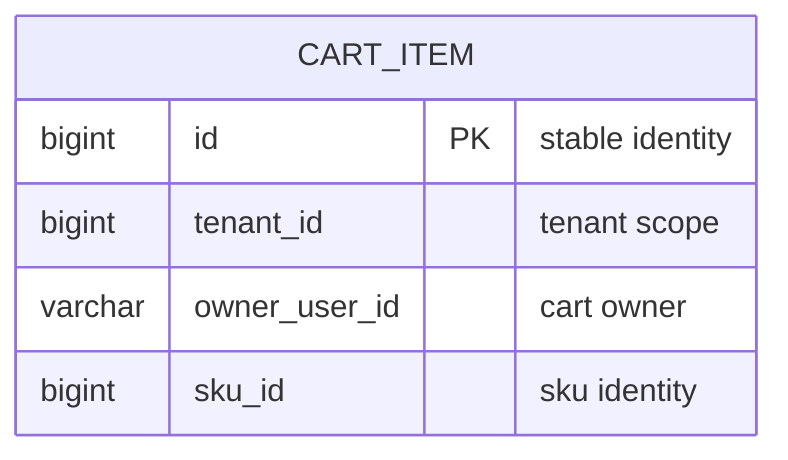

# 独立购物车模块

| Field | Value |
| --- | --- |
| Document | `2026-10-13-14-29-shopping-cart.md` |
| Template Version | `9` |
| Archetype Cleanup | `Required` |
| Status | `Review` |
| Type | `Feature` |
| Complexity | `Complex` |
| Complexity Drivers | 新的 Light 模块、登录后的购物车 HTTP、PostgreSQL 行合并、调用既有商品详情、网页回跳与并发改数量 |
| Created | `2026-10-13 14:29 CST` |
| Updated | `2026-10-13 14:39 CST` |
| Owner | mario |
| Repository | enjoyshop |
| Scope | `enjoyshop-service-cart` 与 `enjoyshop-web` 购物车页；不修改 goods 源码，不修改平台源码 |
| Change Surface | 在已生成的 Light 模块中删除学生样例并新增购物车表、两条 REST 和网页购物车；商品详情与 Edge 登录只复用 |
| Affected Chapters | `§7, §8, §9, §10, §11, §12, §13, §14, §15, §16` |
| Source Requirement | 用户要求按天猫登录后购物车实现购物车功能并先写规格；购物车必须是新模块，不能放进 goods |
| Baseline Revision | `e3ebe39` on main；工作区另有未提交的 `enjoyshop-service/pom.xml` 模块登记，以及未跟踪的 `enjoyshop-service/enjoyshop-service-cart` |
| Amends | `None` |
| Supersedes | `None` |
| Depends On | [目录权限与 Edge 登录](2026-10-13-11-06-catalog-permission-and-edge-login.md) §5、§7、§9、§12 |
| Related Specs | [商品生命周期](2026-10-09-10-55-product-management-lifecycle.md) |
| Related Plans | [购物车实现计划](../plan/2026-10-13-14-52-shopping-cart-implementation.md) |

## 1. Summary

已登录用户需要一个购物车：按 SKU 增加或减少数量、查看自己的行和合计。数量变化时沿用加入时记下的单价和单重，不重新取价。数量减到 0 或以下时删除该行。未登录访问走现有御衡 Edge 登录，登录后回到原来的页面。

购物车放在已经生成的 `enjoyshop-service-cart`，不放进 `enjoyshop-service-goods`。权威数据在 PostgreSQL。浏览器不提交价格。商品是否可售，由购物车服务端调用既有 `GET /api/v1/products/{spuId}` 决定。生成工程里的用户、课程、班级样例在第一条购物车业务被接受之前删除。

## 2. Background and Current State

### 2.1 Business and user context

目标行为来自天猫式购物车，而不是把教程工程复制进来。用户必须先登录。同一 SKU 已在购物车时，请求里的数量是有符号增量；结果不大于 0 就删除该行。列表返回行、总件数和总金额。教程页面上的勾选、收藏、下架清理、固定的“已节省”和结算页都不在本次范围。教程把输入框里的绝对数量再交给增量接口，本规格改为页面先算出差额。

### 2.2 Repository evidence

| Evidence ID | Classification | Exact path/symbol/decision/command | Observed fact | Design significance | Verification limit/freshness |
| --- | --- | --- | --- | --- | --- |
| `EVD-001` | Static repository | `enjoyshop-service/enjoyshop-service-cart/pom.xml` parent `egon-cola-archetypes-parent:5.4.1` | 2026-10-13 由 `egon-cola-archetype-light:5.4.1` 生成，包名 `top.egon.enjoyshop.cart`，描述仍是 Student management sample | 新模块已经存在，规格不能再手写一套工程，也不能改父 POM | 未运行该模块，未连接数据库 |
| `EVD-002` | Static repository | `enjoyshop-service/pom.xml` | 聚合 POM 已列入 `enjoyshop-service-cart`，与 `enjoyshop-service-goods` 并列 | 反应器登记已完成，后续只保持该行 | 相对 `e3ebe39` 这是未提交差异 |
| `EVD-003` | Static repository | `ProductController.getProduct`，`operationId` `getProduct` | `GET /api/v1/products/{spuId}` 返回 `ResultRecord<ProductResult>`，内含 `spu` 与 `skuList` | 不新增 SKU 查询接口；加入新行时服务端选中 SKU | 未调用运行中的 goods |
| `EVD-004` | Static repository | `SkuResult`、`SpuResult`、`ProductSearchItemResult` | SKU 有 `price`、`weight`、`status`、`name`、`image`；SPU 有三级类目、`status`、`isMarketable`；搜索卡片已有 `skuId` 与 `spuId` | 浏览器只提交这两个标识；价格以商品详情为准 | 静态字段，不是线上抽样 |
| `EVD-005` | Static repository | `NativeHttpSecurityConfiguration` 与 `ProductAuthorizationComponent` | 商品链匹配 `/api/v1/products/**`，先守兵再鉴身，`register-filter` 为 true 时抛 `IllegalStateException`；权限码 `enjoyshop:product:read`，系统码 `enjoyshop-goods` | 购物车复制这条链，使用自己的系统码和权限码，不改 goods | 未用真实令牌访问 |
| `EVD-006` | Static repository | `IdpBearerAuthenticationFilter.unauthorized` | 失败体只有 `code` 与 `message`，消息为 `Tianquan-Shoubing authentication failed`；无效令牌原因码来自校验结果，缺省 `JWT_INVALID` | 购物车不另做一套登录错误体 | 阅读的是平台源码，本次不修改平台 |
| `EVD-007` | Static repository | `GoodsErrorStatus` | 商品业务码占用 `610101` 到 `610499` | 购物车使用 `610501` 到 `610599` | 只证明源码中的枚举，不证明线上没有别的占用 |
| `EVD-008` | Static repository | `V20261009_001__initialize_product_schema.sql` | `deleted_at` 是 `TIMESTAMP(6) WITHOUT TIME ZONE`；有效行唯一用部分索引 `WHERE deleted_at IS NULL` | 购物车沿用 EgonModel 列，并用同样的部分唯一索引 | 未对购物车库执行 |
| `EVD-009` | Static repository | `enjoyshop-web/src/app.js`、`api.js`、`connection.js`、`pages/products.js`、`pages/search.js` | 哈希路由没有购物车；401 在 BFF 模式进入 `#/connection`；登录地址是 `/oauth2/authorization/{registrationId}`；空 registration 不跳转；商品页和搜索页已能看到 SKU | 不新做 Thymeleaf，不把令牌写入浏览器存储 | 未在浏览器里点击 |
| `EVD-010` | User decision | 本次及前序确认 | 必须登录；PostgreSQL 是权威库；Redis 不能当购物车账本；模块独立于 goods | 这些选择不再打开 | 不是运行时测量 |
| `EVD-011` | Static repository | 购物车工程 `src/main/java/.../user`、`teaching`、GraphQL、proto、样例 SQL | 生成物仍包含用户、角色、课程、班级控制器和对应表脚本；`ResponseWrapperHandler` 会把控制器返回值包进 `ApiResponse` | 第一条业务接受前必须删除或替换，否则购物车响应会被包两次 | 扫描限于该未跟踪目录，未启动进程 |

### 2.3 Problem statement and gap

仓库里没有购物车表、购物车接口或购物车页。商品服务已经能按 SPU 返回 SKU，网页也已经能登录，但两者都没有购物车。若把购物车放进 goods，会把订单前的个人数量和商品主数据写在同一个模块里，这与用户要求相反。生成出的 Light 工程又还是学生样例，不能把样例控制器留在购物车进程里。

### 2.4 Evidence and current-chain map

| Entry/trigger | Current call chain | Data read/written | External dependency | Consumers | Evidence |
| --- | --- | --- | --- | --- | --- |
| 打开商品或搜索 | `app.js` 到 `products.js` 或 `search.js`，再请求 goods | goods 读 SPU/SKU 或搜索索引；购物车无写入 | goods HTTP | 已登录运营页 | `EVD-003` `EVD-009` |
| 未登录业务 401 | `api.js` 把哈希改为 `#/connection`；按钮进入 Edge 授权地址 | 浏览器不保存访问令牌 | 御衡 Edge | 现有网页 | `EVD-009` 与目录权限规格 §12 |
| 生成模块启动 | `StudentManagementApplication` 扫描 user 与 teaching DAO；安全链 `anyRequest().permitAll()` | 样例 SQL 会建用户、课程、班级表 | 尚未部署 | 无购物车调用方 | `EVD-001` `EVD-011` |

### 2.5 Archetype example cleanup

Cleanup disposition: Required

Target project: `enjoyshop-service/enjoyshop-service-cart`，当前只有这一个生成模块

Origin evidence: `egon-cola-archetype-light:5.4.1`，父 POM `top.egon:egon-cola-archetypes-parent:5.4.1`，生成日志使用该版本；源码仍含 `UserController`、`CourseController` 与 `teaching_user_facade.proto`

Scan scope: All target modules

Scan evidence: 2026-10-13 对 `enjoyshop-service-cart` 做了源码、测试、GraphQL、proto、MyBatis XML、`db/egon-mp` 与 `db/migration/sharding` 路径扫描。没有启动进程，也没有查询真实的 `ddl_history`，因此样例 SQL 只能判定为未应用的生成脚本。 同日第二次按 import 扫描了 user 与 teaching 包之外的源码。仍引用样例类型的文件包括 `MqRouteEnum`、`LocalAdapterConfiguration`、`ExternalClientConfig`、`LightFacadeConverter`、`RpcIdQuery`、`DeletedStatus`、`BaseBusinessException`、`NativeHttpCompatibilityTest`、`LocalTransactionBoundaryTest` 和 `RepositoryPersistenceContractTest`。

| Example ID | Exact paths/symbols | Origin evidence | Action | Real-business requirement / infrastructure purpose | Incoming references/config/data handling | Acceptance evidence |
| --- | --- | --- | --- | --- | --- | --- |
| `EXAMPLE-001` | `enjoyshop-service/enjoyshop-service-cart/src/main/java/top/egon/enjoyshop/cart/adapter/user/controller/PermissionController.java`, `enjoyshop-service/enjoyshop-service-cart/src/main/java/top/egon/enjoyshop/cart/adapter/user/controller/RoleController.java`, `enjoyshop-service/enjoyshop-service-cart/src/main/java/top/egon/enjoyshop/cart/adapter/user/controller/UserController.java`, `enjoyshop-service/enjoyshop-service-cart/src/main/java/top/egon/enjoyshop/cart/adapter/user/controller/package-info.java`, `enjoyshop-service/enjoyshop-service-cart/src/main/java/top/egon/enjoyshop/cart/adapter/user/facade/impl/PermissionFacadeImpl.java`, `enjoyshop-service/enjoyshop-service-cart/src/main/java/top/egon/enjoyshop/cart/adapter/user/facade/impl/UserFacadeImpl.java`, `enjoyshop-service/enjoyshop-service-cart/src/main/java/top/egon/enjoyshop/cart/adapter/user/facade/impl/package-info.java`, `enjoyshop-service/enjoyshop-service-cart/src/main/java/top/egon/enjoyshop/cart/adapter/user/facade/package-info.java`, `enjoyshop-service/enjoyshop-service-cart/src/main/java/top/egon/enjoyshop/cart/adapter/user/graphql/UserResolver.java`, `enjoyshop-service/enjoyshop-service-cart/src/main/java/top/egon/enjoyshop/cart/adapter/user/graphql/package-info.java`, `enjoyshop-service/enjoyshop-service-cart/src/main/java/top/egon/enjoyshop/cart/adapter/user/mq/UserImportedConsumer.java`, `enjoyshop-service/enjoyshop-service-cart/src/main/java/top/egon/enjoyshop/cart/adapter/user/mq/package-info.java`, `enjoyshop-service/enjoyshop-service-cart/src/main/java/top/egon/enjoyshop/cart/adapter/user/package-info.java`, `enjoyshop-service/enjoyshop-service-cart/src/main/java/top/egon/enjoyshop/cart/adapter/user/pojo/convertor/UserAdapterConvertor.java`, `enjoyshop-service/enjoyshop-service-cart/src/main/java/top/egon/enjoyshop/cart/adapter/user/pojo/convertor/package-info.java`, `enjoyshop-service/enjoyshop-service-cart/src/main/java/top/egon/enjoyshop/cart/adapter/user/pojo/dto/AssignRoleRequest.java`, `enjoyshop-service/enjoyshop-service-cart/src/main/java/top/egon/enjoyshop/cart/adapter/user/pojo/dto/CreateUserRequest.java`, `enjoyshop-service/enjoyshop-service-cart/src/main/java/top/egon/enjoyshop/cart/adapter/user/pojo/dto/GrantPermissionRequest.java`, `enjoyshop-service/enjoyshop-service-cart/src/main/java/top/egon/enjoyshop/cart/adapter/user/pojo/dto/package-info.java`, `enjoyshop-service/enjoyshop-service-cart/src/main/java/top/egon/enjoyshop/cart/adapter/user/pojo/vo/PermissionTreeVO.java`, `enjoyshop-service/enjoyshop-service-cart/src/main/java/top/egon/enjoyshop/cart/adapter/user/pojo/vo/UserDetailVO.java`, `enjoyshop-service/enjoyshop-service-cart/src/main/java/top/egon/enjoyshop/cart/adapter/user/pojo/vo/package-info.java`, `enjoyshop-service/enjoyshop-service-cart/src/main/java/top/egon/enjoyshop/cart/adapter/user/validators/UserRequestValidator.java`, `enjoyshop-service/enjoyshop-service-cart/src/main/java/top/egon/enjoyshop/cart/adapter/user/validators/package-info.java`, `enjoyshop-service/enjoyshop-service-cart/src/main/java/top/egon/enjoyshop/cart/application/user/manage/PermissionManage.java`, `enjoyshop-service/enjoyshop-service-cart/src/main/java/top/egon/enjoyshop/cart/application/user/manage/RoleManage.java`, `enjoyshop-service/enjoyshop-service-cart/src/main/java/top/egon/enjoyshop/cart/application/user/manage/UserManage.java`, `enjoyshop-service/enjoyshop-service-cart/src/main/java/top/egon/enjoyshop/cart/application/user/manage/impl/PermissionManageImpl.java`, `enjoyshop-service/enjoyshop-service-cart/src/main/java/top/egon/enjoyshop/cart/application/user/manage/impl/RoleManageImpl.java`, `enjoyshop-service/enjoyshop-service-cart/src/main/java/top/egon/enjoyshop/cart/application/user/manage/impl/UserManageImpl.java`, `enjoyshop-service/enjoyshop-service-cart/src/main/java/top/egon/enjoyshop/cart/application/user/manage/impl/package-info.java`, `enjoyshop-service/enjoyshop-service-cart/src/main/java/top/egon/enjoyshop/cart/application/user/manage/package-info.java`, `enjoyshop-service/enjoyshop-service-cart/src/main/java/top/egon/enjoyshop/cart/application/user/package-info.java`, `enjoyshop-service/enjoyshop-service-cart/src/main/java/top/egon/enjoyshop/cart/application/user/pojo/command/AssignRoleCommand.java`, `enjoyshop-service/enjoyshop-service-cart/src/main/java/top/egon/enjoyshop/cart/application/user/pojo/command/CreateUserCommand.java`, `enjoyshop-service/enjoyshop-service-cart/src/main/java/top/egon/enjoyshop/cart/application/user/pojo/command/GrantPermissionCommand.java`, `enjoyshop-service/enjoyshop-service-cart/src/main/java/top/egon/enjoyshop/cart/application/user/pojo/command/package-info.java`, `enjoyshop-service/enjoyshop-service-cart/src/main/java/top/egon/enjoyshop/cart/application/user/pojo/convertor/UserApplicationConvertor.java`, `enjoyshop-service/enjoyshop-service-cart/src/main/java/top/egon/enjoyshop/cart/application/user/pojo/convertor/package-info.java`, `enjoyshop-service/enjoyshop-service-cart/src/main/java/top/egon/enjoyshop/cart/application/user/pojo/query/GetUserPermissionsQuery.java`, `enjoyshop-service/enjoyshop-service-cart/src/main/java/top/egon/enjoyshop/cart/application/user/pojo/query/GetUserQuery.java`, `enjoyshop-service/enjoyshop-service-cart/src/main/java/top/egon/enjoyshop/cart/application/user/pojo/query/package-info.java`, `enjoyshop-service/enjoyshop-service-cart/src/main/java/top/egon/enjoyshop/cart/application/user/pojo/result/PermissionDetailResult.java`, `enjoyshop-service/enjoyshop-service-cart/src/main/java/top/egon/enjoyshop/cart/application/user/pojo/result/PermissionResult.java`, `enjoyshop-service/enjoyshop-service-cart/src/main/java/top/egon/enjoyshop/cart/application/user/pojo/result/UserResult.java`, `enjoyshop-service/enjoyshop-service-cart/src/main/java/top/egon/enjoyshop/cart/application/user/pojo/result/package-info.java`, `enjoyshop-service/enjoyshop-service-cart/src/main/java/top/egon/enjoyshop/cart/application/user/validators/UserApplicationValidator.java`, `enjoyshop-service/enjoyshop-service-cart/src/main/java/top/egon/enjoyshop/cart/application/user/validators/package-info.java`, `enjoyshop-service/enjoyshop-service-cart/src/main/java/top/egon/enjoyshop/cart/common/exception/UserDomainException.java`, `enjoyshop-service/enjoyshop-service-cart/src/main/java/top/egon/enjoyshop/cart/common/exception/UserFacadeException.java`, `enjoyshop-service/enjoyshop-service-cart/src/main/java/top/egon/enjoyshop/cart/common/exception/UserUseCaseException.java`, `enjoyshop-service/enjoyshop-service-cart/src/main/java/top/egon/enjoyshop/cart/domain/user/aggregates/RolePermissionAggregate.java`, `enjoyshop-service/enjoyshop-service-cart/src/main/java/top/egon/enjoyshop/cart/domain/user/aggregates/UserAggregate.java`, `enjoyshop-service/enjoyshop-service-cart/src/main/java/top/egon/enjoyshop/cart/domain/user/aggregates/package-info.java`, `enjoyshop-service/enjoyshop-service-cart/src/main/java/top/egon/enjoyshop/cart/domain/user/entities/Permission.java`, `enjoyshop-service/enjoyshop-service-cart/src/main/java/top/egon/enjoyshop/cart/domain/user/entities/Role.java`, `enjoyshop-service/enjoyshop-service-cart/src/main/java/top/egon/enjoyshop/cart/domain/user/entities/User.java`, `enjoyshop-service/enjoyshop-service-cart/src/main/java/top/egon/enjoyshop/cart/domain/user/entities/package-info.java`, `enjoyshop-service/enjoyshop-service-cart/src/main/java/top/egon/enjoyshop/cart/domain/user/enums/PermissionStatus.java`, `enjoyshop-service/enjoyshop-service-cart/src/main/java/top/egon/enjoyshop/cart/domain/user/enums/RoleStatus.java`, `enjoyshop-service/enjoyshop-service-cart/src/main/java/top/egon/enjoyshop/cart/domain/user/enums/UserStatus.java`, `enjoyshop-service/enjoyshop-service-cart/src/main/java/top/egon/enjoyshop/cart/domain/user/enums/package-info.java`, `enjoyshop-service/enjoyshop-service-cart/src/main/java/top/egon/enjoyshop/cart/domain/user/package-info.java`, `enjoyshop-service/enjoyshop-service-cart/src/main/java/top/egon/enjoyshop/cart/domain/user/service/PermissionDomainService.java`, `enjoyshop-service/enjoyshop-service-cart/src/main/java/top/egon/enjoyshop/cart/domain/user/service/RoleDomainService.java`, `enjoyshop-service/enjoyshop-service-cart/src/main/java/top/egon/enjoyshop/cart/domain/user/service/UserDomainService.java`, `enjoyshop-service/enjoyshop-service-cart/src/main/java/top/egon/enjoyshop/cart/domain/user/service/UserEventService.java`, `enjoyshop-service/enjoyshop-service-cart/src/main/java/top/egon/enjoyshop/cart/domain/user/service/UserIdempotencyService.java`, `enjoyshop-service/enjoyshop-service-cart/src/main/java/top/egon/enjoyshop/cart/domain/user/service/UserQueryService.java`, `enjoyshop-service/enjoyshop-service-cart/src/main/java/top/egon/enjoyshop/cart/domain/user/service/package-info.java`, `enjoyshop-service/enjoyshop-service-cart/src/main/java/top/egon/enjoyshop/cart/domain/user/validators/UserDomainValidator.java`, `enjoyshop-service/enjoyshop-service-cart/src/main/java/top/egon/enjoyshop/cart/domain/user/validators/package-info.java`, `enjoyshop-service/enjoyshop-service-cart/src/main/java/top/egon/enjoyshop/cart/domain/user/vos/ExternalUser.java`, `enjoyshop-service/enjoyshop-service-cart/src/main/java/top/egon/enjoyshop/cart/domain/user/vos/PermissionCode.java`, `enjoyshop-service/enjoyshop-service-cart/src/main/java/top/egon/enjoyshop/cart/domain/user/vos/RoleCode.java`, `enjoyshop-service/enjoyshop-service-cart/src/main/java/top/egon/enjoyshop/cart/domain/user/vos/UserEvent.java`, `enjoyshop-service/enjoyshop-service-cart/src/main/java/top/egon/enjoyshop/cart/domain/user/vos/UserId.java`, `enjoyshop-service/enjoyshop-service-cart/src/main/java/top/egon/enjoyshop/cart/domain/user/vos/UserSnapshot.java`, `enjoyshop-service/enjoyshop-service-cart/src/main/java/top/egon/enjoyshop/cart/domain/user/vos/package-info.java`, `enjoyshop-service/enjoyshop-service-cart/src/main/java/top/egon/enjoyshop/cart/facade/user/PermissionFacade.java`, `enjoyshop-service/enjoyshop-service-cart/src/main/java/top/egon/enjoyshop/cart/facade/user/UserFacade.java`, `enjoyshop-service/enjoyshop-service-cart/src/main/java/top/egon/enjoyshop/cart/facade/user/dto/AssignRoleDTO.java`, `enjoyshop-service/enjoyshop-service-cart/src/main/java/top/egon/enjoyshop/cart/facade/user/dto/CreateUserDTO.java`, `enjoyshop-service/enjoyshop-service-cart/src/main/java/top/egon/enjoyshop/cart/facade/user/dto/GrantPermissionDTO.java`, `enjoyshop-service/enjoyshop-service-cart/src/main/java/top/egon/enjoyshop/cart/facade/user/dto/PermissionDTO.java`, `enjoyshop-service/enjoyshop-service-cart/src/main/java/top/egon/enjoyshop/cart/facade/user/dto/PermissionDetailDTO.java`, `enjoyshop-service/enjoyshop-service-cart/src/main/java/top/egon/enjoyshop/cart/facade/user/dto/UserDetailDTO.java`, `enjoyshop-service/enjoyshop-service-cart/src/main/java/top/egon/enjoyshop/cart/facade/user/dto/package-info.java`, `enjoyshop-service/enjoyshop-service-cart/src/main/java/top/egon/enjoyshop/cart/facade/user/enums/UserFacadeStatus.java`, `enjoyshop-service/enjoyshop-service-cart/src/main/java/top/egon/enjoyshop/cart/facade/user/enums/package-info.java`, `enjoyshop-service/enjoyshop-service-cart/src/main/java/top/egon/enjoyshop/cart/facade/user/package-info.java`, `enjoyshop-service/enjoyshop-service-cart/src/main/java/top/egon/enjoyshop/cart/facade/user/utils/UserFacadeAssert.java`, `enjoyshop-service/enjoyshop-service-cart/src/main/java/top/egon/enjoyshop/cart/facade/user/utils/package-info.java`, `enjoyshop-service/enjoyshop-service-cart/src/main/java/top/egon/enjoyshop/cart/infrastructure/user/client/UserQueryClient.java`, `enjoyshop-service/enjoyshop-service-cart/src/main/java/top/egon/enjoyshop/cart/infrastructure/user/client/impl/LocalUserQueryClientImpl.java`, `enjoyshop-service/enjoyshop-service-cart/src/main/java/top/egon/enjoyshop/cart/infrastructure/user/client/impl/RestUserQueryClientImpl.java`, `enjoyshop-service/enjoyshop-service-cart/src/main/java/top/egon/enjoyshop/cart/infrastructure/user/client/impl/package-info.java`, `enjoyshop-service/enjoyshop-service-cart/src/main/java/top/egon/enjoyshop/cart/infrastructure/user/client/package-info.java`, `enjoyshop-service/enjoyshop-service-cart/src/main/java/top/egon/enjoyshop/cart/infrastructure/user/converter/PermissionPOConverter.java`, `enjoyshop-service/enjoyshop-service-cart/src/main/java/top/egon/enjoyshop/cart/infrastructure/user/converter/RolePOConverter.java`, `enjoyshop-service/enjoyshop-service-cart/src/main/java/top/egon/enjoyshop/cart/infrastructure/user/converter/UserPOConverter.java`, `enjoyshop-service/enjoyshop-service-cart/src/main/java/top/egon/enjoyshop/cart/infrastructure/user/converter/package-info.java`, `enjoyshop-service/enjoyshop-service-cart/src/main/java/top/egon/enjoyshop/cart/infrastructure/user/dao/PermissionDAO.java`, `enjoyshop-service/enjoyshop-service-cart/src/main/java/top/egon/enjoyshop/cart/infrastructure/user/dao/RoleDAO.java`, `enjoyshop-service/enjoyshop-service-cart/src/main/java/top/egon/enjoyshop/cart/infrastructure/user/dao/RolePermissionDAO.java`, `enjoyshop-service/enjoyshop-service-cart/src/main/java/top/egon/enjoyshop/cart/infrastructure/user/dao/UserDAO.java`, `enjoyshop-service/enjoyshop-service-cart/src/main/java/top/egon/enjoyshop/cart/infrastructure/user/dao/UserRoleDAO.java`, `enjoyshop-service/enjoyshop-service-cart/src/main/java/top/egon/enjoyshop/cart/infrastructure/user/dao/package-info.java`, `enjoyshop-service/enjoyshop-service-cart/src/main/java/top/egon/enjoyshop/cart/infrastructure/user/package-info.java`, `enjoyshop-service/enjoyshop-service-cart/src/main/java/top/egon/enjoyshop/cart/infrastructure/user/po/PermissionPO.java`, `enjoyshop-service/enjoyshop-service-cart/src/main/java/top/egon/enjoyshop/cart/infrastructure/user/po/RolePO.java`, `enjoyshop-service/enjoyshop-service-cart/src/main/java/top/egon/enjoyshop/cart/infrastructure/user/po/RolePermissionPO.java`, `enjoyshop-service/enjoyshop-service-cart/src/main/java/top/egon/enjoyshop/cart/infrastructure/user/po/UserPO.java`, `enjoyshop-service/enjoyshop-service-cart/src/main/java/top/egon/enjoyshop/cart/infrastructure/user/po/UserRolePO.java`, `enjoyshop-service/enjoyshop-service-cart/src/main/java/top/egon/enjoyshop/cart/infrastructure/user/po/package-info.java`, `enjoyshop-service/enjoyshop-service-cart/src/main/java/top/egon/enjoyshop/cart/infrastructure/user/repo/PermissionRepository.java`, `enjoyshop-service/enjoyshop-service-cart/src/main/java/top/egon/enjoyshop/cart/infrastructure/user/repo/RolePermissionRepository.java`, `enjoyshop-service/enjoyshop-service-cart/src/main/java/top/egon/enjoyshop/cart/infrastructure/user/repo/RoleRepository.java`, `enjoyshop-service/enjoyshop-service-cart/src/main/java/top/egon/enjoyshop/cart/infrastructure/user/repo/UserRepository.java`, `enjoyshop-service/enjoyshop-service-cart/src/main/java/top/egon/enjoyshop/cart/infrastructure/user/repo/UserRoleRepository.java`, `enjoyshop-service/enjoyshop-service-cart/src/main/java/top/egon/enjoyshop/cart/infrastructure/user/repo/package-info.java`, `enjoyshop-service/enjoyshop-service-cart/src/main/java/top/egon/enjoyshop/cart/infrastructure/user/service/impl/PermissionDomainServiceImpl.java`, `enjoyshop-service/enjoyshop-service-cart/src/main/java/top/egon/enjoyshop/cart/infrastructure/user/service/impl/RoleDomainServiceImpl.java`, `enjoyshop-service/enjoyshop-service-cart/src/main/java/top/egon/enjoyshop/cart/infrastructure/user/service/impl/UserDomainServiceImpl.java`, `enjoyshop-service/enjoyshop-service-cart/src/main/java/top/egon/enjoyshop/cart/infrastructure/user/service/impl/UserEventServiceImpl.java`, `enjoyshop-service/enjoyshop-service-cart/src/main/java/top/egon/enjoyshop/cart/infrastructure/user/service/impl/UserIdempotencyServiceImpl.java`, `enjoyshop-service/enjoyshop-service-cart/src/main/java/top/egon/enjoyshop/cart/infrastructure/user/service/impl/UserQueryServiceImpl.java`, `enjoyshop-service/enjoyshop-service-cart/src/main/java/top/egon/enjoyshop/cart/infrastructure/user/service/impl/package-info.java`, `enjoyshop-service/enjoyshop-service-cart/src/main/java/top/egon/enjoyshop/cart/infrastructure/user/service/package-info.java`, `enjoyshop-service/enjoyshop-service-cart/src/main/java/top/egon/enjoyshop/cart/infrastructure/user/validators/UserInfrastructureValidator.java`, `enjoyshop-service/enjoyshop-service-cart/src/main/java/top/egon/enjoyshop/cart/infrastructure/user/validators/package-info.java`, `enjoyshop-service/enjoyshop-service-cart/src/test/java/top/egon/enjoyshop/cart/adapter/user/controller/PermissionControllerTest.java`, `enjoyshop-service/enjoyshop-service-cart/src/test/java/top/egon/enjoyshop/cart/adapter/user/controller/RoleControllerTest.java`, `enjoyshop-service/enjoyshop-service-cart/src/test/java/top/egon/enjoyshop/cart/adapter/user/controller/UserControllerTest.java`, `enjoyshop-service/enjoyshop-service-cart/src/test/java/top/egon/enjoyshop/cart/adapter/user/facade/UserFacadeImplTest.java`, `enjoyshop-service/enjoyshop-service-cart/src/test/java/top/egon/enjoyshop/cart/adapter/user/graphql/UserResolverTest.java`, `enjoyshop-service/enjoyshop-service-cart/src/test/java/top/egon/enjoyshop/cart/adapter/user/mq/UserImportedConsumerTest.java`, `enjoyshop-service/enjoyshop-service-cart/src/test/java/top/egon/enjoyshop/cart/application/user/manage/PermissionManageTest.java`, `enjoyshop-service/enjoyshop-service-cart/src/test/java/top/egon/enjoyshop/cart/application/user/manage/RoleManageTest.java`, `enjoyshop-service/enjoyshop-service-cart/src/test/java/top/egon/enjoyshop/cart/application/user/manage/UserManageTest.java`, `enjoyshop-service/enjoyshop-service-cart/src/test/java/top/egon/enjoyshop/cart/application/user/validators/UserApplicationValidatorTest.java`, `enjoyshop-service/enjoyshop-service-cart/src/test/java/top/egon/enjoyshop/cart/domain/user/aggregates/RolePermissionAggregateTest.java`, `enjoyshop-service/enjoyshop-service-cart/src/test/java/top/egon/enjoyshop/cart/domain/user/aggregates/UserAggregateTest.java`, `enjoyshop-service/enjoyshop-service-cart/src/test/java/top/egon/enjoyshop/cart/infrastructure/user/client/RestUserQueryClientImplTest.java`, `enjoyshop-service/enjoyshop-service-cart/src/test/java/top/egon/enjoyshop/cart/infrastructure/user/service/UserEventServiceImplTest.java`, `enjoyshop-service/enjoyshop-service-cart/src/test/java/top/egon/enjoyshop/cart/infrastructure/user/validators/UserInfrastructureValidatorTest.java` | Light 5.4.1 用户样例 | Delete | 删除用户样例生产代码与测试，REQ-020 | `StudentManagementApplication` 扫描 `infrastructure.user.dao`；`UserController` 暴露 `/api/users` | TEST-020 |
| `EXAMPLE-002` | `enjoyshop-service/enjoyshop-service-cart/src/main/java/top/egon/enjoyshop/cart/adapter/teaching/controller/CourseController.java`, `enjoyshop-service/enjoyshop-service-cart/src/main/java/top/egon/enjoyshop/cart/adapter/teaching/controller/SchoolClassController.java`, `enjoyshop-service/enjoyshop-service-cart/src/main/java/top/egon/enjoyshop/cart/adapter/teaching/controller/package-info.java`, `enjoyshop-service/enjoyshop-service-cart/src/main/java/top/egon/enjoyshop/cart/adapter/teaching/facade/impl/CourseFacadeImpl.java`, `enjoyshop-service/enjoyshop-service-cart/src/main/java/top/egon/enjoyshop/cart/adapter/teaching/facade/impl/SchoolClassFacadeImpl.java`, `enjoyshop-service/enjoyshop-service-cart/src/main/java/top/egon/enjoyshop/cart/adapter/teaching/facade/impl/package-info.java`, `enjoyshop-service/enjoyshop-service-cart/src/main/java/top/egon/enjoyshop/cart/adapter/teaching/facade/package-info.java`, `enjoyshop-service/enjoyshop-service-cart/src/main/java/top/egon/enjoyshop/cart/adapter/teaching/graphql/CourseResolver.java`, `enjoyshop-service/enjoyshop-service-cart/src/main/java/top/egon/enjoyshop/cart/adapter/teaching/graphql/package-info.java`, `enjoyshop-service/enjoyshop-service-cart/src/main/java/top/egon/enjoyshop/cart/adapter/teaching/mq/CourseImportedConsumer.java`, `enjoyshop-service/enjoyshop-service-cart/src/main/java/top/egon/enjoyshop/cart/adapter/teaching/mq/package-info.java`, `enjoyshop-service/enjoyshop-service-cart/src/main/java/top/egon/enjoyshop/cart/adapter/teaching/package-info.java`, `enjoyshop-service/enjoyshop-service-cart/src/main/java/top/egon/enjoyshop/cart/adapter/teaching/pojo/convertor/TeachingAdapterConvertor.java`, `enjoyshop-service/enjoyshop-service-cart/src/main/java/top/egon/enjoyshop/cart/adapter/teaching/pojo/convertor/package-info.java`, `enjoyshop-service/enjoyshop-service-cart/src/main/java/top/egon/enjoyshop/cart/adapter/teaching/pojo/dto/CreateCourseRequest.java`, `enjoyshop-service/enjoyshop-service-cart/src/main/java/top/egon/enjoyshop/cart/adapter/teaching/pojo/dto/CreateSchoolClassRequest.java`, `enjoyshop-service/enjoyshop-service-cart/src/main/java/top/egon/enjoyshop/cart/adapter/teaching/pojo/dto/ScheduleCourseRequest.java`, `enjoyshop-service/enjoyshop-service-cart/src/main/java/top/egon/enjoyshop/cart/adapter/teaching/pojo/dto/package-info.java`, `enjoyshop-service/enjoyshop-service-cart/src/main/java/top/egon/enjoyshop/cart/adapter/teaching/pojo/vo/CourseDetailVO.java`, `enjoyshop-service/enjoyshop-service-cart/src/main/java/top/egon/enjoyshop/cart/adapter/teaching/pojo/vo/SchoolClassDetailVO.java`, `enjoyshop-service/enjoyshop-service-cart/src/main/java/top/egon/enjoyshop/cart/adapter/teaching/pojo/vo/package-info.java`, `enjoyshop-service/enjoyshop-service-cart/src/main/java/top/egon/enjoyshop/cart/adapter/teaching/validators/TeachingRequestValidator.java`, `enjoyshop-service/enjoyshop-service-cart/src/main/java/top/egon/enjoyshop/cart/adapter/teaching/validators/package-info.java`, `enjoyshop-service/enjoyshop-service-cart/src/main/java/top/egon/enjoyshop/cart/application/teaching/manage/CourseManage.java`, `enjoyshop-service/enjoyshop-service-cart/src/main/java/top/egon/enjoyshop/cart/application/teaching/manage/SchoolClassManage.java`, `enjoyshop-service/enjoyshop-service-cart/src/main/java/top/egon/enjoyshop/cart/application/teaching/manage/impl/CourseManageImpl.java`, `enjoyshop-service/enjoyshop-service-cart/src/main/java/top/egon/enjoyshop/cart/application/teaching/manage/impl/SchoolClassManageImpl.java`, `enjoyshop-service/enjoyshop-service-cart/src/main/java/top/egon/enjoyshop/cart/application/teaching/manage/impl/package-info.java`, `enjoyshop-service/enjoyshop-service-cart/src/main/java/top/egon/enjoyshop/cart/application/teaching/manage/package-info.java`, `enjoyshop-service/enjoyshop-service-cart/src/main/java/top/egon/enjoyshop/cart/application/teaching/package-info.java`, `enjoyshop-service/enjoyshop-service-cart/src/main/java/top/egon/enjoyshop/cart/application/teaching/pojo/command/CreateCourseCommand.java`, `enjoyshop-service/enjoyshop-service-cart/src/main/java/top/egon/enjoyshop/cart/application/teaching/pojo/command/CreateSchoolClassCommand.java`, `enjoyshop-service/enjoyshop-service-cart/src/main/java/top/egon/enjoyshop/cart/application/teaching/pojo/command/ScheduleCourseCommand.java`, `enjoyshop-service/enjoyshop-service-cart/src/main/java/top/egon/enjoyshop/cart/application/teaching/pojo/command/package-info.java`, `enjoyshop-service/enjoyshop-service-cart/src/main/java/top/egon/enjoyshop/cart/application/teaching/pojo/convertor/TeachingApplicationConvertor.java`, `enjoyshop-service/enjoyshop-service-cart/src/main/java/top/egon/enjoyshop/cart/application/teaching/pojo/convertor/package-info.java`, `enjoyshop-service/enjoyshop-service-cart/src/main/java/top/egon/enjoyshop/cart/application/teaching/pojo/query/GetCourseQuery.java`, `enjoyshop-service/enjoyshop-service-cart/src/main/java/top/egon/enjoyshop/cart/application/teaching/pojo/query/GetSchoolClassQuery.java`, `enjoyshop-service/enjoyshop-service-cart/src/main/java/top/egon/enjoyshop/cart/application/teaching/pojo/query/package-info.java`, `enjoyshop-service/enjoyshop-service-cart/src/main/java/top/egon/enjoyshop/cart/application/teaching/pojo/result/CourseResult.java`, `enjoyshop-service/enjoyshop-service-cart/src/main/java/top/egon/enjoyshop/cart/application/teaching/pojo/result/SchoolClassResult.java`, `enjoyshop-service/enjoyshop-service-cart/src/main/java/top/egon/enjoyshop/cart/application/teaching/pojo/result/package-info.java`, `enjoyshop-service/enjoyshop-service-cart/src/main/java/top/egon/enjoyshop/cart/application/teaching/validators/TeachingApplicationValidator.java`, `enjoyshop-service/enjoyshop-service-cart/src/main/java/top/egon/enjoyshop/cart/application/teaching/validators/package-info.java`, `enjoyshop-service/enjoyshop-service-cart/src/main/java/top/egon/enjoyshop/cart/common/exception/TeachingDomainException.java`, `enjoyshop-service/enjoyshop-service-cart/src/main/java/top/egon/enjoyshop/cart/common/exception/TeachingFacadeException.java`, `enjoyshop-service/enjoyshop-service-cart/src/main/java/top/egon/enjoyshop/cart/common/exception/TeachingUseCaseException.java`, `enjoyshop-service/enjoyshop-service-cart/src/main/java/top/egon/enjoyshop/cart/domain/teaching/aggregates/CourseAggregate.java`, `enjoyshop-service/enjoyshop-service-cart/src/main/java/top/egon/enjoyshop/cart/domain/teaching/aggregates/SchoolClassAggregate.java`, `enjoyshop-service/enjoyshop-service-cart/src/main/java/top/egon/enjoyshop/cart/domain/teaching/aggregates/package-info.java`, `enjoyshop-service/enjoyshop-service-cart/src/main/java/top/egon/enjoyshop/cart/domain/teaching/entities/Course.java`, `enjoyshop-service/enjoyshop-service-cart/src/main/java/top/egon/enjoyshop/cart/domain/teaching/entities/SchoolClass.java`, `enjoyshop-service/enjoyshop-service-cart/src/main/java/top/egon/enjoyshop/cart/domain/teaching/entities/package-info.java`, `enjoyshop-service/enjoyshop-service-cart/src/main/java/top/egon/enjoyshop/cart/domain/teaching/enums/CourseStatus.java`, `enjoyshop-service/enjoyshop-service-cart/src/main/java/top/egon/enjoyshop/cart/domain/teaching/enums/SchoolClassStatus.java`, `enjoyshop-service/enjoyshop-service-cart/src/main/java/top/egon/enjoyshop/cart/domain/teaching/enums/package-info.java`, `enjoyshop-service/enjoyshop-service-cart/src/main/java/top/egon/enjoyshop/cart/domain/teaching/package-info.java`, `enjoyshop-service/enjoyshop-service-cart/src/main/java/top/egon/enjoyshop/cart/domain/teaching/service/CourseDomainService.java`, `enjoyshop-service/enjoyshop-service-cart/src/main/java/top/egon/enjoyshop/cart/domain/teaching/service/CourseIdempotencyService.java`, `enjoyshop-service/enjoyshop-service-cart/src/main/java/top/egon/enjoyshop/cart/domain/teaching/service/SchoolClassDomainService.java`, `enjoyshop-service/enjoyshop-service-cart/src/main/java/top/egon/enjoyshop/cart/domain/teaching/service/TeachingEventService.java`, `enjoyshop-service/enjoyshop-service-cart/src/main/java/top/egon/enjoyshop/cart/domain/teaching/service/TeachingQueryService.java`, `enjoyshop-service/enjoyshop-service-cart/src/main/java/top/egon/enjoyshop/cart/domain/teaching/service/package-info.java`, `enjoyshop-service/enjoyshop-service-cart/src/main/java/top/egon/enjoyshop/cart/domain/teaching/validators/TeachingDomainValidator.java`, `enjoyshop-service/enjoyshop-service-cart/src/main/java/top/egon/enjoyshop/cart/domain/teaching/validators/package-info.java`, `enjoyshop-service/enjoyshop-service-cart/src/main/java/top/egon/enjoyshop/cart/domain/teaching/vos/CourseCode.java`, `enjoyshop-service/enjoyshop-service-cart/src/main/java/top/egon/enjoyshop/cart/domain/teaching/vos/CourseSchedule.java`, `enjoyshop-service/enjoyshop-service-cart/src/main/java/top/egon/enjoyshop/cart/domain/teaching/vos/CourseSnapshot.java`, `enjoyshop-service/enjoyshop-service-cart/src/main/java/top/egon/enjoyshop/cart/domain/teaching/vos/ExternalCourse.java`, `enjoyshop-service/enjoyshop-service-cart/src/main/java/top/egon/enjoyshop/cart/domain/teaching/vos/SchoolClassId.java`, `enjoyshop-service/enjoyshop-service-cart/src/main/java/top/egon/enjoyshop/cart/domain/teaching/vos/Semester.java`, `enjoyshop-service/enjoyshop-service-cart/src/main/java/top/egon/enjoyshop/cart/domain/teaching/vos/TeachingEvent.java`, `enjoyshop-service/enjoyshop-service-cart/src/main/java/top/egon/enjoyshop/cart/domain/teaching/vos/package-info.java`, `enjoyshop-service/enjoyshop-service-cart/src/main/java/top/egon/enjoyshop/cart/facade/teaching/CourseFacade.java`, `enjoyshop-service/enjoyshop-service-cart/src/main/java/top/egon/enjoyshop/cart/facade/teaching/SchoolClassFacade.java`, `enjoyshop-service/enjoyshop-service-cart/src/main/java/top/egon/enjoyshop/cart/facade/teaching/dto/CourseDTO.java`, `enjoyshop-service/enjoyshop-service-cart/src/main/java/top/egon/enjoyshop/cart/facade/teaching/dto/CreateCourseDTO.java`, `enjoyshop-service/enjoyshop-service-cart/src/main/java/top/egon/enjoyshop/cart/facade/teaching/dto/CreateSchoolClassDTO.java`, `enjoyshop-service/enjoyshop-service-cart/src/main/java/top/egon/enjoyshop/cart/facade/teaching/dto/ScheduleCourseDTO.java`, `enjoyshop-service/enjoyshop-service-cart/src/main/java/top/egon/enjoyshop/cart/facade/teaching/dto/SchoolClassDetailDTO.java`, `enjoyshop-service/enjoyshop-service-cart/src/main/java/top/egon/enjoyshop/cart/facade/teaching/dto/package-info.java`, `enjoyshop-service/enjoyshop-service-cart/src/main/java/top/egon/enjoyshop/cart/facade/teaching/enums/CourseFacadeStatus.java`, `enjoyshop-service/enjoyshop-service-cart/src/main/java/top/egon/enjoyshop/cart/facade/teaching/enums/package-info.java`, `enjoyshop-service/enjoyshop-service-cart/src/main/java/top/egon/enjoyshop/cart/facade/teaching/package-info.java`, `enjoyshop-service/enjoyshop-service-cart/src/main/java/top/egon/enjoyshop/cart/facade/teaching/utils/TeachingFacadeAssert.java`, `enjoyshop-service/enjoyshop-service-cart/src/main/java/top/egon/enjoyshop/cart/facade/teaching/utils/package-info.java`, `enjoyshop-service/enjoyshop-service-cart/src/main/java/top/egon/enjoyshop/cart/infrastructure/teaching/client/TeachingQueryClient.java`, `enjoyshop-service/enjoyshop-service-cart/src/main/java/top/egon/enjoyshop/cart/infrastructure/teaching/client/impl/LocalTeachingQueryClientImpl.java`, `enjoyshop-service/enjoyshop-service-cart/src/main/java/top/egon/enjoyshop/cart/infrastructure/teaching/client/impl/RestTeachingQueryClientImpl.java`, `enjoyshop-service/enjoyshop-service-cart/src/main/java/top/egon/enjoyshop/cart/infrastructure/teaching/client/impl/package-info.java`, `enjoyshop-service/enjoyshop-service-cart/src/main/java/top/egon/enjoyshop/cart/infrastructure/teaching/client/package-info.java`, `enjoyshop-service/enjoyshop-service-cart/src/main/java/top/egon/enjoyshop/cart/infrastructure/teaching/converter/CoursePOConverter.java`, `enjoyshop-service/enjoyshop-service-cart/src/main/java/top/egon/enjoyshop/cart/infrastructure/teaching/converter/SchoolClassPOConverter.java`, `enjoyshop-service/enjoyshop-service-cart/src/main/java/top/egon/enjoyshop/cart/infrastructure/teaching/converter/package-info.java`, `enjoyshop-service/enjoyshop-service-cart/src/main/java/top/egon/enjoyshop/cart/infrastructure/teaching/dao/ClassCourseScheduleDAO.java`, `enjoyshop-service/enjoyshop-service-cart/src/main/java/top/egon/enjoyshop/cart/infrastructure/teaching/dao/CourseDAO.java`, `enjoyshop-service/enjoyshop-service-cart/src/main/java/top/egon/enjoyshop/cart/infrastructure/teaching/dao/SchoolClassDAO.java`, `enjoyshop-service/enjoyshop-service-cart/src/main/java/top/egon/enjoyshop/cart/infrastructure/teaching/dao/package-info.java`, `enjoyshop-service/enjoyshop-service-cart/src/main/java/top/egon/enjoyshop/cart/infrastructure/teaching/package-info.java`, `enjoyshop-service/enjoyshop-service-cart/src/main/java/top/egon/enjoyshop/cart/infrastructure/teaching/po/ClassCourseSchedulePO.java`, `enjoyshop-service/enjoyshop-service-cart/src/main/java/top/egon/enjoyshop/cart/infrastructure/teaching/po/CoursePO.java`, `enjoyshop-service/enjoyshop-service-cart/src/main/java/top/egon/enjoyshop/cart/infrastructure/teaching/po/SchoolClassPO.java`, `enjoyshop-service/enjoyshop-service-cart/src/main/java/top/egon/enjoyshop/cart/infrastructure/teaching/po/package-info.java`, `enjoyshop-service/enjoyshop-service-cart/src/main/java/top/egon/enjoyshop/cart/infrastructure/teaching/repo/ClassCourseScheduleRepository.java`, `enjoyshop-service/enjoyshop-service-cart/src/main/java/top/egon/enjoyshop/cart/infrastructure/teaching/repo/CourseRepository.java`, `enjoyshop-service/enjoyshop-service-cart/src/main/java/top/egon/enjoyshop/cart/infrastructure/teaching/repo/SchoolClassRepository.java`, `enjoyshop-service/enjoyshop-service-cart/src/main/java/top/egon/enjoyshop/cart/infrastructure/teaching/repo/package-info.java`, `enjoyshop-service/enjoyshop-service-cart/src/main/java/top/egon/enjoyshop/cart/infrastructure/teaching/service/impl/CourseDomainServiceImpl.java`, `enjoyshop-service/enjoyshop-service-cart/src/main/java/top/egon/enjoyshop/cart/infrastructure/teaching/service/impl/CourseIdempotencyServiceImpl.java`, `enjoyshop-service/enjoyshop-service-cart/src/main/java/top/egon/enjoyshop/cart/infrastructure/teaching/service/impl/SchoolClassDomainServiceImpl.java`, `enjoyshop-service/enjoyshop-service-cart/src/main/java/top/egon/enjoyshop/cart/infrastructure/teaching/service/impl/TeachingEventServiceImpl.java`, `enjoyshop-service/enjoyshop-service-cart/src/main/java/top/egon/enjoyshop/cart/infrastructure/teaching/service/impl/TeachingQueryServiceImpl.java`, `enjoyshop-service/enjoyshop-service-cart/src/main/java/top/egon/enjoyshop/cart/infrastructure/teaching/service/impl/package-info.java`, `enjoyshop-service/enjoyshop-service-cart/src/main/java/top/egon/enjoyshop/cart/infrastructure/teaching/service/package-info.java`, `enjoyshop-service/enjoyshop-service-cart/src/main/java/top/egon/enjoyshop/cart/infrastructure/teaching/validators/TeachingInfrastructureValidator.java`, `enjoyshop-service/enjoyshop-service-cart/src/main/java/top/egon/enjoyshop/cart/infrastructure/teaching/validators/package-info.java`, `enjoyshop-service/enjoyshop-service-cart/src/test/java/top/egon/enjoyshop/cart/adapter/teaching/controller/CourseControllerTest.java`, `enjoyshop-service/enjoyshop-service-cart/src/test/java/top/egon/enjoyshop/cart/adapter/teaching/controller/SchoolClassControllerTest.java`, `enjoyshop-service/enjoyshop-service-cart/src/test/java/top/egon/enjoyshop/cart/adapter/teaching/facade/TeachingFacadeImplTest.java`, `enjoyshop-service/enjoyshop-service-cart/src/test/java/top/egon/enjoyshop/cart/adapter/teaching/graphql/CourseResolverTest.java`, `enjoyshop-service/enjoyshop-service-cart/src/test/java/top/egon/enjoyshop/cart/adapter/teaching/mq/CourseImportedConsumerTest.java`, `enjoyshop-service/enjoyshop-service-cart/src/test/java/top/egon/enjoyshop/cart/application/teaching/manage/CourseManageTest.java`, `enjoyshop-service/enjoyshop-service-cart/src/test/java/top/egon/enjoyshop/cart/application/teaching/manage/SchoolClassManageTest.java`, `enjoyshop-service/enjoyshop-service-cart/src/test/java/top/egon/enjoyshop/cart/application/teaching/validators/TeachingApplicationValidatorTest.java`, `enjoyshop-service/enjoyshop-service-cart/src/test/java/top/egon/enjoyshop/cart/domain/teaching/aggregates/SchoolClassAggregateTest.java`, `enjoyshop-service/enjoyshop-service-cart/src/test/java/top/egon/enjoyshop/cart/infrastructure/teaching/client/RestTeachingQueryClientImplTest.java`, `enjoyshop-service/enjoyshop-service-cart/src/test/java/top/egon/enjoyshop/cart/infrastructure/teaching/service/TeachingEventServiceImplTest.java`, `enjoyshop-service/enjoyshop-service-cart/src/test/java/top/egon/enjoyshop/cart/infrastructure/teaching/validators/TeachingInfrastructureValidatorTest.java` | Light 5.4.1 教学样例 | Delete | 删除课程与班级样例生产代码与测试，REQ-020 | `CourseController`、`SchoolClassController` 与教学 DAO 扫描 | TEST-020 |
| `EXAMPLE-003` | `enjoyshop-service/enjoyshop-service-cart/src/main/proto/teaching_user_facade.proto`, `enjoyshop-service/enjoyshop-service-cart/src/main/resources/graphql/teaching.graphqls`, `enjoyshop-service/enjoyshop-service-cart/src/main/resources/graphql/user.graphqls`, `enjoyshop-service/enjoyshop-service-cart/src/main/resources/mybatis/mapper/teaching/ClassCourseScheduleDAO.xml`, `enjoyshop-service/enjoyshop-service-cart/src/main/resources/mybatis/mapper/teaching/CourseDAO.xml`, `enjoyshop-service/enjoyshop-service-cart/src/main/resources/mybatis/mapper/teaching/SchoolClassDAO.xml`, `enjoyshop-service/enjoyshop-service-cart/src/main/resources/mybatis/mapper/user/PermissionDAO.xml`, `enjoyshop-service/enjoyshop-service-cart/src/main/resources/mybatis/mapper/user/RoleDAO.xml`, `enjoyshop-service/enjoyshop-service-cart/src/main/resources/mybatis/mapper/user/RolePermissionDAO.xml`, `enjoyshop-service/enjoyshop-service-cart/src/main/resources/mybatis/mapper/user/UserDAO.xml`, `enjoyshop-service/enjoyshop-service-cart/src/main/resources/mybatis/mapper/user/UserRoleDAO.xml` | 样例 GraphQL、proto 与 Mapper XML | Delete | 删除样例契约与 SQL 映射，REQ-020 | `spring-boot-starter-graphql` 与 protobuf 插件会装载这些资源 | TEST-020 |
| `EXAMPLE-004` | `enjoyshop-service/enjoyshop-service-cart/src/main/java/top/egon/enjoyshop/cart/adapter/handler/ApiResponse.java`, `enjoyshop-service/enjoyshop-service-cart/src/main/java/top/egon/enjoyshop/cart/adapter/handler/GlobalExceptionHandler.java`, `enjoyshop-service/enjoyshop-service-cart/src/main/java/top/egon/enjoyshop/cart/adapter/handler/GraphQlExceptionResolver.java`, `enjoyshop-service/enjoyshop-service-cart/src/main/java/top/egon/enjoyshop/cart/adapter/handler/ResponseWrapperHandler.java`, `enjoyshop-service/enjoyshop-service-cart/src/test/java/top/egon/enjoyshop/cart/adapter/handler/GlobalExceptionHandlerTest.java`, `enjoyshop-service/enjoyshop-service-cart/src/test/java/top/egon/enjoyshop/cart/adapter/handler/GraphQlExceptionResolverTest.java`, `enjoyshop-service/enjoyshop-service-cart/src/test/java/top/egon/enjoyshop/cart/adapter/handler/ResponseWrapperHandlerTest.java` | 样例响应包装 | Delete | 删除 `ApiResponse` 包装，避免包住 `ResultRecord`，REQ-020 | `ResponseWrapperHandler` 的 `@ControllerAdvice` 作用于 `adapter` 包 | TEST-020 |
| `EXAMPLE-005` | `enjoyshop-service/enjoyshop-service-cart/src/main/resources/db/migration/sharding/master-data/B20260825_001__baseline_light_master_data_schema.sql`, `enjoyshop-service/enjoyshop-service-cart/src/main/resources/db/migration/sharding/master-data/V20260726_001__init_light_master_data_schema.sql`, `enjoyshop-service/enjoyshop-service-cart/src/main/resources/db/migration/sharding/master-data/V20260825_001__migrate_light_master_data_to_egon_model.sql`, `enjoyshop-service/enjoyshop-service-cart/src/main/resources/db/migration/sharding/shard/B20260825_002__baseline_light_sharded_schema.sql`, `enjoyshop-service/enjoyshop-service-cart/src/main/resources/db/migration/sharding/shard/V20260726_002__init_light_sharded_schema.sql`, `enjoyshop-service/enjoyshop-service-cart/src/main/resources/db/migration/sharding/shard/V20260825_002__migrate_light_sharded_to_tenant_model.sql` | 未应用的分片样例迁移 | Delete | 删除用户、课程、班级分片脚本，避免首启建样例表，REQ-020 | `FlywayMigrationConventionTest` 点名这些文件；本模块没有已应用记录 | TEST-020 |
| `EXAMPLE-006` | `enjoyshop-service/enjoyshop-service-cart/src/main/resources/db/egon-mp/V20260913_001__initialize_repository_schema.sql` | 同一生成脚本，含样例表和文末 `ddl_history` | Replace | 只保留 `ddl_history`，去掉样例业务表，REQ-020 | `repository-manifest.json` 现有 SHA-256 必须随文件一起更新；首启前没有应用记录 | TEST-021 |
| `EXAMPLE-007` | `enjoyshop-service/enjoyshop-service-cart/src/main/java/top/egon/enjoyshop/cart/start/config/NativeRpcConfiguration.java`, `enjoyshop-service/enjoyshop-service-cart/src/test/java/top/egon/enjoyshop/cart/start/config/NativeRpcConfigurationTest.java`, `enjoyshop-service/enjoyshop-service-cart/src/test/java/top/egon/enjoyshop/cart/adapter/NativeRpcProviderTest.java`, `enjoyshop-service/enjoyshop-service-cart/src/test/java/top/egon/enjoyshop/cart/facade/NativeRpcContractTest.java`, `enjoyshop-service/enjoyshop-service-cart/src/test/java/top/egon/enjoyshop/cart/facade/NativeRpcMappingTest.java`, `enjoyshop-service/enjoyshop-service-cart/pom.xml` | 样例 RPC Provider | Replace | 去掉教学与用户 RPC 实现，保留校验 Bean，REQ-020 | 去掉 `lightFacadeConverter` Bean，并删除 POM 里的 `LightFacadeConverterImpl` 包登记。proto 删除后这些测试不能再引用 `teaching_user_facade.proto`。若继承的 protobuf 插件在没有 proto 时构建失败，在本模块 POM 跳过该插件的生成目标，不恢复样例 proto | TEST-020 |
| `EXAMPLE-008` | `enjoyshop-service/enjoyshop-service-cart/src/test/java/top/egon/enjoyshop/cart/architecture/ArchetypeContractConvergenceTest.java`, `enjoyshop-service/enjoyshop-service-cart/src/test/java/top/egon/enjoyshop/cart/architecture/LightPersistenceArchitectureTest.java`, `enjoyshop-service/enjoyshop-service-cart/src/test/java/top/egon/enjoyshop/cart/infrastructure/migration/FlywayMigrationConventionTest.java`, `enjoyshop-service/enjoyshop-service-cart/src/test/resources/mybatis/h2-schema.sql`, `enjoyshop-service/enjoyshop-service-cart/src/test/java/top/egon/enjoyshop/cart/application/transaction/LocalTransactionBoundaryTest.java`, `enjoyshop-service/enjoyshop-service-cart/src/test/java/top/egon/enjoyshop/cart/start/config/NativeHttpCompatibilityTest.java`, `enjoyshop-service/enjoyshop-service-cart/src/test/java/top/egon/enjoyshop/cart/infrastructure/config/datasource/RepositoryPersistenceContractTest.java` | 样例架构与迁移断言 | Replace | 断言改为购物车边界，不再要求用户或课程类型，REQ-020 | 这些测试直接读取样例类、样例 SQL、H2 用户表、`/api/users` 和 `CourseRepository`。替换后只断言购物车 Manage、`/api/v1/cart` 和 `cart_item` | TEST-020 TEST-021 |
| `EXAMPLE-009` | `enjoyshop-service/enjoyshop-service-cart/README.md`, `enjoyshop-service/enjoyshop-service-cart/README.zh-CN.md`, `enjoyshop-service/enjoyshop-service-cart/deploy/container/README.md`, `enjoyshop-service/enjoyshop-service-cart/src/main/java/top/egon/enjoyshop/cart/start/config/OpenApiConfig.java` | 学生样例说明与 OpenAPI 标题 | Replace | 文档和 OpenAPI 改为购物车，并声明 `bearerAuth`，REQ-020 | 容器说明现在写着教学 proto；`studentManagementOpenApi` 没有安全方案 | TEST-012 |
| `EXAMPLE-010` | `enjoyshop-service/enjoyshop-service-cart/src/main/java/top/egon/enjoyshop/cart/start/StudentManagementApplication.java`, `enjoyshop-service/enjoyshop-service-cart/src/main/java/top/egon/enjoyshop/cart/start/config/NativeHttpSecurityConfiguration.java`, `enjoyshop-service/enjoyshop-service-cart/src/main/java/top/egon/enjoyshop/cart/start/config/JacksonConfig.java`, `enjoyshop-service/enjoyshop-service-cart/src/main/java/top/egon/enjoyshop/cart/start/config/ActuatorConfig.java`, `enjoyshop-service/enjoyshop-service-cart/src/main/resources/egon-mybatis-plus-sharding.yml`, `enjoyshop-service/enjoyshop-service-cart/src/test/resources/sharding/pgsql-routing-fixture.sql`, `enjoyshop-service/enjoyshop-service-cart/src/main/java/top/egon/enjoyshop/cart/infrastructure/config/RedisConfig.java` | Light 启动、安全和分片基础设施 | Infrastructure | 进程启动、HTTP 安全壳、Jackson、执行器、MyBatis 分片配置和路由夹具仍要保留；购物车表不进入教学分片 | 类名 `StudentManagementApplication` 保持不变；安全链和 MapperScan 会按购物车改内容。`RedisConfig` 只在缓存组件开启时提供 Redisson 客户端，不是购物车账本。`RequestContextFilter` 保留，购物车所有者禁止使用 `currentOrAnonymous` | TEST-013 确认进程配置仍在，且业务包不引用样例控制器 |
| `EXAMPLE-011` | `enjoyshop-service/enjoyshop-service-cart/src/main/java/top/egon/enjoyshop/cart/infrastructure/mq/MqMessageService.java`, `enjoyshop-service/enjoyshop-service-cart/src/main/java/top/egon/enjoyshop/cart/infrastructure/mq/MqRouteEnum.java`, `enjoyshop-service/enjoyshop-service-cart/src/main/java/top/egon/enjoyshop/cart/infrastructure/mq/package-info.java`, `enjoyshop-service/enjoyshop-service-cart/src/main/java/top/egon/enjoyshop/cart/infrastructure/mq/impl/RabbitMqMessageServiceImpl.java`, `enjoyshop-service/enjoyshop-service-cart/src/main/java/top/egon/enjoyshop/cart/infrastructure/mq/impl/package-info.java`, `enjoyshop-service/enjoyshop-service-cart/src/main/java/top/egon/enjoyshop/cart/infrastructure/config/RabbitMqConfig.java`, `enjoyshop-service/enjoyshop-service-cart/src/main/java/top/egon/enjoyshop/cart/infrastructure/config/LocalAdapterConfiguration.java`, `enjoyshop-service/enjoyshop-service-cart/src/main/java/top/egon/enjoyshop/cart/infrastructure/config/ExternalClientConfig.java`, `enjoyshop-service/enjoyshop-service-cart/src/main/java/top/egon/enjoyshop/cart/infrastructure/config/TransactionCompletionExecutor.java`, `enjoyshop-service/enjoyshop-service-cart/src/main/java/top/egon/enjoyshop/cart/common/enums/DeletedStatus.java`, `enjoyshop-service/enjoyshop-service-cart/src/main/java/top/egon/enjoyshop/cart/adapter/handler/RabbitConsumerErrorHandler.java`, `enjoyshop-service/enjoyshop-service-cart/src/test/java/top/egon/enjoyshop/cart/infrastructure/config/RabbitMqConfigTest.java`, `enjoyshop-service/enjoyshop-service-cart/src/test/java/top/egon/enjoyshop/cart/infrastructure/config/TransactionCompletionExecutorTest.java`, `enjoyshop-service/enjoyshop-service-cart/src/test/java/top/egon/enjoyshop/cart/infrastructure/mq/RabbitMqMessageServiceImplTest.java`, `enjoyshop-service/enjoyshop-service-cart/src/test/java/top/egon/enjoyshop/cart/support/RecordingMqMessageService.java`, `enjoyshop-service/enjoyshop-service-cart/src/test/java/top/egon/enjoyshop/cart/adapter/handler/RabbitConsumerErrorHandlerTest.java` | Light 5.4.1 的 `MqRouteEnum` 只有课程、用户和授权路由；`LocalAdapterConfiguration` 与 `ExternalClientConfig` 只装配这些样例客户端 | Delete | 删除样例消息、样例外部客户端和只服务样例的提交后执行器，REQ-020 | `RabbitMqConfig` 声明 `user.imported` 与 `course.imported` 队列；`LocalAdapterConfiguration` 注册 `teachingQueryClient`、`userQueryClient` 和 `mqMessageService`。删除后购物车业务不注入 `RabbitTemplate`。`RedisConfig` 不在本行 | TEST-020 |
| `EXAMPLE-012` | `enjoyshop-service/enjoyshop-service-cart/src/main/java/top/egon/enjoyshop/cart/adapter/pojo/convertor/LightFacadeConverter.java`, `enjoyshop-service/enjoyshop-service-cart/src/main/java/top/egon/enjoyshop/cart/adapter/pojo/convertor/package-info.java`, `enjoyshop-service/enjoyshop-service-cart/src/main/java/top/egon/enjoyshop/cart/adapter/pojo/dto/RpcIdQuery.java`, `enjoyshop-service/enjoyshop-service-cart/src/main/java/top/egon/enjoyshop/cart/adapter/pojo/dto/package-info.java`, `enjoyshop-service/enjoyshop-service-cart/src/main/java/top/egon/enjoyshop/cart/facade/package-info.java`, `enjoyshop-service/enjoyshop-service-cart/src/main/java/top/egon/enjoyshop/cart/facade/validation/NativeRpcValidationGroup.java`, `enjoyshop-service/enjoyshop-service-cart/src/main/java/top/egon/enjoyshop/cart/facade/validation/package-info.java`, `enjoyshop-service/enjoyshop-service-cart/src/main/java/top/egon/enjoyshop/cart/common/exception/BaseBusinessException.java` | `LightFacadeConverter` 只映射 `teaching_user_facade.proto`；`NativeRpcValidationGroup` 只被样例 DTO 使用；`BaseBusinessException` 只被用户和教学异常继承 | Delete | 删除没有购物车消费者的样例 RPC 类型和样例异常根，REQ-020 | `NativeRpcConfiguration` 的 `lightFacadeConverter` Bean、POM 的 `LightFacadeConverterImpl` 登记，以及架构测试对这些文件的存在断言，都不再要求它们。`ConfigDecryptException` 仍被加密配置使用，不删除 | TEST-020 |
| `EXAMPLE-013` | `enjoyshop-service/enjoyshop-service-cart/src/main/resources/application.yml`, `enjoyshop-service/enjoyshop-service-cart/src/main/resources/application-dev.yml`, `enjoyshop-service/enjoyshop-service-cart/src/main/resources/application-prod.yml`, `enjoyshop-service/enjoyshop-service-cart/src/main/resources/application-test.yml` | `application.yml`、`application-dev.yml` 和 `application-prod.yml` 含 `user-base-url` 与 `teaching-base-url`；`application-test.yml` 的 `external-http` 只有 `enabled` | Replace | 去掉样例用户和教学服务地址，四个环境的 `external-http` 只保留 `enabled`，REQ-020 | `ExternalClientConfig` 删除后这些地址没有消费者。goods 地址使用单独的 `app.goods.base-url`，不复用样例键 | TEST-016 TEST-020 |

## 3. Goals and Non-goals

### 3.1 Goals

- 购物车是独立 Light 模块，反应器继续并列登记。
- 只有已登录且具备对应权限码的 USER 能读或改自己的购物车。
- 增量合并、软删除、冻结单价和单重、整数分金额，都落在 PostgreSQL。
- 网页能列表、加减和按输入改数量，并在登录后回到原页面。
- 学生样例从购物车模块消失。

### 3.2 Non-goals

- 不实现京东式匿名购物车，不使用 Cookie 购物车，登录时不合并匿名车。
- 不用 Redis 哈希、RedisTemplate 或新的 Redis 客户端保存购物车。
- 不把购物车写入 `tb_order_item` 或任何订单行表。
- 不新增 goods 接口，不让浏览器提交价格，不检查库存。
- 不做勾选、收藏、下架清理、固定优惠文案、结算页和 `getOrderInfo`。
- 不新增 GraphQL 购物车字段，不引入 Feign、Eureka、Hystrix、Ribbon、jjwt、Thymeleaf 或本地 JWT 解析。
- 不修改 `/Users/mario/SelfProject/Egon-COLA/egon-cola-xingyuan/` 下的平台源码。
- 不在本规格中实现业务代码或编写 Plan。

### 3.3 Change Surface and Design Depth

| Area/layer | Disposition | Exact repository evidence | Changed or preserved behavior/contract | Required Spec treatment | Chapter(s) |
| --- | --- | --- | --- | --- | --- |
| 购物车 HTTP 与授权 | Affected | 模块目前只有样例控制器和 `permitAll` | 新增列表与增量两条接口，守兵加鉴身 | 完整契约、失败和测试 | `§7, §9, §14, §15` |
| 购物车 PostgreSQL 行 | Affected | 模块还没有 `cart_item` | 新表是权威账本，部分唯一索引保护有效行 | 完整表、索引、事务 | `§7, §10, §11, §14` |
| Light 模块业务代码 | Affected | `top.egon.enjoyshop.cart` 仍是学生样例 | 生成器创建目录类型，代理补增量、商品客户端和策略 | 完整文件与模式 | `§7, §8, §10, §13, §14, §15` |
| 原型样例清理 | Affected | `UserController`、`CourseController`、样例 SQL 仍在 | 删除或替换全部未使用样例 | 精确删除与验收 | `§8, §14` |
| 网页购物车 | Affected | `app.js` 无 cart 路由 | 新增 `#/cart`，商品页和搜索页可加入，401 后可回到原页 | 完整页面状态 | `§12, §14, §16` |
| goods 商品详情 | Context-only | `GET /api/v1/products/{spuId}`，`operationId` `getProduct` | 购物车只调用，不改 goods 路由、权限和响应 | 只记录复用边界 | `边界` |
| 目录权限与 Edge 登录 | Context-only | 已接受规格 §5、§12；`connection.js` | 登录地址、空 registration 失败、不保存令牌保持不变 | 只说明购物车如何接上 | `边界` |
| goods 源码与平台源码 | Unchanged | goods 模块与平台仓库 | 本次不改文件 | 不做目标设计 | `边界` |
| 匿名车、Redis 账本、结算 | Not applicable | 用户已排除 | 没有这些契约 | 不设计 | `边界` |

## 4. Requirements and Acceptance Criteria

| ID | Atomic requirement | Priority | Observable acceptance criteria | Source |
| --- | --- | --- | --- | --- |
| `REQ-001` | 购物车位于 `enjoyshop-service-cart`，不位于 goods | Must | 购物车控制器、表和 DAO 只出现在 cart 模块；goods 源码无购物车类型 | 用户要求新模块且不要放进 goods |
| `REQ-002` | 未登录不能使用购物车 | Must | 无 Bearer 时购物车 URL 返回 401，且不写库 | 用户选择天猫式登录后购物车 |
| `REQ-003` | PostgreSQL 是唯一权威购物车存储 | Must | 增删改查只读写 `cart_item`；业务代码不使用 RedisTemplate 或 RabbitTemplate 保存购物车 | 用户选择沿用现有 PostgreSQL |
| `REQ-004` | 只有一个增量命令和一条只读列表 | Must | `POST /api/v1/cart/items` 接受有符号 `num`；`GET /api/v1/cart` 不改数据；不存在 GET 修改 URL | 教程的加入、修改、删除合并为一个命令 |
| `REQ-005` | 新行冻结当时的单价和单重，之后数量变化不重新取价 | Must | 商品改价后，旧行的 `unitPrice` 不变；金额和重量按冻结值重算 | 教程按购物车内价格计算，并补上重量没更新的缺陷 |
| `REQ-006` | 结果数量不大于 0 时软删除；之后再加入是新行并重新取价 | Must | `deleted_at` 非空；再次正增量插入新的有效行，单价来自当时的商品详情 | 软删除唯一约束与不复活旧价格 |
| `REQ-007` | 读权限与写权限分离，所有者只来自身份 | Must | GET 需要 `enjoyshop:cart:read`，POST 需要 `enjoyshop:cart:write`；所有者是鉴身快照中的 USER 主体，忽略客户端传入的用户名 | 目录权限规格的权限码模式 |
| `REQ-008` | 新行的价格只来自服务端商品详情 | Must | 请求体没有价格；goods 失败、不可售或找不到 SKU 时不插入；调用 goods 时只转发调用方的 Authorization | 不信任浏览器报价，复用 `getProduct` |
| `REQ-009` | 现有网页提供购物车，并把绝对数量换成差额 | Must | `#/cart` 可列表和加减；输入框提交 `输入值减当前值`；差额为 0 不请求；登录后回到允许的原哈希 | 教程页面，以及修正绝对数量误传 |
| `REQ-010` | 金额和重量使用整数，溢出即拒绝 | Must | 单价、行金额、应付和重量都是整数；`Math.multiplyExact` 或 `Math.addExact` 溢出返回 `610506`，不回绕 | 商品价格已经是分 |
| `REQ-011` | 同一有效 SKU 并发修改只保留一行 | Must | 有效行唯一；冲突事务重试一次，第二次仍冲突返回 `610507` | PostgreSQL 空值不参与普通唯一比较 |
| `REQ-020` | 购物车业务接受前删除未使用的 Light 样例 | Must | `EXAMPLE-001` 到 `EXAMPLE-009` 以及 `EXAMPLE-011`、`EXAMPLE-012`、`EXAMPLE-013` 的样例类型、资源和脚本不再被业务引用 | 生成工程的第一条业务必须清理样例 |

### 4.1 Scenario matrix

| Scenario | Actor/trigger | Preconditions | Main path | Alternative/failure path | Data/state change | Observable result | Requirements |
| --- | --- | --- | --- | --- | --- | --- | --- |
| 首次加入 | 已授权 USER 提交正增量 | 无有效行，商品可售 | 读商品详情后插入 | goods 不可用或 SKU 不可售则不写 | 新行冻结单价和单重 | 200，列表含该行 | `REQ-005` `REQ-008` |
| 已有行加数量 | 同一 SKU 再提交正增量 | 有效行存在 | 不调用 goods，按冻结单价重算 | 溢出则拒绝 | 数量、行金额、重量和应付更新 | 200，单价不变 | `REQ-005` `REQ-010` |
| 减到零或以下 | 提交负增量 | 有效行存在 | 软删除 | 无有效行时负增量不写库 | `deleted_at` 写入；或保持无行 | 200，列表不再含该行 | `REQ-006` |
| 未登录或无权限 | 无令牌、坏令牌或权限拒绝 | 购物车 URL | 过滤器或授权组件拒绝 | 无 | 无写入 | 401、403 或 503，见第 9 章 | `REQ-002` `REQ-007` |
| 并发插入 | 两个请求同时首次加入同一 SKU | 开始时都无有效行 | 一个插入，另一个冲突后重试并改已有行 | 第二次仍冲突则 409 | 最终只有一条有效行 | 两者都成功时数量为两次增量之和；否则一个 409 | `REQ-011` |
| 输入框改数量 | 页面把绝对数量换成差额 | 行上当前数量已知 | 差额非 0 才 POST | 差额为 0 不请求；服务端仍拒绝 0 | 与增量命令相同 | 页面显示新数量 | `REQ-009` |
| 样例清理 | 实现验收扫描 cart 模块 | 样例仍在生成树中 | 删除或替换样例 | 基础设施类保留 | 样例路由和样例表脚本消失 | 测试找不到 `UserController` 与课程表脚本 | `REQ-020` |

### 4.2 Use-case analysis

#### 4.2.1 Actor inventory

| Actor ID | Actor/role | Goal and responsibility | Entry/channel | Permission/tenant context | Evidence |
| --- | --- | --- | --- | --- | --- |
| `ACTOR-001` | 已登录 USER | 查看和修改自己的购物车 | `#/cart`、商品页、搜索页 | 租户和主体来自守兵与鉴身快照 | `EVD-010` |
| `ACTOR-002` | 未登录或权限不足的调用方 | 不能读写购物车 | 直接请求购物车 URL | 无有效 USER 或缺少权限码 | `REQ-002` |
| `ACTOR-003` | 御衡 Edge | 完成已有登录并回到网页 | `/oauth2/authorization/{registrationId}` | 不由购物车签发令牌 | `connection.js` |
| `ACTOR-004` | goods 商品服务 | 提供可售 SKU 快照 | `GET /api/v1/products/{spuId}` | 仍要求 `enjoyshop:product:read` | `ProductController` |

#### 4.2.2 Use-case artifact

| ID | Use case/goal | Primary actor | Supporting actors/systems | Trigger | Preconditions | Main success outcome | Alternatives/failures | Postconditions | Requirements | Interfaces/pages | Tests |
| --- | --- | --- | --- | --- | --- | --- | --- | --- | --- | --- | --- |
| `UC-001` | 查看自己的购物车 | `ACTOR-001` | 无 | 打开 `#/cart` | 有效 USER 且有读权限 | 看到有效行、总件数和总金额 | 401、403、503 或空车 | 无数据变化 | `REQ-002` `REQ-004` `REQ-007` | `API-001` `#/cart` | `TEST-001` `TEST-014` |
| `UC-002` | 按差额修改一行 | `ACTOR-001` | `ACTOR-004` | 加减或输入数量 | 有效 USER 且有写权限 | 行按规则插入、更新或软删除 | 不可售、goods 失败、溢出、冲突 | 只有该所有者的有效行变化 | `REQ-004` `REQ-005` `REQ-006` `REQ-008` `REQ-010` `REQ-011` | `API-002` | `TEST-002` `TEST-004` |
| `UC-003` | 从商品或搜索加入 | `ACTOR-001` | `ACTOR-004` | 点击加入购物车 | 页面已有 `spuId` 和 `skuId` | 以增量 1 调用同一命令 | 与 `UC-002` 相同 | 与 `UC-002` 相同 | `REQ-008` `REQ-009` | `API-002` | `TEST-014` |
| `UC-004` | 登录后回到原页面 | `ACTOR-001` | `ACTOR-003` | 购物车请求返回 401 | BFF 模式且 registration 已配置 | 先到 `#/connection`，登录成功后回到允许的原哈希 | registration 为空时不跳转 | 浏览器不保存访问令牌 | `REQ-009` | `#/connection` | `TEST-015` |
| `UC-005` | 拒绝无权访问 | `ACTOR-002` | 无 | 直接调用购物车 URL | 无令牌、坏令牌或无权限 | 401、403 或 503 | 请求头中的用户名被忽略 | 无业务写入 | `REQ-002` `REQ-007` | `API-001` `API-002` | `TEST-003` |



## 5. Constraints, Assumptions, and Decisions

### 5.1 Confirmed constraints

- 父 POM 保持 `top.egon:egon-cola-archetypes-parent:5.4.1`，空 `relativePath`。
- 成功响应使用既有 `ResultRecord`。成功码是 `10000`，状态文本是 `SUCCESS`。
- 商品详情、守兵、鉴身和 Edge 登录的既有契约不改。
- 购物车权限系统码是 `enjoyshop-cart`，资源是 `enjoyshop.cart`。本次不在平台里发放该权限；测试使用与 goods 相同方式的合成令牌。
- 调用 goods 时，调用方还必须能通过 goods 自己的 `enjoyshop:product:read`。购物车不在本地代替 goods 做这个判断。
- 不新增 Event，不使用事务外盒，不使用 Spring Statemachine。

### 5.2 Small-gap assumptions

| ID | Inference | Repository evidence | Why locally reversible | Impact if wrong |
| --- | --- | --- | --- | --- |
| `ASM-001` | 增量允许 `-9999` 到 `9999`，且不能为 0 | 商品数量是整数；教程没有单独上限 | 只改校验常量 | 上下限需要调整，命令形状不变 |
| `ASM-002` | 购物车默认监听 `SERVER_PORT` `8081`，四个配置文件里引用 `server.port` 的回退值同步改为 `8081` | goods 与生成模块目前都回退到 `8080` | 改回端口即可 | 本地两个进程端口冲突 |
| `ASM-003` | goods 连接超时和读取超时各 2 秒，且不在数据库事务内调用 | 商品详情是同步 HTTP | 只改配置值 | 过短会误报不可用，过长会占住请求线程 |
| `ASM-004` | 可售指 HTTP 200，SPU `status` 为 `1`、`isMarketable` 为 true、`isDelete` 不为 true，且目标 SKU `status` 为 `1` | `SpuResult` 与 `SkuResult` 的现有字段 | 可售谓词集中在一个策略里 | 会放行或拒绝错误的 SKU |
| `ASM-005` | 列表一次返回该用户全部有效行，不分页 | 教程返回整车 | 以后可加分页 | 行数极大时响应变大 |
| `ASM-006` | SKU 图片为空时保存 SPU 图片，仍为空则保存空字符串 | `SkuResult.image` 与 `SpuResult.image` | 只影响展示图 | 图片来源需要改回单字段 |

### 5.3 Resolved decisions

| ID | Decision | Decision owner | Evidence and rationale | Requirements |
| --- | --- | --- | --- | --- |
| `DEC-001` | 使用已生成的 Light 模块，不放入 goods | mario | 用户明确要求一个新模块 | `REQ-001` |
| `DEC-002` | 必须登录，不做匿名车和登录合并 | mario | 用户选择天猫式购物车 | `REQ-002` |
| `DEC-003` | PostgreSQL 加现有 MyBatis-Plus 是权威库 | mario | 用户选择沿用现有持久化 | `REQ-003` |
| `DEC-004` | 一个有符号增量命令；页面把绝对数量换成差额 | mario | 教程增量语义，同时修正输入框把绝对值再次相加的缺陷 | `REQ-004` `REQ-009` |
| `DEC-005` | 新行取价，旧行不刷新价格；软删除后不复活 | mario | 教程按车内价格计算；普通唯一索引不能约束空的 `deleted_at` | `REQ-005` `REQ-006` |
| `DEC-006` | 权限码沿用守兵和鉴身，不新建认证服务 | mario | 已接受的目录权限规格 | `REQ-007` |
| `DEC-007` | 清理全部未使用样例，基础设施保留 | mario | 生成工程的第一条业务规格必须处理样例 | `REQ-020` |

### 5.4 Open major decisions

没有未决的重大决策。端口、超时、可售谓词、不分页和空图片回退都记录为 `ASM-*`，不改变模块、登录、权威库或公开命令的形状。

## 6. Project Technology Context

| Concern | Current choice | Repository evidence | Constraint on design |
| --- | --- | --- | --- |
| 语言与父工程 | Java 21，Light 父 POM `5.4.1` | cart `pom.xml` | 不改父 POM，不手写第二套模块树 |
| HTTP 与文档 | Spring MVC，`yuheng-starter-openapi-webmvc` 已在生成 POM | cart `pom.xml` 与 goods `OpenApiConfig` | 代码优先的 OpenAPI 3，不引入 Springfox |
| 持久化 | Egon COLA MP 与 PostgreSQL | `egon-mybatis-plus-sharding.yml`，goods 商品 SQL | 新版本脚本，不改已应用的 goods 脚本 |
| 身份 | 守兵 `5.4.1` 与鉴身 `5.4.1` | goods `pom.xml` 已批准这两个依赖 | cart POM 增加同版本依赖，不解析 JWT |
| 网页 | 现有原生 ESM 页面，`node --test` | `enjoyshop-web/package.json` | 不新增前端框架 |
| 生成器 | `scripts/egon-codegen.sh` 的 native light `backend-crud` | 规格技能中的生成合同 | 初始目录类型由生成器创建 |

### 6.1 Java architecture profile and capability baseline

| Architecture profile | Archetype/template or base package | Exact evidence and verifier | Existing deviations | Design action |
| --- | --- | --- | --- | --- |
| Egon-COLA Light | `egon-cola-archetype-light:5.4.1`，包 `top.egon.enjoyshop.cart` | cart `pom.xml`；生成测试 `ArchetypeContractConvergenceTest` | 当前内容是学生样例，不是业务偏差 | 保持 Light，清理样例后再放购物车 |

| Need | Spring/JDK candidate | Spring Boot Starter candidate | Egon-COLA/module candidate | Proven gap | Decision/dependency impact |
| --- | --- | --- | --- | --- | --- |
| 身份与权限 | Spring Security 过滤器链 | 已有 web starter | `egon-cola-tianquan-shoubing-starter` 与 `egon-cola-tianquan-jianshen-starter` `5.4.1` | cart POM 尚未声明，goods 已批准 | 增加这两个既有依赖 |
| 商品快照 | Spring `RestClient` | 已有 web starter | 不使用 Feign | 无现成的内部商品客户端 | 在 cart 模块写一个只转发 Authorization 的客户端 |
| 主键 | JDK 无可用的业务发号 | 无 | 生成 POM 已有 `egon-cola-component-common-id-starter` | 无 | 复用，不新增 |
| 购物车缓存或消息 | 不需要 | 生成 POM 已有 Redis 与 AMQP starter | 不把它们用于购物车 | 无账本缺口 | 不新增依赖，业务代码不注入 RedisTemplate 或 RabbitTemplate |
| 登录 | 无 | 无 | 御衡 Edge 已有 BFF | 无 | 不新增登录依赖 |

### 6.2 User-mandated Java rule compliance

| Literal rule | Affected? | Repository evidence | Exact design decision | Files/types/interfaces | Validation/test evidence | Status/blocker |
| --- | --- | --- | --- | --- | --- | --- |
| Rule 1 | Yes | goods 的 `ProductResult`、`BrandBO`、`SkuDAO` | 新类型使用 PO、BO、DAO、Query、Command、Result、Repository 或明确的组件后缀 | 第 10 章类型 | TEST-013 名称扫描 | PASS |
| Rule 2 | Yes | goods 控制器使用 `@Valid` 与分组 | 命令在控制器和领域入口校验；电话号码不出现，不引入 libphonenumber | `AdjustCartItemCommand` 与策略入口 | TEST-002 拒绝 0 和越界 | PASS |
| Rule 3 | Yes | goods 使用 class 与 Lombok；`ResultRecord` 是既有 record | 新载体用 class 和规定的 Lombok；只有既有 `ResultRecord` 保持 record | 第 10 章 | TEST-013 | PASS |
| Rule 4 | Yes | `ProductAuthorizationComponent` 的命名 Bean | 业务 Bean 显式命名，构造注入，依赖加 `@Qualifier`，类上 `@Slf4j` | 控制器、Manage、策略、客户端 | TEST-013 | PASS |
| Rule 5 | Yes | 金额计算可用 JDK | 只用 JDK `Math.multiplyExact` 与 `Math.addExact`；不新增工具依赖 | 重算策略 | TEST-004 | PASS |
| Rule 6 | Yes | `ResultRecord` 与 goods Jackson | 业务码用枚举名，不用 ordinal；对外 JSON 走 Spring Jackson | `CartErrorStatus` 与结果类型 | TEST-001 | PASS |
| Rule 7 | Yes | cart 已有四个 `application*.yml` | 新增键在四个文件同时存在，值可以不同 | 端口、goods 地址、CORS、守兵与鉴身 | TEST-016 | PASS |
| Rule 9 | Yes | 四种数量结果的外部调用和价格规则不同 | 使用策略加注册表，禁止在 Manage 里用分支写四套行为 | 第 13 章四个策略 | TEST-002 | PASS |
| Rule 10 | Yes | EgonModel 的 `create_time` 与 `deleted_at` | 按第 6.3 节；不使用 `java.util.Date` | `CartItemPO` | TEST-011 | PASS |
| Rule 11 | Yes | Light 生成树与 MP starter | 只保持 Light；有效行用 `deleted_at IS NULL` 部分唯一索引；命令和查询分离；明确没有 Event | 第 8、9、11 章 | TEST-004 TEST-013 | PASS |

### 6.3 Time semantics and conversion contract

Time contract: Required

| Time ID | Fields/symbols | Semantics | Java/runtime type | Storage policy | Wire policy | Business zone source | Display zone source | Boundary / DST rules | Precision / Clock | Compatibility | Verification |
| --- | --- | --- | --- | --- | --- | --- | --- | --- | --- | --- | --- |
| `TIME-001` | `CartItemPO.createTime`、`CartItemPO.updateTime`、列 `create_time`、`update_time` | Occurred instant | OffsetDateTime | UTC instant | Internal | Not applicable: 这两列只审计写入时刻，购物车不按日历计算 | Not applicable: `#/cart` 不渲染这两列 | Not applicable: 没有日历日期或夏令时业务规则 | PostgreSQL `timestamptz(6)`；`Clock.systemUTC()` 截断到微秒 | Not applicable: 新列，没有历史购物车行 | `TEST-011` |
| `TIME-002` | `CartItemPO.deletedAt`、列 `deleted_at` | Occurred instant | LocalDateTime | Legacy UTC | Internal | Not applicable: 墓碑时刻不参与业务日历 | Not applicable: 有效行列表不返回该列，页面不渲染 | Not applicable: 空值表示有效行，没有夏令时换日规则 | `timestamp(6)` without time zone；把 `Clock.systemUTC()` 转成 UTC 墙钟并截断到微秒 | goods 的 EgonModel 已把该列当作 UTC 墙钟；购物车按同一映射转换 | `TEST-011` |

## 7. Architecture Design

### 7.0 Minimum-design baseline and element-necessity audit

| Proposed element | Change | Requirements | Existing/direct alternative | Concrete inadequacy of alternative | Added calls/state/coupling/failures/migration/operations | Verdict |
| --- | --- | --- | --- | --- | --- | --- |
| `enjoyshop-service-cart` | Keep | `REQ-001` | 把表和接口放进 goods | 用户禁止放入 goods | 多一个进程和一条商品 HTTP | Keep |
| `cart_item` | New | `REQ-003` `REQ-006` | Redis 哈希或订单行表 | Redis 不是权威库；订单行的订单号不能为空 | 一张新表和部分唯一索引 | Add |
| `API-001` 与 `API-002` | New | `REQ-004` | 只在网页保存数组，或用 GET 修改 | 刷新即丢失；GET 修改不可缓存且不安全 | 两个契约和授权失败 | Add |
| 商品详情客户端 | New | `REQ-008` | 浏览器提交价格，或新增 SKU 接口 | 价格可被伪造；现有详情已经包含 SKU | 一次服务端调用及其超时 | Add |
| 四个调整策略 | New | Rule 9，`REQ-005` | Manage 中的四分支 | 取价、不取价和删除不能写成一段硬编码 | 四个 Bean 与一个注册表 | Add |
| 购物车 GraphQL、Event、Feign、匿名车 | Remove | 非目标 | 不建 | 没有独立消费者 | 无 | Remove |
| `#/cart` | New | `REQ-009` | 新 Thymeleaf 站点 | 用户要求使用现有网页 | 一个哈希页和回跳键 | Add |

| Path | Network calls | Client states | Server contracts/state | Failure and TOCTOU points | Additional user/business value |
| --- | --- | --- | --- | --- | --- |
| Direct baseline | 浏览器直接把价格写入 goods 或本地数组 | 一个本地数组 | 无购物车权威状态 | 价格被伪造，刷新丢失 | 不满足登录、权威库和独立模块 |
| Selected design | 列表一次；已有行修改一次；新行由服务端额外调用一次 goods | 页面加载、空、成功、错误、登录回跳 | 两个 REST 和一张表 | goods 超时、唯一冲突、价格在加入前变化 | 满足登录后的权威购物车，且旧行不刷新价格 |

### 7.1 System Architecture Design

购物车进程信任守兵验签后的身份，不信任请求体里的用户、租户或价格。商品主数据仍归 goods。购物车库只拥有 `cart_item`。

#### 7.1.1 Architecture Mermaid view



#### 7.1.2 Boundary and responsibility table

| Module/component | Capability and data owned | Inputs/outputs | Allowed dependencies | Forbidden responsibility | Requirements |
| --- | --- | --- | --- | --- | --- |
| `enjoyshop-web` | 差额、展示元、回跳哈希 | 两个购物车 JSON | 现有 `api.js` | 不保存令牌，不提交价格 | `REQ-009` |
| `enjoyshop-service-cart` | 有效购物车行 | 列表和增量 | 守兵、鉴身、goods 详情、PostgreSQL | 不改商品，不建登录，不用 Redis 当账本 | `REQ-001` `REQ-003` |
| goods | 商品与 SKU 主数据 | 既有详情 | 既有商品库 | 不写入购物车 | `REQ-008` |
| Edge | 会话和授权跳转 | 既有登录地址 | 既有 OIDC | 不解析为购物车用户名 | `REQ-002` |

### 7.2 High-Level Design

列表只读当前租户、当前主体的有效行。增量先校验，再按是否已有有效行选择策略。只有“没有有效行且增量为正”才调用 goods。数据库事务不包裹这次 HTTP。数量变化使用行上的单价和单重。软删除不把数量写成 0，只写 `deleted_at`。

#### 7.2.1 Critical business/control flowchart



事务外调用 goods 的精确顺序见第 7.3 节。流程图表达的是业务结果，不表示 HTTP 调用包在事务里。

#### 7.2.2 High-level decision and quality matrix

| Concern/use case | Required behavior | Selected mechanism | Failure/degradation behavior | Trade-off | Verification | Requirements |
| --- | --- | --- | --- | --- | --- | --- |
| 身份与权限 | 未登录 401，无权限 403，鉴身不可用 503 | 独立过滤器链加 `CartAuthorizationComponent` | 不写库 | 比匿名车多一次登录 | TEST-003 | `REQ-002` `REQ-007` |
| 金额正确 | 分和克都不回绕，旧行不刷新价格 | 冻结列加 `Math.multiplyExact` | `610506` | 极端大数量会被拒绝 | TEST-004 | `REQ-005` `REQ-010` |
| 并发一行 | 同一有效 SKU 只有一行 | 部分唯一索引，事务重试一次 | 第二次 `610507` | 调用方需要重读列表 | TEST-005 | `REQ-011` |
| 商品依赖 | 新行必须可售 | 事务外调用既有详情 | 超时或非成功不插入 | 新行比改数量多一次调用 | TEST-006 | `REQ-008` |

### 7.3 Detailed Design

#### 7.3.1 Detailed component collaboration

| Step | Caller -> callee | Contract/symbol | Input/output mapping | State/data effect | Failure behavior | Requirements |
| --- | --- | --- | --- | --- | --- | --- |
| 1 | 浏览器到 `CartController` | `API-001` 或 `API-002` | 身份不在请求体 | 无 | 过滤器直接失败 | `REQ-002` |
| 2 | 控制器到 `cartManage` | `list` 或 `adjust` | 命令只含 `spuId`、`skuId`、`num` | 无 | 校验失败 400 | `REQ-004` |
| 3 | `cartAuthorizationComponent` | `requirePermission` | 读或写权限码 | 无 | 403 或 503 | `REQ-007` |
| 4 | `goodsProductSnapshotClient` | goods `getProduct` | 仅当预读没有有效行且增量为正 | 无本地写入 | 失败则停止 | `REQ-008` |
| 5 | 策略到 `CartItemRepository` | 锁定有效行、插入、更新或软删除 | 金额由策略计算 | 一行变化 | 唯一冲突重试一次 | `REQ-005` `REQ-011` |

#### 7.3.2 Critical-path Mermaid swimlane



#### 7.3.3 Transactions, consistency, concurrency, and idempotency

| Concern/state change | Owner and boundary | Mechanism/isolation/lock | Concurrent or duplicate behavior | Commit/visibility point | Failure result | Requirements/tests |
| --- | --- | --- | --- | --- | --- | --- |
| 有效行插入、重算或软删除 | `cartManage` 打开本地事务 | `READ COMMITTED`；`SELECT ... FOR UPDATE` 锁定 `deleted_at IS NULL` 的所有者加 SKU | 插入冲突回滚并整段重试一次；第二次 409 | 事务提交 | 回滚，调用方看到冲突或成功后的列表 | `REQ-011` / `TEST-005` |
| goods 快照 | 事务外，最多调用一次 | 无数据库锁 | 调用期间另一请求插入后，本次改为按冻结价更新，丢弃新快照 | goods 成功本身不写购物车 | 连接、超时、401、403、5xx 为 `610505`；找到但不可售或 404 为 `610504` | `REQ-008` / `TEST-006` |
| 无行且负增量 | 无事务写入 | 先读有效行 | 重复删除仍不写 | 无提交 | 200 和当前列表 | `REQ-006` / `TEST-002` |
| 正增量重复提交 | 无幂等键 | 每次都是新的差额 | 提交两次会加两次 | 各自提交 | 这是命令语义，不是故障 | `REQ-004` / `TEST-002` |

预读发现需要快照时，先在事务外调用 goods。进入事务后如果有效行已经出现，则不再插入。预读以为有行、锁定时行已消失且增量仍为正时，回滚空事务，若还没有快照则调用一次 goods，再进入一次事务。goods 调用总数不超过 1，写入事务尝试不超过 2。

#### 7.3.4 Failure semantics, recovery, and reconciliation

| Failure point | Detection | Immediate control flow | Data/transaction state | Retry and idempotency | Caller/frontend result | Recovery/reconciliation owner | Verification |
| --- | --- | --- | --- | --- | --- | --- | --- |
| 无或坏 Bearer | 过滤器或入口点 | 立即返回 | 无事务 | 调用方重新登录 | 401，体没有 `success` | 用户通过 Edge | TEST-003 |
| 权限拒绝 | 决策不是 ALLOW | 抛 `CART_FORBIDDEN` | 无写入 | 不重试 | 403 | 权限授予不在本次 | TEST-003 |
| 鉴身不可用 | 决策为空或 INDETERMINATE | 抛 `CART_AUTHORIZATION_UNAVAILABLE` | 无写入 | 调用方可稍后重试 | 503 | 平台鉴身 | TEST-003 |
| goods 不可用 | 超时、连接失败、401、403、5xx | 不打开写入事务 | 无购物车写入 | 不自动重试 goods | 503 `610505` | 调用方稍后再次加入 | TEST-006 |
| SKU 不可售或缺失 | 200 但不满足 `ASM-004`，或 goods 404 | 不插入 | 无写入 | 不重试 | 409 `610504` | 用户选择其他 SKU | TEST-006 |
| 金额溢出 | `ArithmeticException` | 回滚 | 无部分更新 | 不重试 | 409 `610506` | 用户减小数量 | TEST-004 |
| 唯一冲突 | 数据库约束 | 回滚并重试一次 | 第一次回滚 | 仅一次 | 仍失败则 409 `610507` | 页面重新读取列表 | TEST-005 |
| 未映射异常 | 异常处理器 | 记录错误 | 事务回滚 | 不重试 | 500 `610599` | 按 `traceId` 查日志 | TEST-001 |

#### 7.3.5 Observability and operational boundaries

| Signal/runbook | Emitting owner and point | Fields/dimensions | Sensitive-data rule | Success/failure threshold | Alert/dashboard/operator action | Verification boundary |
| --- | --- | --- | --- | --- | --- | --- |
| 业务拒绝日志 | `cartManage` 与异常处理器 | 操作名、结果码、`traceId`、租户 | 不记录 Authorization、令牌或完整商品介绍 | 4xx 用 warn | 无新告警规则；用 `traceId` 关联 | 测试断言日志不含 Bearer |
| goods 调用日志 | `goodsProductSnapshotClient` | `spuId`、HTTP 状态、耗时 | 不记录响应中的介绍正文 | 超时记为 `610505` | 本次不建仪表盘 | TEST-006 |
| 审计列 | `cart_item` | `create_user_id`、`update_user_id`、时间列 | 主体标识按现有 EgonModel 保存 | 每次成功写入都填 | 无独立审计服务 | TEST-011 |

#### 7.3.6 Conclusion evidence chain

| Conclusion | Repository/user evidence | Constraint or requirement | Design decision | Consequence and trade-off | Verification and acceptance evidence |
| --- | --- | --- | --- | --- | --- |
| 购物车独立建账，不放进 goods，也不放进 Redis | `EVD-001`、`DEC-001`、`DEC-003` | `REQ-001` `REQ-003` | Light 模块加 PostgreSQL `cart_item` | 多一个进程，但主数据和购物车分开，刷新不丢 | TEST-013 与 TEST-004 |
| 新行取价，旧行冻结，并发只留一行 | `EVD-008`、`DEC-005` | `REQ-005` `REQ-006` `REQ-011` | 事务外 goods、事务内锁定、部分唯一索引和一次重试 | 加入时多一次调用；改数量不会跟着商品改价 | TEST-004 TEST-005 TEST-006 |

## 8. Package Structure and Code File Tree

### 8.1 Current relevant tree

```text
enjoyshop-service/pom.xml
enjoyshop-service/enjoyshop-service-cart/
  pom.xml
  src/main/java/top/egon/enjoyshop/cart/
    adapter/user
    adapter/teaching
    adapter/handler/ResponseWrapperHandler.java
    application/user
    application/teaching
    domain/user
    domain/teaching
    start/StudentManagementApplication.java
    start/config/NativeHttpSecurityConfiguration.java
  src/main/resources/db/egon-mp/V20260913_001__initialize_repository_schema.sql
  src/main/resources/graphql/user.graphqls
  src/main/resources/graphql/teaching.graphqls
enjoyshop-web/src/app.js
enjoyshop-web/src/api.js
enjoyshop-web/src/pages/products.js
enjoyshop-web/src/pages/search.js
enjoyshop-web/src/pages/connection.js
```

### 8.2 Target tree

精确删除清单在下面各 `EXAMPLE-*` 段中，每行列出一个文件，不含通配符。生成器创建的目录文件以 `scripts/egon-codegen.sh` 的 v2 plan 为准；若计划中的路径与下表不同，以计划为准，禁止再手写一份同职责类型。计划不得选择 Event 或外盒产物。

```text
enjoyshop-service/enjoyshop-service-cart/src/main/java/top/egon/enjoyshop/cart/
  adapter/cart/CartController.java
  application/cart/AdjustCartItemCommand.java
  application/cart/ListCartQuery.java
  application/cart/CartItemResult.java
  application/cart/CartResult.java
  application/cart/CartManage.java
  application/cart/CartManageImpl.java
  application/cart/CartAuthorizationComponent.java
  application/cart/CartItemAdjustmentKind.java
  application/cart/CartItemAdjustmentStrategy.java
  application/cart/CartItemAdjustmentStrategyRegistry.java
  application/cart/InsertFromSnapshotStrategy.java
  application/cart/AbsentRemovalStrategy.java
  application/cart/RecomputeStoredPriceStrategy.java
  application/cart/SoftDeleteStrategy.java
  domain/cart/CartItemBO.java
  domain/cart/CartItemDomainService.java
  infrastructure/cart/po/CartItemPO.java
  infrastructure/cart/dao/CartItemDAO.java
  infrastructure/cart/repo/CartItemRepository.java
  infrastructure/cart/converter/CartItemConverter.java
  infrastructure/cart/GoodsProductSnapshotClient.java
  adapter/handler/BaseExceptionHandler.java
  common/enums/CartErrorStatus.java
  common/validation/CartQuantityDelta.java
src/main/resources/mybatis/mapper/cart/CartItemDAO.xml
src/main/resources/db/egon-mp/V20261013_001__initialize_cart_schema.sql
enjoyshop-web/src/pages/cart.js
enjoyshop-web/test/cart.test.mjs
```

`EXAMPLE-001` 删除：

```text
enjoyshop-service/enjoyshop-service-cart/src/main/java/top/egon/enjoyshop/cart/adapter/user/controller/PermissionController.java
enjoyshop-service/enjoyshop-service-cart/src/main/java/top/egon/enjoyshop/cart/adapter/user/controller/RoleController.java
enjoyshop-service/enjoyshop-service-cart/src/main/java/top/egon/enjoyshop/cart/adapter/user/controller/UserController.java
enjoyshop-service/enjoyshop-service-cart/src/main/java/top/egon/enjoyshop/cart/adapter/user/controller/package-info.java
enjoyshop-service/enjoyshop-service-cart/src/main/java/top/egon/enjoyshop/cart/adapter/user/facade/impl/PermissionFacadeImpl.java
enjoyshop-service/enjoyshop-service-cart/src/main/java/top/egon/enjoyshop/cart/adapter/user/facade/impl/UserFacadeImpl.java
enjoyshop-service/enjoyshop-service-cart/src/main/java/top/egon/enjoyshop/cart/adapter/user/facade/impl/package-info.java
enjoyshop-service/enjoyshop-service-cart/src/main/java/top/egon/enjoyshop/cart/adapter/user/facade/package-info.java
enjoyshop-service/enjoyshop-service-cart/src/main/java/top/egon/enjoyshop/cart/adapter/user/graphql/UserResolver.java
enjoyshop-service/enjoyshop-service-cart/src/main/java/top/egon/enjoyshop/cart/adapter/user/graphql/package-info.java
enjoyshop-service/enjoyshop-service-cart/src/main/java/top/egon/enjoyshop/cart/adapter/user/mq/UserImportedConsumer.java
enjoyshop-service/enjoyshop-service-cart/src/main/java/top/egon/enjoyshop/cart/adapter/user/mq/package-info.java
enjoyshop-service/enjoyshop-service-cart/src/main/java/top/egon/enjoyshop/cart/adapter/user/package-info.java
enjoyshop-service/enjoyshop-service-cart/src/main/java/top/egon/enjoyshop/cart/adapter/user/pojo/convertor/UserAdapterConvertor.java
enjoyshop-service/enjoyshop-service-cart/src/main/java/top/egon/enjoyshop/cart/adapter/user/pojo/convertor/package-info.java
enjoyshop-service/enjoyshop-service-cart/src/main/java/top/egon/enjoyshop/cart/adapter/user/pojo/dto/AssignRoleRequest.java
enjoyshop-service/enjoyshop-service-cart/src/main/java/top/egon/enjoyshop/cart/adapter/user/pojo/dto/CreateUserRequest.java
enjoyshop-service/enjoyshop-service-cart/src/main/java/top/egon/enjoyshop/cart/adapter/user/pojo/dto/GrantPermissionRequest.java
enjoyshop-service/enjoyshop-service-cart/src/main/java/top/egon/enjoyshop/cart/adapter/user/pojo/dto/package-info.java
enjoyshop-service/enjoyshop-service-cart/src/main/java/top/egon/enjoyshop/cart/adapter/user/pojo/vo/PermissionTreeVO.java
enjoyshop-service/enjoyshop-service-cart/src/main/java/top/egon/enjoyshop/cart/adapter/user/pojo/vo/UserDetailVO.java
enjoyshop-service/enjoyshop-service-cart/src/main/java/top/egon/enjoyshop/cart/adapter/user/pojo/vo/package-info.java
enjoyshop-service/enjoyshop-service-cart/src/main/java/top/egon/enjoyshop/cart/adapter/user/validators/UserRequestValidator.java
enjoyshop-service/enjoyshop-service-cart/src/main/java/top/egon/enjoyshop/cart/adapter/user/validators/package-info.java
enjoyshop-service/enjoyshop-service-cart/src/main/java/top/egon/enjoyshop/cart/application/user/manage/PermissionManage.java
enjoyshop-service/enjoyshop-service-cart/src/main/java/top/egon/enjoyshop/cart/application/user/manage/RoleManage.java
enjoyshop-service/enjoyshop-service-cart/src/main/java/top/egon/enjoyshop/cart/application/user/manage/UserManage.java
enjoyshop-service/enjoyshop-service-cart/src/main/java/top/egon/enjoyshop/cart/application/user/manage/impl/PermissionManageImpl.java
enjoyshop-service/enjoyshop-service-cart/src/main/java/top/egon/enjoyshop/cart/application/user/manage/impl/RoleManageImpl.java
enjoyshop-service/enjoyshop-service-cart/src/main/java/top/egon/enjoyshop/cart/application/user/manage/impl/UserManageImpl.java
enjoyshop-service/enjoyshop-service-cart/src/main/java/top/egon/enjoyshop/cart/application/user/manage/impl/package-info.java
enjoyshop-service/enjoyshop-service-cart/src/main/java/top/egon/enjoyshop/cart/application/user/manage/package-info.java
enjoyshop-service/enjoyshop-service-cart/src/main/java/top/egon/enjoyshop/cart/application/user/package-info.java
enjoyshop-service/enjoyshop-service-cart/src/main/java/top/egon/enjoyshop/cart/application/user/pojo/command/AssignRoleCommand.java
enjoyshop-service/enjoyshop-service-cart/src/main/java/top/egon/enjoyshop/cart/application/user/pojo/command/CreateUserCommand.java
enjoyshop-service/enjoyshop-service-cart/src/main/java/top/egon/enjoyshop/cart/application/user/pojo/command/GrantPermissionCommand.java
enjoyshop-service/enjoyshop-service-cart/src/main/java/top/egon/enjoyshop/cart/application/user/pojo/command/package-info.java
enjoyshop-service/enjoyshop-service-cart/src/main/java/top/egon/enjoyshop/cart/application/user/pojo/convertor/UserApplicationConvertor.java
enjoyshop-service/enjoyshop-service-cart/src/main/java/top/egon/enjoyshop/cart/application/user/pojo/convertor/package-info.java
enjoyshop-service/enjoyshop-service-cart/src/main/java/top/egon/enjoyshop/cart/application/user/pojo/query/GetUserPermissionsQuery.java
enjoyshop-service/enjoyshop-service-cart/src/main/java/top/egon/enjoyshop/cart/application/user/pojo/query/GetUserQuery.java
enjoyshop-service/enjoyshop-service-cart/src/main/java/top/egon/enjoyshop/cart/application/user/pojo/query/package-info.java
enjoyshop-service/enjoyshop-service-cart/src/main/java/top/egon/enjoyshop/cart/application/user/pojo/result/PermissionDetailResult.java
enjoyshop-service/enjoyshop-service-cart/src/main/java/top/egon/enjoyshop/cart/application/user/pojo/result/PermissionResult.java
enjoyshop-service/enjoyshop-service-cart/src/main/java/top/egon/enjoyshop/cart/application/user/pojo/result/UserResult.java
enjoyshop-service/enjoyshop-service-cart/src/main/java/top/egon/enjoyshop/cart/application/user/pojo/result/package-info.java
enjoyshop-service/enjoyshop-service-cart/src/main/java/top/egon/enjoyshop/cart/application/user/validators/UserApplicationValidator.java
enjoyshop-service/enjoyshop-service-cart/src/main/java/top/egon/enjoyshop/cart/application/user/validators/package-info.java
enjoyshop-service/enjoyshop-service-cart/src/main/java/top/egon/enjoyshop/cart/common/exception/UserDomainException.java
enjoyshop-service/enjoyshop-service-cart/src/main/java/top/egon/enjoyshop/cart/common/exception/UserFacadeException.java
enjoyshop-service/enjoyshop-service-cart/src/main/java/top/egon/enjoyshop/cart/common/exception/UserUseCaseException.java
enjoyshop-service/enjoyshop-service-cart/src/main/java/top/egon/enjoyshop/cart/domain/user/aggregates/RolePermissionAggregate.java
enjoyshop-service/enjoyshop-service-cart/src/main/java/top/egon/enjoyshop/cart/domain/user/aggregates/UserAggregate.java
enjoyshop-service/enjoyshop-service-cart/src/main/java/top/egon/enjoyshop/cart/domain/user/aggregates/package-info.java
enjoyshop-service/enjoyshop-service-cart/src/main/java/top/egon/enjoyshop/cart/domain/user/entities/Permission.java
enjoyshop-service/enjoyshop-service-cart/src/main/java/top/egon/enjoyshop/cart/domain/user/entities/Role.java
enjoyshop-service/enjoyshop-service-cart/src/main/java/top/egon/enjoyshop/cart/domain/user/entities/User.java
enjoyshop-service/enjoyshop-service-cart/src/main/java/top/egon/enjoyshop/cart/domain/user/entities/package-info.java
enjoyshop-service/enjoyshop-service-cart/src/main/java/top/egon/enjoyshop/cart/domain/user/enums/PermissionStatus.java
enjoyshop-service/enjoyshop-service-cart/src/main/java/top/egon/enjoyshop/cart/domain/user/enums/RoleStatus.java
enjoyshop-service/enjoyshop-service-cart/src/main/java/top/egon/enjoyshop/cart/domain/user/enums/UserStatus.java
enjoyshop-service/enjoyshop-service-cart/src/main/java/top/egon/enjoyshop/cart/domain/user/enums/package-info.java
enjoyshop-service/enjoyshop-service-cart/src/main/java/top/egon/enjoyshop/cart/domain/user/package-info.java
enjoyshop-service/enjoyshop-service-cart/src/main/java/top/egon/enjoyshop/cart/domain/user/service/PermissionDomainService.java
enjoyshop-service/enjoyshop-service-cart/src/main/java/top/egon/enjoyshop/cart/domain/user/service/RoleDomainService.java
enjoyshop-service/enjoyshop-service-cart/src/main/java/top/egon/enjoyshop/cart/domain/user/service/UserDomainService.java
enjoyshop-service/enjoyshop-service-cart/src/main/java/top/egon/enjoyshop/cart/domain/user/service/UserEventService.java
enjoyshop-service/enjoyshop-service-cart/src/main/java/top/egon/enjoyshop/cart/domain/user/service/UserIdempotencyService.java
enjoyshop-service/enjoyshop-service-cart/src/main/java/top/egon/enjoyshop/cart/domain/user/service/UserQueryService.java
enjoyshop-service/enjoyshop-service-cart/src/main/java/top/egon/enjoyshop/cart/domain/user/service/package-info.java
enjoyshop-service/enjoyshop-service-cart/src/main/java/top/egon/enjoyshop/cart/domain/user/validators/UserDomainValidator.java
enjoyshop-service/enjoyshop-service-cart/src/main/java/top/egon/enjoyshop/cart/domain/user/validators/package-info.java
enjoyshop-service/enjoyshop-service-cart/src/main/java/top/egon/enjoyshop/cart/domain/user/vos/ExternalUser.java
enjoyshop-service/enjoyshop-service-cart/src/main/java/top/egon/enjoyshop/cart/domain/user/vos/PermissionCode.java
enjoyshop-service/enjoyshop-service-cart/src/main/java/top/egon/enjoyshop/cart/domain/user/vos/RoleCode.java
enjoyshop-service/enjoyshop-service-cart/src/main/java/top/egon/enjoyshop/cart/domain/user/vos/UserEvent.java
enjoyshop-service/enjoyshop-service-cart/src/main/java/top/egon/enjoyshop/cart/domain/user/vos/UserId.java
enjoyshop-service/enjoyshop-service-cart/src/main/java/top/egon/enjoyshop/cart/domain/user/vos/UserSnapshot.java
enjoyshop-service/enjoyshop-service-cart/src/main/java/top/egon/enjoyshop/cart/domain/user/vos/package-info.java
enjoyshop-service/enjoyshop-service-cart/src/main/java/top/egon/enjoyshop/cart/facade/user/PermissionFacade.java
enjoyshop-service/enjoyshop-service-cart/src/main/java/top/egon/enjoyshop/cart/facade/user/UserFacade.java
enjoyshop-service/enjoyshop-service-cart/src/main/java/top/egon/enjoyshop/cart/facade/user/dto/AssignRoleDTO.java
enjoyshop-service/enjoyshop-service-cart/src/main/java/top/egon/enjoyshop/cart/facade/user/dto/CreateUserDTO.java
enjoyshop-service/enjoyshop-service-cart/src/main/java/top/egon/enjoyshop/cart/facade/user/dto/GrantPermissionDTO.java
enjoyshop-service/enjoyshop-service-cart/src/main/java/top/egon/enjoyshop/cart/facade/user/dto/PermissionDTO.java
enjoyshop-service/enjoyshop-service-cart/src/main/java/top/egon/enjoyshop/cart/facade/user/dto/PermissionDetailDTO.java
enjoyshop-service/enjoyshop-service-cart/src/main/java/top/egon/enjoyshop/cart/facade/user/dto/UserDetailDTO.java
enjoyshop-service/enjoyshop-service-cart/src/main/java/top/egon/enjoyshop/cart/facade/user/dto/package-info.java
enjoyshop-service/enjoyshop-service-cart/src/main/java/top/egon/enjoyshop/cart/facade/user/enums/UserFacadeStatus.java
enjoyshop-service/enjoyshop-service-cart/src/main/java/top/egon/enjoyshop/cart/facade/user/enums/package-info.java
enjoyshop-service/enjoyshop-service-cart/src/main/java/top/egon/enjoyshop/cart/facade/user/package-info.java
enjoyshop-service/enjoyshop-service-cart/src/main/java/top/egon/enjoyshop/cart/facade/user/utils/UserFacadeAssert.java
enjoyshop-service/enjoyshop-service-cart/src/main/java/top/egon/enjoyshop/cart/facade/user/utils/package-info.java
enjoyshop-service/enjoyshop-service-cart/src/main/java/top/egon/enjoyshop/cart/infrastructure/user/client/UserQueryClient.java
enjoyshop-service/enjoyshop-service-cart/src/main/java/top/egon/enjoyshop/cart/infrastructure/user/client/impl/LocalUserQueryClientImpl.java
enjoyshop-service/enjoyshop-service-cart/src/main/java/top/egon/enjoyshop/cart/infrastructure/user/client/impl/RestUserQueryClientImpl.java
enjoyshop-service/enjoyshop-service-cart/src/main/java/top/egon/enjoyshop/cart/infrastructure/user/client/impl/package-info.java
enjoyshop-service/enjoyshop-service-cart/src/main/java/top/egon/enjoyshop/cart/infrastructure/user/client/package-info.java
enjoyshop-service/enjoyshop-service-cart/src/main/java/top/egon/enjoyshop/cart/infrastructure/user/converter/PermissionPOConverter.java
enjoyshop-service/enjoyshop-service-cart/src/main/java/top/egon/enjoyshop/cart/infrastructure/user/converter/RolePOConverter.java
enjoyshop-service/enjoyshop-service-cart/src/main/java/top/egon/enjoyshop/cart/infrastructure/user/converter/UserPOConverter.java
enjoyshop-service/enjoyshop-service-cart/src/main/java/top/egon/enjoyshop/cart/infrastructure/user/converter/package-info.java
enjoyshop-service/enjoyshop-service-cart/src/main/java/top/egon/enjoyshop/cart/infrastructure/user/dao/PermissionDAO.java
enjoyshop-service/enjoyshop-service-cart/src/main/java/top/egon/enjoyshop/cart/infrastructure/user/dao/RoleDAO.java
enjoyshop-service/enjoyshop-service-cart/src/main/java/top/egon/enjoyshop/cart/infrastructure/user/dao/RolePermissionDAO.java
enjoyshop-service/enjoyshop-service-cart/src/main/java/top/egon/enjoyshop/cart/infrastructure/user/dao/UserDAO.java
enjoyshop-service/enjoyshop-service-cart/src/main/java/top/egon/enjoyshop/cart/infrastructure/user/dao/UserRoleDAO.java
enjoyshop-service/enjoyshop-service-cart/src/main/java/top/egon/enjoyshop/cart/infrastructure/user/dao/package-info.java
enjoyshop-service/enjoyshop-service-cart/src/main/java/top/egon/enjoyshop/cart/infrastructure/user/package-info.java
enjoyshop-service/enjoyshop-service-cart/src/main/java/top/egon/enjoyshop/cart/infrastructure/user/po/PermissionPO.java
enjoyshop-service/enjoyshop-service-cart/src/main/java/top/egon/enjoyshop/cart/infrastructure/user/po/RolePO.java
enjoyshop-service/enjoyshop-service-cart/src/main/java/top/egon/enjoyshop/cart/infrastructure/user/po/RolePermissionPO.java
enjoyshop-service/enjoyshop-service-cart/src/main/java/top/egon/enjoyshop/cart/infrastructure/user/po/UserPO.java
enjoyshop-service/enjoyshop-service-cart/src/main/java/top/egon/enjoyshop/cart/infrastructure/user/po/UserRolePO.java
enjoyshop-service/enjoyshop-service-cart/src/main/java/top/egon/enjoyshop/cart/infrastructure/user/po/package-info.java
enjoyshop-service/enjoyshop-service-cart/src/main/java/top/egon/enjoyshop/cart/infrastructure/user/repo/PermissionRepository.java
enjoyshop-service/enjoyshop-service-cart/src/main/java/top/egon/enjoyshop/cart/infrastructure/user/repo/RolePermissionRepository.java
enjoyshop-service/enjoyshop-service-cart/src/main/java/top/egon/enjoyshop/cart/infrastructure/user/repo/RoleRepository.java
enjoyshop-service/enjoyshop-service-cart/src/main/java/top/egon/enjoyshop/cart/infrastructure/user/repo/UserRepository.java
enjoyshop-service/enjoyshop-service-cart/src/main/java/top/egon/enjoyshop/cart/infrastructure/user/repo/UserRoleRepository.java
enjoyshop-service/enjoyshop-service-cart/src/main/java/top/egon/enjoyshop/cart/infrastructure/user/repo/package-info.java
enjoyshop-service/enjoyshop-service-cart/src/main/java/top/egon/enjoyshop/cart/infrastructure/user/service/impl/PermissionDomainServiceImpl.java
enjoyshop-service/enjoyshop-service-cart/src/main/java/top/egon/enjoyshop/cart/infrastructure/user/service/impl/RoleDomainServiceImpl.java
enjoyshop-service/enjoyshop-service-cart/src/main/java/top/egon/enjoyshop/cart/infrastructure/user/service/impl/UserDomainServiceImpl.java
enjoyshop-service/enjoyshop-service-cart/src/main/java/top/egon/enjoyshop/cart/infrastructure/user/service/impl/UserEventServiceImpl.java
enjoyshop-service/enjoyshop-service-cart/src/main/java/top/egon/enjoyshop/cart/infrastructure/user/service/impl/UserIdempotencyServiceImpl.java
enjoyshop-service/enjoyshop-service-cart/src/main/java/top/egon/enjoyshop/cart/infrastructure/user/service/impl/UserQueryServiceImpl.java
enjoyshop-service/enjoyshop-service-cart/src/main/java/top/egon/enjoyshop/cart/infrastructure/user/service/impl/package-info.java
enjoyshop-service/enjoyshop-service-cart/src/main/java/top/egon/enjoyshop/cart/infrastructure/user/service/package-info.java
enjoyshop-service/enjoyshop-service-cart/src/main/java/top/egon/enjoyshop/cart/infrastructure/user/validators/UserInfrastructureValidator.java
enjoyshop-service/enjoyshop-service-cart/src/main/java/top/egon/enjoyshop/cart/infrastructure/user/validators/package-info.java
enjoyshop-service/enjoyshop-service-cart/src/test/java/top/egon/enjoyshop/cart/adapter/user/controller/PermissionControllerTest.java
enjoyshop-service/enjoyshop-service-cart/src/test/java/top/egon/enjoyshop/cart/adapter/user/controller/RoleControllerTest.java
enjoyshop-service/enjoyshop-service-cart/src/test/java/top/egon/enjoyshop/cart/adapter/user/controller/UserControllerTest.java
enjoyshop-service/enjoyshop-service-cart/src/test/java/top/egon/enjoyshop/cart/adapter/user/facade/UserFacadeImplTest.java
enjoyshop-service/enjoyshop-service-cart/src/test/java/top/egon/enjoyshop/cart/adapter/user/graphql/UserResolverTest.java
enjoyshop-service/enjoyshop-service-cart/src/test/java/top/egon/enjoyshop/cart/adapter/user/mq/UserImportedConsumerTest.java
enjoyshop-service/enjoyshop-service-cart/src/test/java/top/egon/enjoyshop/cart/application/user/manage/PermissionManageTest.java
enjoyshop-service/enjoyshop-service-cart/src/test/java/top/egon/enjoyshop/cart/application/user/manage/RoleManageTest.java
enjoyshop-service/enjoyshop-service-cart/src/test/java/top/egon/enjoyshop/cart/application/user/manage/UserManageTest.java
enjoyshop-service/enjoyshop-service-cart/src/test/java/top/egon/enjoyshop/cart/application/user/validators/UserApplicationValidatorTest.java
enjoyshop-service/enjoyshop-service-cart/src/test/java/top/egon/enjoyshop/cart/domain/user/aggregates/RolePermissionAggregateTest.java
enjoyshop-service/enjoyshop-service-cart/src/test/java/top/egon/enjoyshop/cart/domain/user/aggregates/UserAggregateTest.java
enjoyshop-service/enjoyshop-service-cart/src/test/java/top/egon/enjoyshop/cart/infrastructure/user/client/RestUserQueryClientImplTest.java
enjoyshop-service/enjoyshop-service-cart/src/test/java/top/egon/enjoyshop/cart/infrastructure/user/service/UserEventServiceImplTest.java
enjoyshop-service/enjoyshop-service-cart/src/test/java/top/egon/enjoyshop/cart/infrastructure/user/validators/UserInfrastructureValidatorTest.java
```

`EXAMPLE-002` 删除：

```text
enjoyshop-service/enjoyshop-service-cart/src/main/java/top/egon/enjoyshop/cart/adapter/teaching/controller/CourseController.java
enjoyshop-service/enjoyshop-service-cart/src/main/java/top/egon/enjoyshop/cart/adapter/teaching/controller/SchoolClassController.java
enjoyshop-service/enjoyshop-service-cart/src/main/java/top/egon/enjoyshop/cart/adapter/teaching/controller/package-info.java
enjoyshop-service/enjoyshop-service-cart/src/main/java/top/egon/enjoyshop/cart/adapter/teaching/facade/impl/CourseFacadeImpl.java
enjoyshop-service/enjoyshop-service-cart/src/main/java/top/egon/enjoyshop/cart/adapter/teaching/facade/impl/SchoolClassFacadeImpl.java
enjoyshop-service/enjoyshop-service-cart/src/main/java/top/egon/enjoyshop/cart/adapter/teaching/facade/impl/package-info.java
enjoyshop-service/enjoyshop-service-cart/src/main/java/top/egon/enjoyshop/cart/adapter/teaching/facade/package-info.java
enjoyshop-service/enjoyshop-service-cart/src/main/java/top/egon/enjoyshop/cart/adapter/teaching/graphql/CourseResolver.java
enjoyshop-service/enjoyshop-service-cart/src/main/java/top/egon/enjoyshop/cart/adapter/teaching/graphql/package-info.java
enjoyshop-service/enjoyshop-service-cart/src/main/java/top/egon/enjoyshop/cart/adapter/teaching/mq/CourseImportedConsumer.java
enjoyshop-service/enjoyshop-service-cart/src/main/java/top/egon/enjoyshop/cart/adapter/teaching/mq/package-info.java
enjoyshop-service/enjoyshop-service-cart/src/main/java/top/egon/enjoyshop/cart/adapter/teaching/package-info.java
enjoyshop-service/enjoyshop-service-cart/src/main/java/top/egon/enjoyshop/cart/adapter/teaching/pojo/convertor/TeachingAdapterConvertor.java
enjoyshop-service/enjoyshop-service-cart/src/main/java/top/egon/enjoyshop/cart/adapter/teaching/pojo/convertor/package-info.java
enjoyshop-service/enjoyshop-service-cart/src/main/java/top/egon/enjoyshop/cart/adapter/teaching/pojo/dto/CreateCourseRequest.java
enjoyshop-service/enjoyshop-service-cart/src/main/java/top/egon/enjoyshop/cart/adapter/teaching/pojo/dto/CreateSchoolClassRequest.java
enjoyshop-service/enjoyshop-service-cart/src/main/java/top/egon/enjoyshop/cart/adapter/teaching/pojo/dto/ScheduleCourseRequest.java
enjoyshop-service/enjoyshop-service-cart/src/main/java/top/egon/enjoyshop/cart/adapter/teaching/pojo/dto/package-info.java
enjoyshop-service/enjoyshop-service-cart/src/main/java/top/egon/enjoyshop/cart/adapter/teaching/pojo/vo/CourseDetailVO.java
enjoyshop-service/enjoyshop-service-cart/src/main/java/top/egon/enjoyshop/cart/adapter/teaching/pojo/vo/SchoolClassDetailVO.java
enjoyshop-service/enjoyshop-service-cart/src/main/java/top/egon/enjoyshop/cart/adapter/teaching/pojo/vo/package-info.java
enjoyshop-service/enjoyshop-service-cart/src/main/java/top/egon/enjoyshop/cart/adapter/teaching/validators/TeachingRequestValidator.java
enjoyshop-service/enjoyshop-service-cart/src/main/java/top/egon/enjoyshop/cart/adapter/teaching/validators/package-info.java
enjoyshop-service/enjoyshop-service-cart/src/main/java/top/egon/enjoyshop/cart/application/teaching/manage/CourseManage.java
enjoyshop-service/enjoyshop-service-cart/src/main/java/top/egon/enjoyshop/cart/application/teaching/manage/SchoolClassManage.java
enjoyshop-service/enjoyshop-service-cart/src/main/java/top/egon/enjoyshop/cart/application/teaching/manage/impl/CourseManageImpl.java
enjoyshop-service/enjoyshop-service-cart/src/main/java/top/egon/enjoyshop/cart/application/teaching/manage/impl/SchoolClassManageImpl.java
enjoyshop-service/enjoyshop-service-cart/src/main/java/top/egon/enjoyshop/cart/application/teaching/manage/impl/package-info.java
enjoyshop-service/enjoyshop-service-cart/src/main/java/top/egon/enjoyshop/cart/application/teaching/manage/package-info.java
enjoyshop-service/enjoyshop-service-cart/src/main/java/top/egon/enjoyshop/cart/application/teaching/package-info.java
enjoyshop-service/enjoyshop-service-cart/src/main/java/top/egon/enjoyshop/cart/application/teaching/pojo/command/CreateCourseCommand.java
enjoyshop-service/enjoyshop-service-cart/src/main/java/top/egon/enjoyshop/cart/application/teaching/pojo/command/CreateSchoolClassCommand.java
enjoyshop-service/enjoyshop-service-cart/src/main/java/top/egon/enjoyshop/cart/application/teaching/pojo/command/ScheduleCourseCommand.java
enjoyshop-service/enjoyshop-service-cart/src/main/java/top/egon/enjoyshop/cart/application/teaching/pojo/command/package-info.java
enjoyshop-service/enjoyshop-service-cart/src/main/java/top/egon/enjoyshop/cart/application/teaching/pojo/convertor/TeachingApplicationConvertor.java
enjoyshop-service/enjoyshop-service-cart/src/main/java/top/egon/enjoyshop/cart/application/teaching/pojo/convertor/package-info.java
enjoyshop-service/enjoyshop-service-cart/src/main/java/top/egon/enjoyshop/cart/application/teaching/pojo/query/GetCourseQuery.java
enjoyshop-service/enjoyshop-service-cart/src/main/java/top/egon/enjoyshop/cart/application/teaching/pojo/query/GetSchoolClassQuery.java
enjoyshop-service/enjoyshop-service-cart/src/main/java/top/egon/enjoyshop/cart/application/teaching/pojo/query/package-info.java
enjoyshop-service/enjoyshop-service-cart/src/main/java/top/egon/enjoyshop/cart/application/teaching/pojo/result/CourseResult.java
enjoyshop-service/enjoyshop-service-cart/src/main/java/top/egon/enjoyshop/cart/application/teaching/pojo/result/SchoolClassResult.java
enjoyshop-service/enjoyshop-service-cart/src/main/java/top/egon/enjoyshop/cart/application/teaching/pojo/result/package-info.java
enjoyshop-service/enjoyshop-service-cart/src/main/java/top/egon/enjoyshop/cart/application/teaching/validators/TeachingApplicationValidator.java
enjoyshop-service/enjoyshop-service-cart/src/main/java/top/egon/enjoyshop/cart/application/teaching/validators/package-info.java
enjoyshop-service/enjoyshop-service-cart/src/main/java/top/egon/enjoyshop/cart/common/exception/TeachingDomainException.java
enjoyshop-service/enjoyshop-service-cart/src/main/java/top/egon/enjoyshop/cart/common/exception/TeachingFacadeException.java
enjoyshop-service/enjoyshop-service-cart/src/main/java/top/egon/enjoyshop/cart/common/exception/TeachingUseCaseException.java
enjoyshop-service/enjoyshop-service-cart/src/main/java/top/egon/enjoyshop/cart/domain/teaching/aggregates/CourseAggregate.java
enjoyshop-service/enjoyshop-service-cart/src/main/java/top/egon/enjoyshop/cart/domain/teaching/aggregates/SchoolClassAggregate.java
enjoyshop-service/enjoyshop-service-cart/src/main/java/top/egon/enjoyshop/cart/domain/teaching/aggregates/package-info.java
enjoyshop-service/enjoyshop-service-cart/src/main/java/top/egon/enjoyshop/cart/domain/teaching/entities/Course.java
enjoyshop-service/enjoyshop-service-cart/src/main/java/top/egon/enjoyshop/cart/domain/teaching/entities/SchoolClass.java
enjoyshop-service/enjoyshop-service-cart/src/main/java/top/egon/enjoyshop/cart/domain/teaching/entities/package-info.java
enjoyshop-service/enjoyshop-service-cart/src/main/java/top/egon/enjoyshop/cart/domain/teaching/enums/CourseStatus.java
enjoyshop-service/enjoyshop-service-cart/src/main/java/top/egon/enjoyshop/cart/domain/teaching/enums/SchoolClassStatus.java
enjoyshop-service/enjoyshop-service-cart/src/main/java/top/egon/enjoyshop/cart/domain/teaching/enums/package-info.java
enjoyshop-service/enjoyshop-service-cart/src/main/java/top/egon/enjoyshop/cart/domain/teaching/package-info.java
enjoyshop-service/enjoyshop-service-cart/src/main/java/top/egon/enjoyshop/cart/domain/teaching/service/CourseDomainService.java
enjoyshop-service/enjoyshop-service-cart/src/main/java/top/egon/enjoyshop/cart/domain/teaching/service/CourseIdempotencyService.java
enjoyshop-service/enjoyshop-service-cart/src/main/java/top/egon/enjoyshop/cart/domain/teaching/service/SchoolClassDomainService.java
enjoyshop-service/enjoyshop-service-cart/src/main/java/top/egon/enjoyshop/cart/domain/teaching/service/TeachingEventService.java
enjoyshop-service/enjoyshop-service-cart/src/main/java/top/egon/enjoyshop/cart/domain/teaching/service/TeachingQueryService.java
enjoyshop-service/enjoyshop-service-cart/src/main/java/top/egon/enjoyshop/cart/domain/teaching/service/package-info.java
enjoyshop-service/enjoyshop-service-cart/src/main/java/top/egon/enjoyshop/cart/domain/teaching/validators/TeachingDomainValidator.java
enjoyshop-service/enjoyshop-service-cart/src/main/java/top/egon/enjoyshop/cart/domain/teaching/validators/package-info.java
enjoyshop-service/enjoyshop-service-cart/src/main/java/top/egon/enjoyshop/cart/domain/teaching/vos/CourseCode.java
enjoyshop-service/enjoyshop-service-cart/src/main/java/top/egon/enjoyshop/cart/domain/teaching/vos/CourseSchedule.java
enjoyshop-service/enjoyshop-service-cart/src/main/java/top/egon/enjoyshop/cart/domain/teaching/vos/CourseSnapshot.java
enjoyshop-service/enjoyshop-service-cart/src/main/java/top/egon/enjoyshop/cart/domain/teaching/vos/ExternalCourse.java
enjoyshop-service/enjoyshop-service-cart/src/main/java/top/egon/enjoyshop/cart/domain/teaching/vos/SchoolClassId.java
enjoyshop-service/enjoyshop-service-cart/src/main/java/top/egon/enjoyshop/cart/domain/teaching/vos/Semester.java
enjoyshop-service/enjoyshop-service-cart/src/main/java/top/egon/enjoyshop/cart/domain/teaching/vos/TeachingEvent.java
enjoyshop-service/enjoyshop-service-cart/src/main/java/top/egon/enjoyshop/cart/domain/teaching/vos/package-info.java
enjoyshop-service/enjoyshop-service-cart/src/main/java/top/egon/enjoyshop/cart/facade/teaching/CourseFacade.java
enjoyshop-service/enjoyshop-service-cart/src/main/java/top/egon/enjoyshop/cart/facade/teaching/SchoolClassFacade.java
enjoyshop-service/enjoyshop-service-cart/src/main/java/top/egon/enjoyshop/cart/facade/teaching/dto/CourseDTO.java
enjoyshop-service/enjoyshop-service-cart/src/main/java/top/egon/enjoyshop/cart/facade/teaching/dto/CreateCourseDTO.java
enjoyshop-service/enjoyshop-service-cart/src/main/java/top/egon/enjoyshop/cart/facade/teaching/dto/CreateSchoolClassDTO.java
enjoyshop-service/enjoyshop-service-cart/src/main/java/top/egon/enjoyshop/cart/facade/teaching/dto/ScheduleCourseDTO.java
enjoyshop-service/enjoyshop-service-cart/src/main/java/top/egon/enjoyshop/cart/facade/teaching/dto/SchoolClassDetailDTO.java
enjoyshop-service/enjoyshop-service-cart/src/main/java/top/egon/enjoyshop/cart/facade/teaching/dto/package-info.java
enjoyshop-service/enjoyshop-service-cart/src/main/java/top/egon/enjoyshop/cart/facade/teaching/enums/CourseFacadeStatus.java
enjoyshop-service/enjoyshop-service-cart/src/main/java/top/egon/enjoyshop/cart/facade/teaching/enums/package-info.java
enjoyshop-service/enjoyshop-service-cart/src/main/java/top/egon/enjoyshop/cart/facade/teaching/package-info.java
enjoyshop-service/enjoyshop-service-cart/src/main/java/top/egon/enjoyshop/cart/facade/teaching/utils/TeachingFacadeAssert.java
enjoyshop-service/enjoyshop-service-cart/src/main/java/top/egon/enjoyshop/cart/facade/teaching/utils/package-info.java
enjoyshop-service/enjoyshop-service-cart/src/main/java/top/egon/enjoyshop/cart/infrastructure/teaching/client/TeachingQueryClient.java
enjoyshop-service/enjoyshop-service-cart/src/main/java/top/egon/enjoyshop/cart/infrastructure/teaching/client/impl/LocalTeachingQueryClientImpl.java
enjoyshop-service/enjoyshop-service-cart/src/main/java/top/egon/enjoyshop/cart/infrastructure/teaching/client/impl/RestTeachingQueryClientImpl.java
enjoyshop-service/enjoyshop-service-cart/src/main/java/top/egon/enjoyshop/cart/infrastructure/teaching/client/impl/package-info.java
enjoyshop-service/enjoyshop-service-cart/src/main/java/top/egon/enjoyshop/cart/infrastructure/teaching/client/package-info.java
enjoyshop-service/enjoyshop-service-cart/src/main/java/top/egon/enjoyshop/cart/infrastructure/teaching/converter/CoursePOConverter.java
enjoyshop-service/enjoyshop-service-cart/src/main/java/top/egon/enjoyshop/cart/infrastructure/teaching/converter/SchoolClassPOConverter.java
enjoyshop-service/enjoyshop-service-cart/src/main/java/top/egon/enjoyshop/cart/infrastructure/teaching/converter/package-info.java
enjoyshop-service/enjoyshop-service-cart/src/main/java/top/egon/enjoyshop/cart/infrastructure/teaching/dao/ClassCourseScheduleDAO.java
enjoyshop-service/enjoyshop-service-cart/src/main/java/top/egon/enjoyshop/cart/infrastructure/teaching/dao/CourseDAO.java
enjoyshop-service/enjoyshop-service-cart/src/main/java/top/egon/enjoyshop/cart/infrastructure/teaching/dao/SchoolClassDAO.java
enjoyshop-service/enjoyshop-service-cart/src/main/java/top/egon/enjoyshop/cart/infrastructure/teaching/dao/package-info.java
enjoyshop-service/enjoyshop-service-cart/src/main/java/top/egon/enjoyshop/cart/infrastructure/teaching/package-info.java
enjoyshop-service/enjoyshop-service-cart/src/main/java/top/egon/enjoyshop/cart/infrastructure/teaching/po/ClassCourseSchedulePO.java
enjoyshop-service/enjoyshop-service-cart/src/main/java/top/egon/enjoyshop/cart/infrastructure/teaching/po/CoursePO.java
enjoyshop-service/enjoyshop-service-cart/src/main/java/top/egon/enjoyshop/cart/infrastructure/teaching/po/SchoolClassPO.java
enjoyshop-service/enjoyshop-service-cart/src/main/java/top/egon/enjoyshop/cart/infrastructure/teaching/po/package-info.java
enjoyshop-service/enjoyshop-service-cart/src/main/java/top/egon/enjoyshop/cart/infrastructure/teaching/repo/ClassCourseScheduleRepository.java
enjoyshop-service/enjoyshop-service-cart/src/main/java/top/egon/enjoyshop/cart/infrastructure/teaching/repo/CourseRepository.java
enjoyshop-service/enjoyshop-service-cart/src/main/java/top/egon/enjoyshop/cart/infrastructure/teaching/repo/SchoolClassRepository.java
enjoyshop-service/enjoyshop-service-cart/src/main/java/top/egon/enjoyshop/cart/infrastructure/teaching/repo/package-info.java
enjoyshop-service/enjoyshop-service-cart/src/main/java/top/egon/enjoyshop/cart/infrastructure/teaching/service/impl/CourseDomainServiceImpl.java
enjoyshop-service/enjoyshop-service-cart/src/main/java/top/egon/enjoyshop/cart/infrastructure/teaching/service/impl/CourseIdempotencyServiceImpl.java
enjoyshop-service/enjoyshop-service-cart/src/main/java/top/egon/enjoyshop/cart/infrastructure/teaching/service/impl/SchoolClassDomainServiceImpl.java
enjoyshop-service/enjoyshop-service-cart/src/main/java/top/egon/enjoyshop/cart/infrastructure/teaching/service/impl/TeachingEventServiceImpl.java
enjoyshop-service/enjoyshop-service-cart/src/main/java/top/egon/enjoyshop/cart/infrastructure/teaching/service/impl/TeachingQueryServiceImpl.java
enjoyshop-service/enjoyshop-service-cart/src/main/java/top/egon/enjoyshop/cart/infrastructure/teaching/service/impl/package-info.java
enjoyshop-service/enjoyshop-service-cart/src/main/java/top/egon/enjoyshop/cart/infrastructure/teaching/service/package-info.java
enjoyshop-service/enjoyshop-service-cart/src/main/java/top/egon/enjoyshop/cart/infrastructure/teaching/validators/TeachingInfrastructureValidator.java
enjoyshop-service/enjoyshop-service-cart/src/main/java/top/egon/enjoyshop/cart/infrastructure/teaching/validators/package-info.java
enjoyshop-service/enjoyshop-service-cart/src/test/java/top/egon/enjoyshop/cart/adapter/teaching/controller/CourseControllerTest.java
enjoyshop-service/enjoyshop-service-cart/src/test/java/top/egon/enjoyshop/cart/adapter/teaching/controller/SchoolClassControllerTest.java
enjoyshop-service/enjoyshop-service-cart/src/test/java/top/egon/enjoyshop/cart/adapter/teaching/facade/TeachingFacadeImplTest.java
enjoyshop-service/enjoyshop-service-cart/src/test/java/top/egon/enjoyshop/cart/adapter/teaching/graphql/CourseResolverTest.java
enjoyshop-service/enjoyshop-service-cart/src/test/java/top/egon/enjoyshop/cart/adapter/teaching/mq/CourseImportedConsumerTest.java
enjoyshop-service/enjoyshop-service-cart/src/test/java/top/egon/enjoyshop/cart/application/teaching/manage/CourseManageTest.java
enjoyshop-service/enjoyshop-service-cart/src/test/java/top/egon/enjoyshop/cart/application/teaching/manage/SchoolClassManageTest.java
enjoyshop-service/enjoyshop-service-cart/src/test/java/top/egon/enjoyshop/cart/application/teaching/validators/TeachingApplicationValidatorTest.java
enjoyshop-service/enjoyshop-service-cart/src/test/java/top/egon/enjoyshop/cart/domain/teaching/aggregates/SchoolClassAggregateTest.java
enjoyshop-service/enjoyshop-service-cart/src/test/java/top/egon/enjoyshop/cart/infrastructure/teaching/client/RestTeachingQueryClientImplTest.java
enjoyshop-service/enjoyshop-service-cart/src/test/java/top/egon/enjoyshop/cart/infrastructure/teaching/service/TeachingEventServiceImplTest.java
enjoyshop-service/enjoyshop-service-cart/src/test/java/top/egon/enjoyshop/cart/infrastructure/teaching/validators/TeachingInfrastructureValidatorTest.java
```

`EXAMPLE-003` 删除：

```text
enjoyshop-service/enjoyshop-service-cart/src/main/proto/teaching_user_facade.proto
enjoyshop-service/enjoyshop-service-cart/src/main/resources/graphql/teaching.graphqls
enjoyshop-service/enjoyshop-service-cart/src/main/resources/graphql/user.graphqls
enjoyshop-service/enjoyshop-service-cart/src/main/resources/mybatis/mapper/teaching/ClassCourseScheduleDAO.xml
enjoyshop-service/enjoyshop-service-cart/src/main/resources/mybatis/mapper/teaching/CourseDAO.xml
enjoyshop-service/enjoyshop-service-cart/src/main/resources/mybatis/mapper/teaching/SchoolClassDAO.xml
enjoyshop-service/enjoyshop-service-cart/src/main/resources/mybatis/mapper/user/PermissionDAO.xml
enjoyshop-service/enjoyshop-service-cart/src/main/resources/mybatis/mapper/user/RoleDAO.xml
enjoyshop-service/enjoyshop-service-cart/src/main/resources/mybatis/mapper/user/RolePermissionDAO.xml
enjoyshop-service/enjoyshop-service-cart/src/main/resources/mybatis/mapper/user/UserDAO.xml
enjoyshop-service/enjoyshop-service-cart/src/main/resources/mybatis/mapper/user/UserRoleDAO.xml
```

`EXAMPLE-004` 删除：

```text
enjoyshop-service/enjoyshop-service-cart/src/main/java/top/egon/enjoyshop/cart/adapter/handler/ApiResponse.java
enjoyshop-service/enjoyshop-service-cart/src/main/java/top/egon/enjoyshop/cart/adapter/handler/GlobalExceptionHandler.java
enjoyshop-service/enjoyshop-service-cart/src/main/java/top/egon/enjoyshop/cart/adapter/handler/GraphQlExceptionResolver.java
enjoyshop-service/enjoyshop-service-cart/src/main/java/top/egon/enjoyshop/cart/adapter/handler/ResponseWrapperHandler.java
enjoyshop-service/enjoyshop-service-cart/src/test/java/top/egon/enjoyshop/cart/adapter/handler/GlobalExceptionHandlerTest.java
enjoyshop-service/enjoyshop-service-cart/src/test/java/top/egon/enjoyshop/cart/adapter/handler/GraphQlExceptionResolverTest.java
enjoyshop-service/enjoyshop-service-cart/src/test/java/top/egon/enjoyshop/cart/adapter/handler/ResponseWrapperHandlerTest.java
```

`EXAMPLE-005` 删除：

```text
enjoyshop-service/enjoyshop-service-cart/src/main/resources/db/migration/sharding/master-data/B20260825_001__baseline_light_master_data_schema.sql
enjoyshop-service/enjoyshop-service-cart/src/main/resources/db/migration/sharding/master-data/V20260726_001__init_light_master_data_schema.sql
enjoyshop-service/enjoyshop-service-cart/src/main/resources/db/migration/sharding/master-data/V20260825_001__migrate_light_master_data_to_egon_model.sql
enjoyshop-service/enjoyshop-service-cart/src/main/resources/db/migration/sharding/shard/B20260825_002__baseline_light_sharded_schema.sql
enjoyshop-service/enjoyshop-service-cart/src/main/resources/db/migration/sharding/shard/V20260726_002__init_light_sharded_schema.sql
enjoyshop-service/enjoyshop-service-cart/src/main/resources/db/migration/sharding/shard/V20260825_002__migrate_light_sharded_to_tenant_model.sql
```

`EXAMPLE-006` 替换 `V20260913_001__initialize_repository_schema.sql`：保留文件末尾现有 `ddl_history` 定义；`DO` 块不再创建 `users`、`roles`、`permissions`、`user_roles`、`role_permissions`、`courses`、`school_classes` 或 `class_course_schedules`。未知 `egon_migration.role` 仍失败。同步更新 `repository-manifest.json` 的 SHA-256。该脚本在本模块没有已应用记录，首启之后禁止再改这一版。

`EXAMPLE-007` 替换 `NativeRpcConfiguration`、四个 RPC 测试和 `pom.xml`：删除教学和用户 RPC 实现及 `lightFacadeConverter` Bean，保留 `nativeRpcValidation` 与 `nativeRpcValidationExceptionMapper`。删除 POM 中 `LightFacadeConverterImpl` 这一条 `facadeImplementationPackage`。若继承的 protobuf 插件在没有 proto 时构建失败，在本模块 POM 跳过该插件的生成目标，不恢复样例 proto。

`EXAMPLE-008` 替换：架构测试、迁移约定测试、H2 脚本、`LocalTransactionBoundaryTest`、`NativeHttpCompatibilityTest` 和 `RepositoryPersistenceContractTest` 改为购物车。事务边界断言指向购物车 Manage；HTTP 兼容断言改为 `/api/v1/cart`；持久化契约改为 `cart_item`。不再引用用户或课程。

`EXAMPLE-009` 替换：README 与 OpenAPI 标题改为 EnjoyShop Cart，并增加 `bearerAuth`。Bean 名改为 `cartOpenApi`。

`EXAMPLE-011` 删除：

```text
enjoyshop-service/enjoyshop-service-cart/src/main/java/top/egon/enjoyshop/cart/infrastructure/mq/MqMessageService.java
enjoyshop-service/enjoyshop-service-cart/src/main/java/top/egon/enjoyshop/cart/infrastructure/mq/MqRouteEnum.java
enjoyshop-service/enjoyshop-service-cart/src/main/java/top/egon/enjoyshop/cart/infrastructure/mq/package-info.java
enjoyshop-service/enjoyshop-service-cart/src/main/java/top/egon/enjoyshop/cart/infrastructure/mq/impl/RabbitMqMessageServiceImpl.java
enjoyshop-service/enjoyshop-service-cart/src/main/java/top/egon/enjoyshop/cart/infrastructure/mq/impl/package-info.java
enjoyshop-service/enjoyshop-service-cart/src/main/java/top/egon/enjoyshop/cart/infrastructure/config/RabbitMqConfig.java
enjoyshop-service/enjoyshop-service-cart/src/main/java/top/egon/enjoyshop/cart/infrastructure/config/LocalAdapterConfiguration.java
enjoyshop-service/enjoyshop-service-cart/src/main/java/top/egon/enjoyshop/cart/infrastructure/config/ExternalClientConfig.java
enjoyshop-service/enjoyshop-service-cart/src/main/java/top/egon/enjoyshop/cart/infrastructure/config/TransactionCompletionExecutor.java
enjoyshop-service/enjoyshop-service-cart/src/main/java/top/egon/enjoyshop/cart/common/enums/DeletedStatus.java
enjoyshop-service/enjoyshop-service-cart/src/main/java/top/egon/enjoyshop/cart/adapter/handler/RabbitConsumerErrorHandler.java
enjoyshop-service/enjoyshop-service-cart/src/test/java/top/egon/enjoyshop/cart/infrastructure/config/RabbitMqConfigTest.java
enjoyshop-service/enjoyshop-service-cart/src/test/java/top/egon/enjoyshop/cart/infrastructure/config/TransactionCompletionExecutorTest.java
enjoyshop-service/enjoyshop-service-cart/src/test/java/top/egon/enjoyshop/cart/infrastructure/mq/RabbitMqMessageServiceImplTest.java
enjoyshop-service/enjoyshop-service-cart/src/test/java/top/egon/enjoyshop/cart/support/RecordingMqMessageService.java
enjoyshop-service/enjoyshop-service-cart/src/test/java/top/egon/enjoyshop/cart/adapter/handler/RabbitConsumerErrorHandlerTest.java
```

`EXAMPLE-012` 删除：

```text
enjoyshop-service/enjoyshop-service-cart/src/main/java/top/egon/enjoyshop/cart/adapter/pojo/convertor/LightFacadeConverter.java
enjoyshop-service/enjoyshop-service-cart/src/main/java/top/egon/enjoyshop/cart/adapter/pojo/convertor/package-info.java
enjoyshop-service/enjoyshop-service-cart/src/main/java/top/egon/enjoyshop/cart/adapter/pojo/dto/RpcIdQuery.java
enjoyshop-service/enjoyshop-service-cart/src/main/java/top/egon/enjoyshop/cart/adapter/pojo/dto/package-info.java
enjoyshop-service/enjoyshop-service-cart/src/main/java/top/egon/enjoyshop/cart/facade/package-info.java
enjoyshop-service/enjoyshop-service-cart/src/main/java/top/egon/enjoyshop/cart/facade/validation/NativeRpcValidationGroup.java
enjoyshop-service/enjoyshop-service-cart/src/main/java/top/egon/enjoyshop/cart/facade/validation/package-info.java
enjoyshop-service/enjoyshop-service-cart/src/main/java/top/egon/enjoyshop/cart/common/exception/BaseBusinessException.java
```

`EXAMPLE-013` 替换四个 `application*.yml`：删除 `app.integrations.external-http.user-base-url` 与 `teaching-base-url`。四个文件的 `external-http` 只保留 `enabled`。goods 基址使用 `app.goods.base-url`，不复用样例键。

### 8.3 Package and file responsibilities

| Operation | Path/package | Symbols | Responsibility | Dependencies | Requirements |
| --- | --- | --- | --- | --- | --- |
| Modify | `enjoyshop-service/enjoyshop-service-cart/pom.xml` | 两个天权依赖 | 增加守兵和鉴身 `5.4.1`；按 `EXAMPLE-007` 去掉 `LightFacadeConverterImpl`；不新增 Feign、jjwt 或第二套 Redis | goods 已使用的同版本 | `REQ-007` `REQ-020` |
| Modify | `StudentManagementApplication` | 类名不变 | 排除 `GraphQlAutoConfiguration` 与 `GraphQlWebMvcAutoConfiguration`；MapperScan 只留 `infrastructure.cart.dao` | 与 goods 启动类相同的排除方式 | `REQ-020` |
| Modify | `NativeHttpSecurityConfiguration` | `cartSecurityFilterChain` | 匹配 `/api/v1/cart` 与 `/api/v1/cart/**`；守兵在鉴身之前；`register-filter` 为 true 时抛 `IllegalStateException` | 两个天权过滤器 | `REQ-002` |
| Create | 生成器目录文件 | PO、DAO、XML、Repository、BO、领域服务、命令、查询、结果、转换器、Manage、Controller | 初始 CREATE 由 `backend-crud` 写出；之后只把增量行为改入领域服务和 Manage | MP starter | `REQ-003` |
| Create | 四个策略与注册表 | `CartItemAdjustmentStrategyRegistry` | 按 `CartItemAdjustmentKind` 选择行为 | 领域服务 | `REQ-005` |
| Create | `GoodsProductSnapshotClient` | `load` | 用 `RestClient` 调用 goods，只复制 Authorization | 既有详情 | `REQ-008` |
| Create | `V20261013_001__initialize_cart_schema.sql` | `cart_item` | 代理编写 DDL；生成器消费其中的 `CREATE TABLE`，不手写 PO | MP 管理 DDL | `REQ-003` |
| Delete | `EXAMPLE-001` 到 `EXAMPLE-005`、`EXAMPLE-011`、`EXAMPLE-012` | 样例类型与资源 | 按第 8.2 节清单删除 | 同步去掉扫描和测试引用 | `REQ-020` |
| Modify | `enjoyshop-web/src/pages/cart.js` 与 `app.js` | `renderCart` | 购物车页和导航 | 现有 `api.js` | `REQ-009` |
| Modify | `products.js`、`search.js`、`api.js`、`connection.js` | 加入按钮与回跳 | 提交增量 1；401 保存允许的哈希 | 不保存令牌 | `REQ-009` |

`enjoyshop-service/pom.xml` 已包含 `enjoyshop-service-cart`。实现时保持该模块行，不改 cart 的父 POM。

## 9. Interface Definitions

### 9.0 API protocol and documentation governance

| Concern | Decision/evidence |
| --- | --- |
| Protocol selection | 只新增 REST。网页已经用 HTTP JSON 调用 goods；购物车没有独立的 GraphQL 消费者。生成的两份 SDL 删除，不新增购物车根字段。 |
| CQE application level | L1。查询只读，命令写同一张 PostgreSQL 表。不拆读模型，不建事件总线。明确没有 Event。 |
| REST source of truth | 代码优先。控制器注解、Bean Validation 和 Jackson 是运行时契约。 |
| GraphQL source of truth | 不适用。购物车没有 SDL，启动类排除 GraphQL 自动配置。 |
| Springdoc/OpenAPI compatibility | 生成 POM 已有 `yuheng-starter-openapi-webmvc`。使用 `io.swagger.v3.oas.annotations`，文档为 OpenAPI 3。 |
| Legacy Swagger/Springfox status | cart 与 goods POM 都没有 Springfox。不添加 Swagger 2 注解。 |
| Security and documentation exposure | 两个操作声明 `bearerAuth`。文档不放真实令牌。治理开关保持生成工程默认关闭。 |
| Contract publication and drift gate | 测试读取 `/v3/api-docs`，断言 `operationId` 为 `listCart` 与 `adjustCartItem`。 |

### 9.1 Interface Inventory

| ID | Change/necessity verdict | Name/purpose | Kind | API style/CQE role | Consumer | Owner | Method + URL / GraphQL field / symbol / topic | Operation ID/schema source | Input | Output | Auth/tenant | Error model | Idempotency/version | Requirements |
| --- | --- | --- | --- | --- | --- | --- | --- | --- | --- | --- | --- | --- | --- | --- |
| `API-001` | New/Add | 查询当前用户的有效购物车 | HTTP | REST Query | 购物车页 | enjoyshop-service-cart | `GET /api/v1/cart` | `listCart` | 无请求体 | `ResultRecord` 包裹 `CartResult` | USER 与 `enjoyshop:cart:read` | 过滤器体或 `CartErrorStatus` | 只读，无版本参数 | `REQ-004` |
| `API-002` | New/Add | 按有符号差额调整一行 | HTTP | REST Command | 购物车页、商品页、搜索页 | enjoyshop-service-cart | `POST /api/v1/cart/items` | `adjustCartItem` | `AdjustCartItemCommand` | `ResultRecord` 包裹 `CartResult` | USER 与 `enjoyshop:cart:write` | 过滤器体或 `CartErrorStatus` | 重复正增量会再次增加；无幂等键 | `REQ-004` |

### 9.2 Per-interface Detailed Contracts

#### 9.2.1 API-001 — 查询购物车

##### Necessity and interaction-cost decision

| Concern | Decision |
| --- | --- |
| Change classification | New |
| Independent consumer goal | 用户打开购物车页时看到自己的行和合计 |
| Parameter ownership and derivation | 租户和所有者来自身份；服务端不接受用户名、租户或价格参数 |
| Direct/no-new-interface alternative | 商品详情不能推导出个人购物车 |
| Caller use of result | 渲染行、单价、数量和合计 |
| Round trips and failure points | 一次读取；失败点是 401、403、503 和 500 |
| Verdict | Add，因为 `REQ-004` 要求一条只读列表 |

##### API style and CQE semantics

| Concern | Decision/evidence |
| --- | --- |
| Protocol style | `REST Query` |
| CQE role | Query 只读取有效行，不写库，不调用 goods |
| Resource/task semantics | `GET /api/v1/cart` 表示当前身份拥有的购物车资源 |
| Read/write and side effects | 只查 `deleted_at IS NULL` 的行并求和；无审计写入 |
| Consistency and idempotency | 读已提交数据；重复 GET 不改变行 |
| Why this style | 页面进入时需要独立读取；把它并进商品详情会让商品接口依赖个人状态 |

##### Identity and purpose

| Concern | Definition |
| --- | --- |
| Purpose/owner/consumer | 购物车模块为 `#/cart` 提供当前用户列表 |
| Protocol and endpoint | `GET /api/v1/cart` |
| Content type/version | 响应 `application/json`；没有版本前缀之外的第二套媒体类型 |
| Auth/permission/tenant | 守兵身份必须是 USER；鉴身系统码 `enjoyshop-cart`；权限 `enjoyshop:cart:read`；租户取身份上的 `tenantId` |
| Timeout/retry/rate limit | 不调用 goods；无应用层重试；无新的限流规则 |
| Idempotency/concurrency | 只读。列表按 `id` 升序 |

##### Request parameters

无请求体。无查询参数。出现任何查询参数都返回 400 `CART_REQUEST_INVALID`。

| Name | Location | Type/format | Required/null | Default | Validation/range/enum | Meaning | Example | Source |
| --- | --- | --- | --- | --- | --- | --- | --- | --- |
| Authorization | Header | Bearer 令牌 | 浏览器通过 Edge 发送 | 无 | 由守兵过滤器检查 | 当前用户身份 | Bearer 后接令牌 | Edge |

##### Success response

HTTP 200。`Cache-Control: no-store`。空车仍是 200，`items` 为空数组，合计为 0。

```jsonc
{
  "success": true, // 固定 true。来自 ResultRecord.success。
  "code": 10000, // ResultCode.SUCCESS 的数值。
  "status": "SUCCESS", // ResultCode.SUCCESS 的状态名。
  "message": "success", // ResultCode.SUCCESS 的消息。
  "data": { // 当前身份的有效购物车。
    "items": [ // 按 id 升序。无有效行时为空数组。
      {
        "spuId": "10001", // 字符串形式的 SPU 标识。
        "skuId": "20002", // 字符串形式的 SKU 标识。
        "name": "示例 SKU", // 加入时冻结的 SKU 名称，最长 3000。
        "image": "https://cdn.example/sku.png", // 加入时冻结的图片，可为空字符串。
        "unitPrice": 19900, // 冻结单价，单位分，最小 1。
        "unitWeight": 500, // 冻结单重，单位克，最小 0。
        "quantity": 2, // 当前有效数量，最小 1。
        "lineAmount": 39800, // unitPrice 乘 quantity，单位分。
        "payAmount": 39800, // 与 lineAmount 相等，没有优惠。
        "lineWeight": 1000 // unitWeight 乘 quantity，单位克。
      }
    ],
    "totalNum": 2, // 有效数量之和。
    "totalPrice": 39800 // 有效 payAmount 之和，单位分。
  },
  "traceId": "trace-1", // 当前链路标识，没有时为 null。
  "timestamp": 1760320800000 // 响应生成时的 Unix 毫秒。
}
```

| Field path | Type/format | Required/null/default | Validation/enum/precision | Meaning and source | Frontend use |
| --- | --- | --- | --- | --- | --- |
| `data.items[].unitPrice` | integer | 必有 | 分，最小 1 | 冻结单价 | 除以 100 显示元 |
| `data.items[].quantity` | integer | 必有 | 最小 1 | 有效数量 | 输入框当前值 |
| `data.totalNum` | integer | 必有 | 所有数量之和 | 服务端 `addExact` | 显示总件数 |
| `data.totalPrice` | integer | 必有 | 所有应付之和，分 | 服务端 `addExact` | 除以 100 显示元 |

##### Error responses

| Condition | HTTP/protocol status | Business code | Response shape | Retryable | Frontend handling |
| --- | --- | --- | --- | --- | --- |
| 无 Bearer | 401 | `AUTHORIZATION_HEADER_INVALID` | 过滤器或入口点，无 `success` | 登录后可以 | 进入连接页并记住允许的原哈希 |
| Bearer 无效或过期 | 401 | 校验原因码，缺省 `JWT_INVALID` | 同上，消息固定 | 登录后可以 | 同上 |
| 鉴权暂不可用 | 503 | 过滤器原因码 | 消息为 `Tianquan-Shoubing authentication state is temporarily unavailable` | 可以 | 显示稍后重试 |
| 无读权限或不是 USER | 403 | `610501` `CART_FORBIDDEN` | `ResultRecord` | 否 | 显示无权限 |
| 鉴身不可用 | 503 | `610502` `CART_AUTHORIZATION_UNAVAILABLE` | `ResultRecord` | 可以 | 显示稍后重试 |
| 查询参数非法 | 400 | `610503` `CART_REQUEST_INVALID` | `ResultRecord` | 否 | 显示请求无效 |
| 合计溢出 | 409 | `610506` `CART_QUANTITY_OVERFLOW` | `ResultRecord` | 否 | 显示数量过大 |
| 未映射异常 | 500 | `610599` `CART_INTERNAL_ERROR` | `ResultRecord` | 否 | 显示失败和 traceId |

```jsonc
{
  "code": "AUTHORIZATION_HEADER_INVALID", // 无 Bearer 时由入口点写出；坏 Bearer 时原因码改为 JWT_INVALID 或其他校验码。
  "message": "Tianquan-Shoubing authentication failed" // 过滤器固定消息，不回显令牌。
}
```

```jsonc
{
  "success": false, // 业务失败固定 false。
  "code": 610501, // CART_FORBIDDEN。
  "status": "CART_FORBIDDEN", // 枚举名，不用 ordinal。
  "message": "cart permission is denied", // 稳定英文消息。
  "data": null, // 无附加体。
  "traceId": "trace-1", // 链路标识。
  "timestamp": 1760320800000 // Unix 毫秒。
}
```

##### Interface logic for frontend and consumers

1. 页面进入 `#/cart` 后调用本接口，不附带用户名或价格。
2. 无 Bearer 由过滤器或入口点返回 401；有 Bearer 后检查 USER、租户和读权限。
3. 按租户、主体和 `deleted_at IS NULL` 读取并按 `id` 升序排列。
4. 不打开写事务，不调用 goods，不读取 Redis。
5. 用 `addExact` 计算 `totalNum` 与 `totalPrice`；不发布事件。
6. 重复读取没有副作用；合计溢出返回 409。
7. 页面在加载时禁用加减；200 后渲染；401 走回跳；403 显示无权限。

##### Documentation contract

| Concern | Decision/evidence |
| --- | --- |
| Documentation authority | 代码优先，`CartController.listCart` |
| REST OpenAPI operation / GraphQL SDL operation | `operationId` `listCart`，`GET /api/v1/cart` |
| Annotation/mapping ownership | `@Operation`、`@ApiResponses`、`@SecurityRequirement(name = "bearerAuth")` |
| Generated schema elements | 200 使用返回类型；401、403、503、400、409、500 指向错误体 |
| Compatibility and drift proof | TEST-012 断言生成文档含 `listCart` 且没有购物车 GraphQL |

| Target | Required annotation/configuration | Exact values/source | Generated OAS effect | Verification |
| --- | --- | --- | --- | --- |
| `CartController#listCart` | `@Operation` 与安全、响应注解 | `operationId` 为 `listCart` | 路径 `GET /api/v1/cart` | TEST-012 |

##### Compatibility and verification

新接口没有旧调用方。goods 的 `getProduct` 不改变。网页只消费 `data.items`、`totalNum` 和 `totalPrice`。TEST-001 覆盖空车和一行；TEST-003 覆盖 401 与 403。

#### 9.2.2 API-002 — 调整购物车行

##### Necessity and interaction-cost decision

| Concern | Decision |
| --- | --- |
| Change classification | New |
| Independent consumer goal | 用户把某个 SKU 的数量增加、减少或删掉 |
| Parameter ownership and derivation | `spuId` 与 `skuId` 是页面已有标识；价格、名称、类目和所有者由服务端决定 |
| Direct/no-new-interface alternative | 列表接口不能写；再拆添加、更新、删除三个 URL 会重复同一行锁 |
| Caller use of result | 用返回的最新列表刷新页面 |
| Round trips and failure points | 已有行一次写请求；新行由服务端再调用一次 goods |
| Verdict | Add。一个命令覆盖教程里的添加和改数量 |

##### API style and CQE semantics

| Concern | Decision/evidence |
| --- | --- |
| Protocol style | `REST Command` |
| CQE role | Command 改变当前用户的一行；没有 Event |
| Resource/task semantics | `POST /api/v1/cart/items` 是调整任务，不是用 GET 修改资源 |
| Read/write and side effects | 插入、更新或软删除一行；新行才读 goods |
| Consistency and idempotency | 事务提交后可见；重复相同正增量会再次增加；无行负增量重复调用不写库 |
| Why this style | 教程的添加和修改都是数量差额；拆成多个资源动词不能减少锁或取价规则 |

##### Identity and purpose

| Concern | Definition |
| --- | --- |
| Purpose/owner/consumer | 购物车模块接受购物车页、商品页和搜索页的差额 |
| Protocol and endpoint | `POST /api/v1/cart/items` |
| Content type/version | 请求和响应都是 `application/json` |
| Auth/permission/tenant | USER、系统码 `enjoyshop-cart`、权限 `enjoyshop:cart:write` |
| Timeout/retry/rate limit | goods 超时各 2 秒；应用不自动重试 goods；唯一冲突只重试一次事务 |
| Idempotency/concurrency | 无幂等键；锁定有效行；第二次唯一冲突返回 409 |

##### Request parameters

无路径参数，无查询参数。任何查询参数返回 400。

| Name | Location | Type/format | Required/null | Default | Validation/range/enum | Meaning | Example | Source |
| --- | --- | --- | --- | --- | --- | --- | --- | --- |
| Authorization | Header | Bearer | 必有 | 无 | 守兵校验 | 身份 | Bearer 令牌 | Edge |
| spuId | Body | 数字字符串 | 必有，不可空 | 无 | `[1-9][0-9]{0,18}` | 商品标识 | `10001` | 商品页或搜索卡片 |
| skuId | Body | 数字字符串 | 必有，不可空 | 无 | 同上 | SKU 标识 | `20002` | 同一页面 |
| num | Body | int | 必有 | 无 | `-9999` 到 `9999`，不能为 0 | 有符号差额，不是绝对数量 | `1` | 按钮或输入框差额 |

```jsonc
{
  "spuId": "10001", // 必有。数字字符串，不接受价格或用户名。
  "skuId": "20002", // 必有。新行时必须属于该 SPU 的 skuList。
  "num": 1 // 必有。有符号差额，禁止 0，范围 -9999 到 9999。
}
```

##### Success response

HTTP 200。`Cache-Control: no-store`。响应体与 `API-001` 的成功体相同，`data` 是操作提交后的当前列表。无行且负增量也返回 200 和未变化的列表。

```jsonc
{
  "success": true, // 命令提交成功，或无行负增量没有写入也视为成功。
  "code": 10000, // SUCCESS。
  "status": "SUCCESS", // 状态名。
  "message": "success", // 稳定消息。
  "data": { // 提交后的有效购物车。
    "items": [ // 软删除的行不出现。
      {
        "spuId": "10001", // SPU 标识字符串。
        "skuId": "20002", // SKU 标识字符串。
        "name": "示例 SKU", // 冻结名称。
        "image": "https://cdn.example/sku.png", // 冻结图片。
        "unitPrice": 19900, // 冻结单价，分。
        "unitWeight": 500, // 冻结单重，克。
        "quantity": 1, // 更新后的数量。
        "lineAmount": 19900, // 重算后的行金额，分。
        "payAmount": 19900, // 等于行金额。
        "lineWeight": 500 // 重算后的行重量，克。
      }
    ],
    "totalNum": 1, // 数量合计。
    "totalPrice": 19900 // 应付合计，分。
  },
  "traceId": "trace-2", // 链路标识。
  "timestamp": 1760320800000 // Unix 毫秒。
}
```

| Field path | Type/format | Required/null/default | Validation/enum/precision | Meaning and source | Frontend use |
| --- | --- | --- | --- | --- | --- |
| `data.items[].quantity` | integer | 必有 | 最小 1 | 提交后的数量 | 替换输入框 |
| `data.items[].unitPrice` | integer | 必有 | 旧行必须保持原值 | 冻结单价 | 确认没有重新取价 |
| `data.totalPrice` | integer | 必有 | 分 | 服务端合计 | 刷新合计 |

##### Error responses

| Condition | HTTP/protocol status | Business code | Response shape | Retryable | Frontend handling |
| --- | --- | --- | --- | --- | --- |
| 无或坏 Bearer | 401 | `AUTHORIZATION_HEADER_INVALID` 或校验原因码 | 无 `success` | 登录后可以 | 回跳 |
| 无写权限 | 403 | `610501` | `ResultRecord` | 否 | 显示无权限 |
| 鉴身不可用 | 503 | `610502` | `ResultRecord` | 可以 | 稍后重试 |
| `num` 为 0、越界、标识不合法、多余参数或不可读 JSON | 400 | `610503` | `ResultRecord`，校验细节在 `data.fieldErrors` | 否 | 保留输入 |
| SKU 不存在或不可售 | 409 | `610504` `CART_SKU_NOT_SELLABLE` | `ResultRecord` | 否 | 提示不能加入 |
| goods 超时、连接失败、401、403 或 5xx | 503 | `610505` `CART_GOODS_UNAVAILABLE` | `ResultRecord` | 可以 | 提示稍后重试 |
| 金额或合计溢出 | 409 | `610506` | `ResultRecord` | 否 | 提示数量过大 |
| 第二次唯一冲突 | 409 | `610507` `CART_VERSION_CONFLICT` | `ResultRecord` | 可以重读后再提交 | 重新 GET |
| 未映射异常 | 500 | `610599` | `ResultRecord` | 否 | 显示 traceId |

```jsonc
{
  "success": false, // 校验失败。
  "code": 610503, // CART_REQUEST_INVALID。
  "status": "CART_REQUEST_INVALID", // 枚举名。
  "message": "cart request parameters are invalid", // 稳定消息。
  "data": { // 只在字段校验失败时出现。
    "fieldErrors": [ // 一个或多个字段。
      {
        "field": "num", // 请求字段名。
        "message": "must be a non-zero signed delta" // 不回显内部堆栈。
      }
    ]
  },
  "traceId": "trace-3", // 链路标识。
  "timestamp": 1760320800000 // Unix 毫秒。
}
```

##### Interface logic for frontend and consumers

1. 页面只提交 `spuId`、`skuId` 和差额；加号提交 `1`，减号提交 `-1`。
2. 校验失败直接 400；通过后要求写权限。
3. 预读有效行。无行且为正才在事务外读取 goods，并按 `ASM-004` 判断可售。
4. 事务内锁定有效行，按策略插入、重算或软删除；金额使用精确乘法。
5. 不发布事件，不写 Redis，不修改 goods。
6. 唯一冲突重试一次；goods 不自动重试；重复正增量不是幂等。
7. 页面收到 200 后用响应替换列表；失败时保留原数量并显示错误。

##### Documentation contract

| Concern | Decision/evidence |
| --- | --- |
| Documentation authority | 代码优先，`CartController.adjustCartItem` |
| REST OpenAPI operation / GraphQL SDL operation | `operationId` `adjustCartItem`，`POST /api/v1/cart/items` |
| Annotation/mapping ownership | `@Operation`、请求体 `@Schema`、`@SecurityRequirement` 与错误响应 |
| Generated schema elements | 请求体三个字段；200 与 400、401、403、409、503、500 |
| Compatibility and drift proof | TEST-012 断言 `adjustCartItem` 的请求体没有价格字段 |

| Target | Required annotation/configuration | Exact values/source | Generated OAS effect | Verification |
| --- | --- | --- | --- | --- |
| `CartController#adjustCartItem` | `@Operation` 与请求体注解 | `operationId` 为 `adjustCartItem` | 路径 `POST /api/v1/cart/items` | TEST-012 |
| `AdjustCartItemCommand.num` | `@Schema` 说明这是差额 | 范围与非 0 约束 | 组件字段 `num` | TEST-012 |

##### Compatibility and verification

没有旧购物车客户端。商品页和搜索页都调用这一条，不另做加入接口。成功响应与列表相同，并带 `Cache-Control: no-store`。查询串、差额 0 和请求体里的价格都不是兼容输入。TEST-002 覆盖四种数量结果；TEST-006 确认失败时库中无新行；TEST-012 确认生成文档没有价格字段。

### 9.3 OpenAPI 3 and springdoc annotation plan

| Target | Required annotation/configuration | Exact values/source | Generated OAS effect | Verification |
| --- | --- | --- | --- | --- |
| `OpenApiConfig#cartOpenApi` | `bearerAuth` HTTP bearer | goods 已使用同名方案 | `components.securitySchemes.bearerAuth` | TEST-012 |
| `CartController` 两个方法 | `@Operation`、`@ApiResponse`、`@SecurityRequirement` | 第 9.2 节的 operationId 与状态码 | 两个路径操作 | TEST-012 |
| 命令与结果字段 | `@Schema` 只补充差额和字符串标识 | Bean Validation 仍是运行时权威 | 组件属性 | TEST-012 |

文档路径沿用 starter 的 `/v3/api-docs`。不启用需要额外文档身份的治理开关。不添加 Springfox。

### 9.4 API contract generation and blocking gate

| Gate ID | Applicability | Status | Evidence | Finding | Required action/exception |
| --- | --- | --- | --- | --- | --- |
| `API-GATE-001` | Applicable | PASS | 第 7.0 与第 9.1 节只有列表和增量 | 两条都有独立用户目标，商品详情不是购物车参数转发接口 | None |
| `API-GATE-002` | Applicable | PASS | 第 9.0 节 L1 与明确无 Event | REST Query 与 REST Command 是足够的最小分类 | None |
| `API-GATE-003` | Applicable | PASS | 两个合同含方法、路径、状态、Cache-Control 和差额语义 | GET 只读；POST 不是幂等加数 | None |
| `API-GATE-004` | Not applicable | N/A | 启动类排除 GraphQL，库存没有 GraphQL 操作 | 样例 SDL 删除，不新增根字段 | None |
| `API-GATE-005` | Applicable | PASS | 命令约束与两份 jsonc 一致，标识用字符串 | 运行时校验和文档字段一致 | None |
| `API-GATE-006` | Applicable | PASS | 401 体不含令牌；权限码和租户来自身份 | 文档不展示真实令牌，错误不回显堆栈 | None |
| `API-GATE-007` | Applicable | PASS | 既有 OpenAPI starter 与 `io.swagger.v3.oas` | 不引入 Springfox，operationId 明确 | None |
| `API-GATE-008` | Applicable | PASS | TEST-012 读取 `/v3/api-docs` | 可以断言两个 operationId 和请求体没有价格 | None |
| `API-GATE-009` | Applicable | PASS | 第 19 章把两个 API 连到需求和测试 | 字段、金额和失败码在接口、表和页面之间一致 | None |

## 10. POJO and Data Model Design

### 10.1 POJO role classification and class necessity

| Object/path | Selected role | Owner/boundary and consumers | Why a distinct class is necessary or reuse is safe | Mapping owner | Requirements |
| --- | --- | --- | --- | --- | --- |
| `CartItemPO` | PO | 基础设施与 MP | 表行不能直接作为 HTTP 契约 | `CartItemConverter` | `REQ-003` |
| `CartItemBO` | BO | 领域策略 | 承载冻结价格和数量不变量 | `CartItemConverter` | `REQ-005` |
| `AdjustCartItemCommand` | Command | 控制器到 Manage | 请求校验与持久化字段不同 | 无自动映射，字段只有三个 | `REQ-004` |
| `ListCartQuery` | Query | Manage | 查询没有业务筛选字段，身份来自上下文 | 无 | `REQ-004` |
| `CartItemResult` | Result | HTTP | 只暴露页面需要的列 | `CartItemResultConverter` | `REQ-009` |
| `CartResult` | Result | HTTP | 行集合加两个合计 | 由 Manage 组装 | `REQ-004` |
| `CartItemDAO` | DAO | Repository | MP 访问组件，不是数据载体 | 无 | `REQ-003` |
| `CartItemRepository` | Repository | 领域服务 | 封装锁定、插入、更新和软删除 | 无 | `REQ-011` |

不新增名称含 Data、Info、Param 或 Bean 的载体。不把 PO 返回给网页。

### 10.2 Persistence objects, ORM entities, and business data objects

| Model | Kind | Ownership/lifecycle | Validation and state rules | Persistence | Requirements |
| --- | --- | --- | --- | --- | --- |
| `CartItemPO` | PO | 继承 EgonModel，不重复声明通用列 | 有效行数量至少为 1 | `cart_item` | `REQ-003` |
| `CartItemBO` | BO | 策略在事务内修改 | 金额必须等于单价乘数量 | 通过转换器写回 PO | `REQ-010` |

### 10.3 Field design

| Model.field | Type | Required/null/default | Validation and semantics | Source/mapping | Requirements |
| --- | --- | --- | --- | --- | --- |
| `AdjustCartItemCommand.spuId` | String | 必有 | 数字字符串 | 请求 JSON | `REQ-008` |
| `AdjustCartItemCommand.skuId` | String | 必有 | 数字字符串 | 请求 JSON | `REQ-008` |
| `AdjustCartItemCommand.num` | Integer | 必有 | 非 0，范围见 `ASM-001` | 请求 JSON | `REQ-004` |
| `CartItemBO.unitPrice` | Integer | 必有 | 分，最小 1，旧行不可改 | 新行来自 SKU，旧行来自列 | `REQ-005` |
| `CartItemBO.quantity` | Integer | 必有 | 有效行最小 1 | 旧值加差额 | `REQ-006` |
| `CartItemResult.payAmount` | Integer | 必有 | 等于行金额 | 列 `pay_amount` | `REQ-010` |

### 10.3.1 Representation, construction, and validation

| Type | Record / class / immutable class | Lombok annotations or compact constructor | Validation annotations/groups | Normalization | Framework/ORM reason | Tests |
| --- | --- | --- | --- | --- | --- | --- |
| `CartItemPO` | class | `@Data` `@NoArgsConstructor` `@AllArgsConstructor` `@Accessors(chain = true)` `@SuperBuilder` `@EqualsAndHashCode(callSuper = true)` | 持久化约束在表上 | 无 | 继承 EgonModel | TEST-013 |
| `AdjustCartItemCommand` | class | 同上但用 `@Builder` | `@NotBlank` `@Pattern` `@NotNull` `@Min` `@Max` 与非 0 约束 | 标识拒绝空白 | 请求体 | TEST-002 |
| `CartItemResult` | class | 与命令相同的 class 注解 | 出参不重复校验金额 | 标识序列化为字符串 | HTTP | TEST-001 |
| `ResultRecord` | 既有 record | 不改平台类型 | 无 | 无 | 平台契约已经是 record | TEST-001 |

### 10.4 Object flow and mapping relationships

`CartItemConverter` 实现 `BaseConverter<CartItemPO, CartItemBO>`，Bean 名 `cartItemConverter`。它映射业务列和继承列，不映射请求体。`CartItemResultConverter` 实现 `BaseForwardConverter<CartItemBO, CartItemResult>`，Bean 名 `cartItemResultConverter`。标识在结果中写成十进制字符串。不使用 `BeanUtils.copyProperties`。命令只有三个字段，由 Manage 读取，不为它再做无意义转换器。

### 10.5 Reuse, inheritance, and composition decisions

`CartItemPO` 继承 EgonModel，因为通用列、乐观版本和逻辑删除属于同一持久化生命周期。Manage、策略和客户端之间用组合。不建业务 `BaseService`。四个策略实现同一个接口，由注册表按枚举保存。

### 10.6 State transitions and lifecycle

有效行的数量始终大于 0。结果数量大于 0 时保持有效并重算金额和重量。结果不大于 0 时只写 `deleted_at` 与更新审计，不把数量改成 0 或负数。软删除行不能被更新复活。下一次正增量插入新 `id`，并重新读取商品价格。

### 10.7 Relational model consistency

`CartItemPO` 对应第 11 章的 `cart_item`。没有指向 goods 的数据库外键。`sku_id` 只是跨服务标识。一张有效行由租户、所有者和 SKU 唯一确定。

## 11. Database Design

### 11.1 Table Inventory

| Table | Existing/new | Purpose and owner | Read/write paths | Change | DDL script | Requirements |
| --- | --- | --- | --- | --- | --- | --- |
| `cart_item` | New | 购物车模块拥有的权威有效行 | `CartItemRepository` 列表、锁定、插入、更新、软删除 | Create | `db/egon-mp/V20261013_001__initialize_cart_schema.sql` | `REQ-003` |

### 11.2 Per-table Detailed Design

#### 11.2.1 cart_item

##### Purpose, ownership, and lifecycle

购物车模块是唯一写入者。网页通过两个 API 间接读写。表放在 `MASTER_DATA`，不放入教学分片。预期一行是一个用户的一个有效 SKU，软删除行保留。本次不设保留期限，也不做归档任务。

##### Complete column design

| Column | Native type | Length/precision | Null | Default | Generated | PK/FK/unique/check | Meaning | Source/mapping | Example |
| --- | --- | --- | --- | --- | --- | --- | --- | --- | --- |
| `id` | BIGINT | 64 位 | No | 无 | 应用发号 | PK | 行标识 | EgonModel | `90001` |
| `tenant_id` | BIGINT | 64 位 | No | 无 | 无 | 部分唯一索引的第一列 | 租户 | 身份 | `1` |
| `create_user_id` | VARCHAR | 128 | No | 无 | 无 | 无 | 创建主体 | 身份 subject | `user-1` |
| `create_time` | TIMESTAMP WITH TIME ZONE | 6 | No | 无 | 无 | 无 | 创建时刻 | `TIME-001` | UTC 时刻 |
| `update_user_id` | VARCHAR | 128 | No | 无 | 无 | 无 | 最后修改主体 | 身份 subject | `user-1` |
| `update_time` | TIMESTAMP WITH TIME ZONE | 6 | No | 无 | 无 | 无 | 最后修改时刻 | `TIME-001` | UTC 时刻 |
| `deleted_at` | TIMESTAMP WITHOUT TIME ZONE | 6 | Yes | 空 | 无 | 空表示有效 | 软删除墓碑 | `TIME-002` | 空 |
| `version` | BIGINT | 64 位 | No | `0` | 无 | `CHECK (version >= 0)` | 乐观版本 | EgonModel | `0` |
| `owner_user_id` | VARCHAR | 128 | No | 无 | 无 | 部分唯一索引 | 购物车所有者 | 身份 subject | `user-1` |
| `spu_id` | BIGINT | 64 位 | No | 无 | 无 | 无数据库外键 | SPU 标识 | 商品快照 | `10001` |
| `sku_id` | BIGINT | 64 位 | No | 无 | 无 | 部分唯一索引 | SKU 标识 | 商品快照 | `20002` |
| `category1_id` | BIGINT | 64 位 | No | 无 | 无 | 无外键 | 一级类目快照 | SPU | `11` |
| `category2_id` | BIGINT | 64 位 | No | 无 | 无 | 无外键 | 二级类目快照 | SPU | `22` |
| `category3_id` | BIGINT | 64 位 | No | 无 | 无 | 无外键 | 三级类目快照 | SPU | `33` |
| `name` | VARCHAR | 3000 | No | 无 | 无 | 无 | 冻结 SKU 名 | SKU | `示例` |
| `image` | VARCHAR | 500 | No | 空字符串 | 无 | 无 | 冻结图片 | SKU，空则 SPU | 空字符串 |
| `unit_price` | INTEGER | 32 位 | No | 无 | 无 | `CHECK (unit_price >= 1)` | 冻结单价，分 | SKU `price` | `19900` |
| `unit_weight` | INTEGER | 32 位 | No | 无 | 无 | `CHECK (unit_weight >= 0)` | 冻结单重，克 | SKU `weight` | `500` |
| `quantity` | INTEGER | 32 位 | No | 无 | 无 | `CHECK (quantity >= 1)` | 有效数量；软删除行保留删除前的正数 | 差额结果 | `2` |
| `line_amount` | INTEGER | 32 位 | No | 无 | 无 | `CHECK (line_amount >= 1)` | 单价乘数量，分 | 策略 | `39800` |
| `line_weight` | INTEGER | 32 位 | No | 无 | 无 | `CHECK (line_weight >= 0)` | 单重乘数量，克 | 策略 | `1000` |
| `pay_amount` | INTEGER | 32 位 | No | 无 | 无 | `CHECK (pay_amount = line_amount)` | 应付，没有优惠 | 策略 | `39800` |

##### Keys, relationships, and constraints

主键是 `id`。没有指向 `spu` 或 `sku` 的外键，因为商品在另一个服务。有效行唯一由部分唯一索引实现，而不是把可空的 `deleted_at` 放进普通唯一约束。`pay_amount` 必须等于 `line_amount`。

##### Index inventory and per-index justification

| Index | Type/unique | Ordered columns/expressions | Predicate/include | Query and operation | Cardinality/selectivity | Sort/coverage role | Write/storage cost | Decision |
| --- | --- | --- | --- | --- | --- | --- | --- | --- |
| `uk_cart_item_active` | unique btree | `tenant_id`, `owner_user_id`, `sku_id` | `WHERE deleted_at IS NULL` | 锁定和插入前查找一条有效行 | 一个所有者的一个 SKU 最多一行 | 精确等值 | 每次插入和软删除都维护 | Add |
| `idx_cart_item_owner` | btree | `tenant_id`, `owner_user_id`, `id` | `WHERE deleted_at IS NULL` | 列表按 `id` 升序读取一个所有者的全部有效行 | 一个用户的购物车行数远小于全表 | 支持过滤和排序 | 列表写入时维护 | Add |

普通的 `(tenant_id, owner_user_id, sku_id, deleted_at)` 唯一约束不能阻止两条 `deleted_at` 为空的重复行，因为 PostgreSQL 的空值互不相等。因此必须使用部分唯一索引。

##### Access patterns and SQL shape

| Operation | Caller | Predicate/join/order | Expected rows | Index/constraint | Lock/isolation | Failure/idempotency |
| --- | --- | --- | --- | --- | --- | --- |
| 列表 | `CartItemRepository.listActive` | 租户、所有者、`deleted_at IS NULL`，`ORDER BY id` | 一个用户的全部有效行 | `idx_cart_item_owner` | 只读已提交 | 无写入 |
| 锁定 | `CartItemRepository.lockActive` | 同上再加 `sku_id`，`FOR UPDATE` | 0 或 1 | `uk_cart_item_active` | `READ COMMITTED` | 锁等待后重读 |
| 插入 | `CartItemRepository.insert` | 新有效行 | 1 | 部分唯一索引 | 同一事务 | 冲突回滚 |
| 更新 | `CartItemRepository.updateActive` | 按主键更新数量和金额 | 1 | 主键 | 已锁定 | 金额溢出则回滚 |
| 软删除 | `CartItemRepository.softDelete` | 写 `deleted_at` 与更新审计 | 1 | 主键 | 已锁定 | 不修改数量为 0 |

##### Migration and historical-data handling

新脚本只在本模块首次应用。`CREATE TABLE cart_item` 放在 `MASTER_DATA` 角色分支。两个索引写在同一新脚本中；生成器忽略独立的 `CREATE INDEX`，代理仍把索引留在脚本里交给 MP 执行。没有历史购物车行，不需要回填。`EXAMPLE-006` 在首启前替换未应用的样例初始化脚本，并更新 manifest 哈希。任一脚本一旦写入 `ddl_history`，禁止再修改该文件。回滚尚未上线的模块时停止进程并删除未对外发布的新表；已提交的购物车行不能通过恢复样例脚本找回。

##### Transaction, consistency, and recovery

写入事务由 `cartManage` 打开。goods 调用在事务外。提交点是本地事务成功返回。没有缓存和事件需要失效。唯一冲突按第 7.3 节重试一次。修复手段是调用方重新读取 `API-001`，不提供手工改行接口。

### 11.3 Entity-relationship diagram

Relational model change: Yes

| ER entity | Physical table | Scope/change | Authoritative owner | Notes |
| --- | --- | --- | --- | --- |
| `CART_ITEM` | `cart_item` | New | enjoyshop-service-cart | 与 goods 的 SPU/SKU 没有数据库外键 |



`uk_cart_item_active` 在 `deleted_at` 为空时对 `tenant_id`、`owner_user_id`、`sku_id` 唯一。这个关系由部分唯一索引执行，不是外键。商品删除不会级联删除购物车行。

## 12. Frontend Page Design

### 12.1 Route, navigation, permission, and page ownership

| Page | Route/deep link | Navigation entry | Owner | Permission/tenant guard | Unauthorized/missing behavior | Requirements |
| --- | --- | --- | --- | --- | --- | --- |
| 购物车 | `#/cart` | 商品中心下的“购物车” | `pages/cart.js` | 服务端读权限；页面不保存令牌 | 401 进入 `#/connection`，登录后可回到 `#/cart` | `REQ-009` |
| 商品管理加入 | `#/products` | 现有商品导航 | `pages/products.js` | 写权限由服务端判断 | 401 可回到 `#/products` | `REQ-009` |
| 搜索加入 | `#/search` | 现有搜索导航 | `pages/search.js` | 同上 | 401 可回到 `#/search` | `REQ-009` |

### 12.2 Layout and component tree

```text
CartPage
  pageHeader "购物车"
  status region
  line list
    image, name, unit price yuan, quantity input, line amount yuan
    minus button, plus button
  totals totalNum and totalPrice yuan
```

沿用现有 `ui.js` 的页头、空状态和按钮，不引入新的设计系统。不渲染勾选框、收藏、优惠文案或结算按钮。

### 12.3 User flows, forms, and validation

| Flow/action | Preconditions | Ordered interaction | Client validation | Server outcome | Success behavior | Failure/recovery behavior | Contract |
| --- | --- | --- | --- | --- | --- | --- | --- |
| 打开列表 | 进入 `#/cart` | 显示加载后请求 | 无 | 200 或 401、403、503 | 渲染行或空状态 | 401 回跳，其他显示错误 | `API-001` |
| 加减 | 行已显示 | 点击后禁用该行按钮 | 差额固定为 1 或 -1 | `API-002` | 用响应替换整表 | 失败恢复按钮并保留旧数量 | `API-002` |
| 输入数量 | 行已显示 | 失焦或确认 | 必须是整数；差额为 `输入减当前`；差额为 0 不请求 | 非 0 差额 | 替换整表 | 服务端 400 时恢复旧值 | `API-002` |
| 商品或搜索加入 | 卡片已有两个标识 | 点击加入 | 提交 `num` 为 1，不提交价格 | 新行或合并 | 提示已更新 | 401 记住当前允许哈希 | `API-002` |

数量输入不接受小数。页面显示的元由分除以 100 后保留两位，提交值仍是差额整数。

### 12.4 UI state and API/data mapping

| Page/component | Route/entry | User action | API/contract | State/error behavior | Permission | Requirements |
| --- | --- | --- | --- | --- | --- | --- |
| `cart.js` | `#/cart` | 打开、加减、输入 | `API-001` `API-002` | 加载、空、有数据、错误、提交中 | 服务端读写权限 | `REQ-009` |
| 商品 SKU 行 | `#/products` | 加入 | `API-002` | 按钮提交中，失败留在本页 | 写权限 | `REQ-008` |
| 搜索卡片 | `#/search` | 加入 | `API-002` | 同上 | 写权限 | `REQ-008` |

| UI state | Entry condition | Visible components/copy | Enabled actions | Data/cache state | Exit transition | Test |
| --- | --- | --- | --- | --- | --- | --- |
| Loading | 刚进入路由 | “正在读取购物车” | 无加减 | 无旧列表被当成成功 | 成功、空或错误 | TEST-014 |
| Empty | 200 且 items 为空 | “购物车是空的” | 无行内按钮 | 合计为 0 | 从别处加入后重新进入 | TEST-014 |
| Populated | 200 且有行 | 名称、单价元、数量、行金额元、合计 | 加减和输入 | 以最近一次响应为准 | 提交后整表替换 | TEST-014 |
| Submit | 请求未返回 | 该行按钮禁用 | 其他行保持可读 | 不乐观改数量 | 成功替换或失败恢复 | TEST-014 |
| Denied | 403 | “当前身份没有此操作权限” | 无提交 | 保持进入前数据 | 停留本页 | TEST-015 |
| Login | 购物车请求 401 | 连接页 | 平台登录 | `sessionStorage` 只存允许的哈希 | 登录成功后回到该哈希 | TEST-015 |

`sessionStorage` 键名是 `enjoyshop.returnHash`。只允许 `#/cart`、`#/products`、`#/search`。它不是访问令牌。`localStorage` 继续不保存令牌。非购物车接口的 401 仍直接进入 `#/connection`，不写这个键。

### 12.5 Accessibility, responsiveness, and interaction safety

数量输入有可访问名称“数量”。加减按钮名称包含商品名。错误写入现有 `role=alert` 区域。提交期间禁用触发按钮，防止双击造成两次增量。不提供删除确认框，因为减到 0 的结果已经由数量本身表达。窄屏下每行纵向排列，金额不溢出屏幕。TEST-014 覆盖差额为 0 不请求和双击只发出一次已开始的请求。

## 13. Design Patterns and Architecture Principles

### 13.1 Selected patterns

| Pattern/principle | Concrete variation point or problem | Placement | Why direct code is insufficient | Repository alignment |
| --- | --- | --- | --- | --- |
| Strategy | 插入取价、无行删除、冻结价重算、软删除四种结果的外部调用不同 | 四个命名 Bean 与 `cartItemAdjustmentStrategyRegistry` | 一个方法里的分支会把 goods 调用和冻结价格硬编码在一起 | 与商品生命周期把状态规则集中到独立组件的做法一致 |
| Adapter | 购物车需要 goods 详情，但不能依赖 Feign | `GoodsProductSnapshotClient` | JDK HTTP 调用需要隐藏 URL、超时和状态映射 | 模块边界已由用户定下 |

`CartItemAdjustmentKind` 只做分类：无有效行且差额为正是 `INSERT_FROM_SNAPSHOT`；无有效行且差额为负是 `ABSENT_REMOVAL`；有有效行且结果为正是 `RECOMPUTE_STORED`；有有效行且结果不大于 0 是 `SOFT_DELETE`。注册表用枚举映射到策略，缺少策略时返回 `610599`。

### 13.2 Rejected patterns and simpler alternative

不使用模板方法，因为四个结果没有共享的逐步骨架。不使用状态机或外盒，因为没有跨进程事件。不使用工厂创建行，因为构造只发生在插入策略内。不使用观察者刷新价格。不把 Command 模式再套一层对象层次，HTTP 命令类已经足够。

### 13.3 Architecture principles

依赖方向保持 Light：`adapter` 调用 `application` 的 Manage，Manage 调用领域服务和授权组件，领域服务调用 Repository。控制器不访问 DAO。PO 不出基础设施。策略通过注册表组合，不形成服务继承树。商品价格只在插入策略读取，信息隐藏保证重算策略看不到 goods 客户端。

## 14. Test Design

### 14.1 Unit tests

策略测试使用假的 Repository 和商品客户端。插入策略在可售时冻结价格；重算策略在商品价格变化后仍用旧单价，并重算重量；软删除不把数量写成 0；无行负增量不调用 goods。溢出测试让单价乘数量抛出算术异常并映射为 `610506`。网页测试用 Node 测试差额函数和回跳白名单。

### 14.2 Integration, contract, persistence, component, and end-to-end tests

使用 JUnit 与 MockMvc，沿用 goods 的合成守兵和鉴身配置，系统码改为 `enjoyshop-cart`。持久化测试使用现有测试数据库或 H2 兼容边界，至少用 PostgreSQL 方言断言部分唯一索引；若当前测试容器不能创建部分索引，持久化测试必须明确使用 PostgreSQL，不能用一条不会执行的说明代替。OpenAPI 测试读取生成的 `/v3/api-docs`。不启动浏览器和真实 Edge。

### 14.3 Test cases and data

| ID | Level | Target | Scenario/input | Expected assertion | Test double/data | Tool/path | Requirements |
| --- | --- | --- | --- | --- | --- | --- | --- |
| `TEST-001` | Integration | `API-001` | 无行；一行 | 200、合计正确、不调用 goods | 内存或测试库 | MockMvc | `REQ-004` |
| `TEST-002` | Unit | 四个策略 | 首次加入、再加、减到 0、无行减 | 只有首次加入调用 goods；旧单价不变；软删除不复活 | 假客户端 | JUnit | `REQ-005` `REQ-006` |
| `TEST-003` | Integration | 两个 URL | 无 Bearer、坏 Bearer、无权限、鉴身不可用 | 401、403、503 且无插入 | 合成过滤器 | MockMvc | `REQ-002` `REQ-007` |
| `TEST-004` | Unit | 重算 | 单价乘数量溢出；重量重算 | `610506`；重量等于单重乘数量 | 假行 | JUnit | `REQ-010` |
| `TEST-005` | Integration | 并发插入 | 两个事务首次加入同一 SKU | 只剩一行；第二次冲突得到 `610507` | PostgreSQL | JUnit | `REQ-011` |
| `TEST-006` | Integration | 商品客户端 | goods 200 但停用；超时；403 | 不插入；分别是 `610504` 与 `610505`；请求头只有原 Authorization | 假 goods | MockMvc | `REQ-008` |
| `TEST-011` | Integration | 时间列 | 插入和软删除 | `create_time` 带时区；`deleted_at` 是 UTC 墙钟且列表不返回 | PostgreSQL | JUnit | `REQ-010` |
| `TEST-012` | Contract | OpenAPI | 生成文档 | 含 `listCart` 与 `adjustCartItem`；请求体无价格；有 `bearerAuth` | 测试上下文 | MockMvc | `REQ-004` |
| `TEST-013` | Unit | 包扫描 | 业务源码 | 无 RedisTemplate、RabbitTemplate、Feign、样例控制器；Bean 名和后缀符合第 6.2 节 | 源码路径 | JUnit | `REQ-001` `REQ-003` |
| `TEST-014` | Unit | `cart.js` | 输入 3 当前 1；输入等于当前；加号 | 差额 2；差额 0 不请求；加号提交 1 | 无浏览器 | `node --test` | `REQ-009` |
| `TEST-015` | Unit | `api.js` 与 `connection.js` | 购物车 401；普通 401；空 registration | 只保存允许哈希；登录成功后回到该哈希；空 registration 不跳转 | 假 location | `node --test` | `REQ-009` |
| `TEST-016` | Unit | 四个 YAML | 新增键 | `app.goods.base-url`、超时、CORS、`register-filter` 在四个文件都存在 | 解析 YAML | JUnit | Rule 7 |
| `TEST-020` | Unit | `EXAMPLE-001` 到 `EXAMPLE-005`、`EXAMPLE-007` 到 `EXAMPLE-009`、`EXAMPLE-011` 到 `EXAMPLE-013` | 扫描 cart 模块 | 清单中的样例文件不存在；业务源码不引用 `UserController`、`MqRouteEnum`、`LightFacadeConverter` 或课程表；四个 YAML 没有 `user-base-url` | 文件系统 | JUnit | `REQ-020` |
| `TEST-021` | Unit | `EXAMPLE-006` 与 `EXAMPLE-008` | 读取初始化 SQL 和 manifest | 脚本含 `ddl_history`，不含 `CREATE TABLE users` 或 `courses`；哈希与文件一致 | 文件字节 | JUnit | `REQ-020` |

`TEST-011` 同时覆盖 `TIME-001` 与 `TIME-002`。清理测试必须点名 `EXAMPLE-001`、`EXAMPLE-002`、`EXAMPLE-003`、`EXAMPLE-004`、`EXAMPLE-005`、`EXAMPLE-006`、`EXAMPLE-007`、`EXAMPLE-008`、`EXAMPLE-009`、`EXAMPLE-011`、`EXAMPLE-012` 和 `EXAMPLE-013` 的预期缺失或替换结果。`EXAMPLE-010` 由 TEST-013 确认启动类、安全配置和 `RedisConfig` 仍在，且业务源码不注入 `RedisTemplate`。

## 15. Non-functional and Cross-cutting Design

购物车 URL 不匿名。身份只来自守兵和鉴身，系统码 `enjoyshop-cart`。日志禁止出现 Authorization 头。金额用整数分，避免浮点。列表不分页是 `ASM-005`，行锁避免长事务包裹 goods。生成 POM 里的 Redis 和 Rabbit 配置可以继续存在，但购物车业务禁止注入它们。四个环境文件保持同一组新增键。CORS 允许的来源、方法、Authorization 与 Content-Type 头、暴露的 Location，复制 goods 的现有策略，Bean 名使用 `cartCorsConfigurationSource`。

## 16. Compatibility, Migration, Rollout, and Rollback

goods 的公开接口、权限码和网页登录地址不变。购物车是新增进程和新增表。部署时先准备空的购物车库，再启动 cart；goods 不需要同时迁移。回滚尚未对外的版本时停止 cart 进程即可，goods 与 Edge 不受影响。`V20260913_001` 只有在从未应用时才能按 `EXAMPLE-006` 替换；一旦 `ddl_history` 记下原哈希，就不能再改文件，必须另写新版本。新购物车脚本同样一旦应用就不可修改。网页回跳只影响购物车请求的 401，其他接口仍直接进入连接页。

## 17. Alternatives and Decisions

| Option | New elements and interactions | Advantages | Disadvantages/risks | Repository fit | Decision and rationale |
| --- | --- | --- | --- | --- | --- |
| A — 放进 goods 或使用 Redis | 无新进程，或一个 Redis 哈希 | 文件更少 | 违反独立模块和 PostgreSQL 决策；Redis 不是账本 | 与用户决定相反 | Rejected |
| B — 独立 Light 模块和 PostgreSQL | 一个模块、一张表、两条 REST、一次商品调用 | 满足登录、冻结价格和现有技术栈 | 多一个部署单元 | 生成工程已经存在 | Selected |
| C — 三个 REST 资源动词 | 添加、改绝对数量、删除 | 看起来像常规 CRUD | 输入框和加号会分成两套语义，锁和取价仍要重复 | 比教程差额更复杂 | Rejected |

## 18. Risks and Open Questions

| ID | Risk/question | Probability | Impact | Mitigation or decision owner | Status |
| --- | --- | --- | --- | --- | --- |
| `RISK-001` | 平台尚未向真实用户授予 `enjoyshop:cart:read` 与 `enjoyshop:cart:write` | Medium | 真实登录后会 403 | 本次只规定代码和合成令牌；授权发放不在范围内 | Open |
| `RISK-002` | 删除未应用的分片样例脚本后，某个 Light 运行器仍要求 baseline 文件 | Low | 首启失败 | Plan 若证实运行器强制要求，停止并报告；禁止把课程表加回去充当 baseline | Open |
| `RISK-003` | 生成器 v2 计划的类名与第 8.2 节不完全相同 | Medium | 计划路径需要改用生成结果 | 以生成器计划为准，禁止手写第二份目录类型 | Open |
| `RISK-004` | 调用方缺少 `enjoyshop:product:read` 时新行不能取价 | Medium | 加入返回 `610505` | 这是 goods 既有权限，不在购物车里放宽 | Open |

这些风险不改变已经关闭的模块、登录和权威库决定，因此规格仍可评审。它们不是第 5.4 节的未决设计分支。

## 19. Traceability Matrix

| Requirement | Use case | Affected area/chapter | Context-only or unchanged boundary | Interface/model/database/frontend | Tests | Acceptance evidence |
| --- | --- | --- | --- | --- | --- | --- |
| `REQ-001` | `UC-002` | 模块边界，§7 §8 | goods 源码不改 | `enjoyshop-service-cart` | `TEST-013` | 购物车类型不在 goods |
| `REQ-002` | `UC-001` `UC-005` | 过滤器，§9 §15 | Edge 登录地址不变 | `API-001` `API-002` | `TEST-003` | 无令牌 401 且不写库 |
| `REQ-003` | `UC-002` | 表，§11 | Redis 不作为账本 | `cart_item` | `TEST-013` | 业务代码不注入 RedisTemplate |
| `REQ-004` | `UC-001` `UC-002` | 契约，§9 | 无 GET 修改 | `API-001` `API-002` | `TEST-001` `TEST-012` | 只有列表和差额命令 |
| `REQ-005` | `UC-002` | 策略，§7 §13 | goods 改价不影响旧行 | `unit_price` | `TEST-002` | 再次增加后单价不变 |
| `REQ-006` | `UC-002` | 生命周期，§10 §11 | 不复活软删除行 | `deleted_at` | `TEST-002` | 再加入是新价格 |
| `REQ-007` | `UC-005` | 授权，§15 | 不新建认证服务 | 权限码 | `TEST-003` | 读写码分离 |
| `REQ-008` | `UC-002` `UC-003` | 客户端，§7 | `getProduct` 不改 | goods HTTP | `TEST-006` | 请求体无价格 |
| `REQ-009` | `UC-003` `UC-004` | 网页，§12 §16 | 空 registration 仍不跳转 | `#/cart` | `TEST-014` `TEST-015` | 差额和回跳 |
| `REQ-010` | `UC-002` | 金额，§10 | 不用浮点 | 整数列 | `TEST-004` | 溢出 409 |
| `REQ-011` | `UC-002` | 并发，§11 | 无幂等键 | 部分唯一索引 | `TEST-005` | 只留一行 |
| `REQ-020` | `UC-001` | 样例清理，§8 §14 | 基础设施保留 | `EXAMPLE-001` 到 `EXAMPLE-013` | `TEST-020` `TEST-021` `TEST-016` | 样例文件消失 |

## 20. Review and Acceptance

### 20.1 Original-request fidelity

规格覆盖独立模块、登录后使用、PostgreSQL、差额合并、冻结价格、网页和 Edge 回跳。勾选、收藏、优惠文案、结算、匿名车和 goods 内实现都写在非目标。本文件不包含实现或 Plan。

### 20.2 Repository and technical fidelity

路径来自当前生成模块、goods 控制器和网页源码。样例清理覆盖整个 cart 模块，不只是将来会改到的文件。规格证明删除设计，不证明文件已经删除。

### 20.3 Cross-section consistency

架构图、控制流和时序图都把 goods 放在写入事务之外。接口金额、表字段和页面的元显示使用同一分单位。两个 API 都有完整请求、成功体、错误体和七步消费者逻辑。`cart_item` 出现在清单、列设计和 ER 图中。变更面章节与文首一致。

### 20.4 Relationship and effective-design review

本规格依赖目录权限规格中的守兵、鉴身、权限码和 Edge 登录，不改写那些章节。商品生命周期规格只说明详情已经存在。没有互斥的已接受决定。

### 20.5 Blocking Manual Check

| Check ID | Applicability | Status | Evidence | Finding | Required action/exception |
| --- | --- | --- | --- | --- | --- |
| `MC-ARCH-001` | Applicable | PASS | cart POM 与 Light 包树 | 选择 Egon-COLA Light，不混合三层包 | None |
| `MC-REUSE-001` | Applicable | PASS | 第 6.1 节复用账本，含既有 OpenAPI starter | 登录、发号、MP 和文档都先查既有能力 | None |
| `MC-DEP-001` | Applicable | PASS | 守兵和鉴身 `5.4.1` 已在 goods 使用 | 只补这两个依赖；无 Springfox，无新的 Redis 客户端 | None |
| `MC-NAME-001` | Applicable | PASS | 第 10.1 节后缀 | 新载体有明确后缀，没有 Data 或 Param | None |
| `MC-VALID-001` | Applicable | PASS | 命令约束与 400 体 | 层间校验覆盖差额和标识；无电话号码 | None |
| `MC-MODEL-001` | Applicable | PASS | 第 10.3.1 节 | 新类型用规定的 class 注解；不把普通实体改成 record | None |
| `MC-CONVERT-001` | Applicable | PASS | `BaseConverter` 与 `BaseForwardConverter` | 两个转换器都继承平台转换接口 | None |
| `MC-LOG-001` | Applicable | PASS | 业务类要求 `@Slf4j` | 日志不记录 Bearer | None |
| `MC-BEAN-001` | Applicable | PASS | 显式 Bean 名和 `@Qualifier` | 与 goods 授权组件相同的注入方式 | None |
| `MC-UTIL-001` | Applicable | PASS | 只使用 JDK `Math` | 不新增工具库 | None |
| `MC-JSON-001` | Applicable | PASS | `CartErrorStatus` 使用枚举名；第 9 章 jsonc | 不用 ordinal；API-GATE-005 已关闭 | None |
| `MC-TIME-001` | Applicable | PASS | `TIME-001`、`TIME-002` 与 TEST-011 | 创建时间用 UTC `timestamptz`；`deleted_at` 按现有 EgonModel 的 UTC 墙钟转换 | None |
| `MC-CONFIG-001` | Applicable | PASS | 四个 YAML 的新增键由 TEST-016 比较 | 键集合一致，端口和地址的值允许不同 | None |
| `MC-PATTERN-001` | Applicable | PASS | 第 13 章四种调整策略 | 复杂数量结果使用策略，金额公式本身仍是精确乘法 | None |
| `MC-SCOPE-001` | Applicable | PASS | 第 3.3 节与样例清单 | 不改 goods 和平台；清理是明确范围 | None |
| `MC-TEST-001` | Applicable | PASS | 第 14 章含 OpenAPI、唯一索引、清理和网页差额 | 每个受影响行为都有断言 | None |
| `MC-BLOCKER-001` | Applicable | PASS | 第 9.4 节全部关闭，本节没有 FAIL | 没有未关闭的阻断项 | None |

### 20.6 Final verdict

`PASS — Ready for user review`

## Java / CQE contract review

- POJO：新类型使用 class 与规定 Lombok；标识值对象没有独立不变式，因此不额外建 record。`ResultRecord` 保持平台 record。
- 枚举：`CartErrorStatus` 实现既有 `ErrorStatus`，对外状态用枚举名。`CartItemAdjustmentKind` 不进入 JSON。
- 组件与 MP：持久化使用现有 MP starter。PO 继承 EgonModel，通用列不在子类重声明。
- 校验：命令用注解和自定义非 0 约束。领域入口使用 `@Validated`。不把全部规则塞进 `ValidationUtils`。
- 唯一性：业务列是租户、所有者、SKU，再加 `deleted_at` 的空值语义。部分唯一索引只约束空墓碑。重复软删除不互相冲突。
- CQE：`ListCartQuery` 是 Query，`AdjustCartItemCommand` 是 Command。没有 Event，因此不引入外盒或 MQ 投递。
- DDD：保持 Light 的 adapter、application、domain、infrastructure。不引入传统 `biz` 包，也不把样例聚合根留在模块里。
- 验证限制：本规格没有执行生成器或测试。

## Backend generation and dependency evidence

新模块已经由 `egon-coding-create-new-module` 用 `egon-cola-archetype-light:5.4.1` 生成。本规格不另起模块树。

购物车表的初始目录类型使用 `scripts/egon-codegen.sh`。剖面是 native light。逻辑表是 `cart_item`。输入是新的 `CREATE TABLE` 脚本和更新后的 `repository-manifest.json`。生成器只负责初始 CREATE 的 PO、DAO、Mapper XML、Repository、领域模型、领域服务、Command、Query、Result、转换器、Manage 和 Controller。独立的 `CREATE INDEX` 由生成器忽略，但仍留在同一新 SQL 中。后续增量行为、策略、商品客户端、安全链和异常处理由实现计划修改，不反向手写一套目录类型。

若生成器 classpath 缺失，结果是 `BLOCKED_TOOLING`。不得下载依赖或手写替代模板。生成器 apply 之后，按该技能参考中的 classpath SQL journal 规则追加记录。v1 计划不能作为本次输入。

依赖批准：`egon-cola-tianquan-shoubing-starter` 与 `egon-cola-tianquan-jianshen-starter` 的 `5.4.1` 已由目录权限实现使用。购物车只在自己的 POM 中声明同版本。不新增 Redis、Feign、jjwt、Springfox 或 Thymeleaf。
